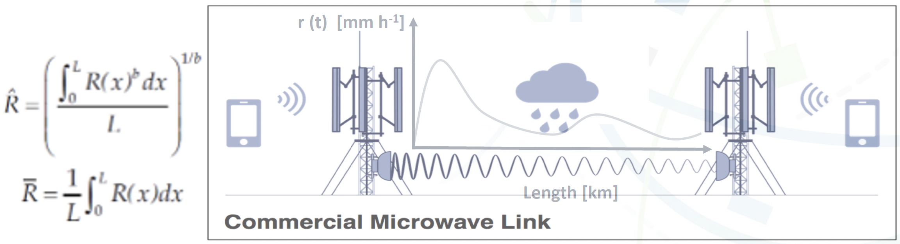

**הצעת פרויקט**

**גילוי משוואות מנתונים להנחתת גשם ולהרטבת אנטנה בלינקים סלולריים**

Discovering the Laws of Microwave-Link Attenuation

יונתן הבר ויהונתן ציצלוק

1.  **נושא הפרויקט ותחומו:**

מידול מבוסס נתונים של הנחתת אות הנגרמת מגשם בקווי Commercial Microwave Links (CML), במטרה לפתח תיאור כללי ומדויק יותר של הקשר בין הגשם, אורך הקו וההנחתה הנמדדת. הפרויקט יתמקד הן בהרחבת המודל המקובל להנחתת גשם עבור אורכי קו שונים, והן במידול נפרד של Wet Antenna Attenuation (WAA), ההנחתה הנובעת מהצטברות מים על מעטפת האנטנה. הפרויקט מתבצע במעבדת CellEnMon לחישה סביבתית אופורטוניסטית, ומשלב עיבוד אותות עם גילוי משוואות מתוך נתונים בשיטות Symbolic Regression ו-SINDy.

2.  **תוכן הפרויקט:**

קווי CML הם לינקים סלולריים הפועלים בתדרי מיקרוגל, שבהם גשם לאורך מסלול ההתפשטות גורם להנחתה מדידה של האות. תכונה זו מאפשרת להשתמש בתשתית התקשורת הקיימת כחיישן אופורטוניסטי לגשם \[5\]. באופן עקרוני, ההנחתה הנגרמת מגשם היא אינטגרל על פני מסלול הלינק: כל מקטע $dx$ לאורך המסלול מנחית את האות ב-$a{R(x,t)}^{b}dx$, והלינק סוכם את התרומות של כל המקטעים (איור 1). מאחר שפילוג הגשם לאורך המסלול אינו ידוע, נהוג לקרב את האינטגרל באמצעות קצב גשם מייצג $\overline{R}$, ממוצע הגשם לאורך המסלול, ולקבל את חוק החזקה המקובל:

$$A_{rain}(t) = \int_{0}^{L}{a{R(x,t)}^{b}dx} \approx a{\overline{R}(t)}^{b}L$$

כאשר $R(x,t)$ הוא קצב הגשם המקומי בנקודה $x$ לאורך המסלול, $L$ הוא אורך הקו, והמקדמים $a$ ו-$b$ תלויים בתדר ובפולריזציה של הלינק. הקירוב מדויק רק כאשר הגשם אחיד לאורך המסלול.

איור 1: אינטגרל המסלול. הגשם משתנה לאורך הלינק ואינו ידוע. לינק בודד מחזיר את $\widehat{R}$ (משמאל למעלה), שמקרב את ממוצע הגשם לאורך המסלול $\overline{R}$ (משמאל למטה). מקור: \[להוסיף\].

מודל זה שימושי, אך אינו מתאר בהכרח היטב את כל תחומי אורכי הקו. עבור קווים ארוכים, הגשם הוא תופעה מקומית ואינו אחיד לאורך כל המסלול, ולכן ההנחה שההנחתה גדלה באופן לינארי עם $L$ עלולה להישבר. מצד שני, גם עבור קווים קצרים נצפות סטיות מהמודל, ובמקרה זה חלק משמעותי מההנחתה עשוי לנבוע מתופעות נוספות שאינן קשורות ישירות להנחתת הגשם לאורך המסלול.

אחת התופעות המרכזיות היא WAA, הנגרמת מהצטברות מים על מעטפת האנטנה בזמן גשם ומהתייבשותה לאחר מכן. בניגוד להנחתת הגשם לאורך המסלול, WAA הוא אפקט מקומי הקשור לאנטנות עצמן, ולכן אינו צפוי להיות תלוי באורך הקו באותו אופן. בנוסף, מדובר בתהליך דינמי בעל זיכרון, מאחר שההנחתה עשויה להישאר גם לאחר שהגשם נחלש או נפסק.

לכן נתאר את ההנחתה הנמדדת $A(t)$ (ההפרש בין עוצמת השידור TSL לעוצמת הקליטה RSL, לאחר הפחתת קו הבסיס) כסכום של הנחתת הגשם לאורך המסלול ושל רכיב כללי $\delta(t)$, הכולל את התרומות שאינן נובעות מגשם לאורך המסלול, כגון WAA ושארית של קו הבסיס (baseline):

$$A(t) = A_{rain}(t) + \delta(t)$$

בשלב הראשון של הפרויקט נתמקד במידול WAA, שהוא הרכיב הראשון של $\delta(t)$ שנמדל. כדי לבודד את רכיב ה-WAA מתוך המדידות נשתמש בזנב ההתייבשות שלאחר סיום הגשם: בפרק זמן זה הנחתת הגשם לאורך המסלול מתאפסת, וההנחתה שנותרת נובעת מ-WAA. גישה זו עדיפה על בחירת קווים שבהם חוק החזקה מתאר היטב את המדידות, שכן בחירה כזו מניחה מראש את המודל שאותו אנו מבקשים לבחון, ולכן היא מעגלית. המטרה תהיה לזהות מודל אמין של תהליכי ההירטבות והייבוש של האנטנות ולהשוות אותו למודלים קיימים מהספרות \[1\], \[9\]. מאחר שמדובר בתהליך דינמי, נבחן שימוש ב-SINDy \[6\] לצורך גילוי משוואות המתארות את ההתפתחות בזמן.

בשלב השני נבחן את הרחבת מודל הנחתת הגשם עצמו. במקום להניח מראש שהקשר הוא תמיד $A_{rain} = a{\overline{R}}^{b}L$, נבחן תיאור כללי יותר מהצורה

$$A_{rain}(t) = a{\overline{R}(t)}^{b}f\left( L,\overline{R},Z \right)$$

כאשר $f$ היא פונקציית תיקון שאותה ננסה לזהות מתוך הנתונים, ו-$Z$ מייצג מאפיינים של המסלול ושל הלינק: אי-אחידות הגשם לאורך המסלול, תדר ופולריזציה, ורזולוציית הזמן של המדידה. בגשם אחיד מתקבל $f = L$, כלומר חוק החזקה המקובל הוא מקרה פרטי של הצורה הכללית. המטרה היא להבין כיצד משתנה בפועל התלות באורך הקו, ובמידת הצורך גם בפרמטרים פיזיקליים נוספים.

בשלב זה נשתמש במודל ה-WAA שנבנה בשלב הראשון כדי להפריד בין ההנחתה הנגרמת מהגשם לאורך המסלול לבין תרומת האנטנות. הפרדה זו חיונית, שכן WAA קבוע נראה כמו $f = L + L_{0}$, כלומר כתוספת קבועה לאורך הקו. לכן יש לבודד את ה-WAA לפני למידת $f$, אחרת פונקציית התיקון תבלע אותו ותפרש אותו בטעות כתלות באורך הקו.

המטרה שלנו היא מודל פיזיקלי מפורש של המסלול ושל ההנחתה, ולא רק חיזוי. אפשר בהחלט להשתמש במודל black‑box כדי ללמוד את הקשר בין המדידות לגשם, אך מודל כזה עשוי לספק חיזוי טוב בלי להסביר את המנגנונים הפיזיקליים שמייצרים את ההנחתה. לעומת זאת, משוואה קריאה מסבירה את המנגנון, ניתנת לבדיקה מול הפיזיקה, וניתנת להעברה בין לינקים ורשתות גם כאשר הנתונים מועטים. מצד שני, אין תיאור אנליטי סגור שמסביר באופן מלא את כל התופעות הרלוונטיות. לכן נשתמש בגישת ביניים – gray‑box – המשלבת ידע פיזיקלי קיים עם גילוי מבוסס נתונים של הקשרים והדינמיקה החסרים. לצד הפרשנות הפיזיקלית נבחן גם את הביצועים: אומדן הגשם שיתקבל יושווה לחוק החזקה, למודלי WAA מהספרות \[1\], \[9\] ולמודל black‑box \[11\].

לזיהוי הקשר הסטטי בין ההנחתה, קצב הגשם ואורך הקו נשתמש ב-Symbolic Regression באמצעות ספריית PySR \[7\], במטרה לקבל ביטוי מתמטי מפורש עבור פונקציית התיקון $f$. עבור רכיבים דינמיים, ובעיקר WAA, נשתמש ב-SINDy \[6\] לצורך זיהוי משוואות המתארות את ההתפתחות בזמן. מאחר שמדידות ה-CML מקוונטטות (למשל, ב-OpenMRG עוצמת הקליטה נמדדת ברזולוציה של 0.3 dB ועוצמת השידור ברזולוציה של 1 dB \[13\]), נשתמש בגרסת weak‑form SINDy \[10\], העמידה יותר לרעש ולקוונטיזציה משום שאינה דורשת גזירה ישירה של האות הנמדד.

לפני שלבי המידול ייבנה pipeline לעיבוד הנתונים, שיכלול שליפה וארגון של מדידות CML והמטא-דאטה שלהן, סנכרון מול נתוני גשם חיצוניים, הערכת קו הבסיס (baseline) \[8\], זיהוי אירועי גשם, טיפול ברעש ובערכים חריגים, ובחירת הקווים המתאימים לכל אחד משלבי המחקר. כייחוס לגשם נעדיף נתוני מכ"ם לאורך מסלול הלינק על פני מד גשם נקודתי, שכן המכ"ם מייצג את הגשם על פני המסלול כולו ולא בנקודה בודדת. בנוסף ייבנה סימולטור שבו האמת ידועה, וכל שיטה תיבדק תחילה על נתונים מסומלצים ורק לאחר מכן תופעל על נתוני אמת.

3.  **תוצרי פרויקט סופיים:**

• pipeline לשליפה, ניקוי, סנכרון ועיבוד של נתוני ה-CML הגולמיים וה-metadata שלהם מתוך בסיסי הנתונים הקיימים.

• סימולטור לבדיקת השיטות מול אמת ידועה, הכולל שדות גשם, לינקים באורכים שונים, מודל WAA, רעש וקוונטיזציה.

• מודל דינמי ל-WAA, שיתקבל מתוך המדידות באמצעות אלגוריתמים מבוססי נתונים.

• מודל מורחב להנחתת גשם בקווי CML, שיתאר את התלות באורך הקו (ואולי גם בגורמים נוספים) מעבר לקירוב $A_{rain} = a{\overline{R}}^{b}L$.

• השוואה כמותית בין המודלים שיתקבלו לבין המודלים המקובלים בספרות, ובחינת תחומי התוקף שלהם.

• דוח מסכם הכולל את שיטת העבודה, התוצאות, המגבלות והמסקנות.

4.  **אופן מימוש הפרויקט:**

תוכנה: הפיתוח יתבצע ב-Python, תוך שימוש בכלים ובפורמטים המקובלים בתחום:

• עיבוד וארגון נתונים: NumPy, pandas, xarray, NetCDF.

• עיבוד נתוני CML: pycomlink ו-poligrain.

• גילוי מודלים: PySR עבור קשרים סטטיים, ו-SINDy (בגרסת weak‑form) עבור מודלים דינמיים.

נתונים: העבודה תתבסס על בסיסי הנתונים הפתוחים OpenMRG \[13\] ו-OpenMesh, בהתאם למוסכמות (conventions) של רשת OpenSense. בנוסף נשתמש ב-OpenRainER \[12\], הכולל נתוני לינקים, מדי גשם ומכ"ם מאזור אמיליה-רומאניה שבאיטליה. לגבי OpenMesh, נבדוק תחילה את זמינות נתוני ייחוס הגשם לפני שנתחייב לשימוש בו.

חומרה: העבודה תתבצע על מחשבים אישיים ובמשאבי המחשוב הקיימים במעבדה.

5.  **מצב הפרויקט היום ומימושים עליהם ניתן להתבסס:**

במעבדת CellEnMon קיימת פעילות מחקרית מתמשכת בתחום החישה הסביבתית באמצעות CML, וניתן להתבסס על תשתיות קיימות לאיסוף ועיבוד המדידות. בנוסף, קיימים מאגרי נתונים פתוחים כגון OpenMRG, OpenMesh ו-OpenRainER, וכלים כגון pycomlink, המספקים בסיס ל-pipeline של הפרויקט.

תופעת ה-WAA נחקרה במספר עבודות קודמות. Schleiss ועמיתיו הציעו מודל דינמי של תהליכי ההירטבות והייבוש \[1\], Pastorek ועמיתיו השוו גישות מעשיות לתיקון WAA במדידות CML \[9\], וניסוי ATTRRA2 הציג מדידות ישירות שהראו כי הדינמיקה בפועל עשויה להיות מורכבת יותר מהמודלים הקיימים \[2\]. בסקירה שביצענו לא מצאנו שימוש ב-SINDy לצורך גילוי מודל דינמי ל-WAA ישירות מתוך מדידות CML.

גם השפעת אורך הקו על מודל ה-power law נחקרה בעבר. Berne ו-Uijlenhoet בחנו את השגיאה הנובעת מאי-אחידות הגשם לאורך המסלול \[3\], ו-Leijnse ועמיתיו בחנו באופן מפורש את השפעת אורך הקו וה-WAA על הערכת הגשם \[4\]. קיימים גם תיקונים המבוססים על effective path length, המבטאים את העובדה שאורך המסלול האפקטיבי בגשם אינו בהכרח שווה לאורך הקו הפיזי. עם זאת, בסקירה שביצענו לא מצאנו שימוש ב-Symbolic Regression (PySR) לצורך למידה ישירה של תיקון מפורש לתלות באורך הקו. הפרויקט יתבסס על הידע הקיים, תוך בחינת ה-WAA באמצעות SINDy והרחבת ה-power law באמצעות PySR.

6.  **תכולת העבודה הנדרשת ובחינת הצלחה:**

**תכולת העבודה:**

• נתונים: הורדת OpenMRG ו-OpenRainER והרצת ה-notebook של OpenSense, התאמה בין כל לינק לנתוני המכ"ם לאורך המסלול שלו ולמד הגשם הקרוב אליו, וחלוקת האירועים לקבוצות אימון ובדיקה.

• סימולטור: יצירת שדות גשם עם גודל תא מבוקר, חישוב האינטגרל המדויק לאורך כל לינק, והוספת מודל WAA ידוע, רעש וקוונטיזציה.

• שלב 1 (WAA): זיהוי לינקים עם זנב התייבשות, התאמת מודלים מהספרות לכל לינק \[1\], \[9\], למידת מודל דינמי באמצעות weak‑form SINDy עם הגשם כקלט, והשוואה בין לינקים – האם מתקבלת אותה צורה עם מקדמים שונים, או חוקים שונים.

• שלב 2 (חוק המסלול): השוואה בין האינטגרל המדויק לחוק הליניארי בסימולציה, למידת $f\left( L,\overline{R},Z \right)$ באמצעות PySR, והרצה על נתוני אמת עם נתוני מכ"ם לאורך המסלול כייחוס.

• אומדן גשם: היפוך המודל המשולב (הנחתת גשם ו-WAA) לקבלת אומדן גשם, ובחינתו על אירועים שלא שימשו לאימון.

**בחינת הצלחה:**

• בסימולציה: שחזור האיברים והמקדמים הנכונים, כתלות ברמת הרעש, בקוונטיזציה ובאורך הלינק.

• בנתוני אמת: הטיה מנורמלת ו-RMSE מנורמל של הגשם המשוחזר מול מדי גשם ומכ"ם, בפילוח לפי אורך הלינק ובהשוואה למודלים מהספרות. בנוסף, כמות הגשם הכוזב לאחר סיום אירועים – מדד שנגדיר במסגרת הפרויקט.

• עקביות פיזיקלית: השוואה בין זמן ההתייבשות שנלמד ב-SINDy לבין זמן ההתייבשות המוערך ישירות מזנבות ההתייבשות, ובדיקת יציבות האיברים שנלמדו בין לינקים ואירועים שונים (bootstrap).

> **מקורות**
>
> \[1\] Schleiss, M., Rieckermann, J., & Berne, A. (2013). “Quantification and Modeling of Wet-Antenna Attenuation for Commercial Microwave Links.” IEEE Geoscience and Remote Sensing Letters, 10(5), 1195–1199. DOI: 10.1109/LGRS.2012.2236074.
>
> \[2\] Tiede, J., Chwala, C., & Siart, U. (2023). “New Insights Into the Dynamics of Wet Antenna Attenuation Based on In Situ Estimations Provided by the Dedicated Field Experiment ATTRRA2.” IEEE Geoscience and Remote Sensing Letters, 20. DOI: 10.1109/LGRS.2023.3320755.
>
> \[3\] Berne, A., & Uijlenhoet, R. (2007). “Path-Averaged Rainfall Estimation Using Microwave Links: Uncertainty Due to Spatial Rainfall Variability.” Geophysical Research Letters, 34. DOI: 10.1029/2007GL029409.
>
> \[4\] Leijnse, H., Uijlenhoet, R., & Stricker, J. N. M. (2008). “Microwave Link Rainfall Estimation: Effects of Link Length and Frequency, Temporal Sampling, Power Resolution, and Wet Antenna Attenuation.” Advances in Water Resources, 31(11), 1481–1493. DOI: 10.1016/j.advwatres.2008.03.004.
>
> \[5\] Messer, H., Zinevich, A., & Alpert, P. (2006). “Environmental Monitoring by Wireless Communication Networks.” Science, 312(5774), 713. DOI: 10.1126/science.1120034.
>
> \[6\] Brunton, S. L., Proctor, J. L., & Kutz, J. N. (2016). “Discovering Governing Equations from Data by Sparse Identification of Nonlinear Dynamical Systems.” Proceedings of the National Academy of Sciences, 113(15), 3932–3937. DOI: 10.1073/pnas.1517384113.
>
> \[7\] Cranmer, M. (2023). “Interpretable Machine Learning for Science with PySR and SymbolicRegression.jl.” arXiv:2305.01582.
>
> \[8\] Ostrometzky, J., & Messer, H. (2018). “Dynamic Determination of the Baseline Level in Microwave Links for Rain Monitoring From Minimum Attenuation Values.” IEEE Journal of Selected Topics in Applied Earth Observations and Remote Sensing.
>
> \[9\] Pastorek, J., Fencl, M., Rieckermann, J., & Bareš, V. (2021). “Precipitation Estimates From Commercial Microwave Links: Practical Approaches to Wet-Antenna Correction.” IEEE Transactions on Geoscience and Remote Sensing. DOI: 10.1109/TGRS.2021.3110004.
>
> \[10\] Messenger, D. A., & Bortz, D. M. (2021). “Weak SINDy: Galerkin-Based Data-Driven Model Selection.” Multiscale Modeling & Simulation, 19(3), 1474–1497. DOI: 10.1137/20M1343166.
>
> \[11\] Habi, H. V., & Messer, H. (2020). “Recurrent Neural Network for Rain Estimation Using Commercial Microwave Links.” IEEE Transactions on Geoscience and Remote Sensing.
>
> \[12\] Covi, E., Roversi, G., & Nebuloni, R. (2026). “OpenRainER: An Open-Source Dataset for Studying the Opportunistic Sensing of Rainfall in Emilia-Romagna, Italy.” Earth System Science Data Discussions (preprint). DOI: 10.5194/essd-2026-160. Data: https://zenodo.org/records/14731404.
>
> \[13\] Andersson, J. C. M., Olsson, J., van de Beek, R. (C. Z.), & Hansryd, J. (2022). “OpenMRG: Open Data from Microwave Links, Radar, and Gauges for Rainfall Quantification in Gothenburg, Sweden.” Earth System Science Data, 14, 5411–5426. DOI: 10.5194/essd-14-5411-2022.
