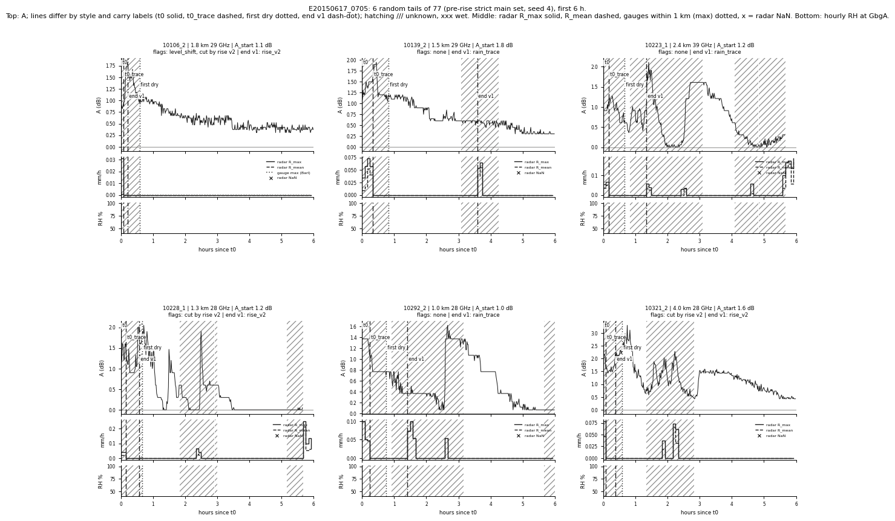
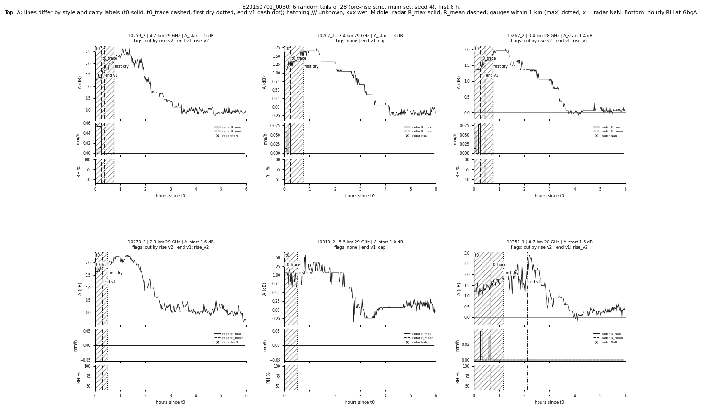
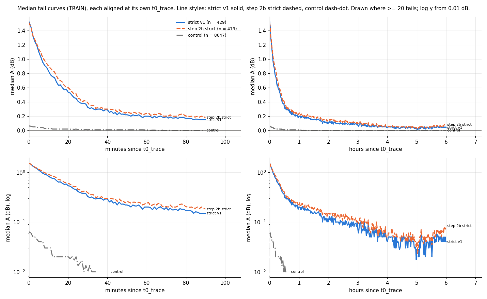

# WAA_estm step 2c: last fixes and the frozen tail set v1 (TRAIN only)

Written by `research/WAA_estm/step2c_freeze.py` (settings `waa.freeze`; the rules of steps 2 and 2b stay). No fitting.
TRAIN events for every number and figure; VAL gets the same rules and files and is only counted. Run time
31 s.

## 1-2. Radar NaN as unknown, rise cut v2

Changes on the 11347 kept step 2 TRAIN tails (`research/WAA_estm/outputs/tables/step2c_changes.csv`; minutes = tail time moved / removed):

| what | tails | minutes |
|---|---|---|
| kept step 2 TRAIN tails | 11347 |  |
| t0_trace moved by the radar-NaN rule | 149 | 7785.0 |
| strict end moved earlier by the radar-NaN rule (before the rise cut) | 1329 | 452000.0 |
| rise v2 detected | 2338 |  |
| end set by rise v2 (cut_by_rise_v2) | 1864 | 333809.0 |
|   of them in the pre-rise main set | 130 | 30971.0 |
| pre-rise main set (after rule 1) | 474 | 213718.0 |
| main set v1 (after rules 1-2) | 429 | 182163.0 |
| step 2b strict main set (reference) | 479 | 220428.0 |

Rise cut v2 (from t0_trace, all minutes, 10 min trailing median >= 0.6 dB above the running minimum for >= 10 min;
cut at the last minute before that run with an excess < 0.15 dB): pre-rise main-set tails that drop below
60 min usable because of it: 45. End of the v1 main-set tails: {'rain_trace': 165, 'cap': 133, 'rise_v2': 85, 'next_wet': 34, 'radar_nan': 7, 'dry_rise': 5}.

## 3. Event diagnostics (TRAIN, `research/WAA_estm/outputs/tables/step2c_events.csv`)

Per event: tails in the pre-rise main set and in v1, links, share of the pre-rise tails whose end is set by the
rise cut v2, share of v1 tails with level_shift or undershoot, radar valid fraction on the paths over
[event start, event end + 6 h], local hours (UTC + 2 h), mean weather at t0 (GbgA).
`event_rise_heavy` = share cut by rise > 30%: 9 events (E20150605_1745, E20150617_0705, E20150628_0530, E20150701_0030, E20150704_2125, E20150705_1910, E20150712_2255, E20150731_1440, E20150802_0400).

| event_id | start_hour_local | end_hour_local | median_t0_trace_hour_local | tails_before_rise_cut | tails_v1 | links_v1 | share_cut_by_rise_v2 | share_level_flags_v1 | radar_valid_fraction | mean_T_t0_c | mean_RH_t0_pct | mean_wind_t0_ms | event_rise_heavy |
|---|---|---|---|---|---|---|---|---|---|---|---|---|---|
| E20150605_1745 | 19 | 12 | 10.0 | 5 | 5 | 4 | 0.4 | 0.0 | 0.986 | 16.8 | 72.6 | 4.1 | True |
| E20150607_0245 | 4 | 16 | 10.0 | 6 | 6 | 3 | 0.167 | 0.167 | 1.0 | 12.9 | 75.3 | 4.8 | False |
| E20150617_0705 | 9 | 23 | 22.0 | 77 | 54 | 40 | 0.429 | 0.056 | 0.934 | 13.0 |  | 4.0 | True |
| E20150628_0530 | 7 | 11 | 10.0 | 57 | 56 | 37 | 0.649 | 0.143 | 1.0 | 14.1 | 94.1 | 1.8 | True |
| E20150701_0030 | 2 | 3 | 3.0 | 28 | 15 | 12 | 0.571 | 0.0 | 1.0 | 13.2 |  | 0.8 | True |
| E20150704_2125 | 23 | 1 | 1.0 | 1 | 1 | 1 | 1.0 | 0.0 | 0.691 | 20.7 | 77.0 | 0.8 | True |
| E20150705_1910 | 21 | 15 | 12.0 | 15 | 15 | 13 | 0.467 | 0.6 | 0.997 | 19.1 | 72.9 | 6.4 | True |
| E20150707_1235 | 14 | 15 | 10.0 | 3 | 3 | 2 | 0.0 | 0.0 | 0.998 | 13.9 | 86.7 | 4.1 | False |
| E20150712_2255 | 0 | 11 | 7.0 | 15 | 13 | 8 | 0.333 | 0.077 | 1.0 | 15.4 | 87.7 | 2.1 | True |
| E20150725_0440 | 6 | 23 | 17.0 | 4 | 4 | 4 | 0.25 | 0.0 | 0.989 | 14.5 | 83.2 | 5.4 | False |
| E20150727_2140 | 23 | 14 | 11.0 | 21 | 21 | 16 | 0.048 | 0.048 | 0.999 | 15.4 | 92.3 | 3.5 | False |
| E20150731_1440 | 16 | 18 | 17.0 | 2 | 1 | 1 | 0.5 | 0.0 | 1.0 | 17.1 | 70.0 | 5.4 | True |
| E20150802_0400 | 6 | 16 | 15.5 | 4 | 4 | 4 | 0.5 | 0.0 | 1.0 | 16.6 | 76.2 | 3.5 | True |
| E20150803_0210 | 4 | 9 | 5.0 | 8 | 8 | 6 | 0.125 | 0.375 | 1.0 | 9.3 | 93.0 | 1.3 | False |
| E20150804_1830 | 20 | 8 | 7.0 | 120 | 115 | 72 | 0.167 | 0.052 | 0.999 | 17.9 | 95.0 | 2.3 | False |
| E20150806_0330 | 5 | 9 | 6.0 | 1 | 1 | 1 | 0.0 | 0.0 | 1.0 | 16.2 | 83.0 | 1.4 | False |
| E20150810_1545 | 17 | 12 | 11.0 | 5 | 5 | 4 | 0.0 | 0.0 | 0.994 | 16.8 | 88.8 | 1.3 | False |
| E20150811_2220 | 0 | 5 | 5.0 | 1 | 1 | 1 | 0.0 | 0.0 | 1.0 | 16.2 | 84.0 | 2.6 | False |
| E20150813_0235 | 4 | 6 | 6.0 | 2 | 2 | 1 | 0.0 | 0.5 | 1.0 | 9.4 | 93.0 | 0.8 | False |
| E20150815_1305 | 15 | 6 | 2.0 | 5 | 5 | 4 | 0.0 | 0.6 | 1.0 | 16.4 | 86.8 | 2.4 | False |
| E20150825_0145 | 3 | 1 | 19.0 | 9 | 9 | 8 | 0.0 | 0.444 | 0.998 | 16.8 | 76.8 | 4.8 | False |
| E20150826_0520 | 7 | 16 | 14.0 | 75 | 75 | 49 | 0.027 | 0.107 | 1.0 | 16.6 | 95.0 | 2.6 | False |
| E20150826_1620 | 18 | 4 | 2.0 | 7 | 7 | 7 | 0.0 | 0.143 | 1.0 | 16.3 | 83.7 | 3.9 | False |
| E20150829_0545 | 7 | 8 | 8.0 | 3 | 3 | 2 | 0.0 | 0.333 | 1.0 | 15.9 | 84.3 | 3.6 | False |

**E20150617_0705** (77 pre-rise tails, 6 shown):

**E20150701_0030** (28 pre-rise tails, 6 shown):

## 4. Frozen set v1

Files: `research/WAA_estm/outputs/products/tails_model.parquet` (243378 1 min rows), `research/WAA_estm/outputs/products/tails_model_index.csv`; alternative:
`research/WAA_estm/outputs/products/tails_model_alt.parquet` (703169 rows), `research/WAA_estm/outputs/products/tails_model_alt_index.csv`. Rules: README.md, "Tail set v1".

| index | tails | sub-links | links | events |
|---|---|---|---|---|
| main, train | 429 | 249 | 159 | 24 |
| main, val | 123 | 96 | 76 | 9 |
| alternative (>= 0.6 dB), train | 1155 | 368 | 212 | 34 |
| alternative (>= 0.6 dB), val | 458 | 263 | 170 | 12 |

TRAIN main-set tails per event: median 6, max 115 (E20150804_1830); events with 1-2
tails: 5 of 24. The largest events: {'E20150804_1830': 115, 'E20150826_0520': 75, 'E20150628_0530': 56, 'E20150617_0705': 54, 'E20150727_2140': 21}.
Flags in the TRAIN main set: level_shift 29, undershoot
23, event_rise_heavy 164.

## 5. Median curve

`research/WAA_estm/outputs/tables/step2c_median_curves.csv`.

## Unclear

1. **level_shift and undershoot are the step 2b values**: level_shift uses t0 and the lenient end, undershoot uses the
   step 2b t0_trace. They were not recomputed for the v1 start / end.
2. **The rise cut v2 runs on unknown minutes too**, so a rise caused by light rain the radar missed is cut (as
   intended), but also a real late WAA rise (dew?) is cut; the two cannot be told apart here.
3. **The rise cut can end a tail at t0_trace** (no quiet minute before the run): such tails get usable 0 and leave the
   set; this is a selection on the early shape of A, though by a fixed rule.
4. **Radar NaN** now blocks the start and ends the strict tail; links / hours with many NaN radar bins lose tails.
   Gauge NaN is still "no trace".
5. **Event shares are small-number statistics**: events with 1-3 pre-rise tails can reach 0 % or 100 % by chance; the
   30% rule then flags a whole event.
6. **VAL events** get `event_rise_heavy` from the same rule, computed on their own tails (not inspected).
7. **Humidity is missing at GbgA** for 102 hours (all in June), including all of
   17-18 June and 30 June - 1 July 06 UTC, i.e. during both events looked at: 69
   TRAIN main-set tails have no RH at t0, and the RH panels of the look figures are empty there.
8. **What the rise cut v2 removes differs by event** (look figures, seed 4, observation only):
   in E20150617_0705 the rises come with new radar traces (rain returning), so the cut is right. In E20150701_0030 (night,
   ~02-03 local) A RISES by 0.5-1 dB right after t0_trace with no radar or gauge trace, stays up 1-2 h, then decays;
   the cut ends these tails within minutes. That can be drizzle below the radar beam (radar 78 km away) or
   condensation on wet radomes; with RH missing these hours the data here cannot decide.
9. **File names** carry no version (`ORGANIZATION.md` forbids `_v1` on active paths): the set id `v1` is in
   config `waa.freeze.tail_set` and in the `tail_set` column of every frozen file.
