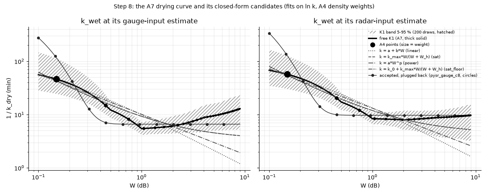

# Step 8: naming the drying law

Written by `research/waa_ksurface/a8_name.py` (decisions.md, "Step 8: naming the drying law", logged before the run). Real TRAIN data of the 14 learning events (the A7 setting; A7 flag: 0 removed). VAL and TEST were not opened.

## 1. The input

30 points (the A4 drying W bins, pooled), weight = A4 minutes scaled to mean 1; y = ln k_dry of the A7 K1 fit. The 0-0.3 dB bin carries 17.3 of 30.

Band: 400 bootstrap K1 refits; code check against the stored A7 draws: REPRODUCED (largest relative difference 0.0e+00).

| W (dB) | A4 minutes | weight | 1/k_dry K1 gauge (min) | 1/k_dry K1 radar (min) | band gauge 5-95 % (min) | band radar 5-95 % (min) |
|---|---|---|---|---|---|---|
| 0.15 | 603585 | 17.3249 | 46.0893 | 56.835 | 24.4 to 112.0 | 30.2 to 125.8 |
| 0.45 | 130284 | 3.7396 | 14.7309 | 20.3174 | 10.0 to 23.2 | 13.7 to 32.1 |
| 0.75 | 76872 | 2.2065 | 8.1428 | 11.9597 | 5.9 to 11.2 | 9.2 to 15.8 |
| 1.05 | 51958 | 1.4914 | 5.4716 | 8.3363 | 4.2 to 7.3 | 6.6 to 10.9 |
| 1.35 | 33640 | 0.9656 | 5.6434 | 8.2155 | 4.3 to 7.7 | 6.3 to 11.1 |
| 1.65 | 24371 | 0.6995 | 5.8206 | 8.0965 | 4.4 to 8.5 | 5.9 to 11.2 |
| 1.95 | 21016 | 0.6032 | 6.0034 | 7.9792 | 4.4 to 9.1 | 5.3 to 11.7 |
| 2.25 | 21695 | 0.6227 | 6.324 | 8.051 | 4.5 to 9.8 | 5.1 to 11.8 |
| 2.55 | 18362 | 0.5271 | 6.6899 | 8.1617 | 4.5 to 10.3 | 5.0 to 11.8 |
| 2.85 | 14848 | 0.4262 | 7.0769 | 8.274 | 4.5 to 11.2 | 4.7 to 11.7 |
| 3.15 | 12035 | 0.3454 | 7.4864 | 8.3879 | 4.6 to 12.0 | 4.6 to 11.9 |
| 3.45 | 9231 | 0.265 | 7.9195 | 8.5033 | 4.6 to 12.9 | 4.3 to 11.8 |
| 3.75 | 7141 | 0.205 | 8.3777 | 8.6203 | 4.6 to 13.9 | 4.1 to 11.8 |
| 4.05 | 5231 | 0.1501 | 8.8133 | 8.7282 | 4.8 to 14.9 | 3.9 to 12.0 |
| 4.35 | 3785 | 0.1086 | 9.0175 | 8.7834 | 4.9 to 15.3 | 3.8 to 12.0 |
| 4.65 | 2813 | 0.0807 | 9.2264 | 8.839 | 4.9 to 15.7 | 3.7 to 12.2 |
| 4.95 | 2016 | 0.0579 | 9.4401 | 8.8949 | 5.0 to 16.0 | 3.7 to 12.3 |
| 5.25 | 1530 | 0.0439 | 9.6588 | 8.9512 | 5.0 to 16.4 | 3.7 to 12.5 |
| 5.55 | 1136 | 0.0326 | 9.8825 | 9.0078 | 5.0 to 16.7 | 3.6 to 12.8 |
| 5.85 | 800 | 0.023 | 10.1114 | 9.0648 | 5.1 to 17.0 | 3.6 to 13.0 |
| 6.15 | 633 | 0.0182 | 10.3457 | 9.1221 | 5.1 to 17.7 | 3.6 to 13.1 |
| 6.45 | 496 | 0.0142 | 10.5853 | 9.1799 | 5.1 to 18.4 | 3.5 to 13.3 |
| 6.75 | 412 | 0.0118 | 10.8305 | 9.2379 | 5.1 to 19.1 | 3.5 to 13.6 |
| 7.05 | 309 | 0.0089 | 11.0814 | 9.2964 | 5.2 to 19.9 | 3.5 to 13.8 |
| 7.35 | 252 | 0.0072 | 11.3381 | 9.3552 | 5.2 to 20.6 | 3.4 to 14.1 |
| 7.65 | 216 | 0.0062 | 11.6007 | 9.4144 | 5.2 to 21.1 | 3.3 to 14.4 |
| 7.95 | 194 | 0.0056 | 11.8695 | 9.4739 | 5.2 to 21.6 | 3.3 to 14.7 |
| 8.25 | 150 | 0.0043 | 12.1444 | 9.5339 | 5.2 to 21.9 | 3.2 to 15.0 |
| 8.55 | 91 | 0.0026 | 12.4257 | 9.5942 | 5.2 to 22.3 | 3.2 to 15.2 |
| 8.85 | 73 | 0.0021 | 12.7136 | 9.6549 | 5.2 to 22.8 | 3.2 to 15.3 |

## 2. Candidates (AICc on the same weighted points)

PySR: 63 equations from 10 searches; 14 on the per-estimate fronts; 11 distinct expressions kept as candidates. Rule: the fewest parameters within 2 of the best Delta_max wins; trial order = the chosen form, then the (p, Delta_max) front by Delta_max (Delta_max <= 10, at most 6).

| name | source | p | aicc_gauge | daicc_gauge | aicc_radar | daicc_radar | dmax | front | best | chosen | trial | formula_radar |
|---|---|---|---|---|---|---|---|---|---|---|---|---|
| linear | physics | 2 | -55.799 | 112.22 | -71.78 | 137.836 | 137.836 | False | False | False | -1 | k = a + b*W  with  a (1/min) = 0.008276, b (1/(min dB)) = 0.06715 |
| sat | physics | 2 | -85.667 | 82.352 | -117.164 | 92.451 | 92.451 | False | False | False | -1 | k = k_max*W/(W + W_h)  with  k_max (1/min) = 0.229, W_h (dB) = 1.724 |
| power | physics | 2 | -66.016 | 102.003 | -87.011 | 122.604 | 122.604 | False | False | False | -1 | k = a*W^p  with  a (1/(min dB^p)) = 0.0761, p = 0.7397 |
| sat_floor | physics | 3 | -82.99 | 85.029 | -114.487 | 95.128 | 95.128 | False | False | False | -1 | k = k_0 + k_max*W/(W + W_h)  with  k_0 (1/min) = 9.358e-14, k_max (1/min) = 0.229, W_h (dB) = 1.724 |
| pysr_gauge_c7 | PySR | 2 | -135.854 | 32.165 | -157.446 | 52.17 | 52.17 | False | False | False | -1 | k = W/(W**c0 + c1)  with  c0 = 2.386, c1 = 8.626 |
| pysr_gauge_c9 | PySR | 3 | -159.544 | 8.476 | -156.78 | 52.836 | 52.836 | False | False | False | -1 | k = (W/(W**c1 + c2))**c0  with  c0 = 0.9706, c1 = 2.413, c2 = 9.637 |
| pysr_gauge_c8 | PySR | 3 | -137.341 | 30.678 | -207.053 | 2.562 | 30.678 | True | True | True | 0 | k = c2/(c1 - exp(W*c0))  with  c0 = -4.541, c1 = -0.0849, c2 = -0.0104 |
| pysr_gauge_c1 | PySR | 1 | -3.902 | 164.118 | -6.796 | 202.819 | 202.819 | False | False | False | -1 | k = c0  with  c0 = 0.03455 |
| pysr_gauge_c6 | PySR | 2 | -107.409 | 60.61 | -118.535 | 91.081 | 91.081 | False | False | False | -1 | k = c1*exp(c0/W)  with  c0 = -0.2985, c1 = 0.1267 |
| pysr_radar_c5 | PySR | 2 | -66.016 | 102.003 | -87.011 | 122.604 | 122.604 | False | False | False | -1 | k = W**c1*c0  with  c0 = 0.0761, c1 = 0.7397 |
| pysr_radar_c10 | PySR | 3 | -136.148 | 31.871 | -209.615 | 0.0 | 31.871 | False | False | False | -1 | k = c1*exp(W**2*c0) + c2  with  c0 = -1.977, c1 = -0.1101, c2 = 0.1229 |
| pysr_radar_c6 | PySR | 2 | -99.791 | 68.228 | -131.97 | 77.645 | 77.645 | False | False | False | -1 | k = c1*exp(-W**c0)  with  c0 = -0.5112, c1 = 0.2454 |
| pysr_radar_c3 | PySR | 1 | -50.714 | 117.306 | -58.329 | 151.286 | 151.286 | True | False | False | -1 | k = W*c0  with  c0 = 0.1005 |
| pysr_radar_c7 | PySR | 2 | -124.666 | 43.353 | -172.416 | 37.199 | 43.353 | True | False | False | -1 | k = c0/(W + c1/W)  with  c0 = 0.6021, c1 = 5.087 |
| pysr_radar_c9 | PySR | 3 | -168.019 | 0.0 | -170.818 | 38.797 | 38.797 | False | False | False | -1 | k = c1/(W + c0 + c2/W)  with  c0 = -0.2364, c1 = 0.5526, c2 = 4.726 |

Chosen form: **pysr_gauge_c8**. Trial order: pysr_gauge_c8.

References (review sel_mid, held-out sums recomputed): code check REPRODUCED (largest relative difference 2.2e-16). CV (dB): gauge: K1 0.38746, K0 0.40759; radar: K1 0.38653, K0 0.40490.

## 3. Plug-back

Accept: at BOTH estimates, CV(form) - CV(free K1) <= 0.00291 dB and CV(K0) - CV(form) > 0.00291 dB (intervals reported, not part of the rule).

| trial | form | k_wet estimate | CV form (dB) | CV free K1 (dB) | CV K0 (dB) | form - K1 (dB) | 90 % (form - K1) | K0 - form (dB) | 90 % (K0 - form) | pass | converged |
|---|---|---|---|---|---|---|---|---|---|---|---|
| 0 | pysr_gauge_c8 | gauge | 0.38803 | 0.38746 | 0.40759 | 0.00057 | -0.00342 to +0.00356 | 0.01956 | +0.01631 to +0.02529 | True | False |
| 0 | pysr_gauge_c8 | radar | 0.38808 | 0.38653 | 0.4049 | 0.00155 | -0.00335 to +0.00512 | 0.01682 | +0.01360 to +0.02324 | True | True |

**Accepted: pysr_gauge_c8**.

## 4. The accepted formula, parameters with 90 % event-bootstrap intervals

`k = c2/(c1 - exp(W*c0))`

| k_wet estimate | parameter | value | 5 % | 95 % | draws | converged |
|---|---|---|---|---|---|---|
| gauge | c0 | -18.13226 | -18.21812 | -18.11869 | 200 | 181 |
| gauge | c1 | -0.004 | -0.01102 | -0.00141 | 200 | 181 |
| gauge | c2 | -0.00061 | -0.00191 | -0.00022 | 200 | 181 |
| radar | c0 | -20.4854 | -20.49537 | -20.47032 | 200 | 195 |
| radar | c1 | -0.00384 | -0.01241 | -0.00094 | 200 | 195 |
| radar | c2 | -0.0004 | -0.00136 | -9e-05 | 200 | 195 |

