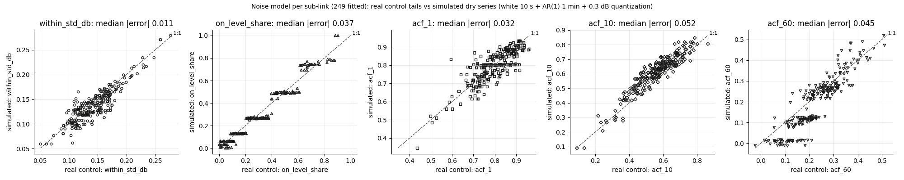
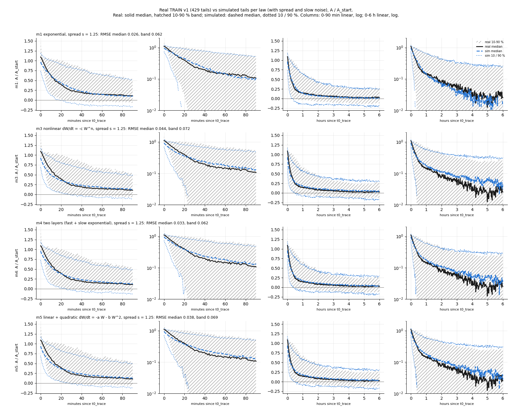
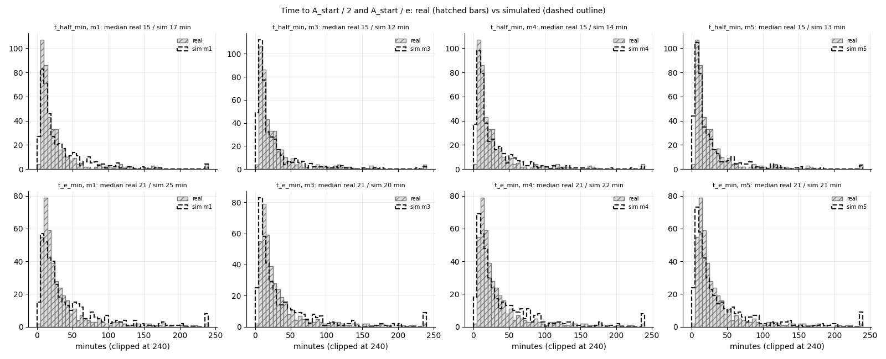
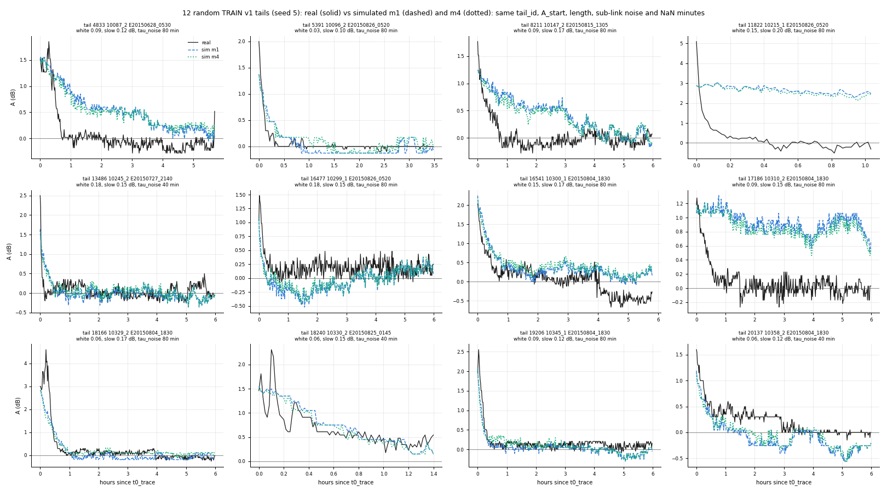
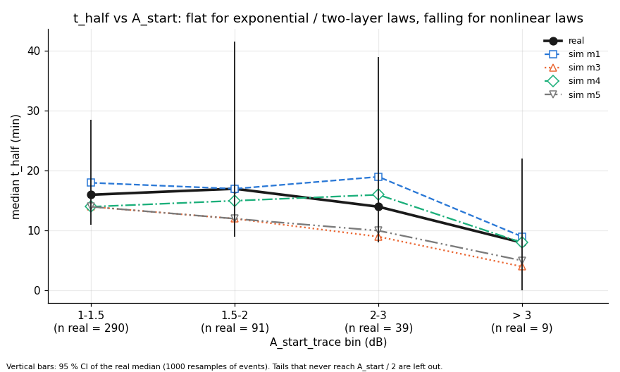

# wet_antenna step 3a-fix: slow noise and a spread for every law (TRAIN v1 skeleton)

Written by `research/wet_antenna/calibrate_simulator.py` (library `research/wet_antenna/simulator.py`, settings `wet_antenna.simulator`); this
replaces the step 3a calibration (m2 dropped: it is m1 with spread). Skeleton = the 429 TRAIN v1 tails.
Switches: {'offset': True, 'noise': True, 'slow_noise': True, 'quantization': True, 'real_nan_mask': True, 'spread': True}. Run time 139 s.

## 1. Slow noise (per sub-link, real control tails)

Noise = 10 s white (sigma_white) + 1 min AR(1) wander (sigma_slow, correlation time tau_noise) + 0.3 dB quantization.
Chosen per sub-link from a lookup grid (4851 points; dry series of 680 min = the median control tail length, 30 per point)
by the summed squared error over 5 targets (scales: std 0.03 dB, on-level 0.05, ACF 0.1).
Fitted: 249 sub-links; median fallback: 0.

| index | real median | sim median | median abs error |
|---|---|---|---|
| within_std_db | 0.141 | 0.134 | 0.011 |
| on_level_share | 0.25 | 0.266 | 0.037 |
| acf_1 | 0.801 | 0.803 | 0.032 |
| acf_10 | 0.572 | 0.629 | 0.052 |
| acf_60 | 0.219 | 0.23 | 0.045 |

Fitted parameters (p10 / median / p90):

| index | p10 | median | p90 |
|---|---|---|---|
| sigma_white_db | 0.03 | 0.09 | 0.18 |
| sigma_slow_db | 0.1 | 0.15 | 0.2 |
| tau_noise_min | 20.0 | 80.0 | 160.0 |

At the grid edge: tau_noise = 1280 min for 9 sub-links, sigma_slow = 0.5 dB for 0.
Before the fix (step 3a, white noise only) the within-tail std was 0.051 dB simulated vs 0.141 dB real.

## 2. Laws with spread

For every s on the grid, the base parameters are fitted to the real median of A / A_start over 0-360 min (noise-free
truth with the spread, same survivors); s is the one whose OBSERVED 10-90 % band (full noise model) is closest to the
real band. Band misfit per s (units of A / A_start):

| s | m1 | m3 | m4 | m5 |
|---|---|---|---|---|
| 0.0 | 0.1657 | 0.1345 | 0.1408 | 0.1361 |
| 0.25 | 0.1553 | 0.1262 | 0.1332 | 0.1266 |
| 0.5 | 0.1322 | 0.1111 | 0.1166 | 0.1095 |
| 0.75 | 0.1046 | 0.0914 | 0.0945 | 0.0893 |
| 1.0 | 0.0767 | 0.0783 | 0.0744 | 0.074 |
| 1.25 | 0.0625 | 0.0717 | 0.062 | 0.0688 |
| 1.5 | 0.0819 | 0.0819 | 0.0716 | 0.0812 |
| 1.75 | 0.1251 | 0.1025 | 0.1024 | 0.1048 |
| 2.0 | 0.1729 | 0.1295 | 0.1449 | 0.1342 |
| 2.5 | 0.2648 | 0.1993 | 0.2306 | 0.2082 |

- **m1** (exponential): tau = 29.75; spread s = 1.25 (time-scale factor 10-90 %: 0.20-4.96)
- **m3** (nonlinear dW/dt = -c W^n): c = 0.05296, n = 2; spread s = 1.25 (time-scale factor 10-90 %: 0.20-4.96)
- **m4** (two layers (fast + slow exponential)): tau_f = 18.73, tau_s = 193, phi = 0.1714; spread s = 1.25 (time-scale factor 10-90 %: 0.20-4.96)
- **m5** (linear + quadratic dW/dt = -a W - b W^2): a = 0.00299, b = 0.04499; spread s = 1.25 (time-scale factor 10-90 %: 0.20-4.96)

## Calibration and misfit (`research/wet_antenna/outputs/tables/calibrate_simulator_calibration.csv`, key)

| law | n_free_params | tau | s | f_10_90 | s_at_grid_edge | rmse_median_truth | rmse_median_observed | rmse_band_observed | c | n | tau_f | tau_s | phi | a | b |
|---|---|---|---|---|---|---|---|---|---|---|---|---|---|---|---|
| m1 | 2 | 29.75393 | 1.25 | 0.20-4.96 | False | 0.0523 | 0.0261 | 0.0625 |  |  |  |  |  |  |  |
| m3 | 2 |  | 1.25 | 0.20-4.96 | False | 0.0268 | 0.044 | 0.0717 | 0.05296 | 2.0 |  |  |  |  |  |
| m4 | 4 |  | 1.25 | 0.20-4.96 | False | 0.0156 | 0.0328 | 0.062 |  |  | 18.72823 | 193.00825 | 0.17142 |  |  |
| m5 | 3 |  | 1.25 | 0.20-4.96 | False | 0.0242 | 0.0381 | 0.0688 |  |  |  |  |  | 0.00299 | 0.04499 |

## 3. Checks (medians; p10 / p90 in `research/wet_antenna/outputs/tables/calibrate_simulator_shape_checks.csv`)

| quantity | real | m1 | m3 | m4 | m5 |
|---|---|---|---|---|---|
| t_half_min | 15.0 | 17.0 | 12.0 | 14.0 | 13.0 |
| t_e_min | 21.0 | 25.0 | 20.0 | 22.0 | 21.0 |
| ratio_10min | 0.568 | 0.572 | 0.462 | 0.51 | 0.475 |
| ratio_30min | 0.229 | 0.28 | 0.255 | 0.274 | 0.268 |
| ratio_60min | 0.143 | 0.132 | 0.181 | 0.173 | 0.184 |
| ratio_180min | 0.048 | 0.03 | 0.073 | 0.064 | 0.064 |
| last_hour_std_db | 0.083 | 0.088 | 0.087 | 0.088 | 0.089 |

Last-hour std p90: real 0.135, m1 0.148, m3 0.149, m4 0.149, m5 0.149 dB. Not reached (t_half / t_e):
real: 12 / 19, m1: 9 / 14, m3: 7 / 10, m4: 7 / 11, m5: 10 / 11.

## 4. t_half per A_start bin (`research/wet_antenna/outputs/tables/calibrate_simulator_thalf_by_astart.csv`)

Exponential (m1) and two-layer (m4) laws give the same t_half for every A_start; nonlinear laws (m3, m5) give shorter
t_half for larger A_start. Median t_half (min); real with a 95 % CI from resampling events:

| A_start_bin_db | real | m1 | m3 | m4 | m5 |
|---|---|---|---|---|---|
| 1-1.5 | 16.0 | 18.0 | 14.0 | 14.0 | 14.0 |
| 1.5-2 | 17.0 | 17.0 | 12.0 | 15.0 | 12.0 |
| 2-3 | 14.0 | 19.0 | 9.0 | 16.0 | 10.0 |
| > 3 | 8.0 | 9.0 | 4.0 | 8.0 | 5.0 |

Real: 1-1.5: n = 290, CI [11, 29], 1.5-2: n = 91, CI [9, 42], 2-3: n = 39, CI [8, 39], > 3: n = 9, CI [0, 22].

## Unclear

1. **The lookup uses one block length** (680 min, the median control tail length; per sub-link the median ranges
   165-720 min). Within-tail std and ACF depend on the
   length through the per-tail mean, so the fit is approximate for sub-links with short control tails.
2. **The noise targets are from the step 2b control set** (not rebuilt with the v1 radar-NaN rule) and may contain a
   little late drying or light rain; this would push sigma_slow up.
3. **One spread for all rate parameters** (m4: tau_f and tau_s scaled together, phi fixed; m5: a and b together). Real
   tails may vary in phi or in the a / b balance; the band fit cannot see that.
4. **The spread is calibrated on the band, the base law on the median**, as two stages; they are not fitted jointly,
   so the median fit at the chosen s may be a little off from the best joint fit.
5. **t_half is censored**: tails that end before reaching A_start / 2 are left out of the median (counts in the table);
   censoring is stronger for slow tails, so all medians are biased low by about the same rule in real and simulated
   data (the simulator copies the real lengths).
6. **The quantization phase** is drawn uniformly per tail and TSL steps are not modelled.
7. **t_half per A_start bin cannot separate the laws yet**: the real 95 % CIs (resampling events) overlap every law in
   every bin, and the > 3 dB bin has 9 tails. Even m1, whose truth t_half does not depend on A_start,
   drops in that bin (9 min): with so few tails the median follows the spread values these
   tails happened to draw. Step 3b should repeat the simulation with many seeds before reading this check.
8. **One AR(1) time scale per sub-link**: for some sub-links lags 1, 10 and 60 cannot all be matched (the horizontal
   stripes in the acf_60 panel: grid tau values); real dry noise likely has more than one time scale (minutes and the
   daily cycle).
