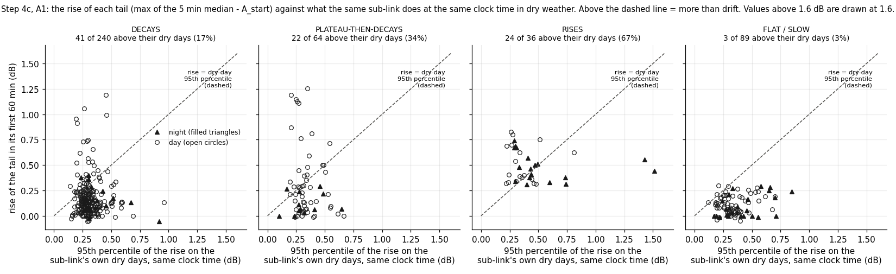
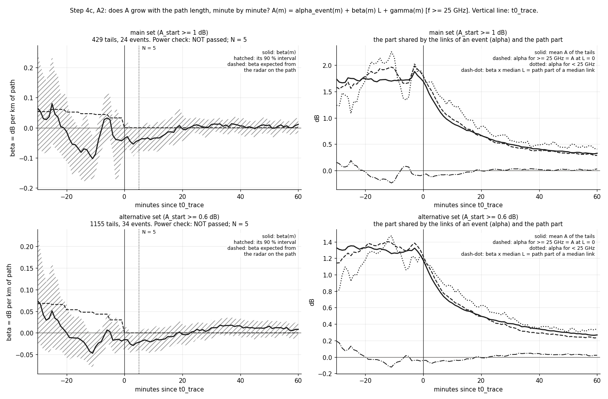
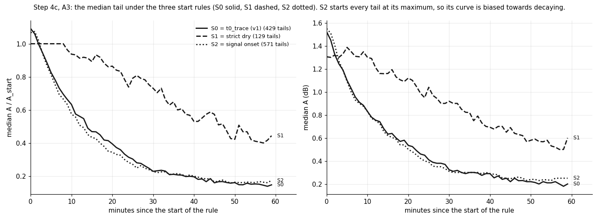
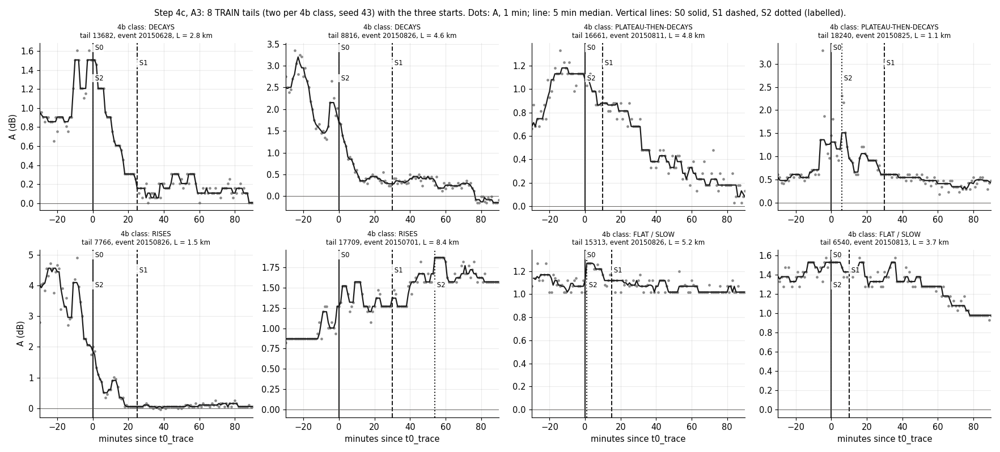

# wet_antenna step 4c (Phase A): what is in a drying tail? (TRAIN tails of v1, no law fit)

Written by `research/wet_antenna/characterise_tails.py`. Settings and every rule: `wet_antenna.characterise_tails` in
`research/config.yaml`, written before the run. The plan this step belongs to: `docs/ROADMAP.md`, section "Plan change
(2026-10-12, after 4b): the signal before the law".

## 1. What was run

- Data: the TRAIN tails of the frozen set v1: 429 main tails (24 events, 159 links), the
  alternative set (1155 tails, A_start >= 0.6 dB), and for the start rules the 10270 TRAIN pairs that pass the v1
  exclusions. VAL rows are dropped when a file is read; no VAL tail is used. A(t) = 1 min `tl_mean` - `baseline_db`
  (frozen baseline v2), read from the release for 30 min before t0_trace as well; largest difference from the A of
  the frozen set: 3.1e-06 dB.
- No drying law is fitted anywhere in this step. Tail set v1, the baseline and all earlier outputs are unchanged.
- Timing: A1 took 0.02 s per tail on the first 20 tails; projection 4 min against a budget of
  1.5 h. Cut: nothing. Run time of this run: 159 s (A1 and the start rules are cached).
- Checks inside the script: the rise of a tail equals the rise of step 4b (largest difference 0.0e+00 dB); the start
  rule S0 with the v1 end rules gives exactly the frozen TRAIN main set (yes); the classes recomputed from S0
  equal the 4b classes for 100.0% of the tails.

## 2. Part 0: the revised plan

Recorded before the analysis: `docs/ROADMAP.md` (the new plan-change section with Q1-Q5 and Phases A-E, three new
standing rules, status rows 4c and 4d, the order line, the open questions pointing to Q1-Q3, one checklist item),
`research/wet_antenna/METHOD.md` (Q1-Q3 at the top of the open issues) and `research/wet_antenna/README.md` (status).

## 3. A1: is the rise of a tail more than the daily cycle? (Q1)

For each of the 429 main tails: the same sub-link, the same clock window (60 min from the clock time of t0_trace), on
every other day of the season that is certified dry: link_state dry in the whole window, at least
12 h since the last wet bin of the link, not inside a run of `dry_jumps.csv`, at least 90% of the
minutes present. On each such day the same statistic as for the tail: rise = maximum of the 5 min median - mean of
the first 5 min. A tail "exceeds" when its rise is above the 95th percentile of its own control days
(at least 5 days, otherwise "no control"). 429 of 429 tails have a control (median
46 control days). By chance alone about 5 % would exceed.

| group | tails | with_control | exceed | share_exceed | median_rise_db | median_control_p95_db | median_control_days | median_control_end_change_db |
|---|---|---|---|---|---|---|---|---|
| all tails | 429 | 429 | 90 | 0.21 | 0.14 | 0.3 | 46.0 | 0.0 |
| class: decays | 240 | 240 | 41 | 0.171 | 0.13 | 0.299 | 46.0 | 0.0 |
| class: plateau-then-decays | 64 | 64 | 22 | 0.344 | 0.21 | 0.316 | 47.0 | 0.0 |
| class: rises | 36 | 36 | 24 | 0.667 | 0.452 | 0.366 | 45.0 | 0.0 |
| class: flat / slow | 89 | 89 | 3 | 0.034 | 0.09 | 0.324 | 46.0 | 0.0 |
| night | 73 | 73 | 15 | 0.205 | 0.163 | 0.359 | 46.0 | 0.0 |
| day | 356 | 356 | 75 | 0.211 | 0.137 | 0.3 | 46.0 | 0.0 |
| dew risk: yes | 300 | 300 | 54 | 0.18 | 0.13 | 0.297 | 46.0 | 0.0 |
| dew risk: no | 60 | 60 | 17 | 0.283 | 0.139 | 0.345 | 46.0 | 0.0 |
| dew risk: unknown | 69 | 69 | 19 | 0.275 | 0.267 | 0.375 | 46.0 | 0.0 |
| class: decays, night | 18 | 18 | 4 | 0.222 | 0.125 | 0.309 | 47.0 | 0.0 |
| class: decays, day | 222 | 222 | 37 | 0.167 | 0.13 | 0.297 | 46.0 | 0.0 |
| class: plateau-then-decays, night | 12 | 12 | 1 | 0.083 | 0.07 | 0.282 | 47.0 | 0.0 |
| class: plateau-then-decays, day | 52 | 52 | 21 | 0.404 | 0.222 | 0.317 | 46.5 | 0.0 |
| class: rises, night | 18 | 18 | 10 | 0.556 | 0.472 | 0.428 | 44.5 | 0.0 |
| class: rises, day | 18 | 18 | 14 | 0.778 | 0.403 | 0.321 | 45.0 | 0.0 |
| class: flat / slow, night | 25 | 25 | 0 | 0.0 | 0.05 | 0.375 | 46.0 | 0.0 |
| class: flat / slow, day | 64 | 64 | 3 | 0.047 | 0.104 | 0.314 | 45.5 | 0.0 |
| night, dew risk: yes | 6 | 6 | 2 | 0.333 | 0.035 | 0.3 | 46.5 | 0.0 |
| night, dew risk: no | 18 | 18 | 2 | 0.111 | 0.079 | 0.373 | 47.0 | 0.0 |
| night, dew risk: unknown | 49 | 49 | 11 | 0.224 | 0.243 | 0.375 | 46.0 | 0.0 |
| day, dew risk: yes | 294 | 294 | 52 | 0.177 | 0.132 | 0.297 | 46.0 | 0.0 |
| day, dew risk: no | 42 | 42 | 15 | 0.357 | 0.185 | 0.339 | 45.0 | 0.0 |
| day, dew risk: unknown | 20 | 20 | 8 | 0.4 | 0.31 | 0.376 | 45.5 | 0.0 |

(`research/wet_antenna/outputs/tables/characterise_tails_a1_summary.csv`; per tail: `research/wet_antenna/outputs/tables/characterise_tails_a1_per_tail.csv`.)

**What dry days do in the same clock window** (median over the tails of each tail's control statistics): how far the
level moves from the first to the last 5 min of the window, and the 95th percentile of the rise.

| night | tails | control_end_change_median_db | control_end_change_p5_db | control_end_change_p95_db | control_p95_of_rise_db |
|---|---|---|---|---|---|
| day | 356 | 0.0 | -0.234 | 0.21 | 0.3 |
| night | 73 | 0.0 | -0.208 | 0.276 | 0.359 |

**Verdict by the rule fixed before the run: RISES ARE MOSTLY WATER (NOT DRIFT).** 24 of the 36 class-"rises" tails with a
control are above their dry-day 95th percentile (67%; rule: at most 25% = drift, at least
60% = water). The night-time rises alone: 10 of 18 (56%); by day: 14 of 18
(78%). On the night-time rises alone the same rule would say "mixed"; at night the dry days themselves move
more (table above).

**Dew-like?** Dew risk (where the humidity is known) of the tails that exceed: 76% (class "rises" only: 50%);
of the decaying tails: 87%. Rule (more than 2 times): **not dew-like by the rule**.
The rule can hardly be met: rain leaves the air humid, so the hourly dew-risk flag is already true for most decaying
tails, and a share cannot be more than twice a share above 50 %.

**The humidity gap.** Humidity at GbgA is missing for 102 hours of the season, all in June.
E20150617_0705: 54 main tails, 54 with unknown dew risk, 10 of class "rises", 26% of its tails with a control above their dry days; E20150701_0030: 15 main tails, 15 with unknown dew risk, 12 of class "rises", 33% of its tails with a control above their dry days.
So for the two events with most rising tails "dew or not" cannot be read from the humidity.

**Daily-cycle amplitude (R1 C3) of the sub-links, per class** (dB; v1 already excludes sub-links above
0.4 dB through `use_in_waa_main`):

| class | count | median | max |
|---|---|---|---|
| decays | 240 | 0.134 | 0.38 |
| plateau-then-decays | 64 | 0.13 | 0.37 |
| rises | 36 | 0.12 | 0.373 |
| flat / slow | 89 | 0.165 | 0.377 |

**Context from `dry_jumps.csv`** (dry-weather runs of >= 3 h at >= 1 dB from the dry median, all train sub-links):
2653 positive jumps on 371 sub-links (1281 negative). 41% of the positive jumps
start at night (night is 30% of all hours; negative jumps: 20%), and 27% start in an hour with
dew risk (dew risk holds in 14% of the hours with humidity; 240 jumps start in an hour without humidity).
So these antennas do gain attenuation at night in humid air without any rain.

## 4. A2: antenna or path rain? (Q2)

Per minute m from -30 to +60 around t0_trace, across the tails of a set:
A(m) = alpha_event(m) + beta(m) L + gamma(m) [f >= 25 GHz] + error, with one intercept per event. beta(m) is the dB
per km of path at that minute (path rain grows with L; the antenna does not). 90 % interval of beta from
1000 event bootstraps. The dashed reference is the beta expected from the radar: the mean over the tails of
a R_mean^b (ITU-R P.838-3 at the frequency and polarization of the sub-link, R_mean = radar along the path).

| set | tails | events | links | median_L_km | L_p10_km | L_p90_km | share_high_band | power | minutes_with_beta_above_0_in_power_range | max_beta_in_power_range | N | minutes_ge0_with_beta_above_0 | minutes_ge0_with_beta_below_0 | expected_inside_interval_before_0 | beta_over_expected_before_0 |
|---|---|---|---|---|---|---|---|---|---|---|---|---|---|---|---|
| main set (A_start >= 1 dB) | 429 | 24 | 159 | 2.35 | 0.76 | 5.21 | 0.923 | False | 0 | 0.08 | 5 | 0 | 2 | 0.567 | -0.32 |
| alternative set (A_start >= 0.6 dB) | 1155 | 34 | 212 | 2.6 | 0.87 | 5.54 | 0.906 | False | 0 | 0.074 | 5 | 0 | 2 | 0.433 | 0.02 |

- **Power check** (the interval of beta above 0 at some minute in -30..-10): main set **NO POWER**
  (0 of 21 minutes; largest beta 0.08 dB/km); alternative set **NO POWER**
  (0 minutes; largest beta 0.074 dB/km).
- **N by the rule** (first minute >= 0 from which the interval of beta contains 0 for 10 minutes in a row): main set
  **N = 5**, alternative set **N = 5**. Where the power check fails, N is not interpreted (rule).
- Minutes >= 0 with the interval of beta above 0: main 0, alternative 0; below 0:
  main 2, alternative 2.
- **Against the expected path rain** (minutes before 0): the mean observed beta is -0.32 times the expected
  one in the main set (0.02 in the alternative set); the expected value lies inside the interval in
  57% of those minutes (alternative 43%). After t0_trace the expected beta is 0 by
  construction of v1 (no radar on the path).
- **alpha(m), the part shared by the links of an event** (>= 25 GHz, i.e. A at L = 0), main set: 1.94 dB at
  -10 min, 1.79 at 0, 0.98 at 10, 0.46 at 30, 0.28 at 60 min. It falls by
  0.82 dB in the first 10 min and by 0.69 dB from 10 to 60 min; the path part of a median link
  (beta x 2.35 km) is -0.08 dB at 0 and -0.08 dB at 10 min.
- **Why there is no power** (information): the path attenuation the radar expects in the last 30 min before t0_trace is
  small, 0.03 to 0.06 dB/km, i.e. 0.08 to 0.13 dB for the mean tail, against a mean A of 1.71 dB;
  the 90 % interval of beta is about +-0.10 dB/km wide there. The tails end with light rain, so the minutes before
  t0_trace are not a period of strong path rain, and the regression cannot see an effect of that size.

Selected minutes (`research/wet_antenna/outputs/tables/characterise_tails_a2_per_minute.csv` has every minute):

| set | minute | tails | mean_A_db | beta_db_per_km | beta_lo | beta_hi | expected_path_rain_db_per_km | expected_path_rain_db | alpha_high_band_db | path_part_median_link_db |
|---|---|---|---|---|---|---|---|---|---|---|
| main set (A_start >= 1 dB) | -30 | 429 | 1.74 | 0.065 | -0.084 | 0.252 | 0.054 | 0.124 | 1.584 | 0.152 |
| main set (A_start >= 1 dB) | -20 | 426 | 1.744 | -0.013 | -0.112 | 0.102 | 0.052 | 0.117 | 1.785 | -0.03 |
| main set (A_start >= 1 dB) | -10 | 429 | 1.713 | -0.087 | -0.153 | -0.014 | 0.044 | 0.094 | 1.942 | -0.204 |
| main set (A_start >= 1 dB) | -5 | 429 | 1.723 | 0.027 | -0.04 | 0.112 | 0.033 | 0.084 | 1.668 | 0.063 |
| main set (A_start >= 1 dB) | 0 | 428 | 1.692 | -0.036 | -0.088 | 0.016 | 0.0 | 0.0 | 1.792 | -0.084 |
| main set (A_start >= 1 dB) | 2 | 429 | 1.462 | -0.046 | -0.076 | 0.002 | 0.0 | 0.0 | 1.583 | -0.107 |
| main set (A_start >= 1 dB) | 5 | 429 | 1.182 | -0.041 | -0.077 | 0.001 | 0.0 | 0.0 | 1.285 | -0.097 |
| main set (A_start >= 1 dB) | 10 | 429 | 0.9 | -0.035 | -0.075 | 0.014 | 0.0 | 0.0 | 0.975 | -0.081 |
| main set (A_start >= 1 dB) | 15 | 429 | 0.759 | -0.014 | -0.054 | 0.031 | 0.0 | 0.0 | 0.784 | -0.032 |
| main set (A_start >= 1 dB) | 20 | 427 | 0.663 | -0.004 | -0.045 | 0.043 | 0.0 | 0.0 | 0.661 | -0.009 |
| main set (A_start >= 1 dB) | 30 | 429 | 0.494 | 0.011 | -0.015 | 0.033 | 0.0 | 0.0 | 0.455 | 0.026 |
| main set (A_start >= 1 dB) | 45 | 429 | 0.371 | -0.003 | -0.035 | 0.022 | 0.0 | 0.0 | 0.367 | -0.008 |
| main set (A_start >= 1 dB) | 60 | 429 | 0.325 | 0.011 | -0.016 | 0.031 | 0.0 | 0.0 | 0.284 | 0.026 |
| alternative set (A_start >= 0.6 dB) | -30 | 1153 | 1.327 | 0.074 | -0.034 | 0.224 | 0.068 | 0.171 | 1.142 | 0.193 |
| alternative set (A_start >= 0.6 dB) | -20 | 1152 | 1.326 | 0.0 | -0.057 | 0.067 | 0.054 | 0.136 | 1.341 | 0.0 |
| alternative set (A_start >= 0.6 dB) | -10 | 1155 | 1.264 | -0.032 | -0.063 | 0.006 | 0.043 | 0.096 | 1.358 | -0.085 |
| alternative set (A_start >= 0.6 dB) | -5 | 1154 | 1.297 | 0.003 | -0.028 | 0.046 | 0.03 | 0.072 | 1.31 | 0.007 |
| alternative set (A_start >= 0.6 dB) | 0 | 1154 | 1.174 | -0.016 | -0.039 | 0.013 | 0.0 | 0.0 | 1.223 | -0.041 |
| alternative set (A_start >= 0.6 dB) | 2 | 1155 | 1.018 | -0.026 | -0.046 | 0.0 | 0.0 | 0.0 | 1.091 | -0.067 |
| alternative set (A_start >= 0.6 dB) | 5 | 1155 | 0.833 | -0.022 | -0.041 | 0.001 | 0.0 | 0.0 | 0.89 | -0.057 |
| alternative set (A_start >= 0.6 dB) | 10 | 1155 | 0.654 | -0.018 | -0.044 | 0.01 | 0.0 | 0.0 | 0.693 | -0.047 |
| alternative set (A_start >= 0.6 dB) | 15 | 1155 | 0.56 | -0.008 | -0.032 | 0.017 | 0.0 | 0.0 | 0.574 | -0.022 |
| alternative set (A_start >= 0.6 dB) | 20 | 1153 | 0.495 | -0.004 | -0.028 | 0.02 | 0.0 | 0.0 | 0.492 | -0.009 |
| alternative set (A_start >= 0.6 dB) | 30 | 1155 | 0.406 | 0.012 | -0.013 | 0.03 | 0.0 | 0.0 | 0.363 | 0.03 |
| alternative set (A_start >= 0.6 dB) | 45 | 1155 | 0.318 | 0.01 | -0.016 | 0.03 | 0.0 | 0.0 | 0.279 | 0.027 |
| alternative set (A_start >= 0.6 dB) | 60 | 1155 | 0.268 | 0.008 | -0.012 | 0.022 | 0.0 | 0.0 | 0.234 | 0.021 |

## 5. A3: when does drying start? (Q3)

Three start rules, none uses a law fit; for each the v1 end rules are applied again from the new start (next rain
trace on the path, rise cut v2 from the new start, the step 2b ends) and the main-set rule (A_start >= 1.0 dB at the
new start, usable length >= 60 min).
- **S0** = t0_trace of v1.
- **S1** = strict dry: the end of the last 5 min bin, between t0 and the first dry bin, with the v1 trace on the
  path OR radar R_max > 0 on the path of a link whose midpoint is within 5 km OR a City gauge within
  5 km of the path > 0 OR the SMHI gauge > 0 if within 10 km; plus 10 min. The release has no
  radar cells around a path, so "radar nearby" is the radar on the paths of the links within 5 km, as in step 4b.
- **S2** = signal onset: the minute of the maximum of the 5 min median of A in [t0_trace, t0_trace + 60 min]
  (never beyond the next rain trace on the path or the step 2b end). **Warning: S2 makes every tail start at a
  maximum, so the shape after the start is biased towards decaying. It is a sensitivity case, not a drying-law set.**

| quantity | S0 = t0_trace (v1) | S1 = strict dry | S2 = signal onset |
|---|---|---|---|
| tails | 429.0 | 129.0 | 571.0 |
| events | 24.0 | 14.0 | 27.0 |
| links | 159.0 | 69.0 | 174.0 |
| share_decays | 0.559 | 0.186 | 0.608 |
| share_plateau-then-decays | 0.149 | 0.318 | 0.105 |
| share_rises | 0.084 | 0.14 | 0.032 |
| share_flat / slow | 0.207 | 0.357 | 0.256 |
| A_over_A_start_10min | 0.568 | 0.937 | 0.525 |
| A_over_A_start_30min | 0.229 | 0.708 | 0.223 |
| A_over_A_start_60min | 0.142 | 0.518 | 0.166 |
| t_half_min | 14.0 | 48.0 | 12.0 |
| share_half_within_60min | 0.865 | 0.581 | 0.877 |
| k_slope | -0.8 | -1.85 | -0.56 |
| k_slope_lo | -1.55 | -3.02 | -0.92 |
| k_slope_hi | -0.43 | -1.05 | -0.02 |
| bins_in_slope | 6.0 | 6.0 | 6.0 |
| delay_median_min | 0.0 | 15.0 | 0.0 |
| delay_q25_min | 0.0 | 10.0 | 0.0 |
| delay_q75_min | 0.0 | 25.0 | 16.0 |
| delay_median_night_min | 0.0 | 25.0 | 3.0 |
| delay_median_day_min | 0.0 | 15.0 | 0.0 |
| tails_night | 73.0 | 31.0 | 89.0 |
| tails_day | 356.0 | 98.0 | 482.0 |

(`research/wet_antenna/outputs/tables/characterise_tails_a3_start_rules.csv`; k(A) per level: `research/wet_antenna/outputs/tables/characterise_tails_a3_rate_per_level.csv`; median curves: `research/wet_antenna/outputs/tables/characterise_tails_a3_median_curves.csv`; the starts of every
pair: `research/wet_antenna/outputs/products/tails_starts.csv`.) The k(A) slope is the B5 method of step 4b: A smoothed over 7 min, central
difference, k = -mean dA/dt / median A per bin, bins with >= 200 tail-minutes, slope of log k vs log A from
0.35 dB up; interval from 200 event bootstraps. The delay is the time from t0_trace to the start of the rule.

How the kept sets overlap:

| start_rule | also kept by S0 | also kept by S1 | also kept by S2 |
|---|---|---|---|
| S0 = t0_trace (v1) | 429 | 76 | 421 |
| S1 = strict dry | 76 | 129 | 117 |
| S2 = signal onset | 421 | 117 | 571 |

- Among the 429 v1 main tails, S1 starts 25 min later (median; quartiles 15-30) and S2
  0 min later (quartiles 0-2; S2 = S0 for 70%). "Rise before onset" (peak
  >= 0.3 dB above A_start at t0_trace): 26% of the v1 main tails. That flag is inflated: A_start is a mean
  over 5 min, so the first minute of a fast-falling tail is already above it. Against the 5 min median AT t0_trace
  (added after the first run, information) the peak is >= 0.3 dB higher in 14%; S2 is 5 min or more after S0 in 19%.
- S1 = strict dry loses 353 of the v1 main tails (A_start below 1 dB at the new start: 349, shorter than 60 min: 4) and adds 53 new ones; S2 = signal onset loses 8 of the v1 main tails (A_start below 1 dB at the new start: 1, shorter than 60 min: 7) and adds 150 new ones.

### Proposal for tail set v2 (for the learners; nothing is frozen here)

No law fit was used for anything below.

- **Proposal: keep S0 (t0_trace) as the start of the tail, and store S1 and S2 as two more times per tail**
  (`research/wet_antenna/outputs/products/tails_starts.csv`), instead of cutting the tails again at one of them. Step 4d then treats the start of
  drying as a quantity per tail that lies between S2 (the earliest it can be read from the signal) and later, and
  uses S1 as the marker "from here no reference within 5 km shows rain".
- **Why not S1 as the start.** S1 comes 25 min after t0_trace (median), and by then most of the signal is gone:
  349 of the 429 v1 tails are below 1.0 dB at S1. What is left (129 tails, 14 events) is the tails
  that are STILL high that long after the rain, i.e. the slow ones: a selection on the outcome (19% "decays",
  t_half 48 min). S1 cannot be the start of a set that also has the 1.0 dB rule.
- **Why not S2 as the start.** It starts every tail at its maximum, so decay after the start is partly built in
  (the warning above). It changes little for most tails anyway (S2 = S0 for 70% of the v1 tails), and it adds
  150 tails whose level reaches 1.0 dB only after t0_trace, i.e. tails that RISE after the last rain trace.
- **How the conclusions of steps 4 and 4b change with the start rule.**
  - Step 4, "the rate per dB falls with the level": the slope of k(A) is -0.8 (-1.55..-0.43) for S0,
    -1.85 (-3.02..-1.05) for S1 and -0.56 (-0.92..-0.02) for S2. It is negative under every rule, so the
    falling k is not made by the choice of the start; S2 only weakens it.
  - Step 4b, "44 % of the tails do not decay at once": 44% for S0, 81% for S1, 39% for S2. Starting at the
    maximum removes most rising tails (8% -> 3%) but not the waiting and the flat ones.
- **What stays stable** between S0 and S2: the median shape (A / A_start 0.568 / 0.229 / 0.142 at 10 / 30 / 60 min
  against 0.525 / 0.223 / 0.166), t_half (14 and 12 min) and the share that halves within
  60 min (86%, 88%). S1 is different in everything, for the reason above.

## 6. In plain words: what a drying tail contains

- **Drift (the daily cycle)? No, not the rises.** On dry days the same sub-link at the same clock time moves little
  in an hour: the 95th percentile of the rise is 0.30 dB by day and 0.36 dB at night. 24 of the
  36 rising tails rise more than that. So the first candidate of Q1, a baseline that drifts with the hour, does
  not explain most of them, and a baseline v3 with a daily-cycle correction is NOT called for by this result. For the
  night-time rises the answer is weaker: 10 of 18 are above their dry nights, so about half of them are no larger
  than what the sub-link does on a dry night. Two more cautions:
  a tail is in the class "rises" because it rises more than 0.3 dB, which is about the dry-day percentile, so part
  of the 67% is built in (median rise of these tails 0.45 dB, median dry-day percentile 0.37 dB); and 21% of
  ALL tails exceed their dry days (17% of the decaying ones), against 5 % by chance: a link that has just been
  rained on is noisier than a dry one, whatever the tail does.
- **Dew? Not decided, and it cannot be decided with this humidity record.** 22 of the 36 rising tails are in the
  two events without humidity. Where humidity is known, the tails that exceed are not in more humid hours than the
  decaying ones (76% against 87% with dew risk). The dry-jump table shows that these antennas do gain
  attenuation at night in humid air without rain (41% of the positive jumps start at night), so dew stays a
  candidate.
- **Path rain in the first minutes? Not shown, and not excluded.** A does not grow with the path length at any minute
  from -30 to +60 (largest upper end of the interval after t0_trace: 0.07 dB/km), but the test did not pass its
  power check: it does not see path rain before t0_trace either, because the rain at the end of an event is light.
  By the rule nothing is concluded from N. Step 2 met the same wall.
- **From which minute is it the antenna?** Not answered. What can be said: the part shared by all links of an event
  falls from 1.79 to 0.98 dB in the first 10 min, and the radar expects only 0.08-0.13 dB of path
  attenuation before t0_trace, so by the radar the fast drop is not path rain. That rests on the radar, which is
  the reference whose blind spots (drizzle, 2 km cells, 5 min) are the question.
- **The start.** The references within 5 km are dry only 25 min after t0_trace (median), and by then 81% of
  the tails are below 1.0 dB. So most of what v1 calls the drying tail happens while it still rains within 5 km.
- **What changes for Step 4d.** (1) No baseline v3 for the daily cycle; the simulator needs rises of 0.3-1 dB that
  are not drift. (2) The start of drying is modelled per tail (between S2 and later) instead of re-cutting the set.
  (3) The simulator must contain nearby rain during the first 15-25 min, because that is when the real tails drop.
  (4) "tau = 10 min is the drying time" stays unproven: the length test cannot separate antenna from path here; the
  very short links of Step 7 remain the real test.

## 7. Decisions for the learners (not taken here)

1. Tail set v2: keep S0 and add S1 / S2 as columns (the proposal), or re-cut at S1 or S2, or lower the 1.0 dB rule
   for an S1 set (not computed here).
2. Is "not drift" accepted for the rises, so that no baseline v3 is built?
3. Humidity for E20150617_0705 and E20150701_0030 from another station: without it "dew or drizzle" stays open.
4. A2 has no power on tails. Accept that Q2 is answered only in Step 7 (very short links, whole events), or design
   another test (for example the two directions of a link, or pairs of links that share one site)?
5. Should the minutes with rain within 5 km (S0 to S1) be used for the drying law at all, be modelled with rain as
   an input (the wetting side), or be left out?

## 8. Unclear / possibly wrong

1. **The A1 verdict leans on a class defined by the same quantity.** "rises" = rise > 0.3 dB; the dry-day 95th
   percentile is about 0.30 dB. The rule was fixed before the run, but a share of 67% against a threshold of
   60% is not a wide margin.
2. **Control days are dry by the references only** (radar on the path, gauges within 1 km): drizzle the radar misses
   can be in a control window too. That makes the control percentile larger, i.e. the test more cautious.
3. **A tail is at a higher level than a dry day.** With 0.3 dB RSL steps and a falling level, the 5 min median of a
   tail moves more than that of a flat dry signal. "More than dry days" is therefore not the same as "water".
4. **The first 12 h of the season** count as "no wet bin yet" from the season start, so no control window lies there.
5. **A2 is run on tails selected by A_start >= 1 dB (0.6 dB)**, a selection on the outcome at minute 0-4. If path
   rain made long links higher, short links would need more antenna water to pass, which pushes beta down. The
   negative beta around minute 0 (interval below 0 at 2 minutes) may come from this.
6. **alpha(m) is not "the antenna" by itself**: it is A at L = 0 in this regression. Rain that is the same for all
   links of an event and does not scale with L in the data would sit in alpha too.
7. **The ITU-R P.838-3 coefficients** are typed into `tails.py` and checked against the tabulated values at 10, 20
   and 30 GHz from memory, not against the document (it is not in `docs/papers/`). They are used only for the
   dashed reference curve.
8. **S1 uses the paths of the links within 5 km as "radar nearby"** (the release has no radar cells around a
   path), and its end rules are the v1 ones (path trace only), so an S1 tail can still have rain within 5 km later.
9. **S1 and S2 tails are not a frozen set**: the event flag `event_rise_heavy`, `level_shift` and `undershoot` were
   not recomputed for them.
10. **The humidity is one station** (GbgA) and hourly; "dew risk" is the same for the whole network.
