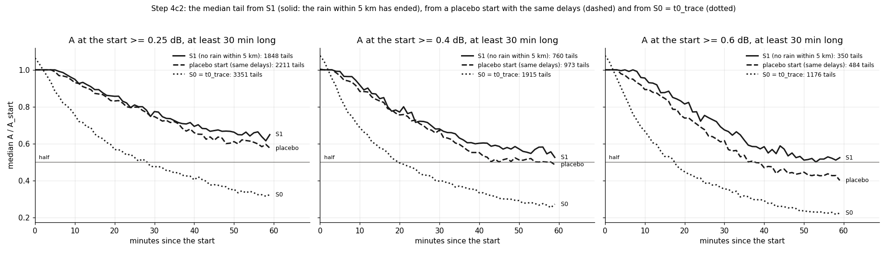
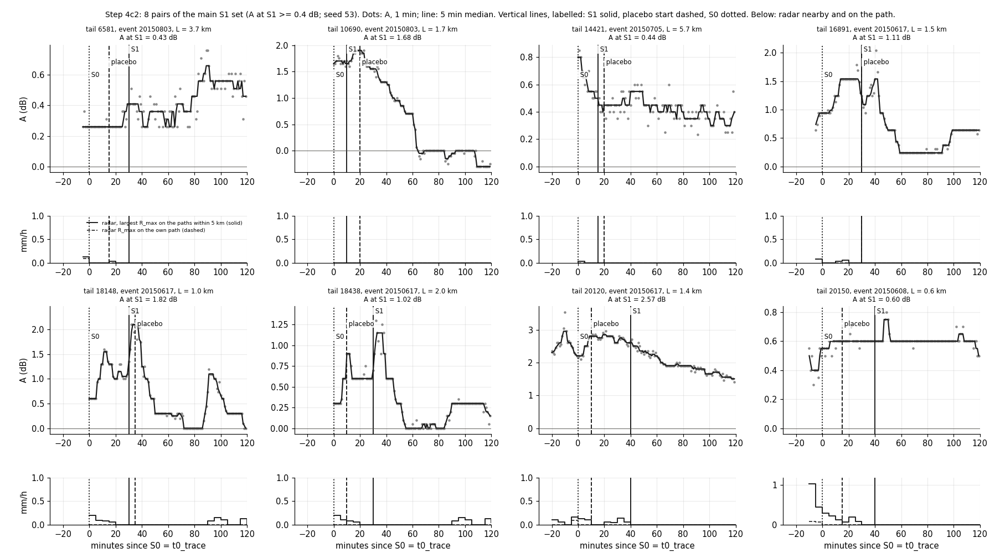
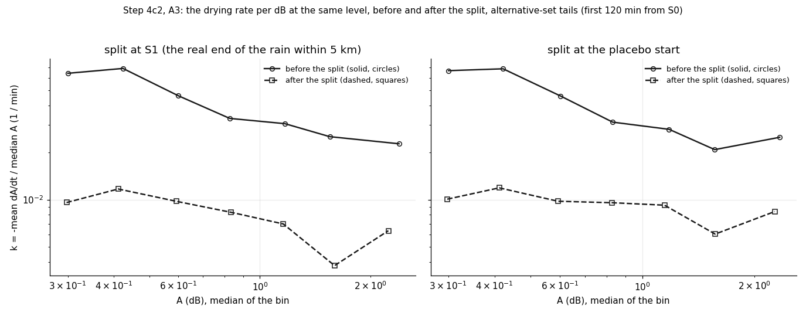

# wet_antenna step 4c2: does drying really start when the rain nearby ends? (TRAIN pairs, no law fit)

Written by `research/wet_antenna/check_drying_after_rain.py`. Settings and the rule: `wet_antenna.drying_after_rain` in
`research/config.yaml`, written before the run. Why this step: `docs/ROADMAP.md`, "Decisions of the learners after 4c".

## 1. What was run

- Data: the 10270 TRAIN pairs that pass the v1 exclusions (50 events, 223 links), with S0 (t0_trace) and S1
  (no rain within 5 km, + 10 min) from `research/wet_antenna/outputs/products/tails_starts.csv` and the 1 min A(t) of v1. VAL is never read. No law
  is fitted. Nothing earlier is changed.
- Three starts per pair, each with the v1 end rules counted from that start (next rain trace on the path, rise cut
  v2, the step 2b ends): **S1**, which ALSO ends at the next rain within 5 km, so its window is truly "no rain
  nearby"; a **placebo** start = S0 + the S1 - S0 delay of another pair drawn at random (seed 51), without the
  "rain nearby" condition; and **S0**. A tail is kept at a threshold if A at the start (mean of the first 5 min) is
  at least the threshold and the tail is at least 30 min long.
- t_half of a set is the Kaplan-Meier median of the time to half: a tail that ends before it has halved is censored
  at its end (S1 windows are shorter, because they also end when rain comes back nearby). Capped at 60 min.
- Timing: 1.1 ms per pair on the first 200 pairs; projection 2.2 min against a budget of
  45 min. Cut: nothing. Run time of this run: 23 s (the pair pass is cached).
- Check: the k(A) computed here equals `raw_rate` of step 4b on 400 tails (largest difference 3.6e-05 per min).

## 2. Part 0: the decisions

The four decisions of the learners after 4c were recorded before the analysis: `docs/ROADMAP.md` (section "Decisions
of the learners after 4c", status rows 4c2 / 3c / 7 / 4d, the order line), `research/wet_antenna/METHOD.md` (under
"Step 4c" and at the top of the open issues) and `research/wet_antenna/README.md` (status).

## 3. A1: tails from S1, lower thresholds

| threshold_db | start | tails | events | links | median_A_start_db | A_over_A_start_10min | A_over_A_start_30min | A_over_A_start_60min | tails_with_60min | t_half_min | share_half_within_60min | share_censored | k_slope | k_slope_lo | k_slope_hi | bins_in_slope | median_delay_from_S0_min | median_usable_min |
|---|---|---|---|---|---|---|---|---|---|---|---|---|---|---|---|---|---|---|
| 0.25 | S1 | 1848 | 48 | 221 | 0.357 | 0.923 | 0.766 | 0.654 | 1591 | 41.0 | 0.593 | 0.048 | -0.51 | -1.33 | 0.44 | 7 | 15.0 | 240.0 |
| 0.4 | S1 | 760 | 37 | 189 | 0.58 | 0.893 | 0.679 | 0.541 | 612 | 40.0 | 0.612 | 0.051 | -1.0 | -1.85 | -0.17 | 7 | 15.0 | 200.0 |
| 0.6 | S1 | 350 | 25 | 144 | 0.886 | 0.936 | 0.668 | 0.519 | 262 | 40.0 | 0.609 | 0.051 | -1.35 | -2.28 | -0.78 | 7 | 15.0 | 172.5 |

(`research/wet_antenna/outputs/tables/check_drying_after_rain_a1_a2_sets.csv`; k(A) per level: `research/wet_antenna/outputs/tables/check_drying_after_rain_rate_per_level.csv`; per pair: `research/wet_antenna/outputs/tables/check_drying_after_rain_pairs.csv`.)
`share_censored` = tails that ended before halving and before 60 min. The k(A) slope is that of log k vs log A from
0.25 dB up (bins with >= 200 tail-minutes; interval from 200 event bootstraps).

## 4. A2: the placebo start, S0, and the difference

| threshold_db | start | tails | events | links | median_A_start_db | A_over_A_start_10min | A_over_A_start_30min | A_over_A_start_60min | tails_with_60min | t_half_min | share_half_within_60min | share_censored | k_slope | k_slope_lo | k_slope_hi | bins_in_slope | median_delay_from_S0_min | median_usable_min |
|---|---|---|---|---|---|---|---|---|---|---|---|---|---|---|---|---|---|---|
| 0.25 | placebo | 2211 | 46 | 223 | 0.367 | 0.906 | 0.734 | 0.591 | 2070 | 39.0 | 0.608 | 0.019 | -0.2 | -0.84 | 0.44 | 7 | 20.0 | 430.0 |
| 0.25 | S0 | 3351 | 48 | 223 | 0.45 | 0.722 | 0.471 | 0.318 | 3318 | 20.0 | 0.768 | 0.002 | -0.03 | -0.73 | 0.41 | 7 | 0.0 | 445.0 |
| 0.25 | S0, only the pairs of the S1 set | 1543 | 46 | 221 | 0.527 | 0.881 | 0.72 | 0.52 | 1537 | 43.0 | 0.614 | 0.001 | -0.21 |  |  | 7 |  |  |
| 0.4 | placebo | 973 | 39 | 212 | 0.6 | 0.871 | 0.65 | 0.481 | 876 | 37.0 | 0.627 | 0.023 | -0.65 | -1.53 | -0.07 | 7 | 15.0 | 395.0 |
| 0.4 | S0 | 1915 | 38 | 222 | 0.673 | 0.646 | 0.39 | 0.255 | 1889 | 18.0 | 0.809 | 0.002 | -0.29 | -1.01 | 0.17 | 7 | 0.0 | 425.0 |
| 0.4 | S0, only the pairs of the S1 set | 613 | 33 | 172 | 0.785 | 0.876 | 0.687 | 0.485 | 607 | 45.0 | 0.61 | 0.002 | -0.64 |  |  | 7 |  |  |
| 0.6 | placebo | 484 | 29 | 173 | 0.9 | 0.888 | 0.575 | 0.385 | 420 | 34.0 | 0.66 | 0.019 | -0.94 | -1.88 | -0.41 | 7 | 15.0 | 402.5 |
| 0.6 | S0 | 1176 | 34 | 212 | 0.88 | 0.616 | 0.34 | 0.202 | 1154 | 16.0 | 0.836 | 0.003 | -0.44 | -1.01 | -0.01 | 7 | 0.0 | 400.0 |
| 0.6 | S0, only the pairs of the S1 set | 276 | 24 | 127 | 1.008 | 0.925 | 0.797 | 0.5 | 272 | 53.0 | 0.547 | 0.004 | -1.23 |  |  | 7 |  |  |

"S0, only the pairs of the S1 set" (information): the pairs of the S1 set, looked at from S0, where A at S0 is also
above the threshold.

The difference S1 - placebo (1000 event bootstraps, 90 % interval; `research/wet_antenna/outputs/tables/check_drying_after_rain_a2_difference.csv`):

| threshold_db | t_half_S1_minus_placebo_min | t_half_lo | t_half_hi | ratio30_S1_minus_placebo | ratio30_lo | ratio30_hi | pairs_in_both_sets |
|---|---|---|---|---|---|---|---|
| 0.25 | 2.0 | -2.0 | 5.0 | 0.031 | -0.006 | 0.052 | 1485 |
| 0.4 | 3.0 | -2.0 | 7.0 | 0.028 | -0.014 | 0.064 | 597 |
| 0.6 | 6.0 | 0.0 | 20.0 | 0.093 | 0.046 | 0.154 | 286 |

| threshold_db | t_half S1 | t_half placebo | t_half S0 | S1 / S0 | S1 / placebo |
|---|---|---|---|---|---|
| 0.25 | 41.0 | 39.0 | 20.0 | 2.05 | 1.05 |
| 0.4 | 40.0 | 37.0 | 18.0 | 2.22 | 1.08 |
| 0.6 | 40.0 | 34.0 | 16.0 | 2.5 | 1.18 |

Added after the first run (information, no rule; `research/wet_antenna/outputs/tables/check_drying_after_rain_a2_placebo_split.csv`): the placebo set mixes starts
that fall while it still rains within 5 km and starts after the pair's own S1. Split by that:

| threshold_db | placebo tails | tails | events | median_A_start_db | A_over_A_start_10min | A_over_A_start_30min | A_over_A_start_60min | t_half_min | share_half_within_60min | median_delay_from_S0_min |
|---|---|---|---|---|---|---|---|---|---|---|
| 0.25 | placebo start BEFORE the pair's S1 (rain still within 5 km) | 1026 | 38 | 0.373 | 0.883 | 0.679 | 0.509 | 34.0 | 0.649 | 15.0 |
| 0.25 | placebo start at or after the pair's S1 | 1185 | 45 | 0.36 | 0.926 | 0.774 | 0.66 | 43.0 | 0.573 | 25.0 |
| 0.4 | placebo start BEFORE the pair's S1 (rain still within 5 km) | 465 | 34 | 0.6 | 0.836 | 0.581 | 0.382 | 33.0 | 0.681 | 15.0 |
| 0.4 | placebo start at or after the pair's S1 | 508 | 36 | 0.6 | 0.9 | 0.717 | 0.545 | 43.0 | 0.579 | 20.0 |
| 0.6 | placebo start BEFORE the pair's S1 (rain still within 5 km) | 233 | 25 | 0.847 | 0.821 | 0.5 | 0.294 | 29.0 | 0.739 | 15.0 |
| 0.6 | placebo start at or after the pair's S1 | 251 | 23 | 0.92 | 0.938 | 0.67 | 0.487 | 41.0 | 0.587 | 20.0 |

## 5. A3: the same level before and after S1

The 1155 alternative-set tails of v1 (A_start >= 0.6 dB at S0), first 120 min from S0. The minutes are split into
"before S1" (rain within 5 km) and "from S1 until rain comes back within 5 km"; k = -mean dA/dt / median A per
level in each part (bins with >= 200 minutes). The same split at the placebo start.

| A_bin_db | S1: minutes before | S1: k before | S1: minutes after | S1: k after | S1: k after / before | placebo: minutes before | placebo: k before | placebo: minutes after | placebo: k after | placebo: k after / before |
|---|---|---|---|---|---|---|---|---|---|---|
| (0.25, 0.35] | 2381 | 0.0641 | 11218 | 0.0096 | 0.15 | 2028 | 0.0666 | 13819 | 0.0101 | 0.15 |
| (0.35, 0.5] | 3183 | 0.0688 | 9840 | 0.0117 | 0.17 | 2994 | 0.0684 | 11733 | 0.0119 | 0.17 |
| (0.5, 0.7] | 5189 | 0.046 | 7711 | 0.0098 | 0.21 | 4916 | 0.0459 | 9717 | 0.0098 | 0.21 |
| (0.7, 1] | 4629 | 0.033 | 5128 | 0.0083 | 0.25 | 4470 | 0.0313 | 6244 | 0.0096 | 0.31 |
| (1, 1.4] | 2418 | 0.0306 | 2399 | 0.007 | 0.23 | 2371 | 0.0281 | 2670 | 0.0092 | 0.33 |
| (1.4, 2] | 1067 | 0.0252 | 1508 | 0.0038 | 0.15 | 1100 | 0.0209 | 1675 | 0.006 | 0.29 |
| (2, 2.83] | 284 | 0.0227 | 262 | 0.0063 | 0.28 | 221 | 0.025 | 325 | 0.0084 | 0.34 |
| (2.83, 6] | 97 |  | 46 |  |  | 104 |  | 39 |  |  |

(`research/wet_antenna/outputs/tables/check_drying_after_rain_a3_before_after.csv`.) **Caution:** tails that fall fast reach the low levels before S1, so "before" holds the
fast ones at each level and "after" the slow ones, whatever the cause. The placebo split has the same bias, so the
S1 ratio is to be read against the placebo ratio, not against 1. Bins with both ratios: 7; S1 ratio
0.15, 0.17, 0.21, 0.25, 0.23, 0.15, 0.28; placebo ratio 0.15, 0.17, 0.21, 0.31, 0.33, 0.29, 0.34.

## 6. Verdict by the rule (threshold 0.4 dB)

- t_half: S1 **40 min** (760 tails), placebo **37 min** (973 tails), S0 **18 min** (1915 tails).
- S1 / S0 = 2.22 (rule for SLOW: >= 2); S1 - placebo = +3 min, 90 % interval
  -2..+7 (SLOW needs it above 0; SAME needs 0 inside and S1 within +-30% of the placebo:
  S1 / placebo = 1.08).
- A / A_start at 30 min: S1 0.679, placebo 0.65, S0 0.39; S1 - placebo
  +0.028 (-0.014..+0.064).

**Verdict: SAME SPEED.**

The reading written with the rule: SLOW = the fast early drop belongs to the end of the rain (path or nearby), not
to the antenna, and tau of about 10 min is not a drying time; SAME = the fast drop is antenna drying.

## 7. In plain words

- **From S1 on, A falls slowly: it halves in 40 min, against 18 min from t0_trace.** That is the first half of the
  SLOW rule (ratio 2.22). But a tail started just as late at a time that has nothing to do with the rain halves
  in 37 min: the difference is +3 min (-2..+7). So most of the slowness comes from STARTING LATE, not from
  the rain within 5 km having ended. By the rule: SAME speed.
- **The verdict rests on a diluted contrast.** 52% of the placebo starts lie at or after the pair's own S1, so they
  are "no rain nearby" too. Split (added after the first run, no rule): placebo tails that start while it still
  rains within 5 km halve in 33 min (465 tails, median delay 15 min), those that start at or after their S1
  in 43 min (508 tails, median delay 20 min); the S1 tails in 40 min. That gap of about 10 min goes in the
  direction of SLOW, but it is mixed up with the delay itself (a start before the pair's S1 is an earlier start).
  So: the end of the rain nearby accounts for at most a small part (33 -> 43 min) of the step from 18 to 40 min;
  most of it is the time since t0_trace.
- **What that does and does not show.** The end of the rain within 5 km is not a clear event in the signal, so
  the fast early drop is mostly not "nearby rain ending". It does NOT show that the fast drop is the antenna: the
  drop starts at t0_trace, which is the last rain trace ON THE PATH, and rain on the path that the radar no longer
  sees would end there too. The reading "SAME = antenna drying" written with the rule is stronger than this test;
  Q2 is narrowed (mostly not the rain nearby), not closed.
- **A tail has two phases in TIME.** About the first 15-20 min after t0_trace are fast; what is left after that
  (0.3-0.9 dB) halves in about 40 min at every threshold (41, 40, 40 min), which would be tau of about 58 min IF it
  were exponential. At the same level of A the rate per dB is 4 to 7 times lower after the split than before
  it (A3), and nearly the same for the placebo split. Either the tails differ a lot in speed (the fast ones are gone
  early: the caution of A3), or the rate depends on the time since the rain and not on the level alone. Step 4b
  pointed the same way (the stall belongs to the event, not to the level).
- **A hint at the higher levels, not at the rule's threshold.** At 0.6 dB the S1 tails are slower than the placebo
  tails (t_half +6 min, +0..+20; A / A_start at 30 min +0.093, +0.046..+0.154), and above
  0.7 dB the k ratio of the S1 split is below that of the placebo split (0.25 vs 0.31, 0.23 vs 0.33, 0.15 vs 0.29, 0.28 vs 0.34). So for
  the wetter tails some of the early speed may go with rain that is still around.
- **For the drying time.** "tau about 10 min" describes the first phase only. It is not shown to be a drying time, and
  it is not shown to be rain. The second phase (t_half about 40 min) is there with no rain within 5 km on any
  reference, so it is the better candidate for antenna water (or a baseline that returns slowly; step 2b's
  `undershoot` and `level_shift` flags).
- **For Step 7 (whole events on very short links).** The model needs room for two time scales (about 10-15 min and
  about 40-60 min) and must not be forced into one exponential. The radar rain as input lets it put the fast phase
  on the path if it scales with L; very short links are where the path part is smallest, so if the fast phase is
  still there at L below about 0.6 km it is the antenna. That is the test this step could not make.

## 8. Unclear / possibly wrong

1. **The placebo is a weak contrast.** 597 pairs are in both the S1 and the placebo set at 0.4 dB, and 52% of the
   placebo starts of that set lie at or after the pair's own S1 (the delays have the same distribution). The split
   in section 4 is the cleaner comparison, but it was added after the first run and has no rule.
2. **The sets are still selected on the outcome**: a tail is in the S1 (or placebo) set only if it is still above the
   threshold that late. That is the same for both, which is the point of the placebo, but it means neither t_half
   is "the" drying time of all antennas.
3. **Censoring.** S1 windows end when rain comes back within 5 km (median usable 200 min against 395); the
   Kaplan-Meier median assumes that this end is unrelated to how the tail would have gone on.
4. **The S0 sets here are not tail set v1**: 1915 tails at 0.4 dB with a 30 min minimum, against 429 at 1 dB and 60 min; their
   t_half is 18 min (v1 main set: 14 min).
5. **"No rain within 5 km" is as good as the references**: radar on link paths (2 km, 5 min) and gauges. Drizzle that the
   radar misses is "no rain" here. The 10 min buffer is a choice.
6. **A3 mixes tails of different speed** (the caution in section 5); its ratios are descriptive.
7. **Low levels and the 0.3 dB RSL steps**: at 0.25-0.4 dB a tail is one quantization step above its baseline, so
   "half" is crossed by noise. The 0.25 dB row is the least reliable.
8. **t_half -> tau** uses tau = t_half / ln 2, true only for an exponential; nothing here shows the second phase is one.
9. **"No rain nearby" windows still hold bumps that look like rain** (gallery, observation only): three of the eight
   pairs shown, all in E20150617_0705, rise by about 1 dB for 10-15 min at the same clock time while the radar is
   valid and shows nothing on any path within 5 km. That event gives 169 of the 760 S1 tails at 0.4 dB. The rise
   cut v2 ends such tails only from 0.6 dB for 10 min on.
