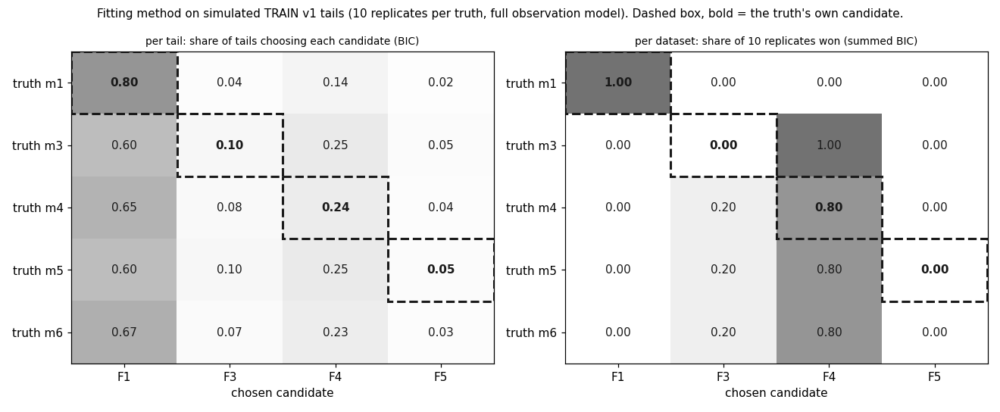
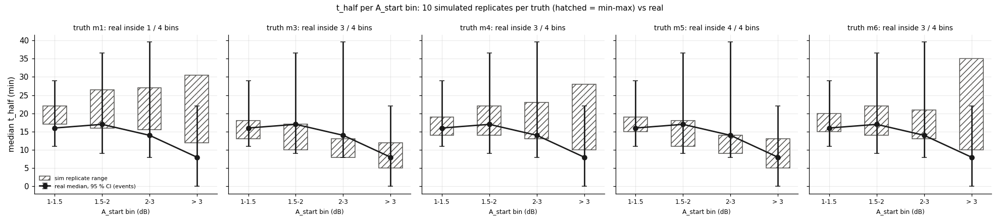
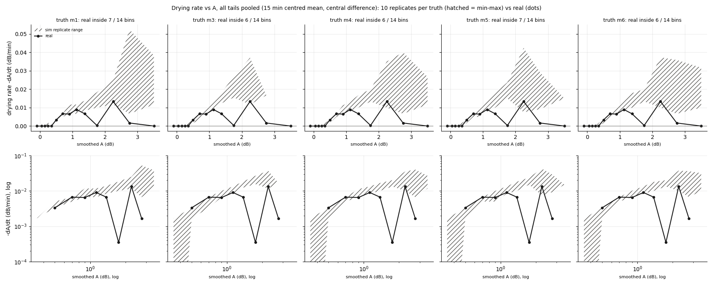
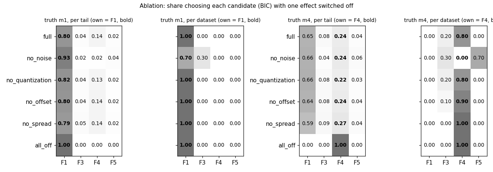

# wet_antenna step 3b-1: the fitting method on simulated tails (known truth)

Written by `research/wet_antenna/check_per_tail_fit.py` (libraries `simulator.py`, `per_tail_fit.py`; settings `wet_antenna.check_per_tail_fit`).
No real tail is fitted. Truths: m1, m3, m4, m5, m6 (step 3a-fix parameters and spread; m6: included: k_run = 0.04374, k_evap = 0.00554, A_c = 0.1615, s = 1.25).
10 replicate datasets per truth on the 429-tail TRAIN v1 skeleton (seeds 1000 ..
1009); ablation 10 replicates per variant. Fits: 257400 rows
(64350 tail fits x candidates). Run time 144 s.

## Summary in plain words

**What the data can tell apart.** Only one thing, and only when all tails of a dataset are scored together: a single exponential (m1) versus a slower-than-exponential tail. With the summed BIC, truth m1 chooses F1 in 100% of the replicates, and no non-exponential truth chooses F1 in more than 0%. They choose the two-layer F4 instead (m3 100%, m4 80%, m5 80%, m6 80%).

**What it cannot tell apart.** Which slow law it is: m3, m4, m5 and m6 all end up at F4 (or F3), so a dataset won by F4 does not mean two layers; the truth's own candidate wins only for m1 100%, m3 0%, m4 80%, m5 0% of the replicates (never for m3, m5). **Per tail nothing can be told apart**: F1 is chosen for 60%-80% of the tails whatever the truth is.

**Parameters.** The exponential time constant comes back without bias (m1: fitted / true tau median 1.01, 10-90 % 0.63-2.11); the slow layer of m4 does not (tau_s median x4.5, 90 % up to x266): a long, small slow layer trades off with the free offset c.

**Why.** For truth m4 the own candidate F4 wins 24% of the tails with every effect on and 100% with every effect off, but switching off ONE effect changes it little (no_noise 24%, no_offset 24%, no_quantization 22%, no_spread 28%). So no single effect is to blame: the noise alone (white + slow) or the 0.3 dB quantization alone is enough to hide the small slow layer in a tail of ~210 minutes (effective n ~64).

**Score.** AIC picks F4 for every truth per dataset (m1 too: 100%), so it cannot even see the exponential; BIC with the effective n is the score to use.

**Population tests do not help.** Over all pairs of truths, the replicate ranges are separate in 2 t_half bin(s) and 1 dA/dt bin(s): the laws, calibrated to the same median and band, predict the same pooled behaviour within the replicate scatter. The real t_half medians lie inside the range of m1 1/4, m3 3/4, m4 3/4, m5 4/4, m6 3/4 bins.

## 1. The fit

Each simulated tail (1 min A over its usable length) is fitted with F1 (exponential, 3 parameters), F4 (two layers,
5), F3 (nonlinear, n in [1.0, 3.0], 4) and F5 (linear + quadratic, 4), all with a free start W0 and offset c.
One effective sample size per tail from the lag-1 autocorrelation rho of the F4 residuals: n_eff = n (1 - rho) /
(1 + rho) (median n 210, rho 0.69, n_eff 64). Converged fits:
99.7%.

## 2. Which candidate wins (BIC; `research/wet_antenna/outputs/tables/check_per_tail_fit_confusion.csv` also has AIC)

Per tail (mean share over replicates):

| law | F1 | F3 | F4 | F5 |
|---|---|---|---|---|
| m1 | 0.802 | 0.041 | 0.138 | 0.019 |
| m3 | 0.596 | 0.105 | 0.252 | 0.048 |
| m4 | 0.65 | 0.077 | 0.236 | 0.038 |
| m5 | 0.599 | 0.103 | 0.248 | 0.05 |
| m6 | 0.669 | 0.067 | 0.23 | 0.034 |

Per dataset (share of replicates won by the summed BIC):

| law | F1 | F3 | F4 | F5 |
|---|---|---|---|---|
| m1 | 1.0 | 0.0 | 0.0 | 0.0 |
| m3 | 0.0 | 0.0 | 1.0 | 0.0 |
| m4 | 0.0 | 0.2 | 0.8 | 0.0 |
| m5 | 0.0 | 0.2 | 0.8 | 0.0 |
| m6 | 0.0 | 0.2 | 0.8 | 0.0 |

AIC, per tail / per dataset:

| law | F1 | F3 | F4 | F5 |
|---|---|---|---|---|
| m1 | 0.714 | 0.035 | 0.223 | 0.028 |
| m3 | 0.48 | 0.08 | 0.388 | 0.052 |
| m4 | 0.54 | 0.063 | 0.351 | 0.046 |
| m5 | 0.487 | 0.078 | 0.381 | 0.054 |
| m6 | 0.563 | 0.053 | 0.344 | 0.041 |

| law | F1 | F3 | F4 | F5 |
|---|---|---|---|---|
| m1 | 0.0 | 0.0 | 1.0 | 0.0 |
| m3 | 0.0 | 0.0 | 1.0 | 0.0 |
| m4 | 0.0 | 0.0 | 1.0 | 0.0 |
| m5 | 0.0 | 0.0 | 1.0 | 0.0 |
| m6 | 0.0 | 0.0 | 1.0 | 0.0 |

## 3. Parameter recovery of the true law's own candidate (`research/wet_antenna/outputs/tables/check_per_tail_fit_recovery.csv`, key)

Scale parameters: fitted / true per tail (1 = unbiased); phi, n: fitted - true; c: fitted - the true offset (the slow
noise also shifts the tail mean, so c is not expected to hit the offset exactly); W0: fitted - A_start.

| law | parameter | measure | true_value | n | median | p10 | p90 | at_bound_share |
|---|---|---|---|---|---|---|---|---|
| m1 | tau | fitted / true | 27.8586 | 4290 | 1.011 | 0.628 | 2.111 |  |
| m1 | c | fitted - true offset (dB) |  | 4290 | -0.007 | -0.273 | 0.155 |  |
| m1 | W0 | fitted - A_start (dB) |  | 4290 | -0.04 | -0.316 | 0.331 |  |
| m3 | k | fitted / true | 0.05656 | 4290 | 0.822 | 0.172 | 1.821 |  |
| m3 | n | fitted - true | 2.0 | 4290 | -0.473 | -1.0 | 1.0 | 0.401 |
| m3 | c | fitted - true offset (dB) |  | 4290 | -0.005 | -0.465 | 0.237 |  |
| m3 | W0 | fitted - A_start (dB) |  | 4290 | -0.124 | -0.475 | 0.417 |  |
| m4 | tau_f | fitted / true | 17.53524 | 4290 | 0.848 | 0.373 | 1.594 |  |
| m4 | tau_s | fitted / true | 180.71362 | 4290 | 4.515 | 0.179 | 266.145 |  |
| m4 | phi | fitted - true | 0.1714 | 4290 | 0.176 | -0.171 | 0.686 | 0.294 |
| m4 | c | fitted - true offset (dB) |  | 4290 | -0.056 | -5.047 | 0.189 |  |
| m4 | W0 | fitted - A_start (dB) |  | 4290 | 0.071 | -0.296 | 5.088 |  |
| m5 | a | fitted / true | 0.00319 | 4290 | 3.033 | 0.0 | 21.609 |  |
| m5 | b | fitted / true | 0.04805 | 4290 | 0.408 | 0.0 | 1.263 |  |
| m5 | c | fitted - true offset (dB) |  | 4290 | 0.009 | -0.293 | 0.241 |  |
| m5 | W0 | fitted - A_start (dB) |  | 4290 | -0.158 | -0.482 | 0.218 |  |

## 4. Population tests (all replicates of each truth vs the real TRAIN v1 tails)

**a. t_half per A_start bin** (`research/wet_antenna/outputs/tables/check_per_tail_fit_thalf_population.csv`): real median with 95 % CI (resampling events) vs the min-max
of the 10 replicate medians.

| bin | m1 | m3 | m4 | m5 | m6 |
|---|---|---|---|---|---|
| 1-1.5 | False | True | True | True | True |
| 1.5-2 | True | True | True | True | True |
| 2-3 | False | False | True | True | True |
| > 3 | False | True | False | True | False |

Real (median t_half in min, 95 % CI from resampling events):

| bin | tails | real_median | real_ci_low | real_ci_high |
|---|---|---|---|---|
| 1-1.5 | 290 | 16.0 | 11.0 | 29.0 |
| 1.5-2 | 91 | 17.0 | 9.0 | 36.6 |
| 2-3 | 39 | 14.0 | 8.0 | 39.6 |
| > 3 | 9 | 8.0 | 0.0 | 22.0 |

Pairs of truths whose replicate ranges do not overlap (bins): {'m1 vs m3': '1 of 4', 'm1 vs m4': '0 of 4', 'm1 vs m5': '1 of 4', 'm1 vs m6': '0 of 4', 'm3 vs m4': '0 of 4', 'm3 vs m5': '0 of 4', 'm3 vs m6': '0 of 4', 'm4 vs m5': '0 of 4', 'm4 vs m6': '0 of 4', 'm5 vs m6': '0 of 4'}.

**b. Drying rate -dA/dt vs A** (`research/wet_antenna/outputs/tables/check_per_tail_fit_dadt_population.csv`): bins of smoothed A where the real median lies inside each
truth's replicate range: m1: 7 / 14, m3: 6 / 14, m4: 6 / 14, m5: 7 / 14, m6: 6 / 14.
Pairs of truths that do not overlap (bins): {'m1 vs m3': '0 of 14', 'm1 vs m4': '0 of 14', 'm1 vs m5': '0 of 14', 'm1 vs m6': '0 of 14', 'm3 vs m4': '0 of 14', 'm3 vs m5': '1 of 14', 'm3 vs m6': '0 of 14', 'm4 vs m5': '0 of 14', 'm4 vs m6': '0 of 14', 'm5 vs m6': '0 of 14'}.

## 5. Ablation (truths m1, m4; `research/wet_antenna/outputs/tables/check_per_tail_fit_ablation.csv`)

Per tail, share choosing each candidate:

| law | variant | F1 | F3 | F4 | F5 |
|---|---|---|---|---|---|
| m1 | all_off | 1.0 | 0.0 | 0.0 | 0.0 |
| m1 | full | 0.802 | 0.041 | 0.138 | 0.019 |
| m1 | no_noise | 0.926 | 0.015 | 0.018 | 0.041 |
| m1 | no_offset | 0.801 | 0.039 | 0.142 | 0.018 |
| m1 | no_quantization | 0.815 | 0.041 | 0.128 | 0.016 |
| m1 | no_spread | 0.786 | 0.053 | 0.139 | 0.022 |
| m4 | all_off | 0.0 | 0.0 | 1.0 | 0.0 |
| m4 | full | 0.65 | 0.077 | 0.236 | 0.038 |
| m4 | no_noise | 0.657 | 0.035 | 0.244 | 0.064 |
| m4 | no_offset | 0.644 | 0.078 | 0.239 | 0.039 |
| m4 | no_quantization | 0.663 | 0.081 | 0.221 | 0.034 |
| m4 | no_spread | 0.591 | 0.09 | 0.275 | 0.044 |

Per dataset, share of replicates won:

| law | variant | F1 | F3 | F4 | F5 |
|---|---|---|---|---|---|
| m1 | all_off | 1.0 | 0.0 | 0.0 | 0.0 |
| m1 | full | 1.0 | 0.0 | 0.0 | 0.0 |
| m1 | no_noise | 0.7 | 0.3 | 0.0 | 0.0 |
| m1 | no_offset | 1.0 | 0.0 | 0.0 | 0.0 |
| m1 | no_quantization | 1.0 | 0.0 | 0.0 | 0.0 |
| m1 | no_spread | 1.0 | 0.0 | 0.0 | 0.0 |
| m4 | all_off | 0.0 | 0.0 | 1.0 | 0.0 |
| m4 | full | 0.0 | 0.2 | 0.8 | 0.0 |
| m4 | no_noise | 0.0 | 0.3 | 0.0 | 0.7 |
| m4 | no_offset | 0.0 | 0.1 | 0.9 | 0.0 |
| m4 | no_quantization | 0.0 | 0.2 | 0.8 | 0.0 |
| m4 | no_spread | 0.0 | 0.0 | 1.0 | 0.0 |

## Unclear

1. **One n_eff per tail, from the F4 residuals.** If F4 overfits the slow noise, rho and n_eff are too optimistic for
   the simpler candidates; a per-candidate n_eff would change the per-tail choice between nested models.
2. **The offset c absorbs the mean of the slow noise over the tail** (AR(1) with tau_noise ~80 min does not average
   out within a few hours), so c and the late part of the curve trade off; this limits what any fit can say about the
   slow layer of F4 or the tail of F3 / F5.
3. **The ablation keeps the real NaN mask and the tail lengths**; "all off" is therefore not a perfect, infinite
   signal: short tails stay short.
4. **The population tests reuse the calibration data**: the laws were calibrated on the real median and band, so the
   real median curve is close to every law by construction; t_half per bin and dA/dt use the same tails, only cut a
   different way.
5. **m6 is a truth only**; there is no state-switch candidate among F1-F5, so its row shows which smooth law
   absorbs a switch.
6. **The ablation has no "noise and quantization off, offset and spread on" variant**, so the claim that noise OR
   quantization alone suffices to hide the slow layer rests on the single-effect variants plus "all off".
7. **The real dA/dt curve above ~1.5 dB is thin** (few minutes, few events; the zig-zag to ~0 at 1.75 and 3.5 dB): the
   simulated drying rates there are higher than the real ones for every law. This can be the early part of real
   tails (plateaus, the fast drop just after t0_trace) that no smooth law has, or simply too few minutes.
8. **Replicates share the skeleton** (same tails, lengths, A_start); the replicate range is the spread from noise and
   spread draws, not from a different set of events.
