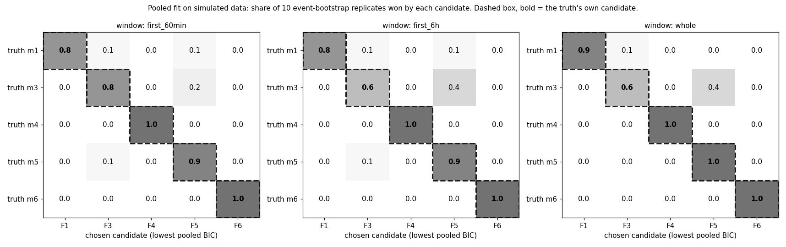
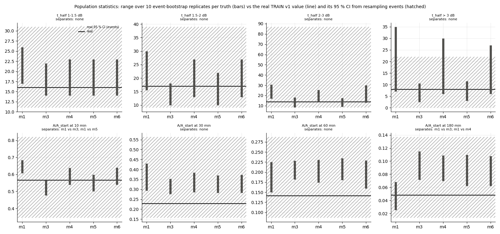

# wet_antenna step 3b-1b: pooled fit, re-tested on simulated tails (known truth)

Written by `research/wet_antenna/check_pooled_fit.py` (libraries `pooled_fit.py`, `simulator.py`, `per_tail_fit.py`; settings
`wet_antenna.check_pooled_fit`). No real tail is fitted. Run time 31 s (fits cached in `.cache/check_pooled_fit/`).

## Summary in plain words

**Which law wins when it is the truth** (share of the event-bootstrap replicates won by the truth's own candidate): first_60min: m1 80%, m3 80%, m4 100%, m5 90%, m6 100%; first_6h: m1 80%, m3 60%, m4 100%, m5 90%, m6 100%; whole: m1 90%, m3 60%, m4 100%, m5 100%, m6 100%. The best window is first_60min.

**Pre-set rule** (own candidate >= 80 % for m1, m4, m5, m6 and key parameters within +-30 %): met in first_60min, first_6h, whole.

**Parameters recovered within +-30 % (first_60min)**: m1 tau (x1.044), m3 k (x0.964), m3 n (x1.015), m4 tau_f (x1.019), m4 tau_s (x0.977), m4 phi (x1.051), m5 a (x0.999), m5 b (x0.99), m6 k_run (x0.982), m6 k_evap (x1.113), m6 A_c (x0.917).

**Population statistics** separate A/A_start at 10 min: m1 vs m3; m1 vs m5; A/A_start at 180 min: m1 vs m3; m1 vs m4 (non-overlapping replicate ranges, event bootstrap).

**What the real tails will be able to tell us (e).** On simulated data with a known noise model, the pooled fit tells the five drying forms apart and recovers their parameters (exponential, two layers, linear + quadratic and the state switch reliably; the pure power law m3 is partly taken for linear + quadratic: F5 wins first_60min 20%, first_6h 40%, whole 40% of the m3 replicates). On the real tails it can therefore say WHICH of the five forms describes the drying best, with its parameters and an event-bootstrap uncertainty. It cannot prove a mechanism (the true law may be none of the five; the winner is then the best approximation). And here the fit used the simulator's own noise model, while real dry noise has more than one time scale: before a real-data winner is trusted, a misspecified-noise test is needed (truth with two noise time scales, fit with one), because unmodelled slow noise can favour the more flexible F4 / F6.

## Method

- **Data**: truths m1 (exponential), m3 (nonlinear dW/dt = -c W^n), m4 (two layers (fast + slow exponential)), m5 (linear + quadratic dW/dt = -a W - b W^2), m6 (state switch (run-off above A_c, evaporation)); 10 replicates, each an EVENT
  bootstrap of the 429-tail TRAIN v1 skeleton (24 events drawn with replacement, all
  their tails; the same draws for every truth; replicate sizes 289-832 tails).
- **Pooled model**: A = W(t / f_i; theta, W0_i) + c_i + noise. theta shared; W0_i per tail (profiled; exact for F1 / F4,
  two Gauss-Newton steps for F3 / F5 / F6); f_i = exp(s (u_link + v_tail)), u, v ~ N(0, 1/2), s fitted; c_i ~ N(0,
  offset_std^2) MAP (closed form); noise white + AR(1) per sub-link = ARMA(1,1), residuals whitened (Box-Jenkins,
  first minute with its stationary variance; NaN minutes dropped).
- **Marginalisation of the speed factors**: per tail, a LAPLACE (Gaussian) approximation of the profile
  log-likelihood in g = u + v (lattice of 17 points, peak refined, curvature from +-0.05); the
  per-tail part v is then integrated analytically and the per-link part u by quadrature on 13 nodes of
  N(0, 1/2). Not a full mixed model: W0 and c are profiled, not integrated.
- **Score**: BIC = -2 log L + k ln N with k = law parameters + 1 (s) and N = the number of distinct (link, event draw)
  pairs that have tails in the window (both directions of a link in one event count once; a link in two events or
  two draws counts twice). Median N: 285 (vs 416 tails).
- **Optimiser**: Nelder-Mead in an unconstrained space from the real-data calibration of each candidate's own truth,
  s = 1.0; converged: 98% (18 fits stopped at maxfev
  400); median 116 evaluations.

## a. Confusion (share of replicates won, lowest pooled BIC; key figure)

**first_60min**

| law | F1 | F3 | F4 | F5 | F6 |
|---|---|---|---|---|---|
| m1 | 0.8 | 0.1 | 0.0 | 0.1 | 0.0 |
| m3 | 0.0 | 0.8 | 0.0 | 0.2 | 0.0 |
| m4 | 0.0 | 0.0 | 1.0 | 0.0 | 0.0 |
| m5 | 0.0 | 0.1 | 0.0 | 0.9 | 0.0 |
| m6 | 0.0 | 0.0 | 0.0 | 0.0 | 1.0 |

**first_6h**

| law | F1 | F3 | F4 | F5 | F6 |
|---|---|---|---|---|---|
| m1 | 0.8 | 0.1 | 0.0 | 0.1 | 0.0 |
| m3 | 0.0 | 0.6 | 0.0 | 0.4 | 0.0 |
| m4 | 0.0 | 0.0 | 1.0 | 0.0 | 0.0 |
| m5 | 0.0 | 0.1 | 0.0 | 0.9 | 0.0 |
| m6 | 0.0 | 0.0 | 0.0 | 0.0 | 1.0 |

**whole**

| law | F1 | F3 | F4 | F5 | F6 |
|---|---|---|---|---|---|
| m1 | 0.9 | 0.1 | 0.0 | 0.0 | 0.0 |
| m3 | 0.0 | 0.6 | 0.0 | 0.4 | 0.0 |
| m4 | 0.0 | 0.0 | 1.0 | 0.0 | 0.0 |
| m5 | 0.0 | 0.0 | 0.0 | 1.0 | 0.0 |
| m6 | 0.0 | 0.0 | 0.0 | 0.0 | 1.0 |

median dBIC to the second candidate: first_60min 5.1, first_6h 6.2, whole 7.6.

## b. Recovery of the own candidate's parameters (`research/wet_antenna/outputs/tables/check_pooled_fit_recovery.csv`, key)

fitted / true per replicate: median and 10-90 % over the 10 replicates; within_tol = |median - 1| <=
0.3.

| law | window | parameter | true | median_ratio | p10_ratio | p90_ratio | replicates | within_tol |
|---|---|---|---|---|---|---|---|---|
| m1 | first_60min | tau | 29.75393 | 1.044 | 0.884 | 1.107 | 10 | True |
| m1 | first_60min | s | 1.25 | 0.941 | 0.897 | 1.013 | 10 | True |
| m1 | first_6h | tau | 29.75393 | 1.027 | 0.923 | 1.187 | 10 | True |
| m1 | first_6h | s | 1.25 | 0.958 | 0.934 | 1.041 | 10 | True |
| m1 | whole | tau | 29.75393 | 1.055 | 0.912 | 1.145 | 10 | True |
| m1 | whole | s | 1.25 | 0.971 | 0.94 | 1.011 | 10 | True |
| m3 | first_60min | k | 0.05296 | 0.964 | 0.911 | 1.109 | 10 | True |
| m3 | first_60min | n | 2.0 | 1.015 | 0.993 | 1.039 | 10 | True |
| m3 | first_60min | s | 1.25 | 1.006 | 0.962 | 1.088 | 10 | True |
| m3 | first_6h | k | 0.05296 | 0.987 | 0.857 | 1.098 | 10 | True |
| m3 | first_6h | n | 2.0 | 1.003 | 0.988 | 1.023 | 10 | True |
| m3 | first_6h | s | 1.25 | 1.016 | 0.984 | 1.046 | 10 | True |
| m3 | whole | k | 0.05296 | 0.993 | 0.885 | 1.086 | 10 | True |
| m3 | whole | n | 2.0 | 0.994 | 0.981 | 1.021 | 10 | True |
| m3 | whole | s | 1.25 | 1.017 | 0.974 | 1.046 | 10 | True |
| m4 | first_60min | tau_f | 18.72823 | 1.019 | 0.897 | 1.169 | 10 | True |
| m4 | first_60min | tau_s | 193.00825 | 0.977 | 0.863 | 1.069 | 10 | True |
| m4 | first_60min | phi | 0.17142 | 1.051 | 0.987 | 1.216 | 10 | True |
| m4 | first_60min | s | 1.25 | 0.97 | 0.923 | 1.031 | 10 | True |
| m4 | first_6h | tau_f | 18.72823 | 1.06 | 0.956 | 1.103 | 10 | True |
| m4 | first_6h | tau_s | 193.00825 | 1.028 | 0.894 | 1.125 | 10 | True |
| m4 | first_6h | phi | 0.17142 | 1.054 | 0.978 | 1.132 | 10 | True |
| m4 | first_6h | s | 1.25 | 0.976 | 0.947 | 1.037 | 10 | True |
| m4 | whole | tau_f | 18.72823 | 1.042 | 0.904 | 1.113 | 10 | True |
| m4 | whole | tau_s | 193.00825 | 1.021 | 0.841 | 1.124 | 10 | True |
| m4 | whole | phi | 0.17142 | 1.036 | 0.971 | 1.126 | 10 | True |
| m4 | whole | s | 1.25 | 0.973 | 0.933 | 1.023 | 10 | True |
| m5 | first_60min | a | 0.00299 | 0.999 | 0.848 | 1.485 | 10 | True |
| m5 | first_60min | b | 0.04499 | 0.99 | 0.929 | 1.075 | 10 | True |
| m5 | first_60min | s | 1.25 | 1.009 | 0.957 | 1.077 | 10 | True |
| m5 | first_6h | a | 0.00299 | 1.129 | 0.941 | 1.662 | 10 | True |
| m5 | first_6h | b | 0.04499 | 0.998 | 0.865 | 1.1 | 10 | True |
| m5 | first_6h | s | 1.25 | 1.01 | 0.98 | 1.048 | 10 | True |
| m5 | whole | a | 0.00299 | 1.146 | 0.889 | 1.679 | 10 | True |
| m5 | whole | b | 0.04499 | 0.957 | 0.88 | 1.071 | 10 | True |
| m5 | whole | s | 1.25 | 1.024 | 0.961 | 1.041 | 10 | True |
| m6 | first_60min | k_run | 0.04374 | 0.982 | 0.812 | 1.039 | 10 | True |
| m6 | first_60min | k_evap | 0.00554 | 1.113 | 0.92 | 1.315 | 10 | True |
| m6 | first_60min | A_c | 0.16148 | 0.917 | 0.817 | 1.106 | 10 | True |
| m6 | first_60min | s | 1.25 | 0.939 | 0.909 | 1.015 | 10 | True |
| m6 | first_6h | k_run | 0.04374 | 0.909 | 0.801 | 1.009 | 10 | True |
| m6 | first_6h | k_evap | 0.00554 | 1.16 | 0.997 | 1.233 | 10 | True |
| m6 | first_6h | A_c | 0.16148 | 0.992 | 0.901 | 1.115 | 10 | True |
| m6 | first_6h | s | 1.25 | 0.976 | 0.935 | 1.058 | 10 | True |
| m6 | whole | k_run | 0.04374 | 0.955 | 0.822 | 1.023 | 10 | True |
| m6 | whole | k_evap | 0.00554 | 1.183 | 0.932 | 1.281 | 10 | True |
| m6 | whole | A_c | 0.16148 | 1.002 | 0.937 | 1.122 | 10 | True |
| m6 | whole | s | 1.25 | 0.986 | 0.939 | 1.024 | 10 | True |

## c. Population statistics (`research/wet_antenna/outputs/tables/check_pooled_fit_population.csv`)

Real value with its 95 % CI (resampling events) vs the min-max over the replicates of each truth. Statistics that
separate at least one pair of truths (non-overlapping ranges):

| statistic | separates |
|---|---|
| A/A_start at 10 min | m1 vs m3; m1 vs m5 |
| A/A_start at 180 min | m1 vs m3; m1 vs m4 |

Real value inside each truth's range (number of the 8 statistics): {'m1_real_inside': 3, 'm3_real_inside': 4, 'm4_real_inside': 5, 'm5_real_inside': 5, 'm6_real_inside': 5}.

| statistic | real | real_ci_low | real_ci_high | m1_min | m1_max | m3_min | m3_max | m4_min | m4_max | m5_min | m5_max | m6_min | m6_max |
|---|---|---|---|---|---|---|---|---|---|---|---|---|---|
| t_half 1-1.5 dB | 16.0 | 11.0 | 31.012 | 17.0 | 26.0 | 14.0 | 22.0 | 14.0 | 23.0 | 14.0 | 23.0 | 14.0 | 23.0 |
| t_half 1.5-2 dB | 17.0 | 9.0 | 39.0 | 15.5 | 30.0 | 10.0 | 18.0 | 13.0 | 27.0 | 10.0 | 22.0 | 13.0 | 27.0 |
| t_half 2-3 dB | 14.0 | 8.0 | 87.0 | 17.0 | 30.5 | 8.5 | 18.0 | 14.0 | 25.5 | 9.0 | 17.5 | 13.0 | 30.0 |
| t_half > 3 dB | 8.0 | 0.0 | 22.0 | 7.0 | 35.0 | 2.5 | 10.5 | 6.0 | 30.0 | 3.0 | 11.5 | 6.0 | 27.0 |
| A/A_start at 10 min | 0.568 | 0.345 | 0.82 | 0.606 | 0.685 | 0.476 | 0.567 | 0.54 | 0.638 | 0.501 | 0.597 | 0.54 | 0.64 |
| A/A_start at 30 min | 0.229 | 0.156 | 0.564 | 0.293 | 0.43 | 0.276 | 0.353 | 0.286 | 0.384 | 0.282 | 0.371 | 0.282 | 0.374 |
| A/A_start at 60 min | 0.142 | 0.086 | 0.287 | 0.15 | 0.225 | 0.182 | 0.228 | 0.174 | 0.231 | 0.18 | 0.235 | 0.159 | 0.229 |
| A/A_start at 180 min | 0.048 | 0.013 | 0.137 | 0.025 | 0.068 | 0.072 | 0.115 | 0.07 | 0.109 | 0.062 | 0.11 | 0.062 | 0.108 |

## d. Decision rule (fixed in `wet_antenna.check_pooled_fit.decision` before the run)

Useful if, per dataset, the truth's own candidate wins >= 80% of the replicates for
m1, m4, m5, m6, and every key law parameter is recovered within +-30%
(median). Met per window (all four truths): {'first_60min': True, 'first_6h': True, 'whole': True}.

| law | window | in_rule | own_win_share | win_ok | params_ok | params_off | main_confusion | met |
|---|---|---|---|---|---|---|---|---|
| m1 | first_60min | True | 0.8 | True | True |  | F3 10% | True |
| m1 | first_6h | True | 0.8 | True | True |  | F3 10% | True |
| m1 | whole | True | 0.9 | True | True |  | F3 10% | True |
| m3 | first_60min | False | 0.8 | True | True |  | F5 20% | True |
| m3 | first_6h | False | 0.6 | False | True |  | F5 40% | False |
| m3 | whole | False | 0.6 | False | True |  | F5 40% | False |
| m4 | first_60min | True | 1.0 | True | True |  |  | True |
| m4 | first_6h | True | 1.0 | True | True |  |  | True |
| m4 | whole | True | 1.0 | True | True |  |  | True |
| m5 | first_60min | True | 0.9 | True | True |  | F3 10% | True |
| m5 | first_6h | True | 0.9 | True | True |  | F3 10% | True |
| m5 | whole | True | 1.0 | True | True |  |  | True |
| m6 | first_60min | True | 1.0 | True | True |  |  | True |
| m6 | first_6h | True | 1.0 | True | True |  |  | True |
| m6 | whole | True | 1.0 | True | True |  |  | True |

## Unclear

1. **The noise model in the fit is the simulator's own** (same sub-link parameters, same white + AR(1) form). On real
   tails the true noise has more than one time scale (3a-fix), so the real-data likelihood will be less sharp than here.
2. **Quantization is not in the likelihood**: it is folded into the white part ((sigma_white^2 + 0.3^2 / 12) / 6),
   which is only right when the 10 s noise dithers the 0.3 dB steps; for the quietest sub-links it is not.
3. **Laplace in g** assumes each tail's profile likelihood is near-Gaussian in log speed; for tails that barely decay
   in the window (first 60 min of slow tails) it is flat and one-sided.
4. **W0 and c are profiled, not integrated** (a few hundred nuisance parameters per dataset); they are the same for
   every candidate, so they do not bias the comparison, but log L is optimistic in absolute terms.
5. **BIC's N** counts (link, event draw) pairs; neighbouring links in one event share weather and are not
   independent either, so N is still an upper bound on the independent information.
6. **One optimiser start per candidate** (the real-data calibration); a few fits stop at maxfev. A worse local optimum
   for the true candidate would show up as a confusion, not as a crash.
7. **m3 is not in the decision rule** (as set); its row is reported for completeness.
8. **The real early decay is faster than every simulated truth**: the real median A / A_start at 30 min
   (0.229) lies below the replicate range of every
   truth (lowest minimum 0.276),
   though inside its own wide CI (0.156-0.564).
   The same holds at 60 min (real 0.142, lowest truth
   minimum 0.150), and at 180 min only
   m1's range contains the real value. So the real tails fall faster early and keep less of a slow tail than every
   calibrated truth: a hint (the real CIs are wide), not a result. With the calibrated spread s = 1.25 the simulated
   first hour stays a little slow. The real fit (step 4) fits s and the law parameters on the real tails, so it is not
   bound to the calibration.
9. **Replicate sizes vary** (event bootstrap: 289-832 tails), so the power varies between
   replicates; the confusion shares are over these varying sizes.
