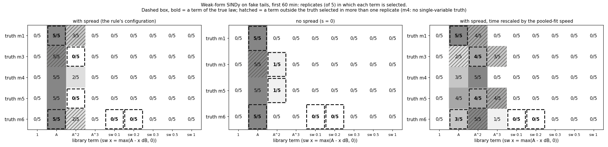

# wet_antenna step 3b-2: weak-form SINDy on fake tails (known truth)

Written by `research/wet_antenna/check_sindy.py` (libraries `sindy.py`, `simulator.py`, `pooled_fit.py`; settings
`wet_antenna.check_sindy`). Fake data only: no real tail is fitted and the frozen tail set v1 is not changed.

**Verdicts: Q1 FAIL, Q2 FAIL, Q3 PARTIAL, Q4 FAIL** (section 8).

## 1. What was run

- **Software**: pysindy is not installed in this environment (neither is scikit-learn, which it needs), so the
  weak-form SINDy is written out in `sindy.py` (numpy 2.4.5 only, about 150 lines): weak-form rows,
  thresholded sparse regression, cross-validation over events, stability selection.
- **Data**: the fake datasets of step 3b-1c, test T2 (3a-fix noise, event bootstrap of the 429-tail TRAIN v1
  skeleton, seeds 3000 + replicate), 5 replicates per truth: m1, m3, m4, m5, m6 with spread
  s = 1.25, and m1, m3, m5, m6 with no spread (s = 0; same seeds, so the same noise and
  offsets). 20 of the 20 spread datasets that step 3b-1c also made are bit-identical to
  its datasets (m3 was not a truth there). Windows: first_60min, whole.
- **Runs**: 370 SINDy runs on 45 datasets (window x offset mode x rescaling). Pooled fits for the
  25 spread datasets (5 candidates, 4 starts each, first 60 min): 400 reused from
  step 3b-1c, 100 new (m3).
- **Cut for time**: nothing. The timed replicate (m3 with spread) took
  175 s for the pooled fits and 13 s for its SINDy runs; projected
  total 8 min on 3 processes (budget 2.0 h).
- **Run time**: 18 min wall time (cached in `.cache/check_sindy/`). This run: 10 s.

## 2. Library, settings and the offset

- **Law searched**: dA/dt = sum of xi_j theta_j(A), one law for all tails of a dataset. Library (9 terms):
  1, A, A^2, A^3 and the switch terms max(A - A_c, 0) for A_c = 0.1, 0.2, 0.3, 0.5, 1.0 dB (written `sw0.1` ...).
- **Weak form**: test function phi = (1 - tau^2)^2 on windows of 21 min, centres every
  5 min; row: -integral(phi' A) = sum xi_j integral(phi theta_j(A)). NaN runs up to 3 min
  are interpolated, a window with a NaN left is skipped. Rows of a tail are weighted by 1 / (1 min noise sd of its
  sub-link, from `sim_noise_params.csv`). Median rows and tails per dataset:

| window | offset | rows | tails |
|---|---|---|---|
| first_60min | handled | 3821.0 | 478.0 |
| first_60min | naive | 3821.0 | 478.0 |
| first_60min | oracle | 3821.0 | 478.0 |
| whole | handled | 34468.0 | 478.0 |
| whole | naive | 34468.0 | 478.0 |
| whole | oracle | 34468.0 | 478.0 |

- **Sparse regression**: thresholded backward elimination (`waa_sindy.select`). The usual STLSQ (drop small
  coefficients) failed a noise-free self-test: while A > 0.1 dB the term max(A - 0.1, 0) is A minus a constant, the
  fit splits the coefficient between such copies and none is small. So a term is judged by how much the fit worsens
  without it (sqrt of the increase of the squared residual / ||b||), and among the terms that cost less than the
  threshold the least simple one (last in the library order) is removed first.
- **Threshold**: grid [0.01, 0.02, 0.03, 0.05, 0.08, 0.12, 0.2, 0.3, 0.45], chosen per run by 5-fold cross-validation over EVENT DRAWS
  (all tails of an event draw are held out together), one-standard-error rule (largest threshold within one SE of
  the best held-out error). Chosen thresholds (median, min, max):

| spread | window | offset | rescale | median | min | max |
|---|---|---|---|---|---|---|
| False | first_60min | handled | none | 0.45 | 0.12 | 0.45 |
| False | first_60min | naive | none | 0.12 | 0.08 | 0.3 |
| False | first_60min | oracle | none | 0.16 | 0.05 | 0.45 |
| False | whole | handled | none | 0.2 | 0.12 | 0.45 |
| False | whole | naive | none | 0.2 | 0.12 | 0.3 |
| False | whole | oracle | none | 0.2 | 0.08 | 0.45 |
| True | first_60min | handled | fit | 0.2 | 0.08 | 0.45 |
| True | first_60min | handled | none | 0.45 | 0.12 | 0.45 |
| True | first_60min | handled | true | 0.2 | 0.05 | 0.45 |
| True | first_60min | naive | none | 0.2 | 0.12 | 0.45 |
| True | first_60min | oracle | none | 0.2 | 0.05 | 0.45 |
| True | whole | handled | fit | 0.2 | 0.08 | 0.45 |
| True | whole | handled | none | 0.3 | 0.12 | 0.3 |
| True | whole | handled | true | 0.2 | 0.03 | 0.45 |
| True | whole | naive | none | 0.2 | 0.08 | 0.3 |
| True | whole | oracle | none | 0.2 | 0.08 | 0.3 |

- **Stability selection**: 50 bootstrap resamples of the event draws at the chosen threshold; a
  term counts as **selected in a replicate if its frequency is >= 0.6**. Coefficients: ordinary least squares on the
  selected terms.
- **Offset** (A = W + c, c unknown per tail), three ways:
  - `naive`: ignore c (use A as W).
  - `handled` (my way, the configuration of the rule): a free constant per tail in dA/dt, removed by subtracting each
    tail's mean from all its weak-form rows. For a linear law this is exact (dA/dt = -k (A - c) = -k A + k c). For
    a nonlinear law it is not (W^2 = A^2 - 2 c A + c^2: a per-tail slope error is left). Price: the library's
    constant term `1` cannot be seen any more, and the absolute level of A (where W = 0 is) is given up.
  - `oracle`: the true c subtracted. Impossible on real data; it shows the ceiling.
- **Rescaling check** (spread datasets, handled offset): right-hand side divided by the tail's speed factor f_i
  (f_i dA/dt = h(A)): `fit` = f_i estimated by the BIC-winning pooled fit of the same dataset (posterior mode per
  tail), `true` = the simulator's f_i.
- **True terms of the rule** (`wet_antenna.check_sindy.decision.true_terms`): m1: A; m3: A^2; m5: A^2 (A allowed, its coefficient
  reported but not counted); m6: A and a switch term at 0.1 or 0.2 dB (true A_c = 0.16 dB). Seen in
  the noise-free self-test before the run: above A_c the switch law IS a straight line, dW/dt = k_run A_c -
  (k_run + k_evap) W, so on tails that stay above A_c the terms `1` + `A` describe it exactly.

## 3. Selection frequency: truth x term (`research/wet_antenna/outputs/tables/check_sindy_selection.csv`)

Replicates (of 5) in which the term is selected; **bold** = a term of the true law. First 60 min, handled offset.

**With spread (the configuration of the rule):**

| truth | 1 | A | A^2 | A^3 | sw0.1 | sw0.2 | sw0.3 | sw0.5 | sw1 |
|---|---|---|---|---|---|---|---|---|---|
| m1 | 0/5 | **5/5** | 3/5 | 0/5 | 0/5 | 0/5 | 0/5 | 0/5 | 0/5 |
| m3 | 0/5 | 5/5 | **0/5** | 0/5 | 0/5 | 0/5 | 0/5 | 0/5 | 0/5 |
| m4 | 0/5 | 5/5 | 2/5 | 0/5 | 0/5 | 0/5 | 0/5 | 0/5 | 0/5 |
| m5 | 0/5 | 5/5 | **0/5** | 0/5 | 0/5 | 0/5 | 0/5 | 0/5 | 0/5 |
| m6 | 0/5 | **5/5** | 2/5 | 0/5 | **0/5** | **0/5** | 0/5 | 0/5 | 0/5 |

| truth | returned (x replicates) | median threshold |
|---|---|---|
| m1 | A + A^2 x3, A x2 | 0.2 |
| m3 | A x5 | 0.45 |
| m4 | A x3, A + A^2 x2 | 0.45 |
| m5 | A x5 | 0.45 |
| m6 | A x3, A + A^2 x2 | 0.2 |

**No spread (s = 0):**

| truth | 1 | A | A^2 | A^3 | sw0.1 | sw0.2 | sw0.3 | sw0.5 | sw1 |
|---|---|---|---|---|---|---|---|---|---|
| m1 | 0/5 | **5/5** | 0/5 | 0/5 | 0/5 | 0/5 | 0/5 | 0/5 | 0/5 |
| m3 | 0/5 | 5/5 | **1/5** | 0/5 | 0/5 | 0/5 | 0/5 | 0/5 | 0/5 |
| m5 | 0/5 | 5/5 | **1/5** | 0/5 | 0/5 | 0/5 | 0/5 | 0/5 | 0/5 |
| m6 | 0/5 | **5/5** | 0/5 | 0/5 | **0/5** | **0/5** | 0/5 | 0/5 | 0/5 |

| truth | returned (x replicates) | median threshold |
|---|---|---|
| m1 | A x5 | 0.45 |
| m3 | A x4, A + A^2 x1 | 0.45 |
| m5 | A x4, A + A^2 x1 | 0.45 |
| m6 | A x5 | 0.45 |

**With spread, time rescaled by the pooled-fit speed:**

| truth | 1 | A | A^2 | A^3 | sw0.1 | sw0.2 | sw0.3 | sw0.5 | sw1 |
|---|---|---|---|---|---|---|---|---|---|
| m1 | 0/5 | **5/5** | 4/5 | 0/5 | 0/5 | 0/5 | 0/5 | 0/5 | 0/5 |
| m3 | 0/5 | 2/5 | **4/5** | 3/5 | 0/5 | 0/5 | 0/5 | 0/5 | 0/5 |
| m4 | 0/5 | 3/5 | 5/5 | 0/5 | 0/5 | 0/5 | 0/5 | 0/5 | 0/5 |
| m5 | 0/5 | 4/5 | **4/5** | 4/5 | 0/5 | 0/5 | 0/5 | 0/5 | 0/5 |
| m6 | 0/5 | **3/5** | 5/5 | 1/5 | **0/5** | **0/5** | 0/5 | 0/5 | 0/5 |

**With spread, time rescaled by the TRUE speed:**

| truth | 1 | A | A^2 | A^3 | sw0.1 | sw0.2 | sw0.3 | sw0.5 | sw1 |
|---|---|---|---|---|---|---|---|---|---|
| m1 | 0/5 | **4/5** | 2/5 | 0/5 | 1/5 | 1/5 | 0/5 | 0/5 | 0/5 |
| m3 | 0/5 | 1/5 | **4/5** | 1/5 | 0/5 | 0/5 | 0/5 | 0/5 | 0/5 |
| m4 | 0/5 | 3/5 | 5/5 | 0/5 | 0/5 | 0/5 | 0/5 | 0/5 | 0/5 |
| m5 | 0/5 | 3/5 | **4/5** | 0/5 | 0/5 | 0/5 | 0/5 | 0/5 | 0/5 |
| m6 | 0/5 | **3/5** | 5/5 | 0/5 | **0/5** | **0/5** | 0/5 | 0/5 | 0/5 |

The pre-set rule in EVERY configuration (cell = `met`, or why not). Only the first-60-min, handled, not rescaled row
with spread counts for Q1; the others show what helps and what hurts.

With spread:

| window | offset | rescale | m1 | m3 | m5 | m6 |
|---|---|---|---|---|---|---|
| first_60min | handled | fit | spurious A^2 4/5; coef A x0.48 | spurious A 2/5, A^3 3/5; coef A^2 x0.45 | spurious A^3 4/5; coef A^2 x0.38 | true A 3/5, sw0.1/sw0.2 0/5; spurious A^2 5/5; coef A x2.31, switch x0.00 |
| first_60min | handled | none | spurious A^2 3/5; coef A x1.79 | true A^2 0/5; spurious A 5/5; coef A^2 x0.00 | true A^2 0/5; coef A^2 x0.00 | true sw0.1/sw0.2 0/5; spurious A^2 2/5; coef A x9.06, switch x0.00 |
| first_60min | handled | true | spurious A^2 2/5; coef A x0.28 | coef A^2 x0.55 | coef A^2 x0.52 | true A 3/5, sw0.1/sw0.2 0/5; spurious A^2 5/5; coef A x1.53, switch x0.00 |
| first_60min | naive | none | spurious 1 5/5; coef A x0.19 | true A^2 0/5; spurious 1 5/5, A 4/5; coef A^2 x0.00 | true A^2 0/5; spurious 1 5/5; coef A^2 x0.00 | true sw0.1/sw0.2 0/5; spurious 1 5/5; coef A x1.72, switch x0.00 |
| first_60min | oracle | none | spurious 1 5/5, A^2 3/5, A^3 2/5; coef A x0.30 | true A^2 0/5; spurious 1 4/5, A 4/5; coef A^2 x0.00 | true A^2 0/5; spurious 1 5/5; coef A^2 x0.00 | true sw0.1/sw0.2 0/5; spurious 1 5/5; coef A x1.78, switch x0.00 |
| whole | handled | fit | true A 1/5; spurious A^2 4/5; coef A x0.00 | true A^2 2/5; spurious A^3 4/5; coef A^2 x0.00 | true A^2 2/5; spurious A^3 4/5; coef A^2 x0.00 | true A 0/5, sw0.1/sw0.2 0/5; spurious sw0.5 2/5; coef A x0.00, switch x0.00 |
| whole | handled | none | coef A x0.43 | true A^2 0/5; spurious A 5/5; coef A^2 x0.00 | true A^2 0/5; coef A^2 x0.00 | true sw0.1/sw0.2 0/5; coef A x2.88, switch x0.00 |
| whole | handled | true | true A 0/5; spurious A^2 2/5; coef A x0.00 | true A^2 2/5; spurious A^3 3/5; coef A^2 x0.00 | true A^2 2/5; spurious A^3 3/5; coef A^2 x0.00 | true A 1/5, sw0.1/sw0.2 0/5; spurious sw0.5 2/5; coef A x0.00, switch x0.00 |
| whole | naive | none | coef A x0.25 | true A^2 0/5; spurious A 5/5; coef A^2 x0.00 | true A^2 0/5; coef A^2 x0.00 | true sw0.1/sw0.2 0/5; coef A x1.64, switch x0.00 |
| whole | oracle | none | coef A x0.30 | true A^2 0/5; spurious A 5/5; coef A^2 x0.00 | true A^2 0/5; coef A^2 x0.00 | true sw0.1/sw0.2 0/5; coef A x1.89, switch x0.00 |

No spread:

| window | offset | rescale | m1 | m3 | m5 | m6 |
|---|---|---|---|---|---|---|
| first_60min | handled | none | met | true A^2 1/5; spurious A 5/5; coef A^2 x0.00 | true A^2 1/5; coef A^2 x0.00 | true sw0.1/sw0.2 0/5; coef A x8.36, switch x0.00 |
| first_60min | naive | none | true A 3/5; spurious 1 5/5, A^2 2/5; coef A x0.69 | true A^2 2/5; spurious 1 2/5, A 3/5; coef A^2 x0.00 | true A^2 1/5; coef A^2 x0.00 | true A 2/5, sw0.1/sw0.2 0/5; spurious 1 3/5, A^2 3/5; coef A x0.00, switch x0.00 |
| first_60min | oracle | none | met | spurious 1 2/5 | spurious 1 3/5 | true sw0.1/sw0.2 0/5; coef A x6.65, switch x0.00 |
| whole | handled | none | spurious A^2 3/5; coef A x0.52 | coef A^2 x0.65 | met | true A 3/5, sw0.1/sw0.2 0/5; spurious A^2 5/5; coef A x2.37, switch x0.00 |
| whole | naive | none | true A 2/5; spurious A^2 5/5; coef A x0.00 | coef A^2 x0.50 | coef A^2 x0.59 | true A 0/5, sw0.1/sw0.2 0/5; spurious A^2 5/5; coef A x0.00, switch x0.00 |
| whole | oracle | none | spurious A^2 4/5, A^3 4/5; coef A x0.29 | met | met | true A 0/5, sw0.1/sw0.2 1/5; spurious A^2 4/5; coef A x0.00, switch x0.00 |

**Post hoc diagnostic, added after the first complete run (it changes no verdict).** In the rule's configuration
the one-standard-error rule picked the largest threshold of the grid in most runs. Held-out error (share of the
squared left-hand side that is NOT explained; medians over the replicates) with the rule's threshold, with the
threshold of lowest error, and with the largest threshold of the grid:

| spread | truth | threshold_rule | threshold_lowest_error | heldout_error_rule | heldout_error_lowest | heldout_error_one_term | se_of_lowest |
|---|---|---|---|---|---|---|---|
| False | m1 | 0.45 | 0.03 | 0.49 | 0.489 | 0.49 | 0.034 |
| False | m3 | 0.45 | 0.05 | 0.4413 | 0.426 | 0.4413 | 0.0363 |
| False | m5 | 0.45 | 0.05 | 0.4439 | 0.4278 | 0.4439 | 0.0347 |
| False | m6 | 0.45 | 0.03 | 0.3647 | 0.3647 | 0.3647 | 0.0328 |
| True | m1 | 0.2 | 0.02 | 0.5424 | 0.5256 | 0.5815 | 0.0377 |
| True | m3 | 0.45 | 0.03 | 0.5813 | 0.5758 | 0.5813 | 0.0294 |
| True | m4 | 0.45 | 0.03 | 0.5604 | 0.5437 | 0.5775 | 0.03 |
| True | m5 | 0.45 | 0.05 | 0.5787 | 0.5709 | 0.5787 | 0.0316 |
| True | m6 | 0.2 | 0.02 | 0.5645 | 0.5386 | 0.5742 | 0.0333 |

What comes out, first 60 min, handled offset, if the threshold of LOWEST held-out error is used instead:

| spread | rescale | truth | returned (x replicates) |
|---|---|---|---|
| False | none | m1 | A x4, A + A^2 + A^3 x1 |
| False | none | m3 | A + A^2 x1, A + A^2 + A^3 + sw0.2 x1, A x1, A + A^2 + A^3 x1, A + A^3 x1 |
| False | none | m5 | A + A^3 x2, A + A^2 x1, A^2 + A^3 + sw0.2 x1, A + A^2 + A^3 + sw0.2 + sw1 x1 |
| False | none | m6 | A x4, A + A^2 + A^3 + sw0.1 + sw0.2 + sw0.3 x1 |
| True | fit | m1 | A + A^2 + A^3 + sw0.1 + sw0.2 + sw0.5 x1, A + sw0.3 x1, A + A^2 + A^3 + sw0.1 + sw0.2 + sw0.3 x1, A + A^2 + A^3 x1, (nothing) x1 |
| True | fit | m3 | A + A^2 + A^3 x1, A^3 x1, A + A^2 + A^3 + sw0.1 + sw0.2 + sw0.5 x1, A + A^2 + A^3 + sw0.2 + sw0.5 x1, A + A^3 + sw0.1 + sw0.2 + sw0.3 + sw0.5 + sw1 x1 |
| True | fit | m4 | A + A^2 + A^3 + sw0.2 + sw0.3 + sw0.5 x1, A + A^2 + sw0.1 x1, sw0.1 + sw0.5 x1, A + A^2 x1, A + sw0.2 + sw0.5 x1 |
| True | fit | m5 | A + A^2 + A^3 x1, A + A^3 x1, A^3 + sw0.1 + sw0.5 x1, A + A^2 + A^3 + sw0.2 + sw0.5 x1, A + sw0.5 + sw1 x1 |
| True | fit | m6 | A + A^2 x2, A + A^2 + sw0.3 x1, A + A^2 + sw0.1 + sw0.2 + sw0.3 + sw0.5 + sw1 x1, A + A^2 + sw0.1 + sw0.2 + sw0.5 x1 |
| True | none | m1 | A + A^2 + A^3 + sw0.1 + sw0.2 + sw0.3 + sw0.5 + sw1 x1, A^2 + A^3 + sw0.1 + sw0.2 + sw0.3 + sw1 x1, A + A^2 + A^3 x1, A + A^2 + A^3 + sw0.1 x1, A + A^2 + A^3 + sw0.1 + sw0.5 x1 |
| True | none | m3 | A x2, A + A^2 + A^3 + sw0.1 + sw0.2 + sw0.3 + sw0.5 + sw1 x1, A + A^2 + A^3 + sw0.1 + sw0.2 + sw0.5 + sw1 x1, A + A^2 + A^3 x1 |
| True | none | m4 | A + A^2 + A^3 + sw0.1 x2, A x1, A + A^2 + A^3 x1, A + A^2 x1 |
| True | none | m5 | A x2, A + A^2 x1, A + A^2 + A^3 + sw0.1 + sw0.2 + sw0.5 + sw1 x1, A + A^2 + A^3 + sw0.1 x1 |
| True | none | m6 | A + A^2 + A^3 + sw0.1 + sw0.2 + sw0.3 + sw0.5 x2, A x1, A + A^2 + sw0.1 + sw0.2 + sw0.5 x1, A + A^2 x1 |
| True | true | m1 | A + A^2 + A^3 x2, A + A^2 x1, sw0.1 x1, A + A^2 + sw0.2 + sw0.3 + sw0.5 x1 |
| True | true | m3 | A + A^2 + A^3 x3, A + A^2 + A^3 + sw0.2 x1, A^2 x1 |
| True | true | m4 | A + A^2 + sw0.1 + sw0.2 + sw0.3 + sw0.5 x1, A + A^2 + sw0.1 + sw0.3 + sw0.5 + sw1 x1, sw0.1 + sw0.5 x1, A + A^2 + A^3 x1, sw0.5 x1 |
| True | true | m5 | A + A^2 x1, A + A^2 + A^3 + sw0.1 + sw0.2 + sw0.3 + sw0.5 x1, A + A^2 + A^3 x1, A + A^2 + A^3 + sw0.2 x1, A^2 x1 |
| True | true | m6 | A + A^2 + sw0.2 x1, A + A^2 + A^3 + sw0.1 + sw0.2 + sw0.3 + sw0.5 + sw1 x1, sw0.1 + sw0.5 x1, A + A^2 x1, A^2 + sw0.2 + sw0.3 + sw0.5 x1 |

The rule evaluated on that variant (for information only):

| spread | rescale | truth | true_selected | spurious | coef_ratios | met |
|---|---|---|---|---|---|---|
| False | none | m1 | A 5/5 | A^2 1/5, A^3 1/5 | A x0.94 | True |
| True | fit | m1 | A 4/5 | A^2 3/5, A^3 3/5, sw0.1 2/5, sw0.2 2/5, sw0.3 2/5, sw0.5 1/5 | A x0.26 | False |
| True | none | m1 | A 4/5 | A^2 5/5, A^3 5/5, sw0.1 4/5, sw0.2 2/5, sw0.3 2/5, sw0.5 2/5, sw1 2/5 | A x2.31 | False |
| True | true | m1 | A 4/5 | A^2 4/5, A^3 2/5, sw0.1 1/5, sw0.2 1/5, sw0.3 1/5, sw0.5 1/5 | A x0.28 | False |
| False | none | m3 | A^2 3/5 | A 5/5, A^3 3/5, sw0.2 1/5 | A^2 x0.00 | False |
| True | fit | m3 | A^2 3/5 | A 4/5, A^3 5/5, sw0.1 2/5, sw0.2 3/5, sw0.3 1/5, sw0.5 3/5, sw1 1/5 | A^2 x0.15 | False |
| True | none | m3 | A^2 3/5 | A 5/5, A^3 3/5, sw0.1 2/5, sw0.2 2/5, sw0.3 1/5, sw0.5 2/5, sw1 2/5 | A^2 x0.00 | False |
| True | true | m3 | A^2 5/5 | A 4/5, A^3 4/5, sw0.2 1/5 | A^2 x0.35 | False |
| False | none | m5 | A^2 3/5 | A^3 4/5, sw0.2 2/5, sw1 1/5 | A^2 x0.00 | False |
| True | fit | m5 | A^2 2/5 | A^3 4/5, sw0.1 1/5, sw0.2 1/5, sw0.5 3/5, sw1 1/5 | A^2 x0.00 | False |
| True | none | m5 | A^2 3/5 | A^3 2/5, sw0.1 2/5, sw0.2 1/5, sw0.5 1/5, sw1 1/5 | A^2 x0.00 | False |
| True | true | m5 | A^2 5/5 | A^3 3/5, sw0.1 1/5, sw0.2 2/5, sw0.3 1/5, sw0.5 1/5 | A^2 x0.54 | False |
| False | none | m6 | A 5/5; sw0.1/sw0.2 1/5 | A^2 1/5, A^3 1/5, sw0.3 1/5 | A x8.43, switch x0.00 | False |
| True | fit | m6 | A 5/5; sw0.1/sw0.2 2/5 | A^2 5/5, sw0.3 2/5, sw0.5 2/5, sw1 1/5 | A x1.54, switch x0.00 | False |
| True | none | m6 | A 5/5; sw0.1/sw0.2 3/5 | A^2 4/5, A^3 2/5, sw0.3 2/5, sw0.5 3/5 | A x11.33, switch x0.25 | False |
| True | true | m6 | A 3/5; sw0.1/sw0.2 4/5 | A^2 4/5, A^3 1/5, sw0.3 2/5, sw0.5 3/5, sw1 1/5 | A x1.09, switch x0.59 | False |

## 4. Coefficient recovery (`research/wet_antenna/outputs/tables/check_sindy_coefficients.csv`)

fitted / true (median, min, max over the replicates; 0 where the term is not selected), first 60 min, handled
offset. True = the base law (speed factor 1). `counted` = part of the rule.

| truth | spread | rescale | coefficient | true | median_ratio | min_ratio | max_ratio | replicates_nonzero | counted |
|---|---|---|---|---|---|---|---|---|---|
| m1 | False | none | A | -0.03361 | 0.944 | 0.909 | 0.95 | 5 | True |
| m1 | True | fit | A | -0.03361 | 0.48 | 0.385 | 0.769 | 5 | True |
| m1 | True | none | A | -0.03361 | 1.786 | 1.291 | 1.959 | 5 | True |
| m1 | True | true | A | -0.03361 | 0.28 | -0.0 | 0.741 | 4 | True |
| m3 | False | none | A^2 | -0.05296 | 0.0 | -0.0 | 0.417 | 1 | True |
| m3 | True | fit | A^2 | -0.05296 | 0.451 | -0.0 | 0.823 | 4 | True |
| m3 | True | none | A^2 | -0.05296 | 0.0 | -0.0 | -0.0 | 0 | True |
| m3 | True | true | A^2 | -0.05296 | 0.553 | -0.0 | 0.647 | 4 | True |
| m5 | False | none | A | -0.00299 | 18.297 | 10.401 | 18.961 | 5 | False |
| m5 | False | none | A^2 | -0.04499 | 0.0 | -0.0 | 0.462 | 1 | True |
| m5 | True | fit | A | -0.00299 | 2.833 | -0.0 | 3.611 | 4 | False |
| m5 | True | fit | A^2 | -0.04499 | 0.384 | -0.0 | 0.942 | 4 | True |
| m5 | True | none | A | -0.00299 | 16.634 | 16.029 | 18.293 | 5 | False |
| m5 | True | none | A^2 | -0.04499 | 0.0 | -0.0 | -0.0 | 0 | True |
| m5 | True | true | A | -0.00299 | 2.341 | -0.0 | 3.717 | 3 | False |
| m5 | True | true | A^2 | -0.04499 | 0.521 | -0.0 | 0.722 | 4 | True |
| m6 | False | none | A | -0.00554 | 8.362 | 8.02 | 8.433 | 5 | True |
| m6 | False | none | switch | -0.04374 | 0.0 | -0.0 | -0.0 | 0 | True |
| m6 | True | fit | A | -0.00554 | 2.308 | -0.0 | 3.256 | 3 | True |
| m6 | True | fit | switch | -0.04374 | 0.0 | -0.0 | -0.0 | 0 | True |
| m6 | True | none | A | -0.00554 | 9.063 | 8.597 | 12.794 | 5 | True |
| m6 | True | none | switch | -0.04374 | 0.0 | -0.0 | -0.0 | 0 | True |
| m6 | True | true | A | -0.00554 | 1.533 | -0.0 | 2.783 | 3 | True |
| m6 | True | true | switch | -0.04374 | 0.0 | -0.0 | -0.0 | 0 | True |

## 5. m4 (hidden state) and the spread mixture

**m4 (two layers), first 60 min:**

| offset | rescale | returned (x replicates) |
|---|---|---|
| handled | fit | A + A^2 x3, A^2 x2 |
| handled | none | A x3, A + A^2 x2 |
| handled | true | A + A^2 x3, A^2 x2 |
| naive | none | 1 + A x4, 1 x1 |
| oracle | none | 1 + A x3, 1 x1, 1 + A + A^2 + A^3 x1 |

**m1 (exponential), first 60 min: no spread vs spread vs rescaled:**

| spread | offset | rescale | returned (x replicates) |
|---|---|---|---|
| False | handled | none | A x5 |
| False | naive | none | 1 + A x3, 1 + A^2 x2 |
| False | oracle | none | A x5 |
| True | handled | fit | A + A^2 x4, A x1 |
| True | handled | none | A + A^2 x3, A x2 |
| True | handled | true | A + A^2 x2, sw0.1 x1, A x1, A + sw0.2 x1 |
| True | naive | none | 1 + A x4, 1 x1 |
| True | oracle | none | 1 + A x2, 1 + A + A^2 + A^3 x1, 1 + A^2 + A^3 + sw0.1 x1, 1 + A + A^2 x1 |

## 6. Offset: naive vs handled vs oracle (first 60 min, not rescaled)

| spread | truth | offset | returned (x replicates) |
|---|---|---|---|
| False | m1 | handled | A x5 |
| False | m1 | naive | 1 + A x3, 1 + A^2 x2 |
| False | m1 | oracle | A x5 |
| False | m3 | handled | A x4, A + A^2 x1 |
| False | m3 | naive | A x3, 1 + A^2 x2 |
| False | m3 | oracle | A^2 x3, 1 + A^2 x2 |
| False | m5 | handled | A x4, A + A^2 x1 |
| False | m5 | naive | A x3, 1 + A^2 x1, (nothing) x1 |
| False | m5 | oracle | 1 + A^2 x3, A^2 x2 |
| False | m6 | handled | A x5 |
| False | m6 | naive | 1 + A^2 x3, A x2 |
| False | m6 | oracle | A x4, 1 + A^2 + A^3 x1 |
| True | m1 | handled | A + A^2 x3, A x2 |
| True | m1 | naive | 1 + A x4, 1 x1 |
| True | m1 | oracle | 1 + A x2, 1 + A + A^2 + A^3 x1, 1 + A^2 + A^3 + sw0.1 x1, 1 + A + A^2 x1 |
| True | m3 | handled | A x5 |
| True | m3 | naive | 1 + A x4, 1 x1 |
| True | m3 | oracle | 1 + A x3, A x1, 1 x1 |
| True | m4 | handled | A x3, A + A^2 x2 |
| True | m4 | naive | 1 + A x4, 1 x1 |
| True | m4 | oracle | 1 + A x3, 1 x1, 1 + A + A^2 + A^3 x1 |
| True | m5 | handled | A x5 |
| True | m5 | naive | 1 + A x4, 1 x1 |
| True | m5 | oracle | 1 + A x4, 1 x1 |
| True | m6 | handled | A x3, A + A^2 x2 |
| True | m6 | naive | 1 + A x4, 1 x1 |
| True | m6 | oracle | 1 + A x3, 1 x1, 1 + A + A^2 + A^3 x1 |

Coefficients (fitted / true, median):

| spread | truth | coefficient | handled | naive | oracle |
|---|---|---|---|---|---|
| False | m1 | A | 0.944 | 0.693 | 0.964 |
| False | m3 | A^2 | 0.0 | 0.0 | 0.826 |
| False | m5 | A | 18.297 | 9.545 | 0.0 |
| False | m5 | A^2 | 0.0 | 0.0 | 0.769 |
| False | m6 | A | 8.362 | 0.0 | 6.65 |
| False | m6 | switch | 0.0 | 0.0 | 0.0 |
| True | m1 | A | 1.786 | 0.186 | 0.3 |
| True | m3 | A^2 | 0.0 | 0.0 | 0.0 |
| True | m5 | A | 16.634 | 3.414 | 3.782 |
| True | m5 | A^2 | 0.0 | 0.0 | 0.0 |
| True | m6 | A | 9.063 | 1.717 | 1.781 |
| True | m6 | switch | 0.0 | 0.0 | 0.0 |

## 7. Agreement with the pooled fit (`research/wet_antenna/outputs/tables/check_sindy_agreement.csv`)

Per spread dataset: the BIC winner of the pooled fit (best of 4 starts, first 60 min) and the family named by the
SINDy terms (first 60 min, handled offset). Families: exponential (F1; only A), nonlinear (F3 / F5; A^2 or A^3),
switch (F6; a switch term), two layers (F4; no SINDy family). Counted for Q4: m1, m3, m5, m6.

| truth | datasets | pooled_winners | sindy_families | agree | sindy_rescaled_families | agree_rescaled |
|---|---|---|---|---|---|---|
| m1 | 5 | F1 x4, F6 x1 | nonlinear x3, exponential x2 | 1 | nonlinear x4, exponential x1 | 1 |
| m3 | 5 | F3 x3, F5 x2 | exponential x5 | 0 | nonlinear x5 | 5 |
| m4 | 5 | F4 x4, F6 x1 | exponential x3, nonlinear x2 | 0 | nonlinear x5 | 0 |
| m5 | 5 | F5 x4, F3 x1 | exponential x5 | 0 | nonlinear x5 | 5 |
| m6 | 5 | F6 x5 | exponential x3, nonlinear x2 | 0 | nonlinear x5 | 0 |

Linear rate (1 / min): 1 / tau of the pooled F1 fit vs the SINDy coefficient of A (0 = A not selected), medians per truth:

| truth | pooled_F1_rate | sindy_A_coef | sindy_rescaled_A_coef |
|---|---|---|---|
| m1 | 0.0346 | 0.06 | 0.0161 |
| m3 | 0.0591 | 0.0507 | -0.0 |
| m4 | 0.0415 | 0.0499 | 0.0106 |
| m5 | 0.0525 | 0.0497 | 0.0085 |
| m6 | 0.0532 | 0.0502 | 0.0128 |

## 8. Verdicts and what they mean for Step 5

| question | verdict | basis |
|---|---|---|
| Q1 | FAIL | 0 of 4 truths meet the rule: m1 spurious A^2 3/5; coef A x1.79; m3 true A^2 0/5; spurious A 5/5; coef A^2 x0.00; m5 true A^2 0/5; coef A^2 x0.00; m6 true sw0.1/sw0.2 0/5; spurious A^2 2/5; coef A x9.06, switch x0.00 |
| Q2 | FAIL | m4 returns: A x3, A + A^2 x2 |
| Q3 | PARTIAL | m1 with spread returns: A + A^2 x3, A x2 |
| Q4 | FAIL | same family in 1 of 20 datasets (m1, m3, m5, m6); with time rescaling 11 of 20 |

Rule per truth (first 60 min, handled offset, with spread, not rescaled):

| truth | true_selected | spurious | coef_ratios | true_ok | spurious_ok | coef_ok | met |
|---|---|---|---|---|---|---|---|
| m1 | A 5/5 | A^2 3/5 | A x1.79 | True | False | False | False |
| m3 | A^2 0/5 | A 5/5 | A^2 x0.00 | False | False | False | False |
| m5 | A^2 0/5 |  | A^2 x0.00 | False | True | False | False |
| m6 | A 5/5; sw0.1/sw0.2 0/5 | A^2 2/5 | A x9.06, switch x0.00 | False | False | False | False |

**In plain words: on tails like ours, this weak-form SINDy does not find the drying law.** It returns "A" (an
exponential) for almost every truth, and where it adds a term the term is wrong.

- **Q1 (true terms), FAIL: 0 of 4 truths.** In the rule's configuration m3 and m5 (quadratic laws) come out as a
  plain "A" in 5 of 5 replicates and A^2 is never selected. m6 (switch) comes out as "A" with a rate of about
  0.05 / min, which is k_run + k_evap: above A_c the switch law is a straight line, and the free constant per tail
  swallows its constant part; no switch term is ever selected. m1 keeps A (5/5) but gets a false A^2 in 3 of 5 and
  its rate is x1.79. Without spread only m1 is met (A in 5/5, rate x0.94); m3 and m5 still come out as "A" (4/5).
- **Why.** About half of the left-hand side is noise, and the laws differ very little in what they explain: the
  held-out error is 0.36-0.49 without spread and 0.53-0.58 with spread whatever the threshold, and the best
  threshold beats the one-term model by 0.00-0.06, at most about 1.5 standard errors (0.03-0.04). So cross-validation
  cannot tell the laws apart and keeps one term. With the threshold of lowest error instead (post hoc check), the
  result is not better but unstable: 1 to 8 terms, different in every replicate.
- **The offset matters.** With the true offset removed and no spread, the first hour gives A^2 for m3 and m5 in 5 of
  5 (coefficients x0.83 and x0.77) and "A" for m1 (x0.96): the method works when W is known. Ignoring the offset
  (naive) puts a false constant term into nearly every result (m1 without spread: "1" in 5/5, rate x0.69). The free
  constant per tail repairs the linear law only; for the quadratic laws it removes the very information that
  separates A^2 from A in the first hour.
- **Q2 (m4, hidden state), FAIL = misleading.** m4 comes out as a clean single-variable law in 5 of 5 ("A" x3,
  "A + A^2" x2), the same answers as m1 and m6. Nothing in the output says that a second state is missing.
- **Q3 (mixture trap), PARTIAL = the trap is real.** Exponential tails with different speeds return a false A^2 in
  3 of 5 replicates (0 of 5 without spread), and the pooled rate is x1.79 the median tail's. Rescaling time by the
  pooled-fit speed does not cure it (A^2 in 4 of 5, rate x0.48); even the TRUE speed leaves A^2 in 2 of 5 and a
  rate x0.28, so the rescaling as I built it has a problem of its own (section 9, point 3).
- **Q4 (agreement with the pooled fit), FAIL.** Same family in 1 of 20 datasets. The pooled fit names the true
  family in 19 of 20 of them (m1: F1 x4; m3: F3 / F5 x5; m5: F5 / F3 x5; m6: F6 x5), so the disagreement is SINDy
  being wrong. With time rescaling they agree in 11 of 20, but only because rescaled SINDy says "nonlinear" for
  every truth, m1, m4 and m6 included.

**For Step 5 (SINDy on real tails).**
1. Do not run it as planned (one pooled law dA/dt = h(A) on the real tails) and read the result as the drying law.
   On fake data the answer is "A" whatever the truth, so "A" on real tails would not mean exponential, and an A^2
   term could be the speed mixture (Q3), not physics.
2. The pooled fit of 3b-1b / 3b-1c is the tool that works here. It wins because it uses what this SINDy throws
   away: the absolute level (offset prior), a speed per tail inside the model, and the noise model.
3. If SINDy stays in the plan, it needs a redesign that is tested on these same fake datasets first: the speed per
   tail inside the regression (not a pooled law), an offset prior instead of a free constant, a library without
   switch terms below the noise level, and a treatment of the noise inside the library terms. Until then it can
   serve only as a cross-check of the pooled-fit winner (does the fitted law's h(W) lie inside the SINDy scatter?).
4. Step 7 (wetting, with rain as input, whole events) is a different problem: the signal there is the rise during
   rain, several dB in minutes, far above the noise. This result does not say SINDy will fail there; step 3c should
   test it the same way.

## 9. Unclear / possibly wrong

1. **The sparse regression is mine, not the textbook one.** STLSQ failed the noise-free self-test (duplicate-like
   switch terms), so I used thresholded backward elimination that removes the least simple removable term first.
   That prefers polynomials over switch terms on ties. It may have helped "A" to win, but the post hoc check with a
   low threshold shows no hidden correct answer either.
2. **Thresholds sit at the edge of the grid** (0.45 in most runs of the rule's configuration). The one-SE rule with
   5 folds is conservative; a larger grid would not change the outcome (one term is already the result), and the
   lowest-error threshold was checked post hoc. That check was added after seeing the first results; it reran the
   same seeds and the decision table is identical to the first run (compared file to file).
3. **The time rescaling is probably flawed as built.** Rows are divided by the speed factor f on the right-hand
   side, so very fast tails (f down to 0.05), whose signal is gone after a few minutes, enter with noise-only
   library terms multiplied by up to 20. I think this is why even the true speed gives rates x0.28-0.55 (noise in
   the regressors pulls coefficients toward zero). A fair rescaling test needs another weighting or resampling
   each tail on its own time axis. So "rescaling does not cure the mixture" is not established; "this rescaling
   does not" is.
4. **Noise inside the library terms** (A^2 of a noisy A is biased up by the noise variance; all terms carry the
   noise of A) is not treated at all. Rates are low by 4-25 % even in the best cases (m1 x0.94, m3 x0.83, m5 x0.77).
5. **"handled" is my choice of offset treatment.** An offset prior as in the pooled fit (c near 0 within
   offset_std) would keep the level information that the free constant gives up; I did not build it because the
   constant it implies in dA/dt depends on the unknown law. It is the first thing to try in a redesign.
6. **The rule for m6 could not be met by construction in the first hour**: seen before the run in the noise-free
   self-test (above A_c the law is "1 + A"); I kept the rule as written. In the naive mode m6 does come out as
   "1 + A" in 4 of 5 with spread, but so do m1, m3, m4 and m5.
7. **m5's A is "allowed, not required"** and its coefficient not counted (my reading of the rule). It is selected
   5 of 5 with a rate x17: it is standing in for the quadratic term, not measuring a.
8. **Q2 and Q3 verdict rules are mine** (fixed in the config before the run): Q2 FAIL = a clean single-variable law
   in >= 4 of 5; Q3 PASS = a false term in at most 1 of 5, FAIL = in >= 4 of 5. Q4 counts families, with F3 and F5
   as one, and leaves m4 out.
9. **One window width (21 min) and one test function.** Wider windows average more noise but blur the fast first
   minutes; not explored (no re-running after the result).
10. **Whole-tail window**: about 34,000 rows per dataset, most of them late minutes with A near 0 (noise only). It
    helps the no-spread quadratic laws (m5 met, m3 A^2 x0.65) and hurts m1 (false A^2 in 3 of 5 without spread).
    I did not study why.
11. **5 replicates**, of very different size (135-753 tails): counts such as 2/5 vs 3/5 are not distinguishable.

