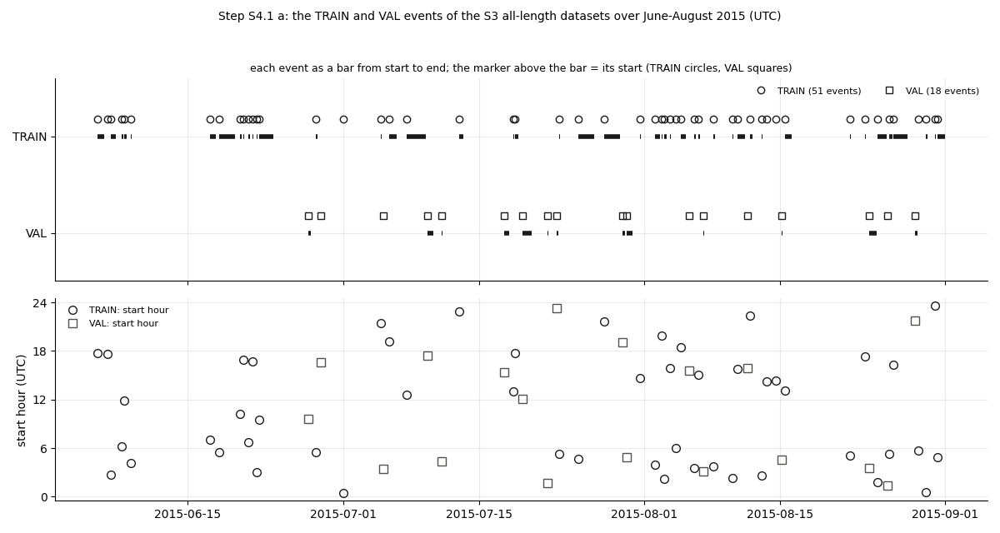
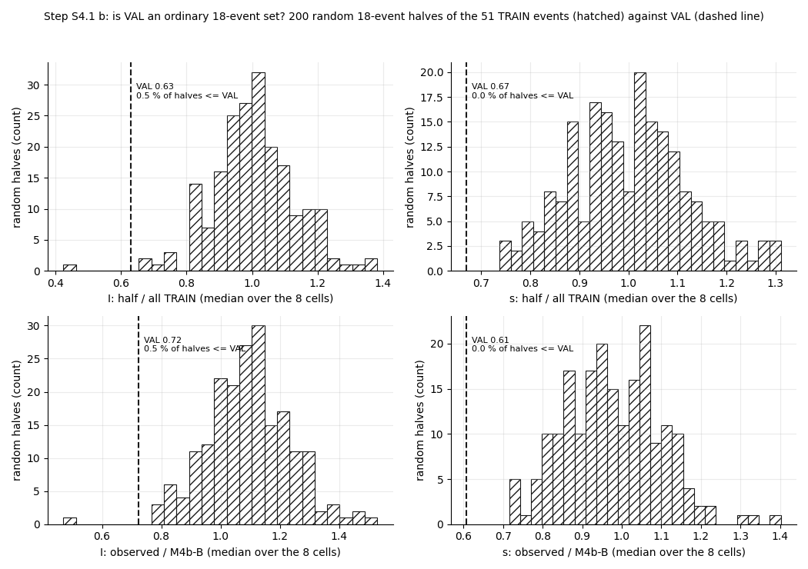
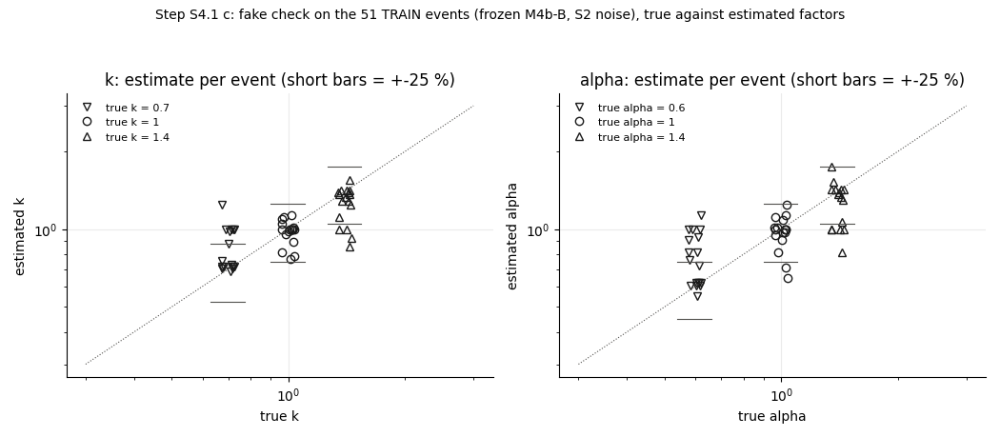
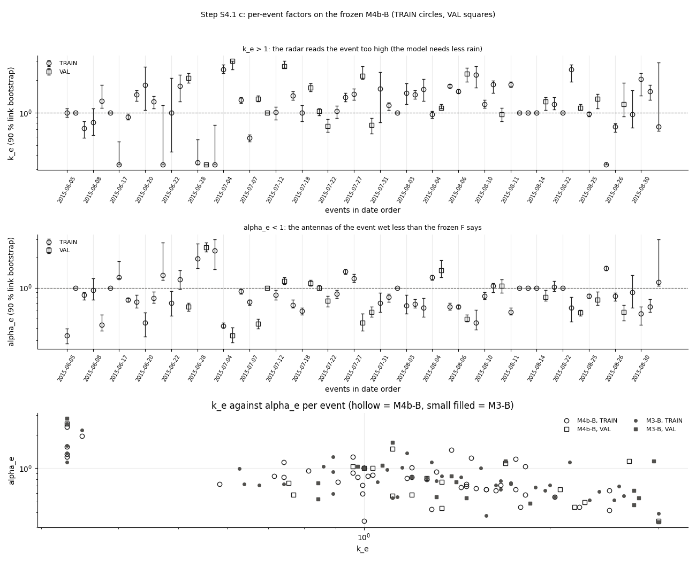
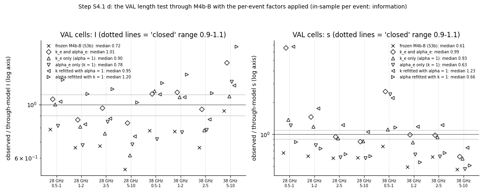
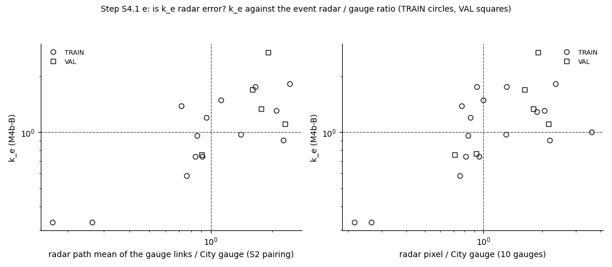
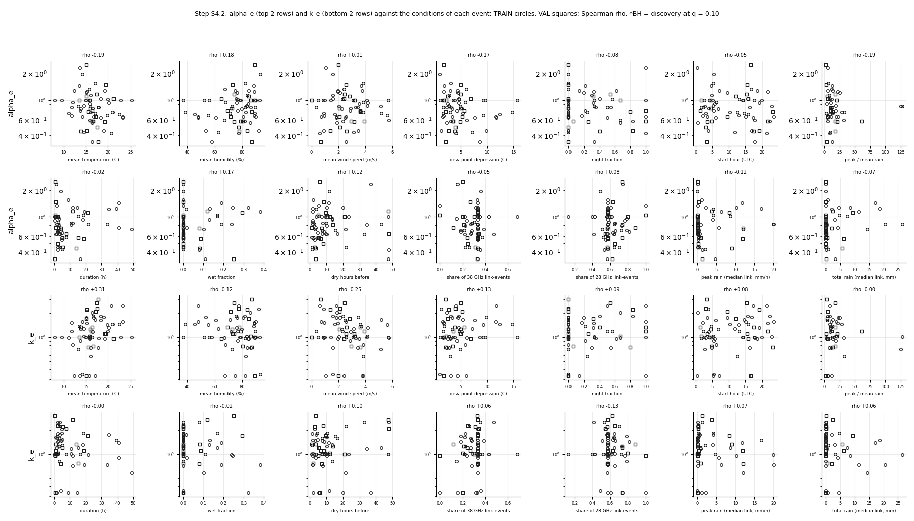
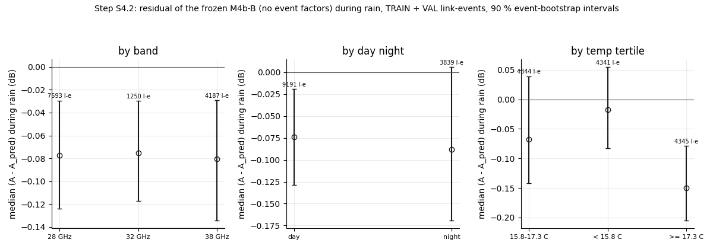

# wet_antenna steps S4.1 + S4.2: why do events differ? Per-event rain-scale and antenna factors, then the conditions

Written by `research/wet_antenna/conditions_s4.py` (libraries `system_id.py`, `length_test.py`). Settings and every rule:
`wet_antenna.conditions_s4` in `research/config.yaml`, written on 2026-10-15 BEFORE the run (one change before the run, after a
smoke test of the code: the ridge 0.5 -> 0.05 per link, see section 9). Plan: `docs/ROADMAP.md`, "Remaining plan", S4 sub-steps.
Frozen model: **M4b-B** of S3b (WAA v3, provisional), M3-B as a check; F, P, timing, a_link and d are NOT changed.

**Standing rule.** WAA is never estimated by subtracting a power-law rain term. The path part is separated only through its dependence on L at matched rain. ITU-R P.838 appears only as a size reference, never to correct data. The per-event rain factor k_e is estimated from the data-learned P of the frozen fit and the spread of L, not from ITU.

## 1. Facts: the events and the split

**How the split was made** (quoted, not re-derived). `pipeline/docs/methods.md`, section 8: "Events: train / val / test = 60 / 20 / 20 %,
stratified by intensity class (seeded RNG, seed 42, over the sorted ids)." The intensity class is "terciles of the maximum 5 min City rate
over events" (methods.md, section 6). The code (`pipeline/src/cmlpipe/events/core.py`, `split_events`): "event_id -> split, stratified by
intensity_class; seeded permutation of the SORTED ids per class." Links: "train / test = 80 / 20 %, stratified by length class (< 1, 1-3,
> 3 km) x frequency band", parallel links together; this step uses only TRAIN links. So the event split is random within each intensity
tercile; it does not look at dates, weather or radar quality. The split files are frozen and were only read.

Events in the release split: TRAIN 53, VAL 18 (TEST not read). In the S3 all-length
datasets (events with at least one kept link-event): TRAIN 51, VAL 18.

| set | events | median_duration_h | median_total_mm | median_peak_mmh | median_wet_fraction | median_links | first | last |
|---|---|---|---|---|---|---|---|---|
| TRAIN | 51 | 3.583 | 0.05 | 3.118 | 0.0 | 128.0 | 2015-06-05 17:45:00 | 2015-09-01 00:00:00 |
| VAL | 18 | 3.25 | 0.095 | 6.564 | 0.0 | 75.5 | 2015-06-27 09:35:00 | 2015-08-29 02:50:00 |

Intensity classes per set:

| set | heavy | light | moderate |
|---|---|---|---|
| TRAIN | 16 | 18 | 17 |
| VAL | 6 | 6 | 6 |

Rain per event = radar path-mean R of the links inside the event's [start, end) (total = median over links, mm; peak = largest 5 min
value over links and the median over links of each link's peak, mm/h; wet fraction = share of the 5 min bins whose median-over-links R
>= 0.3 mm/h). Times UTC. (`research/wet_antenna/outputs/tables/conditions_s4_events.csv`.)

| set | event_id | start | end | duration_h | intensity_class | total_mm_median_link | peak_mmh_max_link | peak_mmh_median_link | wet_fraction | links | link_events | links_under_1km | links_over_3km |
|---|---|---|---|---|---|---|---|---|---|---|---|---|---|
| TRAIN | E20150605_1745 | 2015-06-05 17:45 | 06-06 10:25 | 16.67 | heavy | 3.25 | 24.99 | 4.7 | 0.11 | 205 | 369 | 41 | 61 |
| TRAIN | E20150606_1740 | 2015-06-06 17:40 | 06-06 18:35 | 0.92 | moderate | 0.0 | 0.0 | 0.0 | 0.0 | 12 | 23 | 5 | 2 |
| TRAIN | E20150607_0245 | 2015-06-07 02:45 | 06-07 14:40 | 11.92 | light | 0.04 | 3.3 | 0.17 | 0.0 | 139 | 253 | 14 | 54 |
| TRAIN | E20150608_0615 | 2015-06-08 06:15 | 06-08 09:20 | 3.08 | light | 0.01 | 0.73 | 0.1 | 0.0 | 24 | 42 | 0 | 12 |
| TRAIN | E20150608_1150 | 2015-06-08 11:50 | 06-08 17:00 | 5.17 | moderate | 0.92 | 8.68 | 2.06 | 0.0 | 185 | 332 | 41 | 54 |
| TRAIN | E20150609_0410 | 2015-06-09 04:10 | 06-09 05:00 | 0.83 | moderate | 0.0 | 0.0 | 0.0 | 0.0 | 14 | 22 | 7 | 1 |
| TRAIN | E20150617_0705 | 2015-06-17 07:05 | 06-17 21:35 | 14.5 | heavy | 4.42 | 5.62 | 2.26 | 0.32 | 138 | 246 | 33 | 43 |
| TRAIN | E20150618_0530 | 2015-06-18 05:30 | 06-19 22:20 | 40.83 | heavy | 4.16 | 30.52 | 5.66 | 0.02 | 206 | 371 | 41 | 62 |
| TRAIN | E20150620_1015 | 2015-06-20 10:15 | 06-20 14:50 | 4.58 | light | 0.02 | 3.27 | 0.13 | 0.0 | 51 | 94 | 1 | 17 |
| TRAIN | E20150620_1655 | 2015-06-20 16:55 | 06-20 19:10 | 2.25 | light | 0.09 | 7.03 | 0.45 | 0.0 | 25 | 45 | 0 | 14 |
| TRAIN | E20150621_0645 | 2015-06-21 06:45 | 06-21 09:45 | 3.0 | light | 0.03 | 0.39 | 0.08 | 0.0 | 25 | 45 | 0 | 17 |
| TRAIN | E20150621_1645 | 2015-06-21 16:45 | 06-21 18:25 | 1.67 | light | 0.02 | 0.59 | 0.06 | 0.0 | 5 | 9 | 0 | 3 |
| TRAIN | E20150622_0300 | 2015-06-22 03:00 | 06-22 04:55 | 1.92 | light | 0.13 | 2.72 | 0.43 | 0.0 | 18 | 33 | 0 | 12 |
| TRAIN | E20150622_0930 | 2015-06-22 09:30 | 06-23 20:05 | 34.58 | heavy | 2.14 | 56.62 | 4.14 | 0.01 | 206 | 371 | 41 | 62 |
| VAL | E20150627_0935 | 2015-06-27 09:35 | 06-27 17:15 | 7.67 | light | 0.21 | 2.85 | 0.22 | 0.0 | 181 | 323 | 39 | 49 |
| TRAIN | E20150628_0530 | 2015-06-28 05:30 | 06-28 09:40 | 4.17 | moderate | 0.0 | 0.39 | 0.0 | 0.0 | 66 | 120 | 14 | 19 |
| VAL | E20150628_1635 | 2015-06-28 16:35 | 06-28 17:20 | 0.75 | moderate | 0.03 | 0.51 | 0.15 | 0.0 | 33 | 61 | 2 | 18 |
| TRAIN | E20150701_0030 | 2015-07-01 00:30 | 07-01 01:50 | 1.33 | light | 0.02 | 0.46 | 0.1 | 0.0 | 21 | 39 | 0 | 14 |
| TRAIN | E20150704_2125 | 2015-07-04 21:25 | 07-04 23:30 | 2.08 | light | 0.26 | 5.17 | 1.3 | 0.08 | 172 | 310 | 41 | 51 |
| VAL | E20150705_0325 | 2015-07-05 03:25 | 07-05 03:45 | 0.33 | light | 0.11 | 1.97 | 1.36 | 0.25 | 23 | 40 | 0 | 9 |
| TRAIN | E20150705_1910 | 2015-07-05 19:10 | 07-06 13:10 | 18.0 | heavy | 3.07 | 28.07 | 4.1 | 0.13 | 205 | 370 | 41 | 62 |
| TRAIN | E20150707_1235 | 2015-07-07 12:35 | 07-09 13:45 | 49.17 | heavy | 14.41 | 43.58 | 12.0 | 0.1 | 205 | 370 | 41 | 61 |
| VAL | E20150709_1725 | 2015-07-09 17:25 | 07-10 07:20 | 13.92 | heavy | 5.75 | 64.97 | 9.01 | 0.08 | 205 | 370 | 41 | 62 |
| VAL | E20150711_0420 | 2015-07-11 04:20 | 07-11 05:35 | 1.25 | moderate | 0.0 | 0.0 | 0.0 | 0.0 | 10 | 20 | 1 | 3 |
| TRAIN | E20150712_2255 | 2015-07-12 22:55 | 07-13 09:35 | 10.67 | moderate | 0.07 | 1.72 | 0.19 | 0.0 | 148 | 269 | 19 | 57 |
| VAL | E20150717_1525 | 2015-07-17 15:25 | 07-18 03:15 | 11.83 | moderate | 2.41 | 13.89 | 3.74 | 0.12 | 206 | 371 | 41 | 62 |
| TRAIN | E20150718_1300 | 2015-07-18 13:00 | 07-18 15:15 | 2.25 | moderate | 0.0 | 0.76 | 0.05 | 0.0 | 19 | 33 | 4 | 10 |
| TRAIN | E20150718_1745 | 2015-07-18 17:45 | 07-19 01:20 | 7.58 | moderate | 0.08 | 3.2 | 0.4 | 0.0 | 172 | 306 | 38 | 54 |
| VAL | E20150719_1205 | 2015-07-19 12:05 | 07-20 09:25 | 21.33 | heavy | 9.29 | 48.67 | 8.4 | 0.29 | 206 | 371 | 41 | 62 |
| VAL | E20150722_0140 | 2015-07-22 01:40 | 07-22 03:45 | 2.08 | light | 0.02 | 0.62 | 0.15 | 0.0 | 7 | 10 | 0 | 6 |
| VAL | E20150722_2315 | 2015-07-22 23:15 | 07-23 03:20 | 4.08 | heavy | 2.01 | 42.97 | 12.05 | 0.08 | 205 | 369 | 41 | 61 |
| TRAIN | E20150723_0520 | 2015-07-23 05:20 | 07-23 08:00 | 2.67 | moderate | 0.04 | 1.79 | 0.18 | 0.0 | 128 | 229 | 30 | 35 |
| TRAIN | E20150725_0440 | 2015-07-25 04:40 | 07-26 21:20 | 40.67 | heavy | 17.13 | 73.51 | 11.81 | 0.19 | 206 | 370 | 41 | 62 |
| TRAIN | E20150727_2140 | 2015-07-27 21:40 | 07-29 12:50 | 39.17 | heavy | 18.62 | 85.63 | 16.74 | 0.13 | 206 | 371 | 41 | 62 |
| VAL | E20150729_1905 | 2015-07-29 19:05 | 07-30 00:35 | 5.5 | moderate | 0.11 | 20.35 | 0.3 | 0.0 | 69 | 129 | 9 | 20 |
| VAL | E20150730_0450 | 2015-07-30 04:50 | 07-30 20:15 | 15.42 | heavy | 0.51 | 40.13 | 0.85 | 0.0 | 206 | 370 | 41 | 62 |
| TRAIN | E20150731_1440 | 2015-07-31 14:40 | 07-31 16:35 | 1.92 | light | 0.08 | 16.32 | 0.32 | 0.0 | 37 | 66 | 0 | 17 |
| TRAIN | E20150802_0400 | 2015-08-02 04:00 | 08-02 14:40 | 10.67 | light | 0.46 | 5.43 | 0.86 | 0.0 | 206 | 371 | 41 | 62 |
| TRAIN | E20150802_1955 | 2015-08-02 19:55 | 08-02 21:00 | 1.08 | moderate | 0.0 | 0.0 | 0.0 | 0.0 | 12 | 23 | 5 | 2 |
| TRAIN | E20150803_0210 | 2015-08-03 02:10 | 08-03 07:15 | 5.08 | moderate | 0.01 | 0.41 | 0.04 | 0.0 | 45 | 87 | 5 | 21 |
| TRAIN | E20150803_1550 | 2015-08-03 15:50 | 08-03 18:15 | 2.42 | light | 0.03 | 0.17 | 0.13 | 0.0 | 54 | 100 | 5 | 20 |
| TRAIN | E20150804_0600 | 2015-08-04 06:00 | 08-04 07:00 | 1.0 | light | 0.04 | 0.28 | 0.17 | 0.0 | 8 | 14 | 0 | 5 |
| TRAIN | E20150804_1830 | 2015-08-04 18:30 | 08-05 06:25 | 11.92 | heavy | 8.55 | 33.21 | 10.28 | 0.24 | 206 | 370 | 41 | 62 |
| VAL | E20150805_1535 | 2015-08-05 15:35 | 08-05 16:25 | 0.83 | light | 0.08 | 0.86 | 0.36 | 0.0 | 11 | 19 | 0 | 7 |
| TRAIN | E20150806_0330 | 2015-08-06 03:30 | 08-06 07:05 | 3.58 | heavy | 0.09 | 3.12 | 0.6 | 0.0 | 188 | 337 | 41 | 53 |
| TRAIN | E20150806_1505 | 2015-08-06 15:05 | 08-06 18:20 | 3.25 | moderate | 0.05 | 0.44 | 0.17 | 0.0 | 177 | 317 | 41 | 48 |
| VAL | E20150807_0305 | 2015-08-07 03:05 | 08-07 05:20 | 2.25 | moderate | 0.04 | 10.28 | 0.27 | 0.0 | 104 | 189 | 15 | 36 |
| TRAIN | E20150808_0345 | 2015-08-08 03:45 | 08-08 06:50 | 3.08 | light | 0.01 | 1.66 | 0.11 | 0.0 | 29 | 51 | 4 | 9 |
| TRAIN | E20150810_0220 | 2015-08-10 02:20 | 08-10 03:55 | 1.58 | light | 0.01 | 0.22 | 0.07 | 0.0 | 27 | 48 | 1 | 13 |
| TRAIN | E20150810_1545 | 2015-08-10 15:45 | 08-11 10:20 | 18.58 | heavy | 4.66 | 7.96 | 4.24 | 0.17 | 206 | 370 | 41 | 62 |
| VAL | E20150811_1550 | 2015-08-11 15:50 | 08-11 16:25 | 0.58 | light | 0.01 | 0.1 | 0.07 | 0.0 | 2 | 4 | 0 | 0 |
| TRAIN | E20150811_2220 | 2015-08-11 22:20 | 08-12 03:10 | 4.83 | light | 0.19 | 1.91 | 0.29 | 0.0 | 187 | 336 | 41 | 50 |
| TRAIN | E20150813_0235 | 2015-08-13 02:35 | 08-13 04:50 | 2.25 | moderate | 0.0 | 0.0 | 0.0 | 0.0 | 19 | 37 | 5 | 6 |
| TRAIN | E20150813_1415 | 2015-08-13 14:15 | 08-13 14:30 | 0.25 | moderate | 0.0 | 0.0 | 0.0 | 0.0 | 7 | 14 | 1 | 2 |
| TRAIN | E20150814_1420 | 2015-08-14 14:20 | 08-14 14:35 | 0.25 | moderate | 0.0 | 0.0 | 0.0 | 0.0 | 7 | 14 | 1 | 2 |
| VAL | E20150815_0435 | 2015-08-15 04:35 | 08-15 07:00 | 2.42 | moderate | 0.01 | 0.3 | 0.07 | 0.0 | 36 | 68 | 1 | 19 |
| TRAIN | E20150815_1305 | 2015-08-15 13:05 | 08-16 04:15 | 15.17 | heavy | 7.37 | 32.06 | 8.71 | 0.17 | 205 | 370 | 41 | 61 |
| TRAIN | E20150822_0505 | 2015-08-22 05:05 | 08-22 07:05 | 2.0 | moderate | 0.0 | 0.0 | 0.0 | 0.0 | 8 | 15 | 2 | 1 |
| TRAIN | E20150823_1720 | 2015-08-23 17:20 | 08-23 20:50 | 3.5 | moderate | 0.02 | 22.84 | 0.13 | 0.0 | 21 | 36 | 2 | 8 |
| VAL | E20150824_0330 | 2015-08-24 03:30 | 08-24 22:20 | 18.83 | heavy | 6.32 | 66.99 | 11.98 | 0.09 | 206 | 371 | 41 | 62 |
| TRAIN | E20150825_0145 | 2015-08-25 01:45 | 08-25 23:15 | 21.5 | heavy | 26.53 | 59.54 | 19.87 | 0.24 | 205 | 369 | 41 | 61 |
| VAL | E20150826_0120 | 2015-08-26 01:20 | 08-26 02:15 | 0.92 | light | 0.01 | 0.3 | 0.07 | 0.0 | 9 | 17 | 1 | 4 |
| TRAIN | E20150826_0520 | 2015-08-26 05:20 | 08-26 14:20 | 9.0 | heavy | 0.64 | 3.49 | 1.13 | 0.0 | 204 | 366 | 41 | 61 |
| TRAIN | E20150826_1620 | 2015-08-26 16:20 | 08-28 02:15 | 33.92 | heavy | 20.53 | 91.06 | 20.13 | 0.19 | 204 | 366 | 41 | 61 |
| VAL | E20150828_2145 | 2015-08-28 21:45 | 08-29 02:50 | 5.08 | heavy | 0.08 | 13.09 | 0.73 | 0.0 | 82 | 148 | 7 | 39 |
| TRAIN | E20150829_0545 | 2015-08-29 05:45 | 08-29 06:05 | 0.33 | light | 0.01 | 0.72 | 0.09 | 0.0 | 10 | 17 | 0 | 7 |
| TRAIN | E20150830_0035 | 2015-08-30 00:35 | 08-30 05:20 | 4.75 | moderate | 0.04 | 14.35 | 0.25 | 0.0 | 131 | 229 | 32 | 34 |
| TRAIN | E20150830_2335 | 2015-08-30 23:35 | 08-31 01:15 | 1.67 | light | 0.01 | 0.77 | 0.07 | 0.0 | 27 | 48 | 2 | 13 |
| TRAIN | E20150831_0455 | 2015-08-31 04:55 | 09-01 00:00 | 19.08 | heavy | 11.49 | 12.0 | 6.23 | 0.38 | 204 | 367 | 41 | 61 |

**READING.** The split is random within each intensity tercile, and the result looks like it: VAL has
18 events (6 light, 6 moderate, 6 heavy), spread from late June to late August between the
TRAIN events, not a block in time. Most events carry very little rain at the links: 40 of 69 events have a median path
accumulation under 0.1 mm inside [start, end) (link_state can be wet from a gauge or from R_max on the path). The steady-rain bins of the
length test come from the few large events: in VAL the events with >= 1 mm at the median link are E20150709_1725, E20150717_1525, E20150719_1205, E20150722_2315, E20150824_0330
(5 events), so the VAL length test is effectively a test on about 5 events.

## 2. Is the TRAIN / VAL gap ordinary event-to-event spread?

200 random splits of the 51 TRAIN events into 33 / 18;
on each 18-event half the S3.1 model-free length line (no bootstrap), on the 8 VAL-eligible cells
(28 GHz 0.5-1, 28 GHz 1-2, 28 GHz 2-5, 28 GHz 5-10, 38 GHz 0.5-1, 38 GHz 1-2, 38 GHz 2-5, 38 GHz 5-10). Rule: VAL is "rare" if fewer than 5 % of the halves have a ratio as low as VAL's.
(`research/wet_antenna/outputs/tables/conditions_s4_split_half.csv`.)

| statistic | VAL I | halves I median | halves I 5-95 % | share of halves <= VAL (I) | VAL s | halves s median | halves s 5-95 % | share of halves <= VAL (s) |
|---|---|---|---|---|---|---|---|---|
| observed, half / all TRAIN | 0.631 | 1.003 | 0.81 - 1.21 | 0.005 | 0.67 | 1.005 | 0.81 - 1.22 | 0.0 |
| observed / M4b-B through the test | 0.722 | 1.093 | 0.85 - 1.32 | 0.005 | 0.608 | 0.978 | 0.80 - 1.16 | 0.0 |
| INFORMATION: observed, half / the other 33 TRAIN events (VAL: VAL / all TRAIN) | 0.631 | 1.006 | 0.75 - 1.37 | 0.015 | 0.67 | 1.003 | 0.74 - 1.33 | 0.01 |

**READING.** By the rule, the VAL set is **rare**: 0.5 % (I) and 0.0 % (s) of the 200 random
18-event halves of TRAIN are as low as VAL relative to all of TRAIN, and 0.5 % / 0.0 % as low relative to the frozen model.
A half is part of the TRAIN set it is compared with, which narrows its spread (by about a third, since 18 of 51 events are shared); the
fairer comparison of each half with the OTHER 33 events (information, not in the rule) gives 1.5 % and 1.0 %, still under
5 %. So the VAL gap is more than the ordinary event-to-event spread of TRAIN: something about the VAL events (or about the rain reference in them).
Caveat: the halves are random sets of events; the cells are dominated by the few large events (above), so "18 events" is really "the large
events among them".

## 3. Fake check (run first)

Truth = the frozen M4b-B with per-event k in [0.7, 1.0, 1.4] and alpha in [0.6, 1.0, 1.4] (9 pairs, seeded order) on the
real rain of the 51 TRAIN events, the S2 noise. Recovered = both within +-25 %. Rule: PASS if >= 80 % of
the events. **Result: FAIL** (32 of 51 events = 63 %; k alone 41,
alpha alone 35). (`research/wet_antenna/outputs/tables/conditions_s4_fake.csv`.)

| k_true | alpha_true | events | recovered | k_ratio_median | alpha_ratio_median |
|---|---|---|---|---|---|
| 0.7 | 0.6 | 6 | 3 | 1.208 | 1.19 |
| 0.7 | 1.0 | 5 | 4 | 1.079 | 1.0 |
| 0.7 | 1.4 | 6 | 4 | 1.03 | 1.018 |
| 1.0 | 0.6 | 6 | 2 | 1.045 | 1.404 |
| 1.0 | 1.0 | 6 | 6 | 1.0 | 1.008 |
| 1.0 | 1.4 | 5 | 4 | 0.891 | 0.995 |
| 1.4 | 0.6 | 6 | 4 | 0.981 | 1.107 |
| 1.4 | 1.0 | 6 | 3 | 0.963 | 0.859 |
| 1.4 | 1.4 | 5 | 2 | 0.886 | 0.759 |

Recovered by the number of short links (< 1 km) of the event: at least 3 short links 26 of 35; fewer than 3 short links 6 of 16.
By the intensity class of the event:

| intensity_class | events | recovered | k_recovered | alpha_recovered |
|---|---|---|---|---|
| heavy | 16 | 16 | 16 | 16 |
| light | 18 | 10 | 15 | 12 |
| moderate | 17 | 6 | 10 | 7 |

**READING. FAIL** (63 % of the events recovered, rule 80 %). The failures are not spread evenly: every heavy event is
recovered (16 of 16), the light and moderate events often not. In those events the rain at the links is small or nil, the
loss hardly changes over the grid, and k and alpha trade against each other (less rain with a larger antenna factor gives nearly the
same A); the weak ridge then pulls them toward 1 (true 1.4 / 1.4 estimated about 0.89 / 0.76 of the truth; true 0.7 / 0.6 about 1.2 x).
At the truth k = alpha = 1 all 6 events are recovered, so the code has no bias there. **By the rule, the
real factors below are reported and NOT interpreted.** That heavy events pass 100 % suggests a fake check restricted to heavy events
(rule fixed before running) could license reading their factors; that is a proposal for a sub-step, not something done here.

## 4. Per-event factors

A_pred = alpha_e W[a_link F(R / k_e)] + L P(R(t - d) / k_e) + c on every link-event of the event; grid 122 x 122 (k [0.33, 3.0],
alpha [0.2, 3.0], log-spaced, plus 1), Huber 0.3 dB, log-ridge 0.05 per link; 200 link-bootstrap draws
inside the event (90 %). "lacks short / long" = fewer than 3 links < 1 km / > 3 km. (`research/wet_antenna/outputs/tables/conditions_s4_factors.csv`.)

| set | event_id | links | links_under_1km | links_over_3km | k | k_lo | k_hi | alpha | alpha_lo | alpha_hi | boot_corr_lnk_lnalpha | lacks_short | lacks_long | k_at_bound | alpha_at_bound |
|---|---|---|---|---|---|---|---|---|---|---|---|---|---|---|---|
| TRAIN | E20150605_1745 | 205 | 41 | 61 | 1.0 | 0.907 | 1.092 | 0.336 | 0.281 | 0.394 | 0.737 | False | False | False | False |
| TRAIN | E20150606_1740 | 12 | 5 | 2 | 1.0 | 1.0 | 1.0 | 1.0 | 1.0 | 1.0 |  | False | True | False | False |
| TRAIN | E20150607_0245 | 139 | 14 | 54 | 0.715 | 0.583 | 0.828 | 0.848 | 0.757 | 0.907 | 0.557 | False | False | False | False |
| TRAIN | E20150608_0615 | 24 | 0 | 12 | 0.813 | 0.617 | 1.091 | 0.949 | 0.757 | 1.244 | -0.726 | True | False | False | False |
| TRAIN | E20150608_1150 | 185 | 41 | 54 | 1.287 | 1.111 | 1.792 | 0.431 | 0.376 | 0.54 | 0.821 | False | False | False | False |
| TRAIN | E20150609_0410 | 14 | 7 | 1 | 1.0 | 1.0 | 1.0 | 1.0 | 1.0 | 1.0 |  | False | True | False | False |
| TRAIN | E20150617_0705 | 138 | 33 | 43 | 0.33 | 0.33 | 0.542 | 1.273 | 1.244 | 1.826 | 0.986 | False | False | True | False |
| TRAIN | E20150618_0530 | 206 | 41 | 62 | 0.908 | 0.859 | 0.977 | 0.757 | 0.724 | 0.792 | 0.413 | False | False | False | False |
| TRAIN | E20150620_1015 | 51 | 1 | 17 | 1.464 | 1.287 | 1.605 | 0.724 | 0.632 | 0.848 | -0.575 | True | False | False | False |
| TRAIN | E20150620_1655 | 25 | 0 | 14 | 1.792 | 1.051 | 2.638 | 0.451 | 0.329 | 0.565 | 0.192 | True | False | False | False |
| TRAIN | E20150621_0645 | 25 | 0 | 17 | 1.264 | 1.091 | 1.413 | 0.792 | 0.708 | 0.908 | -0.99 | True | False | False | False |
| TRAIN | E20150621_1645 | 5 | 0 | 3 | 0.33 | 0.33 | 1.174 | 1.331 | 1.189 | 2.804 | 0.342 | True | False | True | False |
| TRAIN | E20150622_0300 | 18 | 0 | 12 | 0.995 | 0.435 | 2.079 | 0.708 | 0.527 | 0.928 | 0.384 | True | False | False | False |
| TRAIN | E20150622_0930 | 206 | 41 | 62 | 1.76 | 1.264 | 2.235 | 1.216 | 0.971 | 1.49 | 0.957 | False | False | False | False |
| VAL | E20150627_0935 | 181 | 39 | 49 | 2.077 | 1.894 | 2.321 | 0.647 | 0.591 | 0.708 | -0.276 | False | False | False | False |
| TRAIN | E20150628_0530 | 66 | 14 | 19 | 0.349 | 0.33 | 0.563 | 1.954 | 1.559 | 2.744 | -0.631 | False | False | False | False |
| VAL | E20150628_1635 | 33 | 2 | 18 | 0.33 | 0.33 | 0.33 | 2.504 | 2.288 | 2.804 | 0.055 | True | False | True | False |
| TRAIN | E20150701_0030 | 21 | 0 | 14 | 0.33 | 0.33 | 0.771 | 2.341 | 1.524 | 3.0 | -0.613 | True | False | True | False |
| TRAIN | E20150704_2125 | 172 | 41 | 51 | 2.496 | 2.319 | 2.787 | 0.421 | 0.403 | 0.451 | 0.033 | False | False | False | False |
| VAL | E20150705_0325 | 23 | 0 | 9 | 3.0 | 2.496 | 3.0 | 0.336 | 0.287 | 0.403 | -0.799 | True | False | True | False |
| TRAIN | E20150705_1910 | 205 | 41 | 62 | 1.311 | 1.218 | 1.386 | 0.928 | 0.867 | 0.971 | 0.778 | False | False | False | False |
| TRAIN | E20150707_1235 | 205 | 41 | 61 | 0.584 | 0.542 | 0.628 | 0.724 | 0.677 | 0.758 | 0.871 | False | False | False | False |
| VAL | E20150709_1725 | 205 | 41 | 62 | 1.335 | 1.264 | 1.437 | 0.441 | 0.394 | 0.493 | 0.568 | False | False | False | False |
| VAL | E20150711_0420 | 10 | 1 | 3 | 1.0 | 1.0 | 1.0 | 1.0 | 1.0 | 1.0 |  | True | False | False | False |
| TRAIN | E20150712_2255 | 148 | 19 | 57 | 1.013 | 0.859 | 1.133 | 0.848 | 0.757 | 0.95 | 0.005 | False | False | False | False |
| VAL | E20150717_1525 | 206 | 41 | 62 | 2.687 | 2.589 | 3.0 | 1.163 | 1.087 | 1.274 | 0.859 | False | False | False | False |
| TRAIN | E20150718_1300 | 19 | 4 | 10 | 1.437 | 1.311 | 1.576 | 0.677 | 0.632 | 0.757 | -0.943 | False | False | False | False |
| TRAIN | E20150718_1745 | 172 | 38 | 54 | 0.995 | 0.828 | 1.174 | 0.591 | 0.54 | 0.632 | 0.473 | False | False | False | False |
| VAL | E20150719_1205 | 206 | 41 | 62 | 1.696 | 1.576 | 1.86 | 1.111 | 1.039 | 1.189 | 0.852 | False | False | False | False |
| VAL | E20150722_0140 | 7 | 0 | 6 | 1.032 | 0.942 | 1.091 | 1.0 | 0.949 | 1.064 | -0.821 | True | False | False | False |
| VAL | E20150722_2315 | 205 | 41 | 61 | 0.755 | 0.664 | 0.875 | 0.74 | 0.647 | 0.829 | 0.782 | False | False | False | False |
| TRAIN | E20150723_0520 | 128 | 30 | 35 | 1.032 | 0.891 | 1.153 | 0.867 | 0.792 | 0.949 | -0.686 | False | False | False | False |
| TRAIN | E20150725_0440 | 206 | 41 | 62 | 1.386 | 1.264 | 1.519 | 1.457 | 1.362 | 1.526 | 0.903 | False | False | False | False |
| TRAIN | E20150727_2140 | 206 | 41 | 62 | 1.491 | 1.311 | 1.665 | 1.244 | 1.136 | 1.362 | 0.958 | False | False | False | False |
| VAL | E20150729_1905 | 69 | 9 | 20 | 2.194 | 2.037 | 2.689 | 0.451 | 0.376 | 0.552 | -0.046 | False | False | False | False |
| VAL | E20150730_0450 | 206 | 41 | 62 | 0.769 | 0.64 | 0.891 | 0.578 | 0.515 | 0.647 | 0.557 | False | False | False | False |
| TRAIN | E20150731_1440 | 37 | 0 | 17 | 1.665 | 0.813 | 2.362 | 0.708 | 0.577 | 0.888 | -0.154 | True | False | False | False |
| TRAIN | E20150802_0400 | 206 | 41 | 62 | 1.174 | 1.051 | 1.241 | 0.81 | 0.724 | 0.867 | 0.248 | False | False | False | False |
| TRAIN | E20150802_1955 | 12 | 5 | 2 | 1.0 | 1.0 | 1.0 | 1.0 | 1.0 | 1.0 |  | False | True | False | False |
| TRAIN | E20150803_0210 | 45 | 5 | 21 | 1.519 | 1.195 | 1.86 | 0.661 | 0.552 | 0.848 | -0.997 | False | False | False | False |
| TRAIN | E20150803_1550 | 54 | 5 | 20 | 1.464 | 1.335 | 1.607 | 0.692 | 0.632 | 0.775 | -0.98 | False | False | False | False |
| TRAIN | E20150804_0600 | 8 | 0 | 5 | 1.635 | 1.287 | 2.039 | 0.632 | 0.516 | 0.792 | -0.993 | True | False | False | False |
| TRAIN | E20150804_1830 | 206 | 41 | 62 | 0.959 | 0.891 | 1.032 | 1.273 | 1.189 | 1.331 | 0.889 | False | False | False | False |
| VAL | E20150805_1535 | 11 | 0 | 7 | 1.111 | 1.09 | 1.196 | 1.49 | 1.273 | 1.868 | -0.054 | True | False | False | False |
| TRAIN | E20150806_0330 | 188 | 41 | 53 | 1.76 | 1.696 | 1.827 | 0.647 | 0.604 | 0.708 | -0.191 | False | False | False | False |
| TRAIN | E20150806_1505 | 177 | 41 | 48 | 1.576 | 1.519 | 1.636 | 0.647 | 0.618 | 0.677 | -0.899 | False | False | False | False |
| VAL | E20150807_0305 | 104 | 15 | 36 | 2.277 | 1.929 | 2.589 | 0.493 | 0.461 | 0.54 | -0.119 | False | False | False | False |
| TRAIN | E20150808_0345 | 29 | 4 | 9 | 2.235 | 1.695 | 2.687 | 0.451 | 0.384 | 0.605 | -0.996 | False | False | False | False |
| TRAIN | E20150810_0220 | 27 | 1 | 13 | 1.196 | 1.111 | 1.311 | 0.829 | 0.775 | 0.907 | -0.982 | True | False | False | False |
| TRAIN | E20150810_1545 | 206 | 41 | 62 | 1.826 | 1.519 | 1.965 | 1.039 | 0.907 | 1.111 | 0.923 | False | False | False | False |
| VAL | E20150811_1550 | 2 | 0 | 0 | 0.959 | 0.828 | 1.111 | 1.039 | 0.887 | 1.216 | -1.0 | True | True | False | False |
| TRAIN | E20150811_2220 | 187 | 41 | 50 | 1.826 | 1.728 | 1.929 | 0.578 | 0.54 | 0.632 | -0.805 | False | False | False | False |
| TRAIN | E20150813_0235 | 19 | 5 | 6 | 1.0 | 1.0 | 1.0 | 1.0 | 1.0 | 1.0 |  | False | False | False | False |
| TRAIN | E20150813_1415 | 7 | 1 | 2 | 1.0 | 1.0 | 1.0 | 1.0 | 1.0 | 1.0 |  | True | True | False | False |
| TRAIN | E20150814_1420 | 7 | 1 | 2 | 1.0 | 1.0 | 1.0 | 1.0 | 1.0 | 1.0 |  | True | True | False | False |
| VAL | E20150815_0435 | 36 | 1 | 19 | 1.264 | 1.051 | 1.386 | 0.81 | 0.74 | 0.949 | -0.991 | True | False | False | False |
| TRAIN | E20150815_1305 | 205 | 41 | 61 | 1.196 | 1.071 | 1.386 | 1.016 | 0.928 | 1.164 | 0.931 | False | False | False | False |
| TRAIN | E20150822_0505 | 8 | 2 | 1 | 1.0 | 1.0 | 1.0 | 1.0 | 1.0 | 1.0 |  | True | True | False | False |
| TRAIN | E20150823_1720 | 21 | 2 | 8 | 2.496 | 1.929 | 2.787 | 0.632 | 0.46 | 0.81 | 0.518 | True | False | False | False |
| VAL | E20150824_0330 | 206 | 41 | 62 | 1.111 | 1.051 | 1.196 | 0.565 | 0.528 | 0.605 | 0.824 | False | False | False | False |
| TRAIN | E20150825_0145 | 205 | 41 | 61 | 0.977 | 0.924 | 1.013 | 0.829 | 0.792 | 0.867 | 0.887 | False | False | False | False |
| VAL | E20150826_0120 | 9 | 1 | 4 | 1.335 | 1.091 | 1.491 | 0.757 | 0.677 | 0.908 | -0.994 | True | False | False | False |
| TRAIN | E20150826_0520 | 204 | 41 | 61 | 0.33 | 0.33 | 0.349 | 1.559 | 1.49 | 1.631 | 0.374 | False | False | True | False |
| TRAIN | E20150826_1620 | 204 | 41 | 61 | 0.741 | 0.664 | 0.798 | 0.829 | 0.74 | 0.887 | 0.929 | False | False | False | False |
| VAL | E20150828_2145 | 82 | 7 | 39 | 1.196 | 0.924 | 1.894 | 0.578 | 0.471 | 0.677 | 0.454 | False | False | False | False |
| TRAIN | E20150829_0545 | 10 | 0 | 7 | 0.959 | 0.726 | 1.605 | 0.907 | 0.632 | 1.331 | -0.953 | True | False | False | False |
| TRAIN | E20150830_0035 | 131 | 32 | 34 | 2.039 | 1.437 | 2.321 | 0.552 | 0.431 | 0.647 | 0.017 | False | False | False | False |
| TRAIN | E20150830_2335 | 27 | 2 | 13 | 1.576 | 1.31 | 1.792 | 0.647 | 0.578 | 0.775 | -0.964 | True | False | False | False |
| TRAIN | E20150831_0455 | 204 | 41 | 61 | 0.741 | 0.676 | 2.892 | 1.137 | 1.039 | 3.0 | 0.999 | False | False | False | False |

TRAIN against VAL, and the correlation of ln k_e and ln alpha_e (`research/wet_antenna/outputs/tables/conditions_s4_factor_summary.csv`; for the correlation row,
TRAIN_median = Spearman over all events, VAL_median = the median within-event bootstrap correlation, mann_whitney_p = its p-value):

| fit | factor | TRAIN_median | TRAIN_lo | TRAIN_hi | TRAIN_p10 | TRAIN_p90 | TRAIN_events | VAL_median | VAL_lo | VAL_hi | VAL_p10 | VAL_p90 | VAL_events | mann_whitney_p |
|---|---|---|---|---|---|---|---|---|---|---|---|---|---|---|
| M4b-B | k | 1.032 | 1.0 | 1.287 | 0.584 | 1.826 | 51.0 | 1.23 | 1.032 | 1.696 | 0.765 | 2.4 | 18.0 | 0.271 |
| M4b-B | alpha | 0.829 | 0.724 | 0.949 | 0.552 | 1.273 | 51.0 | 0.749 | 0.578 | 1.0 | 0.448 | 1.261 | 18.0 | 0.419 |
| M4b-B | Spearman(ln k, ln alpha), all events | -0.512 |  |  |  |  |  | 0.055 |  |  |  |  |  | 0.0 |
| M3-B | k | 1.174 | 1.0 | 1.437 | 0.628 | 2.319 | 51.0 | 1.398 | 1.071 | 1.86 | 0.843 | 2.835 | 18.0 | 0.248 |
| M3-B | alpha | 0.81 | 0.724 | 0.993 | 0.552 | 1.273 | 51.0 | 0.749 | 0.546 | 1.031 | 0.479 | 1.326 | 18.0 | 0.552 |
| M3-B | Spearman(ln k, ln alpha), all events | -0.568 |  |  |  |  |  | 0.014 |  |  |  |  |  | 0.0 |

M4b-B against M3-B per event: Spearman k 0.96, alpha 0.96.

**READING.** **Not interpreted: the fake check failed (section 3).** Only what the method does is noted here. 8 events have exactly k = alpha = 1 with no
interval: no modelled rain at their links, so the ridge alone sets them. Several events sit at a bound of k (`k_at_bound`). Inside an
event the two factors are strongly tied in many events (within-event bootstrap correlation of ln k and ln alpha: median
+0.05 over events, often beyond +-0.8 in either sign), which is the k / alpha trade the fake check shows. Over events the
Spearman is -0.51 (rule: |rho| > 0.7 = not separable, so "separable" over events by the rule, but see the fake check). The
two frozen frames give the same factors (M4b-B against M3-B: Spearman 0.96 for both), so the numbers do not depend on the frame;
that does not make them right.

## 5. Which factor closes the VAL gap?

The S3.1 bins and Huber line on the model's own prediction with the factors applied per event (in-sample per event: information only).
"closes" = median observed / model ratio within 0.9-1.1. (`research/wet_antenna/outputs/tables/conditions_s4_close_gap.csv`.)

| set | variant | cells | I_ratio_median | s_ratio_median | I_inside | s_inside | both_inside | closes_I | closes_s |
|---|---|---|---|---|---|---|---|---|---|
| TRAIN | frozen M4b-B (S3b) | 8 | 1.071 | 0.985 | 8 | 8 | 8 | True | True |
| TRAIN | k_e and alpha_e | 8 | 1.026 | 1.001 | 8 | 7 | 7 | True | True |
| TRAIN | k_e only (alpha = 1) | 8 | 1.043 | 1.014 | 8 | 7 | 7 | True | True |
| TRAIN | alpha_e only (k = 1) | 8 | 1.044 | 1.003 | 8 | 8 | 8 | True | True |
| TRAIN | k refitted with alpha = 1 | 8 | 1.043 | 0.987 | 8 | 7 | 7 | True | True |
| TRAIN | alpha refitted with k = 1 | 8 | 1.028 | 1.009 | 8 | 7 | 7 | True | True |
| VAL | frozen M4b-B (S3b) | 8 | 0.722 | 0.608 | 3 | 2 | 1 | False | False |
| VAL | k_e and alpha_e | 8 | 1.011 | 0.989 | 7 | 6 | 6 | True | True |
| VAL | k_e only (alpha = 1) | 8 | 0.904 | 0.935 | 5 | 7 | 4 | True | True |
| VAL | alpha_e only (k = 1) | 8 | 0.775 | 0.633 | 5 | 4 | 1 | False | False |
| VAL | k refitted with alpha = 1 | 8 | 0.952 | 1.227 | 7 | 7 | 6 | True | False |
| VAL | alpha refitted with k = 1 | 8 | 1.196 | 0.661 | 6 | 3 | 3 | False | False |

**READING.** **Not interpreted: the fake check failed (section 3).** With both factors per event the VAL length test is passed in-sample (median ratio I
1.01, s 0.99); this is expected from two free numbers per event and says only that one scale per event on the whole
model is enough to describe the VAL bins. Which of the two does it (k alone: 0.90 / 0.93; alpha alone:
0.78 / 0.63) depends on the split between k and alpha, which the fake check did not confirm.

## 6. Radar against gauge

Primary: radar path mean of the gauge links (City gauge within 1 km, the S2 pairing) / gauge, per event, events with >= 1.0 mm
per gauge link. Spearman with k_e: **0.65** [0.30, 0.89] (p 0.003, 19 events).
Secondary (radar pixel at the 10 City gauges / gauges): 0.62 [0.30, 0.83] (24 events).
Expectation written before the run: if k_e is radar error, Spearman >= 0.5. (`research/wet_antenna/outputs/tables/conditions_s4_radar_gauge.csv`.)

The ratio itself per set (no factor involved; events with >= 1.0 mm per gauge link, or in total over the gauges for the pixel ratio;
"pooled" = all radar mm / all gauge mm of the set):

| ratio | TRAIN events | TRAIN median | TRAIN p25-p75 | VAL events | VAL median | VAL p25-p75 | mann_whitney_p | TRAIN pooled radar / gauge | VAL pooled radar / gauge |
|---|---|---|---|---|---|---|---|---|---|
| radar_over_gauge | 14 | 0.931 | 0.78 - 1.59 | 5 | 1.766 | 1.60 - 1.90 | 0.156 | 0.894 | 1.707 |
| pixel_radar_over_gauge | 18 | 0.939 | 0.78 - 1.74 | 6 | 1.715 | 1.09 - 1.88 | 0.454 | 0.91 | 1.607 |

| set | event_id | gauge_links | gauge_mm_per_link | radar_over_gauge | kept | pixel_gauge_mm | pixel_radar_over_gauge | k | alpha |
|---|---|---|---|---|---|---|---|---|---|
| TRAIN | E20150605_1745 | 50 | 0.824 | 4.15 | False | 9.6 | 3.599 | 1.0 | 0.336 |
| TRAIN | E20150606_1740 | 12 | 0.1 | 0.0 | False | 0.2 | 0.0 | 1.0 | 1.0 |
| TRAIN | E20150607_0245 | 23 | 0.0 |  | False | 0.0 |  | 0.715 | 0.848 |
| TRAIN | E20150608_1150 | 49 | 0.755 | 1.707 | False | 5.6 | 1.885 | 1.287 | 0.431 |
| TRAIN | E20150609_0410 | 14 | 0.143 | 0.0 | False | 0.4 | 0.0 | 1.0 | 1.0 |
| TRAIN | E20150617_0705 | 36 | 24.725 | 0.168 | True | 184.5 | 0.216 | 0.33 | 1.273 |
| TRAIN | E20150618_0530 | 50 | 1.858 | 2.259 | True | 17.7 | 2.188 | 0.908 | 0.757 |
| TRAIN | E20150620_1015 | 4 | 0.0 |  | False | 0.0 |  | 1.464 | 0.724 |
| TRAIN | E20150620_1655 | 4 | 0.0 |  | False | 0.0 |  | 1.792 | 0.451 |
| TRAIN | E20150622_0930 | 50 | 1.44 | 1.653 | True | 24.6 | 1.319 | 1.76 | 1.216 |
| TRAIN | E20150628_0530 | 45 | 0.224 | 0.001 | False | 2.2 | 0.0 | 0.349 | 1.954 |
| TRAIN | E20150701_0030 | 1 | 0.0 |  | False | 0.0 |  | 0.33 | 2.341 |
| TRAIN | E20150704_2125 | 46 | 0.0 |  | False | 0.0 |  | 2.496 | 0.421 |
| TRAIN | E20150705_1910 | 49 | 1.327 | 2.089 | True | 14.3 | 2.068 | 1.311 | 0.928 |
| TRAIN | E20150707_1235 | 50 | 16.312 | 0.76 | True | 185.2 | 0.755 | 0.584 | 0.724 |
| TRAIN | E20150712_2255 | 26 | 0.042 | 2.505 | False | 0.3 | 2.016 | 1.013 | 0.848 |
| TRAIN | E20150718_1300 | 5 | 0.1 | 0.0 | False | 0.1 | 0.0 | 1.437 | 0.677 |
| TRAIN | E20150718_1745 | 46 | 0.035 | 3.284 | False | 0.3 | 2.36 | 0.995 | 0.591 |
| TRAIN | E20150723_0520 | 43 | 0.028 | 1.259 | False | 0.2 | 1.22 | 1.032 | 0.867 |
| TRAIN | E20150725_0440 | 50 | 22.064 | 0.718 | True | 225.6 | 0.771 | 1.386 | 1.457 |
| TRAIN | E20150727_2140 | 50 | 16.612 | 1.12 | True | 230.0 | 0.996 | 1.491 | 1.244 |
| TRAIN | E20150802_0400 | 50 | 0.0 |  | False | 0.0 |  | 1.174 | 0.81 |
| TRAIN | E20150802_1955 | 12 | 0.1 | 0.0 | False | 0.2 | 0.0 | 1.0 | 1.0 |
| TRAIN | E20150803_0210 | 19 | 0.095 | 0.002 | False | 0.4 | 0.0 | 1.519 | 0.661 |
| TRAIN | E20150803_1550 | 7 | 0.0 |  | False | 0.0 |  | 1.464 | 0.692 |
| TRAIN | E20150804_1830 | 50 | 8.084 | 0.857 | True | 110.0 | 0.833 | 0.959 | 1.273 |
| TRAIN | E20150806_0330 | 50 | 0.228 | 0.617 | False | 1.7 | 0.926 | 1.76 | 0.647 |
| TRAIN | E20150806_1505 | 48 | 0.013 | 4.086 | False | 0.2 | 2.43 | 1.576 | 0.647 |
| TRAIN | E20150808_0345 | 1 | 0.0 |  | False | 0.0 |  | 2.235 | 0.451 |
| TRAIN | E20150810_0220 | 2 | 0.0 |  | False | 0.0 |  | 1.196 | 0.829 |
| TRAIN | E20150810_1545 | 50 | 2.004 | 2.434 | True | 21.4 | 2.354 | 1.826 | 1.039 |
| TRAIN | E20150811_2220 | 50 | 0.0 |  | False | 0.0 |  | 1.826 | 0.578 |
| TRAIN | E20150813_0235 | 19 | 0.095 | 0.0 | False | 0.4 | 0.0 | 1.0 | 1.0 |
| TRAIN | E20150813_1415 | 7 | 0.2 | 0.0 | False | 0.2 | 0.0 | 1.0 | 1.0 |
| TRAIN | E20150814_1420 | 7 | 0.2 | 0.0 | False | 0.2 | 0.0 | 1.0 | 1.0 |
| TRAIN | E20150815_1305 | 50 | 8.31 | 0.955 | True | 95.5 | 0.857 | 1.196 | 1.016 |
| TRAIN | E20150822_0505 | 8 | 0.088 | 0.0 | False | 0.2 | 0.0 | 1.0 | 1.0 |
| TRAIN | E20150823_1720 | 5 | 0.1 | 0.0 | False | 0.1 | 0.0 | 2.496 | 0.632 |
| TRAIN | E20150825_0145 | 50 | 17.614 | 1.398 | True | 234.5 | 1.302 | 0.977 | 0.829 |
| TRAIN | E20150826_0520 | 50 | 2.378 | 0.264 | True | 23.6 | 0.264 | 0.33 | 1.559 |
| TRAIN | E20150826_1620 | 50 | 17.506 | 0.907 | True | 250.3 | 0.952 | 0.741 | 0.829 |
| TRAIN | E20150830_0035 | 36 | 0.014 | 2.543 | False | 0.1 | 2.257 | 2.039 | 0.552 |
| TRAIN | E20150830_2335 | 7 | 0.0 |  | False | 0.0 |  | 1.576 | 0.647 |
| TRAIN | E20150831_0455 | 50 | 14.5 | 0.838 | True | 150.2 | 0.81 | 0.741 | 1.137 |
| VAL | E20150627_0935 | 47 | 0.0 |  | False | 0.0 |  | 2.077 | 0.647 |
| VAL | E20150628_1635 | 7 | 0.1 | 0.403 | False | 0.1 | 0.613 | 0.33 | 2.504 |
| VAL | E20150709_1725 | 49 | 3.251 | 1.766 | True | 32.1 | 1.803 | 1.335 | 0.441 |
| VAL | E20150711_0420 | 10 | 0.16 | 0.0 | False | 0.3 | 0.0 | 1.0 | 1.0 |
| VAL | E20150717_1525 | 50 | 1.326 | 1.902 | True | 12.3 | 1.912 | 2.687 | 1.163 |
| VAL | E20150719_1205 | 50 | 5.288 | 1.598 | True | 63.9 | 1.626 | 1.696 | 1.111 |
| VAL | E20150722_2315 | 50 | 2.176 | 0.905 | True | 28.4 | 0.709 | 0.755 | 0.74 |
| VAL | E20150729_1905 | 25 | 0.028 | 4.079 | False | 0.1 | 3.1 | 2.194 | 0.451 |
| VAL | E20150730_0450 | 50 | 0.64 | 0.925 | False | 6.0 | 0.916 | 0.769 | 0.578 |
| VAL | E20150807_0305 | 22 | 0.023 | 2.939 | False | 0.1 | 5.563 | 2.277 | 0.493 |
| VAL | E20150815_0435 | 7 | 0.1 | 0.0 | False | 0.1 | 0.0 | 1.264 | 0.81 |
| VAL | E20150824_0330 | 50 | 3.106 | 2.308 | True | 32.9 | 2.167 | 1.111 | 0.565 |
| VAL | E20150826_0120 | 4 | 0.0 |  | False | 0.0 |  | 1.335 | 0.757 |
| VAL | E20150828_2145 | 7 | 0.9 | 0.111 | False | 0.9 | 0.203 | 1.196 | 0.578 |

**READING.** The Spearman of k_e with the radar / gauge ratio is 0.65 [0.30, 0.89], above the 0.5 written before the run,
but it rests on k_e, which is not interpreted (fake FAIL). **The ratio itself needs no factor:** on the events with enough gauge rain the radar
reads 1.71 x the gauges in VAL (pooled; median over 5 events 1.77) against 0.89 x in TRAIN (median over
14 events 0.93); the radar pixel at the gauges gives the same (1.61 against
0.91). TRAIN / VAL of these pooled ratios is 0.52, the same size as the VAL gap (observed VAL / TRAIN:
I 0.63, s 0.67). So the radar over-reads the rain of the large VAL events relative to the City gauges, by about
as much as VAL "attenuates less per radar mm/h". This is a direction and a size, not a proof: only 5 VAL events have enough gauge
rain (Mann-Whitney p 0.16), the gauges are points against a path mean or a 2 x 2 km pixel, and the radar is gauge-adjusted
(pipeline methods.md, section 9), so it is not independent of the gauges.

## 7. Conditions (S4.2, descriptive)

**What the repo has** (nothing downloaded):

| condition data | where | used |
|---|---|---|
| hourly temperature, humidity, wind speed, dew point, dew-point depression, night flag (SMHI GbgA, one station) | `research/baseline/outputs/products/dew_risk_hourly.csv` (baseline module, made from the release `met_1h`) | yes: per event over [start, end) |
| hourly SMHI weather incl. pressure, wind gust and direction | release store `met_1h` | no (the same station; the dew table holds what is used) |
| per-event min / mean / max temperature, humidity, wind (hourly SMHI around the event) | release table `events` (columns temperature_*, humidity_*, wind_*) | no (same source; recomputed over [start, end) from the dew table) |
| certified dry hours before the event | release table `events`, column dry_before_h | yes |
| radar path-mean rain per link, link_state | release stores `radar_along_links_5min`, `link_reference_state_5min` (in the S3 datasets) | yes: rain proxies, wet fraction |
| radar pixel at the gauges, City gauges 5 min | release stores `radar_at_gauges_5min`, `gauges_city_5min` | yes: S4.1 e (information) |
| sun elevation / solar radiation, dew sensors, antenna radome type, maintenance | not in the repo | no (not downloaded, by the rule) |

Spearman of ln alpha_e and ln k_e (M4b-B) with each condition over the TRAIN + VAL events, 90 % event-bootstrap intervals; 28 tests,
Benjamini-Hochberg at q = 0.1 (`research/wet_antenna/outputs/tables/conditions_s4_condition_tests.csv`):

| factor | label | rho | lo | hi | p | bh_discovery | events |
|---|---|---|---|---|---|---|---|
| alpha | mean temperature (C) | -0.194 | -0.36 | -0.004 | 0.11 | False | 69 |
| alpha | mean humidity (%) | 0.179 | -0.023 | 0.368 | 0.145 | False | 68 |
| alpha | mean wind speed (m/s) | 0.015 | -0.177 | 0.206 | 0.905 | False | 69 |
| alpha | dew-point depression (C) | -0.167 | -0.366 | 0.019 | 0.172 | False | 68 |
| alpha | night fraction | -0.076 | -0.281 | 0.138 | 0.536 | False | 69 |
| alpha | start hour (UTC) | -0.051 | -0.262 | 0.153 | 0.674 | False | 69 |
| alpha | peak / mean rain | -0.188 | -0.403 | 0.058 | 0.196 | False | 49 |
| alpha | duration (h) | -0.022 | -0.228 | 0.194 | 0.859 | False | 69 |
| alpha | wet fraction | 0.165 | -0.051 | 0.37 | 0.175 | False | 69 |
| alpha | dry hours before | 0.124 | -0.1 | 0.329 | 0.312 | False | 69 |
| alpha | share of 38 GHz link-events | -0.052 | -0.239 | 0.141 | 0.671 | False | 69 |
| alpha | share of 28 GHz link-events | 0.076 | -0.115 | 0.259 | 0.535 | False | 69 |
| alpha | peak rain (median link, mm/h) | -0.115 | -0.322 | 0.088 | 0.346 | False | 69 |
| alpha | total rain (median link, mm) | -0.068 | -0.288 | 0.143 | 0.577 | False | 69 |
| k | mean temperature (C) | 0.312 | 0.148 | 0.469 | 0.009 | False | 69 |
| k | mean humidity (%) | -0.121 | -0.315 | 0.077 | 0.326 | False | 68 |
| k | mean wind speed (m/s) | -0.251 | -0.44 | -0.052 | 0.037 | False | 69 |
| k | dew-point depression (C) | 0.125 | -0.073 | 0.301 | 0.31 | False | 68 |
| k | night fraction | 0.09 | -0.114 | 0.286 | 0.462 | False | 69 |
| k | start hour (UTC) | 0.085 | -0.106 | 0.273 | 0.489 | False | 69 |
| k | peak / mean rain | -0.001 | -0.275 | 0.267 | 0.994 | False | 49 |
| k | duration (h) | -0.002 | -0.213 | 0.203 | 0.987 | False | 69 |
| k | wet fraction | -0.016 | -0.226 | 0.22 | 0.894 | False | 69 |
| k | dry hours before | 0.102 | -0.11 | 0.31 | 0.405 | False | 69 |
| k | share of 38 GHz link-events | 0.058 | -0.144 | 0.245 | 0.638 | False | 69 |
| k | share of 28 GHz link-events | -0.131 | -0.338 | 0.093 | 0.282 | False | 69 |
| k | peak rain (median link, mm/h) | 0.068 | -0.128 | 0.261 | 0.581 | False | 69 |
| k | total rain (median link, mm) | 0.06 | -0.134 | 0.248 | 0.622 | False | 69 |

Residual of the frozen M4b-B (no event factors) during rain, per link-event median, then the median over link-events (`research/wet_antenna/outputs/tables/conditions_s4_residual_check.csv`):

| by | level | link_events | events | median_residual_db | lo | hi |
|---|---|---|---|---|---|---|
| band | 28 GHz | 7593 | 69 | -0.077 | -0.124 | -0.029 |
| band | 32 GHz | 1250 | 63 | -0.075 | -0.117 | -0.03 |
| band | 38 GHz | 4187 | 67 | -0.081 | -0.135 | -0.029 |
| day_night | day | 9191 | 61 | -0.074 | -0.129 | -0.019 |
| day_night | night | 3839 | 30 | -0.088 | -0.169 | 0.006 |
| temp_tertile | 15.8-17.3 C | 4344 | 30 | -0.068 | -0.142 | 0.039 |
| temp_tertile | < 15.8 C | 4341 | 38 | -0.018 | -0.083 | 0.055 |
| temp_tertile | >= 17.3 C | 4345 | 32 | -0.15 | -0.205 | -0.078 |

**READING.** **Not interpreted: the fake check failed (section 3).** For the record: 0 of 28 tests are discoveries by Benjamini-Hochberg at
q = 0.1; the smallest p-values are k with mean temperature (C) (rho +0.31, p 0.009), k with mean wind speed (m/s) (rho -0.25, p 0.037), alpha with mean temperature (C) (rho -0.19, p 0.110).
**The residual check needs no factor.** During rain the frozen M4b-B predicts too much at every band (median residual
-0.077 / -0.075 / -0.081 dB at 28 / 32 / 38 GHz) and equally by day and by night
(-0.074 / -0.088 dB): no band or day / night effect. By temperature the warmest tertile is lower
(>= 17.3 C: -0.150 [-0.205, -0.078] dB) than the coolest (-0.018 dB), with
intervals apart. Temperature is almost constant inside an event and the tertiles hold 30, 38, 32 events, so this is an event
difference that goes with temperature, not shown to be caused by it (warm events may also differ in rain type or radar error).

## 8. What this means for WAA v3 (a candidate, not a final claim)

Candidate (to be checked in S5, not a final claim): **keep M4b-B as it is (WAA v3, provisional); do not add an event
factor yet; no antenna level that depends on a condition.**
- The VAL gap is more than ordinary event spread (section 2), so no event-independent fit could have passed the S3b rule on VAL.
- The one factor-free comparison of the rain reference (section 6) shows the radar reading the large VAL events about 1.9 x higher
  against the gauges than the TRAIN events, the same size as the gap. The most likely reading is a rain-reference (radar) difference
  between the event sets, not different antennas; it says nothing against the antenna part of M4b-B.
- The per-event factors could have separated "radar" from "antenna" per event, but the fake check failed (63 %), so they are
  not used. An event factor in the final equation would need (i) a fake check that passes on the events where it is read (heavy
  events passed 16 / 16) and (ii) a way to set it without the target (a rain-reference check), else it is just a free
  number per event.
- No condition was linked to the factors (and they are not interpreted); the residual is the same across bands and day / night and
  lower in the warmest events: a lead, not a term.

## 9. Unclear / possibly wrong

- **The ridge was changed before the run** (0.5 -> 0.05 per link) after a smoke test of the code on 3 TRAIN events showed that 0.5
  set the factor of a light event by itself. The real k_e, alpha_e of those 3 events were seen then; nothing else.
- **Fake check FAIL:** with the S2 noise (variance x 3, pessimistic on purpose), light and moderate events do not fix k and alpha
  apart. A milder noise or a stronger ridge would raise the share, but the rule was fixed before the run and is kept.
- **The split-half rule compares a half with a set that contains it**; the fairer half-against-the-rest comparison is given as
  information and gives the same verdict.
- **The length test on VAL rests on about 5 large events** (E20150709_1725, E20150717_1525, E20150719_1205, E20150722_2315, E20150824_0330); "VAL" there means mostly those.
- **Radar vs gauge:** City gauges are points (weaker QC than SMHI), the radar is a path mean or a 2 x 2 km pixel and is gauge-adjusted
  (not independent of the gauges); only 5 VAL events have >= 1.0 mm per gauge link. Events with little gauge rain give
  ratios of 0 or 3-4 (in the table, not kept).
- **Grid estimates:** steps of 1.9 % (k) and 2.3 % (alpha); several events sit at the k bounds 0.33 or 3, and 8 events with no
  modelled rain at their links are set to 1 by the ridge.
- **The temperature effect in the residual** is between events (each tertile is about 30-38 events), so it may be the rain type or the
  radar error of those events, not the antennas.
- **Conditions come from one station (GbgA)**, hourly; humidity is missing for one event.

Run: factor loops 2.9 min (main TRAIN + fake 1.5, M4b-B VAL 0.2, M3-B TRAIN 1.0, M3-B VAL 0.2), whole computation 3.3 min; this report
3.8 min. Budget 2.0 h: nothing cut.
