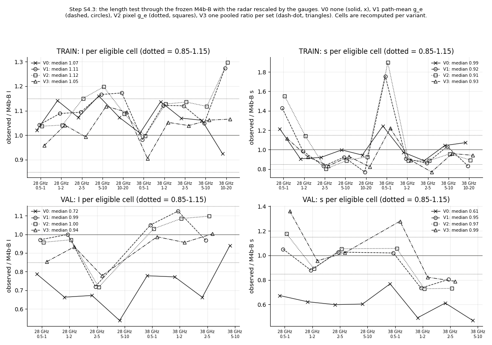
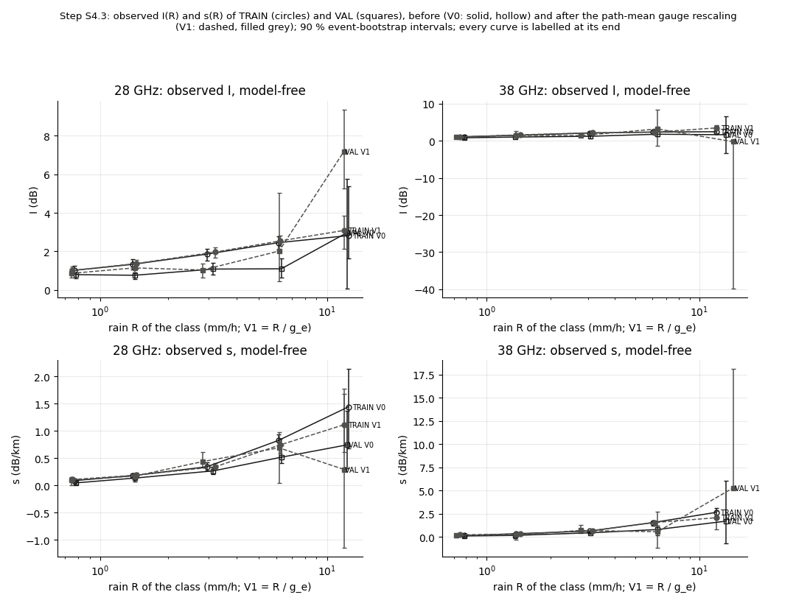
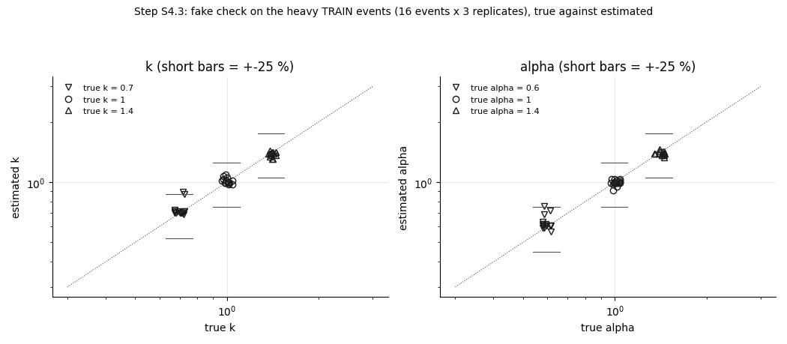
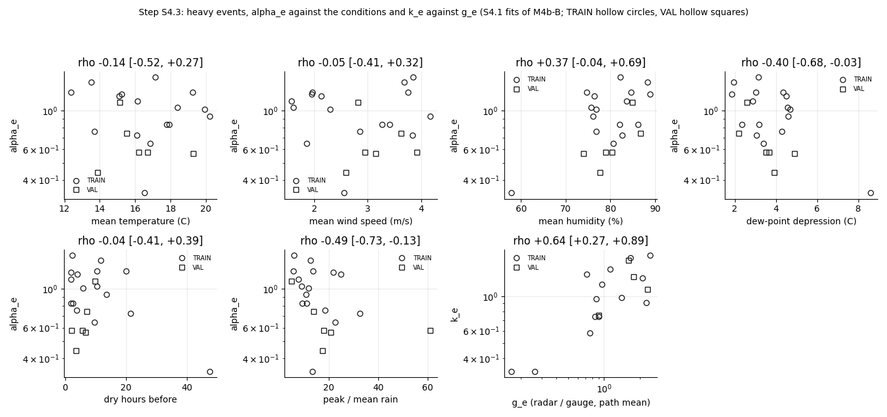

# wet_antenna step S4.3: is the VAL gap the radar? Gauge-rescaled length test, and per-event factors on heavy events

Written by `research/wet_antenna/conditions_s4c.py` (libraries `event_factors.py`, `system_id.py`, `length_test.py`). Settings and every
rule: `wet_antenna.conditions_s4c` in `research/config.yaml`, written on 2026-10-15 BEFORE the run. Frozen model: **M4b-B** of S3b (WAA v3,
provisional), M3-B as a check; NOTHING is refitted. Plan: `docs/ROADMAP.md`, S4.3.

**Standing rule.** WAA is never estimated by subtracting a power-law rain term. The path part is separated only through its dependence on L at matched rain. ITU-R P.838 appears only as a size reference, never to correct data. In this step the rain correction comes from the City gauges only, never from the links.

## 1. What was run

- **g_e** = radar rain / City-gauge rain per event, the two S4.1 definitions (code moved unchanged to `event_factors.py`; the S4.1 tables
  are reproduced byte for byte after the move): **path mean** = the radar path mean of the gauge links (City gauge within 1 km) against
  their gauges, used if >= 1.0 mm per gauge link; **pixel** = the radar pixel at the 10 City gauges against the gauges, used if the
  gauges' SUM is >= 1.0 mm (the S4.1 code rule). Other events: g_e = 1. Pooled per set (path mean): G_TRAIN = 0.894,
  G_VAL = 1.707. (`research/wet_antenna/outputs/tables/conditions_s4c_g_e.csv`.)
- Path-mean g_e used for 19 events (14 TRAIN, 5 VAL); pixel g_e for 24
  (18 TRAIN, 6 VAL). The events that got a g_e:

| set | event_id | intensity_class | gauge_links | gauge_mm_per_link | g_path_raw | path_used | pixel_gauge_mm | g_pixel_raw | pixel_used |
|---|---|---|---|---|---|---|---|---|---|
| TRAIN | E20150605_1745 | heavy | 50 | 0.824 | 4.15 | False | 9.6 | 3.599 | True |
| TRAIN | E20150608_1150 | moderate | 49 | 0.755 | 1.707 | False | 5.6 | 1.885 | True |
| TRAIN | E20150617_0705 | heavy | 36 | 24.725 | 0.168 | True | 184.5 | 0.216 | True |
| TRAIN | E20150618_0530 | heavy | 50 | 1.858 | 2.259 | True | 17.7 | 2.188 | True |
| TRAIN | E20150622_0930 | heavy | 50 | 1.44 | 1.653 | True | 24.6 | 1.319 | True |
| TRAIN | E20150628_0530 | moderate | 45 | 0.224 | 0.001 | False | 2.2 | 0.0 | True |
| TRAIN | E20150705_1910 | heavy | 49 | 1.327 | 2.089 | True | 14.3 | 2.068 | True |
| TRAIN | E20150707_1235 | heavy | 50 | 16.312 | 0.76 | True | 185.2 | 0.755 | True |
| TRAIN | E20150725_0440 | heavy | 50 | 22.064 | 0.718 | True | 225.6 | 0.771 | True |
| TRAIN | E20150727_2140 | heavy | 50 | 16.612 | 1.12 | True | 230.0 | 0.996 | True |
| TRAIN | E20150804_1830 | heavy | 50 | 8.084 | 0.857 | True | 110.0 | 0.833 | True |
| TRAIN | E20150806_0330 | heavy | 50 | 0.228 | 0.617 | False | 1.7 | 0.926 | True |
| TRAIN | E20150810_1545 | heavy | 50 | 2.004 | 2.434 | True | 21.4 | 2.354 | True |
| TRAIN | E20150815_1305 | heavy | 50 | 8.31 | 0.955 | True | 95.5 | 0.857 | True |
| TRAIN | E20150825_0145 | heavy | 50 | 17.614 | 1.398 | True | 234.5 | 1.302 | True |
| TRAIN | E20150826_0520 | heavy | 50 | 2.378 | 0.264 | True | 23.6 | 0.264 | True |
| TRAIN | E20150826_1620 | heavy | 50 | 17.506 | 0.907 | True | 250.3 | 0.952 | True |
| TRAIN | E20150831_0455 | heavy | 50 | 14.5 | 0.838 | True | 150.2 | 0.81 | True |
| VAL | E20150709_1725 | heavy | 49 | 3.251 | 1.766 | True | 32.1 | 1.803 | True |
| VAL | E20150717_1525 | moderate | 50 | 1.326 | 1.902 | True | 12.3 | 1.912 | True |
| VAL | E20150719_1205 | heavy | 50 | 5.288 | 1.598 | True | 63.9 | 1.626 | True |
| VAL | E20150722_2315 | heavy | 50 | 2.176 | 0.905 | True | 28.4 | 0.709 | True |
| VAL | E20150730_0450 | heavy | 50 | 0.64 | 0.925 | False | 6.0 | 0.916 | True |
| VAL | E20150824_0330 | heavy | 50 | 3.106 | 2.308 | True | 32.9 | 2.167 | True |

  g_e = 1 (too little gauge rain) for the other 45 events: E20150606_1740 (TRAIN), E20150607_0245 (TRAIN), E20150608_0615 (TRAIN), E20150609_0410 (TRAIN), E20150620_1015 (TRAIN), E20150620_1655 (TRAIN), E20150621_0645 (TRAIN), E20150621_1645 (TRAIN), E20150622_0300 (TRAIN), E20150701_0030 (TRAIN), E20150704_2125 (TRAIN), E20150712_2255 (TRAIN), E20150718_1300 (TRAIN), E20150718_1745 (TRAIN), E20150723_0520 (TRAIN), E20150731_1440 (TRAIN), E20150802_0400 (TRAIN), E20150802_1955 (TRAIN), E20150803_0210 (TRAIN), E20150803_1550 (TRAIN), E20150804_0600 (TRAIN), E20150806_1505 (TRAIN), E20150808_0345 (TRAIN), E20150810_0220 (TRAIN), E20150811_2220 (TRAIN), E20150813_0235 (TRAIN), E20150813_1415 (TRAIN), E20150814_1420 (TRAIN), E20150822_0505 (TRAIN), E20150823_1720 (TRAIN), E20150829_0545 (TRAIN), E20150830_0035 (TRAIN), E20150830_2335 (TRAIN), E20150627_0935 (VAL), E20150628_1635 (VAL), E20150705_0325 (VAL), E20150711_0420 (VAL), E20150722_0140 (VAL), E20150729_1905 (VAL), E20150805_1535 (VAL), E20150807_0305 (VAL), E20150811_1550 (VAL), E20150815_0435 (VAL), E20150826_0120 (VAL), E20150828_2145 (VAL).
- Variants (R -> R / g in the model input AND in the observed bins; the steady-rain bins and classes are recomputed per variant):
  **V0** no rescaling (= S3b); **V1** R / g_e per event, path-mean version; **V2** R / g_e per event, pixel version; **V3** R / G per set, G = the pooled path-mean radar / gauge ratio of the set (all radar mm / all gauge mm over the events used for g_e; one number for TRAIN, one for VAL).
- The length test exactly as S3b check 1 (Huber line; observed with the event bootstrap, 1000 draws; eligible cell = >= 8 links < 1 km).
- Part 2: the S4.1 fake design on the heavy TRAIN events, 3 replicates.
- **The circularity, plainly:** the radar product is gauge-adjusted (`pipeline/docs/methods.md`, section 9: "it is gauge-adjusted, so it is
  not independent of the gauges"), so dividing it by a gauge ratio partly undoes or redoes an adjustment that already used gauges; and
  g_e compares point gauges with path means (or a 2 x 2 km pixel), so it holds sampling error as well as radar error. Only the City
  gauges are used here, never the links.

## 2. Part 1: the verdicts

Rules (written before the run): **explained** on VAL = in V1 (M4b-B) the median observed / model ratio of I AND of s within
0.85-1.15 AND both inside in >= 2/3 of the eligible cells; **TRAIN not broken** = the same three on TRAIN in V1.

- **Explained on VAL: YES.**
- **TRAIN not broken: YES.**

Per set, variant and fit (`research/wet_antenna/outputs/tables/conditions_s4c_length_verdict.csv`):

| set | variant | fit | eligible_cells | I_ratio_median | s_ratio_median | I_inside | s_inside | both_inside | both_share | all_three_criteria |
|---|---|---|---|---|---|---|---|---|---|---|
| TRAIN | V0 | M4b-B | 10 | 1.071 | 0.985 | 10 | 10 | 10 | 1.0 | True |
| TRAIN | V0 | M3-B | 10 | 1.073 | 0.936 | 10 | 10 | 10 | 1.0 | True |
| VAL | V0 | M4b-B | 8 | 0.722 | 0.608 | 3 | 2 | 1 | 0.125 | False |
| VAL | V0 | M3-B | 8 | 0.728 | 0.581 | 3 | 2 | 1 | 0.125 | False |
| TRAIN | V1 | M4b-B | 10 | 1.107 | 0.916 | 9 | 8 | 7 | 0.7 | True |
| TRAIN | V1 | M3-B | 10 | 1.138 | 0.868 | 9 | 7 | 6 | 0.6 | False |
| VAL | V1 | M4b-B | 6 | 0.985 | 0.95 | 5 | 6 | 5 | 0.833 | True |
| VAL | V1 | M3-B | 6 | 0.997 | 0.864 | 5 | 5 | 4 | 0.667 | False |
| TRAIN | V2 | M4b-B | 10 | 1.123 | 0.91 | 8 | 8 | 7 | 0.7 | True |
| TRAIN | V2 | M3-B | 10 | 1.125 | 0.923 | 7 | 6 | 5 | 0.5 | False |
| VAL | V2 | M4b-B | 6 | 1.001 | 0.973 | 5 | 6 | 5 | 0.833 | True |
| VAL | V2 | M3-B | 6 | 0.997 | 0.893 | 5 | 5 | 4 | 0.667 | False |
| TRAIN | V3 | M4b-B | 10 | 1.047 | 0.928 | 10 | 9 | 9 | 0.9 | True |
| TRAIN | V3 | M3-B | 10 | 1.07 | 0.853 | 10 | 7 | 7 | 0.7 | True |
| VAL | V3 | M4b-B | 6 | 0.945 | 0.989 | 6 | 6 | 6 | 1.0 | True |
| VAL | V3 | M3-B | 6 | 0.946 | 0.912 | 4 | 6 | 4 | 0.667 | False |

**READING.** On VAL without rescaling (V0) the model over-predicts the length dependence: I 0.72, s 0.61, both inside 1 / 8.
Dividing the radar rain by the event's radar / gauge ratio closes the gap: V1 I 0.99, s 0.95, both inside 5 / 6; V2 (pixel) I 1.00, s 0.97, both inside 5 / 6;
V3 (one number per set) I 0.94, s 0.99, both inside 6 / 6. TRAIN stays inside the rules but loses some sharpness: V0 I 1.07, s 0.99, both inside 10 / 10, V1 I 1.11, s 0.92, both inside 7 / 10.
So by the rules written before the run the VAL gap is **explained by the rain reference**, and TRAIN is not broken. Three caveats:
(a) the number of eligible VAL cells falls from 8 (V0) to 6 (V1): the class(es) 5-10 disappear
because VAL rain is divided by about 1.7, and those were among the worst V0 cells, so part of the improvement is that the hardest
cells leave the test; (b) the check fit M3-B misses the share rule in V1 on VAL by rounding (4 / 6 =
0.66667 against the written 0.6667) and on TRAIN (0.60); its medians move the same way;
(c) the per-set V3 does as well as the per-event V1 on VAL, so the data cannot say whether the error is per event or one bias of the
VAL period.

Every eligible cell, M4b-B (`research/wet_antenna/outputs/tables/conditions_s4c_length_cells.csv`, both fits):

| set | variant | band | class | R_cell | I_obs | I_lo | I_hi | I_model | s_obs | s_lo | s_hi | s_model | I_inside | s_inside |
|---|---|---|---|---|---|---|---|---|---|---|---|---|---|---|
| TRAIN | V0 | 28 GHz | 0.5-1 | 0.77 | 1.019 | 0.837 | 1.263 | 0.998 | 0.085 | 0.048 | 0.122 | 0.07 | True | True |
| TRAIN | V0 | 28 GHz | 1-2 | 1.392 | 1.328 | 1.073 | 1.584 | 1.164 | 0.176 | 0.143 | 0.22 | 0.194 | True | True |
| TRAIN | V0 | 28 GHz | 2-5 | 2.957 | 1.859 | 1.522 | 2.121 | 1.733 | 0.339 | 0.277 | 0.415 | 0.369 | True | True |
| TRAIN | V0 | 28 GHz | 5-10 | 6.109 | 2.453 | 2.083 | 2.782 | 2.114 | 0.822 | 0.725 | 0.928 | 0.824 | True | True |
| TRAIN | V0 | 28 GHz | 10-20 | 12.444 | 2.821 | 1.645 | 5.383 | 2.63 | 1.439 | 0.683 | 2.133 | 1.524 | True | True |
| TRAIN | V0 | 38 GHz | 0.5-1 | 0.785 | 1.099 | 0.91 | 1.361 | 1.09 | 0.156 | 0.111 | 0.202 | 0.126 | True | True |
| TRAIN | V0 | 38 GHz | 1-2 | 1.376 | 1.471 | 1.128 | 1.837 | 1.294 | 0.358 | 0.294 | 0.421 | 0.368 | True | True |
| TRAIN | V0 | 38 GHz | 2-5 | 3.044 | 2.081 | 1.739 | 2.391 | 1.946 | 0.638 | 0.471 | 0.781 | 0.72 | True | True |
| TRAIN | V0 | 38 GHz | 5-10 | 6.071 | 2.346 | 2.004 | 2.813 | 2.211 | 1.561 | 1.202 | 1.703 | 1.497 | True | True |
| TRAIN | V0 | 38 GHz | 10-20 | 12.004 | 2.437 | 2.019 | 3.987 | 2.635 | 2.66 | 2.239 | 3.086 | 2.481 | True | True |
| VAL | V0 | 28 GHz | 0.5-1 | 0.757 | 0.795 | 0.588 | 0.895 | 1.011 | 0.043 | 0.013 | 0.083 | 0.064 | False | True |
| VAL | V0 | 28 GHz | 1-2 | 1.382 | 0.763 | 0.578 | 0.903 | 1.15 | 0.132 | 0.071 | 0.195 | 0.212 | False | False |
| VAL | V0 | 28 GHz | 2-5 | 3.065 | 1.084 | 0.778 | 1.404 | 1.611 | 0.264 | 0.21 | 0.327 | 0.441 | False | False |
| VAL | V0 | 28 GHz | 5-10 | 6.109 | 1.098 | 0.641 | 1.623 | 2.04 | 0.514 | 0.401 | 0.733 | 0.852 | False | False |
| VAL | V0 | 38 GHz | 0.5-1 | 0.76 | 0.8 | 0.508 | 1.067 | 1.028 | 0.115 | -0.011 | 0.182 | 0.15 | True | True |
| VAL | V0 | 38 GHz | 1-2 | 1.319 | 0.998 | 0.814 | 1.624 | 1.293 | 0.176 | -0.094 | 0.281 | 0.357 | True | False |
| VAL | V0 | 38 GHz | 2-5 | 2.992 | 1.207 | 0.689 | 1.578 | 1.821 | 0.456 | 0.353 | 0.603 | 0.745 | False | False |
| VAL | V0 | 38 GHz | 5-10 | 6.176 | 1.76 | 1.283 | 2.906 | 1.872 | 0.81 | 0.223 | 1.227 | 1.723 | True | False |
| TRAIN | V1 | 28 GHz | 0.5-1 | 0.752 | 1.01 | 0.848 | 1.211 | 0.968 | 0.104 | 0.058 | 0.144 | 0.073 | True | True |
| TRAIN | V1 | 28 GHz | 1-2 | 1.445 | 1.37 | 1.108 | 1.576 | 1.259 | 0.185 | 0.142 | 0.235 | 0.188 | True | True |
| TRAIN | V1 | 28 GHz | 2-5 | 3.215 | 1.965 | 1.655 | 2.199 | 1.797 | 0.339 | 0.284 | 0.4 | 0.408 | True | False |
| TRAIN | V1 | 28 GHz | 5-10 | 6.231 | 2.548 | 2.284 | 2.816 | 2.185 | 0.741 | 0.587 | 0.852 | 0.803 | False | True |
| TRAIN | V1 | 28 GHz | 10-20 | 11.874 | 3.086 | 2.147 | 3.85 | 2.631 | 1.11 | 0.609 | 1.674 | 1.441 | True | True |
| TRAIN | V1 | 38 GHz | 0.5-1 | 0.747 | 1.013 | 0.832 | 1.226 | 1.031 | 0.237 | 0.166 | 0.311 | 0.135 | True | False |
| TRAIN | V1 | 38 GHz | 1-2 | 1.437 | 1.601 | 1.292 | 1.845 | 1.427 | 0.317 | 0.249 | 0.382 | 0.348 | True | True |
| TRAIN | V1 | 38 GHz | 2-5 | 3.134 | 2.156 | 1.866 | 2.421 | 1.925 | 0.701 | 0.564 | 0.857 | 0.814 | True | True |
| TRAIN | V1 | 38 GHz | 5-10 | 6.169 | 2.313 | 1.984 | 2.723 | 2.204 | 1.565 | 1.247 | 1.789 | 1.515 | True | True |
| TRAIN | V1 | 38 GHz | 10-20 | 12.027 | 3.454 | 2.075 | 4.268 | 2.713 | 2.079 | 0.835 | 2.835 | 2.492 | True | True |
| VAL | V1 | 28 GHz | 0.5-1 | 0.725 | 0.862 | 0.66 | 1.112 | 0.888 | 0.095 | 0.002 | 0.15 | 0.091 | True | True |
| VAL | V1 | 28 GHz | 1-2 | 1.379 | 1.145 | 0.89 | 1.405 | 1.146 | 0.168 | 0.103 | 0.213 | 0.191 | True | True |
| VAL | V1 | 28 GHz | 2-5 | 2.748 | 1.037 | 0.625 | 1.357 | 1.44 | 0.434 | 0.324 | 0.615 | 0.423 | False | True |
| VAL | V1 | 38 GHz | 0.5-1 | 0.696 | 0.928 | 0.748 | 1.231 | 0.884 | 0.192 | -0.02 | 0.273 | 0.188 | True | True |
| VAL | V1 | 38 GHz | 1-2 | 1.331 | 1.445 | 1.153 | 2.593 | 1.285 | 0.229 | -0.263 | 0.354 | 0.312 | True | True |
| VAL | V1 | 38 GHz | 2-5 | 2.678 | 1.384 | 0.944 | 1.56 | 1.428 | 0.709 | 0.439 | 1.265 | 0.882 | True | True |
| TRAIN | V2 | 28 GHz | 0.5-1 | 0.751 | 1.016 | 0.856 | 1.219 | 0.98 | 0.114 | 0.069 | 0.151 | 0.073 | True | True |
| TRAIN | V2 | 28 GHz | 1-2 | 1.425 | 1.313 | 1.053 | 1.512 | 1.261 | 0.206 | 0.166 | 0.252 | 0.181 | True | True |
| TRAIN | V2 | 28 GHz | 2-5 | 3.156 | 2.025 | 1.791 | 2.216 | 1.76 | 0.333 | 0.281 | 0.381 | 0.415 | False | False |
| TRAIN | V2 | 28 GHz | 5-10 | 6.178 | 2.589 | 2.336 | 2.864 | 2.162 | 0.722 | 0.554 | 0.83 | 0.813 | False | True |
| TRAIN | V2 | 28 GHz | 10-20 | 11.989 | 2.768 | 1.695 | 3.554 | 2.546 | 1.365 | 0.916 | 1.803 | 1.472 | True | True |
| TRAIN | V2 | 38 GHz | 0.5-1 | 0.761 | 1.057 | 0.896 | 1.252 | 1.061 | 0.246 | 0.183 | 0.309 | 0.13 | True | False |
| TRAIN | V2 | 38 GHz | 1-2 | 1.438 | 1.609 | 1.32 | 1.852 | 1.427 | 0.309 | 0.252 | 0.364 | 0.349 | True | True |
| TRAIN | V2 | 38 GHz | 2-5 | 3.134 | 2.15 | 1.866 | 2.434 | 1.894 | 0.741 | 0.629 | 0.856 | 0.835 | True | True |
| TRAIN | V2 | 38 GHz | 5-10 | 6.103 | 2.427 | 2.102 | 2.819 | 2.171 | 1.457 | 1.043 | 1.71 | 1.523 | True | True |
| TRAIN | V2 | 38 GHz | 10-20 | 12.03 | 3.572 | 2.551 | 4.122 | 2.756 | 2.211 | 1.393 | 2.605 | 2.474 | True | True |
| VAL | V2 | 28 GHz | 0.5-1 | 0.718 | 0.846 | 0.635 | 1.047 | 0.884 | 0.108 | 0.031 | 0.168 | 0.092 | True | True |
| VAL | V2 | 28 GHz | 1-2 | 1.392 | 1.129 | 0.915 | 1.408 | 1.163 | 0.168 | 0.082 | 0.215 | 0.188 | True | True |
| VAL | V2 | 28 GHz | 2-5 | 2.761 | 1.029 | 0.607 | 1.291 | 1.435 | 0.444 | 0.33 | 0.604 | 0.421 | False | True |
| VAL | V2 | 38 GHz | 0.5-1 | 0.707 | 0.907 | 0.738 | 1.13 | 0.881 | 0.201 | -0.002 | 0.293 | 0.19 | True | True |
| VAL | V2 | 38 GHz | 1-2 | 1.35 | 1.377 | 1.133 | 2.324 | 1.27 | 0.246 | -0.194 | 0.359 | 0.337 | True | True |
| VAL | V2 | 38 GHz | 2-5 | 2.651 | 1.569 | 1.211 | 1.826 | 1.43 | 0.644 | 0.393 | 1.113 | 0.881 | True | True |
| TRAIN | V3 | 28 GHz | 0.5-1 | 0.774 | 0.967 | 0.797 | 1.214 | 1.01 | 0.075 | 0.036 | 0.115 | 0.067 | True | True |
| TRAIN | V3 | 28 GHz | 1-2 | 1.384 | 1.233 | 0.99 | 1.483 | 1.184 | 0.177 | 0.14 | 0.221 | 0.191 | True | True |
| TRAIN | V3 | 28 GHz | 2-5 | 2.96 | 1.698 | 1.379 | 1.959 | 1.71 | 0.316 | 0.258 | 0.382 | 0.379 | True | True |
| TRAIN | V3 | 28 GHz | 5-10 | 6.188 | 2.398 | 2.07 | 2.672 | 2.144 | 0.768 | 0.669 | 0.869 | 0.827 | True | True |
| TRAIN | V3 | 28 GHz | 10-20 | 11.813 | 2.773 | 1.656 | 4.101 | 2.534 | 1.244 | 0.872 | 1.819 | 1.51 | True | True |
| TRAIN | V3 | 38 GHz | 0.5-1 | 0.776 | 0.986 | 0.806 | 1.252 | 1.089 | 0.166 | 0.115 | 0.216 | 0.136 | True | True |
| TRAIN | V3 | 38 GHz | 1-2 | 1.384 | 1.393 | 1.074 | 1.766 | 1.324 | 0.331 | 0.268 | 0.389 | 0.371 | True | True |
| TRAIN | V3 | 38 GHz | 2-5 | 2.998 | 1.978 | 1.626 | 2.268 | 1.903 | 0.569 | 0.444 | 0.688 | 0.739 | True | False |
| TRAIN | V3 | 38 GHz | 5-10 | 6.12 | 2.386 | 2.038 | 2.84 | 2.247 | 1.435 | 1.125 | 1.592 | 1.495 | True | True |
| TRAIN | V3 | 38 GHz | 10-20 | 12.122 | 2.718 | 2.185 | 4.276 | 2.551 | 2.465 | 1.814 | 2.73 | 2.616 | True | True |
| VAL | V3 | 28 GHz | 0.5-1 | 0.715 | 0.777 | 0.635 | 0.913 | 0.91 | 0.115 | 0.019 | 0.176 | 0.084 | True | True |
| VAL | V3 | 28 GHz | 1-2 | 1.384 | 1.054 | 0.918 | 1.363 | 1.129 | 0.192 | 0.109 | 0.245 | 0.201 | True | True |
| VAL | V3 | 28 GHz | 2-5 | 2.763 | 1.182 | 0.817 | 1.554 | 1.519 | 0.424 | 0.327 | 0.588 | 0.415 | True | True |
| VAL | V3 | 38 GHz | 0.5-1 | 0.715 | 0.92 | 0.743 | 1.301 | 0.933 | 0.207 | 0.025 | 0.32 | 0.162 | True | True |
| VAL | V3 | 38 GHz | 1-2 | 1.351 | 1.227 | 1.025 | 1.868 | 1.282 | 0.283 | 0.036 | 0.375 | 0.344 | True | True |
| VAL | V3 | 38 GHz | 2-5 | 2.733 | 1.549 | 0.995 | 1.693 | 1.545 | 0.672 | 0.511 | 1.051 | 0.852 | True | True |

## 3. The observed curves before and after

Model-free S3.1 I and s of VAL against TRAIN per variant, on the cells eligible on VAL (`research/wet_antenna/outputs/tables/conditions_s4c_model_free.csv`):

| variant | cells | I_VAL_over_TRAIN_median | s_VAL_over_TRAIN_median | I_overlap | s_overlap |
|---|---|---|---|---|---|
| V0 | 8 | 0.631 | 0.67 | 4 | 7 |
| V1 | 6 | 0.845 | 0.912 | 4 | 6 |
| V2 | 6 | 0.845 | 0.843 | 4 | 6 |
| V3 | 6 | 0.829 | 1.214 | 6 | 6 |

| variant | band | class | R_cell_VAL | R_cell_TRAIN | I_VAL | I_VAL_lo | I_VAL_hi | I_TRAIN | I_TRAIN_lo | I_TRAIN_hi | s_VAL | s_VAL_lo | s_VAL_hi | s_TRAIN | s_TRAIN_lo | s_TRAIN_hi | I_VAL_over_TRAIN | s_VAL_over_TRAIN | I_intervals_overlap | s_intervals_overlap |
|---|---|---|---|---|---|---|---|---|---|---|---|---|---|---|---|---|---|---|---|---|
| V0 | 28 GHz | 0.5-1 | 0.757 | 0.77 | 0.795 | 0.588 | 0.895 | 1.019 | 0.837 | 1.263 | 0.043 | 0.013 | 0.083 | 0.085 | 0.048 | 0.122 | 0.78 | 0.508 | True | True |
| V0 | 28 GHz | 1-2 | 1.382 | 1.392 | 0.763 | 0.578 | 0.903 | 1.328 | 1.073 | 1.584 | 0.132 | 0.071 | 0.195 | 0.176 | 0.143 | 0.22 | 0.574 | 0.748 | False | True |
| V0 | 28 GHz | 2-5 | 3.065 | 2.957 | 1.084 | 0.778 | 1.404 | 1.859 | 1.522 | 2.121 | 0.264 | 0.21 | 0.327 | 0.339 | 0.277 | 0.415 | 0.583 | 0.778 | False | True |
| V0 | 28 GHz | 5-10 | 6.109 | 6.109 | 1.098 | 0.641 | 1.623 | 2.453 | 2.083 | 2.782 | 0.514 | 0.401 | 0.733 | 0.822 | 0.725 | 0.928 | 0.448 | 0.626 | False | True |
| V0 | 38 GHz | 0.5-1 | 0.76 | 0.785 | 0.8 | 0.508 | 1.067 | 1.099 | 0.91 | 1.361 | 0.115 | -0.011 | 0.182 | 0.156 | 0.111 | 0.202 | 0.727 | 0.739 | True | True |
| V0 | 38 GHz | 1-2 | 1.319 | 1.376 | 0.998 | 0.814 | 1.624 | 1.471 | 1.128 | 1.837 | 0.176 | -0.094 | 0.281 | 0.358 | 0.294 | 0.421 | 0.679 | 0.492 | True | False |
| V0 | 38 GHz | 2-5 | 2.992 | 3.044 | 1.207 | 0.689 | 1.578 | 2.081 | 1.739 | 2.391 | 0.456 | 0.353 | 0.603 | 0.638 | 0.471 | 0.781 | 0.58 | 0.715 | False | True |
| V0 | 38 GHz | 5-10 | 6.176 | 6.071 | 1.76 | 1.283 | 2.906 | 2.346 | 2.004 | 2.813 | 0.81 | 0.223 | 1.227 | 1.561 | 1.202 | 1.703 | 0.75 | 0.519 | True | True |
| V1 | 28 GHz | 0.5-1 | 0.725 | 0.752 | 0.862 | 0.66 | 1.112 | 1.01 | 0.848 | 1.211 | 0.095 | 0.002 | 0.15 | 0.104 | 0.058 | 0.144 | 0.854 | 0.914 | True | True |
| V1 | 28 GHz | 1-2 | 1.379 | 1.445 | 1.145 | 0.89 | 1.405 | 1.37 | 1.108 | 1.576 | 0.168 | 0.103 | 0.213 | 0.185 | 0.142 | 0.235 | 0.836 | 0.91 | True | True |
| V1 | 28 GHz | 2-5 | 2.748 | 3.215 | 1.037 | 0.625 | 1.357 | 1.965 | 1.655 | 2.199 | 0.434 | 0.324 | 0.615 | 0.339 | 0.284 | 0.4 | 0.528 | 1.282 | False | True |
| V1 | 38 GHz | 0.5-1 | 0.696 | 0.747 | 0.928 | 0.748 | 1.231 | 1.013 | 0.832 | 1.226 | 0.192 | -0.02 | 0.273 | 0.237 | 0.166 | 0.311 | 0.916 | 0.81 | True | True |
| V1 | 38 GHz | 1-2 | 1.331 | 1.437 | 1.445 | 1.153 | 2.593 | 1.601 | 1.292 | 1.845 | 0.229 | -0.263 | 0.354 | 0.317 | 0.249 | 0.382 | 0.902 | 0.724 | True | True |
| V1 | 38 GHz | 2-5 | 2.678 | 3.134 | 1.384 | 0.944 | 1.56 | 2.156 | 1.866 | 2.421 | 0.709 | 0.439 | 1.265 | 0.701 | 0.564 | 0.857 | 0.642 | 1.012 | False | True |
| V2 | 28 GHz | 0.5-1 | 0.718 | 0.751 | 0.846 | 0.635 | 1.047 | 1.016 | 0.856 | 1.219 | 0.108 | 0.031 | 0.168 | 0.114 | 0.069 | 0.151 | 0.833 | 0.953 | True | True |
| V2 | 28 GHz | 1-2 | 1.392 | 1.425 | 1.129 | 0.915 | 1.408 | 1.313 | 1.053 | 1.512 | 0.168 | 0.082 | 0.215 | 0.206 | 0.166 | 0.252 | 0.86 | 0.815 | True | True |
| V2 | 28 GHz | 2-5 | 2.761 | 3.156 | 1.029 | 0.607 | 1.291 | 2.025 | 1.791 | 2.216 | 0.444 | 0.33 | 0.604 | 0.333 | 0.281 | 0.381 | 0.508 | 1.335 | False | True |
| V2 | 38 GHz | 0.5-1 | 0.707 | 0.761 | 0.907 | 0.738 | 1.13 | 1.057 | 0.896 | 1.252 | 0.201 | -0.002 | 0.293 | 0.246 | 0.183 | 0.309 | 0.858 | 0.817 | True | True |
| V2 | 38 GHz | 1-2 | 1.35 | 1.438 | 1.377 | 1.133 | 2.324 | 1.609 | 1.32 | 1.852 | 0.246 | -0.194 | 0.359 | 0.309 | 0.252 | 0.364 | 0.856 | 0.796 | True | True |
| V2 | 38 GHz | 2-5 | 2.651 | 3.134 | 1.569 | 1.211 | 1.826 | 2.15 | 1.866 | 2.434 | 0.644 | 0.393 | 1.113 | 0.741 | 0.629 | 0.856 | 0.73 | 0.869 | False | True |
| V3 | 28 GHz | 0.5-1 | 0.715 | 0.774 | 0.777 | 0.635 | 0.913 | 0.967 | 0.797 | 1.214 | 0.115 | 0.019 | 0.176 | 0.075 | 0.036 | 0.115 | 0.803 | 1.532 | True | True |
| V3 | 28 GHz | 1-2 | 1.384 | 1.384 | 1.054 | 0.918 | 1.363 | 1.233 | 0.99 | 1.483 | 0.192 | 0.109 | 0.245 | 0.177 | 0.14 | 0.221 | 0.854 | 1.084 | True | True |
| V3 | 28 GHz | 2-5 | 2.763 | 2.96 | 1.182 | 0.817 | 1.554 | 1.698 | 1.379 | 1.959 | 0.424 | 0.327 | 0.588 | 0.316 | 0.258 | 0.382 | 0.696 | 1.341 | True | True |
| V3 | 38 GHz | 0.5-1 | 0.715 | 0.776 | 0.92 | 0.743 | 1.301 | 0.986 | 0.806 | 1.252 | 0.207 | 0.025 | 0.32 | 0.166 | 0.115 | 0.216 | 0.934 | 1.247 | True | True |
| V3 | 38 GHz | 1-2 | 1.351 | 1.384 | 1.227 | 1.025 | 1.868 | 1.393 | 1.074 | 1.766 | 0.283 | 0.036 | 0.375 | 0.331 | 0.268 | 0.389 | 0.88 | 0.855 | True | True |
| V3 | 38 GHz | 2-5 | 2.733 | 2.998 | 1.549 | 0.995 | 1.693 | 1.978 | 1.626 | 2.268 | 0.672 | 0.511 | 1.051 | 0.569 | 0.444 | 0.688 | 0.783 | 1.181 | True | True |

**READING.** The model-free curves tell the same story without any model: the median VAL / TRAIN ratio of I goes from
0.63 (V0) to 0.84 (V1), of s from 0.67 to 0.91. The gap closes most of the way but
not all: the 28 GHz 2-5 mm/h cell still has VAL I at 0.53 x TRAIN with non-overlapping intervals (V1), and V3 over-shoots s
(median 1.21). At light rain (0.5-2 mm/h) VAL and TRAIN agree after rescaling within their intervals.

## 4. Part 2: heavy events only

Fake check: the S4.1 design (frozen M4b-B; k in [0.7, 1.0, 1.4], alpha in [0.6, 1.0, 1.4]; S2 noise; ridge 0.05 per link) on
the 16 heavy TRAIN events x 3 replicates. Rule: PASS if >= 80 % of the event-replicates recover both within
+-25 %. **Result: PASS** (47 of 48 = 98 %; k alone 47, alpha alone 47).
(`research/wet_antenna/outputs/tables/conditions_s4c_heavy_fake.csv`.)

| replicate | event_replicates | recovered | k_ok | alpha_ok |
|---|---|---|---|---|
| 0 | 16 | 16 | 16 | 16 |
| 1 | 16 | 16 | 16 | 16 |
| 2 | 16 | 15 | 15 | 15 |

| k_true | alpha_true | event_replicates | recovered |
|---|---|---|---|
| 0.7 | 0.6 | 6 | 5 |
| 0.7 | 1.0 | 6 | 6 |
| 0.7 | 1.4 | 5 | 5 |
| 1.0 | 0.6 | 6 | 6 |
| 1.0 | 1.0 | 6 | 6 |
| 1.0 | 1.4 | 4 | 4 |
| 1.4 | 0.6 | 3 | 3 |
| 1.4 | 1.0 | 6 | 6 |
| 1.4 | 1.4 | 6 | 6 |

**READING.** On heavy events the factors are identifiable: 98 % of the event-replicates recover both k and alpha
within +-25 % (rule 80 %), as S4.1 already hinted (16 / 16). Part 2 therefore goes on.

Real factors of the heavy events (22 events: 16 TRAIN, 6 VAL; the S4.1 fits of M4b-B,
`research/wet_antenna/outputs/tables/conditions_s4_factors.csv`, no rerun; `research/wet_antenna/outputs/tables/conditions_s4c_heavy_factors.csv`):

| set | event_id | links | k | k_lo | k_hi | alpha | alpha_lo | alpha_hi | temperature | wind_speed | humidity | dew_point_depression | dry_before_h | peak_over_mean | g_path_raw | path_used |
|---|---|---|---|---|---|---|---|---|---|---|---|---|---|---|---|---|
| TRAIN | E20150605_1745 | 205 | 1.0 | 0.907 | 1.092 | 0.336 | 0.281 | 0.394 | 16.511 | 2.561 | 57.889 | 8.594 | 47.5 | 13.451 | 4.15 | False |
| TRAIN | E20150617_0705 | 138 | 0.33 | 0.33 | 0.542 | 1.273 | 1.244 | 1.826 | 12.38 | 3.76 | 74.667 | 4.361 | 20.083 | 5.694 | 0.168 | True |
| TRAIN | E20150618_0530 | 206 | 0.908 | 0.859 | 0.977 | 0.757 | 0.724 | 0.792 | 13.714 | 2.857 | 76.784 | 4.276 | 3.667 | 18.669 | 2.259 | True |
| TRAIN | E20150622_0930 | 206 | 1.76 | 1.264 | 2.235 | 1.216 | 0.971 | 1.49 | 15.106 | 2.131 | 76.37 | 4.5 | 3.917 | 24.982 | 1.653 | True |
| TRAIN | E20150705_1910 | 205 | 1.311 | 1.218 | 1.386 | 0.928 | 0.867 | 0.971 | 20.216 | 4.168 | 76.053 | 4.608 | 13.583 | 10.87 | 2.089 | True |
| TRAIN | E20150707_1235 | 205 | 0.584 | 0.542 | 0.628 | 0.724 | 0.676 | 0.758 | 16.086 | 3.842 | 82.64 | 3.042 | 21.5 | 32.752 | 0.76 | True |
| VAL | E20150709_1725 | 205 | 1.336 | 1.264 | 1.437 | 0.441 | 0.394 | 0.493 | 13.88 | 2.593 | 77.667 | 3.922 | 3.583 | 17.633 | 1.766 | True |
| VAL | E20150719_1205 | 206 | 1.696 | 1.576 | 1.86 | 1.111 | 1.039 | 1.189 | 15.136 | 2.818 | 84.864 | 2.6 | 9.75 | 4.971 | 1.598 | True |
| VAL | E20150722_2315 | 205 | 0.755 | 0.664 | 0.875 | 0.74 | 0.647 | 0.829 | 15.54 | 3.62 | 86.8 | 2.202 | 7.167 | 14.002 | 0.905 | True |
| TRAIN | E20150725_0440 | 206 | 1.386 | 1.264 | 1.519 | 1.457 | 1.362 | 1.526 | 13.517 | 3.688 | 88.31 | 1.938 | 11.583 | 12.685 | 0.718 | True |
| TRAIN | E20150727_2140 | 206 | 1.491 | 1.311 | 1.665 | 1.244 | 1.136 | 1.362 | 15.24 | 1.948 | 88.925 | 1.858 | 1.917 | 21.979 | 1.12 | True |
| VAL | E20150730_0450 | 206 | 0.769 | 0.64 | 0.891 | 0.578 | 0.515 | 0.647 | 16.7 | 2.953 | 80.412 | 3.525 | 2.167 | 18.006 | 0.925 | False |
| TRAIN | E20150804_1830 | 206 | 0.959 | 0.891 | 1.032 | 1.273 | 1.189 | 1.331 | 19.262 | 1.962 | 84.615 | 3.036 | 10.417 | 13.793 | 0.857 | True |
| TRAIN | E20150806_0330 | 188 | 1.76 | 1.696 | 1.827 | 0.647 | 0.604 | 0.708 | 16.84 | 1.86 | 80.6 | 3.394 | 9.583 | 22.766 | 0.617 | False |
| TRAIN | E20150810_1545 | 206 | 1.826 | 1.519 | 1.965 | 1.039 | 0.907 | 1.111 | 18.37 | 1.605 | 75.65 | 4.574 | 10.5 | 9.115 | 2.434 | True |
| TRAIN | E20150815_1305 | 205 | 1.196 | 1.071 | 1.386 | 1.016 | 0.928 | 1.164 | 19.925 | 2.294 | 76.812 | 4.7 | 5.833 | 11.994 | 0.955 | True |
| VAL | E20150824_0330 | 206 | 1.111 | 1.051 | 1.196 | 0.565 | 0.528 | 0.605 | 19.285 | 3.145 | 74.05 | 4.898 | 6.667 | 20.858 | 2.308 | True |
| TRAIN | E20150825_0145 | 205 | 0.977 | 0.924 | 1.014 | 0.829 | 0.792 | 0.867 | 17.93 | 3.274 | 82.044 | 3.184 | 2.583 | 9.451 | 1.398 | True |
| TRAIN | E20150826_0520 | 204 | 0.33 | 0.33 | 0.349 | 1.559 | 1.49 | 1.631 | 17.13 | 3.85 | 82.2 | 3.162 | 2.25 | 6.151 | 0.264 | True |
| TRAIN | E20150826_1620 | 204 | 0.741 | 0.664 | 0.798 | 0.829 | 0.74 | 0.887 | 17.789 | 3.414 | 86.229 | 2.36 | 1.917 | 11.114 | 0.907 | True |
| VAL | E20150828_2145 | 82 | 1.196 | 0.924 | 1.894 | 0.578 | 0.472 | 0.677 | 16.217 | 3.917 | 79.0 | 3.668 | 5.583 | 61.0 | 0.111 | False |
| TRAIN | E20150831_0455 | 204 | 0.741 | 0.676 | 2.892 | 1.137 | 1.039 | 3.0 | 16.135 | 1.57 | 83.6 | 2.862 | 1.917 | 7.911 | 0.838 | True |

Spearman tests (90 % event-bootstrap intervals; BH at q = 0.1 over the 6 condition tests; the k_e vs g_e test has its own
expectation, >= 0.5; `research/wet_antenna/outputs/tables/conditions_s4c_heavy_tests.csv`):

| test | column | rho | lo | hi | p | events | bh_discovery |
|---|---|---|---|---|---|---|---|
| ln alpha_e vs mean temperature (C) | temperature | -0.141 | -0.519 | 0.274 | 0.531 | 22 | False |
| ln alpha_e vs mean wind speed (m/s) | wind_speed | -0.051 | -0.406 | 0.324 | 0.822 | 22 | False |
| ln alpha_e vs mean humidity (%) | humidity | 0.372 | -0.043 | 0.687 | 0.088 | 22 | False |
| ln alpha_e vs dew-point depression (C) | dew_point_depression | -0.395 | -0.685 | -0.035 | 0.069 | 22 | False |
| ln alpha_e vs dry hours before | dry_before_h | -0.044 | -0.409 | 0.387 | 0.847 | 22 | False |
| ln alpha_e vs peak / mean rain | peak_over_mean | -0.491 | -0.735 | -0.132 | 0.02 | 22 | False |
| ln k_e vs ln g_e (path mean, events with g_e) | g_path | 0.644 | 0.267 | 0.893 | 0.004 | 18 |  |

**READING.** (Descriptive only, 22 events; not a law.) **k_e follows g_e**: Spearman 0.64
(90 % [0.27, 0.89], 18 events), above the expectation 0.5 written before the run. The rain-scale factor that the
links ask for is the same scale the gauges see in the radar (links against radar, gauges against radar; the radar is shared, see
section 6): a second sign that the radar, not the antenna, makes events differ. **No condition is a BH discovery** for alpha_e (6 tests, q = 0.1); the strongest
is ln alpha_e vs peak / mean rain (rho -0.49, p 0.020), then dew-point depression and humidity (wetter air, larger alpha_e), all with
intervals that are wide for 22 events. Events at the edge of the fit grid (E20150617_0705, E20150826_0520, E20150831_0455: k at its lower edge or alpha
interval to the upper edge) weigh on these ranks and should not be read alone.

## 5. What this means for WAA v3 and for the S5 evaluation

- **WAA v3: keep M4b-B unchanged.** With the rain reference corrected by the gauges, the frozen model passes the VAL length
  test (explained; TRAIN not broken), so the S3b gap does not call for a new antenna term or event-dependent
  WAA parameters. Nothing was refitted here; whether a refit on gauge-rescaled rain moves the parameters is a question for S5
  (it would change the science, so only as a written S5 sub-step).
- **S5 evaluation, rain reference:** report every error twice, on the raw radar (V0, as before) and on the radar divided by the
  event's path-mean g_e (V1, events with >= 1.0 mm per gauge link; g_e = 1 otherwise), with V1 as the main reference and the
  pooled V3 as the sensitivity check. The gauge links alone (City gauge within 1 km) stay the independent check, since they do not use
  g_e from a different place. The per-event factors k_e are descriptive and are not used to correct anything.
- The weather question (alpha_e against conditions) stays open: nothing passes BH on 22 heavy events.

## 6. Unclear / possibly wrong

- **Circularity.** The radar is already gauge-adjusted, and g_e uses the same kind of gauges, so V1 partly measures how well the
  adjustment worked in this period; it is not an independent test. g_e also compares point gauges with path means (or 2 x 2 km pixels).
- **Few events.** The VAL correction rests on 5 VAL events with a path-mean g_e; the large VAL events dominate the steady-rain bins.
- **Cells leave the test.** Rescaling lowers R, so the 5-10 mm/h VAL cells drop below 8 links; the improvement is partly fewer, easier cells.
- **Rule rounding.** "2/3" was written as 0.6667, so 4 / 6 counts as a miss (M3-B on VAL). Kept as written, not changed after the run.
- **The 2-5 mm/h cells** of VAL stay low against TRAIN even after rescaling (model-free); a radar error that depends on rain rate,
  or a rain type in VAL, would do that; not tested.
- **Part 2** factors come from the S4.1 fits (grid-bounded; some events at the grid edge); the k_e vs g_e agreement uses the same radar
  on both sides of the ratio, so part of it may be shared radar noise.

Run: computation 10.1 min; this report 0.2 min (budget 1.0 h).
