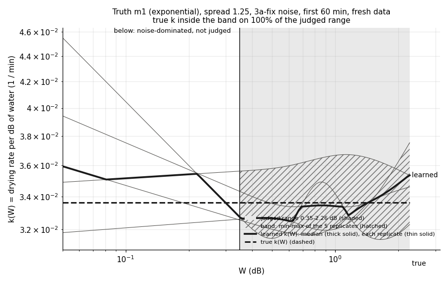
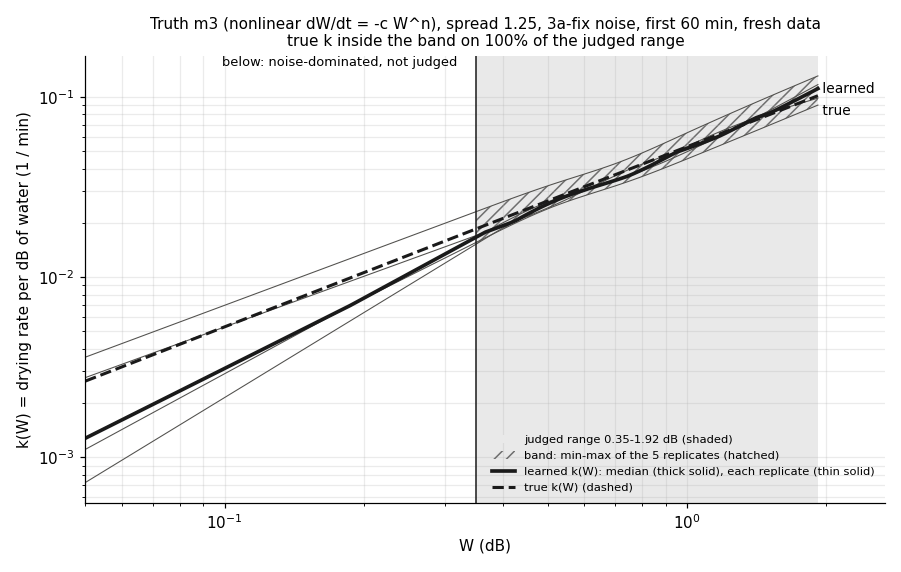
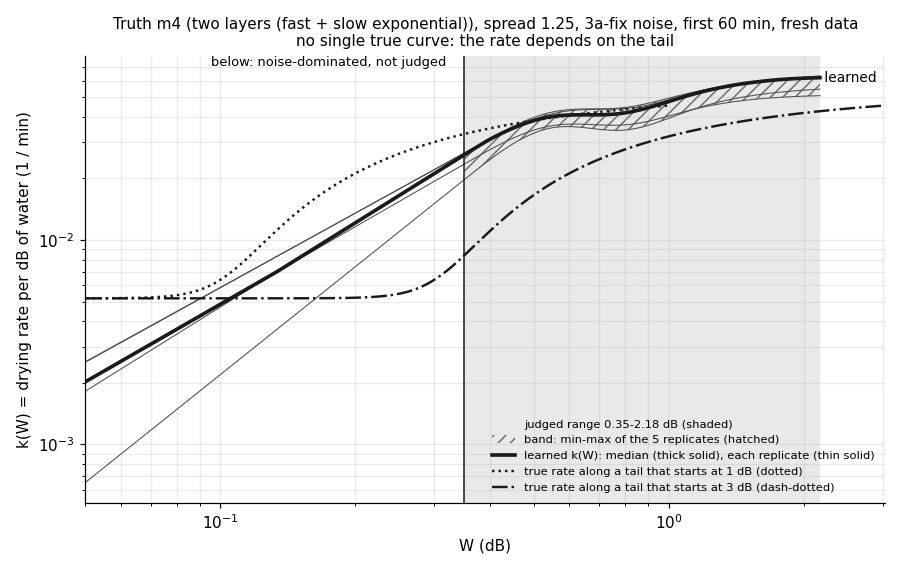
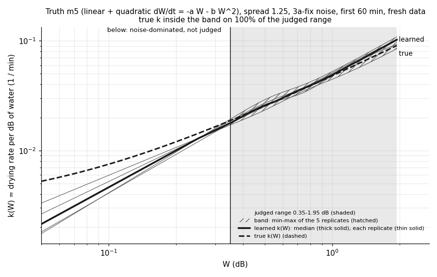
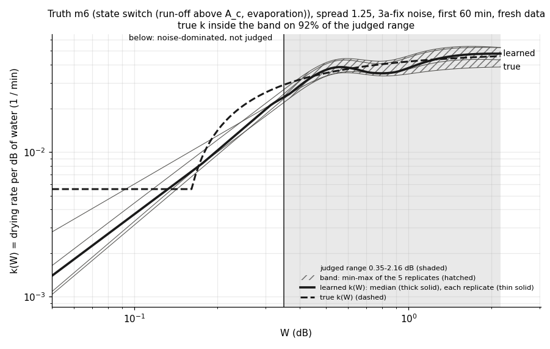

# wet_antenna step 3b-3b: confirmation run of "draw the curve, then name it" (rule fixed before the run)

Written by `research/wet_antenna/confirm_free_curve.py` (libraries `free_curve.py`, `pooled_fit.py`, `sindy.py`,
`simulator.py`; settings `wet_antenna.confirm_free_curve`, fit settings `wet_antenna.check_free_curve`). Fake data only: no real tail is fitted, the frozen
tail set v1 is not changed.

**Overall verdict: PARTIAL.** Per truth: m1 PASS, m3 PASS, m5 PASS, m4 FAIL, m6 not judged.

## 1. What was run

- **Why**: step 3b-3 found, after seeing its results, that the free curve and its equation are right above about
  0.35 dB. This run tests exactly that on fresh data, with the range, the tests and the rule written before the run.
- **Data**: NEW event bootstraps of the 429-tail TRAIN v1 skeleton (seeds 4000 + replicate; 3b-3 used
  3000), 5 replicates, 3a-fix noise, speed spread s = 1.25. Truths m1, m3, m4, m5, m6. Robustness: T1 noise
  (two slow time scales, the fit keeps one) for m1, m3. Window: first 60 min.
- **Fit**: the free-curve pooled fit of 3b-3, unchanged (4 starts of 150 evaluations,
  the best continued for 450, penalties [0.01, 0.1, 1.0] chosen by 2-fold cross-validation over
  event draws). Only the knots moved: 5 knots at W_lo, W_hi and 3 equal quantiles of log A in between. Below
  W_lo the curve continues as a straight line in log-log; it is fitted there (the tail ends need it) but not judged.
  The curvature interval of 3b-3 is not computed.
- **Fits**: 35 free-curve fits, 38002 likelihood evaluations in the main stages; plus the F4
  menu fit of the 5 m4 datasets (starts g1, g2, g3, 800 evaluations each).
- **Timing and cut**: replicate 0 (all 7 datasets) was run first: 7.7 min wall on
  3 processes; projected total 0.64 h (budget 1.5 h).
  Cut: nothing.
- **Run time**: 32 min wall (1.5 process-hours; cached in
  `.cache/confirm_free_curve/`). This run: 11 s.

| kind | fits | s_median | start_spread_median | minutes_median |
|---|---|---|---|---|
| T1 | 10 | 1.1633499999999999 | 11.235 | 2.5 |
| main | 25 | 1.1843 | 8.47 | 2.6 |

Chosen penalty (fits):

| kind | 0.01 | 0.1 | 1.0 |
|---|---|---|---|
| T1 | 2 | 4 | 4 |
| main | 6 | 9 | 10 |

Best start (fits; with all knots above 0.2 dB the "step" start is a flat start at k = 0.05 / min):

| kind | falling | flat | rising | step |
|---|---|---|---|---|
| T1 | 2 | 5 | 3 | 0 |
| main | 5 | 8 | 11 | 1 |

## 2. Judged range per dataset

W_lo = 0.35 dB (fixed). W_hi = the level with 200 tail-minutes of A above it in the first
60 min, per dataset (`w_hi_min`-`w_hi_max` over the replicates). Band, slopes and jump 2 use
[W_lo, `w_hi_judged`] = the range common to the 5 replicates, on 40 log-spaced points.
`minutes_in_range` = tail-minutes with A inside the range (median over replicates).

| kind | truth | w_lo_db | w_hi_min | w_hi_judged | w_hi_max | tails | independent | minutes_in_range | knots_rep0 |
|---|---|---|---|---|---|---|---|---|---|
| T1 | m1 | 0.35 | 2.217 | 2.217 | 3.523 | 492.0 | 355.0 | 17669.0 | 0.35 0.592 0.851 1.21 3.52 |
| T1 | m3 | 0.35 | 1.917 | 1.917 | 2.674 | 492.0 | 355.0 | 17877.0 | 0.35 0.517 0.71 1 2.67 |
| main | m1 | 0.35 | 2.263 | 2.263 | 3.523 | 492.0 | 355.0 | 17756.0 | 0.35 0.591 0.848 1.19 3.52 |
| main | m3 | 0.35 | 1.918 | 1.918 | 2.631 | 492.0 | 355.0 | 17745.0 | 0.35 0.52 0.716 0.99 2.63 |
| main | m4 | 0.35 | 2.175 | 2.175 | 3.424 | 492.0 | 355.0 | 17780.0 | 0.35 0.542 0.78 1.11 3.42 |
| main | m5 | 0.35 | 1.947 | 1.947 | 2.74 | 492.0 | 355.0 | 17958.0 | 0.35 0.533 0.738 1.01 2.74 |
| main | m6 | 0.35 | 2.163 | 2.163 | 3.404 | 492.0 | 355.0 | 17603.0 | 0.35 0.541 0.78 1.11 3.4 |

## 3. Curve (`research/wet_antenna/outputs/tables/confirm_free_curve_curve_shape.csv`)

Rule: the true k(W) inside the min-max band of the 5 replicates on >= 80% of the judged range,
AND the median learned / true k within +-20%.

| truth | w_hi_db | band_coverage | median_k_ratio | curve_ok |
|---|---|---|---|---|
| m1 | 2.263 | 1.0 | 0.994 | True |
| m3 | 1.918 | 1.0 | 0.97 | True |
| m5 | 1.947 | 1.0 | 1.027 | True |

## 4. Shape

Slope of log k vs log W over the judged range, one number per replicate (least squares on the grid). Rule: m1 flat =
|slope| < 0.15 in >= 4 of 5; m3, m5 rising = slope > 0.6 in >= 4 of 5.
m4 and m6 are listed for comparison (no rule).

| truth | true_slope | slopes | slope_median | flat_reps | rising_reps | shape_wanted | shape_ok |
|---|---|---|---|---|---|---|---|
| m1 | 0.0 | -0.01 0.05 0.04 0.01 0.01 | 0.012 | 5 | 0 | flat | True |
| m3 | 1.0 | 1.02 1.05 1.09 0.99 1.12 | 1.048 | 0 | 5 | rising | True |
| m4 |  | 0.43 0.47 0.42 0.36 0.42 | 0.418 | 0 | 0 | - |  |
| m5 | 0.921 | 0.93 0.97 1.03 0.96 0.96 | 0.962 | 0 | 5 | rising | True |
| m6 | 0.23 | 0.20 0.30 0.27 0.30 0.32 | 0.296 | 0 | 0 | - |  |

## 5. Jump 2: terms and coefficients (`research/wet_antenna/outputs/tables/confirm_free_curve_j2_selection.csv`, `research/wet_antenna/outputs/tables/confirm_free_curve_j2_coefficients.csv`)

h(W) = W k(W) of every replicate on the judged grid; library W, W^2, W^3, sw0.5, sw0.75 (sw x = max(W - x dB, 0)); the
thresholded backward elimination and threshold choice of 3b-3 (leave-one-replicate-out, one-SE rule). Replicates in
which a term is selected (**bold** = a term of the true law):

| kind | truth | W | W^2 | W^3 | sw0.5 | sw0.75 |
|---|---|---|---|---|---|---|
| T1 | m1 | **5/5** | 0/5 | 0/5 | 0/5 | 0/5 |
| T1 | m3 | 0/5 | **5/5** | 0/5 | 0/5 | 0/5 |
| main | m1 | **5/5** | 0/5 | 0/5 | 0/5 | 0/5 |
| main | m3 | 0/5 | **5/5** | 0/5 | 0/5 | 0/5 |
| main | m4 | 4/5 | 5/5 | 5/5 | 1/5 | 0/5 |
| main | m5 | 0/5 | **5/5** | 0/5 | 0/5 | 0/5 |
| main | m6 | 0/5 | 5/5 | 5/5 | 5/5 | 0/5 |

Rule: true terms in >= 4 of 5, no other term in more than 1 of 5, counted coefficient
(median of fitted / true, 0 where not selected) within +-30%.

| truth | threshold | returned | true_selected | spurious | coef_ratios | equation_ok |
|---|---|---|---|---|---|---|
| m1 | 0.45 | W x5 | W 5/5 |  | W x0.99 | True |
| m3 | 0.3 | W^2 x5 | W^2 5/5 |  | W^2 x0.97 | True |
| m5 | 0.3 | W^2 x5 | W^2 5/5 |  | W^2 x1.13 | True |

| truth | coefficient | true | median_ratio | min_ratio | max_ratio | replicates_nonzero | counted |
|---|---|---|---|---|---|---|---|
| m1 | W | 0.03361 | 0.988 | 0.966 | 1.074 | 5 | True |
| m3 | W^2 | 0.05296 | 0.974 | 0.873 | 1.206 | 5 | True |
| m5 | W | 0.00299 | 0.0 | 0.0 | 0.0 | 0 | False |
| m5 | W^2 | 0.04499 | 1.131 | 1.017 | 1.213 | 5 | True |

## 6. m6 and m4

**m6 (state switch at 0.16 dB, below W_lo: not judged).** Above A_c the true law is
k = k_evap + k_run (1 - A_c / W): it rises toward k_run. Over the judged range: true slope 0.23, learned
slopes 0.20 0.30 0.27 0.30 0.32 (median 0.296); true k inside the band on 92% of the range, level
x0.968. Jump 2 returns: W^2 + W^3 + sw0.5 x5 (median coefficients:
W^2 0.0816, W^3 -0.0217, sw0.5 -0.0383).

**m4 (two layers: no single curve).** Rule: PASS if BIC(free curve) - BIC(F4) > 10 in >= 4 of 5.
The free curve counts 6 parameters (5 knots + s), F4 counts 4.

| rep | bic_free_curve | bic_f4 | f4_best_start | curve_minus_f4_bic | warning |
|---|---|---|---|---|---|
| 0 | 32462.1 | 32459.4 | g3 | 2.7 | False |
| 1 | 40712.4 | 40708.2 | g3 | 4.2 | False |
| 2 | 36876.8 | 36838.1 | g3 | 38.7 | True |
| 3 | 31403.2 | 31350.0 | g3 | 53.2 | True |
| 4 | 23305.8 | 23302.5 | g3 | 3.3 | False |

What the free curve draws for m4 over the judged range: slopes 0.43 0.47 0.42 0.36 0.42; jump 2
returns W + W^2 + W^3 x4, W^2 + W^3 + sw0.5 x1.

## 7. T1 robustness (noise the fit does not know)

Same tests as the main data; reported, not part of the verdict.

| truth | w_hi_db | band_coverage | median_k_ratio | curve_ok | true_slope | slopes | slope_median | flat_reps | rising_reps | shape_wanted | shape_ok |
|---|---|---|---|---|---|---|---|---|---|---|---|
| m1 | 2.217 | 1.0 | 1.057 | True | 0.0 | -0.01 0.01 0.02 -0.02 -0.05 | -0.014 | 5 | 0 | flat | True |
| m3 | 1.917 | 0.725 | 0.966 | False | 1.0 | 1.05 1.09 1.01 0.96 1.09 | 1.047 | 0 | 5 | rising | True |

| truth | threshold | returned | true_selected | spurious | coef_ratios | equation_ok |
|---|---|---|---|---|---|---|
| m1 | 0.45 | W x5 | W 5/5 |  | W x1.05 | True |
| m3 | 0.3 | W^2 x5 | W^2 5/5 |  | W^2 x0.96 | True |

Fitted spread s (true 1.25), median: T1 m1: 1.20, T1 m3: 1.14, main m1: 1.17, main m3: 1.20, main m4: 1.19, main m5: 1.14, main m6: 1.21.

## 8. Verdict and what it means for Step 4

| truth | curve_ok | shape_ok | equation_ok | verdict | basis |
|---|---|---|---|---|---|
| m1 | True | True | True | PASS | coverage 100%, level x0.99; flat in 5 of 5; equation: W x5; W x0.99 |
| m3 | True | True | True | PASS | coverage 100%, level x0.97; rising in 5 of 5; equation: W^2 x5; W^2 x0.97 |
| m5 | True | True | True | PASS | coverage 100%, level x1.03; rising in 5 of 5; equation: W^2 x5; W^2 x1.13 |
| m4 |  |  |  | FAIL | BIC(free curve) - BIC(F4) > 10 in 2 of 5 |
| m6 |  |  |  | not judged | switch at 0.16 dB, below W_lo: cannot be named here by design |

**Overall: PARTIAL** (over m1, m3, m5, m4; PASS = every criterion of every truth).

**In plain words: the post hoc finding of 3b-3 is confirmed on fresh data. Above 0.35 dB the free curve and its
equation are right for the three single-curve laws, on every criterion. The m4 warning sign is NOT confirmed (2 of 5),
which is why the overall verdict is PARTIAL.**

- **m1, m3, m5: PASS on curve, shape and equation.** The true k(W) is inside the replicate band on 100 % of the
  judged range, the level is within 3 % (x0.99, x0.97, x1.03). The slopes separate the laws cleanly: m1 between
  -0.01 and 0.05 (true 0), m3 between 0.99 and 1.12 (true 1), m5 between 0.93 and 1.03 (true 0.92). Jump 2 returns
  exactly one term in 5 of 5: "W" for m1 (coefficient x0.99), "W^2" for m3 (x0.97) and for m5 (x1.13; m5's small
  linear part, 0.003 / min, is never selected and goes into the W^2 coefficient). The mixing trap (speed spread
  making an exponential look nonlinear) does not appear: m1 gets no false term in any replicate.
- **T1 noise (noise the fit does not know)**: same slopes and the same one-term equations (W x1.05, W^2 x0.96). The
  only miss is the band coverage of m3 (72 %, level x0.97): the band of 5 replicates is narrow there.
- **m6 (switch at 0.16 dB, below W_lo).** Over the judged range the curve is right (inside the band on 92 %, level
  x0.97, slopes 0.20-0.32 against a true 0.23): a mild rise, clearly neither flat (m1) nor W^2 (m3, m5). Jump 2 gives
  a three-term fit (W^2 + W^3 + a switch term at 0.5 dB with negative coefficients) in 5 of 5, which is a
  description of a bent curve, not a law. A real-data user would conclude: "above 0.35 dB the rate rises slowly
  with W (slope about 0.3); not exponential, not quadratic; the equation is not a clean one-term law". That is
  true, but it does not say "switch": the switch itself is below the judged range.
- **m4 (two layers): FAIL of the warning sign.** The free curve is worse than F4 by more than 10 BIC in only 2 of 5
  replicates (2.7, 4.2, 38.7, 53.2, 3.3). In 3b-3 it was 4 of 5. So "free curve worse than F4" cannot be relied on
  to expose a hidden second state in the first 60 min. What m4 does show over the judged range: slopes 0.36-0.47
  and a three-term equation, i.e. the same picture as m6. The curve cannot tell m4 from m6.
- **The slope is the most useful single number.** About 0 = exponential; about 1 = quadratic (m3 / m5, which stay
  one family as in 3b-1c); 0.2-0.5 with a multi-term equation = "something else" (switch or two layers), to be
  settled by the menu fits F6 and F4, not by the curve.

**What this means for Step 4 (real tails).**
1. Run exactly this setup on the real tails: first 60 min, 5 knots from 0.35 dB to W_hi, band from an event
   bootstrap, slope of log k vs log W, jump 2 with this library.
2. **The statement we can make on real data holds for W between 0.35 dB and W_hi (about 2 dB here; it must be
   computed on the real tails) and for the first 60 min only**: "in this range the drying rate per dB of water is
   flat / rises with slope x, and h(W) is (or is not) a single-term law". If the real slope is near 0 with equation
   "W", the exponential is supported in that range; near 1 with "W^2", a quadratic law. This run shows both would
   be recovered with the level within about 5 % and the leading coefficient within about 15 %.
3. A slope of 0.2-0.5 with a multi-term equation must be reported as "mildly rising, law not identified by the
   curve". It is what both a switch and two layers look like. Nothing may be said about W < 0.35 dB (so nothing
   about a switch level near 0.16 dB) or about the late, slow part of the tails from this tool.
4. Keep the menu fits (F1, F3 / F5, F4, F6) next to the curve, with the 3b-1c rules. Do not use "free curve vs F4"
   as a pass / fail check of a hidden state; report the BIC difference only as information.

## 9. Unclear / possibly wrong

1. **The F4 fit behind the m4 test may be too weak, and I did not check.** I gave F4 three generic starts (g1, g2,
   g3; 800 evaluations each); 3b-3 took the best of four (it also had the start built from the F1 solution). The
   best start was g3 in all 5. If F4 did not reach its optimum, its BIC is too high and the difference too small,
   which would turn a real warning into a FAIL. Against that: all 5 fits stopped on tolerance after 157-322
   evaluations and landed on similar parameters (tau_f 16-18 min, tau_s 156-295 min, phi 0.16-0.20). The more
   likely reading is that the new knots (all above 0.35 dB, a free straight line below) let one curve imitate two
   layers better than the 3b-3 knots did. I did not refit: the rule says no re-running after a failed cell. A check
   with the F1-solution start on these 5 cached datasets would settle it and takes minutes.
2. **F4 start choice was mine**, not in the task text (which only says BIC(F4)); it was fixed in the config before
   the run.
3. **"Same thresholded method and threshold choice" for jump 2**: with the smaller library the cross-validation
   picked thresholds 0.3-0.45, the top of the grid. A high threshold favours one-term answers, which helps m1, m3,
   m5 and would hide a small second term (m5's linear part is never found; a weak real second term would not be
   either).
4. **m5 and m3 are not told apart** (both "W^2", slopes 0.96 vs 1.05). This is the F3 / F5 family of 3b-1c again; the
   rule counted only W^2 for m5, so it passes.
5. **The band is the min-max of 5 replicates of the SAME skeleton** (event bootstrap). 100 % coverage with 5
   curves is not a calibrated interval. On real data there is one dataset, so the band must come from an event
   bootstrap of the fit (5 fits of about 3 min each); its coverage was not tested here, since here the replicates
   also had new noise and new speed factors.
6. **The straight line below W_lo is fitted, not judged, but it is not harmless**: the tails spend most of their
   minutes below 0.35 dB, and those minutes pull on the slope at the first knot. For m1, m3, m5 the truth happens to
   be a straight line in log-log there, so the continuation is exactly right. For m6 (a step at 0.16 dB) and m4 it
   is wrong, and the curve just above W_lo may bend to compensate (m4: steep between 0.35 and 0.5 dB, then a
   plateau). Real tails may be of that kind.
7. **The fitted spread s is low** (median 1.14-1.21 against a true 1.25) in every dataset. The same sign as in the
   earlier steps; the curve level is nevertheless within 3 %.
8. **The search budget is unchanged from 3b-3** (150 evaluations per start). The starts still differ by a median
   of 8 in cost after the first stage (3b-3: 34-41), so the problem is much better conditioned, but I did not
   verify that the final fits are at the optimum.
9. **W_hi differs between replicates** (1.9-3.5 dB) because it follows the bootstrap draw; the judged range is the
   common part, so the top knot of most replicates lies above it. On real tails there is one W_hi.
10. **Timing**: replicate 0 was run and timed in full this time (7.7 min, projected 0.64 h); the run took 32 min,
    nothing was cut.
11. **Key figure**: the limit of 6 is reached, so the five `step3b3b_k_<truth>.png` are diag. If one should become
    key I would take `confirm_free_curve_k_m1.png` (flat curve inside the band despite the spread) and demote
    `outputs/tables/check_pooled_fit_recovery.csv`. The real-tail curve of Step 4 is the better candidate, so I would wait.
