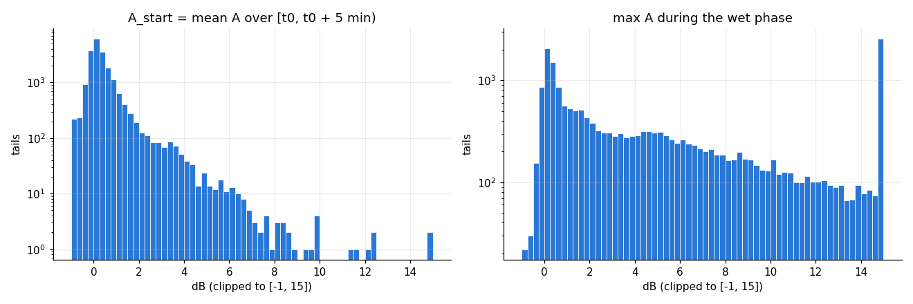
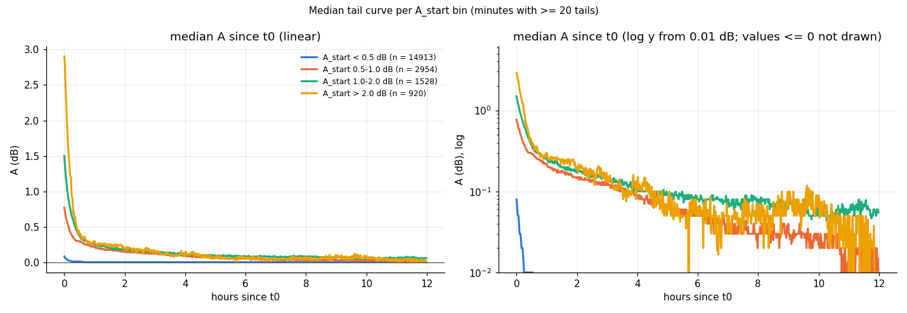
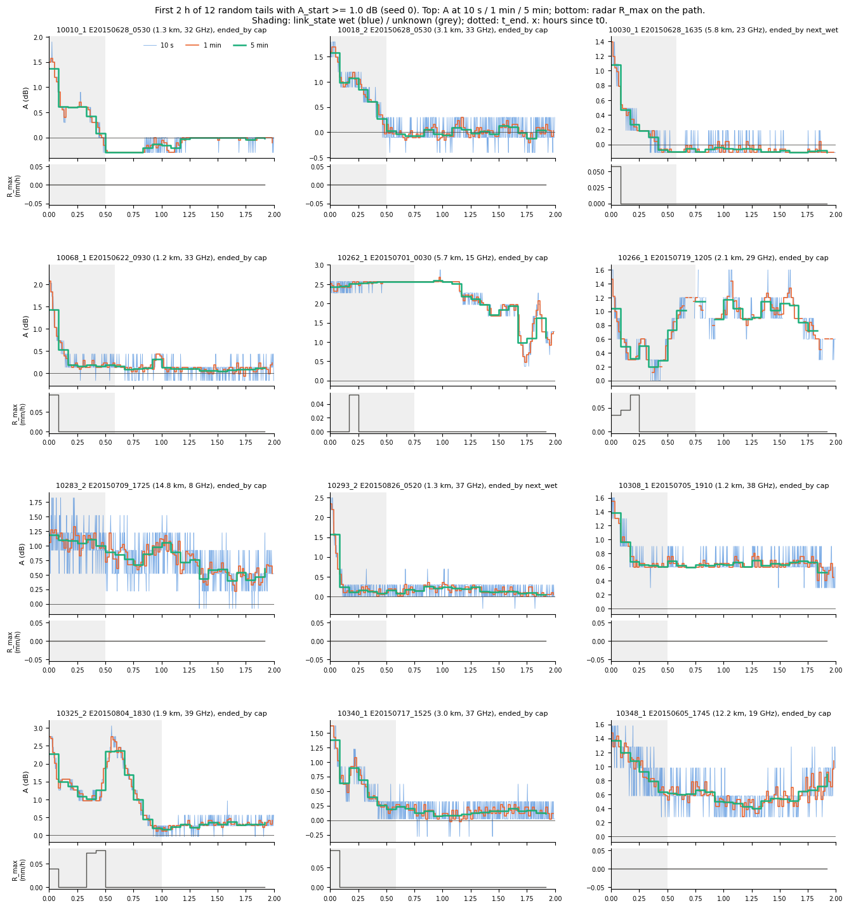

# wet_antenna step 1: all drying tails (descriptive, no selection)

Written by `research/wet_antenna/extract_tails.py` (settings `wet_antenna` in `research/config.yaml`; tail definition in
the module README). Nothing here selects, fits or filters tails: every pair with a baseline and a wet bin is a tail.
In a tail A_rain = 0 by construction, so A(t) = δ(t) = WAA + baseline residual.

Run time 159 s. Products: `research/wet_antenna/outputs/products/tails_1min.parquet` (47 MB, 12412931 tail minutes),
`research/wet_antenna/outputs/products/tails_index.csv` (20355 tails).

## A(t) check

A(t) is built here as 1 min `tl_mean` (float32 -> float64) - `baseline_db`. On 3 random pairs (seed
0) it is compared with `baseline.a_of_t(cml_id, event_id, res="1min", pad="12h")` over that function's whole
window (`research/wet_antenna/outputs/tables/extract_tails_a_check.csv`):

| tail_id | event_id | sublink_id | n_minutes | n_nan | max_abs_diff_db | exactly_equal |
|---|---|---|---|---|---|---|
| 10404 | E20150709_1725 | 10193_2 | 2275 | 0 | 0.0 | True |
| 12964 | E20150718_1745 | 10236_2 | 1895 | 0 | 0.0 | True |
| 17312 | E20150825_0145 | 10312_1 | 2730 | 0 | 0.0 | True |

## Counts

Tails: **20355** (19659 with at least one minute; 696 of length 0), on
566 sub-links of 283 links, 69 events.

By split (train + val events on train links only; test has no baseline):

| split_event | tails | events | sublinks |
|---|---|---|---|
| train | 15370 | 51 | 566 |
| val | 4985 | 18 | 566 |

By `ended_by`:

| ended_by | tails | median_length_min |
|---|---|---|
| cap | 13803 | 720.0 |
| gap | 78 | 161.0 |
| next_wet | 5908 | 425.0 |
| season_end | 566 | 0.0 |

Tails per sub-link (histogram: number of sub-links with that many tails; median 35, max
51):

| tails per sub-link | sub-links |
|---|---|
| [20, 25) | 1 |
| [25, 30) | 8 |
| [30, 35) | 245 |
| [35, 40) | 200 |
| [40, 45) | 92 |
| [45, 50) | 16 |
| [50, 55) | 4 |

By length class x frequency band (sub-link 1 band, as in the release):

| length_class | <25GHz | >=25GHz | All |
|---|---|---|---|
| 1-3km | 0 | 8974 | 8974 |
| <1km | 0 | 3455 | 3455 |
| >3km | 2052 | 5874 | 7926 |
| All | 2052 | 18303 | 20355 |

## Distributions

Percentiles (dB; length in minutes). `A_start` = mean A over [t0, t0 + 5 min); `wet_A_max` = largest 1 min A between
the link's first wet bin in the event and t0. Figure: `research/wet_antenna/outputs/figures/extract_tails_distributions.png`.

| index | n | p10 | p25 | median | p75 | p90 | p99 | max |
|---|---|---|---|---|---|---|---|---|
| A_start_db | 20315.0 | -0.18 | -0.0 | 0.19 | 0.53 | 1.15 | 4.15 | 16.11 |
| wet_A_max_db | 20335.0 | 0.1 | 0.61 | 3.68 | 8.92 | 16.48 | 31.84 | 45.87 |
| length_min | 20355.0 | 250.0 | 575.0 | 720.0 | 720.0 | 720.0 | 720.0 | 720.0 |

A_start bins: {'< 0.5': 14913, '0.5-1.0': 2954, '1.0-2.0': 1528, '> 2.0': 920}; A_start NaN (no valid minute in the first
5): 40.

## How fast A returns to the dry level

Share of tails with A(t0 + k) < max(0.3 dB, 2 x `offset_std`), among
the tails still running at minute k and with a valid A there (`research/wet_antenna/outputs/tables/extract_tails_return_to_dry.csv`). Rows: A_start bin.

| A_start_bin | 2 | 5 | 10 | 30 | 60 | 180 |
|---|---|---|---|---|---|---|
| all | 0.724 | 0.767 | 0.813 | 0.884 | 0.912 | 0.931 |
| < 0.5 | 0.908 | 0.935 | 0.942 | 0.953 | 0.961 | 0.961 |
| 0.5-1.0 | 0.214 | 0.332 | 0.501 | 0.72 | 0.798 | 0.861 |
| 1.0-2.0 | 0.06 | 0.123 | 0.285 | 0.591 | 0.715 | 0.814 |
| > 2.0 | 0.06 | 0.105 | 0.254 | 0.586 | 0.667 | 0.787 |

Number of tails behind each share:

| A_start_bin | 2 | 5 | 10 | 30 | 60 | 180 |
|---|---|---|---|---|---|---|
| all | 19523 | 19519 | 19496 | 19455 | 19387 | 19111 |
| < 0.5 | 14761 | 14741 | 14717 | 14700 | 14657 | 14413 |
| 0.5-1.0 | 2917 | 2920 | 2916 | 2906 | 2897 | 2867 |
| 1.0-2.0 | 1477 | 1478 | 1483 | 1471 | 1462 | 1462 |
| > 2.0 | 368 | 370 | 374 | 372 | 369 | 367 |

## Median tail curve per A_start bin

`research/wet_antenna/outputs/tables/extract_tails_median_curves.csv` (median and count per minute). Drawn where >= 20 tails remain; the curve mixes
fewer tails at later minutes (tails end by next_wet / gap / cap), so its far end is a different population.

## Dry-weather rises later in the tail

Definition (descriptive, settings `wet_antenna.report`): A smoothed by a trailing 15 min rolling median;
from `t_first_dry` on, only minutes with link_state dry; a rise starts at the first such minute where the smoothed A is
>= 0.3 dB above its running minimum since `t_first_dry`. Table: `research/wet_antenna/outputs/tables/extract_tails_dry_rises.csv`.

- Tails with a rise: **11016** of 19659 (56%).
- Start, minutes since t0: {'n': 11016, 'p10': 74.0, 'p25': 130.0, 'median': 248.0, 'p75': 417.0, 'p90': 568.0, 'p99': 698.0, 'max': 719.0}.
- Rise size at its start (dB): {'n': 11016, 'p10': 0.3, 'p25': 0.32, 'median': 0.35, 'p75': 0.35, 'p90': 0.4, 'p99': 0.7, 'max': 7.4}.
- Largest rise after its start (dB): {'n': 11016, 'p10': 0.35, 'p25': 0.4, 'median': 0.55, 'p75': 0.82, 'p90': 1.36, 'p99': 4.79, 'max': 18.99}; tails whose rise reaches >= 0.6 dB
  (two RSL steps): 4479; >= 1 dB: 2051.
- In a dew-risk hour at its start: 997 of 11016.
- Start hour, local time (UTC + 2 h): {0: 402, 1: 391, 2: 303, 3: 236, 4: 263, 5: 270, 6: 340, 7: 451, 8: 761, 9: 664, 10: 483, 11: 494, 12: 488, 13: 524, 14: 570, 15: 542, 16: 487, 17: 502, 18: 456, 19: 445, 20: 501, 21: 566, 22: 524, 23: 353}.

The threshold equals one RSL quantization step (0.3 dB) and a 15 min median of 1 min means can still flip between two
levels, so part of these "rises" may be quantization; the share is an upper bound until checked.

## Resolution check

12 random tails with A_start >= 1.0 dB (seed 0): A at 10 s, 1 min
and 5 min over the first 2 h, link_state shading, radar R_max below.

## Unclear or inconsistent

1. **Tails of length 0**: 696. They stay in the index (no selection) with no rows in the 1 min
   product. Causes: t0 clipped to the season's last bin while still wet (566, all from the last event);
   **t0 itself is a WET bin** (104: `last_wet_end` is searched only inside the network event, and the link
   was still wet at the network event end, so the "tail" stops at once); A NaN for >= 15 min from t0
   (26). Tails with a wet t0 in total: 670; state at t0:
   {'unknown': 19685, 'wet': 670}.
2. **`ended_by = season_end`**: 566 tails (the data stop first, or `last_wet_end`
   was clipped by `make_baseline_table.py` to the last bin of the season); not in the requested set
   {next_wet, gap, cap}.
3. **`t_first_dry` after `t_end`**: 828 tails never reach a dry bin before they end
   (all margin / unknown); 566 have no dry bin left in the season.
4. **Overlapping tails on one sub-link**: 0; same (sub-link, t0) twice: 0. A tail can run past the
   network event bounds into the next event's time if the link itself stays non-wet.
5. **A_start NaN**: 40 tails have no valid A in their first 5 minutes.
6. **The margin is part of the tail.** t0 is normally an `unknown` bin (rain within 30 min, or 0 < R_max < 0.1 mm/h).
   Median `margin_min` 35 min; tails with R_max > 0 in the margin:
   10999; with a gauge rate > 0 there: 128.
   So the first minutes of a tail can still hold light path rain.
7. **Gauge columns use the nearest gauge only** (if within 1000 m: 4738
   tails), while link_state uses every gauge within 1 km. SMHI GbgA is 15 min (broadcast to 5 min, then 1 min).
8. **Broadcast resolutions.** link_state, radar and gauge are 5 min, dew risk 1 h, on a 1 min A: within a 5 min bin
   the reference does not change, so the exact minute rain stops is unknown to +-5 min.
9. **`wet_A_max` window** starts at the link's first wet bin in the network event, so for multi-run events it covers
   several showers and the pauses between them.
10. **The 1 min product is large** (47 MB): git-ignored, rebuilt by this script.
11. **Rises at 0.3 dB** may include quantization flips (see above).
