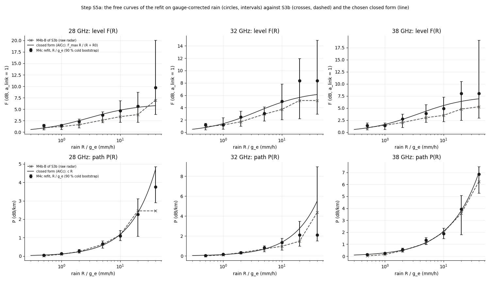
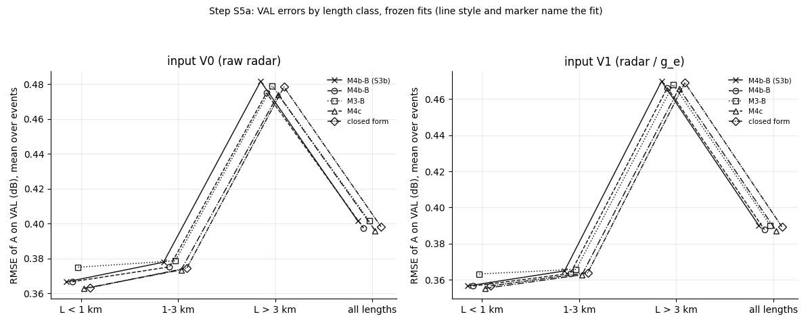
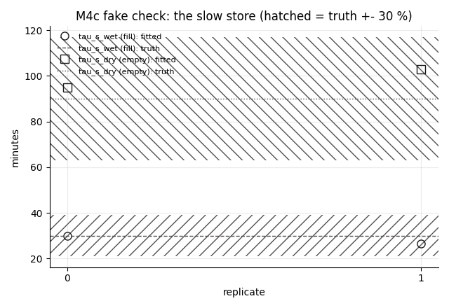
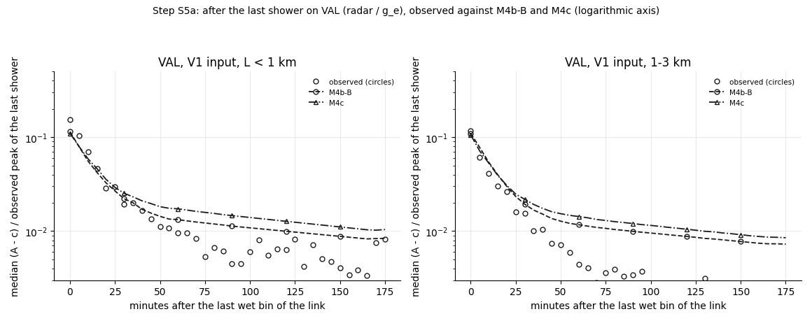

# wet_antenna step S5a: WAA v3 refitted on gauge-corrected rain, the slow leftover (M4c), closed forms of F(R) and P(R)

Written by `research/wet_antenna/final_s5a.py` (libraries `final_model.py`, `system_id.py`, `length_test.py`, `event_factors.py`). Settings and every rule:
`wet_antenna.final_s5a` in `research/config.yaml`, written on 2026-10-17 BEFORE the run. Plan: `docs/ROADMAP.md`, S5a.

**Standing rule.** WAA is never estimated by subtracting a power-law rain term. The path part is separated only through its dependence on L at matched rain. ITU-R P.838 only as a size reference (and, as in S2b / S3b, one of the optimiser starting values of P). Closed forms are fitted to the curves the data already learned; a power law appears only as one candidate among several, chosen by the data, never imposed. The rain correction comes from the City gauges only, never from the links. TEST was not read.

## 1. What was run

- Data: the S3 all-length datasets, TRAIN 9780 link-events (51 events), VAL 3250 (18 events).
  Input V1 = radar / g_e with the S4.3 path-mean ratio (`research/wet_antenna/outputs/tables/conditions_s4c_g_e.csv`): g_e used for 14 TRAIN and
  5 VAL events (>= 1.0 mm per gauge link), g_e = 1 for the others. The same division in the 5 min
  radar of the steady-rain bins (the classes are recomputed).
- Fits on the corrected TRAIN set: M4b-B (M4b, fixed tau_f_wet 2.6, tau_f_dry 10.3, phi 0.72, tau_s 240), M3-B (M3, fixed tau_wet 2.9, tau_dry 12.8), M4c (M4c, fixed tau_f_wet 2.6, tau_f_dry 10.3); 8 starts for
  M4b-B / M3-B (the S2b plan), 4 for M4c; caps 1000 / 300 / 1000; no folds.
- **Cold bootstrap**: M4b-B 30 draws, M4c 20 draws (resampled events, the winning plan start, the lag of the
  fit on all events, caps 1000 + 1000). Fitting time summed over the processes: fits 3.4 h, bootstrap
  5.1 h; the jobs took 0.0 h wall clock on 3 processes.
- **Timing first:** one M4b-B start 417.5 s (1000 iterations, converged False); projection 4.28 h against
  the budget 5.0 h: **cuts: nothing** (projected 4.28 h).

Convergence (`research/wet_antenna/outputs/tables/final_s5a_convergence.csv`):

| fit | model | d | converged_on_all_events | starts | starts_converged | best_start | spread_over_starts | boot_draws | boot_converged | fit_minutes | boot_minutes |
|---|---|---|---|---|---|---|---|---|---|---|---|
| M4b-B | M4b | 1 | True | 8 | 2 | g4+Phalf | 0.19 | 30 | 30 | 81.9 | 156.8 |
| M3-B | M3 | 2 | True | 8 | 6 | g4+Phalf | 0.15 | 0 | 0 | 74.0 | 0.0 |
| M4c | M4c | 1 | True | 4 | 0 | nested | 0.23 | 20 | 16 | 47.5 | 149.1 |

## 2. Refit on corrected rain (Part 1)

Parameters against S3b (the frozen M4b-B fitted on the raw radar); intervals = 5-95 % of the cold draws (`research/wet_antenna/outputs/tables/final_s5a_parameters.csv`):

| fit | parameter | value | lo | hi | se | draws | S3b |
|---|---|---|---|---|---|---|---|
| M4b-B | d | 1.0 | 1.0 | 1.0 | 0.0 | 30 | 1.0 |
| M4b-B | phi | 0.72 | 0.72 | 0.72 | 0.0 | 30 | 0.72 |
| M4b-B | F[28 GHz](0.5) | 0.994 | 0.717 | 1.346 | 0.193 | 30 | 0.978 |
| M4b-B | P[28 GHz](0.5) | 0.034 | 0.0 | 0.088 | 0.035 | 30 | 0.009 |
| M4b-B | F[28 GHz](2) | 1.646 | 1.086 | 2.191 | 0.364 | 30 | 1.635 |
| M4b-B | P[28 GHz](2) | 0.237 | 0.083 | 0.361 | 0.093 | 30 | 0.245 |
| M4b-B | F[28 GHz](5) | 2.711 | 2.132 | 3.151 | 0.353 | 30 | 2.619 |
| M4b-B | P[28 GHz](5) | 0.573 | 0.329 | 0.818 | 0.168 | 30 | 0.634 |
| M4b-B | F[28 GHz](10) | 3.27 | 2.329 | 4.824 | 0.792 | 30 | 3.377 |
| M4b-B | P[28 GHz](10) | 0.99 | 0.558 | 1.491 | 0.277 | 30 | 1.145 |
| M4b-B | F[28 GHz](20) | 4.043 | 2.52 | 6.523 | 1.359 | 30 | 3.835 |
| M4b-B | P[28 GHz](20) | 2.141 | 0.731 | 3.206 | 0.78 | 30 | 2.453 |
| M4b-B | F[32 GHz](0.5) | 0.868 | 0.584 | 1.066 | 0.163 | 30 | 0.903 |
| M4b-B | P[32 GHz](0.5) | 0.036 | 0.0 | 0.119 | 0.047 | 30 | 0.006 |
| M4b-B | F[32 GHz](2) | 1.775 | 0.954 | 2.59 | 0.52 | 30 | 1.702 |
| M4b-B | P[32 GHz](2) | 0.29 | 0.067 | 0.491 | 0.133 | 30 | 0.329 |
| M4b-B | F[32 GHz](5) | 2.537 | 1.874 | 3.105 | 0.414 | 30 | 2.936 |
| M4b-B | P[32 GHz](5) | 0.697 | 0.295 | 1.044 | 0.268 | 30 | 0.698 |
| M4b-B | F[32 GHz](10) | 3.682 | 2.253 | 5.476 | 1.032 | 30 | 3.706 |
| M4b-B | P[32 GHz](10) | 1.171 | 0.53 | 1.733 | 0.408 | 30 | 0.969 |
| M4b-B | F[32 GHz](20) | 5.921 | 2.936 | 8.392 | 1.796 | 30 | 5.148 |
| M4b-B | P[32 GHz](20) | 1.845 | 0.53 | 3.322 | 0.986 | 30 | 1.47 |
| M4b-B | F[38 GHz](0.5) | 0.993 | 0.752 | 1.313 | 0.163 | 30 | 0.957 |
| M4b-B | P[38 GHz](0.5) | 0.072 | 0.002 | 0.152 | 0.053 | 30 | 0.022 |
| M4b-B | F[38 GHz](2) | 1.939 | 1.211 | 2.61 | 0.494 | 30 | 2.016 |
| M4b-B | P[38 GHz](2) | 0.434 | 0.156 | 0.675 | 0.173 | 30 | 0.466 |
| M4b-B | F[38 GHz](5) | 2.951 | 2.443 | 3.523 | 0.339 | 30 | 3.005 |
| M4b-B | P[38 GHz](5) | 1.115 | 0.54 | 1.521 | 0.328 | 30 | 1.091 |
| M4b-B | F[38 GHz](10) | 3.466 | 2.522 | 5.075 | 0.775 | 30 | 3.484 |
| M4b-B | P[38 GHz](10) | 1.676 | 0.951 | 2.372 | 0.431 | 30 | 2.0 |
| M4b-B | F[38 GHz](20) | 5.464 | 3.719 | 7.773 | 1.474 | 30 | 4.776 |
| M4b-B | P[38 GHz](20) | 3.624 | 1.406 | 4.944 | 1.274 | 30 | 3.572 |
| M4b-B | a_p10 | 0.767 | 0.687 | 0.802 | 0.036 | 30 | 0.725 |
| M4b-B | a_p90 | 1.244 | 1.259 | 1.386 | 0.043 | 30 | 1.21 |
| M3-B | d | 2.0 |  |  |  | 0 |  |
| M3-B | F[28 GHz](0.5) | 0.527 |  |  |  | 0 |  |
| M3-B | P[28 GHz](0.5) | 0.15 |  |  |  | 0 |  |
| M3-B | F[28 GHz](2) | 0.83 |  |  |  | 0 |  |
| M3-B | P[28 GHz](2) | 0.426 |  |  |  | 0 |  |
| M3-B | F[28 GHz](5) | 1.438 |  |  |  | 0 |  |
| M3-B | P[28 GHz](5) | 0.826 |  |  |  | 0 |  |
| M3-B | F[28 GHz](10) | 1.58 |  |  |  | 0 |  |
| M3-B | P[28 GHz](10) | 1.312 |  |  |  | 0 |  |
| M3-B | F[28 GHz](20) | 2.003 |  |  |  | 0 |  |
| M3-B | P[28 GHz](20) | 2.719 |  |  |  | 0 |  |
| M3-B | F[32 GHz](0.5) | 0.405 |  |  |  | 0 |  |
| M3-B | P[32 GHz](0.5) | 0.154 |  |  |  | 0 |  |
| M3-B | F[32 GHz](2) | 0.751 |  |  |  | 0 |  |
| M3-B | P[32 GHz](2) | 0.528 |  |  |  | 0 |  |
| M3-B | F[32 GHz](5) | 1.264 |  |  |  | 0 |  |
| M3-B | P[32 GHz](5) | 0.938 |  |  |  | 0 |  |
| M3-B | F[32 GHz](10) | 1.551 |  |  |  | 0 |  |
| M3-B | P[32 GHz](10) | 1.634 |  |  |  | 0 |  |
| M3-B | F[32 GHz](20) | 2.381 |  |  |  | 0 |  |
| M3-B | P[32 GHz](20) | 2.707 |  |  |  | 0 |  |
| M3-B | F[38 GHz](0.5) | 0.617 |  |  |  | 0 |  |
| M3-B | P[38 GHz](0.5) | 0.233 |  |  |  | 0 |  |
| M3-B | F[38 GHz](2) | 1.107 |  |  |  | 0 |  |
| M3-B | P[38 GHz](2) | 0.736 |  |  |  | 0 |  |
| M3-B | F[38 GHz](5) | 1.822 |  |  |  | 0 |  |
| M3-B | P[38 GHz](5) | 1.487 |  |  |  | 0 |  |
| M3-B | F[38 GHz](10) | 1.923 |  |  |  | 0 |  |
| M3-B | P[38 GHz](10) | 2.165 |  |  |  | 0 |  |
| M3-B | F[38 GHz](20) | 3.006 |  |  |  | 0 |  |
| M3-B | P[38 GHz](20) | 4.516 |  |  |  | 0 |  |
| M3-B | a_p10 | 0.63 |  |  |  | 0 |  |
| M3-B | a_p90 | 1.502 |  |  |  | 0 |  |
| M4c | d | 1.0 | 1.0 | 1.0 | 0.0 | 20 | 1.0 |
| M4c | phi | 0.431 | 0.193 | 0.841 | 0.24 | 20 | 0.72 |
| M4c | tau_s_wet | 600.0 | 20.169 | 600.0 | 228.294 | 20 |  |
| M4c | tau_s_dry | 216.777 | 10.0 | 600.0 | 237.567 | 20 |  |
| M4c | F[28 GHz](0.5) | 1.429 | 0.542 | 1.743 | 0.509 | 20 | 0.978 |
| M4c | P[28 GHz](0.5) | 0.058 | 0.041 | 0.1 | 0.022 | 20 | 0.009 |
| M4c | F[28 GHz](2) | 2.286 | 0.937 | 2.862 | 0.7 | 20 | 1.635 |
| M4c | P[28 GHz](2) | 0.288 | 0.169 | 0.37 | 0.072 | 20 | 0.245 |
| M4c | F[28 GHz](5) | 3.744 | 2.096 | 4.455 | 1.12 | 20 | 2.619 |
| M4c | P[28 GHz](5) | 0.672 | 0.435 | 0.835 | 0.129 | 20 | 0.634 |
| M4c | F[28 GHz](10) | 4.665 | 2.195 | 6.866 | 1.673 | 20 | 3.377 |
| M4c | P[28 GHz](10) | 1.103 | 0.842 | 1.396 | 0.214 | 20 | 1.145 |
| M4c | F[28 GHz](20) | 5.655 | 2.195 | 8.7 | 2.243 | 20 | 3.835 |
| M4c | P[28 GHz](20) | 2.27 | 1.073 | 3.124 | 0.661 | 20 | 2.453 |
| M4c | F[32 GHz](0.5) | 1.213 | 0.43 | 1.491 | 0.428 | 20 | 0.903 |
| M4c | P[32 GHz](0.5) | 0.051 | 0.0 | 0.104 | 0.035 | 20 | 0.006 |
| M4c | F[32 GHz](2) | 2.501 | 1.009 | 3.459 | 0.923 | 20 | 1.702 |
| M4c | P[32 GHz](2) | 0.331 | 0.193 | 0.434 | 0.09 | 20 | 0.329 |
| M4c | F[32 GHz](5) | 3.08 | 1.834 | 4.136 | 0.845 | 20 | 2.936 |
| M4c | P[32 GHz](5) | 0.84 | 0.427 | 1.027 | 0.202 | 20 | 0.698 |
| M4c | F[32 GHz](10) | 5.036 | 2.062 | 7.839 | 2.602 | 20 | 3.706 |
| M4c | P[32 GHz](10) | 1.366 | 0.589 | 1.781 | 0.353 | 20 | 0.969 |
| M4c | F[32 GHz](20) | 8.35 | 2.233 | 11.975 | 3.167 | 20 | 5.148 |
| M4c | P[32 GHz](20) | 2.099 | 0.992 | 3.48 | 0.905 | 20 | 1.47 |
| M4c | F[38 GHz](0.5) | 1.384 | 0.531 | 1.954 | 0.521 | 20 | 0.957 |
| M4c | P[38 GHz](0.5) | 0.132 | 0.072 | 0.214 | 0.053 | 20 | 0.022 |
| M4c | F[38 GHz](2) | 2.717 | 1.02 | 3.772 | 0.956 | 20 | 2.016 |
| M4c | P[38 GHz](2) | 0.554 | 0.367 | 0.679 | 0.105 | 20 | 0.466 |
| M4c | F[38 GHz](5) | 3.918 | 2.099 | 5.744 | 1.344 | 20 | 3.005 |
| M4c | P[38 GHz](5) | 1.346 | 0.992 | 1.557 | 0.201 | 20 | 1.091 |
| M4c | F[38 GHz](10) | 4.877 | 2.234 | 7.295 | 1.756 | 20 | 3.484 |
| M4c | P[38 GHz](10) | 1.897 | 1.481 | 2.341 | 0.311 | 20 | 2.0 |
| M4c | F[38 GHz](20) | 7.995 | 2.456 | 10.535 | 2.676 | 20 | 4.776 |
| M4c | P[38 GHz](20) | 3.923 | 1.792 | 5.089 | 1.091 | 20 | 3.572 |
| M4c | a_p10 | 0.76 | 0.693 | 0.848 | 0.046 | 20 | 0.725 |
| M4c | a_p90 | 1.246 | 1.289 | 1.45 | 0.054 | 20 | 1.21 |

**READING.** The refit on the corrected rain hardly moves WAA v3: the S3b value of every free knot lies inside the cold-bootstrap
interval of the refit, except F(1) at 32 and 38 GHz, where the refit is flat between 0.5 and 1 mm/h (an increment at its bound 0) (e.g. 28 GHz F(2) 1.65 [1.09, 2.19] dB against 1.63; P(5) 0.57 [0.33, 0.82] dB/km against
0.63); the lag stays 1 min; P at 0.5 mm/h is a little larger (0.034 against
0.009 dB/km). The training loss falls from 163 991 (S3b, raw radar) to 158513: the corrected rain
describes TRAIN better. The **cold** intervals are much wider than the warm S3b ones (F(2) of 28 GHz spans 1.10 dB):
this is the real uncertainty of the free curves, and it is largest above 10 mm/h, where few points are. One oddity: the a_link 90th
percentile of the fit (1.24) lies below its bootstrap interval; resampling events (duplicates) spreads a_link
more than the fit on all events, so the a_link spread interval is biased up.



VAL, frozen fits, inputs V0 (raw radar) and V1 (radar / g_e) (`research/wet_antenna/outputs/tables/final_s5a_val.csv`):

| input | fit | VAL set | link_events | rmse | rmse_lo | rmse_hi | rmse_rain | rmse_0_60 | rmse_60_180 | shower_peak_error | integral_pred_over_obs | integral_lo | integral_hi |
|---|---|---|---|---|---|---|---|---|---|---|---|---|---|
| V0 | M4b-B (S3b) | all lengths | 3250 | 0.402 | 0.308 | 0.51 | 0.84 | 0.277 | 0.205 | -0.507 | 1.242 | 0.588 | 4.149 |
| V0 | M4b-B (S3b) | L < 1 km | 531 | 0.367 | 0.29 | 0.444 | 0.764 | 0.259 | 0.21 | -0.508 | 0.95 | 0.515 | 1.994 |
| V0 | M4b-B (S3b) | 1-3 km | 1654 | 0.378 | 0.287 | 0.485 | 0.802 | 0.264 | 0.194 | -0.542 | 1.429 | 0.637 | 4.476 |
| V0 | M4b-B (S3b) | L > 3 km | 1065 | 0.482 | 0.368 | 0.607 | 0.968 | 0.301 | 0.219 | -0.436 | 1.592 | -5.753 | 7.373 |
| V0 | M4b-B | all lengths | 3250 | 0.397 | 0.306 | 0.504 | 0.827 | 0.275 | 0.205 | -0.535 | 1.218 | 0.58 | 4.108 |
| V0 | M4b-B | L < 1 km | 531 | 0.367 | 0.289 | 0.444 | 0.763 | 0.26 | 0.21 | -0.499 | 0.952 | 0.514 | 2.007 |
| V0 | M4b-B | 1-3 km | 1654 | 0.375 | 0.286 | 0.481 | 0.793 | 0.262 | 0.194 | -0.554 | 1.406 | 0.627 | 4.411 |
| V0 | M4b-B | L > 3 km | 1065 | 0.475 | 0.362 | 0.602 | 0.949 | 0.298 | 0.219 | -0.528 | 1.544 | -5.592 | 7.002 |
| V0 | M3-B | all lengths | 3250 | 0.401 | 0.308 | 0.511 | 0.83 | 0.279 | 0.206 | -0.479 | 0.719 | 0.338 | 2.488 |
| V0 | M3-B | L < 1 km | 531 | 0.375 | 0.296 | 0.456 | 0.778 | 0.272 | 0.214 | -0.445 | 0.631 | 0.335 | 1.418 |
| V0 | M3-B | 1-3 km | 1654 | 0.379 | 0.288 | 0.486 | 0.792 | 0.267 | 0.194 | -0.513 | 0.87 | 0.37 | 2.939 |
| V0 | M3-B | L > 3 km | 1065 | 0.479 | 0.365 | 0.607 | 0.955 | 0.295 | 0.218 | -0.471 | 0.768 | -2.7 | 3.45 |
| V0 | M4c | all lengths | 3250 | 0.396 | 0.305 | 0.501 | 0.828 | 0.27 | 0.206 | -0.56 | 1.314 | 0.6 | 4.221 |
| V0 | M4c | L < 1 km | 531 | 0.363 | 0.287 | 0.44 | 0.753 | 0.256 | 0.211 | -0.582 | 1.085 | 0.579 | 2.262 |
| V0 | M4c | 1-3 km | 1654 | 0.373 | 0.285 | 0.479 | 0.791 | 0.257 | 0.195 | -0.573 | 1.518 | 0.642 | 4.59 |
| V0 | M4c | L > 3 km | 1065 | 0.474 | 0.362 | 0.601 | 0.953 | 0.292 | 0.219 | -0.489 | 1.621 | -5.773 | 7.619 |
| V0 | closed form | all lengths | 3250 | 0.398 | 0.307 | 0.504 | 0.835 | 0.272 | 0.206 | -0.551 | 1.278 | 0.579 | 4.13 |
| V0 | closed form | L < 1 km | 531 | 0.363 | 0.286 | 0.441 | 0.753 | 0.254 | 0.211 | -0.621 | 1.041 | 0.547 | 2.177 |
| V0 | closed form | 1-3 km | 1654 | 0.375 | 0.286 | 0.481 | 0.795 | 0.258 | 0.195 | -0.574 | 1.467 | 0.631 | 4.438 |
| V0 | closed form | L > 3 km | 1065 | 0.478 | 0.365 | 0.605 | 0.964 | 0.294 | 0.219 | -0.472 | 1.595 | -5.708 | 7.393 |
| V1 | M4b-B (S3b) | all lengths | 3250 | 0.39 | 0.303 | 0.491 | 0.814 | 0.275 | 0.205 | -1.042 | 1.065 | 0.497 | 3.506 |
| V1 | M4b-B (S3b) | L < 1 km | 531 | 0.357 | 0.285 | 0.429 | 0.739 | 0.257 | 0.211 | -0.97 | 0.787 | 0.418 | 1.703 |
| V1 | M4b-B (S3b) | 1-3 km | 1654 | 0.365 | 0.282 | 0.463 | 0.772 | 0.262 | 0.194 | -1.085 | 1.227 | 0.537 | 3.915 |
| V1 | M4b-B (S3b) | L > 3 km | 1065 | 0.47 | 0.362 | 0.589 | 0.941 | 0.298 | 0.218 | -1.045 | 1.377 | -4.925 | 6.398 |
| V1 | M4b-B | all lengths | 3250 | 0.388 | 0.301 | 0.487 | 0.804 | 0.273 | 0.205 | -1.048 | 1.047 | 0.487 | 3.402 |
| V1 | M4b-B | L < 1 km | 531 | 0.357 | 0.285 | 0.429 | 0.739 | 0.258 | 0.211 | -0.959 | 0.791 | 0.416 | 1.705 |
| V1 | M4b-B | 1-3 km | 1654 | 0.364 | 0.281 | 0.462 | 0.766 | 0.26 | 0.194 | -1.092 | 1.212 | 0.528 | 3.873 |
| V1 | M4b-B | L > 3 km | 1065 | 0.466 | 0.358 | 0.588 | 0.929 | 0.294 | 0.218 | -1.053 | 1.334 | -4.697 | 6.16 |
| V1 | M3-B | all lengths | 3250 | 0.39 | 0.303 | 0.489 | 0.803 | 0.277 | 0.206 | -1.0 | 0.645 | 0.293 | 2.269 |
| V1 | M3-B | L < 1 km | 531 | 0.363 | 0.291 | 0.438 | 0.75 | 0.269 | 0.215 | -0.904 | 0.544 | 0.27 | 1.28 |
| V1 | M3-B | 1-3 km | 1654 | 0.366 | 0.284 | 0.465 | 0.762 | 0.266 | 0.194 | -1.036 | 0.789 | 0.323 | 2.701 |
| V1 | M3-B | L > 3 km | 1065 | 0.468 | 0.36 | 0.589 | 0.929 | 0.293 | 0.218 | -0.991 | 0.694 | -2.416 | 3.17 |
| V1 | M4c | all lengths | 3250 | 0.387 | 0.301 | 0.488 | 0.808 | 0.268 | 0.206 | -1.081 | 1.111 | 0.505 | 3.589 |
| V1 | M4c | L < 1 km | 531 | 0.355 | 0.282 | 0.428 | 0.735 | 0.253 | 0.211 | -1.055 | 0.892 | 0.469 | 1.931 |
| V1 | M4c | 1-3 km | 1654 | 0.363 | 0.28 | 0.461 | 0.767 | 0.255 | 0.195 | -1.108 | 1.287 | 0.541 | 3.915 |
| V1 | M4c | L > 3 km | 1065 | 0.466 | 0.358 | 0.589 | 0.933 | 0.289 | 0.219 | -1.047 | 1.38 | -4.93 | 6.475 |
| V1 | closed form | all lengths | 3250 | 0.389 | 0.301 | 0.49 | 0.814 | 0.27 | 0.205 | -1.074 | 1.072 | 0.483 | 3.512 |
| V1 | closed form | L < 1 km | 531 | 0.357 | 0.283 | 0.431 | 0.736 | 0.252 | 0.211 | -1.046 | 0.846 | 0.447 | 1.853 |
| V1 | closed form | 1-3 km | 1654 | 0.364 | 0.28 | 0.462 | 0.771 | 0.256 | 0.194 | -1.112 | 1.228 | 0.511 | 3.741 |
| V1 | closed form | L > 3 km | 1065 | 0.469 | 0.36 | 0.591 | 0.942 | 0.291 | 0.219 | -1.049 | 1.355 | -4.861 | 6.378 |



The length test through the model (S3b rule: both inside in >= 2/3 of the eligible cells; `research/wet_antenna/outputs/tables/final_s5a_length_verdict.csv`, cells in
`research/wet_antenna/outputs/tables/final_s5a_length_test.csv`):

| input | set | fit | eligible_cells | I_inside | s_inside | both_inside | share | I_ratio_median | s_ratio_median | passes |
|---|---|---|---|---|---|---|---|---|---|---|
| V0 | VAL | M4b-B (S3b) | 8 | 3 | 2 | 1 | 0.125 | 0.722 | 0.608 | False |
| V0 | VAL | M4b-B | 8 | 3 | 2 | 1 | 0.125 | 0.765 | 0.641 | False |
| V0 | VAL | M3-B | 8 | 3 | 2 | 1 | 0.125 | 0.744 | 0.63 | False |
| V0 | VAL | M4c | 8 | 3 | 1 | 0 | 0.0 | 0.783 | 0.614 | False |
| V0 | VAL | closed form | 8 | 3 | 2 | 0 | 0.0 | 0.741 | 0.61 | False |
| V1 | VAL | M4b-B (S3b) | 6 | 5 | 6 | 5 | 0.833 | 0.985 | 0.95 | True |
| V1 | VAL | M4b-B | 6 | 5 | 6 | 5 | 0.833 | 1.024 | 0.946 | True |
| V1 | VAL | M3-B | 6 | 5 | 6 | 5 | 0.833 | 0.991 | 0.902 | True |
| V1 | VAL | M4c | 6 | 5 | 6 | 5 | 0.833 | 1.061 | 0.912 | True |
| V1 | VAL | closed form | 6 | 5 | 6 | 5 | 0.833 | 1.0 | 0.9 | True |
| V1 | TRAIN | M4b-B | 10 | 9 | 9 | 8 | 0.8 | 1.106 | 1.01 | True |
| V1 | TRAIN | M3-B | 10 | 9 | 9 | 8 | 0.8 | 1.113 | 0.977 | True |
| V1 | TRAIN | M4c | 10 | 9 | 10 | 9 | 0.9 | 1.141 | 0.962 | True |
| V1 | TRAIN | closed form | 10 | 9 | 10 | 9 | 0.9 | 1.104 | 0.957 | True |

**READING.** (1) **The corrected input is better for every fit**: VAL RMSE on V1 against V0, all lengths: M4b-B (S3b) 0.390 / 0.402, M4b-B 0.388 / 0.397, M3-B 0.390 / 0.401, M4c 0.387 / 0.396, closed form 0.389 / 0.398 dB.
(2) **The length test passes on V1 for every fit and fails on V0 for every fit** (M4b-B (S3b) 5/6, M4b-B 5/6, M3-B 5/6, M4c 5/6, closed form 5/6 on V1; at most
1 of 8 on V0), including the S3b fit that never saw corrected rain: the refit is not what closes the gap, the input is
(as S4.3). (3) The fits differ by a few thousandths of a dB in every length class and window; M4c is best in the first hour after the rain
(RMSE 0-60 min 0.268 against M4b-B 0.273 dB). (4) **Shower peaks get worse on V1**: -1.05 dB against
-0.53 on V0 (M4b-B; the same for all fits): g_e is an event-total factor, and dividing the whole event lowers the peaks
too, where the radar was not too high. (5) After the rain M3-B ends far too low (integral 0.54 x on L < 1 km), M4b-B at
0.79 / 1.21 x (L < 1 km / 1-3 km) is already inside the 0.7-1.4 range with the corrected rain: most of the S2b-S3b
"slow leftover" (1.2-1.4 x) was the over-read radar. TRAIN (in-sample, V1): the refits pass 8/10 cells (S3b on V0: 10/10).

## 3. The slow leftover (Part 2: M4c)

Fake check (truth phi 0.9, tau_s_wet 30, tau_s_dry 90 min; rule: both slow times within
+-30 % in 2 of 2): **PASS** (`research/wet_antenna/outputs/tables/final_s5a_m4c_fake.csv`).

| replicate | phi_true | phi | tau_s_wet_true | tau_s_wet | tau_s_dry_true | tau_s_dry | tau_s_wet_ok | tau_s_dry_ok | both_ok | converged | minutes |
|---|---|---|---|---|---|---|---|---|---|---|---|
| 0 | 0.9 | 0.9 | 30.0 | 29.91 | 90.0 | 95.06 | True | True | True | True | 17.8 |
| 1 | 0.9 | 0.9 | 30.0 | 26.62 | 90.0 | 103.03 | True | True | True | False | 24.4 |



The rule on VAL V1 (`research/wet_antenna/outputs/tables/final_s5a_m4c_rule.csv`): **M4c REPLACES M4b-B**.

| criterion | value | M4b-B | rule | ok |
|---|---|---|---|---|
| after-rain integral 0-180 min, L < 1 km | 0.8923 | 0.7913 | 0.7-1.4 | True |
| after-rain integral 0-180 min, 1-3 km | 1.2868 | 1.2122 | 0.7-1.4 | True |
| VAL RMSE (all lengths) M4c - M4b-B (dB) | -0.0005 | 0.3878 | <= 0.005 | True |
| VAL length test through the model (S3b rule) | 0.8333 | 0.8333 | >= 0.6667 | True |



**READING.** The fake check passes cleanly (both replicates within 14 % of both slow times, phi 0.90). **On the real data
the slow store of M4c is NOT identified**: tau_s_wet = 600 min, AT the upper bound (600), interval 20-600; tau_s_dry 217 [10, 600] min;
phi 0.43 [0.19, 0.84] (M4b-B: 0.72 fixed); 4 of the 20 cold draws did not converge, and all 4 starts ended within
0.23 loss units of each other (one flat valley, not several optima). In words: the data want a slow store that fills over
many hours and empties in a few hours, i.e. close to a store fed by the rain amount (the S2b candidate), but they cannot say how slow.
**By the rule written before the run M4c replaces M4b-B** (all four criteria hold; table above), and that decision is kept. But it is a
weak replacement: M4b-B already meets the integral criterion on the corrected rain, the RMSE gain is -0.0005 dB, and in the median
curves after the last shower (figure) both models stay above the observed median from about 40 min on, M4c more than M4b-B; the
integral criterion is a MEAN over link-events and is carried by the larger events. The rule did not ask for identified parameters; it
should have. The leftover is therefore written down as only partly described: its size is right on average, its time constants are not known.

## 4. Closed forms of F(R) and P(R) (Part 3), on M4c

Knot values with the cold-bootstrap SE (floored: max(5 % of the value, 0.02 dB for F, 0.01 dB/km for P)); knots
0.5, 1, 2, 5, 10, 20, 40 mm/h (723 TRAIN link-events have corrected rain above 20 mm/h; the 40 mm/h knot is dropped below
30). `research/wet_antenna/outputs/tables/final_s5a_knots.csv`:

| kind | band | f_ghz | R | value | lo | hi | se_boot | se_used |
|---|---|---|---|---|---|---|---|---|
| F | 28 GHz | 29.1865 | 0.5 | 1.4289 | 0.5416 | 1.7429 | 0.5086 | 0.5086 |
| F | 28 GHz | 29.1865 | 1.0 | 1.4289 | 0.6133 | 1.7429 | 0.4881 | 0.4881 |
| F | 28 GHz | 29.1865 | 2.0 | 2.286 | 0.9374 | 2.8621 | 0.6996 | 0.6996 |
| F | 28 GHz | 29.1865 | 5.0 | 3.7442 | 2.0962 | 4.4553 | 1.1203 | 1.1203 |
| F | 28 GHz | 29.1865 | 10.0 | 4.6654 | 2.195 | 6.8656 | 1.6727 | 1.6727 |
| F | 28 GHz | 29.1865 | 20.0 | 5.655 | 2.195 | 8.7005 | 2.2433 | 2.2433 |
| F | 28 GHz | 29.1865 | 40.0 | 9.712 | 3.8437 | 20.055 | 5.4621 | 5.4621 |
| F | 32 GHz | 32.795 | 0.5 | 1.2133 | 0.4305 | 1.4907 | 0.4281 | 0.4281 |
| F | 32 GHz | 32.795 | 1.0 | 1.2383 | 0.5079 | 2.3656 | 0.5719 | 0.5719 |
| F | 32 GHz | 32.795 | 2.0 | 2.5014 | 1.0086 | 3.4595 | 0.9227 | 0.9227 |
| F | 32 GHz | 32.795 | 5.0 | 3.0801 | 1.8339 | 4.1362 | 0.8452 | 0.8452 |
| F | 32 GHz | 32.795 | 10.0 | 5.036 | 2.0616 | 7.8386 | 2.6019 | 2.6019 |
| F | 32 GHz | 32.795 | 20.0 | 8.3497 | 2.2332 | 11.9747 | 3.1674 | 3.1674 |
| F | 32 GHz | 32.795 | 40.0 | 8.3497 | 2.9799 | 14.9122 | 4.3338 | 4.3338 |
| F | 38 GHz | 37.324 | 0.5 | 1.384 | 0.5312 | 1.9538 | 0.5212 | 0.5212 |
| F | 38 GHz | 37.324 | 1.0 | 1.384 | 0.5801 | 1.9659 | 0.5355 | 0.5355 |
| F | 38 GHz | 37.324 | 2.0 | 2.717 | 1.0196 | 3.7716 | 0.9563 | 0.9563 |
| F | 38 GHz | 37.324 | 5.0 | 3.9183 | 2.0987 | 5.7437 | 1.3437 | 1.3437 |
| F | 38 GHz | 37.324 | 10.0 | 4.8771 | 2.2336 | 7.2949 | 1.7559 | 1.7559 |
| F | 38 GHz | 37.324 | 20.0 | 7.9951 | 2.4558 | 10.5352 | 2.6755 | 2.6755 |
| F | 38 GHz | 37.324 | 40.0 | 7.9951 | 2.9542 | 19.0244 | 5.3601 | 5.3601 |
| P | 28 GHz | 29.1865 | 0.5 | 0.0582 | 0.0408 | 0.1002 | 0.0224 | 0.0224 |
| P | 28 GHz | 29.1865 | 1.0 | 0.1344 | 0.0829 | 0.1694 | 0.0299 | 0.0299 |
| P | 28 GHz | 29.1865 | 2.0 | 0.2881 | 0.1687 | 0.3702 | 0.0716 | 0.0716 |
| P | 28 GHz | 29.1865 | 5.0 | 0.6715 | 0.435 | 0.8348 | 0.129 | 0.129 |
| P | 28 GHz | 29.1865 | 10.0 | 1.103 | 0.8421 | 1.3957 | 0.2135 | 0.2135 |
| P | 28 GHz | 29.1865 | 20.0 | 2.2704 | 1.0729 | 3.124 | 0.661 | 0.661 |
| P | 28 GHz | 29.1865 | 40.0 | 3.7528 | 2.9056 | 4.8624 | 0.9268 | 0.9268 |
| P | 32 GHz | 32.795 | 0.5 | 0.0508 | 0.0 | 0.1036 | 0.0354 | 0.0354 |
| P | 32 GHz | 32.795 | 1.0 | 0.1616 | 0.0483 | 0.2022 | 0.0512 | 0.0512 |
| P | 32 GHz | 32.795 | 2.0 | 0.3314 | 0.1927 | 0.4342 | 0.0901 | 0.0901 |
| P | 32 GHz | 32.795 | 5.0 | 0.8396 | 0.4273 | 1.0272 | 0.2016 | 0.2016 |
| P | 32 GHz | 32.795 | 10.0 | 1.3656 | 0.5887 | 1.781 | 0.3529 | 0.3529 |
| P | 32 GHz | 32.795 | 20.0 | 2.0991 | 0.9916 | 3.4798 | 0.905 | 0.905 |
| P | 32 GHz | 32.795 | 40.0 | 2.0991 | 1.5156 | 8.9665 | 2.7912 | 2.7912 |
| P | 38 GHz | 37.324 | 0.5 | 0.1324 | 0.0723 | 0.2139 | 0.0527 | 0.0527 |
| P | 38 GHz | 37.324 | 1.0 | 0.2551 | 0.1612 | 0.3126 | 0.0495 | 0.0495 |
| P | 38 GHz | 37.324 | 2.0 | 0.5536 | 0.3667 | 0.679 | 0.1054 | 0.1054 |
| P | 38 GHz | 37.324 | 5.0 | 1.3462 | 0.9923 | 1.5565 | 0.2013 | 0.2013 |
| P | 38 GHz | 37.324 | 10.0 | 1.8968 | 1.4814 | 2.3412 | 0.3108 | 0.3108 |
| P | 38 GHz | 37.324 | 20.0 | 3.9231 | 1.7917 | 5.0887 | 1.0914 | 1.0914 |
| P | 38 GHz | 37.324 | 40.0 | 6.8652 | 5.2653 | 7.4929 | 0.8578 | 0.8578 |

Every candidate, per band and pooled (weighted least squares, AICc; `chosen` = lowest AICc, or a simpler one within 2; `research/wet_antenna/outputs/tables/final_s5a_closed_forms.csv`):

| kind | scope | form | formula | k | n | aicc | params | max_rel_dev | chosen | delta_aicc |
|---|---|---|---|---|---|---|---|---|---|---|
| F | 28 GHz | exp_sat | F_max (1 - exp(-R / R0)) | 2 | 7 | 0.05 | {"F_max": 4.98616, "R0": 2.80499} | 0.487 | False | 2.46 |
| F | 28 GHz | hyperbolic | F_max R / (R + R0) | 2 | 7 | -2.41 | {"F_max": 6.20097, "R0": 2.93525} | 0.405 | True | 0.0 |
| F | 28 GHz | tanh_sat | F_max tanh(R / R0) | 2 | 7 | 1.9 | {"F_max": 4.65608, "R0": 3.13366} | 0.521 | False | 4.31 |
| F | 28 GHz | capped_power | min(c R^b, F_max) | 3 | 7 | 0.003 | {"c": 1.65794, "b": 0.46044, "F_max": 6.24059} | 0.357 | False | 2.412 |
| F | 32 GHz | exp_sat | F_max (1 - exp(-R / R0)) | 2 | 7 | 3.317 | {"F_max": 5.78818, "R0": 4.27087} | 0.473 | False | 3.985 |
| F | 32 GHz | hyperbolic | F_max R / (R + R0) | 2 | 7 | 0.814 | {"F_max": 6.7059, "R0": 3.77224} | 0.353 | True | 1.482 |
| F | 32 GHz | tanh_sat | F_max tanh(R / R0) | 2 | 7 | 4.822 | {"F_max": 3.90607, "R0": 2.47751} | 0.532 | False | 5.49 |
| F | 32 GHz | capped_power | min(c R^b, F_max) | 3 | 7 | -0.668 | {"c": 1.48883, "b": 0.52054, "F_max": 8.3497} | 0.202 | False | 0.0 |
| F | 38 GHz | exp_sat | F_max (1 - exp(-R / R0)) | 2 | 7 | -0.403 | {"F_max": 5.92223, "R0": 3.32368} | 0.402 | False | 2.581 |
| F | 38 GHz | hyperbolic | F_max R / (R + R0) | 2 | 7 | -2.984 | {"F_max": 7.54377, "R0": 3.67451} | 0.347 | True | 0.0 |
| F | 38 GHz | tanh_sat | F_max tanh(R / R0) | 2 | 7 | 1.418 | {"F_max": 5.36354, "R0": 3.42968} | 0.439 | False | 4.402 |
| F | 38 GHz | capped_power | min(c R^b, F_max) | 3 | 7 | -2.302 | {"c": 1.67711, "b": 0.50311, "F_max": 7.99508} | 0.212 | False | 0.682 |
| F | pooled: one curve | exp_sat | F_max (1 - exp(-R / R0)) | 2 | 21 | -11.349 | {"F_max": 5.28959, "R0": 3.14096} |  | False | 24.074 |
| F | pooled: one curve | hyperbolic | F_max R / (R + R0) | 2 | 21 | -18.75 | {"F_max": 6.71184, "R0": 3.38527} |  | False | 16.672 |
| F | pooled: one curve | tanh_sat | F_max tanh(R / R0) | 2 | 21 | -6.218 | {"F_max": 4.61558, "R0": 3.06249} |  | False | 29.204 |
| F | pooled: one curve | capped_power | min(c R^b, F_max) | 3 | 21 | -35.423 | {"c": 1.61235, "b": 0.48082, "F_max": 8.62378} |  | True | 0.0 |
| F | pooled: amp linear in f | exp_sat | F_max (1 - exp(-R / R0)) | 3 | 21 | -9.029 | {"F_max": 5.12468, "R0": 3.13791, "kappa": 0.11793} |  | False | 24.733 |
| F | pooled: amp linear in f | hyperbolic | F_max R / (R + R0) | 3 | 21 | -16.589 | {"F_max": 6.51718, "R0": 3.39096, "kappa": 0.11383} |  | False | 17.172 |
| F | pooled: amp linear in f | tanh_sat | F_max tanh(R / R0) | 3 | 21 | -3.849 | {"F_max": 4.45917, "R0": 3.05571, "kappa": 0.12761} |  | False | 29.912 |
| F | pooled: amp linear in f | capped_power | min(c R^b, F_max) | 4 | 21 | -33.761 | {"c": 1.56215, "b": 0.48232, "F_max": 8.62378, "kappa": 0.11167} |  | True | 0.0 |
| P | 28 GHz | power | c R^b | 2 | 7 | -6.333 | {"c": 0.13569, "b": 0.92391} | 0.23 | False | 0.0 |
| P | 28 GHz | linear | c R | 1 | 7 | -4.509 | {"c": 0.11757} | 0.253 | True | 1.824 |
| P | 28 GHz | quadratic | c R + d R^2 | 2 | 7 | -0.309 | {"c": 0.11757, "d": 0.0} | 0.253 | False | 6.024 |
| P | 28 GHz | shifted_power | c ((R + R1)^b - R1^b) | 3 | 7 | -3.505 | {"c": 0.60019, "R1": 10.74903, "b": 0.59553} | 0.165 | False | 2.828 |
| P | 32 GHz | power | c R^b | 2 | 7 | -0.019 | {"c": 0.15879, "b": 0.9107} | 1.177 | False | 2.151 |
| P | 32 GHz | linear | c R | 1 | 7 | -2.17 | {"c": 0.13766} | 1.623 | True | 0.0 |
| P | 32 GHz | quadratic | c R + d R^2 | 2 | 7 | 2.03 | {"c": 0.13766, "d": 0.0} | 1.623 | False | 4.2 |
| P | 32 GHz | shifted_power | c ((R + R1)^b - R1^b) | 3 | 7 | 2.829 | {"c": 6.45268, "R1": 12.83806, "b": 0.2} | 0.675 | False | 4.999 |
| P | 38 GHz | power | c R^b | 2 | 7 | -1.764 | {"c": 0.27703, "b": 0.8747} | 0.159 | True | 0.0 |
| P | 38 GHz | linear | c R | 1 | 7 | 4.107 | {"c": 0.20497} | 0.259 | False | 5.871 |
| P | 38 GHz | quadratic | c R + d R^2 | 2 | 7 | 8.307 | {"c": 0.20497, "d": 0.0} | 0.259 | False | 10.071 |
| P | 38 GHz | shifted_power | c ((R + R1)^b - R1^b) | 3 | 7 | 3.598 | {"c": 0.41819, "R1": 1.63752, "b": 0.76926} | 0.134 | False | 5.362 |
| P | pooled: one curve | power | c R^b | 2 | 21 | 16.324 | {"c": 0.16579, "b": 0.9401} |  | False | 1.02 |
| P | pooled: one curve | linear | c R | 1 | 21 | 15.303 | {"c": 0.14701} |  | True | 0.0 |
| P | pooled: one curve | quadratic | c R + d R^2 | 2 | 21 | 17.76 | {"c": 0.14701, "d": 0.0} |  | False | 2.456 |
| P | pooled: one curve | shifted_power | c ((R + R1)^b - R1^b) | 3 | 21 | 18.627 | {"c": 0.25151, "R1": 3.54135, "b": 0.8315} |  | False | 3.323 |
| P | pooled: amp linear in f | power | c R^b | 3 | 21 | -12.419 | {"c": 0.14631, "b": 0.90388, "kappa": 0.9831} |  | True | 1.662 |
| P | pooled: amp linear in f | linear | c R | 2 | 21 | -2.066 | {"c": 0.12317, "kappa": 0.85978} |  | False | 12.015 |
| P | pooled: amp linear in f | quadratic | c R + d R^2 | 3 | 21 | 0.68 | {"c": 0.12317, "d": 0.0, "kappa": 0.85978} |  | False | 14.76 |
| P | pooled: amp linear in f | shifted_power | c ((R + R1)^b - R1^b) | 4 | 21 | -14.081 | {"c": 0.37041, "R1": 5.36961, "b": 0.68114, "kappa": 1.00256} |  | False | 0.0 |

Intervals of the chosen per-band forms (the form fitted to every cold draw):

| kind | band | form | parameter | value | lo | hi | draws |
|---|---|---|---|---|---|---|---|
| F | 28 GHz | hyperbolic | F_max | 6.201 | 2.8299 | 10.4814 | 20 |
| F | 28 GHz | hyperbolic | R0 | 2.9353 | 1.8718 | 5.604 | 20 |
| F | 32 GHz | hyperbolic | F_max | 6.7059 | 3.0954 | 12.1283 | 20 |
| F | 32 GHz | hyperbolic | R0 | 3.7722 | 2.421 | 10.789 | 20 |
| F | 38 GHz | hyperbolic | F_max | 7.5438 | 3.384 | 13.8859 | 20 |
| F | 38 GHz | hyperbolic | R0 | 3.6745 | 1.9235 | 11.1635 | 20 |
| P | 28 GHz | linear | c | 0.1176 | 0.0814 | 0.1437 | 20 |
| P | 32 GHz | linear | c | 0.1377 | 0.0887 | 0.1699 | 20 |
| P | 38 GHz | power | c | 0.277 | 0.2093 | 0.3185 | 20 |
| P | 38 GHz | power | b | 0.8747 | 0.8102 | 0.9485 | 20 |

**PySR:** PySR ran (0.9 min, seeds [1, 2, 3]). For P all three seeds give R * 0.147 at complexity 3 (= the linear candidate, the
pooled curve), and with f: f R * 0.0046 or exp(-61.7 / f) R (the amplitude grows with f; from 3 frequencies this is not a frequency law).
For F all three seeds give log(R^2 + 3.46) at complexity 6: a form NOT in the candidate list, which rises like 2 log R and does not
saturate; with the 40 mm/h knot uncertain by about 5 dB the data cannot tell a slow logarithmic rise from a saturation.

| kind | seed | complexity | loss | equation |
|---|---|---|---|---|
| F | 1 | 1 | 1.26392 | 1.8637885 |
| F | 1 | 4 | 0.2467 | log(R * 6.0464096) |
| F | 1 | 5 | 0.23004 | (R + 4.8266883) * 0.2766134 |
| F | 1 | 6 | 0.09936 | log((R * R) - -3.456421) |
| F | 1 | 8 | 0.07723 | log((R * R) - -2.940209) * 1.0974628 |
| F | 1 | 10 | 0.0772 | (log((R * R) - -3.067435) * 1.1105791) + -0.055357553 |
| F | 2 | 1 | 1.26392 | 1.8637986 |
| F | 2 | 4 | 0.2467 | log(R) + 1.7994365 |
| F | 2 | 5 | 0.23004 | (R * 0.2766121) + 1.3351034 |
| F | 2 | 6 | 0.09936 | log((R * R) + 3.4564354) |
| F | 2 | 8 | 0.0699 | ((0.6553515 / R) + log(R)) * 2.1426272 |
| F | 2 | 10 | 0.06987 | (1.4251193 / (R + 0.008702542)) + (log(R) * 2.1384714) |
| F | 3 | 1 | 1.26392 | 1.8637974 |
| F | 3 | 4 | 0.2467 | log(R * 6.0463886) |
| F | 3 | 5 | 0.23004 | (R * 0.27660996) + 1.3351159 |
| F | 3 | 6 | 0.09936 | log((R * R) + 3.456421) |
| F | 3 | 8 | 0.07723 | log((R * R) + 2.9406395) / 0.9112303 |
| F | 3 | 10 | 0.0772 | (log((R * R) + 3.0532103) - 0.044534486) / 0.9015645 |
| P | 1 | 1 | 0.05024 | 0.14948174 |
| P | 1 | 3 | 0.00696 | R * 0.14701404 |
| P | 1 | 5 | 0.00407 | (f * R) * 0.004629903 |
| P | 1 | 6 | 0.00285 | exp(-61.660362 / f) * R |
| P | 1 | 7 | 0.00274 | (R * (f * 0.00014063086)) * f |
| P | 1 | 8 | 0.00252 | (R - -0.16582684) * exp(-63.45148 / f) |
| P | 1 | 9 | 0.00241 | ((f * (R + 0.15858617)) * 0.00013441966) * f |
| P | 2 | 1 | 0.05024 | 0.14948165 |
| P | 2 | 3 | 0.00696 | R * 0.14701404 |
| P | 2 | 5 | 0.00407 | (R * f) * 0.004629903 |
| P | 2 | 6 | 0.00285 | exp(-61.663628 / f) * R |
| P | 2 | 7 | 0.00271 | R * ((f + -18.370295) * 0.010590392) |
| P | 2 | 8 | 0.00252 | (R - -0.16282737) * exp(-63.24584 / f) |
| P | 2 | 9 | 0.00233 | ((f + -19.174063) * 0.010655097) * (R + 0.177658) |
| P | 3 | 1 | 0.05024 | 0.14948174 |
| P | 3 | 3 | 0.00696 | R * 0.14701404 |
| P | 3 | 5 | 0.00407 | (f * R) * 0.004629903 |
| P | 3 | 7 | 0.00271 | R * ((f * 0.010589783) - 0.19452845) |
| P | 3 | 9 | 0.00241 | f * ((f * (R + 0.15858968)) * 0.00013442065) |
| P | 3 | 10 | 0.00207 | ((f - log(R)) * 0.00015081684) * (R * f) |

**Plug-back** (the chosen forms in the model, parameters and a_link refitted with the dynamics fixed; `research/wet_antenna/outputs/tables/final_s5a_plug_back.csv`): **HOLDS**.

| criterion | value | rule | ok |
|---|---|---|---|
| VAL V1 RMSE (all lengths): closed form - free curves (dB) | 0.0021 | <= 0.005 | True |
| VAL V1 length test through the model (S3b rule) | 0.8333 | >= 0.6667 | True |

**READING.** **P (the path part):** the data choose a straight line or a power law with an exponent just below 1:
28 GHz linear, 32 GHz linear, 38 GHz power; at 38 GHz b = 0.87 [0.81, 0.95]. At 28 GHz the power law has the lowest AICc (b
0.92) and the line, 1.8 AICc higher with one parameter fewer, is taken by the simplicity rule; at 32 GHz the line is
lowest (power law +2.2, b 0.91). The quadratic term is 0 in every band (bound), so P does not bend up. Pooled with the amplitude
linear in f the power law wins (b 0.90, kappa 0.98 per 10 GHz). This is a power law found among the candidates, not
imposed: P ~ c R^b with b ~ 0.9, c rising with frequency. **F (the antenna level):** the knots of the kept model are poorly determined
(SE 0.7-1.0 dB at 2 mm/h, 4-5 dB at 40 mm/h), so the shapes are hard to tell apart: per band the hyperbolic
saturation F_max R / (R + R0) is chosen (the others 0.7-5.5 AICc higher; at 32 GHz the capped power law is lower by 1.5 but has
one parameter more), pooled the capped power law min(c R^b, F_max) wins clearly (b 0.48; hyperbolic +16.7 AICc). The saturation level
F_max is 6.2 [2.8, 10.5] dB at 28 GHz: the data say F saturates, not where. Note that F is the EQUILIBRIUM level of M4c;
with phi 0.43 and a slow store that fills over hours, the level reached after 30 min of steady rain is about
0.46 x F. **Plug-back:** the per-band forms in the model, refitted with the dynamics fixed, cost +0.0021 dB on VAL V1
(rule <= 0.005) and keep the length test at 5/6: **it holds**.

## 5. WAA v4 (closed form)

```
WAA v4 (S5a, closed form): M4c on gauge-corrected rain R / g_e, TRAIN events of all link lengths
A(t) = W_f(t) + W_s(t) + L * P_band(R(t - d)) + c,   u = a_link * F_band(R)
dW_f/dt = (phi u - W_f) / tau_f,   tau_f = tau_f_wet while W_f rises, tau_f_dry while it falls
dW_s/dt = ((1 - phi) u - W_s) / tau_s,   tau_s = tau_s_wet while W_s rises, tau_s_dry while it falls
lag d +1 min
tau_f_wet    2.6   (fixed: gauge timing of S2b)
tau_f_dry    10.3   (fixed: gauge timing of S2b)
phi          0.431 [0.193, 0.841]
tau_s_wet    600 [20.2, 600]
tau_s_dry    217 [10, 600]
F[28 GHz](R) = F_max R / (R + R0)       F_max = 4.98 [2.83, 10.5], R0 = 1.63 [1.87, 5.6]  (dB)
F[32 GHz](R) = F_max R / (R + R0)       F_max = 6.14 [3.1, 12.1], R0 = 2.31 [2.42, 10.8]  (dB)
F[38 GHz](R) = F_max R / (R + R0)       F_max = 6.57 [3.38, 13.9], R0 = 2.48 [1.92, 11.2]  (dB)
P[28 GHz](R) = c R                      c = 0.128 [0.0814, 0.144]  (dB/km)
P[32 GHz](R) = c R                      c = 0.154 [0.0887, 0.17]  (dB/km)
P[38 GHz](R) = c R^b                    c = 0.289 [0.209, 0.319], b = 0.882 [0.81, 0.948]  (dB/km)
a_link 10-90 %   0.71 - 1.16
[intervals: the closed form fitted to each cold bootstrap draw of the free curves; the plug-back value is the refit with the dynamics fixed]
```

Read the box with section 3: the slow-store times are not identified (tau_s_wet at its bound), and F is the
equilibrium level of a store that is rarely filled. The closed-form intervals come from the knot curves of the cold draws (centred on
the knot fit); the plug-back values are the refit with the dynamics fixed, so the two can differ (e.g. F_max). P is the better-determined
half of the model; F is a saturating curve of uncertain height.

## 6. What S5b will do on TEST (rules fixed now, config `wet_antenna.final_s5a.s5b_plan`)

- **Model:** the model kept by S5a: WAA v4 (closed form) if the plug-back held, else the S5a refit with the free curves; frozen, no refit on TEST.
- **Data:** the TEST events on all links with the S2 rules (TRAIN links and TEST links reported separately; TEST links get a_link = 1).
- **References:** V0 (raw radar) and V1 (radar / g_e, g_e from the TEST events' City gauges by the S4.1 path-mean definition, >= 1.0 mm per gauge link, else 1); pooled V3 as sensitivity; the TEST gauge links with the gauge input as the independent check (frozen model, gauge input).
- **Pass:** PASS if (1) the TEST length test through the model on V1 passes (S3b rule: both inside in >= 2/3 of the eligible cells) AND (2) the TEST V1 RMSE of every length class (< 1, 1-3, > 3 km) is within 10 % of the VAL V1 RMSE of the same class. Reported, not part of the verdict: after-rain integral, shower peaks, V0 numbers, TEST links against TRAIN links.
- **Decide before S5b reads TEST:** the model for S5b is the S5a choice (M4c in closed form, by the rules). If the learners prefer
  M4b-B because M4c's slow store is not identified (section 3), that must be written into `final_s5a.s5b_plan` BEFORE TEST is read;
  the VAL numbers say the difference will be a few thousandths of a dB either way.

## 7. Unclear / possibly wrong

- **M4c is kept by a rule that did not ask for identified parameters**; tau_s_wet sits at its bound and its interval spans the bounds.
- **Mean against median after the rain:** the integral criterion (mean over link-events) is met, the median curves after the last shower
  are too high from about 40 min for both models.
- **V1 lowers the shower peaks** (about -1.0 dB instead of -0.5 dB): an event-total g_e is the wrong correction at the peaks; a
  rain-rate-dependent radar error (parked from S4.3) would fit this.
- **Circularity of V1:** the radar is already gauge-adjusted and g_e uses point gauges against path means; only 5 VAL events carry a
  g_e of their own.
- **F knots are poorly determined** (the M4c bootstrap moves F and phi together), so the F closed form is weak; P is the solid part.
- **The 40 mm/h knot is kept** (723 TRAIN link-events have corrected rain above 20 mm/h), but it rests on few minutes.
- **3 frequencies** are too few for a frequency law (kappa and the PySR f-forms are descriptions of these 3 bands).
- **M3-B** has no intervals (point fit only, as the config says); 32 GHz has no link under 1 km.
- The VAL length test on V1 has 6 eligible cells; the one that fails for M4c is 38 GHz, 1-2 mm/h (I outside).

Run: this report 5.2 min after the start of the script.
