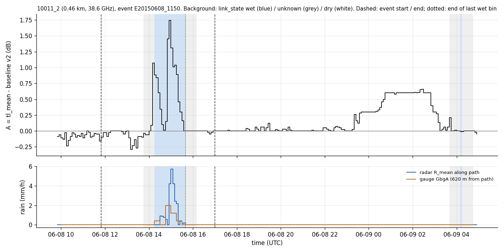

# wet_antenna step 0: inventory of the inputs

Written by `research/wet_antenna/inventory.py` (rerunnable; every number below is measured by that script
on release `openmrg_v1` and the frozen baseline products). Inventory only: nothing is analysed, fitted or
selected here.

Notation: TL = TSL - RSL (`tl_mean`), A(t) = TL(t) - baseline = A_rain(t) + δ(t); in a drying tail A_rain = 0, so
A(t) = δ(t) (WAA + baseline residual).

## 2a. A(t) after baseline subtraction (method v2, frozen)

**There is no stored A(t) file.** A(t) is computed on demand from two stored parts:

| part | path | format | produced by | content |
|---|---|---|---|---|
| TL | `data/release/openmrg_v1/timeseries/cml_<res>.zarr`, variable `tl_mean` | Zarr, dims (time, sublink_id) | pipeline stage `aggregate` (L3) | mean of the valid 10 s TL samples of the bin, dB; NaN if < 80 % of the bin's samples are valid |
| baseline | `research/baseline/outputs/products/baselines.csv` | CSV, 40186 rows | `research/baseline/make_baseline_table.py` | one flat baseline per (event, sub-link), `baseline_db` (dB) |

- Baseline table: 40186 rows = 71 events (train 53, val
  18; **no test events**) x 566 sub-links on 283 **train** links (status:
  {'good': 513, 'degraded': 53}). Missing baselines: 1150. `use_in_waa_main` = True: 30322 rows.
  Significant train events with a wet bin on the link and `use_in_waa_main`: **7375 pairs on
  441 sub-links**.
- Resolution: the baseline is one number per event; A(t) can be had at any CML resolution (10 s via
  `cml_10s`, 1 min, 5 min, 15 min, 1 h), but the baseline itself was computed from 5 min `tl_mean`.
- Time span: JJA 2015 (1 Jun - 31 Aug), only around events that have a baseline row.
- **How it is subtracted** (`research/baseline/baseline.py`, function `a_of_t`, line 252):

```python
out = tl[base.index] - base                                   # broadcast: one baseline per sub-link column
```

  i.e. A(t) = tl_mean(t) - baseline_db, one constant per sub-link column, over [event start - pad, event end + pad).
  The release itself has no baseline ("no baseline is applied in this release", DATA_GUIDE section 4), so the
  only subtraction is this line. Columns of `baselines.csv`: `event_id`, `split_event`, `significant`, `run_count`, `event_start`, `event_end`, `link_has_wet_slot`, `last_wet_end`, `sublink_id`, `cml_id`, `status`, `baseline_db`, `window_h`, `n_usable_slots`, `missing`, `summer_dry_median_db`, `dew_risk_during_event`, `dew_share_during_event`, `excursion`, `dew_risk_in_window`, `dew_share_in_window`, `daily_cycle_large`, `degraded`, `toggling`, `offset_std`, `offset_p90_abs`, `use_in_waa_main`.
- `research/baseline/outputs/products/baseline_uncertainty.csv`: 566 sub-links, the spread of the v2 baseline error in dry weather
  (`offset_std`, `offset_p90_abs`, dB), meant as weights.

## 2b. link_state (wet / dry per bin per link)

- Path: `data/release/openmrg_v1/timeseries/link_reference_state_5min.zarr`; API `d.link_state(cml_ids, start, end)`.
  Produced by `pipeline/src/cmlpipe/events/link_state.py` (stage `link_state`, config section `link_state`).
- Dims {'time': 26496, 'cml_id': 364}, **5 min**, **per link (cml_id), not per sub-link**. Span 2015-06-01 00:00 .. 2015-08-31 23:55 (26496 steps).
- Values: `state` int8: 0 dry, 1 wet, -1 unknown; `reasons` uint8 bitmask: 1 radar_wet, 2 gauge_wet,
  4 radar_missing (in the +-30 min window), 8 margin. Shares over all link-bins: {'dry': 0.771, 'wet': 0.088, 'unknown': 0.141}.
- Rules (references only, never CML): **wet** if radar `R_max` along the path >= 0.1 mm/h or a gauge within 1 km has
  >= 0.1 mm in the bin; **dry** if not wet and `R_max` == 0 and every gauge within 1 km == 0 (and valid) in the bin
  **and in every bin within +-30 min**; **unknown** otherwise.
- **The 30 min margin is already included, on the dry side only**: wet bins are NOT widened; the bins within 30 min of
  any non-zero rain become `unknown` (reason bit 8), not wet. Of the unknown bins, 88%
  carry the margin bit and 14% the radar-missing bit. So the first non-wet bin
  after the rain (`last_wet_end` in `baselines.csv`) is normally an `unknown` margin bin, and the first `dry` bin
  comes ~30 min later.

## 2c. Flags

**Per 10 s sample / per CML bin (pipeline QC, L2; CML signals only).** `flags` (10 s, `cml_10s`) and `flags_or`
(bitwise OR over the bin, every L3 resolution), uint16; made by `pipeline/src/cmlpipe/qc/`. Share of 5 min sub-link
bins with the bit set (all 728 sub-links, JJA):

| bit | flag | meaning | blocks the sample? | share of 5 min bins |
|---|---|---|---|---|
| 1 | missing_rsl | RSL missing | yes | 0.0414 |
| 2 | missing_tsl | TSL missing | yes (tsl, tl) | 0.041 |
| 4 | out_of_range | RSL outside [-100, -20] dBm or TSL outside [-15, 30] dBm | yes | 0.0 |
| 8 | rx_floor | RSL within 1 dB of a receiver floor for >= 10 min (attenuation only a lower bound) | yes (rsl, tl) | 0.0 |
| 16 | spike | isolated RSL outlier (<= 3 samples) vs a 5 min rolling median | yes (rsl, tl) | 0.0002 |
| 32 | tsl_step | TSL change >= 1 dB | no (information) | 0.0221 |
| 64 | flatline | RSL exactly constant >= 12 h | no (information) | 0.0011 |
| 128 | network_gap | missing while >= 5 % of the alive sub-links are missing (collector outage) | yes | 0.0011 |

Blocked samples are excluded from the bin statistics; a bin statistic is NaN unless >= 80 % of its 10 s samples are
valid (`n_valid_tl` gives the count, 30 per 5 min bin). Share of NaN `tl_mean` 5 min bins: 0.0332;
sub-links with no valid 5 min `tl_mean` at all: 16. `network_gaps` table: 93 outage
intervals.

**Per sub-link (pipeline).** `quality_status` (`d.status()`): good / degraded / unusable from completeness, flag
shares and dry noise (methods.md section 3); all 728 sub-links: {'good': 641, 'degraded': 67, 'unusable': 20}. `tsl_behaviour`: no_tsl / toggling /
constant / rare_steps / frequent_steps.

**Per (event, link) (pipeline).** `event_links`: `frac_rx_floor_event_*`, `frac_spike_event_*`,
`frac_network_gap_event_*`, `valid_fraction_{event,before,after}_*`, `cml_ok_{event,before,after}` (>= 80 % valid
bins in the event / 3 h before / 3 h after). `event_links_flags_extra`: flatline / tsl_step shares (information).

**Per (event, sub-link) (frozen baseline v2, `baselines.csv`).** Counts over the 40186 rows:
{'missing': 1150, 'excursion': 820, 'dew_risk_in_window': 2847, 'dew_risk_during_event': 13718, 'daily_cycle_large': 5112, 'degraded': 3763, 'toggling': 1136, 'use_in_waa_main': 30322}.

| flag | meaning | how | resolution |
|---|---|---|---|
| `missing` | no baseline | < 1 h usable dry time in the 24 h and in the 48 h before the event | per event |
| `excursion` | "flagged baseline window": baseline > 1 dB from the sub-link's summer dry median | value check | per event |
| `dew_risk_in_window` | > 25 % of the baseline window's dry slots in dew-risk hours | hourly dew risk on 5 min slots | per event (from hourly) |
| `dew_risk_during_event` | > 25 % of [event start, last wet end + 1 h) in dew-risk hours | same | per event (from hourly) |
| `daily_cycle_large` | dry daily-cycle amplitude > 0.4 dB (R1 C3; good sub-links only) | per sub-link | per sub-link |
| `degraded`, `toggling` | quality status degraded / TSL class toggling | from the release | per sub-link |
| `use_in_waa_main` | not (missing, excursion, daily_cycle_large, degraded, toggling) | rule | per event |

**Time-resolved, not in the pipeline (baseline module products).**
- `research/baseline/outputs/products/dry_jumps.csv`: 3934 dry-day jumps ("baseline jumps") on 382 train sub-links
  (sign: {'positive': 2653, 'negative': 1281}): runs >= 3 h of dry slots with TL >= 1 dB above / below the summer dry median; start / end
  times (5 min resolution), weather, `both_directions`, `neighbours_jumping`.
- `research/baseline/outputs/products/dew_risk_hourly.csv`: 2208 hours (2015-06-01 01:00 .. 2015-09-01 00:00), `dew_risk` = RH >= 90 % or T - Td < 2 degC
  (true in 13% of hours); "possible dew" flag, **hourly, one station for the whole network**.
- `dry_excursions.csv` (in the `baseline_exp` exploration): an exploration (hourly, good sub-links, 1 / 2 / 3 dB
  above the dry level, episodes >= 3 h). Not a product; modules must not read it.

## 2d. Learn / test split

- Frozen pipeline split (`split_events`, `split_links`; `pipeline/src/cmlpipe/events/stage.py`, seed 42, never
  changed without `--force-split`): events {'train': 53, 'test': 18, 'val': 18} (significant events by split: {'train': 18, 'test': 10, 'val': 7}),
  stratified by intensity tercile; links {'train': 285, 'test': 71, 'excluded': 8}, stratified by length class x frequency band, parallel
  links kept together, links with both sub-links unusable excluded. Not a spatial hold-out.
- Intended use: fit on train events x train links, tune on val events; unseen events = test x train links; unseen
  links = train events x test links.
- `baselines.csv` already follows it: only train + val events on train links. **Test events and test links have no
  baseline yet**, so A(t) cannot be computed for them with `a_of_t`.
- No WAA-specific split exists.

## 2e. Rain references per link

| reference | path | resolution | coverage |
|---|---|---|---|
| radar along the path | `radar_along_links_{5min,15min,1h}.zarr`: `R_mean` (path-weighted), `R_max`, `R_std`, `wet_fraction`, `valid_weight_fraction` | **5 min** native (2 km grid), mm/h, floored at 0 dBZ | dims {'time': 26496, 'cml_id': 364}, 2015-06-01 00:00 .. 2015-08-31 23:55 (26496 steps); non-NaN `R_mean` 99.2%; 62 links lie in one radar cell |
| City gauges (10) | `gauges_city_{1min,5min,15min,1h}.zarr` (`amount_mm`, `rate_mm_h`) | **1 min** native | 87 of 364 links (66 train links) have a gauge within 1 km (`links.has_gauge_within_1km`) |
| SMHI GbgA | `gauges_smhi_{15min,1h}.zarr` | **15 min** native | one station |
| radar at gauges | `radar_at_gauges_*.zarr` | 5 min | 11 gauges |
| matching | `link_gauge_matches` (852 link-gauge pairs within 5 km); `event_links.gauge_id` = matched gauge per (event, link) | - | - |

Gauges: Jarn (city, weighing), Torp (city, weighing), Bergsj (city, weighing), Torsl (city, weighing), Chalm (city, weighing), Tole (city, weighing), Barl (city, weighing), Drakeg (city, tipping_bucket), Lbom (city, tipping_bucket), Askim (city, tipping_bucket), GbgA (smhi, weighing).

## 2f. Link metadata and A / B pairing

- `tables/sublinks` (728 rows) and `tables/links` (364 rows); the same values are coordinates of the CML
  Zarr stores. Columns: `frequency_ghz` (7.46-38.68 GHz), `polarization`
  ({'v': 722, 'h': 6}), `length_m` (min / median / max 0.14 / 2.27 /
  15.23 km, EPSG:3006), `site_0_antenna_diameter_m`, `site_1_antenna_diameter_m` (values
  [0.2, 0.3, 0.6, 0.9, 1.2] m; rows with a missing diameter: 0), `tx_site`, `rx_site`, `hop`, `length_class`,
  `frequency_band`, `tsl_behaviour`, `status`.
- Pairing: `sublink_id = "<cml_id>_<1|2>"`; sub-link 1 = raw direction A (site_0 -> site_1), sub-link 2 = raw
  direction B (site_1 -> site_0); measured mapping sub-link -> direction: {1: ['A'], 2: ['B']}. Links with both sub-links:
  364 of 364. |f2 - f1| per link: 0.0-1.498 GHz
  (1 links list the same frequency for both directions). Both directions share the path, the two sites
  (`site_0_antenna_diameter_m`, `site_1_antenna_diameter_m` are per site, not per direction) and the link_state. Whether
  the two directions use the same physical antenna at a site is not stated in the metadata.

## 2g. Weather

- `met_1h.zarr` (SMHI GbgA, central Gothenburg): humidity, pressure, temperature, wind_direction, wind_gust, wind_speed (+ SMHI qc codes); hourly, 2015-06-01 01:00 .. 2015-09-01 00:00 (2208 steps).
  Units: degC, %, hPa, m/s, degree. API `d.met(start, end)`.
- Loaded and derived in `research/baseline/outputs/products/dew_risk_hourly.csv` (temperature, humidity, wind speed, dew point, dew-point
  depression, dew_risk, sun elevation, night), and in `dry_jumps.csv` (mean weather per jump).

## 2h. Existing tail-related scripts (the `WAA_exp` exploration folder; not a module input)

- `tail_sample.py`: first look at 12 random drying tails (seed 1) from significant train events with
  `use_in_waa_main` and a wet bin on the link. Tail start = `last_wet_end` (first bin after the link's last wet
  link_state bin in the event; the unknown margin is inside the tail); tail end = next wet bin or 6 h. A = 5 min
  `tl_mean` - `baseline_db`. Writes `tail_sample.csv` (ids, length, frequency, tail start / end, `ended_by`, A at
  start, mean A in the last hour), `tail_sample_panels.png`, `tail_sample_overlay.png` (linear and log y).
- `gauge_radius.py`: how far a gauge can be from a path and still say "no rain on the path". In-event 5 min bins:
  (A) gauge vs gauge P(B wet | A dry) by distance; (B) P(path radar wet | gauge dry) for every link x City gauge;
  (C) links covered within a radius. Writes `gauge_radius_pairs.csv`, `gauge_radius_link_gauge.csv`,
  `gauge_radius_by_distance.csv`, `gauge_radius.png`. Result used as background: the tail start stays the
  pipeline's link_state (no extra gauges).

## 3. Example: 10011_2, event E20150608_1150

Chosen by references only (rule in the script docstring; one wet run, event <= 6 h): 96 candidate pairs, the largest radar
total along the path (1.9 mm) whose link has no wet bin in the 12 h after its rain.
Link 10011: 0.46 km, 38.58 GHz; gauge GbgA at 620 m from the
path. Event 2015-06-08 11:50:00 .. 2015-06-08 17:00:00 (network bounds); last wet bin of the link ends
2015-06-08 15:40:00. Window: event start - 2 h .. event end + 12 h, 5 min.

Pair-level flags (one value for the whole event): {'baseline_db': 35.4, 'window_h': 24.0, 'n_usable_slots': 288, 'missing': False, 'excursion': False, 'dew_risk_in_window': False, 'dew_risk_during_event': False, 'daily_cycle_large': False, 'degraded': False, 'toggling': False, 'use_in_waa_main': True, 'offset_std': 0.1377, 'offset_p90_abs': 0.263}



Columns: `A_db` = tl_mean - baseline_db; `n_valid_tl` (of 30); `state_reasons` and `qc_flags_or` are decoded
bitmasks; `dew_risk_hour` = hourly dew risk of GbgA; `in_dry_jump` = inside a `dry_jumps.csv` interval of this
sub-link; `network_event` = network event id. Full table also in `research/wet_antenna/outputs/tables/inventory_example.csv`.

| time_utc | A_db | tl_mean_db | n_valid_tl | link_state | state_reasons | qc_flags_or | dew_risk_hour | in_dry_jump | network_event | radar_R_mean_mmh | gauge_GbgA_mmh |
|---|---|---|---|---|---|---|---|---|---|---|---|
| 06-08 09:50 | -0.09 | 35.310001373291016 | 30 | dry |  |  | False | False | - | 0.0 |  |
| 06-08 09:55 | -0.06 | 35.34000015258789 | 30 | dry |  |  | False | False | - | 0.0 |  |
| 06-08 10:00 | -0.11 | 35.290000915527344 | 30 | dry |  |  | False | False | - | 0.0 | 0.0 |
| 06-08 10:05 | -0.13 | 35.27000045776367 | 30 | dry |  |  | False | False | - | 0.0 | 0.0 |
| 06-08 10:10 | -0.03 | 35.369998931884766 | 30 | dry |  |  | False | False | - | 0.0 | 0.0 |
| 06-08 10:15 | -0.24 | 35.15999984741211 | 30 | dry |  |  | False | False | - | 0.0 | 0.0 |
| 06-08 10:20 | -0.15 | 35.25 | 30 | dry |  |  | False | False | - | 0.0 | 0.0 |
| 06-08 10:25 | -0.09 | 35.310001373291016 | 30 | dry |  |  | False | False | - | 0.0 | 0.0 |
| 06-08 10:30 | -0.03 | 35.369998931884766 | 30 | dry |  |  | False | False | - | 0.0 | 0.0 |
| 06-08 10:35 | -0.05 | 35.349998474121094 | 30 | dry |  |  | False | False | - | 0.0 | 0.0 |
| 06-08 10:40 | -0.1 | 35.29999923706055 | 30 | dry |  |  | False | False | - | 0.0 | 0.0 |
| 06-08 10:45 | -0.07 | 35.33000183105469 | 30 | dry |  |  | False | False | - | 0.0 | 0.0 |
| 06-08 10:50 | -0.09 | 35.310001373291016 | 30 | dry |  |  | False | False | - | 0.0 | 0.0 |
| 06-08 10:55 | -0.04 | 35.36000061035156 | 30 | dry |  |  | False | False | - | 0.0 | 0.0 |
| 06-08 11:00 | -0.11 | 35.290000915527344 | 30 | dry |  |  | False | False | - | 0.0 | 0.0 |
| 06-08 11:05 | -0.06 | 35.34000015258789 | 30 | dry |  |  | False | False | - | 0.0 | 0.0 |
| 06-08 11:10 | 0.0 | 35.400001525878906 | 30 | dry |  |  | False | False | - | 0.0 | 0.0 |
| 06-08 11:15 | -0.02 | 35.380001068115234 | 30 | dry |  |  | False | False | - | 0.0 | 0.0 |
| 06-08 11:20 | -0.1 | 35.29999923706055 | 30 | dry |  |  | False | False | - | 0.0 | 0.0 |
| 06-08 11:25 | -0.08 | 35.31999969482422 | 30 | dry |  |  | False | False | - | 0.0 | 0.0 |
| 06-08 11:30 | -0.04 | 35.36000061035156 | 30 | dry |  |  | False | False | - | 0.0 | 0.0 |
| 06-08 11:35 | -0.05 | 35.349998474121094 | 30 | dry |  |  | False | False | - | 0.0 | 0.0 |
| 06-08 11:40 | -0.05 | 35.349998474121094 | 30 | dry |  |  | False | False | - | 0.0 | 0.0 |
| 06-08 11:45 | -0.16 | 35.2400016784668 | 30 | dry |  |  | False | False | - | 0.0 | 0.0 |
| 06-08 11:50 | -0.1 | 35.29999923706055 | 30 | dry |  |  | False | False | E20150608_1150 | 0.0 | 0.0 |
| 06-08 11:55 | -0.03 | 35.369998931884766 | 30 | dry |  |  | False | False | E20150608_1150 | 0.0 | 0.0 |
| 06-08 12:00 | -0.03 | 35.369998931884766 | 30 | dry |  |  | False | False | E20150608_1150 | 0.0 | 0.0 |
| 06-08 12:05 | -0.09 | 35.310001373291016 | 30 | dry |  |  | False | False | E20150608_1150 | 0.0 | 0.0 |
| 06-08 12:10 | -0.03 | 35.369998931884766 | 30 | dry |  |  | False | False | E20150608_1150 | 0.0 | 0.0 |
| 06-08 12:15 | 0.0 | 35.400001525878906 | 30 | dry |  |  | False | False | E20150608_1150 | 0.0 | 0.0 |
| 06-08 12:20 | 0.0 | 35.400001525878906 | 30 | dry |  |  | False | False | E20150608_1150 | 0.0 | 0.0 |
| 06-08 12:25 | 0.0 | 35.400001525878906 | 30 | dry |  |  | False | False | E20150608_1150 | 0.0 | 0.0 |
| 06-08 12:30 | 0.0 | 35.400001525878906 | 30 | dry |  |  | False | False | E20150608_1150 | 0.0 | 0.0 |
| 06-08 12:35 | 0.0 | 35.400001525878906 | 30 | dry |  |  | False | False | E20150608_1150 | 0.0 | 0.0 |
| 06-08 12:40 | 0.0 | 35.400001525878906 | 30 | dry |  |  | False | False | E20150608_1150 | 0.0 | 0.0 |
| 06-08 12:45 | -0.01 | 35.38999938964844 | 30 | dry |  |  | False | False | E20150608_1150 | 0.0 | 0.0 |
| 06-08 12:50 | -0.05 | 35.349998474121094 | 30 | dry |  |  | False | False | E20150608_1150 | 0.0 | 0.0 |
| 06-08 12:55 | -0.01 | 35.38999938964844 | 30 | dry |  |  | False | False | E20150608_1150 | 0.0 | 0.0 |
| 06-08 13:00 | 0.0 | 35.400001525878906 | 30 | dry |  |  | False | False | E20150608_1150 | 0.0 | 0.0 |
| 06-08 13:05 | -0.11 | 35.290000915527344 | 30 | dry |  |  | False | False | E20150608_1150 | 0.0 | 0.0 |
| 06-08 13:10 | -0.29 | 35.11000061035156 | 30 | dry |  |  | False | False | E20150608_1150 | 0.0 | 0.0 |
| 06-08 13:15 | -0.23 | 35.16999816894531 | 30 | dry |  |  | False | False | E20150608_1150 | 0.0 | 0.0 |
| 06-08 13:20 | -0.14 | 35.2599983215332 | 30 | dry |  |  | False | False | E20150608_1150 | 0.0 | 0.0 |
| 06-08 13:25 | -0.27 | 35.130001068115234 | 30 | dry |  |  | False | False | E20150608_1150 | 0.0 | 0.0 |
| 06-08 13:30 | -0.09 | 35.310001373291016 | 30 | dry |  |  | False | False | E20150608_1150 | 0.0 | 0.0 |
| 06-08 13:35 | -0.09 | 35.310001373291016 | 30 | dry |  |  | False | False | E20150608_1150 | 0.0 | 0.0 |
| 06-08 13:40 | -0.1 | 35.29999923706055 | 30 | dry |  |  | False | False | E20150608_1150 | 0.0 | 0.0 |
| 06-08 13:45 | -0.04 | 35.36000061035156 | 30 | unknown | margin |  | False | False | E20150608_1150 | 0.0 | 0.0 |
| 06-08 13:50 | -0.06 | 35.34000015258789 | 30 | unknown | margin |  | False | False | E20150608_1150 | 0.0 | 0.0 |
| 06-08 13:55 | -0.06 | 35.34000015258789 | 30 | unknown | margin |  | False | False | E20150608_1150 | 0.0 | 0.0 |
| 06-08 14:00 | 0.0 | 35.400001525878906 | 30 | unknown | margin |  | False | False | E20150608_1150 | 0.0 | 0.0 |
| 06-08 14:05 | 0.09 | 35.4900016784668 | 30 | unknown | margin |  | False | False | E20150608_1150 | 0.0 | 0.0 |
| 06-08 14:10 | 1.07 | 36.470001220703125 | 30 | unknown | margin |  | False | False | E20150608_1150 | 0.0 | 0.0 |
| 06-08 14:15 | 0.88 | 36.279998779296875 | 30 | wet | gauge_wet |  | False | False | E20150608_1150 | 0.0 | 0.4000000059604645 |
| 06-08 14:20 | 0.84 | 36.2400016784668 | 30 | wet | gauge_wet |  | False | False | E20150608_1150 | 0.0 | 0.4000000059604645 |
| 06-08 14:25 | 0.6 | 36.0 | 30 | wet | gauge_wet |  | False | False | E20150608_1150 | 0.0 | 0.4000000059604645 |
| 06-08 14:30 | 0.34 | 35.7400016784668 | 30 | wet | radar_wet |  | False | False | E20150608_1150 | 0.9100000262260437 | 0.0 |
| 06-08 14:35 | 0.1 | 35.5 | 30 | wet | radar_wet |  | False | False | E20150608_1150 | 0.8600000143051147 | 0.0 |
| 06-08 14:40 | 0.01 | 35.40999984741211 | 30 | wet | radar_wet |  | False | False | E20150608_1150 | 0.7599999904632568 | 0.0 |
| 06-08 14:45 | 0.15 | 35.54999923706055 | 30 | wet | radar_wet|gauge_wet |  | False | False | E20150608_1150 | 0.5600000023841858 | 2.0 |
| 06-08 14:50 | 1.45 | 36.849998474121094 | 30 | wet | gauge_wet |  | False | False | E20150608_1150 | 0.0 | 2.0 |
| 06-08 14:55 | 1.74 | 37.13999938964844 | 30 | wet | radar_wet|gauge_wet |  | False | False | E20150608_1150 | 4.230000019073486 | 2.0 |
| 06-08 15:00 | 1.31 | 36.709999084472656 | 30 | wet | radar_wet|gauge_wet |  | False | False | E20150608_1150 | 5.75 | 1.2000000476837158 |
| 06-08 15:05 | 1.01 | 36.40999984741211 | 30 | wet | radar_wet|gauge_wet |  | False | False | E20150608_1150 | 4.230000019073486 | 1.2000000476837158 |
| 06-08 15:10 | 1.04 | 36.439998626708984 | 30 | wet | radar_wet|gauge_wet |  | False | False | E20150608_1150 | 2.430000066757202 | 1.2000000476837158 |
| 06-08 15:15 | 0.89 | 36.290000915527344 | 30 | wet | radar_wet|gauge_wet |  | False | False | E20150608_1150 | 2.1500000953674316 | 0.4000000059604645 |
| 06-08 15:20 | 0.46 | 35.86000061035156 | 30 | wet | gauge_wet |  | False | False | E20150608_1150 | 0.0 | 0.4000000059604645 |
| 06-08 15:25 | 0.3 | 35.70000076293945 | 30 | wet | radar_wet|gauge_wet |  | False | False | E20150608_1150 | 0.36000001430511475 | 0.4000000059604645 |
| 06-08 15:30 | 0.16 | 35.560001373291016 | 30 | wet | radar_wet |  | False | False | E20150608_1150 | 0.1599999964237213 | 0.0 |
| 06-08 15:35 | 0.0 | 35.400001525878906 | 30 | wet | radar_wet |  | False | False | E20150608_1150 | 0.18000000715255737 | 0.0 |
| 06-08 15:40 | 0.0 | 35.400001525878906 | 30 | unknown | margin |  | False | False | E20150608_1150 | 0.0 | 0.0 |
| 06-08 15:45 | 0.0 | 35.400001525878906 | 30 | unknown | margin |  | False | False | E20150608_1150 | 0.0 | 0.0 |
| 06-08 15:50 | 0.0 | 35.400001525878906 | 30 | unknown | margin |  | False | False | E20150608_1150 | 0.0 | 0.0 |
| 06-08 15:55 | 0.0 | 35.400001525878906 | 30 | unknown | margin |  | False | False | E20150608_1150 | 0.0 | 0.0 |
| 06-08 16:00 | 0.0 | 35.400001525878906 | 30 | unknown | margin |  | False | False | E20150608_1150 | 0.0 | 0.0 |
| 06-08 16:05 | 0.0 | 35.400001525878906 | 30 | unknown | margin |  | False | False | E20150608_1150 | 0.0 | 0.0 |
| 06-08 16:10 | 0.0 | 35.400001525878906 | 30 | dry |  |  | False | False | E20150608_1150 | 0.0 | 0.0 |
| 06-08 16:15 | 0.0 | 35.400001525878906 | 30 | dry |  |  | False | False | E20150608_1150 | 0.0 | 0.0 |
| 06-08 16:20 | 0.0 | 35.400001525878906 | 30 | dry |  |  | False | False | E20150608_1150 | 0.0 | 0.0 |
| 06-08 16:25 | 0.0 | 35.400001525878906 | 30 | dry |  |  | False | False | E20150608_1150 | 0.0 | 0.0 |
| 06-08 16:30 | 0.0 | 35.400001525878906 | 30 | dry |  |  | False | False | E20150608_1150 | 0.0 | 0.0 |
| 06-08 16:35 | 0.0 | 35.400001525878906 | 30 | dry |  |  | False | False | E20150608_1150 | 0.0 | 0.0 |
| 06-08 16:40 | -0.02 | 35.380001068115234 | 30 | dry |  |  | False | False | E20150608_1150 | 0.0 | 0.0 |
| 06-08 16:45 | -0.05 | 35.349998474121094 | 30 | dry |  |  | False | False | E20150608_1150 | 0.0 | 0.0 |
| 06-08 16:50 | -0.02 | 35.380001068115234 | 30 | dry |  |  | False | False | E20150608_1150 | 0.0 | 0.0 |
| 06-08 16:55 | 0.0 | 35.400001525878906 | 30 | dry |  |  | False | False | E20150608_1150 | 0.0 | 0.0 |
| 06-08 17:00 | 0.0 | 35.400001525878906 | 30 | dry |  |  | False | False | - | 0.0 | 0.0 |
| 06-08 17:05 | 0.0 | 35.400001525878906 | 30 | dry |  |  | False | False | - | 0.0 | 0.0 |
| 06-08 17:10 | 0.0 | 35.400001525878906 | 30 | dry |  |  | False | False | - | 0.0 | 0.0 |
| 06-08 17:15 | 0.0 | 35.400001525878906 | 30 | dry |  |  | False | False | - | 0.0 | 0.0 |
| 06-08 17:20 | 0.0 | 35.400001525878906 | 30 | dry |  |  | False | False | - | 0.0 | 0.0 |
| 06-08 17:25 | 0.0 | 35.400001525878906 | 30 | dry |  |  | False | False | - | 0.0 | 0.0 |
| 06-08 17:30 | 0.0 | 35.400001525878906 | 30 | dry |  |  | False | False | - | 0.0 | 0.0 |
| 06-08 17:35 | 0.01 | 35.40999984741211 | 30 | dry |  |  | False | False | - | 0.0 | 0.0 |
| 06-08 17:40 | 0.0 | 35.400001525878906 | 30 | dry |  |  | False | False | - | 0.0 | 0.0 |
| 06-08 17:45 | 0.0 | 35.400001525878906 | 30 | dry |  |  | False | False | - | 0.0 | 0.0 |
| 06-08 17:50 | 0.0 | 35.400001525878906 | 30 | dry |  |  | False | False | - | 0.0 | 0.0 |
| 06-08 17:55 | 0.0 | 35.400001525878906 | 30 | dry |  |  | False | False | - | 0.0 | 0.0 |
| 06-08 18:00 | 0.0 | 35.400001525878906 | 30 | dry |  |  | False | False | - | 0.0 | 0.0 |
| 06-08 18:05 | 0.0 | 35.400001525878906 | 30 | dry |  |  | False | False | - | 0.0 | 0.0 |
| 06-08 18:10 | 0.0 | 35.400001525878906 | 30 | dry |  |  | False | False | - | 0.0 | 0.0 |
| 06-08 18:15 | 0.0 | 35.400001525878906 | 30 | dry |  |  | False | False | - | 0.0 | 0.0 |
| 06-08 18:20 | 0.0 | 35.400001525878906 | 30 | dry |  |  | False | False | - | 0.0 | 0.0 |
| 06-08 18:25 | 0.04 | 35.439998626708984 | 30 | dry |  |  | False | False | - | 0.0 | 0.0 |
| 06-08 18:30 | 0.03 | 35.43000030517578 | 30 | dry |  |  | False | False | - | 0.0 | 0.0 |
| 06-08 18:35 | 0.0 | 35.400001525878906 | 30 | dry |  |  | False | False | - | 0.0 | 0.0 |
| 06-08 18:40 | 0.0 | 35.400001525878906 | 30 | dry |  |  | False | False | - | 0.0 | 0.0 |
| 06-08 18:45 | 0.0 | 35.400001525878906 | 30 | dry |  |  | False | False | - | 0.0 | 0.0 |
| 06-08 18:50 | 0.06 | 35.459999084472656 | 30 | dry |  |  | False | False | - | 0.0 | 0.0 |
| 06-08 18:55 | 0.03 | 35.43000030517578 | 30 | dry |  |  | False | False | - | 0.0 | 0.0 |
| 06-08 19:00 | 0.0 | 35.400001525878906 | 30 | dry |  |  | False | False | - | 0.0 | 0.0 |
| 06-08 19:05 | 0.06 | 35.459999084472656 | 30 | dry |  |  | False | False | - | 0.0 | 0.0 |
| 06-08 19:10 | 0.06 | 35.459999084472656 | 30 | dry |  |  | False | False | - | 0.0 | 0.0 |
| 06-08 19:15 | 0.0 | 35.400001525878906 | 30 | dry |  |  | False | False | - | 0.0 | 0.0 |
| 06-08 19:20 | 0.05 | 35.45000076293945 | 30 | dry |  |  | False | False | - | 0.0 | 0.0 |
| 06-08 19:25 | 0.12 | 35.52000045776367 | 30 | dry |  |  | False | False | - | 0.0 | 0.0 |
| 06-08 19:30 | 0.0 | 35.400001525878906 | 30 | dry |  |  | False | False | - | 0.0 | 0.0 |
| 06-08 19:35 | 0.0 | 35.400001525878906 | 30 | dry |  |  | False | False | - | 0.0 | 0.0 |
| 06-08 19:40 | 0.0 | 35.400001525878906 | 30 | dry |  |  | False | False | - | 0.0 | 0.0 |
| 06-08 19:45 | 0.02 | 35.41999816894531 | 30 | dry |  |  | False | False | - | 0.0 | 0.0 |
| 06-08 19:50 | 0.01 | 35.40999984741211 | 30 | dry |  |  | False | False | - | 0.0 | 0.0 |
| 06-08 19:55 | 0.0 | 35.400001525878906 | 30 | dry |  |  | False | False | - | 0.0 | 0.0 |
| 06-08 20:00 | 0.0 | 35.400001525878906 | 30 | dry |  |  | False | False | - | 0.0 | 0.0 |
| 06-08 20:05 | 0.03 | 35.43000030517578 | 30 | dry |  |  | False | False | - | 0.0 | 0.0 |
| 06-08 20:10 | 0.03 | 35.43000030517578 | 30 | dry |  |  | False | False | - | 0.0 | 0.0 |
| 06-08 20:15 | 0.0 | 35.400001525878906 | 30 | dry |  |  | False | False | - | 0.0 | 0.0 |
| 06-08 20:20 | 0.06 | 35.459999084472656 | 30 | dry |  |  | False | False | - | 0.0 | 0.0 |
| 06-08 20:25 | 0.01 | 35.40999984741211 | 30 | dry |  |  | False | False | - | 0.0 | 0.0 |
| 06-08 20:30 | 0.0 | 35.400001525878906 | 30 | dry |  |  | False | False | - | 0.0 | 0.0 |
| 06-08 20:35 | 0.0 | 35.400001525878906 | 30 | dry |  |  | False | False | - | 0.0 | 0.0 |
| 06-08 20:40 | 0.0 | 35.400001525878906 | 30 | dry |  |  | False | False | - | 0.0 | 0.0 |
| 06-08 20:45 | 0.0 | 35.400001525878906 | 30 | dry |  |  | False | False | - | 0.0 | 0.0 |
| 06-08 20:50 | 0.0 | 35.400001525878906 | 30 | dry |  |  | False | False | - | 0.0 | 0.0 |
| 06-08 20:55 | 0.0 | 35.400001525878906 | 30 | dry |  |  | False | False | - | 0.0 | 0.0 |
| 06-08 21:00 | 0.0 | 35.400001525878906 | 30 | dry |  |  | False | False | - | 0.0 | 0.0 |
| 06-08 21:05 | 0.0 | 35.400001525878906 | 30 | dry |  |  | False | False | - | 0.0 | 0.0 |
| 06-08 21:10 | 0.0 | 35.400001525878906 | 30 | dry |  |  | False | False | - | 0.0 | 0.0 |
| 06-08 21:15 | 0.0 | 35.400001525878906 | 30 | dry |  |  | False | False | - | 0.0 | 0.0 |
| 06-08 21:20 | 0.0 | 35.400001525878906 | 30 | dry |  |  | False | False | - | 0.0 | 0.0 |
| 06-08 21:25 | 0.01 | 35.40999984741211 | 30 | dry |  |  | False | False | - | 0.0 | 0.0 |
| 06-08 21:30 | 0.0 | 35.400001525878906 | 30 | dry |  |  | False | False | - | 0.0 | 0.0 |
| 06-08 21:35 | 0.0 | 35.400001525878906 | 30 | dry |  |  | False | False | - | 0.0 | 0.0 |
| 06-08 21:40 | 0.0 | 35.400001525878906 | 30 | dry |  |  | False | False | - | 0.0 | 0.0 |
| 06-08 21:45 | 0.0 | 35.400001525878906 | 30 | dry |  |  | False | False | - | 0.0 | 0.0 |
| 06-08 21:50 | 0.0 | 35.400001525878906 | 30 | dry |  |  | False | False | - | 0.0 | 0.0 |
| 06-08 21:55 | 0.05 | 35.45000076293945 | 30 | dry |  |  | False | False | - | 0.0 | 0.0 |
| 06-08 22:00 | 0.05 | 35.45000076293945 | 30 | dry |  |  | False | False | - | 0.0 | 0.0 |
| 06-08 22:05 | 0.03 | 35.43000030517578 | 30 | dry |  |  | False | False | - | 0.0 | 0.0 |
| 06-08 22:10 | 0.01 | 35.40999984741211 | 30 | dry |  |  | False | False | - | 0.0 | 0.0 |
| 06-08 22:15 | 0.0 | 35.400001525878906 | 30 | dry |  |  | False | False | - | 0.0 | 0.0 |
| 06-08 22:20 | 0.0 | 35.400001525878906 | 30 | dry |  |  | False | False | - | 0.0 | 0.0 |
| 06-08 22:25 | 0.05 | 35.45000076293945 | 30 | dry |  |  | False | False | - | 0.0 | 0.0 |
| 06-08 22:30 | 0.07 | 35.470001220703125 | 30 | dry |  |  | False | False | - | 0.0 | 0.0 |
| 06-08 22:35 | 0.06 | 35.459999084472656 | 30 | dry |  |  | False | False | - | 0.0 | 0.0 |
| 06-08 22:40 | 0.05 | 35.45000076293945 | 30 | dry |  |  | False | False | - | 0.0 | 0.0 |
| 06-08 22:45 | 0.02 | 35.41999816894531 | 30 | dry |  |  | False | False | - | 0.0 | 0.0 |
| 06-08 22:50 | 0.02 | 35.41999816894531 | 30 | dry |  |  | False | False | - | 0.0 | 0.0 |
| 06-08 22:55 | 0.0 | 35.400001525878906 | 30 | dry |  |  | False | False | - | 0.0 | 0.0 |
| 06-08 23:00 | 0.0 | 35.400001525878906 | 30 | dry |  |  | True | False | - | 0.0 | 0.0 |
| 06-08 23:05 | 0.0 | 35.400001525878906 | 30 | dry |  |  | True | False | - | 0.0 | 0.0 |
| 06-08 23:10 | 0.0 | 35.400001525878906 | 30 | dry |  |  | True | False | - | 0.0 | 0.0 |
| 06-08 23:15 | 0.02 | 35.41999816894531 | 30 | dry |  |  | True | False | - | 0.0 | 0.0 |
| 06-08 23:20 | 0.26 | 35.65999984741211 | 30 | dry |  |  | True | False | - | 0.0 | 0.0 |
| 06-08 23:25 | 0.16 | 35.560001373291016 | 30 | dry |  |  | True | False | - | 0.0 | 0.0 |
| 06-08 23:30 | 0.12 | 35.52000045776367 | 30 | dry |  |  | True | False | - | 0.0 | 0.0 |
| 06-08 23:35 | 0.28 | 35.68000030517578 | 30 | dry |  |  | True | False | - | 0.0 | 0.0 |
| 06-08 23:40 | 0.3 | 35.70000076293945 | 30 | dry |  |  | True | False | - | 0.0 | 0.0 |
| 06-08 23:45 | 0.3 | 35.70000076293945 | 30 | dry |  |  | True | False | - | 0.0 | 0.0 |
| 06-08 23:50 | 0.3 | 35.70000076293945 | 30 | dry |  |  | True | False | - | 0.0 | 0.0 |
| 06-08 23:55 | 0.3 | 35.70000076293945 | 30 | dry |  |  | True | False | - | 0.0 | 0.0 |
| 06-09 00:00 | 0.3 | 35.70000076293945 | 30 | dry |  |  | True | False | - | 0.0 | 0.0 |
| 06-09 00:05 | 0.3 | 35.70000076293945 | 30 | dry |  |  | True | False | - | 0.0 | 0.0 |
| 06-09 00:10 | 0.3 | 35.70000076293945 | 30 | dry |  |  | True | False | - | 0.0 | 0.0 |
| 06-09 00:15 | 0.3 | 35.70000076293945 | 30 | dry |  |  | True | False | - | 0.0 | 0.0 |
| 06-09 00:20 | 0.31 | 35.709999084472656 | 30 | dry |  |  | True | False | - | 0.0 | 0.0 |
| 06-09 00:25 | 0.33 | 35.72999954223633 | 30 | dry |  |  | True | False | - | 0.0 | 0.0 |
| 06-09 00:30 | 0.37 | 35.77000045776367 | 30 | dry |  |  | True | False | - | 0.0 | 0.0 |
| 06-09 00:35 | 0.46 | 35.86000061035156 | 30 | dry |  |  | True | False | - | 0.0 | 0.0 |
| 06-09 00:40 | 0.5 | 35.900001525878906 | 30 | dry |  |  | True | False | - | 0.0 | 0.0 |
| 06-09 00:45 | 0.6 | 36.0 | 30 | dry |  |  | True | False | - | 0.0 | 0.0 |
| 06-09 00:50 | 0.6 | 36.0 | 30 | dry |  |  | True | False | - | 0.0 | 0.0 |
| 06-09 00:55 | 0.6 | 36.0 | 30 | dry |  |  | True | False | - | 0.0 | 0.0 |
| 06-09 01:00 | 0.6 | 36.0 | 30 | dry |  |  | True | False | - | 0.0 | 0.0 |
| 06-09 01:05 | 0.6 | 36.0 | 30 | dry |  |  | True | False | - | 0.0 | 0.0 |
| 06-09 01:10 | 0.58 | 35.97999954223633 | 30 | dry |  |  | True | False | - | 0.0 | 0.0 |
| 06-09 01:15 | 0.6 | 36.0 | 30 | dry |  |  | True | False | - | 0.0 | 0.0 |
| 06-09 01:20 | 0.6 | 36.0 | 30 | dry |  |  | True | False | - | 0.0 | 0.0 |
| 06-09 01:25 | 0.6 | 36.0 | 30 | dry |  |  | True | False | - | 0.0 | 0.0 |
| 06-09 01:30 | 0.6 | 36.0 | 30 | dry |  |  | True | False | - | 0.0 | 0.0 |
| 06-09 01:35 | 0.6 | 36.0 | 30 | dry |  |  | True | False | - | 0.0 | 0.0 |
| 06-09 01:40 | 0.6 | 36.0 | 30 | dry |  |  | True | False | - | 0.0 | 0.0 |
| 06-09 01:45 | 0.6 | 36.0 | 30 | dry |  |  | True | False | - | 0.0 | 0.0 |
| 06-09 01:50 | 0.6 | 36.0 | 30 | dry |  |  | True | False | - | 0.0 | 0.0 |
| 06-09 01:55 | 0.6 | 36.0 | 30 | dry |  |  | True | False | - | 0.0 | 0.0 |
| 06-09 02:00 | 0.6 | 36.0 | 30 | dry |  |  | True | False | - | 0.0 | 0.0 |
| 06-09 02:05 | 0.61 | 36.0099983215332 | 30 | dry |  |  | True | False | - | 0.0 | 0.0 |
| 06-09 02:10 | 0.6 | 36.0 | 30 | dry |  |  | True | False | - | 0.0 | 0.0 |
| 06-09 02:15 | 0.61 | 36.0099983215332 | 30 | dry |  |  | True | False | - | 0.0 | 0.0 |
| 06-09 02:20 | 0.65 | 36.04999923706055 | 30 | dry |  |  | True | False | - | 0.0 | 0.0 |
| 06-09 02:25 | 0.66 | 36.060001373291016 | 30 | dry |  |  | True | False | - | 0.0 | 0.0 |
| 06-09 02:30 | 0.6 | 36.0 | 30 | dry |  |  | True | False | - | 0.0 | 0.0 |
| 06-09 02:35 | 0.6 | 36.0 | 30 | dry |  |  | True | False | - | 0.0 | 0.0 |
| 06-09 02:40 | 0.6 | 36.0 | 30 | dry |  |  | True | False | - | 0.0 | 0.0 |
| 06-09 02:45 | 0.6 | 36.0 | 30 | dry |  |  | True | False | - | 0.0 | 0.0 |
| 06-09 02:50 | 0.4 | 35.79999923706055 | 30 | dry |  |  | True | False | - | 0.0 | 0.0 |
| 06-09 02:55 | 0.3 | 35.70000076293945 | 30 | dry |  |  | True | False | - | 0.0 | 0.0 |
| 06-09 03:00 | 0.3 | 35.70000076293945 | 30 | dry |  |  | True | False | - | 0.0 | 0.0 |
| 06-09 03:05 | 0.27 | 35.66999816894531 | 30 | dry |  |  | True | False | - | 0.0 | 0.0 |
| 06-09 03:10 | 0.13 | 35.529998779296875 | 30 | dry |  |  | True | False | - | 0.0 | 0.0 |
| 06-09 03:15 | 0.0 | 35.400001525878906 | 30 | dry |  |  | True | False | - | 0.0 | 0.0 |
| 06-09 03:20 | 0.03 | 35.43000030517578 | 30 | dry |  |  | True | False | - | 0.0 | 0.0 |
| 06-09 03:25 | 0.06 | 35.459999084472656 | 30 | dry |  |  | True | False | - | 0.0 | 0.0 |
| 06-09 03:30 | 0.01 | 35.40999984741211 | 30 | dry |  |  | True | False | - | 0.0 | 0.0 |
| 06-09 03:35 | 0.06 | 35.459999084472656 | 30 | dry |  |  | True | False | - | 0.0 | 0.0 |
| 06-09 03:40 | 0.21 | 35.61000061035156 | 30 | unknown | margin |  | True | False | - | 0.0 | 0.0 |
| 06-09 03:45 | 0.0 | 35.400001525878906 | 30 | unknown | margin |  | True | False | - | 0.0 | 0.0 |
| 06-09 03:50 | 0.0 | 35.400001525878906 | 30 | unknown | margin |  | True | False | - | 0.0 | 0.0 |
| 06-09 03:55 | 0.01 | 35.40999984741211 | 30 | unknown | margin |  | True | False | - | 0.0 | 0.0 |
| 06-09 04:00 | 0.0 | 35.400001525878906 | 30 | unknown | margin |  | True | False | - | 0.0 | 0.0 |
| 06-09 04:05 | 0.0 | 35.400001525878906 | 30 | unknown | margin |  | True | False | - | 0.0 | 0.0 |
| 06-09 04:10 | -0.01 | 35.38999938964844 | 30 | wet | gauge_wet |  | True | False | E20150609_0410 | 0.0 | 0.0 |
| 06-09 04:15 | -0.01 | 35.38999938964844 | 30 | unknown | margin |  | True | False | E20150609_0410 | 0.0 | 0.0 |
| 06-09 04:20 | 0.0 | 35.400001525878906 | 30 | unknown | margin |  | True | False | E20150609_0410 | 0.0 | 0.0 |
| 06-09 04:25 | 0.0 | 35.400001525878906 | 30 | unknown | margin |  | True | False | E20150609_0410 | 0.0 | 0.0 |
| 06-09 04:30 | 0.0 | 35.400001525878906 | 30 | unknown | margin |  | True | False | E20150609_0410 | 0.0 | 0.0 |
| 06-09 04:35 | 0.0 | 35.400001525878906 | 30 | unknown | margin |  | True | False | E20150609_0410 | 0.0 | 0.0 |
| 06-09 04:40 | 0.0 | 35.400001525878906 | 30 | unknown | margin |  | True | False | E20150609_0410 | 0.0 | 0.0 |
| 06-09 04:45 | 0.0 | 35.400001525878906 | 30 | dry |  |  | True | False | E20150609_0410 | 0.0 | 0.0 |
| 06-09 04:50 | -0.02 | 35.380001068115234 | 30 | dry |  |  | True | False | E20150609_0410 | 0.0 | 0.0 |
| 06-09 04:55 | -0.05 | 35.349998474121094 | 30 | dry |  |  | True | False | E20150609_0410 | 0.0 | 0.0 |

## 4. Missing, unclear or inconsistent

1. **No stored A(t).** A(t) exists only through `baseline.a_of_t`; the WAA stage has to import
   `research/baseline/baseline.py` (module-to-module code import) or rebuild A from `tl_mean` and `baselines.csv`.
2. **No baseline for test events / test links** (and none for events not in `baselines.csv`), so the held-out
   evaluation cannot use A(t) yet.
3. **Sub-link vs link resolution.** A(t) and the QC flags are per sub-link; link_state, radar, gauges and
   `event_links` are per link. Both directions of a link get the same wet / dry label.
4. **Resolution mismatches.** CML 10 s (aggregates 1 min - 1 h); link_state, radar and the baseline input 5 min; City
   gauges 1 min; SMHI gauge 15 min (its amount labels all three 5 min bins in link_state); weather and dew risk 1 h,
   one station for the whole network. Radar has no 1 min product, so a 1 min WAA model would have a 5 min rain input.
5. **Tail start sits in the margin.** `last_wet_end` is the first non-wet bin, which is normally `unknown` (30 min
   margin, reason 8): a tail that starts there still contains bins with light rain (0 < R_max < 0.1 mm/h) or rain
   within 30 min. The first `dry` bin is ~30 min later. Which one is "the tail start" is a WAA-stage decision.
6. **Radar floor.** Rates below 0 dBZ (~0.03 mm/h) are set to 0, so very light drizzle can be labelled dry.
7. **`last_wet_end` is searched only inside the network event** [start, end) (`make_baseline_table.py`), and is
   clipped at the last time step. Wet bins of the link outside the network event bounds are not seen.
8. **Overlapping flag concepts.** `excursion` (baseline level vs summer median, per event), `dry_jumps.csv` (time
   intervals, >= 3 h, >= 1 dB), `dry_excursions.csv` (exploration, hourly, 1 / 2 / 3 dB) and the C4 table measure
   related "dry level shift" ideas with different windows and resolutions; `dew_risk_during_event` covers the event
   plus 1 h after the last wet bin, i.e. it overlaps the start of every tail, and it is true for about half of the
   significant pairs (by design, rain makes the air humid).
9. **`daily_cycle_large` is known for good sub-links only** (False for degraded ones, which are excluded from
   `use_in_waa_main` anyway).
10. **Weather timestamps.** `met_1h` stamps are instants (first stamp 01:00); `dew_risk_hourly.csv` uses each stamp as
    the START of its hour. A possible 1 h ambiguity for dew risk.
11. **Sub-links with no data.** 16 sub-links have no valid 5 min `tl_mean` at all; status over all 728:
    {'good': 641, 'degraded': 67, 'unusable': 20}. Unusable sub-links have no baseline rows.
12. **Committed table lacks columns:** `r1b_real_events.csv.gz` has no `dew_risk_during_event` (already noted in the
    baseline CATALOG).
13. **Exploration results are not module inputs.** `tail_sample.py` / `gauge_radius.py` hold the learners' tail
    decisions (start = first non-wet bin; end = next wet bin or a maximum length; max 6 h in the sample, where 10 of
    12 tails reached 6 h, i.e. the 6 h cap was often binding). ORGANIZATION.md: modules never read from
    `explorations/`, so the decisions must be re-stated in this module.
14. **Folder layout.** Step 0 first used `scripts/`, `outputs/`, `reports/`; since step 1 the module follows
    ORGANIZATION.md (code at the root, `outputs/{products,tables,figures,reports}/`, README.md, CATALOG.md).
15. **Flag gap seen in the example.** In 10011_2 a dry-weather rise of A (link_state dry, no rain on radar /
    gauge, dew-risk hours) is below the 1 dB `dry_jumps` threshold, so no time-resolved flag marks it; only the
    hourly `dew_risk` is set. A tail that ran into such a period would carry it. (Observation, not analysed.)
