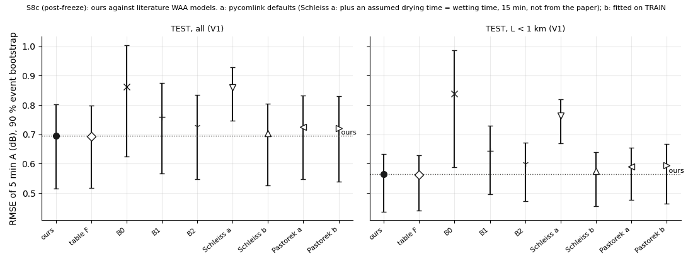
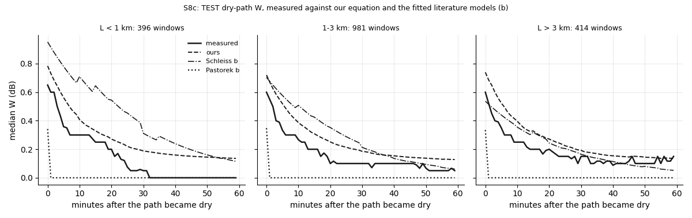

# wet_antenna step S8c: our final WAA equation against two literature WAA models

Written by `research/wet_antenna/literature_s8c.py` (libraries `final_model.py`, `validation.py`, `system_id.py`, `test_s8b.py`). Every setting: `wet_antenna.literature_s8c` in `research/config.yaml`, written on 2026-10-28 BEFORE the run.

## 1. Status

**Status.** TEST was read in S8 / S8b. This is a **post-freeze comparison**. The literature models are fitted on TRAIN only, our equation is not refitted, and no choice about our equation depends on this step.

- Our equation: `research/wet_antenna/outputs/products/waa_equation_final.json` (sha256 `b06ebc8b75867171368e8ea0540bb011014e9615d3dde74f8559b524a25be9cd`), run forward as the S8b closed-F model (fit `research/.cache/wet_antenna/tighten_s6/plug_shared_FP_F_and_P.pkl`, sha256 `1d8163cd8b84aafc85f59c6c223f44b33923278265e3e40819923d8076c8e0b9`, checked). Nothing of it is refitted.
- The forward run reproduces S8b on TEST: **True** (ours 0.6947 / 0.5637 dB, S8b 0.6947 / 0.5637 dB, all / L < 1 km).
- The task is the S8 task: every model gets only V1 (radar / g_e, the S8 g_e after its fix), L and the band, and predicts A - c at 5 min. Same link-events, baseline, c and lag d = 1 min. The S6 table F and the S8 comparison models B0-B2 are shown as references.

## 2. The models as implemented

pycomlink version **0.6.0** (wheel from PyPI, `pycomlink/processing/wet_antenna.py`). The code used, verbatim (docstrings removed):

```python
def waa_pastorek_2021(R, A_max=14, zeta=0.55, d=0.1):
    R = np.asanyarray(R)
    waa = A_max * (1 - np.exp(-d * (R**zeta)))
    # Assure that numeric inaccuracy does not lead to waa > 0 for R == 0
    waa[R == 0] = 0
    return waa
```

```python
def _numba_waa_schleiss_2013(rsl, baseline, wet, waa_max, delta_t, tau):
    waa = np.zeros_like(rsl, dtype=np.float64)
    A = rsl - baseline
    for i in range(1, len(rsl)):
        if wet[i] == True:
            waa[i] = min(A[i], waa_max, waa[i - 1] + (waa_max - waa[i - 1]) * 3 * delta_t / tau)
        else:
            waa[i] = min(A[i], waa_max)
    return waa
```

**Pastorek et al. 2022 (KR-alt; preprint 2021).** Used as in pycomlink, with R = V1(t - d): W = C (1 - exp(-d R^zeta)), d = 0.1. No change. The same form is equation (5) / (A.9) of the paper (the open preprint on engrXiv), with d fixed to 0.1 by the authors. The pycomlink function `waa_pastorek_2021_from_A_obs`, which derives R from the link's own attenuation, is NOT used.

**Schleiss et al. 2013.** pycomlink's loop uses the measured attenuation A = rsl - baseline twice: as a cap in the wet step and as the whole value in the dry step (W = min(A, W_max), i.e. after the rain W simply follows the measurement). Both would hand the model the answer. What was changed:

1. the wet flag is the radar: V1(t - d) > 0.1 mm/h (not the link's own wet / dry classification);
2. the cap at A[i] is removed from the wet step (the step itself, W + (W_max - W) 3 dt / tau, and the cap at W_max are kept);
3. the dry step min(A[i], W_max) is replaced by an exponential decay W - W 3 dt / tau_dry (the paper's abstract: the WAA "decreases exponentially as soon as the rain stops"); without the measured A, pycomlink's dry step would hold W at W_max for ever;
4. W = 0 before each link-event window and the update starts at its first minute (pycomlink keeps waa[0] = 0 and updates from the second step; the windows start dry, so this does not matter); dt = 1 min.

```
for every link-event, W = 0 before its first minute; for every minute i:
    if V1(i - d) > 0.1 mm/h:  W[i] = min(W_max, W[i-1] + (W_max - W[i-1]) * 3 * dt / tau_wet)   # pycomlink's step, without A[i]
    else:                     W[i] = W[i-1] - W[i-1] * 3 * dt / tau_dry                          # replaces min(A[i], W_max)
with dt = 1 min; the prediction is a_link W + L c_band V1(i - d) + c
```

`research/explorations/s8c_checks/check_pycomlink.py` checks the coded forms against pycomlink 0.6.0 itself (Pastorek: identical; Schleiss: identical on wet minutes with the A cap inactive, and different on dry minutes by design).

**Versions.** (a) the published / pycomlink parameters, a_link = 1, only c_band fitted on TRAIN. **Schleiss a = pycomlink defaults plus an assumed drying time equal to the wetting time (15 min), not taken from the paper.** Pastorek a = the pycomlink defaults C = 14 dB, zeta = 0.55, d = 0.1. (b) everything fitted on TRAIN: the amplitude per band (as our A_band), the shape shared over bands, c_band, and a_link with the ridge of our model (Huber 0.3 dB, a_prior_sd 0.5). **The verdict that counts is version (b).** For given shape parameters both models are linear in the amplitude, so the amplitudes, c_band and log a_link are fitted by L-BFGS-B, and the shape by an outer search: Pastorek b a bounded scalar search over zeta, Schleiss b a grid (tau_wet [3, 10, 30, 100, 300, 600] min x tau_dry [3, 10, 30, 100, 300] min) and then Nelder-Mead from its best point (first steps x3 in each direction, maxiter 25). The grid replaced the first plan (Nelder-Mead from the defaults) on 2026-10-28, before any result: the first run was stopped by low memory. Every outer step is cached at once.

| model | shape | amplitude per band (dB; C or W_max) | c_band (dB/km per mm/h) | a_link p10-p90 | TRAIN loss | outer evals | inner converged |
|---|---|---|---|---|---|---|---|
| Schleiss a | tau_wet 15.0 min, tau_dry 15.0 min | 28 GHz 2.30, 32 GHz 2.30, 38 GHz 2.30 | 0.059, 0.055, 0.150 | 1.00-1.00 | 237351.9 | 1 | True |
| Schleiss b | tau_wet 309.2 min, tau_dry 76.9 min | 28 GHz 1.48, 32 GHz 1.27, 38 GHz 1.73 | 0.191, 0.243, 0.336 | 0.68-1.38 | 165645.2 | 57 | True |
| Pastorek a | zeta 0.550 | 28 GHz 14.00, 32 GHz 14.00, 38 GHz 14.00 | 0.050, 0.049, 0.130 | 1.00-1.00 | 173516.5 | 1 | True |
| Pastorek b | zeta 0.566 | 28 GHz 11.96, 32 GHz 10.87, 38 GHz 12.89 | 0.065, 0.098, 0.125 | 0.79-1.27 | 169487.5 | 9 | True |

Our equation for comparison (not refitted): b = 0.542 (u = a_link A_band (R / 5)^b), A_band 2.57 / 2.36 / 2.77 dB, c_band 0.105 / 0.141 / 0.194, tau_f_wet 2.6, tau_f_dry 10.3, phi 0.72, tau_s 240 min. Fitted parameters of every version: `research/wet_antenna/outputs/products/literature_s8c_fits.json`.

**Parameters checked against the papers.**

- Pastorek: the form matches equation (5) / (A.9) of the preprint, d = 0.1 is the paper's choice. The paper's Table II lists NO literature values for KR-alt, so the pycomlink defaults C = 14 dB, zeta = 0.55 could not be checked against the paper text (they may be the calibrated values of its Fig. 5, which cannot be read from the text). The paper assumes the WAA of both antennas, as our W.
- Schleiss: W_max = 2.3 dB matches the paper's abstract ("bounded by a maximum value of about 2.3 dB"); W_max = 2.3 dB and tau = 15 min are the values Pastorek et al. (Table II) take from Schleiss et al. The full text of Schleiss et al. was not available, so the exact equations, the meaning of the factor 3 in pycomlink's step and the drying time constant could not be checked. tau_dry = tau_wet = 15 min in version (a) is an ASSUMPTION, so Schleiss a is labelled "pycomlink defaults plus an assumed drying time". The pycomlink example notebook uses W_max = 2.2 dB, tau = 15, delta_t = 1.
- Pastorek's form is W = C (1 - exp(-d R^zeta)). Its zeta acts inside a saturating function, so it is NOT comparable to our b (the exponent of a plain power law that sets the target of two stores with memory). No agreement between the exponents is claimed, whatever the numbers.

## 3. Results and verdicts

RMSE of the 5 min A (dB, pooled bins, 90 % event bootstrap; VAL was used for decisions in S3-S6b, so its numbers are optimistic):

| model | TEST L < 1 km | TEST all | TEST links (a_link = 1) L < 1 km | TEST links (a_link = 1) all | TRAIN L < 1 km | TRAIN all | VAL (used, optimistic) L < 1 km | VAL (used, optimistic) all |
|---|---|---|---|---|---|---|---|---|
| ours | 0.564 [0.436, 0.633] | 0.695 [0.514, 0.803] | 0.559 [0.456, 0.612] | 0.746 [0.524, 0.879] | 0.648 [0.540, 0.760] | 0.813 [0.670, 0.955] | 0.484 [0.428, 0.522] | 0.619 [0.508, 0.694] |
| table F | 0.562 [0.441, 0.628] | 0.692 [0.517, 0.798] | 0.559 [0.458, 0.611] | 0.743 [0.526, 0.872] | 0.646 [0.539, 0.757] | 0.812 [0.673, 0.950] | 0.483 [0.426, 0.524] | 0.620 [0.507, 0.694] |
| B0 | 0.838 [0.587, 0.987] | 0.862 [0.625, 1.005] | 0.802 [0.582, 0.919] | 0.882 [0.603, 1.047] | 0.860 [0.733, 0.971] | 0.984 [0.805, 1.158] | 0.617 [0.515, 0.698] | 0.717 [0.583, 0.818] |
| B1 | 0.644 [0.495, 0.729] | 0.760 [0.567, 0.874] | 0.670 [0.509, 0.752] | 0.801 [0.563, 0.942] | 0.734 [0.625, 0.843] | 0.889 [0.735, 1.046] | 0.511 [0.458, 0.551] | 0.646 [0.539, 0.722] |
| B2 | 0.601 [0.473, 0.671] | 0.727 [0.547, 0.833] | 0.581 [0.484, 0.634] | 0.779 [0.547, 0.912] | 0.683 [0.572, 0.793] | 0.847 [0.705, 0.989] | 0.500 [0.435, 0.542] | 0.630 [0.518, 0.705] |
| Schleiss a | 0.763 [0.669, 0.818] | 0.859 [0.746, 0.929] | 0.765 [0.675, 0.820] | 0.898 [0.747, 0.988] | 0.845 [0.757, 0.930] | 0.981 [0.857, 1.093] | 0.712 [0.612, 0.784] | 0.792 [0.664, 0.887] |
| Schleiss b | 0.576 [0.454, 0.640] | 0.703 [0.526, 0.804] | 0.592 [0.481, 0.656] | 0.740 [0.525, 0.863] | 0.699 [0.586, 0.812] | 0.852 [0.702, 1.000] | 0.546 [0.478, 0.596] | 0.654 [0.543, 0.732] |
| Pastorek a | 0.590 [0.477, 0.654] | 0.725 [0.547, 0.833] | 0.572 [0.484, 0.623] | 0.770 [0.545, 0.901] | 0.694 [0.577, 0.808] | 0.856 [0.708, 1.000] | 0.506 [0.440, 0.548] | 0.633 [0.517, 0.714] |
| Pastorek b | 0.595 [0.463, 0.667] | 0.720 [0.538, 0.830] | 0.574 [0.476, 0.627] | 0.780 [0.540, 0.921] | 0.682 [0.570, 0.795] | 0.843 [0.698, 0.988] | 0.495 [0.434, 0.535] | 0.623 [0.511, 0.699] |

TEST per length class:

| model | 1-3 km | L < 1 km | L > 3 km | all |
|---|---|---|---|---|
| ours | 0.684 [0.516, 0.784] | 0.564 [0.436, 0.633] | 0.780 [0.551, 0.927] | 0.695 [0.514, 0.803] |
| table F | 0.681 [0.518, 0.775] | 0.562 [0.441, 0.628] | 0.778 [0.553, 0.924] | 0.692 [0.517, 0.798] |
| B0 | 0.850 [0.627, 0.982] | 0.838 [0.587, 0.987] | 0.895 [0.634, 1.064] | 0.862 [0.625, 1.005] |
| B1 | 0.750 [0.570, 0.855] | 0.644 [0.495, 0.729] | 0.837 [0.600, 0.993] | 0.760 [0.567, 0.874] |
| B2 | 0.715 [0.545, 0.811] | 0.601 [0.473, 0.671] | 0.812 [0.581, 0.962] | 0.727 [0.547, 0.833] |
| Schleiss a | 0.845 [0.742, 0.907] | 0.763 [0.669, 0.818] | 0.934 [0.775, 1.042] | 0.859 [0.746, 0.929] |
| Schleiss b | 0.693 [0.524, 0.787] | 0.576 [0.454, 0.640] | 0.787 [0.562, 0.930] | 0.703 [0.526, 0.804] |
| Pastorek a | 0.706 [0.545, 0.799] | 0.590 [0.477, 0.654] | 0.826 [0.587, 0.985] | 0.725 [0.547, 0.833] |
| Pastorek b | 0.709 [0.537, 0.806] | 0.595 [0.463, 0.667] | 0.805 [0.575, 0.957] | 0.720 [0.538, 0.830] |



Paired differences on TEST (model RMSE minus ours, the same 1000 event draws; verdict by the rule written before the run for the literature models, all link-events and L < 1 km; the other rows are information):

| subset | model | difference | verdict | rule_applies |
|---|---|---|---|---|
| all | table F | -0.0025 [-0.0090, +0.0064] | no difference | False |
| all | B0 | +0.1669 [+0.0954, +0.2104] | ours better | False |
| all | B1 | +0.0649 [+0.0467, +0.0750] | ours better | False |
| all | B2 | +0.0320 [+0.0188, +0.0487] | ours better | False |
| all | Schleiss a | +0.1644 [+0.0844, +0.2856] | ours better | True |
| all | Schleiss b | +0.0086 [-0.0102, +0.0391] | no difference | True |
| all | Pastorek a | +0.0307 [+0.0173, +0.0473] | ours better | True |
| all | Pastorek b | +0.0256 [+0.0150, +0.0375] | ours better | True |
| L < 1 km | table F | -0.0016 [-0.0084, +0.0078] | no difference | False |
| L < 1 km | B0 | +0.2746 [+0.1309, +0.3565] | ours better | False |
| L < 1 km | B1 | +0.0798 [+0.0472, +0.0989] | ours better | False |
| L < 1 km | B2 | +0.0372 [+0.0213, +0.0575] | ours better | False |
| L < 1 km | Schleiss a | +0.1997 [+0.1107, +0.3286] | ours better | True |
| L < 1 km | Schleiss b | +0.0118 [-0.0089, +0.0443] | no difference | True |
| L < 1 km | Pastorek a | +0.0268 [+0.0054, +0.0600] | ours better | True |
| L < 1 km | Pastorek b | +0.0308 [+0.0169, +0.0463] | ours better | True |
| 1-3 km | table F | -0.0031 [-0.0098, +0.0061] | no difference | False |
| 1-3 km | B0 | +0.1656 [+0.0971, +0.2085] | ours better | False |
| 1-3 km | B1 | +0.0657 [+0.0483, +0.0758] | ours better | False |
| 1-3 km | B2 | +0.0308 [+0.0169, +0.0488] | ours better | False |
| 1-3 km | Schleiss a | +0.1613 [+0.0802, +0.2848] | ours better | False |
| 1-3 km | Schleiss b | +0.0088 [-0.0104, +0.0392] | no difference | False |
| 1-3 km | Pastorek a | +0.0220 [+0.0060, +0.0454] | ours better | False |
| 1-3 km | Pastorek b | +0.0245 [+0.0133, +0.0381] | ours better | False |
| L > 3 km | table F | -0.0019 [-0.0083, +0.0067] | no difference | False |
| L > 3 km | B0 | +0.1156 [+0.0739, +0.1395] | ours better | False |
| L > 3 km | B1 | +0.0578 [+0.0403, +0.0687] | ours better | False |
| L > 3 km | B2 | +0.0321 [+0.0199, +0.0464] | ours better | False |
| L > 3 km | Schleiss a | +0.1546 [+0.0795, +0.2663] | ours better | False |
| L > 3 km | Schleiss b | +0.0070 [-0.0135, +0.0372] | no difference | False |
| L > 3 km | Pastorek a | +0.0461 [+0.0243, +0.0589] | ours better | False |
| L > 3 km | Pastorek b | +0.0254 [+0.0151, +0.0347] | ours better | False |

**Verdicts (as they came out).** Schleiss a, all: ours better (+0.164 dB [+0.084, +0.286]); Schleiss b, all: no difference (+0.009 dB [-0.010, +0.039]); Pastorek a, all: ours better (+0.031 dB [+0.017, +0.047]); Pastorek b, all: ours better (+0.026 dB [+0.015, +0.038]); Schleiss a, L < 1 km: ours better (+0.200 dB [+0.111, +0.329]); Schleiss b, L < 1 km: no difference (+0.012 dB [-0.009, +0.044]); Pastorek a, L < 1 km: ours better (+0.027 dB [+0.005, +0.060]); Pastorek b, L < 1 km: ours better (+0.031 dB [+0.017, +0.046]).

Information: TEST links never fitted (a_link = 1 for every model):

| subset | model | difference | verdict |
|---|---|---|---|
| all | table F | -0.0031 [-0.0095, +0.0061] | no difference |
| all | B0 | +0.1365 [+0.0719, +0.1725] | ours better |
| all | B1 | +0.0555 [+0.0354, +0.0658] | ours better |
| all | B2 | +0.0330 [+0.0210, +0.0442] | ours better |
| all | Schleiss a | +0.1519 [+0.0784, +0.2676] | ours better |
| all | Schleiss b | -0.0055 [-0.0256, +0.0298] | no difference |
| all | Pastorek a | +0.0238 [+0.0121, +0.0364] | ours better |
| all | Pastorek b | +0.0341 [+0.0163, +0.0430] | ours better |
| L < 1 km | table F | -0.0002 [-0.0062, +0.0073] | no difference |
| L < 1 km | B0 | +0.2430 [+0.1120, +0.3215] | ours better |
| L < 1 km | B1 | +0.1105 [+0.0455, +0.1528] | ours better |
| L < 1 km | B2 | +0.0217 [+0.0035, +0.0458] | ours better |
| L < 1 km | Schleiss a | +0.2058 [+0.1215, +0.3068] | ours better |
| L < 1 km | Schleiss b | +0.0328 [+0.0081, +0.0493] | ours better |
| L < 1 km | Pastorek a | +0.0124 [-0.0099, +0.0450] | no difference |
| L < 1 km | Pastorek b | +0.0145 [-0.0011, +0.0359] | no difference |

Dry-path error on TEST (W_obs - W_model, median over the S7 dry-path windows, 1791 windows, 90 % event bootstrap; positive = the model holds too little water):

| t_min | length | windows | measured_W | err ours | err table F | err Schleiss a | err Schleiss b | err Pastorek a | err Pastorek b |
|---|---|---|---|---|---|---|---|---|---|
| 5 | L < 1 km | 396 | 0.358 | -0.181 [-0.273, -0.105] | -0.174 [-0.291, -0.083] | -0.054 [-0.154, +0.053] | -0.389 [-0.570, -0.282] | +0.350 [+0.300, +0.448] | +0.350 [+0.300, +0.450] |
| 5 | 1-3 km | 981 | 0.333 | -0.186 [-0.242, -0.144] | -0.186 [-0.247, -0.130] | -0.047 [-0.112, +0.003] | -0.226 [-0.392, -0.085] | +0.300 [+0.300, +0.400] | +0.317 [+0.300, +0.400] |
| 5 | L > 3 km | 410 | 0.35 | -0.189 [-0.258, -0.165] | -0.188 [-0.279, -0.144] | -0.057 [-0.147, +0.003] | -0.136 [-0.256, -0.046] | +0.329 [+0.210, +0.400] | +0.326 [+0.210, +0.400] |
| 5 | all | 1787 | 0.35 | -0.185 [-0.242, -0.153] | -0.184 [-0.250, -0.138] | -0.052 [-0.104, +0.004] | -0.239 [-0.393, -0.113] | +0.333 [+0.300, +0.350] | +0.333 [+0.300, +0.351] |
| 10 | L < 1 km | 262 | 0.3 | -0.123 [-0.200, -0.012] | -0.120 [-0.213, -0.022] | +0.121 [+0.064, +0.248] | -0.422 [-0.592, -0.254] | +0.300 [+0.250, +0.309] | +0.300 [+0.249, +0.335] |
| 10 | 1-3 km | 716 | 0.267 | -0.152 [-0.193, -0.103] | -0.153 [-0.202, -0.096] | +0.088 [+0.053, +0.119] | -0.249 [-0.396, -0.120] | +0.257 [+0.200, +0.300] | +0.267 [+0.200, +0.300] |
| 10 | L > 3 km | 320 | 0.25 | -0.168 [-0.252, -0.129] | -0.162 [-0.244, -0.112] | +0.103 [+0.006, +0.126] | -0.123 [-0.262, -0.063] | +0.249 [+0.150, +0.300] | +0.250 [+0.150, +0.300] |
| 10 | all | 1298 | 0.267 | -0.146 [-0.196, -0.103] | -0.147 [-0.203, -0.098] | +0.103 [+0.053, +0.123] | -0.249 [-0.399, -0.117] | +0.250 [+0.200, +0.300] | +0.250 [+0.200, +0.300] |
| 20 | L < 1 km | 150 | 0.2 | -0.085 [-0.176, -0.047] | -0.076 [-0.177, -0.035] | +0.173 [+0.034, +0.210] | -0.331 [-0.492, -0.123] | +0.133 [+0.050, +0.200] | +0.145 [+0.050, +0.200] |
| 20 | 1-3 km | 473 | 0.1 | -0.123 [-0.157, -0.080] | -0.123 [-0.158, -0.081] | +0.100 [+0.041, +0.173] | -0.195 [-0.320, -0.063] | +0.100 [+0.050, +0.200] | +0.100 [+0.050, +0.200] |
| 20 | L > 3 km | 226 | 0.2 | -0.077 [-0.130, -0.036] | -0.074 [-0.123, -0.032] | +0.174 [+0.074, +0.236] | -0.078 [-0.189, -0.015] | +0.200 [+0.092, +0.250] | +0.200 [+0.092, +0.250] |
| 20 | all | 849 | 0.15 | -0.107 [-0.135, -0.066] | -0.110 [-0.129, -0.061] | +0.125 [+0.073, +0.175] | -0.183 [-0.319, -0.063] | +0.150 [+0.083, +0.200] | +0.150 [+0.092, +0.200] |



## 4. What changed in the documents

Written by hand after this run, from the tables of this step (`docs/WAA_research_overview.tex`, the one WAA document; the files `docs/overview/waa_overview.tex` and `waa_part1_full.tex` no longer exist, they were merged into it on 2026-10-19):

- Section 6 (the final test): a paragraph "Comparison with published WAA models" (what each model assumes, memory or not, the references; the Schleiss model driven by the radar wet flag with an exponential drying in place of the measured attenuation; added after the freeze; Schleiss a labelled as pycomlink defaults with an assumed drying time; Pastorek's zeta not comparable to b), Table 7 (TEST RMSE, the difference to ours and the verdicts), Figure 7 (`docs/WAA_research_overview_figures/literature.png`, made by `figs.py` from `literature_s8c_rmse.csv`) and a short reading.
- References: Schleiss et al. 2013 (IEEE GRSL 10(5), 1195-1199, DOI 10.1109/LGRS.2012.2236074) and Pastorek et al. 2022 (IEEE TGRS 60, 1-9, DOI 10.1109/TGRS.2021.3110004), checked against Crossref; the DOI and title of Schleiss et al. also against the EPFL record.
- `docs/ROADMAP.md`: S8c in the step list and the table.

## 5. Unclear / possibly wrong

- **Schleiss a is pycomlink defaults plus an assumed drying time equal to the wetting time (15 min), not taken from the paper.** Its drying is ours, not pycomlink's: pycomlink has no drying law without the measured signal. The exponential drying step follows the paper's abstract, but its exact form and the published drying constant could not be checked. Version (b) fits tau_dry, so the fair comparison does not depend on that assumption, version (a) does.
- **The pycomlink defaults of KR-alt** (C = 14 dB, zeta = 0.55) are not in the paper's text, they could not be checked.
- **The literature models are used outside their setting.** Both papers fit the WAA so that the corrected link rain matches gauges, here the models predict A from radar rain. Version (a) uses parameters calibrated on other links (Schleiss: one 38 GHz link of 1.85 km, Pastorek: 16 links near Prague), so a poor (a) result says little about the papers.
- **The radar wet flag** (V1 > 0.1 mm/h) is a choice made here, not the paper's. The radar is coarse (5 min, 2 km), so short showers can be missed or smeared.
- **The comparison is post-freeze.** TEST had been read in S8 / S8b. The literature models were fitted on TRAIN only and nothing was tuned on TEST, but the outer search ran once and its result was not checked on fake data.
- **The parameters of the literature models have no intervals** (one TRAIN fit each, no bootstrap).