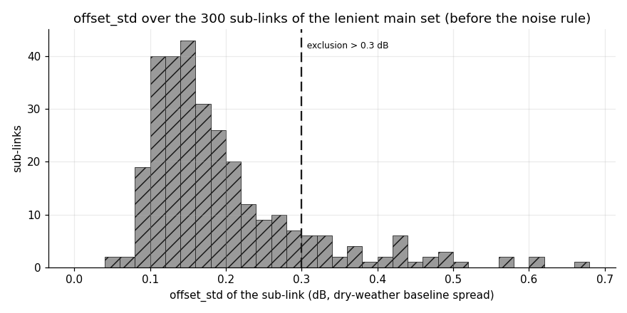
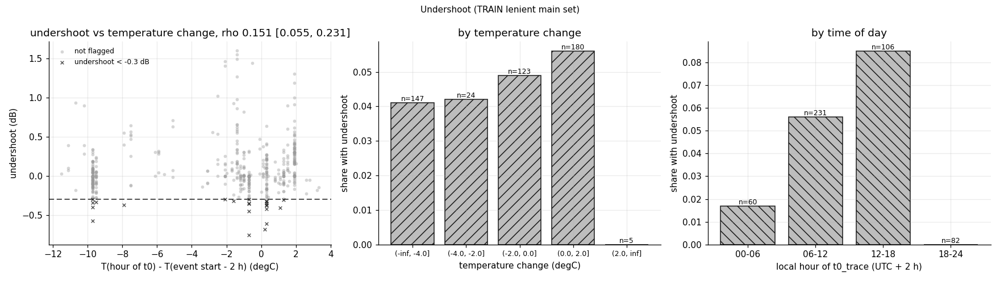
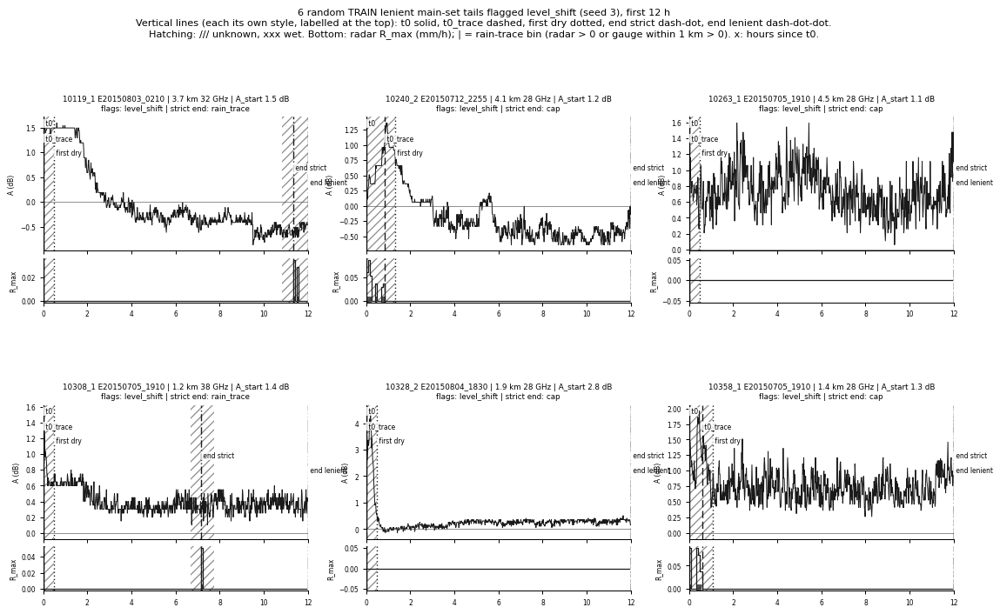
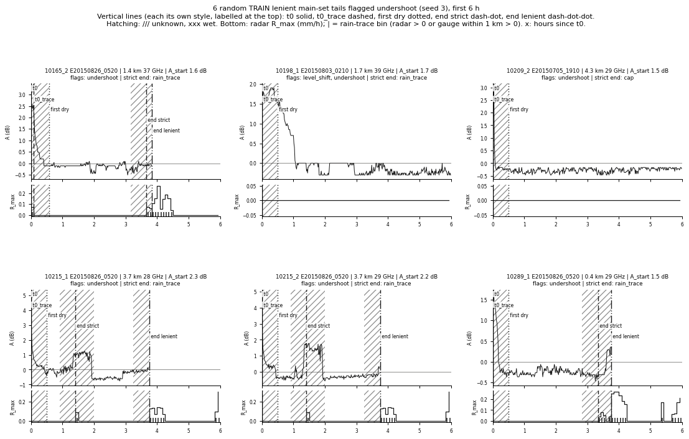
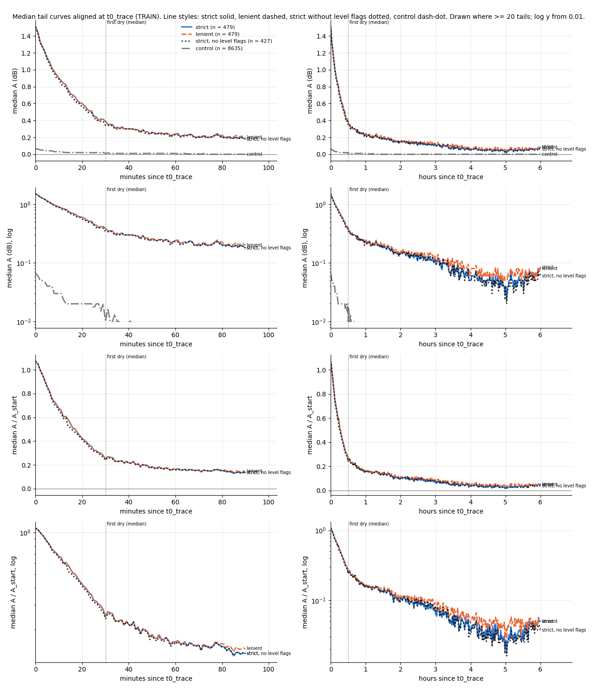
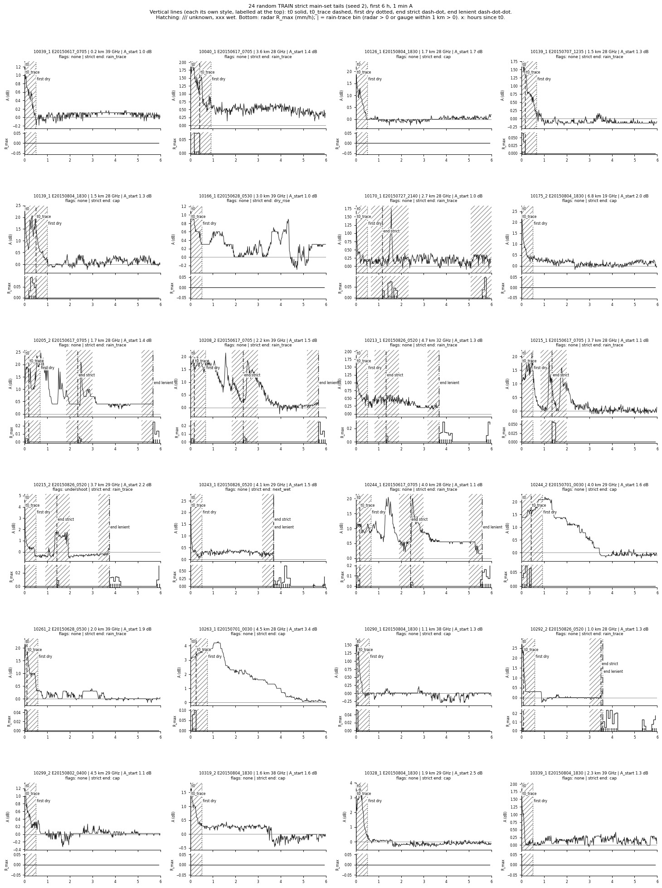

# wet_antenna step 2b: fixes after the step 2 gallery, main sets again (TRAIN only)

Written by `research/wet_antenna/refine_selection.py` (settings `wet_antenna.refine_selection`, plus `wet_antenna.selection` for the
step 2 rules it keeps). No fitting, no shape-based selection. TRAIN events only; VAL rows of
`research/wet_antenna/outputs/products/tails_selected.csv` carry the same new columns. Run time 54 s.

## 1. New tail start t0_trace

t0_trace = end of the last 5 min bin with a rain trace (radar R_max > 0 on the path, or any gauge within
1000 m > 0; 87 links have such a gauge) between t0 and t_first_dry; t0 if the margin has no trace.
A_start_trace = mean A over [t0_trace, t0_trace + 5 min). Kept step 2 TRAIN tails with a trace in the margin:
6039 of 11347.

| index | n | p10 | p25 | median | p75 | p90 |
|---|---|---|---|---|---|---|
| A_start (t0, step 2) | 479.0 | 1.02 | 1.16 | 1.42 | 1.82 | 2.32 |
| A_start_trace (strict main) | 479.0 | 1.05 | 1.15 | 1.33 | 1.64 | 2.11 |
| t0_trace - t0 (min, kept tails) | 11347.0 | 0.0 | 0.0 | 5.0 | 10.0 | 30.0 |
| t0_trace - t0 (min, strict main) | 479.0 | 0.0 | 0.0 | 0.0 | 5.0 | 21.0 |
| usable strict (min, strict main) | 479.0 | 104.0 | 205.0 | 460.0 | 715.0 | 720.0 |
| usable lenient (min, lenient main) | 479.0 | 205.0 | 325.0 | 685.0 | 720.0 | 720.0 |
| late_level_db (lenient main) | 332.0 | -0.13 | -0.01 | 0.07 | 0.2 | 0.3 |
| undershoot_db (lenient main) | 479.0 | -0.2 | -0.09 | 0.01 | 0.21 | 0.41 |

## 2. + 3. Tail ends and tail time

Lenient end = earliest of the first `tsl_step`, the dry-rise cut (step 2 detection; cut moved back to the last minute
before the rise run with a smoothed excess < 0.15 dB), and t_end. Strict end = lenient end, or the first
rain-trace bin after t0_trace if earlier. Over the 11347 kept step 2 TRAIN tails (`research/wet_antenna/outputs/tables/refine_selection_tail_time.csv`):

| quantity | minutes | share_of_step1_time |
|---|---|---|
| tail time t0 .. t_end (step 1) | 7171907.0 | 1.0 |
| usable in step 2 (t0 .. t_use_end) | 6767380.0 | 0.944 |
| lenient end with the earlier rise cut (t0 .. end) | 6630187.0 | 0.924 |
|   removed by moving the rise cut earlier | 137193.0 | 0.019 |
|   removed by moving the start to t0_trace | 109221.0 | 0.015 |
| usable lenient (t0_trace .. lenient end) | 6520966.0 | 0.909 |
| usable strict (t0_trace .. strict end) | 5838836.0 | 0.814 |
|   lost strict vs lenient (rain trace after t0_trace) | 682130.0 | 0.095 |

`truncated_by_lenient`: {'cap': 6858, 'next_wet': 3210, 'dry_rise': 1249, 'tsl_step': 29, 'gap': 1}. `truncated_by_strict`: {'cap': 5628, 'rain_trace': 3116, 'next_wet': 1411, 'dry_rise': 1165, 'tsl_step': 26, 'gap': 1}.

## 4. Noise exclusion (offset_std from dry weather)

offset_std (`baseline_uncertainty.csv`) over the 300 sub-links of the lenient main set before this rule:
{'n': 300, 'p10': 0.11, 'p25': 0.13, 'median': 0.16, 'p75': 0.22, 'p90': 0.32} dB.

Excluded: offset_std > 0.3 dB. Sub-links removed: 39; their tails in that main set:
99; kept step 2 TRAIN tails removed in total: 1077. List (`research/wet_antenna/outputs/tables/refine_selection_noisy_sublinks.csv`):

| sublink_id | tails | offset_std | L_km | frequency_ghz | antennas_m |
|---|---|---|---|---|---|
| 10334_2 | 3 | 0.679 | 5.979 | 32.389 | 0.3/0.3 |
| 10334_1 | 3 | 0.615 | 5.979 | 33.201 | 0.3/0.3 |
| 10151_2 | 2 | 0.612 | 4.725 | 28.178 | 0.3/0.6 |
| 10283_2 | 1 | 0.571 | 14.773 | 7.61 | 0.6/0.6 |
| 10056_2 | 1 | 0.57 | 1.762 | 29.214 | 0.3/0.3 |
| 10152_2 | 2 | 0.508 | 3.53 | 38.556 | 0.3/0.6 |
| 10348_2 | 5 | 0.493 | 12.246 | 18.305 | 0.6/0.6 |
| 10282_2 | 2 | 0.488 | 6.084 | 18.195 | 0.6/0.6 |
| 10347_2 | 8 | 0.486 | 4.893 | 29.214 | 0.6/0.6 |
| 10190_1 | 2 | 0.463 | 7.873 | 18.195 | 0.6/0.6 |
| 10197_2 | 3 | 0.461 | 1.14 | 37.268 | 0.3/0.3 |
| 10083_2 | 1 | 0.443 | 0.571 | 37.268 | 0.3/0.3 |
| 10257_2 | 3 | 0.432 | 3.475 | 28.178 | 0.3/0.3 |
| 10121_1 | 4 | 0.432 | 5.217 | 32.361 | 0.3/0.3 |
| 10138_1 | 5 | 0.431 | 7.712 | 18.25 | 0.6/0.6 |
| 10338_2 | 1 | 0.43 | 8.396 | 19.37 | 0.6/0.6 |
| 10354_2 | 1 | 0.429 | 1.066 | 38.584 | 0.3/0.3 |
| 10257_1 | 1 | 0.428 | 3.475 | 29.186 | 0.3/0.3 |
| 10024_1 | 2 | 0.41 | 0.486 | 29.27 | 0.3/0.3 |
| 10197_1 | 2 | 0.406 | 1.14 | 38.528 | 0.3/0.3 |
| 10338_1 | 1 | 0.381 | 8.396 | 18.36 | 0.6/0.6 |
| 10024_2 | 1 | 0.374 | 0.486 | 28.262 | 0.3/0.3 |
| 10149_1 | 2 | 0.373 | 1.616 | 38.528 | 0.3/0.3 |
| 10239_2 | 3 | 0.369 | 8.042 | 19.37 | 0.6/0.6 |
| 10281_1 | 4 | 0.367 | 2.599 | 29.186 | 0.3/0.3 |
| 10283_1 | 2 | 0.356 | 14.773 | 7.456 | 0.6/0.6 |
| 10147_1 | 2 | 0.349 | 4.493 | 37.268 | 0.3/0.6 |
| 10065_1 | 2 | 0.333 | 1.98 | 28.262 | 0.3/0.3 |
| 10152_1 | 3 | 0.328 | 3.53 | 37.296 | 0.3/0.6 |
| 10220_1 | 2 | 0.325 | 5.92 | 28.234 | 0.6/0.6 |
| 10079_1 | 4 | 0.325 | 0.666 | 28.178 | 0.3/0.3 |
| 10131_2 | 1 | 0.321 | 4.769 | 18.195 | 0.6/0.6 |
| 10056_1 | 3 | 0.321 | 1.762 | 28.206 | 0.3/0.3 |
| 10132_1 | 1 | 0.319 | 4.254 | 28.234 | 0.3/0.3 |
| 10262_1 | 2 | 0.313 | 5.722 | 14.599 | 0.6/0.6 |
| 10348_1 | 5 | 0.311 | 12.246 | 19.315 | 0.6/0.6 |
| 10065_2 | 3 | 0.31 | 1.98 | 29.27 | 0.3/0.3 |
| 10349_1 | 2 | 0.31 | 4.595 | 28.262 | 0.3/0.6 |
| 10209_1 | 4 | 0.307 | 4.267 | 28.262 | 0.3/0.6 |

## 5. Level checks (flags only; nothing excluded)

late_level = median A over [t0 + 6 h, t0 + 12 h] inside the lenient tail, if it has >=
60 valid minutes there; `level_shift` if |late_level| > max(0.3,
2 x offset_std). undershoot = minimum of the 15 min trailing median of A within
3 h after t0_trace (inside the lenient tail); flag if < -0.3 dB.

| index | tails | late level evaluable | level_shift | level_shift share | level_shift share of evaluable | undershoot | undershoot share | both |
|---|---|---|---|---|---|---|---|---|
| main strict | 479.0 | 332.0 | 31.0 | 0.065 | 0.093 | 23.0 | 0.048 | 2.0 |
| main lenient | 479.0 | 332.0 | 31.0 | 0.065 | 0.093 | 23.0 | 0.048 | 2.0 |

Undershoot vs temperature change T(hour of t0) - T(event start - 2 h), lenient main set: Spearman
rho 0.151 [0.055, 0.231] (n = 479, bootstrap over links). By temperature change:

| dT_c | tails | undershoot_share | median_undershoot_db |
|---|---|---|---|
| (-inf, -4.0] | 147 | 0.041 | -0.0 |
| (-4.0, -2.0] | 24 | 0.042 | 0.06 |
| (-2.0, 0.0] | 123 | 0.049 | 0.0 |
| (0.0, 2.0] | 180 | 0.056 | 0.077 |
| (2.0, inf] | 5 | 0.0 | -0.15 |

By local time of t0_trace:

| hour_local_t0_trace | tails | undershoot_share | median_undershoot_db | median_dT_c |
|---|---|---|---|---|
| 00-06 | 60 | 0.017 | 0.285 | -1.7 |
| 06-12 | 231 | 0.056 | -0.02 | -9.5 |
| 12-18 | 106 | 0.085 | -0.0 | 0.3 |
| 18-24 | 82 | 0.0 | 0.27 | 1.9 |

Examples, level_shift (first 12 h):

Examples, undershoot (first 6 h):

## 6. Main sets at t0_trace

Main = kept (step 2 exclusions + noise + A_start_trace NaN), A_start_trace >= 1.0 dB, usable length
(t0_trace .. end) >= 60 min, for the strict and the lenient end. Control = kept, A_start_trace <
0.5 dB, strict end.

| index | tails | sub-links | links | events |
|---|---|---|---|---|
| train tails | 15370 | 566 | 283 | 51 |
| kept (step 2b exclusions) | 10250 | 400 | 223 | 50 |
| main strict | 479 | 261 | 162 | 24 |
| main lenient | 479 | 261 | 162 | 24 |
| main strict, no level flags | 427 | 241 | 155 | 24 |
| alternative strict (>= 0.6) | 1248 | 369 | 212 | 35 |
| alternative lenient (>= 0.6) | 1248 | 369 | 212 | 35 |
| control | 8637 | 400 | 223 | 50 |
| step 2 main set (for reference) | 959 | 373 | 210 | 33 |

Strict and lenient main sets hold the same tails: True. A dry bin needs no rain within +-30 min, so the first trace
after t_first_dry comes >= 35 min later and the strict tail almost always keeps >= 60 min. The sets differ in
LENGTH: 220 of the 479 strict tails end at a rain trace (median usable strict 460 min vs
lenient 685 min).

Why the step 2 main set (959 tails) shrank (first rule that drops each tail):

| index | step 2 main-set tails |
|---|---|
| still in the lenient main set | 438 |
| A_start_trace < 1.0 dB | 381 |
| noisy_baseline | 139 |
| usable lenient < 60 min | 1 |

Strict main: tails per sub-link median 2 (max 6),
per link median 2 (max 9). Per band (own frequency) x length
class x antenna diameters (`research/wet_antenna/outputs/tables/refine_selection_counts.csv`):

| band | length_class | antennas_m | strict_tails | strict_sublinks | strict_links | lenient_tails | lenient_sublinks | lenient_links |
|---|---|---|---|---|---|---|---|---|
| <25GHz | >3km | 0.3/0.3 | 3 | 2 | 1 | 3 | 2 | 1 |
| <25GHz | >3km | 0.3/0.6 | 8 | 4 | 2 | 8 | 4 | 2 |
| <25GHz | >3km | 0.6/0.6 | 24 | 12 | 9 | 24 | 12 | 9 |
| <25GHz | >3km | 0.6/1.2 | 3 | 2 | 1 | 3 | 2 | 1 |
| >=25GHz | 1-3km | 0.2/0.3 | 4 | 2 | 1 | 4 | 2 | 1 |
| >=25GHz | 1-3km | 0.3/0.3 | 206 | 113 | 70 | 206 | 113 | 70 |
| >=25GHz | 1-3km | 0.3/0.6 | 2 | 1 | 1 | 2 | 1 | 1 |
| >=25GHz | <1km | 0.2/0.2 | 2 | 1 | 1 | 2 | 1 | 1 |
| >=25GHz | <1km | 0.3/0.3 | 66 | 40 | 25 | 66 | 40 | 25 |
| >=25GHz | >3km | 0.3/0.3 | 107 | 58 | 33 | 107 | 58 | 33 |
| >=25GHz | >3km | 0.3/0.6 | 35 | 17 | 12 | 35 | 17 | 12 |
| >=25GHz | >3km | 0.6/0.6 | 19 | 9 | 6 | 19 | 9 | 6 |

Median curves aligned at t0_trace (`research/wet_antenna/outputs/tables/refine_selection_median_curves.csv`), 0-90 min and 0-6 h, linear and log y, then the
same normalised by A_start_trace (control left out there: its A_start is ~0):

## 7. Gallery

## Unclear

1. **Trace = presence, not amount.** Any R_max > 0 counts, also radar values at the 0 dBZ floor edge
   (~0.03 mm/h); radar NaN counts as no trace. Links without a gauge within 1 km rely on the radar alone.
2. **SMHI GbgA** is 15 min: one tip marks three 5 min bins as trace, which can move t0_trace up to 10 min too late.
3. **The rise cut** falls back to t_first_dry when no dry minute before the rise run had an excess < 0.15 dB.
4. **late_level** uses the lenient end and t0 (not t0_trace) as the clock, as specified; tails that end before
   t0 + 6 h + 60 min are not evaluable (`late_level_db` NaN, `level_shift` False).
5. **The temperature change** uses one station (GbgA) and hourly values; the hour of t0 and of event start - 2 h are
   floored to the hour.
6. **offset_std** is missing for sub-links without fake events (0 TRAIN tails);
   they are not excluded by the noise rule.
7. **Strict = lenient in membership** (see section 6): the strict end changes the tail length, not the set. A strict
   set that differs would need a stricter start or a minimum strict length longer than 60 min.
8. **Undershoot looks like a level, not a dip** in the example panels: A falls to about -0.3 dB right after the rain and
   often stays there for hours (baseline too high for that event, or a level change after the rain). The flag cannot
   tell this apart from a short dip; `late_level` catches only the part that lasts beyond 6 h.
9. **A_start_trace** is measured right after the last trace; in the strict set the next trace can come soon after,
   so a short strict tail may still be dominated by the rain before.
