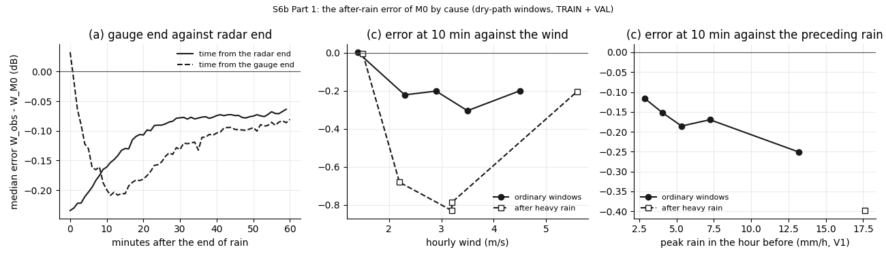
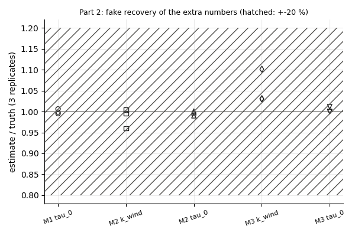
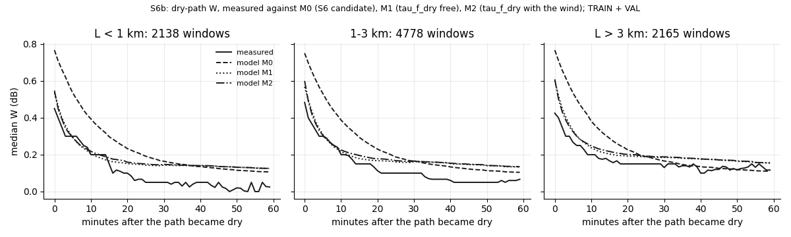
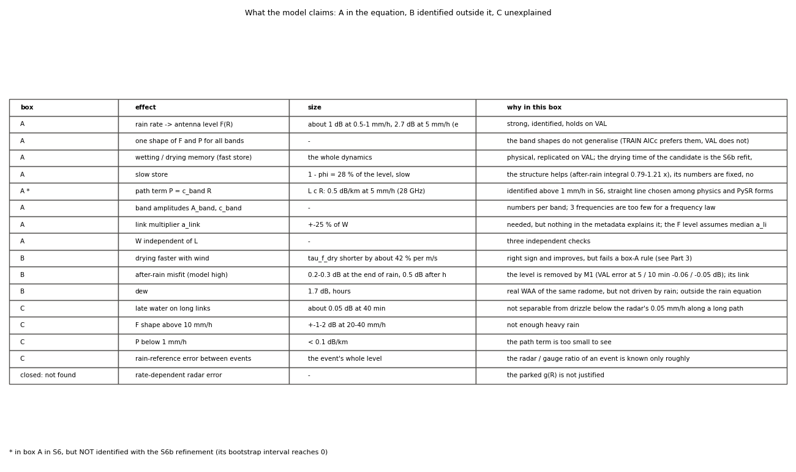
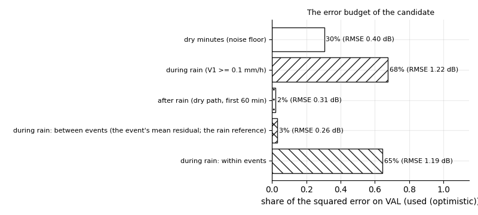

# wet_antenna step S6b: the one return to S6 (drying and wind; the after-rain misfit) and the three boxes

Written by `research/wet_antenna/return_s6b.py` (libraries `wind_drying.py`, `validation.py`, `final_model.py`, `system_id.py`, `length_test.py`). Every rule: `wet_antenna.return_s6b` in `research/config.yaml`, written on 2026-10-19 BEFORE the run. This is the ONE allowed return to S6 (S7 reason (d)); after it the candidate goes to S8 whatever the outcome.

**Standing rule.** WAA is never estimated by subtracting a power-law rain term; the path part is separated only through L at matched rain or by dry-path moments; ITU-R P.838 only as a size reference; the rain correction comes from the City gauges only (g_e); no TEST attenuation or rain was read. The S6 candidate stays the reference (M0); every new fit is compared with it.

Reference M0 = the S6 candidate, sha256 `36135658c4362397754247faf4a744dc2e6e61b6737e9bcc112c83937519d82b`. VAL numbers are **used (optimistic)**.

## 1. What was run

- Dry-path windows (the S7 rule): 9081 (TRAIN 7470, VAL 1611).
- Fits on TRAIN V1 (kernel `wind_drying.kernel_w`, exact M4b at k = 0): M0r, M1, M2, M3; fake checks 9; the box-A rule; a cold bootstrap of 40 draws and 3 identifiability replicates for M1.
- Wind: hourly SMHI GbgA, standardised over the TRAIN link-event minutes (mean 2.90 m/s, SD 1.53 m/s).
- Timing: one evaluation 605 ms on 3 processes; projection 7.22 h; cuts: nothing; M3 run. Run time 4 min.

## 2. The after-rain misfit: cause by cause (M0 frozen)

| cause | windows | events | numbers | verdict |
|---|---|---|---|---|
| (a) the radar calls the path dry late | 3589 | 19 | lag (radar end - gauge end) median +9 min (IQR +2 to +21); ends agree (|lag| <= 5 min) in 980 windows: median error at 5 / 10 min -0.18 n/a / -0.16 n/a dB (all gauge windows -0.20 / -0.16); Spearman error at 10 min vs lag -0.01 [-0.15, +0.13] | not supported |
| (b) the antenna dries faster than the model in general | 3430 | 27 | apparent decay time 0-10 min, measured / model (median): all 0.87 [0.70, 1.06] (3430 windows); ordinary 0.87 [0.71, 1.08] (3214 windows); heavy 0.84 [0.44, 1.07] (216 windows); the error AT t = 0 (before any drying): -0.25 [-0.35, -0.16] dB | not supported |
| (c) drying depends on the weather / the preceding rain | 7563 | 33 | wind_speed vs err10: -0.19 [-0.30, -0.01]; peak_rain_60 vs err10: -0.16 [-0.26, -0.04]; humidity vs err10: +0.22 [+0.05, +0.36]; temperature vs err10: -0.07 [-0.19, +0.10]; wind_speed | peak_rain_60 vs err10: -0.16 [-0.30, +0.04]; peak_rain_60 | wind_speed vs err10: -0.13 [-0.25, -0.03]; humidity | peak_rain_60 vs err10: +0.24 [+0.06, +0.37]; temperature | peak_rain_60 vs err10: -0.09 [-0.20, +0.06]; wind_speed vs decay_ratio: -0.07 [-0.27, +0.15]; peak_rain_60 vs decay_ratio: +0.01 [-0.07, +0.09]; humidity vs decay_ratio: -0.02 [-0.22, +0.11]; temperature vs decay_ratio: -0.26 [-0.40, -0.05]; wind_speed | peak_rain_60 vs decay_ratio: -0.07 [-0.27, +0.14]; peak_rain_60 | wind_speed vs decay_ratio: +0.02 [-0.03, +0.08]; humidity | peak_rain_60 vs decay_ratio: -0.02 [-0.22, +0.11]; temperature | peak_rain_60 vs decay_ratio: -0.26 [-0.40, -0.06] | wind_speed: not supported, peak_rain_60: supported, humidity: supported, temperature: supported |
| (d) F too high at heavy rain | 1407 | 14 | TRAIN: mean residual during V1 >= 10 mm/h on L < 1 km +0.15 [-0.45, +0.64] dB (median +0.11; 1311 bins, 10 events); VAL: mean residual during V1 >= 10 mm/h on L < 1 km +1.24 [+0.14, +1.60] dB (median +0.90; 96 bins, 4 events) | not supported |

Weather and preceding rain, Spearman and partial Spearman with 90 % event-bootstrap intervals (`physical_and_excludes_0` = the rule):

| target | variable | given | rho | lo | hi | physical_and_excludes_0 |
|---|---|---|---|---|---|---|
| err10 | wind_speed |  | -0.185 | -0.303 | -0.014 | True |
| err10 | peak_rain_60 |  | -0.162 | -0.26 | -0.044 | True |
| err10 | humidity |  | 0.223 | 0.048 | 0.358 | True |
| err10 | temperature |  | -0.066 | -0.195 | 0.1 | False |
| err10 | wind_speed | peak_rain_60 | -0.159 | -0.296 | 0.039 | False |
| err10 | peak_rain_60 | wind_speed | -0.131 | -0.252 | -0.029 | True |
| err10 | humidity | peak_rain_60 | 0.241 | 0.062 | 0.366 | True |
| err10 | temperature | peak_rain_60 | -0.085 | -0.202 | 0.064 | False |
| decay_ratio | wind_speed |  | -0.069 | -0.272 | 0.149 | False |
| decay_ratio | peak_rain_60 |  | 0.012 | -0.07 | 0.092 | False |
| decay_ratio | humidity |  | -0.021 | -0.222 | 0.11 | False |
| decay_ratio | temperature |  | -0.258 | -0.402 | -0.055 | True |
| decay_ratio | wind_speed | peak_rain_60 | -0.071 | -0.269 | 0.144 | False |
| decay_ratio | peak_rain_60 | wind_speed | 0.021 | -0.033 | 0.082 | False |
| decay_ratio | humidity | peak_rain_60 | -0.019 | -0.225 | 0.11 | False |
| decay_ratio | temperature | peak_rain_60 | -0.259 | -0.398 | -0.059 | True |



**READING.** (a) **Not the radar's timing.** The radar calls the path dry a median 9 min after the gauge (IQR 2-21 min), but the error does not grow with that lag (Spearman at 10 min -0.01) and it is just as large where the two ends agree. (b) **Not a faster drying in general.** Over the first 10 min the measured W decays at about the model's rate (ratio 0.87 [0.70, 1.06]); the misfit is ALREADY there when the path becomes dry: -0.25 [-0.35, -0.16] dB at t = 0. It is a LEVEL at the end of the rain, not a slow drying. (c) The end-of-rain error is larger after heavier preceding rain (-0.13 [-0.25, -0.03] with the wind held fixed) and in drier air (humidity +0.24 [+0.06, +0.37] with the rain held fixed). The wind alone goes with it too (-0.19 [-0.30, -0.01]) but NOT once the preceding rain is held fixed (-0.16 [-0.30, +0.04]): windy hours are the hours after heavy showers, and the wind adds nothing of its own at the window level. Warm hours dry faster (decay ratio against temperature -0.26 [-0.40, -0.06]). All these are small (|rho| <= 0.26). (d) **F is not too high at heavy rain**: on links < 1 km during V1 >= 10 mm/h the model is not high (TRAIN +0.15 [-0.45, +0.64] dB); on VAL it is LOW (+1.24 [+0.14, +1.60] dB, 4 events). So the misfit is an end-of-rain level that grows with the preceding rain and in dry air; the radar timing, a general faster drying and F at heavy rain are ruled out. By the Part 2 rule M3 (drying with the preceding rain) was run.

## 3. The refinements and the box-A rule

Fits (`research/wet_antenna/outputs/tables/return_s6b_fits.csv`):

| model | free | train_loss | converged | tau_0_min | k | A[28 GHz] | c[28 GHz] | A[32 GHz] | c[32 GHz] | A[38 GHz] | c[38 GHz] | a_p10 | a_p90 | VAL rmse (used (optimistic)) | rise_vs_M0 | length_test | VAL err 5 min M0 / Mx | VAL err 10 min M0 / Mx |
|---|---|---|---|---|---|---|---|---|---|---|---|---|---|---|---|---|---|---|
| M0r | none | 158645.9777 | True | 10.3 | 0.0 | 2.8898 | 0.1053 | 2.6764 | 0.1395 | 3.1172 | 0.1939 | 0.7637 | 1.2345 | 0.3878 | 0.0005 | 5 of 6 | -0.238 / -0.237 | -0.170 / -0.169 |
| M1 | tau_f_dry | 157397.7623 | True | 3.7333 | 0.0 | 3.7582 | 0.0542 | 3.4065 | 0.0719 | 3.9135 | 0.1124 | 0.8078 | 1.2998 | 0.3849 | -0.0024 | 4 of 6 | -0.238 / -0.065 | -0.170 / -0.051 |
| M2 | tau_f_dry, k_wind | 156792.8183 | True | 2.976 | 0.8296 | 3.792 | 0.0527 | 3.415 | 0.0706 | 3.941 | 0.1099 | 0.7981 | 1.2991 | 0.3901 | 0.0028 | 4 of 6 | -0.238 / -0.062 | -0.170 / -0.058 |
| M3 | tau_f_dry, k_wind | 157396.7159 | True | 3.6687 | -0.0088 | 3.7562 | 0.0545 | 3.4067 | 0.0722 | 3.9036 | 0.113 | 0.8076 | 1.3003 | 0.385 | -0.0024 | 4 of 6 | -0.238 / -0.064 | -0.170 / -0.051 |

Fake recovery of the extra numbers (`research/wet_antenna/outputs/tables/return_s6b_fake.csv`):

| model | quantity | replicate | truth | estimate | within | at_bound | converged |
|---|---|---|---|---|---|---|---|
| M1 | M1 tau_0 | 0 | 3.7333 | 3.715 | True | False | True |
| M1 | M1 tau_0 | 1 | 3.7333 | 3.7282 | True | False | True |
| M1 | M1 tau_0 | 2 | 3.7333 | 3.7574 | True | False | True |
| M2 | M2 tau_0 | 0 | 2.976 | 2.967 | True | False | True |
| M2 | M2 k_wind | 0 | 0.8296 | 0.8261 | True | False | True |
| M2 | M2 tau_0 | 1 | 2.976 | 2.9459 | True | False | True |
| M2 | M2 k_wind | 1 | 0.8296 | 0.8329 | True | False | True |
| M2 | M2 tau_0 | 2 | 2.976 | 2.9798 | True | False | True |
| M2 | M2 k_wind | 2 | 0.8296 | 0.7964 | True | False | True |
| M3 | M3 tau_0 | 0 | 3.6687 | 3.711 | True | False | True |
| M3 | M3 k_wind | 0 | -0.0088 | -0.0091 | True | False | True |
| M3 | M3 tau_0 | 1 | 3.6687 | 3.667 | True | False | True |
| M3 | M3 k_wind | 1 | -0.0088 | -0.0097 | True | False | True |
| M3 | M3 tau_0 | 2 | 3.6687 | 3.6699 | True | False | True |
| M3 | M3 k_wind | 2 | -0.0088 | -0.0091 | True | False | True |



The box-A rule (`research/wet_antenna/outputs/tables/return_s6b_box_a_rule.csv`):

| model | 1 identified | 2 physical sign | 3 fixes the after-rain error | 3 VAL improvement 5 / 10 min | 3 heavy VAL / TRAIN 5 / 10 min | 4 does not hurt | 4 detail | 5 not a few events | 5 detail | box |
|---|---|---|---|---|---|---|---|---|---|---|
| M1 | True | True | True | 0.173 [0.134, 0.197] / 0.119 [0.109, 0.134] | +0.125 / +0.129; +0.301 / +0.257 | True | rise -0.0024 dB; length 4 of 6; L>3 - L<1 at 10 min -0.022 [-0.060, 0.005] | True | sign kept in 23 of 23 folds; without E20150718_1745, E20150731_1440, E20150802_0400: improvement +0.172 / +0.119 dB (full +0.173 / +0.119) | A |
| M2 | True | True | False | 0.176 [0.076, 0.247] / 0.112 [0.076, 0.146] | +0.052 / +0.153; +0.321 / +0.292 | False | rise +0.0028 dB; length 4 of 6; L>3 - L<1 at 10 min -0.035 [-0.063, -0.003] | not run (rules 1-4 not all met) |  | B |
| M3 | True | False | True | 0.174 [0.133, 0.198] / 0.120 [0.110, 0.135] | +0.131 / +0.127; +0.299 / +0.253 | True | rise -0.0024 dB; length 4 of 6; L>3 - L<1 at 10 min -0.022 [-0.060, 0.005] | not run (rules 1-4 not all met) |  | C |

| model | left_out | k_or_tau0_minus_10.3 |
|---|---|---|
| M1 | E20150605_1745 | -6.161 |
| M1 | E20150608_1150 | -6.512 |
| M1 | E20150617_0705 | -6.0453 |
| M1 | E20150618_0530 | -6.2525 |
| M1 | E20150620_1655 | -6.5597 |
| M1 | E20150622_0300 | -6.5664 |
| M1 | E20150622_0930 | -6.6493 |
| M1 | E20150704_2125 | -6.5169 |
| M1 | E20150705_1910 | -6.5457 |
| M1 | E20150707_1235 | -6.2899 |
| M1 | E20150718_1745 | -6.5416 |
| M1 | E20150725_0440 | -6.8197 |
| M1 | E20150727_2140 | -7.6319 |
| M1 | E20150731_1440 | -6.5597 |
| M1 | E20150802_0400 | -6.5795 |
| M1 | E20150804_1830 | -6.6899 |
| M1 | E20150810_1545 | -6.4508 |
| M1 | E20150815_1305 | -6.7331 |
| M1 | E20150825_0145 | -6.8403 |
| M1 | E20150826_0520 | -6.5412 |
| M1 | E20150826_1620 | -7.0625 |
| M1 | E20150830_0035 | -6.5388 |
| M1 | E20150831_0455 | -6.0158 |
| M1 | 3 windiest: E20150718_1745, E20150731_1440, E20150802_0400 | -6.5492 |



The new candidate's cold bootstrap (40 draws) and identifiability (`research/wet_antenna/outputs/tables/return_s6b_bootstrap.csv`):

| quantity | value | lo | hi | draws | fake_within_3_of_3 | interval_at_bound | identified |
|---|---|---|---|---|---|---|---|
| A[28 GHz] | 3.7582 | 3.2815 | 4.6411 | 40 | True | False | True |
| c[28 GHz] | 0.0542 | 0.0 | 0.0924 | 40 | True | True | False |
| A[32 GHz] | 3.4065 | 3.0105 | 4.7075 | 40 | True | False | True |
| c[32 GHz] | 0.0719 | 0.0 | 0.1205 | 40 | True | True | False |
| A[38 GHz] | 3.9135 | 3.5988 | 5.0028 | 40 | True | False | True |
| c[38 GHz] | 0.1124 | 0.0 | 0.172 | 40 | True | True | False |
| G(0.5) | 0.308 | 0.2187 | 0.372 | 40 | True | False | True |
| G(1) | 0.308 | 0.2832 | 0.372 | 40 | True | False | True |
| G(2) | 0.6068 | 0.3734 | 0.7591 | 40 | True | False | True |
| G(10) | 1.2208 | 1.0401 | 1.6351 | 40 | True | False | True |
| G(20) | 2.0015 | 1.2896 | 2.542 | 40 | True | False | True |
| G(40) | 2.7037 | 1.751 | 5.0609 | 40 | True | False | True |
| a_p10 | 0.8078 | 0.709 | 0.7842 | 40 | True | False | True |
| a_p90 | 1.2998 | 1.2498 | 1.3677 | 40 | True | False | True |
| tau_0 | 3.7333 | 1.7167 | 6.5831 | 40 | True | False | True |

Identifiability: 15 of 15 quantities within +-20 % in 3 of 3 on fake data; by the full S6 rule (also the bootstrap interval not at a bound) 12 of 15 are identified; NOT identified: c[28 GHz], c[32 GHz], c[38 GHz].

**READING.** **M1 passes every box-A rule.** tau_f_dry = 3.7 min [1.7, 6.6] instead of 10.3: the VAL dry-path error goes from -0.238 / -0.065 dB at 5 min and -0.170 / -0.051 dB at 10 min (improvement 0.17 / 0.12 dB, after heavy rain 0.12 / 0.13); the VAL RMSE does not rise (-0.0024 dB); the length test drops from 5 to 4 of 6 (still passes); 23 of 23 folds and the fit without the 3 windiest events keep it. **M2 (wind)**: k = +0.83 per SD of the wind (tau_f_dry about 42 % shorter per m/s), identified, the right sign, and it improves as much as M1 at 5-10 min, but it fails rule 3 after heavy rain (+0.052 dB at 5 min, rule 0.1) and rule 4 (the length-class difference -0.035 [-0.063, -0.003] excludes 0; VAL RMSE +0.0028 dB): **box B**. Beyond M1 it adds nothing (-0.062 / -0.058 against -0.065 / -0.051 dB). **M3 (preceding rain)**: k = -0.009, essentially 0 with the wrong sign: once tau_f_dry is free, the preceding rain does not change it: **box C**.

**What M1 does to the rest of the equation (the repeated S6 checks).** With tau_f_dry = 3.7 min, close to tau_f_wet = 2.6 min, the fast store follows the rain within minutes, so on every link it looks like a path term; only L tells them apart. The refit moves attenuation from the path to the antenna: c_band halves (28 GHz 0.105 -> 0.054 dB/km per mm/h; the same in every band) and A_band rises by about a third (2.89 -> 3.76 dB at 28 GHz). In the cold bootstrap 8-11 of the 40 draws put c of a band at exactly 0 (all three bands in 6 draws): by the S6 identifiability rule **NOT identified in M1: c[28 GHz], c[32 GHz], c[38 GHz]**. The path term was identified in S6. And 3.7 min is not the antenna's drying time measured with a gauge (S2b 10.3 min, VAL 8.8 min): it is an effective time for the 5 min radar input, which lets the model drop W as the radar rain fades.

## 4. What the model claims: the three boxes

| effect | box | evidence | size | conditions | why |
|---|---|---|---|---|---|
| rain rate -> antenna level F(R) | A | S6: A = 2.74 [2.20, 3.37] / 2.56 [1.88, 3.39] / 2.96 [2.49, 3.53] dB at 5 mm/h; fake 62 / 62; VAL length test 5 / 6 | about 1 dB at 0.5-1 mm/h, 2.7 dB at 5 mm/h (equilibrium; 0.75 x after 30 min) | all rain | strong, identified, holds on VAL |
| one shape of F and P for all bands | A | S6: VAL 0.3875 vs 0.3878 dB; S7.2: short links, shared vs band shapes +0.0005 / -0.0027 dB | - | 28 / 32 / 38 GHz | the band shapes do not generalise (TRAIN AICc prefers them, VAL does not) |
| wetting / drying memory (fast store) | A | S2b: tau_wet 2.6, tau_dry 10.3 min (gauge input); S3.4 VAL 2.0 / 8.8 min; S6b M1: tau_f_dry 3.7 min with the radar input (an effective time) | the whole dynamics | all events | physical, replicated on VAL; the drying time of the candidate is the S6b refit, not the gauge timing |
| slow store | A (structure); numbers C | S2b: tau_s at its 240 min bound; S5a: M4c tau_s_wet at the 600 min bound, phi 0.19-0.84 | 1 - phi = 28 % of the level, slow | long events | the structure helps (after-rain integral 0.79-1.21 x), its numbers are fixed, not identified |
| path term P = c_band R | A (S6); NOT identified with M1 | S6: c = 0.107 / 0.142 / 0.197 dB/km per mm/h, plug-back holds; S7.3e 0.5-0.7 x ITU-R P.838 (size only); S6b M1: c halves and its bootstrap interval reaches 0 in every band | L c R: 0.5 dB/km at 5 mm/h (28 GHz) | R >= 1 mm/h | identified above 1 mm/h in S6, straight line chosen among physics and PySR forms; the faster fast store of the S6b refinement takes over part of it |
| band amplitudes A_band, c_band | A (numbers); no band difference in A detected | S6: A intervals overlap (2.20-3.37, 1.88-3.39, 2.49-3.53); c rises with f | - | 3 bands | numbers per band; 3 frequencies are too few for a frequency law |
| link multiplier a_link | A (multiplier); its cause C | S6: 10-90 % 0.76-1.23; S7.1 / 7.5: no metadata relation (L rho +0.05; PySR below the null) | +-25 % of W | per link | needed, but nothing in the metadata explains it; the F level assumes median a_link = 1 |
| W independent of L | A (confirmed) | S7.1 rho +0.05; W height 2.8 dB in every class; dry-path error -0.18 dB in every class; intercepts 13 / 15 | - | 0.3-8.7 km | three independent checks |
| drying faster with wind | B | S7.5 rho -0.76 (17 events, beats the null); S6b M2: k = +0.830 per SD of the wind (SD 1.53 m/s), tau_0 3.0 min; VAL improvement at 5 / 10 min +0.176 / +0.112 dB; identified True | tau_f_dry shorter by about 42 % per m/s | hourly wind, one station | right sign and improves, but fails a box-A rule (see Part 3) |
| after-rain misfit (model high) | B | S7.3a / S6b Part 1: error at t = 0 -0.25 [-0.35, -0.16] dB, -0.18 dB at 10 min; causes: (a) not supported, (b) not supported, (c) wind_speed not supported, peak_rain_60 supported, humidity supported, temperature supported, (d) not supported | 0.2-0.3 dB at the end of rain, 0.5 dB after heavy rain | the first 20-40 min after the rain | the level is removed by M1 (VAL error at 5 / 10 min -0.06 / -0.05 dB); its link to the preceding rain and dry air stays outside |
| dew | B | S7.4: 125 link-nights, median 1.7 dB (peak 2.3) for about 4 h after midnight; rho with a_link +0.26 [+0.06, +0.45]; raises c by 0.13 [0.05, 0.35] dB | 1.7 dB, hours | dry nights at high humidity | real WAA of the same radome, but not driven by rain; outside the rain equation |
| late water on long links | C | S7.3a: decay 30 [23, 51] min and 31 % left at 40-60 min on L > 3 km against 21 [16, 26] min, 20 % on L < 1 km | about 0.05 dB at 40 min | L > 3 km, dry path | not separable from drizzle below the radar's 0.05 mm/h along a long path |
| F shape above 10 mm/h | C | S6: 0.4 % of the minutes; S7.3d: free knots and (R / 5)^0.47 cannot be told apart | +-1-2 dB at 20-40 mm/h | R > 10 mm/h | not enough heavy rain |
| P below 1 mm/h | C | S6: P(0.5), P(1) intervals at 0 (8 numbers not identified) | < 0.1 dB/km | light rain | the path term is too small to see |
| rain-reference error between events | C (the main source of the error bars) | S4.3 g_e 0.9-1.7 between sets; S6 bootstrap 1-13 x the profile; S6b budget: between events 3% of the squared error on VAL | the event's whole level | every event | the radar / gauge ratio of an event is known only roughly |
| rate-dependent radar error | closed: not found | S7.6: gauge binning -57 %, radar binning +88 % (opposite: regression to the mean) | - | - | the parked g(R) is not justified |



## 5. The error budget (VAL, used (optimistic))

| part | bins | rmse_db | share_of_squared_error | rmse_db M0 | share M0 |
|---|---|---|---|---|---|
| dry minutes (noise floor) | 318839 | 0.398 | 0.3039 | 0.3967 | 0.3037 |
| during rain (V1 >= 0.1 mm/h) | 75136 | 1.222 | 0.6751 | 1.2172 | 0.6737 |
| after rain (dry path, first 60 min) | 36512 | 0.3093 | 0.021 | 0.3201 | 0.0226 |
|   during rain: between events (the event's mean residual; the rain reference) | 75136 | 0.2564 | 0.0297 | 0.2567 | 0.03 |
|   during rain: within events | 75136 | 1.1948 | 0.6454 | 1.1898 | 0.6437 |
| all | 430487 | 0.6214 | 1.0 | 0.6195 | 1.0 |



**READING.** (Candidate M1; M0 next to it.) The dry minutes (no rain, outside the first hour after it) carry 30% of the squared error at 0.40 dB RMSE: the noise floor (baseline noise, quantization, dew - box C and B). During rain: 68% at 1.22 dB, and almost all of it WITHIN events (65%) rather than as one offset per event (3%): the rain-reference error that dominates the parameter intervals is a small part of the prediction error; the bulk is the 5 min, 2 km radar against a 1 min link inside an event (box C). After the rain (the dry path, first hour): 2% at 0.31 dB (M0 0.32 dB): the misfit S6b targets is real but a small part of the total.

## 6. The candidate for S8

```
WAA candidate for S8 (S6b): the S6 candidate with tau_f_dry free (M1); everything else as S6
A(t) = W_f(t) + W_s(t) + L * c_band * R(t - d) + c,   R = radar / g_e,   d = +1 min
dW_f/dt = (phi a_link A_band G(R) - W_f) / tau_f,   tau_f = 2.6 min while wetting (fixed), tau_f_dry while drying
dW_s/dt = ((1 - phi) a_link A_band G(R) - W_s) / tau_s,   phi 0.72, tau_s 240 min (fixed, not identified)
CHANGED  tau_f_dry   3.73 min [1.72, 6.58]   (S6: 10.3 min fixed, the gauge timing)
         A[28 GHz] 3.76 [3.28, 4.64] dB    c[28 GHz] 0.054 [0.000, 0.092] dB/km per mm/h   NOT identified
         A[32 GHz] 3.41 [3.01, 4.71] dB    c[32 GHz] 0.072 [0.000, 0.121] dB/km per mm/h   NOT identified
         A[38 GHz] 3.91 [3.60, 5.00] dB    c[38 GHz] 0.112 [0.000, 0.172] dB/km per mm/h   NOT identified
         G(0.5, 1, 2, 10, 20, 40) 0.31, 0.31, 0.61, 1.22, 2.00, 2.70   (G(5) = 1)
         a_link 10-90 %  0.81 - 1.30
[ ] = 90 % cold event bootstrap (40 draws)
```

**Box A (in the equation):** rain rate -> antenna level F(R); one shape of F and P for all bands; wetting / drying memory (fast store); slow store; path term P = c_band R; band amplitudes A_band, c_band; link multiplier a_link; W independent of L.

**Box B (identified, outside):** drying faster with wind; after-rain misfit (model high); dew.

**Box C (unexplained, in the error budget):** late water on long links; F shape above 10 mm/h; P below 1 mm/h; rain-reference error between events.

**A DECISION IS NEEDED BEFORE S8.** By the rules written before the run, M1 enters box A and is the candidate written here. But M1 makes the path term unidentified (c_band reaches 0 in the bootstrap), which the success definition of the roadmap ('box A numbers identified and bounded') and integrity rule 3 do not allow for a result. The two ways forward, for the learners to choose and date: (1) take M1 as written (c_band reported as not identified; W carries more of the attenuation); (2) keep the S6 candidate (M0, sha256 36135658...) for S8 and put 'a faster effective drying with the radar input removes the end-of-rain misfit but unbinds the path term' in box B. No further return to S6 is allowed either way.

`research/wet_antenna/outputs/products/return_s6b_candidate.json`, sha256 **`06ac89c0abdd1bd49312607d2decad443716e6430910d5cea34f9a99c5879e1d`**.


## 7. What S8 must check

1. Freeze (hash) the candidate the learners choose (section 6), then read TEST once.
2. TEST against VAL per length class (RMSE, the S5a plan), the TEST length test (at least 4 of 6 cells), V1 with g_e from the TEST events' gauges, V0 and the gauge links as the independent check.
3. The dry-path error at 5 and 10 min on TEST, M0 and M1 side by side (the after-rain misfit).
4. If M1: whether c_band stays above 0 on TEST (the length dependence at matched rain is the only thing that pins it).

## 8. Unclear / possibly wrong

- **M1 passes the written rules but unbinds the path term** (section 3): the rules for a refinement did not ask that the OTHER numbers stay identified; the repeated S6 check shows they do not. Reported, not decided here.
- **tau_f_dry = 3.7 min with the radar input against 10.3 / 8.8 min with a gauge**: an effective time, not the antenna's drying.
- **Wind**: S7 found it per event (17 events); at the window level it does not survive holding the preceding rain fixed, and M2 fails two rules: box B, not A.
- **The deviation**: the projected cuts (bootstrap 40 -> 30, M3) were undone before Part 2 ran (config `return_s6b.deviation`).
- **Heavy rain on VAL** rests on 3 events (63 windows); rule 3's heavy part is a point estimate.
- **(d) on VAL**: the model is LOW during >= 10 mm/h on short VAL links (+1.2 dB, 4 events): F at heavy rain may be too LOW there, the opposite of the S7 suspicion; 4 events.
- **a_link percentiles** of the fit lie outside their bootstrap interval (duplicated events in a draw), as in S5a and S6.
- **VAL is used (optimistic)**: every rule of Part 3 was judged on it.
