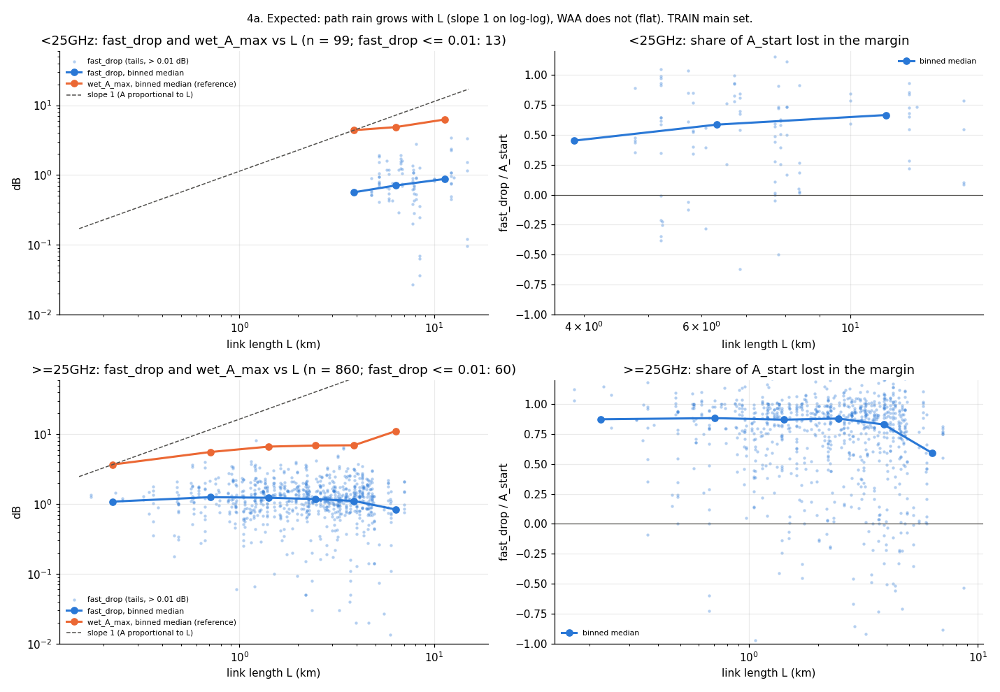
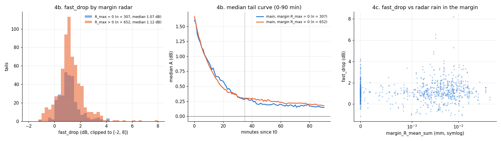
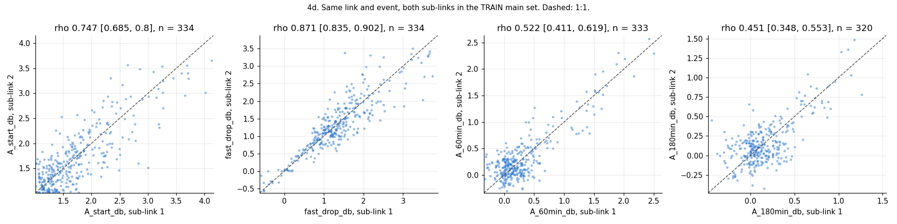
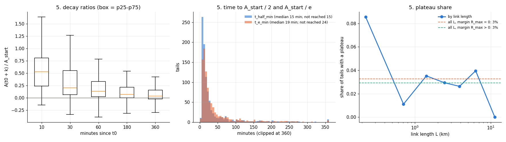
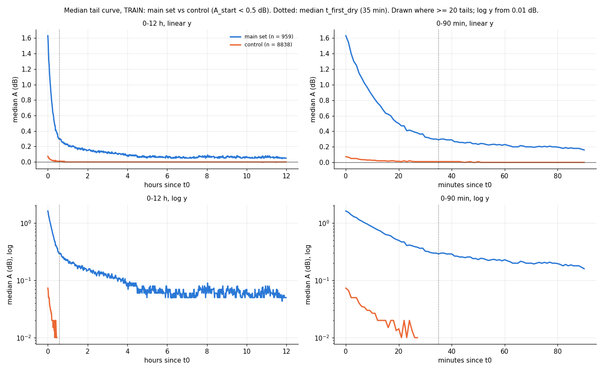
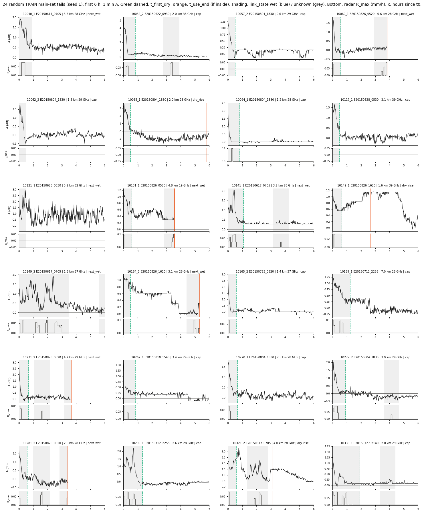

# wet_antenna step 2: clean / select tails, fast-drop test (TRAIN only)

Written by `research/wet_antenna/select_tails.py` (settings `wet_antenna.selection` in `research/config.yaml`, fixed
before the run). No fitting. No tail is kept or dropped by its shape. Every number below uses **TRAIN events only**.
The 4985 VAL tails carry the same columns in `research/wet_antenna/outputs/products/tails_selected.csv` but are not looked at here.
Run time 81 s.

## 1. Exclusions (pre-defined, non-shape)

TRAIN tails: 15370; excluded: 4023; kept: 11347. A tail can have several
reasons (`exclusion_reason`, `;`-separated). Tails per reason:

| index | train tails |
|---|---|
| wet_t0 | 642 |
| length_0 | 666 |
| A_start_nan | 30 |
| not_use_in_waa_main | 3421 |
| status_not_good | 1450 |
| nan_share_gt_max | 312 |

## 2. Truncation of the tail end

On the 11347 kept TRAIN tails: `truncated_by` = the rule that set
`t_use_end` (`tsl_step`: just before the first TSL jump; `dry_rise`: start of the first run of >= 30
min where the 15 min trailing median of A is >= 0.6 dB above its running minimum since
t_first_dry, dry minutes only; otherwise the step 1 `ended_by`). Tail time removed (`research/wet_antenna/outputs/tables/select_tails_truncation.csv`):

| truncated_by | tails | removed_min | median_removed_min | share_of_all_tail_time |
|---|---|---|---|---|
| cap | 6858 | 0 | 0.0 | 0.0 |
| dry_rise | 1249 | 395530 | 318.0 | 0.0551 |
| gap | 1 | 0 | 0.0 | 0.0 |
| next_wet | 3210 | 0 | 0.0 | 0.0 |
| tsl_step | 29 | 8997 | 254.0 | 0.0013 |

## 3. Main set

Main set = kept, A_start >= 1.0 dB, usable length >= 60 min.

| index | tails | sub-links | links | events |
|---|---|---|---|---|
| train tails | 15370 | 566 | 283 | 51 |
| not excluded | 11347 | 441 | 239 | 50 |
| main (A_start >= 1.0) | 959 | 373 | 210 | 33 |
| alternative (A_start >= 0.6) | 2076 | 431 | 237 | 40 |
| control (A_start < 0.5) | 8838 | 441 | 239 | 50 |

Main-set tails per sub-link: median 2, max 10 (373 sub-links); per link:
median 4, max 15. Per band (the sub-link's own frequency) x length class x
antenna diameters (smaller / larger end, m) (`research/wet_antenna/outputs/tables/select_tails_counts.csv`):

| band | length_class | antennas_m | tails | sublinks | links |
|---|---|---|---|---|---|
| <25GHz | >3km | 0.3/0.3 | 6 | 2 | 1 |
| <25GHz | >3km | 0.3/0.6 | 17 | 3 | 2 |
| <25GHz | >3km | 0.6/0.6 | 72 | 27 | 16 |
| <25GHz | >3km | 0.6/1.2 | 4 | 2 | 1 |
| >=25GHz | 1-3km | 0.2/0.3 | 6 | 2 | 1 |
| >=25GHz | 1-3km | 0.3/0.3 | 385 | 162 | 91 |
| >=25GHz | 1-3km | 0.3/0.6 | 6 | 1 | 1 |
| >=25GHz | <1km | 0.2/0.2 | 3 | 2 | 2 |
| >=25GHz | <1km | 0.3/0.3 | 122 | 57 | 33 |
| >=25GHz | >3km | 0.3/0.3 | 214 | 79 | 42 |
| >=25GHz | >3km | 0.3/0.6 | 88 | 25 | 13 |
| >=25GHz | >3km | 0.6/0.6 | 36 | 11 | 7 |

## 4. Fast-drop test: is the early drop WAA or missed path rain?

fast_drop = A_start - A_dry, A_dry = mean A over [t_first_dry, t_first_dry + 5 min) (NaN if that
window is not inside the usable tail). The margin (t0 .. t_first_dry) is the link_state `unknown` time: light rain
or rain within 30 min. **If the early drop is path rain**, fast_drop should grow with L (like wet_A_max, slope 1 on
log-log), with margin radar rain, and agree between the two sub-links only as much as rain does. **If it is WAA**, it should
not grow with L.

Distributions (main set):

| index | n | p10 | p25 | median | p75 | p90 |
|---|---|---|---|---|---|---|
| fast_drop_db | 959.0 | 0.11 | 0.72 | 1.11 | 1.57 | 2.23 |
| fast_drop_share | 959.0 | 0.08 | 0.55 | 0.83 | 0.96 | 1.03 |
| margin_minutes | 959.0 | 30.0 | 30.0 | 35.0 | 45.0 | 70.0 |

Spearman rho with 95 % CI from 1000 bootstrap resamples of LINKS (`research/wet_antenna/outputs/tables/select_tails_correlations.csv`):

| test | x | y | n | links | rho | ci_low | ci_high |
|---|---|---|---|---|---|---|---|
| 4a fast_drop vs L, <25GHz | L_km | fast_drop_db | 99 | 20 | 0.138 | -0.094 | 0.313 |
| 4a fast_drop / A_start vs L, <25GHz | L_km | fast_drop_share | 99 | 20 | 0.055 | -0.123 | 0.282 |
| 4a reference: wet_A_max vs L, <25GHz | L_km | wet_A_max_db | 99 | 20 | 0.195 | -0.075 | 0.356 |
| 4a reference: wet_A_max / L vs L, <25GHz | L_km | k | 99 | 20 | -0.157 | -0.422 | 0.092 |
| 4a fast_drop vs L, >=25GHz | L_km | fast_drop_db | 860 | 190 | -0.104 | -0.203 | -0.0 |
| 4a fast_drop / A_start vs L, >=25GHz | L_km | fast_drop_share | 860 | 190 | -0.127 | -0.235 | -0.016 |
| 4a reference: wet_A_max vs L, >=25GHz | L_km | wet_A_max_db | 860 | 190 | 0.132 | 0.038 | 0.216 |
| 4a reference: wet_A_max / L vs L, >=25GHz | L_km | k | 860 | 190 | -0.583 | -0.648 | -0.507 |
| 4c fast_drop vs margin_R_mean_sum | margin_R_mean_sum_mm | fast_drop_db | 959 | 210 | 0.102 | 0.024 | 0.178 |
| 4c fast_drop vs margin_R_max_max | margin_R_max_max_mmh | fast_drop_db | 959 | 210 | 0.077 | 0.004 | 0.152 |
| 4c fast_drop vs margin_min | margin_minutes | fast_drop_db | 959 | 210 | 0.031 | -0.045 | 0.107 |
| 4d sub-link 1 vs 2: A_start_db | A_start_db_1 | A_start_db_2 | 334 | 160 | 0.747 | 0.685 | 0.8 |
| 4d sub-link 1 vs 2: fast_drop_db | fast_drop_db_1 | fast_drop_db_2 | 334 | 160 | 0.871 | 0.835 | 0.902 |
| 4d sub-link 1 vs 2: A_60min_db | A_60min_db_1 | A_60min_db_2 | 333 | 159 | 0.522 | 0.411 | 0.619 |
| 4d sub-link 1 vs 2: A_180min_db | A_180min_db_1 | A_180min_db_2 | 320 | 156 | 0.451 | 0.348 | 0.553 |

**4a.** fast_drop and the reference wet_A_max vs L, per band:

**4b / 4c.** fast_drop by margin radar (R_max in the margin = 0 vs > 0):

| margin_rain | n | p10 | p25 | median | p75 | p90 |
|---|---|---|---|---|---|---|
| R_max = 0 | 307.0 | 0.26 | 0.69 | 1.07 | 1.46 | 2.1 |
| R_max > 0 | 652.0 | 0.05 | 0.73 | 1.12 | 1.65 | 2.28 |

**4d.** Sub-link 1 vs 2 of the same link and event (both in the main set): 334 pairs.

## 5. Shape descriptors (descriptive only; not used for selection)

A(t0 + k) = mean over [k, k + 5) min, inside the usable tail (NaN after t_use_end). Crossing times
on a 5 min trailing mean; NaN = not reached before t_use_end (censored, so the medians are lower
bounds). Plateau: a 45 min window with max - min <= 0.15 dB and min >
0.6 dB.

| index | n | p10 | p25 | median | p75 | p90 |
|---|---|---|---|---|---|---|
| ratio_10min | 959.0 | 0.08 | 0.24 | 0.53 | 0.81 | 1.02 |
| ratio_30min | 959.0 | -0.01 | 0.06 | 0.21 | 0.56 | 0.96 |
| ratio_60min | 958.0 | -0.03 | 0.03 | 0.13 | 0.33 | 0.76 |
| ratio_180min | 923.0 | -0.08 | -0.0 | 0.07 | 0.22 | 0.46 |
| ratio_360min | 672.0 | -0.13 | -0.02 | 0.04 | 0.16 | 0.29 |
| t_half_min | 944.0 | 7.0 | 9.0 | 15.0 | 29.0 | 76.7 |
| t_e_min | 935.0 | 8.0 | 11.0 | 19.0 | 41.0 | 103.0 |

Plateau tails: 29 of 959 (3%). By margin radar:
{'R_max = 0': '3%', 'R_max > 0': '3%'}. By link length:

| L_km | plateau share | tails |
|---|---|---|
| (0.1, 0.5] | 0.086 | 35 |
| (0.5, 1.0] | 0.011 | 90 |
| (1.0, 2.0] | 0.035 | 227 |
| (2.0, 3.0] | 0.029 | 170 |
| (3.0, 5.0] | 0.026 | 304 |
| (5.0, 8.0] | 0.04 | 101 |
| (8.0, 16.0] | 0.0 | 32 |

## 6. Median tail curve: main set vs control

Control = kept TRAIN tails with A_start < 0.5 dB (8838 tails). Usable part only.
Dotted line = median t_first_dry of the main set (35 min). `research/wet_antenna/outputs/tables/select_tails_median_curves.csv`.

## 7. Gallery for a manual check

## Unclear

1. **Rise start.** The `dry_rise` cut is at the first minute of the >= 30 min run in which
   the excess is >= 0.6 dB, so the cut comes after the rise began (by the time the median needs to climb
   0.6 dB). An earlier cut (where the excess first left ~0) would need another threshold.
2. **The rise is searched only on dry minutes from t_first_dry on.** A rise inside the margin, or during `unknown`
   minutes later on, is not cut.
3. **A_dry needs a dry bin inside the usable tail**: main-set tails with A_dry NaN: 0
   (t_first_dry after t_use_end or no valid A there). They have no fast_drop.
4. **Band** is the sub-link's own frequency here (< / >= 25 GHz), not the release's `frequency_band` (sub-link 1 of
   the link). Sub-links whose band differs from the release band: 0 train tails.
5. **wet_A_max is not a clean path-rain measure**: it spans the link's whole wet phase in the network event (several
   showers in multi-run events) and contains WAA itself. It is the reference curve only for the L scaling.
6. **Pairs (4d)** need both sub-links in the main set, so pairs where one direction has A_start < 1.0 dB
   are missing (selection on A_start of each direction).
7. **Crossing times and plateau** use the 1 min A, which still carries the 0.3 dB RSL quantization; a 0.15
   dB band is half a step.
8. **Light rain after t_first_dry stays in the tail.** No rule cuts `unknown` bins or 0 < R_max < 0.1 mm/h after the
   first dry bin (only a WET bin ends a tail). Main-set tails with R_max > 0 somewhere between t_first_dry and
   t_use_end: 466 of 959. Seen in the gallery (e.g. bumps of A
   inside grey shading after the green line).
9. **Negative A in the tail**: main-set tails whose A at t0 + 60 min is below -0.3 dB: 16
   (baseline too high for that event, or a level change); they stay in the set (no shape rule).
10. **Status** is the sub-link's quality status from `baselines.csv` (good / degraded); `use_in_waa_main` already
   drops degraded, so `status_not_good` adds nothing new here.
