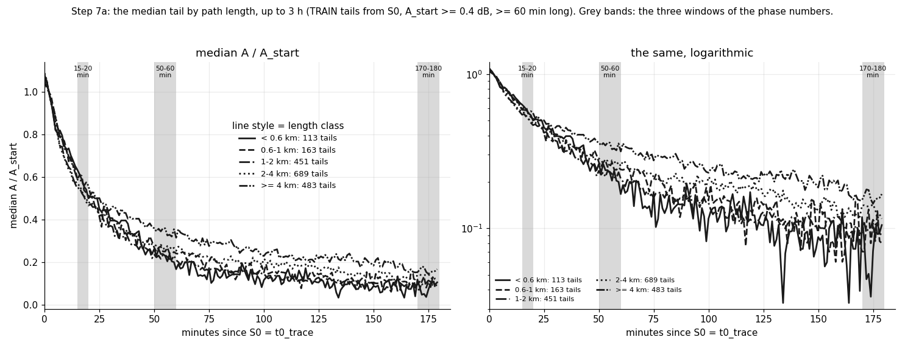
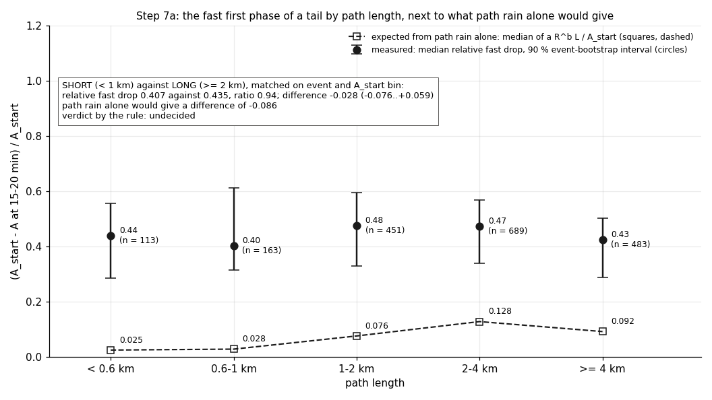
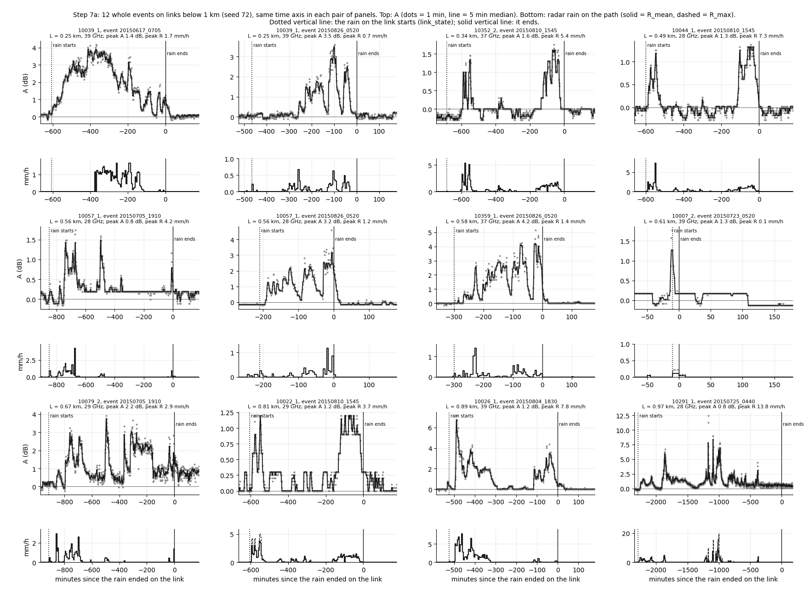

# wet_antenna step 7a: very short links. Enough data, and do they show the fast first phase? (TRAIN only, no law fit)

Written by `research/wet_antenna/short_links.py`. Settings and every rule: `wet_antenna.short_links` in
`research/config.yaml`, written before the run. Why this step: `docs/ROADMAP.md` (Q2, Steps 7 and 7a).

## 1. What was run

- TRAIN links and TRAIN events only; VAL is never read (VAL rows are dropped when a file is read; in part 3 the minutes
  inside an event that is not TRAIN are blanked). No law is fitted. Nothing earlier is changed.
- Part 1: inventory per length class from the release (links, sub-links, link_state, radar on the path) and
  `baselines.csv`, with the pairs of `research/wet_antenna/outputs/products/tails_starts.csv` (the 10270 TRAIN pairs that pass the v1 exclusions).
- Part 2: the 1899 tails of those pairs with start S0 (t0_trace), the v1 end rules, A_start (mean of the first 5 min)
  >= 0.4 dB and a usable length >= 60 min (38 events, 222 links), followed for up to 180 min.
- Part 3: the 1663 pairs on the 41 links below 1 km, from 60 min before the rain on the link to 180 min after it.
- Timing: 0.7 ms per pair on the first 200 pairs; projection 1.6 min against a budget of 45 min.
  Cut: nothing. Run time: 21 s.
- Checks: A_start computed here equals `tails_starts.csv` (largest difference 3.5e-05 dB); A(t) built from the 1 min
  store in part 3 equals the A of the tails on three short tails.

## 2. Part 0: what was recorded

Before the analysis, in `docs/ROADMAP.md`: the paper Tiede, Chwala, Siart & Eibert 2025 (Adv. Radio Sci. 23, 13-19)
with its findings and why its method cannot be used here (section "Literature used for the method"); "tails up to
3-6 h, two phases" under Steps 7 and 4d; "frequency band explicitly" under Step 6; the status row 7a.

## 3. Part 1: inventory

Rows = quantities, columns = length classes; the last two columns are the two candidate cuts for Step 7.
"Rain on the link" = a wet bin of link_state inside a TRAIN event.

|  | < 0.6 km | 0.6-1 km | 1-2 km | 2-4 km | >= 4 km | CUT < 0.6 km | CUT < 1 km |
|---|---|---|---|---|---|---|---|
| links | 25 | 27 | 75 | 94 | 64 | 25 | 52 |
| sub_links | 50 | 54 | 150 | 188 | 128 | 50 | 104 |
| sub_links_good | 42 | 48 | 136 | 174 | 113 | 42 | 90 |
| sub_links_use_in_waa_main | 31 | 40 | 113 | 156 | 101 | 31 | 71 |
| bands (sub-links) | 28 GHz: 12, 38 GHz: 38 | 28 GHz: 26, 38 GHz: 28 | 28 GHz: 64, 32 GHz: 20, 38 GHz: 66 | 28 GHz: 110, 32 GHz: 20, 38 GHz: 58 | <25 GHz: 52, 28 GHz: 58, 32 GHz: 12, 38 GHz: 6 | 28 GHz: 12, 38 GHz: 38 | 28 GHz: 38, 38 GHz: 66 |
| polarization (sub-links) | v: 50 | v: 54 | v: 150 | h: 4, v: 184 | h: 2, v: 126 | v: 50 | v: 104 |
| train_events_with_rain | 42 | 45 | 51 | 53 | 53 | 42 | 48 |
| link_events_with_rain | 661 | 721 | 1982 | 2638 | 1919 | 661 | 1382 |
| events_with_rain_per_link_median | 26.0 | 26.0 | 26.0 | 28.0 | 30.0 | 26.0 | 26.0 |
| wet_minutes_total | 175700 | 196685 | 542120 | 745195 | 576995 | 175700 | 372385 |
| wet_minutes_per_link_median | 7030.0 | 7295.0 | 7270.0 | 8032.5 | 8940.0 | 7030.0 | 7230.0 |
| radar_R_mean_in_rain_median_mmh | 0.49 | 0.46 | 0.46 | 0.4 | 0.32 | 0.49 | 0.47 |
| radar_R_mean_in_rain_p90_mmh | 3.53 | 3.51 | 3.52 | 3.2 | 2.87 | 3.53 | 3.52 |
| pairs_with_baseline_and_rain | 1282 | 1362 | 3870 | 5112 | 3744 | 1282 | 2644 |
| pairs_pass_v1_exclusions | 685 | 978 | 2553 | 3929 | 2125 | 685 | 1663 |
| links_in_those_pairs | 18 | 23 | 58 | 79 | 45 | 18 | 41 |
| events_in_those_pairs | 37 | 38 | 47 | 50 | 50 | 37 | 41 |
| tails_v1_main | 30 | 35 | 114 | 140 | 110 | 30 | 65 |
| tails_0.6dB_set_S0 | 66 | 98 | 283 | 406 | 302 | 66 | 164 |
| tails_0.4dB_60min | 113 | 163 | 451 | 689 | 483 | 113 | 276 |

(`research/wet_antenna/outputs/tables/short_links_p1_inventory.csv`.) Tails per length class and frequency band, so that length and frequency are not confused
(`research/wet_antenna/outputs/tables/short_links_p1_length_by_band.csv`):

| tail_set | length | <25 GHz | 28 GHz | 32 GHz | 38 GHz |
|---|---|---|---|---|---|
| v1 main set (1 dB) | < 0.6 km | 0 | 16 | 0 | 14 |
| v1 main set (1 dB) | 0.6-1 km | 0 | 27 | 0 | 8 |
| v1 main set (1 dB) | 1-2 km | 0 | 59 | 8 | 47 |
| v1 main set (1 dB) | 2-4 km | 0 | 81 | 12 | 47 |
| v1 main set (1 dB) | >= 4 km | 33 | 67 | 9 | 1 |
| 0.6 dB set (S0) | < 0.6 km | 0 | 24 | 0 | 42 |
| 0.6 dB set (S0) | 0.6-1 km | 0 | 64 | 0 | 34 |
| 0.6 dB set (S0) | 1-2 km | 0 | 132 | 25 | 126 |
| 0.6 dB set (S0) | 2-4 km | 0 | 256 | 23 | 127 |
| 0.6 dB set (S0) | >= 4 km | 109 | 158 | 28 | 7 |
| 0.4 dB, >= 60 min (part 2) | < 0.6 km | 0 | 39 | 0 | 74 |
| 0.4 dB, >= 60 min (part 2) | 0.6-1 km | 0 | 107 | 0 | 56 |
| 0.4 dB, >= 60 min (part 2) | 1-2 km | 0 | 215 | 43 | 193 |
| 0.4 dB, >= 60 min (part 2) | 2-4 km | 0 | 430 | 51 | 208 |
| 0.4 dB, >= 60 min (part 2) | >= 4 km | 189 | 237 | 49 | 8 |
| all pairs that pass the v1 exclusions | < 0.6 km | 0 | 256 | 0 | 429 |
| all pairs that pass the v1 exclusions | 0.6-1 km | 0 | 521 | 0 | 457 |
| all pairs that pass the v1 exclusions | 1-2 km | 0 | 1203 | 357 | 993 |
| all pairs that pass the v1 exclusions | 2-4 km | 0 | 2429 | 354 | 1146 |
| all pairs that pass the v1 exclusions | >= 4 km | 829 | 1057 | 211 | 28 |

**Enough for Step 7?** Rule (written first): at least 10 links, 20 events and 200 pairs that pass the v1
exclusions (`research/wet_antenna/outputs/tables/short_links_p1_enough.csv`):

| length | links_in_those_pairs | events_in_those_pairs | pairs_pass_v1_exclusions | link_events_with_rain | tails_0.4dB_60min | enough |
|---|---|---|---|---|---|---|
| CUT < 0.6 km | 18 | 37 | 685 | 661 | 113 | True |
| CUT < 1 km | 41 | 41 | 1663 | 1382 | 276 | True |

**By the rule there is enough below 0.6 km.**

## 4. Part 2: the two phases by length

Per tail: fast-phase drop = A_start - mean A over minutes 15-20; relative fast drop = that / A_start; slow ratio =
mean A over 50-60 min / mean A over 15-20 min; late ratio = mean A over 170-180 min / the same (tails that
last). A ratio of one tail needs A at 15-20 min >= 0.15 dB; the pooled ratio (sum / sum) uses every tail.
Expected path rain = L x mean of a R_mean^b over the 30 min before S0 (ITU-R P.838-3).

|  | < 0.6 km | 0.6-1 km | 1-2 km | 2-4 km | >= 4 km |
|---|---|---|---|---|---|
| tails | 113 | 163 | 451 | 689 | 483 |
| events | 22 | 24 | 29 | 35 | 36 |
| links | 18 | 23 | 57 | 79 | 45 |
| median_A_start_db | 0.67 | 0.65 | 0.68 | 0.65 | 0.703 |
| A_over_A_start_5min | 0.789 | 0.81 | 0.778 | 0.756 | 0.803 |
| A_over_A_start_10min | 0.701 | 0.704 | 0.619 | 0.615 | 0.692 |
| A_over_A_start_20min | 0.492 | 0.507 | 0.462 | 0.463 | 0.527 |
| A_over_A_start_30min | 0.396 | 0.36 | 0.342 | 0.395 | 0.446 |
| A_over_A_start_60min | 0.167 | 0.223 | 0.195 | 0.257 | 0.335 |
| A_over_A_start_120min | 0.119 | 0.153 | 0.109 | 0.183 | 0.211 |
| A_over_A_start_180min | 0.095 | 0.119 | 0.094 | 0.132 | 0.157 |
| tails_at_120min | 99 | 150 | 393 | 561 | 392 |
| tails_at_180min | 94 | 148 | 373 | 517 | 359 |
| fast_drop_db_median | 0.27 | 0.3 | 0.3 | 0.297 | 0.28 |
| rel_fast_drop_median | 0.437 | 0.401 | 0.476 | 0.474 | 0.425 |
| rel_fast_drop_lo | 0.285 | 0.314 | 0.328 | 0.34 | 0.288 |
| rel_fast_drop_hi | 0.557 | 0.611 | 0.595 | 0.568 | 0.501 |
| slow_ratio_median | 0.493 | 0.558 | 0.507 | 0.61 | 0.668 |
| slow_ratio_tails | 92 | 136 | 358 | 553 | 410 |
| slow_ratio_pooled | 0.483 | 0.507 | 0.484 | 0.548 | 0.636 |
| late_ratio_median | 0.246 | 0.255 | 0.248 | 0.296 | 0.328 |
| late_ratio_tails | 78 | 125 | 293 | 424 | 318 |
| late_ratio_pooled | 0.295 | 0.273 | 0.289 | 0.3 | 0.324 |
| share_decays | 0.558 | 0.534 | 0.557 | 0.557 | 0.518 |
| share_plateau-then-decays | 0.115 | 0.11 | 0.14 | 0.11 | 0.128 |
| share_rises | 0.053 | 0.043 | 0.033 | 0.051 | 0.075 |
| share_flat / slow | 0.274 | 0.313 | 0.271 | 0.282 | 0.28 |
| exp_path_db_median | 0.019 | 0.023 | 0.054 | 0.083 | 0.07 |
| exp_path_rel_median | 0.025 | 0.028 | 0.076 | 0.128 | 0.092 |
| radar_R_mean_before_median_mmh | 0.144 | 0.08 | 0.123 | 0.094 | 0.073 |
| median_L_km | 0.459 | 0.793 | 1.388 | 2.89 | 4.874 |

(`research/wet_antenna/outputs/tables/short_links_p2_by_length.csv`; per tail: `research/wet_antenna/outputs/tables/short_links_p2_per_tail.csv`; curves: `research/wet_antenna/outputs/tables/short_links_p2_median_curves.csv`.)

### SHORT against LONG, matched

SHORT = L < 1 km, LONG = L >= 2 km. Inside a stratum every LONG tail is weighted so that both groups have the
same distribution over the strata; the value of a group is its weighted median; 1000 event bootstraps, 90 % interval
of the difference SHORT - LONG. The rule is read on "event and A_start bin" if it keeps at least 50% of the SHORT
tails (and 30), else on "A_start bin".

| group | band | matching | quantity | short_tails | long_tails | short_used | long_used | SHORT | LONG | difference | diff_lo | diff_hi | ratio |
|---|---|---|---|---|---|---|---|---|---|---|---|---|---|
| SHORT < 1 km | all bands | event and A_start bin | relative fast drop | 276 | 1172 | 274 | 986 | 0.407 | 0.435 | -0.028 | -0.076 | 0.059 | 0.936 |
| SHORT < 1 km | all bands | event and A_start bin | fast drop (dB) | 276 | 1172 | 274 | 986 | 0.283 | 0.29 | -0.007 | -0.05 | 0.057 | 0.977 |
| SHORT < 1 km | all bands | event and A_start bin | expected path rain / A_start | 276 | 1172 | 274 | 986 | 0.027 | 0.114 | -0.086 | -0.13 | -0.053 | 0.241 |
| SHORT < 1 km | all bands | event and A_start bin | expected path rain (dB) | 276 | 1172 | 274 | 986 | 0.02 | 0.078 | -0.058 | -0.095 | -0.044 | 0.257 |
| SHORT < 1 km | all bands | A_start bin | relative fast drop | 276 | 1172 | 276 | 1172 | 0.407 | 0.449 | -0.041 | -0.09 | 0.062 | 0.908 |
| SHORT < 1 km | all bands | A_start bin | fast drop (dB) | 276 | 1172 | 276 | 1172 | 0.283 | 0.3 | -0.017 | -0.057 | 0.05 | 0.944 |
| SHORT < 1 km | all bands | A_start bin | expected path rain / A_start | 276 | 1172 | 276 | 1172 | 0.027 | 0.109 | -0.082 | -0.122 | -0.052 | 0.249 |
| SHORT < 1 km | all bands | A_start bin | expected path rain (dB) | 276 | 1172 | 276 | 1172 | 0.02 | 0.077 | -0.057 | -0.087 | -0.041 | 0.26 |
| VERY SHORT < 0.6 km | all bands | event and A_start bin | relative fast drop | 113 | 1172 | 112 | 726 | 0.437 | 0.433 | 0.004 | -0.088 | 0.069 | 1.01 |
| VERY SHORT < 0.6 km | all bands | event and A_start bin | fast drop (dB) | 113 | 1172 | 112 | 726 | 0.27 | 0.285 | -0.015 | -0.067 | 0.043 | 0.947 |
| VERY SHORT < 0.6 km | all bands | event and A_start bin | expected path rain / A_start | 113 | 1172 | 112 | 726 | 0.025 | 0.129 | -0.104 | -0.146 | -0.045 | 0.19 |
| VERY SHORT < 0.6 km | all bands | event and A_start bin | expected path rain (dB) | 113 | 1172 | 112 | 726 | 0.019 | 0.086 | -0.068 | -0.11 | -0.036 | 0.215 |
| VERY SHORT < 0.6 km | all bands | A_start bin | relative fast drop | 113 | 1172 | 113 | 1168 | 0.437 | 0.448 | -0.01 | -0.12 | 0.069 | 0.977 |
| VERY SHORT < 0.6 km | all bands | A_start bin | fast drop (dB) | 113 | 1172 | 113 | 1168 | 0.27 | 0.3 | -0.03 | -0.09 | 0.04 | 0.9 |
| VERY SHORT < 0.6 km | all bands | A_start bin | expected path rain / A_start | 113 | 1172 | 113 | 1168 | 0.025 | 0.108 | -0.083 | -0.123 | -0.046 | 0.228 |
| VERY SHORT < 0.6 km | all bands | A_start bin | expected path rain (dB) | 113 | 1172 | 113 | 1168 | 0.019 | 0.076 | -0.057 | -0.088 | -0.04 | 0.247 |

Bands of the two groups (share of the tails): <25 GHz: SHORT 0%, LONG 16%; 28 GHz: SHORT 53%, LONG 57%; 32 GHz: SHORT 0%, LONG 9%; 38 GHz: SHORT 47%, LONG 18%.
Unevenly spread by the rule (a share differs by more than 15%): **yes**. The relative fast drop inside each band
with at least 20 tails in both groups:

| group | band | matching | quantity | short_tails | long_tails | short_used | long_used | SHORT | LONG | difference | diff_lo | diff_hi | ratio |
|---|---|---|---|---|---|---|---|---|---|---|---|---|---|
| SHORT < 1 km | 28 GHz | event and A_start bin | relative fast drop | 146 | 667 | 143 | 478 | 0.395 | 0.468 | -0.073 | -0.133 | 0.05 | 0.844 |
| SHORT < 1 km | 28 GHz | A_start bin | relative fast drop | 146 | 667 | 146 | 667 | 0.385 | 0.467 | -0.082 | -0.149 | 0.048 | 0.824 |
| SHORT < 1 km | 38 GHz | event and A_start bin | relative fast drop | 130 | 216 | 122 | 167 | 0.426 | 0.42 | 0.006 | -0.113 | 0.136 | 1.013 |
| SHORT < 1 km | 38 GHz | A_start bin | relative fast drop | 130 | 216 | 130 | 212 | 0.456 | 0.502 | -0.046 | -0.171 | 0.121 | 0.909 |
| VERY SHORT < 0.6 km | 28 GHz | event and A_start bin | relative fast drop | 39 | 667 | 37 | 222 | 0.441 | 0.456 | -0.015 | -0.35 | 0.185 | 0.967 |
| VERY SHORT < 0.6 km | 28 GHz | A_start bin | relative fast drop | 39 | 667 | 39 | 664 | 0.371 | 0.473 | -0.103 | -0.387 | 0.129 | 0.783 |
| VERY SHORT < 0.6 km | 38 GHz | event and A_start bin | relative fast drop | 74 | 216 | 69 | 121 | 0.456 | 0.483 | -0.027 | -0.163 | 0.114 | 0.944 |
| VERY SHORT < 0.6 km | 38 GHz | A_start bin | relative fast drop | 74 | 216 | 74 | 212 | 0.437 | 0.502 | -0.065 | -0.194 | 0.129 | 0.872 |

(`research/wet_antenna/outputs/tables/short_links_p2_matched.csv`.)

### The rule

- "fast phase = antenna" if the matched relative fast drop of SHORT is >= 0.7 x that of LONG AND the interval of the
  difference is narrower than 0.5 x the difference path rain alone would give (power);
- "fast phase = path rain" if the SHORT drop is <= 0.4 x the LONG one;
- otherwise, or if the power condition fails, "undecided".

| group | band | matching_used | short_used | long_used | r_SHORT | r_LONG | ratio | ratio_lo | ratio_hi | difference | diff_lo | diff_hi | interval_width | expected_path_difference | power_needs_width_below | power | verdict |
|---|---|---|---|---|---|---|---|---|---|---|---|---|---|---|---|---|---|
| SHORT < 1 km | all bands | event and A_start bin | 274 | 986 | 0.407 | 0.435 | 0.936 | 0.835 | 1.153 | -0.028 | -0.076 | 0.059 | 0.136 | -0.086 | 0.043 | False | undecided |
| SHORT < 1 km | 28 GHz | event and A_start bin | 143 | 478 | 0.395 | 0.468 | 0.844 | 0.69 | 1.089 | -0.073 | -0.133 | 0.05 | 0.183 | -0.079 | 0.04 | False | undecided |
| SHORT < 1 km | 38 GHz | event and A_start bin | 122 | 167 | 0.426 | 0.42 | 1.013 | 0.772 | 1.415 | 0.006 | -0.113 | 0.136 | 0.248 | -0.127 | 0.064 | False | undecided |
| VERY SHORT < 0.6 km | all bands | event and A_start bin | 112 | 726 | 0.437 | 0.433 | 1.01 | 0.782 | 1.162 | 0.004 | -0.088 | 0.069 | 0.157 | -0.104 | 0.052 | False | undecided |
| VERY SHORT < 0.6 km | 28 GHz | event and A_start bin | 37 | 222 | 0.441 | 0.456 | 0.967 | 0.111 | 1.351 | -0.015 | -0.35 | 0.185 | 0.535 | -0.075 | 0.037 | False | undecided |
| VERY SHORT < 0.6 km | 38 GHz | event and A_start bin | 69 | 121 | 0.456 | 0.483 | 0.944 | 0.696 | 1.294 | -0.027 | -0.163 | 0.114 | 0.277 | -0.13 | 0.065 | False | undecided |

(`research/wet_antenna/outputs/tables/short_links_p2_verdict.csv`.) The first row is the rule; the other rows are the same rule on the sub-groups, for information.

**Verdict by the rule: UNDECIDED** (the SHORT drop is 0.94 x the LONG one (>= 0.7), but the power condition fails: the interval of the difference is 0.136 wide, and it must be below 0.043 (half the expected path-rain difference of -0.086)).

### The slow phase (information, no rule)

| group | band | matching | quantity | short_tails | long_tails | short_used | long_used | SHORT | LONG | difference | diff_lo | diff_hi | ratio |
|---|---|---|---|---|---|---|---|---|---|---|---|---|---|
| SHORT < 1 km | all bands | event and A_start bin | slow ratio (50-60 / 15-20 min) | 228 | 963 | 226 | 787 | 0.527 | 0.628 | -0.101 | -0.179 | 0.052 | 0.839 |
| SHORT < 1 km | all bands | event and A_start bin | late ratio (170-180 / 15-20 min) | 203 | 742 | 195 | 580 | 0.239 | 0.286 | -0.047 | -0.127 | 0.079 | 0.837 |
| SHORT < 1 km | 28 GHz | event and A_start bin | slow ratio (50-60 / 15-20 min) | 123 | 548 | 118 | 377 | 0.618 | 0.656 | -0.038 | -0.144 | 0.136 | 0.942 |
| SHORT < 1 km | 28 GHz | event and A_start bin | late ratio (170-180 / 15-20 min) | 108 | 407 | 96 | 265 | 0.219 | 0.241 | -0.021 | -0.126 | 0.147 | 0.911 |
| SHORT < 1 km | 38 GHz | event and A_start bin | slow ratio (50-60 / 15-20 min) | 105 | 170 | 94 | 118 | 0.403 | 0.575 | -0.172 | -0.282 | -0.022 | 0.701 |
| SHORT < 1 km | 38 GHz | event and A_start bin | late ratio (170-180 / 15-20 min) | 95 | 138 | 80 | 84 | 0.25 | 0.324 | -0.074 | -0.281 | 0.102 | 0.771 |
| VERY SHORT < 0.6 km | all bands | event and A_start bin | slow ratio (50-60 / 15-20 min) | 92 | 963 | 91 | 568 | 0.487 | 0.64 | -0.153 | -0.251 | 0.062 | 0.76 |
| VERY SHORT < 0.6 km | all bands | event and A_start bin | late ratio (170-180 / 15-20 min) | 78 | 742 | 74 | 388 | 0.194 | 0.309 | -0.115 | -0.247 | 0.092 | 0.627 |
| VERY SHORT < 0.6 km | 28 GHz | event and A_start bin | slow ratio (50-60 / 15-20 min) | 33 | 548 | 29 | 141 | 0.717 | 0.68 | 0.037 | -0.273 | 0.148 | 1.055 |
| VERY SHORT < 0.6 km | 28 GHz | event and A_start bin | late ratio (170-180 / 15-20 min) | 27 | 407 | 19 | 92 | 0.125 | 0.241 | -0.116 | -0.566 | 0.129 | 0.519 |
| VERY SHORT < 0.6 km | 38 GHz | event and A_start bin | slow ratio (50-60 / 15-20 min) | 59 | 170 | 52 | 92 | 0.403 | 0.576 | -0.173 | -0.315 | 0.062 | 0.7 |
| VERY SHORT < 0.6 km | 38 GHz | event and A_start bin | late ratio (170-180 / 15-20 min) | 51 | 138 | 41 | 62 | 0.165 | 0.331 | -0.166 | -0.399 | 0.083 | 0.498 |

## 5. Part 3: whole events on the links below 1 km (descriptive)

One row per pair: `research/wet_antenna/outputs/tables/short_links_p3_per_event.csv`. Minute 0 = the end of the rain on the link (t0 of link_state). A is read on
its centred 5 min median.

**Peak of A during the rain against the peak of the radar rain** (1663 pairs with radar rain; Spearman of the peak A with the
peak R +0.85; of the peak A minus the expected path attenuation +0.73). Expected path = a R_peak^b L (ITU-R
P.838-3), shown only as a reference:

| R_bin | pairs | events | links | R_peak_median_mmh | A_peak_median_db | A_peak_p90_db | A_peak_max_db | expected_path_median_db | A_peak_minus_path_median_db | A_peak_minus_path_p90_db |
|---|---|---|---|---|---|---|---|---|---|---|
| [0.0, 0.1) | 115 | 19 | 25 | 0.0 | 0.05 | 1.48 | 2.2 | 0.0 | 0.04 | 1.48 |
| [0.1, 0.5) | 298 | 15 | 41 | 0.2 | 0.07 | 0.85 | 1.99 | 0.04 | 0.01 | 0.79 |
| [0.5, 1.0) | 165 | 8 | 41 | 0.76 | 0.8 | 3.52 | 5.4 | 0.14 | 0.67 | 3.31 |
| [1.0, 2.0) | 236 | 12 | 41 | 1.32 | 1.23 | 5.18 | 9.49 | 0.23 | 0.98 | 4.74 |
| [2.0, 5.0) | 207 | 8 | 41 | 2.94 | 1.89 | 4.01 | 10.48 | 0.46 | 1.42 | 3.51 |
| [5.0, 10.0) | 201 | 11 | 41 | 6.61 | 3.3 | 7.94 | 16.05 | 0.98 | 2.19 | 6.49 |
| [10.0, inf) | 441 | 10 | 41 | 17.35 | 6.9 | 12.8 | 21.7 | 2.32 | 4.41 | 9.11 |

(`research/wet_antenna/outputs/tables/short_links_p3_peak_vs_rain.csv`.)

**Timing and drying, on the last shower** (pairs with a peak of A >= 0.6 dB; `research/wet_antenna/outputs/tables/short_links_p3_by_band.csv`). The rain on a link in
one event is often several showers over many hours (median 535 min from the first to the last wet bin), so the times
are measured on the LAST shower = the wet bins of link_state at the end of the rain (gaps up to 30 min bridged).
The peak is searched from the start of that shower to 180 min after its end; "half" = the first minute after the
peak below 0.5 x the peak (not halved within 3 h counts as later than everything); negative = before the rain ended:

| split | group | pairs | events | links | last_shower_minutes_median | last_shower_R_peak_median_mmh | A_peak_median_db | peak_min_after_rain_end_median | share_peak_after_rain_end | share_halved_within_3h | half_min_after_rain_end_median | half_min_after_peak_median | A_over_peak_0min_median | A_over_peak_30min_median | A_over_peak_60min_median | A_over_peak_120min_median | A_over_peak_180min_median |
|---|---|---|---|---|---|---|---|---|---|---|---|---|---|---|---|---|---|
| all | all short links | 792 | 26 | 41 | 85.0 | 0.97 | 1.6 | -32.0 | 0.05 | 0.99 | -11.0 | 11.0 | 0.19 | 0.04 | 0.02 | 0.01 | 0.0 |
| band | 28 GHz | 355 | 25 | 17 | 80.0 | 1.09 | 1.55 | -32.0 | 0.07 | 0.98 | -10.0 | 12.0 | 0.23 | 0.04 | 0.02 | 0.01 | 0.01 |
| band | 38 GHz | 437 | 22 | 24 | 90.0 | 0.91 | 1.62 | -32.0 | 0.04 | 1.0 | -11.0 | 11.0 | 0.17 | 0.04 | 0.02 | 0.01 | 0.0 |
| lc | < 0.6 km | 331 | 25 | 18 | 90.0 | 0.97 | 1.61 | -32.0 | 0.05 | 0.99 | -12.0 | 11.0 | 0.17 | 0.03 | 0.01 | 0.01 | 0.0 |
| lc | 0.6-1 km | 461 | 24 | 23 | 80.0 | 0.97 | 1.6 | -32.0 | 0.06 | 0.99 | -10.0 | 11.0 | 0.2 | 0.04 | 0.03 | 0.01 | 0.0 |

**Does A rise before the radar shows rain?** t_r = the first radar trace (R_max > 0) on the path. Early rise = A at
least 0.3 dB above its level of 60-30 min before t_r, for 5 min in a row, starting 30-5 min before t_r; only pairs
with no radar trace in the hour before t_r. Placebo = the same test 60 min earlier (its share is the false-alarm rate):

| group | pairs | tested | early_rise | share_early_rise | median_lead_min | placebo_tested | placebo_early | share_placebo_early | events_tested | events_with_early_rise |
|---|---|---|---|---|---|---|---|---|---|---|
| all short links | 1663 | 1531 | 65 | 0.042 | 16.0 | 1380 | 20 | 0.014 | 30 | 20 |
| < 0.6 km | 685 | 642 | 32 | 0.05 | 16.0 | 593 | 8 | 0.013 | 29 | 13 |
| 0.6-1 km | 978 | 889 | 33 | 0.037 | 18.0 | 787 | 12 | 0.015 | 29 | 15 |
| 28 GHz | 777 | 710 | 31 | 0.044 | 16.0 | 628 | 12 | 0.019 | 29 | 15 |
| 38 GHz | 886 | 821 | 34 | 0.041 | 16.0 | 752 | 8 | 0.011 | 29 | 15 |

(`research/wet_antenna/outputs/tables/short_links_p3_rise_before_rain.csv`.)

## 6. In plain words

- **Is the fast phase the antenna? By the rule: undecided.** The first half of the "antenna" rule is met (the SHORT drop is
  0.94 x the LONG one, rule >= 0.7); the power condition is not: the interval of the difference is 0.136 wide and
  had to be below 0.043. So no verdict is claimed.
- **What the numbers show all the same: the fast drop does not grow with the path length.** Median fast drop by
  length class (< 0.6 km, 0.6-1 km, 1-2 km, 2-4 km, >= 4 km): 0.27 / 0.30 / 0.30 / 0.30 / 0.28 dB; relative: 0.44 / 0.40 / 0.48 / 0.47 / 0.43; the median
  path length goes from 0.46 to 4.87 km. Matched (same event, same A_start bin) SHORT against LONG:
  0.407 against 0.435, ratio 0.94 (0.84..1.15), in dB 0.28 against 0.29. Below 0.6 km alone the ratio is 1.01 (0.78..1.16; 112 tails).
  A fast phase made of path rain would scale with L: the SHORT links are 0.18 x as long as the LONG ones (medians), and
  the radar-expected path attenuation is 0.26 x. The whole interval of the ratio lies above the "path rain" limit of
  0.4. This is the test with contrast in L that steps 2, 4c and 4c2 could not make, and it speaks for the antenna
  (or for anything else that does not scale with L). It is my reading; the pre-set rule says undecided.
- **Why the rule has no power.** The power condition measures the interval against the path rain the RADAR saw in the
  30 min before the tail: 0.02 dB on SHORT and 0.08 dB on LONG tails (3% and 11% of A_start). That rain is so
  light that it predicts a difference of only -0.086 in the relative fast drop; the data cannot resolve half of that.
  The same numbers say something else: the measured fast drop (0.29 dB) is 4 times the radar-expected path rain
  on LONG tails and 14 times on SHORT ones. So the fast phase is not the rain the radar saw. Rain the radar
  does not see would have to give the same dB on a 0.5 km and on a 4.9 km path.
- **The slow phase is what differs with length, weakly.** Slow ratio (A at 50-60 min / A at 15-20 min), matched:
  SHORT 0.53 against LONG 0.63 (-0.10, -0.18..+0.05; the interval holds 0). Inside the bands: 28 GHz: 0.62 against 0.66 (-0.04, -0.14..+0.14); 38 GHz: 0.40 against 0.58 (-0.17, -0.28..-0.02).
  Median A / A_start at 60 min by length: 0.17 / 0.22 / 0.20 / 0.26 / 0.34. Long links keep more of their level after the first
  20 min. That could be light rain on or near a long path, the lower frequencies of the longest links, or chance.
- **Up to 3 h.** Median A / A_start at 120 and 180 min: 0.12 / 0.15 / 0.11 / 0.18 / 0.21 and 0.10 / 0.12 / 0.09 / 0.13 / 0.16. From 15-20 min to
  50-60 min A falls to about half (about 56 min half-life on LONG, 41 on SHORT, if exponential); from there to 170-180 min it only halves once
  more (late ratio 0.24 and 0.29). So the slow phase is not one exponential either: it slows down again, or it ends on a
  floor. The level at 3 h is about 0.08 dB, the size of the baseline uncertainty of a sub-link, so the stretch
  after about 1-2 h says more about the baseline than about water.
- **Enough data for Step 7?** By the rule there is enough below 0.6 km. Below 0.6 km: 18 links, 37 events, 685 pairs
  (661 link-events with rain), but only 113 tails above 0.4 dB and two bands (28 GHz: 12, 38 GHz: 38 sub-links).
  Below 1 km: 41 links, 1663 pairs, 276 tails. The two short classes behave alike in part 2.
  Suggestion: below 0.6 km as the main set and below 1 km as the larger sensitivity set, L as an input. For the learners.
- **What Step 7 needs, from the first look at whole events.**
  - *Events*: the rain on a link in one event is several showers over 9 h (median). Between showers A often goes back
    to about 0 (gallery), also while the radar still shows light rain. The model must run through such events.
  - *Two time scales*: on the last shower A peaks 32 min BEFORE link_state ends the rain and is at half the peak
    11 min after the peak; when the rain "ends", A is at 19% of the peak, 30 min later at 4%. Most of the
    fall happens while the rain fades, so it cannot be read off without the rain as input. The slow phase of part 2
    (tens of minutes to hours, a few tenths of a dB) comes after that.
  - *Saturation*: no level A_max is visible. The median peak A grows with the peak radar rain in every bin, up to
    6.9 dB at 17 mm/h; minus the expected path attenuation still 4.4 dB. But on these links the expected path
    part in heavy rain is 2.3 dB (not small), and the radar (2 km, 5 min) underestimates a local peak. Step 7 must
    either model the path term also on short links or stay with light and moderate rain, as the roadmap says.
  - *Wetting before rain*: rare. A rises before the first radar trace in 4.2% of the tested pairs (65 of 1531),
    against 1.4% for the placebo an hour earlier. It is not a general feature; single cases exist (gallery:
    10039_1 in E20150617_0705 climbs to 2-4 dB hours before the radar shows rain on the path).
  - *Frequency*: only two bands exist below 1 km (28 and 38 GHz; none at 23 or 32 GHz). After the last shower they look
    alike (half 12 and 11 min after the peak; 23% and 17% of the peak at the end of the rain). In the
    slow phase of part 2 the SHORT tails at 38 GHz fall further than at 28 GHz (0.40 against 0.62), so the band
    should be an input of Step 7.

## 7. Unclear / possibly wrong

1. **The power condition of the rule.** I read "half the expected path-rain difference" as half of E = the matched
   (radar-expected path rain / A_start) of SHORT minus that of LONG. E is small (-0.086) because the rain before a tail is
   light, so the condition fails whatever the data say. A condition on the ratio (is the "path rain" limit 0.4 outside
   the interval?) would have passed; it was not the rule, and the rule was not changed.
2. **Two readings of "or if the power condition fails".** I applied the power condition to the "antenna" verdict
   only. If it also guards "path rain", nothing changes here (the ratio is far from 0.4).
3. **"Does not scale with L" is not yet "antenna".** A rain cell smaller than every link, or a level error shared by
   all links of an event, would not scale with L either. The matching inside events removes the second only partly.
4. **Selection on A_start >= 0.4 dB.** The share of the pairs that reach it is 16%, 17%, 18%, 18%, 23% by length class: about
   the same, which fits a level that does not depend on L. But A_start itself may hold some path rain on long links,
   and the A_start bins are wide.
5. **Frequency and length are mixed.** SHORT tails are 47% 38 GHz, LONG tails 18%; no link below 1 km is below 25 GHz.
   Inside the bands the ratio is 28 GHz: 0.84 (0.69..1.09); 38 GHz: 1.01 (0.77..1.41): the same direction, wider intervals (28 GHz reaches down to its lower end).
6. **The expected path rain is an order of magnitude**, not a measurement: radar R_mean of 5 min and 2 km cells, and
   the ITU-R P.838-3 coefficients were typed in from memory in step 4c (checked at 10, 20, 30 GHz only).
7. **Few independent units.** The SHORT tails come from 26 events and 41 links; three events hold most tails of v1. The
   bootstrap resamples events, not links.
8. **The ratios of one tail** leave out tails that are below 0.15 dB at 15-20 min (they dried completely), which biases the
   median ratios upward; the pooled ratios in the table use every tail.
9. **Part 3 was changed after the first run** (it has no rule): the peak of the WHOLE rain lies hours before its end
   (median rain span 535 min), so the timing numbers are now taken on the last shower (`last_shower_gap_min`).
   The peak A and the peak R of the first table are still those of the whole rain and need not be at the same time.
10. **"The rain ends" is link_state** (radar >= 0.1 mm/h on the path or a gauge within 1 km, 5 min bins). "A is at 19% of
    the peak when the rain ends" depends on that definition as much as on the antenna.
11. **The rise test**: 0.3 dB is one RSL step; the placebo is the same link an hour earlier, which is not the same
    weather (air gets more humid as rain comes closer); rain seen first by a gauge is not "radar rain" here.
12. **The paper of Part 0** (Tiede, Chwala, Siart & Eibert 2025) was recorded as the learners gave it. Checked on the
    publisher's page (2026-10-13): the DOI, title, authors, journal and pages are right, and the text supports drops /
    runlets, "the water amount matters more than the drop positions", "several hours" and "very different drying times
    between repeats". Not confirmed there: the three frequencies (the page says K and Ka band), and "temperature,
    humidity and wind change the drying" (the page says only that they could not be held constant). I did not read
    the full paper.
13. **Inventory details**: "use_in_waa_main" of a sub-link = true in at least one TRAIN event; the rain counts use all
    TRAIN events, the pair counts only those with a baseline.
