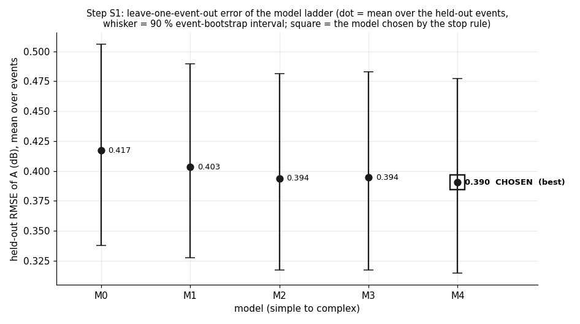
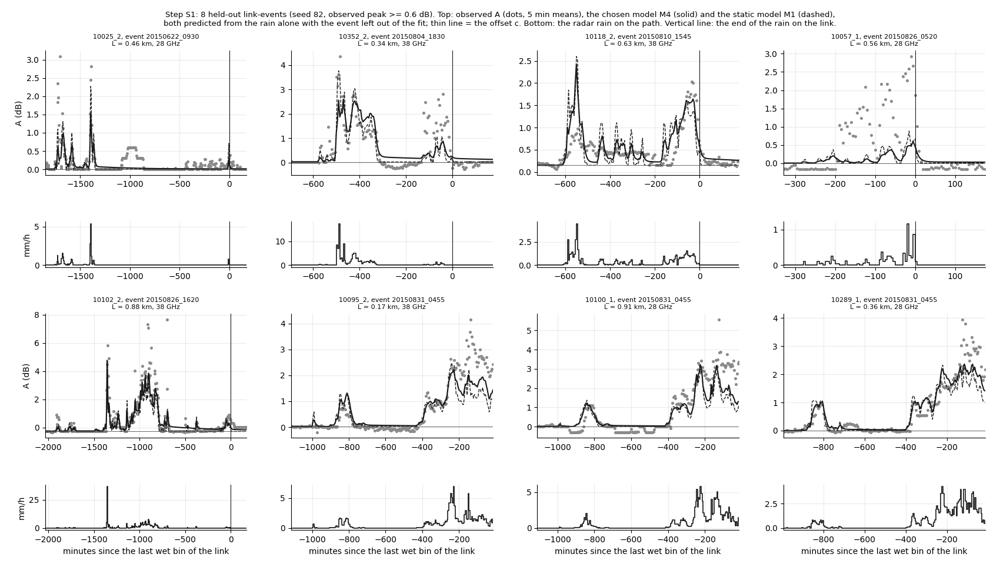
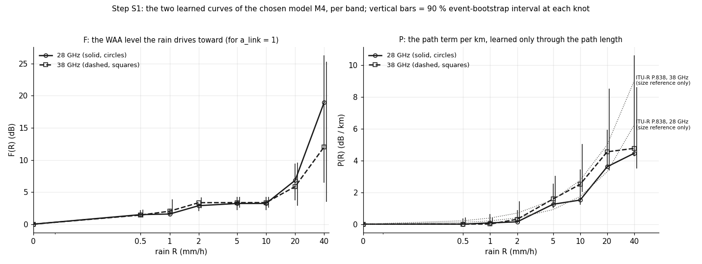
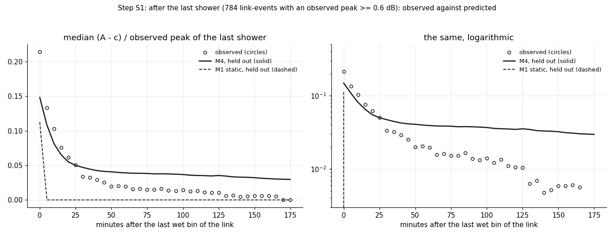

# wet_antenna step S1: system identification of WAA on short links, the model ladder M0-M4 (TRAIN only)

Written by `research/wet_antenna/system_id_ladder.py` (library `system_id.py`). Settings and every rule:
`wet_antenna.system_id` in `research/config.yaml`, written before the run. Plan: `docs/ROADMAP.md`, "Reboot (2026-10-13)".

## 1. What was run

- Every model predicts A_pred(t) = W(t) + L * P_band(R(t - d)) + c at 1 min and is compared with the 5 min means of A.
  M0 no WAA; M1 static W = a_link F_band(R); M2 one time constant; M3 separate wetting / drying time constants; M4 two
  stores. P and F are free piecewise-linear curves on the knots 0, 0.5, 1, 2, 5, 10, 20, 40 mm/h (0 at R = 0, never
  falling). **No power-law rain term is subtracted anywhere**; P is told apart from W only through L. ITU-R P.838 is
  used only to build the fake data and as a dotted size reference in one figure.
- Loss: Huber (delta 0.3 dB) on the 5 min residuals, minimised with L-BFGS-B and the exact gradient; 4 generic starts
  per model; the lag d from the grid -10..10 min by a lag profile (config `lag_candidates`).
- Judge: leave-one-event-out over the 42 TRAIN events (1000 event-bootstrap draws for the intervals).
- TRAIN events only; VAL is never read. Nothing earlier is changed.
- Timing: one M3 fit from a generic start 17.3 s (324 evaluations of 53.3 ms); projection 1.96 h on 3
  processes against a budget of 3.0 h. Cut: nothing. Fitting time summed over the processes:
  7.84 h. Run time of this run: 0.3 min (fits are cached).
- Software: numba 0.68.0 (the model and its gradient), scipy 1.17.1 (L-BFGS-B), numpy 2.4.5. No pysindy, no PySR in this step.

## 2. Data

| group | links | sub_links | link_events | events | points_5min | wet_points | dry_points | links_with_city_gauge_1km | offset_flagged | cut_at_tsl_step | median_window_h |
|---|---|---|---|---|---|---|---|---|---|---|---|
| all | 41 | 67 | 1718 | 42 | 367190 | 93081 | 274109 | 18 | 124 | 0 | 14.8 |
| 28 GHz | 17 | 31 | 803 | 39 | 169208 | 41914 | 127294 | 6 | 66 | 0 | 14.7 |
| 38 GHz | 24 | 36 | 915 | 39 | 197982 | 51167 | 146815 | 12 | 58 | 0 | 14.8 |
| < 0.6 km | 18 | 28 | 709 | 38 | 152918 | 37890 | 115028 | 7 | 47 | 0 | 14.8 |

(`research/wet_antenna/outputs/tables/system_id_ladder_counts.csv`.) A link-event = one TRAIN event on one sub-link. How the pairs were reduced (rules decided
without any fit):

| rule | pairs |
|---|---|
| pairs of the short TRAIN links in TRAIN events | 5406 |
| no baseline | 220 |
| no wet bin of the link in the event | 2542 |
| sub-link not good | 314 |
| use_in_waa_main false | 496 |
| offset_std > 0.3 dB | 104 |
| frequency outside the two bands | 0 |
| cut at a TSL step | 0 |
| TSL step before the rain | 0 |
| too few valid 5 min bins | 0 |
| too many 5 min bins without radar | 12 |
| link-events kept | 1718 |

Path lengths 0.14 to 0.97 km (median 0.67). Radar R_mean on wet points: median 0.48, 90th percentile
3.6, largest 70 mm/h; points above 10 mm/h: 1228.

## 3. The fake check (first)

Truths M3 (tau_wet 3, tau_dry 15 min) and M4 (phi 0.7, tau_f_wet 3, tau_f_dry 10, tau_s 60 min), F = 1.5 (1 - exp(-R / 2)) dB,
P = ITU-R P.838 size, a_link log-normal (sd 0.3), lag 3 min, driven by the real radar rain, windows and lengths; noise
variance x 3, 0.3 dB quantization, unknown offsets. 3 replicates per truth, the same ladder and judge.

| truth | replicate | best | chosen | chosen_is_truth | rmse_M0 | rmse_M1 | rmse_M2 | rmse_M3 | rmse_M4 | d | tau_wet | tau_dry | phi | tau_f_wet | tau_f_dry | tau_s |
|---|---|---|---|---|---|---|---|---|---|---|---|---|---|---|---|---|
| M3 | 0 | M3 | M3 | True | 0.294 | 0.276 | 0.27 | 0.266 | 0.266 | 3 | 2.967 | 15.541 |  |  |  |  |
| M3 | 1 | M4 | M3 | True | 0.314 | 0.295 | 0.288 | 0.285 | 0.285 | 3 | 3.254 | 14.857 |  |  |  |  |
| M3 | 2 | M3 | M3 | True | 0.297 | 0.284 | 0.278 | 0.274 | 0.274 | 3 | 2.999 | 15.569 |  |  |  |  |
| M4 | 0 | M4 | M4 | True | 0.302 | 0.288 | 0.281 | 0.28 | 0.279 | 3 |  |  | 0.685 | 2.767 | 9.887 | 59.814 |
| M4 | 1 | M4 | M4 | True | 0.3 | 0.281 | 0.274 | 0.273 | 0.272 | 3 |  |  | 0.685 | 2.979 | 10.323 | 65.632 |
| M4 | 2 | M4 | M4 | True | 0.295 | 0.283 | 0.276 | 0.276 | 0.275 | 3 |  |  | 0.715 | 3.04 | 11.684 | 76.958 |

(`research/wet_antenna/outputs/tables/system_id_ladder_fake_check.csv`; rmse = held-out RMSE; the parameters are those of the fit of the TRUE rung on all events.)

- **Truth M3: PASS.** Chosen: M3, M3, M3 (true rung in 3 of 3; rule >= 2). Fitted / true: tau_wet x1.00, tau_dry x1.04; d 3 (true 3). Parameters within +-30%: yes.
- **Truth M4: PASS.** Chosen: M4, M4, M4 (true rung in 3 of 3; rule >= 2). Fitted / true: phi x0.98, tau_f_wet x0.99, tau_f_dry x1.03, tau_s x1.09; d 3 (true 3). Parameters within +-30%: yes.

**Fake check: PASS.**

## 4. The ladder on the real data

| model | rmse | rmse_lo | rmse_hi | minus_best | diff_lo | diff_hi | interval_holds_0 | skill_vs_M0 | skill_lo | skill_hi |
|---|---|---|---|---|---|---|---|---|---|---|
| M0 | 0.4171 | 0.3378 | 0.5061 | 0.0267 | 0.0186 | 0.036 | False | 0.0 | 0.0 | 0.0 |
| M1 | 0.4033 | 0.3276 | 0.4894 | 0.013 | 0.0066 | 0.0197 | False | 0.033 | 0.0188 | 0.0484 |
| M2 | 0.3936 | 0.3173 | 0.4816 | 0.0033 | 0.0008 | 0.006 | False | 0.0562 | 0.0408 | 0.0712 |
| M3 | 0.3945 | 0.3175 | 0.4831 | 0.0041 | 0.0015 | 0.0067 | False | 0.0542 | 0.0387 | 0.0702 |
| M4 | 0.3904 | 0.3145 | 0.4773 | 0.0 | 0.0 | 0.0 | True | 0.0641 | 0.0473 | 0.0818 |

(`research/wet_antenna/outputs/tables/system_id_ladder_ladder.csv`; rmse = mean over the held-out events of the RMSE of A (dB); minus_best with the 90 % interval of
the paired difference; skill = 1 - RMSE / RMSE(M0).) More metrics (integrals in dB min, mean per link-event):

| model | rmse_rain | rmse_0_60 | rmse_60_180 | peak_error | peak_error_lo | peak_error_hi | integral_obs | integral_pred | integral_pred_over_obs |
|---|---|---|---|---|---|---|---|---|---|
| M0 | 0.626 | 0.276 | 0.241 | -0.782 | -1.146 | -0.458 | 3.415 | 0.953 | 0.279 |
| M1 | 0.601 | 0.276 | 0.241 | -0.669 | -1.013 | -0.359 | 3.415 | 1.08 | 0.316 |
| M2 | 0.568 | 0.271 | 0.24 | -0.849 | -1.213 | -0.537 | 3.415 | 4.08 | 1.195 |
| M3 | 0.569 | 0.27 | 0.24 | -0.867 | -1.233 | -0.55 | 3.415 | 3.561 | 1.043 |
| M4 | 0.562 | 0.263 | 0.239 | -0.865 | -1.235 | -0.546 | 3.415 | 8.172 | 2.393 |

Fits on all events, and how the starts and folds behaved:

| model | d | loss | loss_g1 | loss_g2 | loss_g3 | loss_g4 | spread_over_starts | fold_d_values | folds_at_iteration_cap | seconds |
|---|---|---|---|---|---|---|---|---|---|---|
| M0 | 3 | 30950.68 | 30950.69 | 30950.68 | 30950.68 | 30950.68 | 0.0 | 3: 42 | 16 | 317 |
| M1 | 3 | 28880.59 | 28880.59 | 28881.17 | 28880.59 | 28881.55 | 0.96 | 3: 42 | 42 | 990 |
| M2 | 2 | 27319.85 | 27319.85 | 27319.92 | 27319.89 | 27350.91 | 31.06 | -1: 1, 2: 41 | 42 | 765 |
| M3 | 2 | 27285.2 | 27285.34 | 27285.2 | 27285.44 | 27285.55 | 0.35 | -1: 1, 2: 41 | 42 | 767 |
| M4 | -1 | 26515.76 | 26515.91 | 26515.76 | 26585.93 | 26516.0 | 70.17 | -1: 39, 2: 3 | 42 | 1245 |

**Best: M4. Chosen by the stop rule (the simplest model whose paired difference to the best has an interval that
holds 0): M4.**





## 5. The chosen model

```
A_pred(t) = W(t) + L * P_band(R(t - d)) + c
    W = W_f + W_s
    dW_f/dt = (phi a_link F_band(R(t - d)) - W_f) / tau_f,   tau_f = tau_f_wet while phi a_link F > W_f, tau_f_dry otherwise
    dW_s/dt = ((1 - phi) a_link F_band(R(t - d)) - W_s) / tau_s
```

Fit on all 42 TRAIN events; 90 % intervals from 100 event-bootstrap refits (time constants and d in minutes;
positive d = A follows the radar):

- radar lag d = -1 (-2..3) min;
- phi = 0.71 (0.53..0.79)
- tau_f_wet = 17.3 (10.4..65.1)
- tau_f_dry = 8.3 (5.3..9.9)
- tau_s = 513.1 (210.1..600.0)  **(the interval reaches the upper bound of 600 min: not identified, only 'long')**
- a_link: sd of log a_link 0.19 (0.18..0.43); 10th to 90th percentile 0.75 to 1.18.

| model | parameter | value | lo | hi |
|---|---|---|---|---|
| M1 | d | 3.0 | 2.0 | 7.0 |
| M1 | a_log_sd | 0.214 | 0.19 | 0.327 |
| M1 | a_p10 | 0.759 | 0.602 | 0.818 |
| M1 | a_p90 | 1.248 | 1.115 | 1.382 |
| M4 | d | -1.0 | -2.0 | 3.0 |
| M4 | phi | 0.709 | 0.53 | 0.792 |
| M4 | tau_f_wet | 17.332 | 10.382 | 65.111 |
| M4 | tau_f_dry | 8.262 | 5.267 | 9.865 |
| M4 | tau_s | 513.059 | 210.143 | 600.0 |
| M4 | a_log_sd | 0.193 | 0.18 | 0.435 |
| M4 | a_p10 | 0.749 | 0.577 | 0.895 |
| M4 | a_p90 | 1.176 | 0.966 | 1.377 |

F and P of M4 at the knots (value, 90 % interval from 100 event-bootstrap refits):

| model | parameter | value | lo | hi |
|---|---|---|---|---|
| M4 | F[28 GHz](0.5) | 1.487 | 1.115 | 2.166 |
| M4 | P[28 GHz](0.5) | 0.002 | 0.002 | 0.356 |
| M4 | F[28 GHz](1) | 1.579 | 1.359 | 2.404 |
| M4 | P[28 GHz](1) | 0.081 | 0.02 | 0.626 |
| M4 | F[28 GHz](2) | 2.879 | 2.042 | 3.193 |
| M4 | P[28 GHz](2) | 0.146 | 0.066 | 0.893 |
| M4 | F[28 GHz](5) | 3.219 | 2.199 | 4.249 |
| M4 | P[28 GHz](5) | 1.25 | 1.003 | 2.528 |
| M4 | F[28 GHz](10) | 3.23 | 2.209 | 4.261 |
| M4 | P[28 GHz](10) | 1.513 | 1.219 | 3.426 |
| M4 | F[28 GHz](20) | 6.822 | 3.744 | 9.433 |
| M4 | P[28 GHz](20) | 3.609 | 3.537 | 5.917 |
| M4 | F[28 GHz](40) | 18.984 | 6.44 | 26.309 |
| M4 | P[28 GHz](40) | 4.453 | 4.277 | 10.611 |
| M4 | F[38 GHz](0.5) | 1.417 | 1.022 | 2.235 |
| M4 | P[38 GHz](0.5) | 0.003 | 0.003 | 0.428 |
| M4 | F[38 GHz](1) | 2.023 | 1.479 | 3.875 |
| M4 | P[38 GHz](1) | 0.008 | 0.007 | 0.434 |
| M4 | F[38 GHz](2) | 3.342 | 2.475 | 4.194 |
| M4 | P[38 GHz](2) | 0.306 | 0.071 | 1.43 |
| M4 | F[38 GHz](5) | 3.355 | 2.549 | 4.216 |
| M4 | P[38 GHz](5) | 1.579 | 1.227 | 3.023 |
| M4 | F[38 GHz](10) | 3.359 | 2.554 | 4.221 |
| M4 | P[38 GHz](10) | 2.502 | 2.017 | 5.046 |
| M4 | F[38 GHz](20) | 5.86 | 2.877 | 9.588 |
| M4 | P[38 GHz](20) | 4.546 | 3.388 | 8.51 |
| M4 | F[38 GHz](40) | 12.042 | 3.478 | 25.277 |
| M4 | P[38 GHz](40) | 4.761 | 3.509 | 8.614 |

(`research/wet_antenna/outputs/tables/system_id_ladder_parameters.csv`.)



## 6. Sensitivity (information, not part of the rule)

| variant | model | link_events | points | rmse_variant | rmse_main_run_same_points | d | F[28 GHz](2) | F[28 GHz](10) | P[28 GHz](10) | F[38 GHz](2) | F[38 GHz](10) | P[38 GHz](10) | phi | tau_f_wet | tau_f_dry | tau_s | phi[28 GHz] | tau_f_wet[28 GHz] | tau_f_dry[28 GHz] | tau_s[28 GHz] | phi[38 GHz] | tau_f_wet[38 GHz] | tau_f_dry[38 GHz] | tau_s[38 GHz] |
|---|---|---|---|---|---|---|---|---|---|---|---|---|---|---|---|---|---|---|---|---|---|---|---|---|
| main run | M1 | 1718 | 367190 | 0.403 | 0.403 | 3 | 1.685 | 2.792 | 1.144 | 1.51 | 2.477 | 2.248 |  |  |  |  |  |  |  |  |  |  |  |  |
| main run | M4 | 1718 | 367190 | 0.39 | 0.39 | -1 | 2.879 | 3.23 | 1.513 | 3.342 | 3.359 | 2.502 | 0.709 | 17.332 | 8.262 | 513.059 |  |  |  |  |  |  |  |  |
| (a) only links < 0.6 km | M1 | 709 | 152918 | 0.401 | 0.401 | 3 | 1.173 | 1.762 | 3.562 | 0.985 | 1.624 | 4.847 |  |  |  |  |  |  |  |  |  |  |  |  |
| (a) only links < 0.6 km | M4 | 709 | 152918 | 0.386 | 0.386 | 2 | 1.831 | 1.906 | 4.682 | 2.038 | 2.041 | 6.316 | 0.652 | 41.614 | 9.641 | 594.128 |  |  |  |  |  |  |  |  |
| (b) only 5 min points with R <= 2 mm/h, no path term | M1 | 1718 | 350556 | 0.376 | 0.375 | 7 | 1.644 | 2.367 | 0.0 | 1.758 | 2.202 | 0.0 |  |  |  |  |  |  |  |  |  |  |  |  |
| (b) only 5 min points with R <= 2 mm/h, no path term | M4 | 1718 | 350556 | 0.361 | 0.36 | -2 | 3.04 | 3.049 | 0.0 | 3.063 | 3.064 | 0.0 | 0.712 | 21.015 | 9.331 | 600.0 |  |  |  |  |  |  |  |  |
| (c) City gauge (1 min) as input, links with a gauge within 1 km | M1 | 749 | 154059 | 0.399 | 0.415 | 1 | 1.3 | 5.172 | 0.031 | 1.539 | 6.421 | 0.033 |  |  |  |  |  |  |  |  |  |  |  |  |
| (c) City gauge (1 min) as input, links with a gauge within 1 km | M4 | 749 | 154059 | 0.339 | 0.402 | -2 | 0.96 | 5.025 | 0.734 | 1.04 | 6.082 | 1.119 | 0.687 | 2.4 | 10.557 | 488.099 |  |  |  |  |  |  |  |  |
| (d) the loss on 1 min A | M1 | 1718 | 367190 | 0.405 | 0.403 | 3 | 1.352 | 2.415 | 1.307 | 1.514 | 2.664 | 2.089 |  |  |  |  |  |  |  |  |  |  |  |  |
| (d) the loss on 1 min A | M4 | 1718 | 367190 | 0.39 | 0.39 | 0 | 2.666 | 3.013 | 1.544 | 3.019 | 3.2 | 2.24 | 0.705 | 16.436 | 7.372 | 489.256 |  |  |  |  |  |  |  |  |
| (e) separate time constants per band | M4 | 1718 | 367190 | 0.391 | 0.39 | -1 | 3.088 | 3.558 | 1.527 | 3.441 | 3.459 | 2.515 |  |  |  |  | 0.686 | 14.976 | 8.284 | 537.888 | 0.726 | 19.387 | 8.323 | 498.717 |

(`research/wet_antenna/outputs/tables/system_id_ladder_sensitivity.csv`. rmse_variant = held-out RMSE of the variant; rmse_main_run_same_points = the main run judged on
the same link-events and points.)

## 7. Checks against earlier facts (held-out predictions)

| group | showers | link_events | peak_R_median_mmh | peak_obs_median_db | peak_M1_median_db | peak_M4_median_db | check | median_L_km | start_obs_median_db | drop_obs_median_db | drop_M1_median_db | drop_M4_median_db |
|---|---|---|---|---|---|---|---|---|---|---|---|---|
| first shower | 1078.0 | 1078 | 0.856 | 0.82 | 0.974 | 0.577 | per-shower peaks, link-events with >= 2 showers |  |  |  |  |  |
| later showers | 5324.0 | 1078 | 0.805 | 1.0 | 0.924 | 0.621 | per-shower peaks, link-events with >= 2 showers |  |  |  |  |  |
| 0.6-1 km |  | 232 |  |  |  |  | fast drop after the last wet bin | 0.869 | 0.7 | 0.357 | 0.185 | 0.138 |
| < 0.6 km |  | 151 |  |  |  |  | fast drop after the last wet bin | 0.459 | 0.703 | 0.33 | 0.165 | 0.136 |

(`research/wet_antenna/outputs/tables/system_id_ladder_checks.csv`; the curve after the last shower: `research/wet_antenna/outputs/tables/system_id_ladder_after_last_shower.csv`.)



## 8. In plain words

**Static or dynamic?** Dynamic. The static model M1 is 0.013 dB worse than the best held out
(0.007..0.020; the interval does not hold 0), and after the last shower it falls to 0 at once, while the observed A / peak is still
0.21 at 0-5 min and 0.08 at 15-20 min (M1: 0.11 and 0.00). **But the gain is small in dB**: the held-out RMSE goes from
0.417 (M0) over 0.403 (M1) to 0.390 dB (M4), a skill of 6.4% (4.7%..8.2%) over "no WAA at all". Most of the error is
not removed by any rung: 0.24 dB remain 1-3 h after the rain (all rungs alike: noise and baseline), and 0.56 dB during rain.
The stop rule chose the TOP rung, so the ladder did not stop: nothing here says that M4 is enough (that is S2).

**How fast does it dry?** The one number that is stable: tau_f_dry = 8.3 (5.3..9.9) min. In the sensitivity runs (a)-(d) it is
9.6, 9.3, 10.6, 7.4 min, with the radar or with the gauge as input. It agrees with the fast first phase of the tails (T17 / T18: fast
for 15-20 min).

**How fast does it wet?** NOT determined. With the radar tau_f_wet = 17.3 (10.4..65.1) min, slower than drying, the opposite of what
[1] describes; with the City gauge (1 min, a point on the ground) as input on the 749 link-events near a gauge it is
2.4 min, and the held-out RMSE falls from 0.402 (radar, the same points) to 0.339 dB. So the slow wetting is most
likely the radar (5 min steps, 2 km cells, measured aloft) and not the antenna: a smoothed input makes the model rise slowly.

**The slow store is not identified.** tau_s = 513 (210..600) min: the interval ends at the bound. A store that slow is almost an
integrator of the rain: it predicts A / peak = 0.039 at 60 min and 0.035 at 120 min after the last shower, where the
observed values are 0.020 and 0.011, and an integral of A over 0-180 min after the rain 2.4 times the observed one
(8.2 against 3.4 dB min per link-event; M3: 3.6). It helps DURING long events (a level that builds up over several
showers) and is wrong AFTER them. It is not a drying time of 9 h; it may as well be a slow drift of the level
that the offset rule does not see. As a "false rain after the event" proxy M4 is WORSE than M2 / M3.

**How big is the path part on short links?** For M4, P at 10 mm/h is 1.5 (1.2..3.4) dB/km at 28 GHz and 2.5 (2.0..5.0) at 38 GHz
(ITU-R P.838, size reference only: 1.8 and 2.8), so on the median link (0.67 km) about 1.0 and 1.7 dB, against a WAA
level F(10) of 3.2 and 3.4 dB (for a_link = 1). At 2 mm/h (the median wet point has 0.48 mm/h) the path part is 0.10 and 0.20 dB:
most of A on these links, most of the time, is the antenna term. **The split is not firm**: P(10) changes with the rung
(M0 4.6 / 6.1, M1 1.1 / 2.2, M2 3.0 / 4.2, M3 3.1 / 4.2, M4 1.5 / 2.5 dB/km) and with the length range (below 0.6 km only: 4.7 / 6.3). With L between
0.14 and 0.97 km the lengths do not separate P from F well; what a rung puts into W it takes out of P.

**What changes for S2** (proposals; the learners decide):
1. The input limits the result more than the model form: the gauge run gains 0.062 dB on its link-events, the whole ladder M0 -> M4 gains 0.027 dB.
   S2 should be run (or at least checked) with the gauge input on the links near a gauge, and the wetting speed read there.
2. The peaks are too low for every rung (mean peak error -0.86 dB for M4, -0.67 for M1): a flexible G(R, W) cannot
   repair what the radar does not show. S2 needs a metric on the peaks, not only the RMSE.
3. The slow store needs another form or another explanation before it is "named": S2 should leave the slow part
   free (or test it against a level drift), and judge it on the 60-180 min window and the integral after the rain.
4. F above 10 mm/h rests on 1228 points of 5 min (0.33%); its rise there (F(40) = 19.0 (6.4..26.3) dB at 28 GHz) is not a result.
5. P and F are only separated by L: the long links (planned for S3) are needed to pin P; until then "the WAA size" of
   this step is F plus or minus an unknown share of P.

## 9. Unclear / possibly wrong

1. **The fake check passed, but it is easier than the real data.** The fake A is driven by the SAME radar series that the
   fit gets, so the input has no error; the real input has (sensitivity (c)). The fake held-out RMSE of M4 is 0.275 dB,
   the real one 0.390 dB: the real data hold structure that the fake data do not have. PASS means "the code and the
   judge find the rung and the numbers when the model class is right and the rain is known", not more.
2. **The fake truths had fast wetting (3 min)**; the real fit gives slow wetting with the radar. A fake check with a
   smoothed or displaced rain input was not run, so "the slow wetting is the radar" is a reading of (c), not a test.
   (c) also differs from the main run in its links (749 of 1718 link-events).
3. **Per-shower peaks** (link-events with >= 2 showers). Observed median peak 0.82 dB (first shower) and 1.00 dB (later
   showers) for a median radar peak of 0.86 and 0.81 mm/h. M4: 0.58 and 0.62 (the right direction, 38% too low);
   M1: 0.97 and 0.92 (the wrong direction). Only a rung with memory makes the later showers higher.
4. **Fast drop after the last wet bin** (A at 0-5 min minus A at 15-20 min): observed 0.36 dB (0.6-1 km), 0.33 dB (< 0.6 km); M4
   0.14, 0.14. It does not grow with L in the data (T18) nor in the model, but the model gives less than half of
   it: the predicted A is already too low when the rain ends (A / peak 0.15 against 0.21).
5. **The radar lag** d = -1 (-2..3) min for M4, but M0 3, M1 3, M2 2, M3 2 for the other rungs: d and the wetting time constant
   trade against each other (a slow wetting does the work of a lag). d is not a measured delay.
6. **Optimiser.** Spread of the loss over the 4 starts: M0 0.0, M1 1.0, M2 31.1, M3 0.4, M4 70.2 (the best loss is about 26516).
   The leave-one-event-out and bootstrap refits are warm starts with an iteration cap (config `maxiter`; column
   folds_at_iteration_cap in section 4): the held-out errors are those of nearly, not fully, converged fits, for every rung alike.
7. **The offset c.** 124 of 1718 link-events had fewer than 30 dry minutes before the rain and got c = 0; they are in the
   fit and in the judge. c is measured 30-120 min before the rain and held for a window of 15 h (median): a baseline
   that moves inside the window goes into the residual, or into the slow store.
8. **a_link of a link that is not in the training events is 1**; with leave-one-EVENT-out nearly every link is seen, so
   the judge does not test new links (that is S3).
9. **Huber loss** (delta 0.3 dB) gives the large residuals at the peaks a linear, not a squared, weight: part of the low
   peaks is the loss, not only the radar. The judge's RMSE is squared, the fit is not.
10. The intervals are over events (42); the events differ a lot in size, so the mean over events is not the mean over points.
