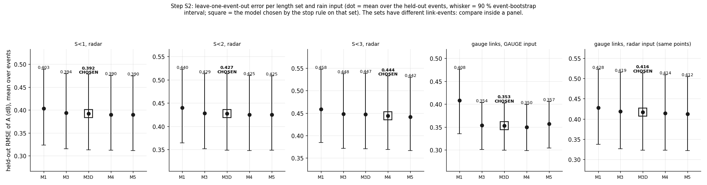
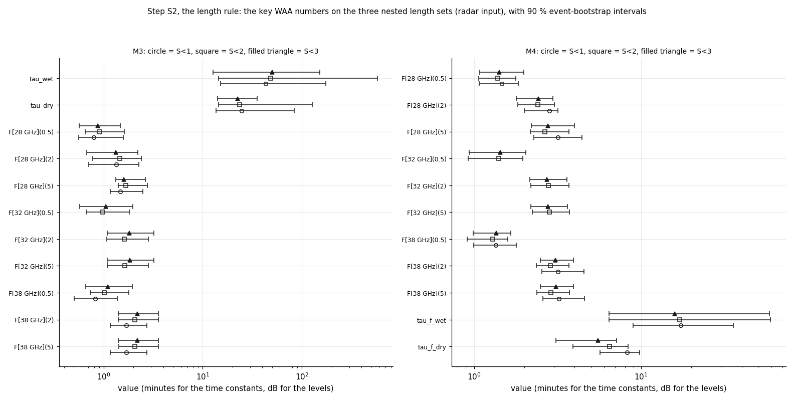
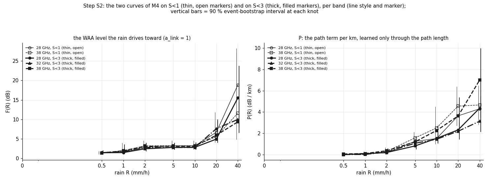
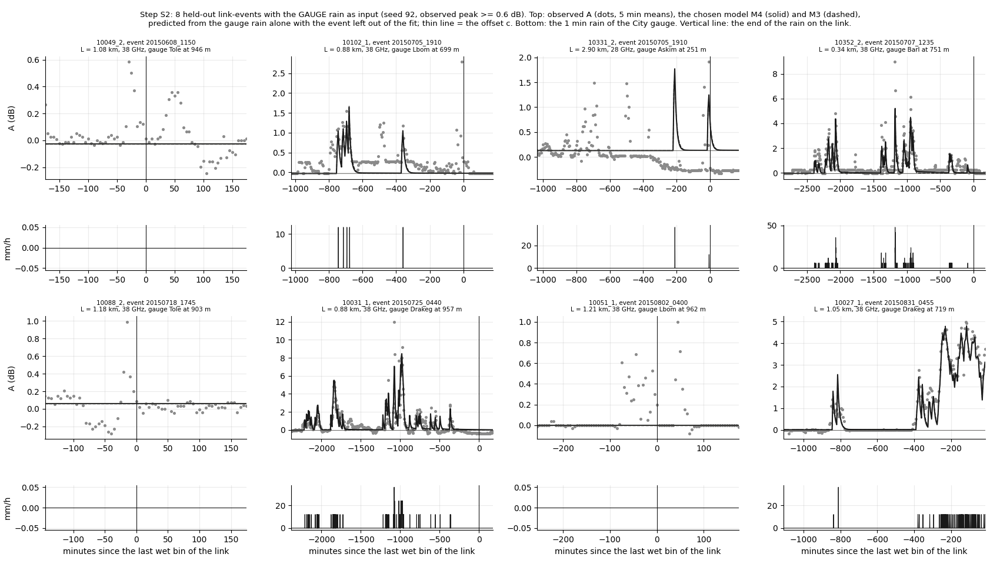
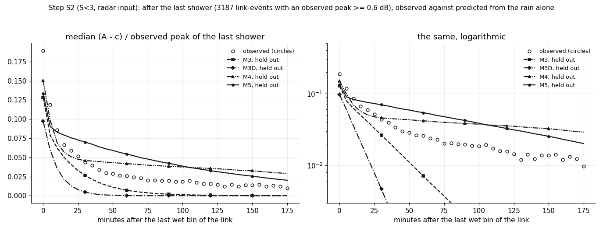
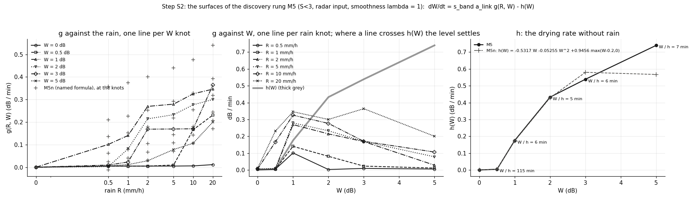

# wet_antenna step S2: the WAA law on links up to 3 km, the slow part, and the discovery rung M5 (TRAIN only)

Written by `research/wet_antenna/system_id_s2.py` (library `system_id.py`). Settings and every rule:
`wet_antenna.system_id_s2` in `research/config.yaml`, written before the run. Plan: `docs/ROADMAP.md`, "Reboot (2026-10-13)".

**Results that carry the label "not validated" below: not validated: fake check Tc failed; not validated: fake check Td failed.**

## 1. What was run

- Every model predicts A_pred(t) = W(t) + L * P_band(R(t - d)) + c at 1 min and is compared with the 5 min means of A.
  M1 static W = a_link F_band(R); M3 one store with a wetting and a drying time constant; M3D = M3 plus a linear level
  drift per link-event (not driven by rain, slopes ~ N(0, s_b^2), s_b fitted); M4 a fast and a slow store; M5 the
  discovery rung dW/dt = s_band a_link g(R, W) - h(W) with g a free surface on 7 x 6 knots and h a free rising
  curve. P and F are free piecewise-linear curves (0 at R = 0, never falling). **No power-law rain term is subtracted
  anywhere**; ITU-R P.838 only builds the fake data and is a size reference.
- Loss, starts, ridge on a_link as S1. The fit is cheaper than in S1 (config `maxiter`): lag grid -4..6 min, the
  folds keep the lag of the fit on all events.
- Judge: leave-one-event-out, 1000 event-bootstrap draws, the S1 stop rule on the order M1 < M3 < M3D < M4 < M5.
- TRAIN events only; VAL is never read. Nothing earlier is changed (the data and judge functions of S1 moved into the
  library unchanged; the S1 outputs are identical).
- Timing: one evaluation on S<3 takes 267 ms (M3) and 722 ms (M5); projection 4.53 h on 3 processes
  against a budget of 5.0 h. Cut: nothing. Fitting time summed over the processes: 45.4 h. Run time
  of this run: 1.3 min (fits are cached).
- Software: numba 0.68.0, scipy 1.17.1 (L-BFGS-B, exact gradients), numpy 2.4.5.

## 2. Counts

Bands (TRAIN links below 3 km): 28 GHz 75 links, 32 GHz 16 links, 38 GHz 90 links. No band was merged (rule: at least 8 links).

| set | band | links | sub_links | link_events | events | points_5min | wet_points | L_min_km | L_median_km | L_max_km | offset_flagged |
|---|---|---|---|---|---|---|---|---|---|---|---|
| S<1, radar | all | 41 | 67 | 1718 | 42 | 367190 | 93081 | 0.14 | 0.67 | 0.97 | 124 |
| S<1, radar | 28 GHz | 17 | 31 | 803 | 39 | 169208 | 41914 | 0.14 | 0.71 | 0.97 | 66 |
| S<1, radar | 38 GHz | 24 | 36 | 915 | 39 | 197982 | 51167 | 0.17 | 0.61 | 0.96 | 58 |
| S<2, radar | all | 99 | 172 | 4381 | 50 | 929641 | 240973 | 0.14 | 1.13 | 1.98 | 353 |
| S<2, radar | 28 GHz | 42 | 80 | 2037 | 44 | 433289 | 110417 | 0.14 | 1.09 | 1.98 | 183 |
| S<2, radar | 32 GHz | 8 | 15 | 364 | 30 | 78902 | 20971 | 1.13 | 1.26 | 1.52 | 27 |
| S<2, radar | 38 GHz | 49 | 77 | 1980 | 49 | 417450 | 109585 | 0.17 | 1.08 | 1.95 | 143 |
| S<3, radar | all | 144 | 257 | 6653 | 51 | 1351199 | 354713 | 0.14 | 1.49 | 3.0 | 567 |
| S<3, radar | 28 GHz | 62 | 118 | 3076 | 51 | 617738 | 159699 | 0.14 | 1.51 | 2.93 | 283 |
| S<3, radar | 32 GHz | 12 | 23 | 582 | 36 | 120175 | 32222 | 1.13 | 1.35 | 2.79 | 41 |
| S<3, radar | 38 GHz | 70 | 116 | 2995 | 50 | 613286 | 162792 | 0.17 | 1.39 | 3.0 | 243 |
| gauge links, GAUGE input | all | 42 | 72 | 1998 | 43 | 388362 | 102977 | 0.23 | 1.09 | 2.93 | 119 |
| gauge links, GAUGE input | 28 GHz | 14 | 26 | 737 | 41 | 136129 | 34730 | 0.49 | 1.07 | 2.93 | 49 |
| gauge links, GAUGE input | 32 GHz | 5 | 9 | 241 | 30 | 46482 | 12896 | 1.26 | 1.52 | 2.79 | 13 |
| gauge links, GAUGE input | 38 GHz | 23 | 37 | 1020 | 40 | 205751 | 55351 | 0.23 | 1.08 | 2.28 | 57 |
| gauge links, radar input (same points) | all | 42 | 72 | 1998 | 43 | 388362 | 102977 | 0.23 | 1.09 | 2.93 | 119 |
| gauge links, radar input (same points) | 28 GHz | 14 | 26 | 737 | 41 | 136129 | 34730 | 0.49 | 1.07 | 2.93 | 49 |
| gauge links, radar input (same points) | 32 GHz | 5 | 9 | 241 | 30 | 46482 | 12896 | 1.26 | 1.52 | 2.79 | 13 |
| gauge links, radar input (same points) | 38 GHz | 23 | 37 | 1020 | 40 | 205751 | 55351 | 0.23 | 1.08 | 2.28 | 57 |

(`research/wet_antenna/outputs/tables/system_id_s2_counts.csv`.) A link-event = one TRAIN event on one sub-link. How the pairs of S<3 were reduced (the S1 rules):

| rule | pairs |
|---|---|
| pairs of the short TRAIN links in TRAIN events | 18974 |
| no baseline | 732 |
| no wet bin of the link in the event | 8820 |
| sub-link not good | 911 |
| use_in_waa_main false | 1405 |
| offset_std > 0.3 dB | 331 |
| frequency outside the bands | 0 |
| cut at a TSL step | 223 |
| TSL step before the rain | 10 |
| too few valid 5 min bins | 6 |
| too many 5 min bins without radar | 106 |
| link-events kept | 6653 |

## 3. The fake checks (first)

Truth of all fake data: F = 3.3 (1 - exp(-R / 1)) dB, P = ITU-R P.838 size, a_link log-normal (sd 0.3), tau_wet 3 min,
tau_dry 8 min, noise variance x 3, 0.3 dB quantization, unknown offsets; 3 replicates per truth.

- **Ta (the input explanation: gauge rain as the truth, a smoothed input for the fit): PASS.** exact input: tau_wet 3.00 (true 3), tau_dry 7.97 (true 8): recovered; smoothed input: tau_wet 6.34 = 2.1 x the truth (at least the factor 2 of the rule), tau_dry 7.02.
- **Tb (drift against a slow store): PASS.** truth M3 + drift read as: DRIFT-LIKE, DRIFT-LIKE, DRIFT-LIKE; truth M4 (slow store, tau_s 300 min) read as: WATER-LIKE, WATER-LIKE, WATER-LIKE.
- **Tc (F and P on S<1 against S<3): FAIL.** on S<3 every F and P number is NOT within +-30% of the truth (worst: P[28 GHz](2) x0.05); mean relative interval width F 0.03 (S<1) -> 0.02 (S<3), P 0.06 -> 0.04; on S<1 2 of 12 numbers are off by more than 30% (farthest: x0.002, P[38 GHz](2)).
- **Td (the discovery rung on M3 data): FAIL.** M5 / truth: t_wet x1.56, t_dry x0.92, level(0.5) x0.36, level(2) x0.52, level(5) x0.52; held-out RMSE of M5 within 2% of M3 in 3 of 3 replicates (M5 0.2802, M3 0.2787 dB).

| truth | replicate | what | tau_wet | tau_dry | d | verdict | tau_s | s_b | rmse_M5 | rmse_M3 | PASS |
|---|---|---|---|---|---|---|---|---|---|---|---|
| Ta | 0 | M3 fitted with the exact input | 2.992 | 7.966 | 0.0 |  |  |  |  |  | True |
| Ta | 0 | M3 fitted with the smooth input | 6.357 | 6.988 | 0.0 |  |  |  |  |  | True |
| Ta | 1 | M3 fitted with the exact input | 3.024 | 7.968 | 0.0 |  |  |  |  |  | True |
| Ta | 1 | M3 fitted with the smooth input | 6.336 | 7.023 | 0.0 |  |  |  |  |  | True |
| Ta | 2 | M3 fitted with the exact input | 2.996 | 8.049 | 0.0 |  |  |  |  |  | True |
| Ta | 2 | M3 fitted with the smooth input | 6.31 | 7.016 | 0.0 |  |  |  |  |  | True |
| Tb | 0 | slow-part rule |  |  |  | DRIFT-LIKE | 0.212 | 0.047 |  |  | True |
| Tb | 1 | slow-part rule |  |  |  | DRIFT-LIKE | 9.248 | 0.048 |  |  | True |
| Tb | 2 | slow-part rule |  |  |  | DRIFT-LIKE | 28.972 | 0.047 |  |  | True |
| Tb2 | 0 | slow-part rule |  |  |  | WATER-LIKE | 272.995 | 0.044 |  |  | True |
| Tb2 | 1 | slow-part rule |  |  |  | WATER-LIKE | 279.138 | 0.045 |  |  | True |
| Tb2 | 2 | slow-part rule |  |  |  | WATER-LIKE | 272.919 | 0.041 |  |  | True |
| Tc | 0 | M3 fitted on S<1 | 2.762 | 7.691 | 2.0 |  |  |  |  |  | False |
| Tc | 0 | M3 fitted on S<3 | 2.621 | 7.043 | 2.0 |  |  |  |  |  | False |
| Tc | 1 | M3 fitted on S<1 | 2.832 | 7.456 | 2.0 |  |  |  |  |  | False |
| Tc | 1 | M3 fitted on S<3 | 2.729 | 7.195 | 2.0 |  |  |  |  |  | False |
| Tc | 2 | M3 fitted on S<1 | 2.78 | 7.605 | 2.0 |  |  |  |  |  | False |
| Tc | 2 | M3 fitted on S<3 | 2.713 | 7.215 | 2.0 |  |  |  |  |  | False |
| Td | 0 | M5 fitted on M3 data | 7.05 | 8.032 | 1.0 |  |  |  | 0.28 | 0.279 | False |
| Td | 1 | M5 fitted on M3 data | 4.552 | 7.256 | 2.0 |  |  |  | 0.283 | 0.282 | False |
| Td | 2 | M5 fitted on M3 data | 4.684 | 7.348 | 2.0 |  |  |  | 0.269 | 0.269 | False |

(`research/wet_antenna/outputs/tables/system_id_s2_fake_checks.csv`.) Ta per input (median over the replicates):

| input | tau_wet | tau_dry |
|---|---|---|
| exact | 3.0 | 7.97 |
| smooth | 6.34 | 7.02 |

Tc, median over the replicates (value / truth and the relative width of the 90 % interval):

| set | kind | name | value | truth | rel_width | ratio |
|---|---|---|---|---|---|---|
| S1 | F | F[28 GHz](0.5) | 1.327 | 1.298 | 0.057 | 1.022 |
| S1 | F | F[28 GHz](2) | 2.881 | 2.853 | 0.024 | 1.01 |
| S1 | F | F[28 GHz](5) | 3.18 | 3.278 | 0.016 | 0.97 |
| S1 | F | F[32 GHz](0.5) |  | 1.298 |  |  |
| S1 | F | F[32 GHz](2) |  | 2.853 |  |  |
| S1 | F | F[32 GHz](5) |  | 3.278 |  |  |
| S1 | F | F[38 GHz](0.5) | 1.307 | 1.298 | 0.042 | 1.007 |
| S1 | F | F[38 GHz](2) | 2.858 | 2.853 | 0.025 | 1.002 |
| S1 | F | F[38 GHz](5) | 3.092 | 3.278 | 0.021 | 0.943 |
| S1 | P | P[28 GHz](10) | 1.255 | 1.69 | 0.08 | 0.742 |
| S1 | P | P[28 GHz](2) | 0.001 | 0.381 | 0.0 | 0.004 |
| S1 | P | P[28 GHz](5) | 0.662 | 0.89 | 0.144 | 0.744 |
| S1 | P | P[32 GHz](10) |  | 2.141 |  |  |
| S1 | P | P[32 GHz](2) |  | 0.507 |  |  |
| S1 | P | P[32 GHz](5) |  | 1.152 |  |  |
| S1 | P | P[38 GHz](10) | 2.099 | 2.68 | 0.055 | 0.783 |
| S1 | P | P[38 GHz](2) | 0.001 | 0.672 | 0.0 | 0.002 |
| S1 | P | P[38 GHz](5) | 1.115 | 1.477 | 0.071 | 0.755 |
| S3 | F | F[28 GHz](0.5) | 1.243 | 1.298 | 0.019 | 0.958 |
| S3 | F | F[28 GHz](2) | 2.788 | 2.853 | 0.013 | 0.977 |
| S3 | F | F[28 GHz](5) | 2.981 | 3.278 | 0.013 | 0.909 |
| S3 | F | F[32 GHz](0.5) | 1.412 | 1.298 | 0.066 | 1.087 |
| S3 | F | F[32 GHz](2) | 2.841 | 2.853 | 0.024 | 0.996 |
| S3 | F | F[32 GHz](5) | 3.079 | 3.278 | 0.02 | 0.939 |
| S3 | F | F[38 GHz](0.5) | 1.319 | 1.298 | 0.024 | 1.016 |
| S3 | F | F[38 GHz](2) | 2.691 | 2.853 | 0.024 | 0.943 |
| S3 | F | F[38 GHz](5) | 2.753 | 3.278 | 0.019 | 0.84 |
| S3 | P | P[28 GHz](10) | 1.422 | 1.69 | 0.027 | 0.841 |
| S3 | P | P[28 GHz](2) | 0.02 | 0.381 | 0.01 | 0.054 |
| S3 | P | P[28 GHz](5) | 0.656 | 0.89 | 0.06 | 0.737 |
| S3 | P | P[32 GHz](10) | 1.856 | 2.141 | 0.033 | 0.867 |
| S3 | P | P[32 GHz](2) | 0.254 | 0.507 | 0.048 | 0.501 |
| S3 | P | P[32 GHz](5) | 0.941 | 1.152 | 0.056 | 0.817 |
| S3 | P | P[38 GHz](10) | 2.339 | 2.68 | 0.032 | 0.873 |
| S3 | P | P[38 GHz](2) | 0.38 | 0.672 | 0.085 | 0.566 |
| S3 | P | P[38 GHz](5) | 1.143 | 1.477 | 0.04 | 0.774 |

## 4. The ladder per set and input

| set | model | rmse | rmse_lo | rmse_hi | minus_best | diff_lo | diff_hi | interval_holds_0 |
|---|---|---|---|---|---|---|---|---|
| S<1, radar | M1 | 0.4033 | 0.3238 | 0.489 | 0.0134 | 0.0072 | 0.0195 | False |
| S<1, radar | M3 | 0.3938 | 0.3151 | 0.4794 | 0.0039 | 0.0013 | 0.0065 | False |
| S<1, radar | M3D | 0.3922 | 0.313 | 0.4785 | 0.0022 | -0.0012 | 0.0057 | True |
| S<1, radar | M4 | 0.3899 | 0.3119 | 0.4752 | 0.0 | 0.0 | 0.0 | True |
| S<1, radar | M5 | 0.39 | 0.3112 | 0.4748 | 0.0001 | -0.0039 | 0.004 | True |
| S<2, radar | M1 | 0.4401 | 0.3641 | 0.5227 | 0.0154 | 0.0095 | 0.0215 | False |
| S<2, radar | M3 | 0.4286 | 0.3516 | 0.513 | 0.0039 | 0.0007 | 0.0072 | False |
| S<2, radar | M3D | 0.4275 | 0.3489 | 0.5135 | 0.0028 | -0.0012 | 0.007 | True |
| S<2, radar | M4 | 0.4249 | 0.3476 | 0.5092 | 0.0002 | -0.0032 | 0.0035 | True |
| S<2, radar | M5 | 0.4247 | 0.3486 | 0.5082 | 0.0 | 0.0 | 0.0 | True |
| S<3, radar | M1 | 0.4583 | 0.3843 | 0.5476 | 0.0168 | 0.0106 | 0.0235 | False |
| S<3, radar | M3 | 0.4478 | 0.3714 | 0.5376 | 0.0062 | 0.0034 | 0.0091 | False |
| S<3, radar | M3D | 0.4475 | 0.3703 | 0.5386 | 0.0059 | 0.0004 | 0.0112 | False |
| S<3, radar | M4 | 0.444 | 0.3688 | 0.5327 | 0.0024 | -0.0002 | 0.0052 | True |
| S<3, radar | M5 | 0.4416 | 0.366 | 0.53 | 0.0 | 0.0 | 0.0 | True |
| gauge links, GAUGE input | M1 | 0.408 | 0.3354 | 0.4759 | 0.0582 | 0.0338 | 0.0826 | False |
| gauge links, GAUGE input | M3 | 0.3541 | 0.3014 | 0.4037 | 0.0044 | 0.0021 | 0.0067 | False |
| gauge links, GAUGE input | M3D | 0.3527 | 0.2996 | 0.4025 | 0.0029 | -0.0002 | 0.0066 | True |
| gauge links, GAUGE input | M4 | 0.3497 | 0.2985 | 0.399 | 0.0 | 0.0 | 0.0 | True |
| gauge links, GAUGE input | M5 | 0.357 | 0.3044 | 0.406 | 0.0073 | 0.0031 | 0.0118 | False |
| gauge links, radar input (same points) | M1 | 0.4278 | 0.3368 | 0.5227 | 0.0158 | 0.0102 | 0.0216 | False |
| gauge links, radar input (same points) | M3 | 0.4189 | 0.3263 | 0.5152 | 0.0069 | 0.0028 | 0.011 | False |
| gauge links, radar input (same points) | M3D | 0.4164 | 0.3227 | 0.5138 | 0.0045 | -0.0005 | 0.0091 | True |
| gauge links, radar input (same points) | M4 | 0.4142 | 0.3224 | 0.5088 | 0.0022 | -0.0025 | 0.0069 | True |
| gauge links, radar input (same points) | M5 | 0.412 | 0.3214 | 0.505 | 0.0 | 0.0 | 0.0 | True |

(`research/wet_antenna/outputs/tables/system_id_s2_ladder.csv`; rmse = mean over the held-out events of the RMSE of A (dB), predicted from the rain alone;
minus_best with the 90 % interval of the paired difference. A held-out link-event of M3D has no drift.) More metrics
(shower peak error = predicted - observed peak, median over the showers with an observed peak >= 0.6 dB):

| set | model | rmse_rain | rmse_0_60 | rmse_60_180 | shower_peak_error_median | shower_peak_error_lo | shower_peak_error_hi | showers | integral_pred_over_obs |
|---|---|---|---|---|---|---|---|---|---|
| S<1, radar | M1 | 0.601 | 0.276 | 0.241 | -0.571 | -0.737 | -0.396 | 4081 | 0.316 |
| S<1, radar | M3 | 0.568 | 0.27 | 0.24 | -0.827 | -1.001 | -0.664 | 4081 | 1.049 |
| S<1, radar | M3D | 0.562 | 0.268 | 0.241 | -0.873 | -1.038 | -0.712 | 4081 | 0.536 |
| S<1, radar | M4 | 0.562 | 0.262 | 0.239 | -0.787 | -0.957 | -0.631 | 4081 | 2.354 |
| S<1, radar | M5 | 0.559 | 0.269 | 0.239 | -0.811 | -1.0 | -0.642 | 4081 | 1.566 |
| S<2, radar | M1 | 0.73 | 0.306 | 0.261 | -0.643 | -0.837 | -0.456 | 10518 | 0.175 |
| S<2, radar | M3 | 0.689 | 0.302 | 0.261 | -0.939 | -1.15 | -0.724 | 10518 | 0.563 |
| S<2, radar | M3D | 0.679 | 0.299 | 0.261 | -0.986 | -1.186 | -0.777 | 10518 | 0.286 |
| S<2, radar | M4 | 0.682 | 0.295 | 0.26 | -0.876 | -1.081 | -0.676 | 10518 | 1.216 |
| S<2, radar | M5 | 0.674 | 0.303 | 0.26 | -0.924 | -1.148 | -0.727 | 10518 | 0.96 |
| S<3, radar | M1 | 0.791 | 0.313 | 0.262 | -0.675 | -0.878 | -0.472 | 15360 | 0.179 |
| S<3, radar | M3 | 0.749 | 0.309 | 0.262 | -0.971 | -1.205 | -0.74 | 15360 | 0.552 |
| S<3, radar | M3D | 0.737 | 0.308 | 0.262 | -1.004 | -1.228 | -0.778 | 15360 | 0.266 |
| S<3, radar | M4 | 0.742 | 0.304 | 0.263 | -0.893 | -1.116 | -0.669 | 15360 | 1.243 |
| S<3, radar | M5 | 0.737 | 0.309 | 0.264 | -0.957 | -1.184 | -0.725 | 15360 | 1.401 |
| gauge links, GAUGE input | M1 | 0.843 | 0.242 | 0.215 | -0.423 | -0.641 | -0.252 | 4252 | 0.0 |
| gauge links, GAUGE input | M3 | 0.65 | 0.269 | 0.217 | -0.706 | -0.83 | -0.574 | 4252 | 5.767 |
| gauge links, GAUGE input | M3D | 0.645 | 0.261 | 0.216 | -0.733 | -0.846 | -0.61 | 4252 | 4.496 |
| gauge links, GAUGE input | M4 | 0.644 | 0.257 | 0.216 | -0.673 | -0.781 | -0.545 | 4252 | 9.727 |
| gauge links, GAUGE input | M5 | 0.618 | 0.297 | 0.22 | -0.701 | -0.82 | -0.6 | 4252 | 15.849 |
| gauge links, radar input (same points) | M1 | 0.685 | 0.243 | 0.215 | -0.7 | -0.909 | -0.49 | 4252 | 1.266 |
| gauge links, radar input (same points) | M3 | 0.653 | 0.241 | 0.215 | -0.959 | -1.178 | -0.718 | 4252 | 3.942 |
| gauge links, radar input (same points) | M3D | 0.643 | 0.24 | 0.215 | -0.963 | -1.18 | -0.742 | 4252 | 2.096 |
| gauge links, radar input (same points) | M4 | 0.642 | 0.236 | 0.216 | -0.892 | -1.101 | -0.66 | 4252 | 10.659 |
| gauge links, radar input (same points) | M5 | 0.638 | 0.243 | 0.214 | -0.906 | -1.126 | -0.675 | 4252 | 7.07 |

M5: the smoothness lambda was chosen on S<3 (radar) by the held-out RMSE:

| lambda | held_out_rmse | training_loss | t_wet | t_dry |
|---|---|---|---|---|
| 1 | 0.4416 | 110790.9283 | 325.2396 | 45.0392 |
| 100 | 0.4423 | 110911.893 | 108.1606 | 45.1123 |
| 10000 | 0.4438 | 111675.6566 | 48.435 | 35.6539 |

The fits (`research/wet_antenna/outputs/tables/system_id_s2_fits.csv`):

| set | model | d | loss | spread_over_starts_at_d0 | best_start | s_b_db_h | folds_at_iteration_cap | folds | seconds |
|---|---|---|---|---|---|---|---|---|---|
| S<1, radar | M1 | 3 | 28880.67 | 1.024 | g3 |  | 42 | 42 | 226 |
| S<1, radar | M3 | 2 | 27285.214 | 0.644 | g1 |  | 42 | 42 | 595 |
| S<1, radar | M3D | -1 | 23182.974 | 186.932 | g1 | 0.036 | 42 | 42 | 336 |
| S<1, radar | M4 | -1 | 26515.67 | 56.098 | g1 |  | 42 | 42 | 478 |
| S<1, radar | M5 | -1 | 26877.972 | 11003.59 | g1 |  | 25 | 42 | 42398 |
| S<2, radar | M1 | 3 | 78368.339 | 3.545 | g1 |  | 50 | 50 | 656 |
| S<2, radar | M3 | 2 | 74337.662 | 3.409 | g1 |  | 50 | 50 | 1213 |
| S<2, radar | M3D | -1 | 63947.027 | 311.945 | g2 | 0.036 | 50 | 50 | 835 |
| S<2, radar | M4 | 1 | 72291.54 | 314.939 | g2 |  | 50 | 50 | 1396 |
| S<2, radar | M5 | -1 | 73456.908 | 19351.926 | g1 |  | 46 | 50 | 43245 |
| S<3, radar | M1 | 3 | 118009.815 | 2.798 | g1 |  | 51 | 51 | 1156 |
| S<3, radar | M3 | 2 | 112489.16 | 2.366 | g2 |  | 51 | 51 | 1995 |
| S<3, radar | M3D | -1 | 97071.875 | 214.422 | g2 | 0.038 | 51 | 51 | 1331 |
| S<3, radar | M4 | 1 | 109121.773 | 507.348 | g2 |  | 51 | 51 | 1970 |
| S<3, radar | M5 | 2 | 110790.928 | 77948.328 | g1 |  | 29 | 51 | 1901 |
| S<3, radar | M5D | -1 | 96356.816 | 35431.9 | g1 | 0.036 | 36 | 51 | 43923 |
| gauge links, GAUGE input | M1 | 0 | 31487.084 | 2.428 | g1 |  | 43 | 43 | 286 |
| gauge links, GAUGE input | M3 | -3 | 23887.798 | 2.984 | g1 |  | 43 | 43 | 611 |
| gauge links, GAUGE input | M3D | -3 | 20278.58 | 497.133 | g1 | 0.042 | 43 | 43 | 363 |
| gauge links, GAUGE input | M4 | -3 | 23303.251 | 6.384 | g1 |  | 43 | 43 | 564 |
| gauge links, GAUGE input | M5 | -3 | 23381.71 | 3902.524 | g1 |  | 43 | 43 | 657 |
| gauge links, radar input (same points) | M1 | 3 | 32509.176 | 1.363 | g3 |  | 43 | 43 | 296 |
| gauge links, radar input (same points) | M3 | 2 | 30964.827 | 0.998 | g1 |  | 43 | 43 | 632 |
| gauge links, radar input (same points) | M3D | -1 | 27051.546 | 204.191 | g1 | 0.043 | 43 | 43 | 386 |
| gauge links, radar input (same points) | M4 | -1 | 30122.633 | 137.985 | g2 |  | 43 | 43 | 585 |
| gauge links, radar input (same points) | M5 | 1 | 30423.217 | 11135.711 | g1 |  | 35 | 43 | 660 |

**Chosen by the stop rule on S<3 (radar): M4** (best: M5). Per set: S<1, radar: best M4, chosen M3D, S<2, radar: best M5, chosen M3D, S<3, radar: best M5, chosen M4, gauge links, GAUGE input: best M4, chosen M3D, gauge links, radar input (same points): best M5, chosen M3D.
Best on the 60-180 min window: S<1, radar: M4, S<2, radar: M5, S<3, radar: M3, gauge links, GAUGE input: M1, gauge links, radar input (same points): M5. Smallest shower peak error: S<1, radar: M1, S<2, radar: M1, S<3, radar: M1, gauge links, GAUGE input: M1, gauge links, radar input (same points): M1.



## 5. The length rule [not validated: fake check Tc failed]

Key numbers of M3 and M4 on the three nested sets (radar input; 90 % event-bootstrap intervals):

| model | key | S1_value | S1_lo | S1_hi | S2_value | S2_lo | S2_hi | S3_value | S3_lo | S3_hi | in_rule | S3_inside_S1_interval |
|---|---|---|---|---|---|---|---|---|---|---|---|---|
| M3 | tau_wet | 43.011 | 15.054 | 173.796 | 48.232 | 14.388 | 582.283 | 50.266 | 12.745 | 151.973 | True | True |
| M3 | tau_dry | 24.655 | 13.576 | 83.61 | 23.566 | 14.501 | 127.127 | 22.545 | 14.176 | 35.446 | True | True |
| M3 | F[28 GHz](0.5) | 0.797 | 0.56 | 1.583 | 0.914 | 0.654 | 1.626 | 0.868 | 0.57 | 1.476 | True | True |
| M3 | F[28 GHz](2) | 1.338 | 0.711 | 2.263 | 1.464 | 0.778 | 2.408 | 1.321 | 0.674 | 2.218 | True | True |
| M3 | F[28 GHz](5) | 1.472 | 1.168 | 2.478 | 1.671 | 1.408 | 2.778 | 1.592 | 1.32 | 2.637 | True | True |
| M3 | F[32 GHz](0.5) |  |  |  | 0.978 | 0.664 | 1.821 | 1.05 | 0.573 | 1.969 | False |  |
| M3 | F[32 GHz](2) |  |  |  | 1.623 | 1.079 | 2.834 | 1.824 | 1.094 | 3.227 | False |  |
| M3 | F[32 GHz](5) |  |  |  | 1.627 | 1.083 | 2.838 | 1.831 | 1.101 | 3.234 | False |  |
| M3 | F[38 GHz](0.5) | 0.822 | 0.505 | 1.379 | 1.018 | 0.729 | 1.807 | 1.101 | 0.656 | 1.94 | True | True |
| M3 | F[38 GHz](2) | 1.694 | 1.163 | 2.745 | 2.075 | 1.415 | 3.551 | 2.188 | 1.401 | 3.57 | True | True |
| M3 | F[38 GHz](5) | 1.695 | 1.164 | 2.746 | 2.075 | 1.415 | 3.551 | 2.19 | 1.403 | 3.571 | True | True |
| M4 | tau_f_wet | 17.243 | 8.945 | 35.682 | 17.035 | 6.416 | 59.515 | 15.907 | 6.432 | 58.556 | True | True |
| M4 | tau_f_dry | 8.264 | 5.684 | 9.806 | 6.473 | 3.897 | 8.36 | 5.515 | 3.08 | 7.109 | True | False |
| M4 | F[28 GHz](0.5) | 1.462 | 1.072 | 1.834 | 1.387 | 1.063 | 1.782 | 1.415 | 1.084 | 1.984 | True | True |
| M4 | F[28 GHz](2) | 2.817 | 1.997 | 3.176 | 2.411 | 1.83 | 3.018 | 2.426 | 1.79 | 2.965 | True | True |
| M4 | F[28 GHz](5) | 3.176 | 2.287 | 4.428 | 2.646 | 2.178 | 3.707 | 2.774 | 2.203 | 3.979 | True | True |
| M4 | F[32 GHz](0.5) |  |  |  | 1.404 | 0.923 | 1.959 | 1.434 | 0.934 | 2.041 | False |  |
| M4 | F[32 GHz](2) |  |  |  | 2.783 | 2.194 | 3.698 | 2.724 | 2.154 | 3.595 | False |  |
| M4 | F[32 GHz](5) |  |  |  | 2.82 | 2.231 | 3.733 | 2.758 | 2.194 | 3.63 | False |  |
| M4 | F[38 GHz](0.5) | 1.35 | 0.992 | 1.789 | 1.29 | 0.907 | 1.591 | 1.362 | 0.988 | 1.659 | True | True |
| M4 | F[38 GHz](2) | 3.182 | 2.551 | 4.54 | 2.866 | 2.355 | 3.709 | 3.073 | 2.49 | 3.927 | True | True |
| M4 | F[38 GHz](5) | 3.219 | 2.583 | 4.578 | 2.882 | 2.371 | 3.722 | 3.084 | 2.501 | 3.939 | True | True |

(`research/wet_antenna/outputs/tables/system_id_s2_length_rule.csv`.) **The rule, read on M4: DISAGREE.** 1 of 8 key numbers of S<3 lie outside the S<1 interval (tau_f_dry): S<1 is the main result, and the difference is a finding for Stage 2. [not validated: fake check Tc failed]





Held-out residuals of M4 on S<3 during rain, per length bin (predicted - observed):

| points | length_km | n_points | links | mean_residual_db | lo | hi | rmse_db | mean_observed_A_minus_c_db |
|---|---|---|---|---|---|---|---|---|
| all wet points | 0-0.5 | 31170 | 15 | -0.235 | -0.387 | -0.087 | 0.988 | 1.172 |
| all wet points | 0.5-1 | 61911 | 26 | -0.269 | -0.453 | -0.095 | 1.225 | 1.362 |
| all wet points | 1-2 | 147892 | 58 | -0.271 | -0.418 | -0.118 | 1.332 | 1.426 |
| all wet points | 2-3 | 113740 | 45 | -0.294 | -0.453 | -0.123 | 1.525 | 1.568 |
| wet points with R >= 2 mm/h | 0-0.5 | 5576 | 15 | -0.403 | -0.65 | -0.159 | 1.294 | 2.38 |
| wet points with R >= 2 mm/h | 0.5-1 | 11058 | 26 | -0.383 | -0.718 | -0.05 | 1.756 | 2.904 |
| wet points with R >= 2 mm/h | 1-2 | 26049 | 58 | -0.284 | -0.629 | 0.065 | 2.041 | 3.271 |
| wet points with R >= 2 mm/h | 2-3 | 17756 | 45 | -0.248 | -0.65 | 0.146 | 2.54 | 4.171 |

(`research/wet_antenna/outputs/tables/system_id_s2_residuals_by_length.csv`.) **No trend by the rule: the intervals of the shortest and the longest bin overlap.**

## 6. The gauge rule

| model | input | held_out_rmse | rmse_lo | rmse_hi | rmse_rain | shower_peak_error_median | peak_lo | peak_hi | d | wetting_min | wetting_min_lo | wetting_min_hi | drying_min | drying_min_lo | drying_min_hi | F[28 GHz](0.5) | F[28 GHz](2) | F[28 GHz](5) | F[32 GHz](0.5) | F[32 GHz](2) | F[32 GHz](5) | F[38 GHz](0.5) | F[38 GHz](2) | F[38 GHz](5) | P_10_first_band |
|---|---|---|---|---|---|---|---|---|---|---|---|---|---|---|---|---|---|---|---|---|---|---|---|---|---|
| M3 | GAUGE | 0.354 | 0.301 | 0.404 | 0.65 | -0.706 | -0.83 | -0.574 | -3 | 2.951 | 2.584 | 3.601 | 12.869 | 11.366 | 15.483 | 0.136 | 0.623 | 2.381 | 0.091 | 0.466 | 2.078 | 0.162 | 0.788 | 3.657 | 0.517 |
| M3 | radar, same points | 0.419 | 0.326 | 0.515 | 0.653 | -0.959 | -1.178 | -0.718 | 2 | 47.058 | 12.853 | 262.247 | 20.904 | 11.873 | 52.626 | 0.798 | 1.478 | 1.49 | 0.915 | 1.596 | 1.602 | 0.908 | 1.795 | 1.802 | 1.981 |
| M4 | GAUGE | 0.35 | 0.298 | 0.399 | 0.644 | -0.673 | -0.781 | -0.545 | -3 | 2.749 | 2.449 | 3.079 | 10.608 | 9.539 | 12.225 | 0.169 | 0.759 | 3.809 | 0.104 | 0.483 | 2.115 | 0.205 | 0.945 | 4.508 | 0.407 |
| M4 | radar, same points | 0.414 | 0.322 | 0.509 | 0.642 | -0.892 | -1.101 | -0.66 | -1 | 17.434 | 8.734 | 38.899 | 7.1 | 4.516 | 8.932 | 1.429 | 2.895 | 3.441 | 1.326 | 3.239 | 3.25 | 1.467 | 3.247 | 3.497 | 1.12 |

(`research/wet_antenna/outputs/tables/system_id_s2_gauge_rule.csv`. The same link-events and 5 min points for both inputs.) Drying (M4): 10.6 min with the gauge, 7.1 min with
the radar: **DO NOT agree** (tolerance 30%). The wetting speed and the peaks are read from the GAUGE run.



## 7. The slow part: a water store or a drift?

| data | M3D_minus_M4_from_R_alone | from_R_lo | from_R_hi | M3D_minus_M4_drift_allowed | drift_allowed_lo | drift_allowed_hi | s_b_db_h | mean_slope_db_h | slope_lo | slope_hi | spearman_slope_rain_depth | tau_s_M4_min | verdict |
|---|---|---|---|---|---|---|---|---|---|---|---|---|---|
| REAL S<3, radar | 0.0035 | -0.0008 | 0.0075 | -0.0008 | -0.0036 | 0.0017 | 0.0383 | 0.0061 | 0.0018 | 0.0105 | 0.1462 | 395.4206 | SLOW RISE, FORM UNDECIDED |
| fake Tb (M3 + drift), replicate 0 | -0.0005 | -0.0009 | -0.0 | -0.0013 | -0.0018 | -0.0008 | 0.047 | 0.0007 | -0.0009 | 0.0024 | 0.0285 | 0.2121 | DRIFT-LIKE |
| fake Tb (M3 + drift), replicate 1 | -0.001 | -0.0016 | -0.0006 | -0.001 | -0.0014 | -0.0006 | 0.0484 | -0.0007 | -0.0025 | 0.001 | -0.0077 | 9.2481 | DRIFT-LIKE |
| fake Tb (M3 + drift), replicate 2 | -0.0008 | -0.0012 | -0.0004 | -0.001 | -0.0016 | -0.0005 | 0.0472 | 0.0006 | -0.0014 | 0.0027 | 0.0323 | 28.9722 | DRIFT-LIKE |
| fake Tb2 (M4, slow store), replicate 0 | 0.0085 | 0.0047 | 0.0125 | 0.0044 | 0.0022 | 0.0069 | 0.0439 | 0.0061 | 0.0044 | 0.0079 | 0.0509 | 272.9945 | WATER-LIKE |
| fake Tb2 (M4, slow store), replicate 1 | 0.0103 | 0.0058 | 0.0148 | 0.0053 | 0.0029 | 0.0081 | 0.0452 | 0.0047 | 0.0023 | 0.0072 | 0.1128 | 279.1383 | WATER-LIKE |
| fake Tb2 (M4, slow store), replicate 2 | 0.0084 | 0.0047 | 0.0124 | 0.0053 | 0.0029 | 0.008 | 0.0413 | 0.0042 | 0.0024 | 0.0059 | 0.0644 | 272.9188 | WATER-LIKE |

(`research/wet_antenna/outputs/tables/system_id_s2_slow_part.csv`.) The ladder again when every model may keep one linear drift per held-out link-event (prior sd s_b of M3D):

| set | model | rmse | minus_best | diff_lo | diff_hi | rmse_60_180 | integral_pred_over_obs |
|---|---|---|---|---|---|---|---|
| S<1, radar | M1 | 0.332 | 0.0125 | 0.0058 | 0.019 | 0.2164 | 5.2067 |
| S<1, radar | M3 | 0.3232 | 0.0038 | 0.0012 | 0.0067 | 0.2121 | 5.1825 |
| S<1, radar | M3D | 0.3194 | 0.0 | 0.0 | 0.0 | 0.2167 | 5.6956 |
| S<1, radar | M4 | 0.3208 | 0.0013 | -0.0006 | 0.0035 | 0.2123 | 5.1506 |
| S<1, radar | M5 | 0.3195 | 0.0001 | -0.0026 | 0.0029 | 0.2116 | 5.02 |
| S<2, radar | M1 | 0.3668 | 0.0151 | 0.0086 | 0.0219 | 0.2291 | 2.8262 |
| S<2, radar | M3 | 0.3559 | 0.0042 | 0.0013 | 0.0075 | 0.2248 | 2.8746 |
| S<2, radar | M3D | 0.3526 | 0.0008 | -0.0019 | 0.0036 | 0.2302 | 3.1346 |
| S<2, radar | M4 | 0.3536 | 0.0019 | -0.0015 | 0.0053 | 0.2242 | 2.8738 |
| S<2, radar | M5 | 0.3517 | 0.0 | 0.0 | 0.0 | 0.2247 | 2.8982 |
| S<3, radar | M1 | 0.3843 | 0.0146 | 0.0084 | 0.0219 | 0.232 | 2.9681 |
| S<3, radar | M3 | 0.3745 | 0.0048 | 0.0018 | 0.0086 | 0.2287 | 3.0477 |
| S<3, radar | M3D | 0.3716 | 0.0019 | 0.0004 | 0.0035 | 0.2342 | 3.3084 |
| S<3, radar | M4 | 0.3724 | 0.0027 | 0.0003 | 0.0054 | 0.227 | 3.0316 |
| S<3, radar | M5 | 0.3699 | 0.0002 | -0.0034 | 0.0041 | 0.2255 | 3.0906 |
| S<3, radar | M5D | 0.3697 | 0.0 | 0.0 | 0.0 | 0.2317 | 3.2628 |
| gauge links, GAUGE input | M1 | 0.3487 | 0.0504 | 0.0307 | 0.0702 | 0.2036 | 25.2912 |
| gauge links, GAUGE input | M3 | 0.3024 | 0.0041 | 0.0024 | 0.0057 | 0.1621 | 14.8614 |
| gauge links, GAUGE input | M3D | 0.2983 | 0.0 | 0.0 | 0.0 | 0.169 | 17.1557 |
| gauge links, GAUGE input | M4 | 0.2998 | 0.0015 | 0.0003 | 0.0027 | 0.1622 | 14.156 |
| gauge links, GAUGE input | M5 | 0.3025 | 0.0042 | 0.0015 | 0.0071 | 0.1631 | 17.3099 |
| gauge links, radar input (same points) | M1 | 0.3633 | 0.0145 | 0.0082 | 0.0208 | 0.2173 | 23.1194 |
| gauge links, radar input (same points) | M3 | 0.3553 | 0.0064 | 0.003 | 0.0097 | 0.2135 | 23.3041 |
| gauge links, radar input (same points) | M3D | 0.3505 | 0.0016 | -0.0022 | 0.0052 | 0.2184 | 25.7591 |
| gauge links, radar input (same points) | M4 | 0.3519 | 0.0031 | -0.0013 | 0.0074 | 0.2131 | 23.0022 |
| gauge links, radar input (same points) | M5 | 0.3489 | 0.0 | 0.0 | 0.0 | 0.2097 | 22.6404 |

(`research/wet_antenna/outputs/tables/system_id_s2_ladder_drift_allowed.csv`.)

**Reading: SLOW RISE, FORM UNDECIDED.** When every model may keep a free linear drift per held-out link-event, M4 is not
better than M3D (RMSE(M3D) - RMSE(M4) = -0.0008 dB, interval -0.0036 .. +0.0017):
a slow store driven by the rain explains no more than a straight ramp. But the ramps of M3D are not centred on 0: their
mean is +0.0061 dB/h (interval +0.0018 .. +0.0105), so the level rises slowly through an event, and the slopes
hardly follow the rain depth of the link-event (Spearman +0.15). From the rain alone M4 and M3D are equal within
the interval (+0.0035 dB, -0.0008 .. +0.0075). On fake data the same rule told a drift from a slow
store in 3 of 3 replicates each way (check Tb), so the rule works; the real data simply are neither of the two clean cases.

What the slow part looks like (the curve below, median over 3187 link-events): the observed (A - c) / peak falls from
0.044 at 30 min to 0.020 at 90 min and 0.010 at 175 min after the last wet bin, an e-folding time of about
76 min, then 122 min. M3 and M3D reach 0 within about an hour (integral over 0-180 min after the rain 0.55 x and
0.27 x the observed); the slow store of M4 (tau_s 395 min on S<3, 512 min with the upper bound 600 inside the
interval on S<1) stays too high (1.24 x), and so does M5 (1.40 x). **So there is a slow part, small (2-4 % of the peak after
30-60 min) with a time constant of about 1-2 h: longer than M3 allows, much shorter than the slow store of M4.** Whether it
is water (a store) or a level change (a ramp) is not decided by these data.



Median (A - c) / peak after the last shower (`research/wet_antenna/outputs/tables/system_id_s2_after_last_shower.csv`):

| minutes_after_last_wet_bin | link_events | observed | M3 | M3D | M4 | M5 |
|---|---|---|---|---|---|---|
| 0 | 3187 | 0.189 | 0.128 | 0.097 | 0.15 | 0.133 |
| 5 | 3187 | 0.119 | 0.079 | 0.06 | 0.099 | 0.09 |
| 10 | 3187 | 0.086 | 0.062 | 0.035 | 0.069 | 0.083 |
| 15 | 3187 | 0.066 | 0.05 | 0.021 | 0.057 | 0.079 |
| 20 | 3187 | 0.059 | 0.041 | 0.013 | 0.051 | 0.076 |
| 30 | 3187 | 0.044 | 0.026 | 0.005 | 0.046 | 0.07 |
| 45 | 3187 | 0.03 | 0.014 | 0.001 | 0.044 | 0.061 |
| 60 | 3187 | 0.026 | 0.007 | 0.0 | 0.042 | 0.054 |
| 90 | 3187 | 0.02 | 0.002 | 0.0 | 0.038 | 0.042 |
| 120 | 3187 | 0.016 | 0.001 | 0.0 | 0.036 | 0.033 |
| 150 | 3187 | 0.014 | 0.0 | 0.0 | 0.033 | 0.025 |
| 175 | 3187 | 0.01 | 0.0 | 0.0 | 0.029 | 0.02 |

## 8. M5 and its name [not validated: fake check Td failed]

The surfaces of M5 on S<3 (radar, lambda 1), in dB per minute (`research/wet_antenna/outputs/tables/system_id_s2_m5_naming.csv`):

| g: R (mm/h) | W = 0 dB | W = 0.5 dB | W = 1 dB | W = 2 dB | W = 3 dB | W = 5 dB |
|---|---|---|---|---|---|---|
| 0.5 | 0.0048 | 0.0046 | 0.1011 | 0.0029 | 0.0095 | 0.0057 |
| 1.0 | 0.0049 | 0.0046 | 0.1405 | 0.0812 | 0.023 | 0.0114 |
| 2.0 | 0.0049 | 0.0047 | 0.2695 | 0.2144 | 0.1685 | 0.0285 |
| 5.0 | 0.005 | 0.0098 | 0.2795 | 0.2327 | 0.1693 | 0.0782 |
| 10.0 | 0.0058 | 0.1663 | 0.3254 | 0.2765 | 0.1703 | 0.1064 |
| 20.0 | 0.0114 | 0.2308 | 0.3459 | 0.3001 | 0.3638 | 0.2001 |

| W_db | h(W) of M5, dB/min | visits_min | h(W) of M5n, dB/min |
|---|---|---|---|
| 0.5 | 0.0043 | 1580066.636 | 0.0047 |
| 1.0 | 0.1753 | 191222.579 | 0.1723 |
| 2.0 | 0.4326 | 182867.5434 | 0.4286 |
| 3.0 | 0.5386 | 21207.4129 | 0.5798 |
| 5.0 | 0.7398 | 1058.6107 | 0.567 |

Numbers derived from the surfaces: t_wet 325.2 min, t_dry 45.0 min, level reached 0.50 dB at 0.5 mm/h, 1.30 dB at 2 mm/h, 1.34 dB at 5 mm/h (28 GHz).

**M5 qualifies for naming** (rule: M5 is the chosen model, or its paired difference to the best holds 0).
E-SINDy (the backward elimination of `sindy.py`, 200 bags of the 36 g-points and 5 h-points,
weights = minutes the 1 min states of the fit visit each knot; a term is kept if selected in >= 60% of the bags;
lambda by the fewest terms within 10 % of the best error). The g library has 52 terms, the h library 5
(`exp(-R/R0)` is used as `1 - exp(-R/R0)` so that g(0, W) = 0). Picked: lambda 0.1 for g (relative weighted error
0.48), lambda 0.02 for h (error 0.04):

    g(R, W) = 0.002563 R +9.862e-05 R^2 -0.5236 R/(1+R/0.5) +0.3517 R/(1+R/1) +0.07396 W
    h(W) = -0.5317 W -0.05255 W^2 +0.9456 max(W-0.2,0)

PySR cross-check (operators +, -, *, /, exp, maxsize 15, its 'best' formula): g: `0.23094307 - exp(-R*W*(W - 0.38404328) - 1.4752507)`; h: `exp(-1*0.19818388 - 1.0941627/(W - 1*0.29158676))`

M5n = this formula as a model (its 8 coefficients free; P, s_band, a_link as M5; M5's lag; one start from M5 and the
E-SINDy coefficients), refitted on all events and judged leave-one-event-out. Coefficients after the refit (unchanged: the refit stopped at once, see below):

    g(R, W) = 0.002563 R +9.862e-05 R^2 -0.5236 R/(1+R/0.5) +0.3517 R/(1+R/1) +0.07396 W
    h(W) = -0.5317 W -0.05255 W^2 +0.9456 max(W-0.2,0)

| model | rmse | rmse_60_180 | shower_peak_error_median | t_wet | t_dry | level(0.5) | level(2) | level(5) | free_numbers_of_g_and_h |
|---|---|---|---|---|---|---|---|---|---|
| M5 | 0.4416 | 0.2637 | -0.957 | 325.2396 | 45.0392 | 0.5014 | 1.3015 | 1.3427 | 41 |
| M5n | 494372.3691 | 2144614.5012 | -0.8062 | 10.8244 | 42.1648 | 0.0 | 0.7404 | 0.8928 | 8 |


**The refit could not start.** With the E-SINDy coefficients g rises with W (the term W) while h stops rising above 3 dB (h = 0.429, 0.580, 0.567 dB/min at W = 2, 3, 5 dB). Under 2 mm/h for 2 h W reaches 0.7 dB with a_link s_band = 1, but 566 dB on the link with the largest a_link s_band of M5 (9.6): there W runs away. The loss at the start is 3.4e+10 (M5: 110791) and the optimiser stopped after 1 iteration(s). The formula is not a bounded model of W.

RMSE(M5n) - RMSE(M5) = +4.944e+05 dB (90 % interval +1468 .. +1.145e+06): **the named formula does NOT count**
(rule: it counts only if its paired difference to M5 holds 0). Terms per lambda: `research/wet_antenna/outputs/tables/system_id_s2_m5_naming_terms.csv`.



## 9. The current WAA equation

```
A(t) = W_f(t) + W_s(t) + L * P_band(R(t - d)) + c          model M4, S<1, radar (main set by the length rule), 90 % intervals
u(t) = a_link * F_band(R(t - d))                                the level the rain drives toward
W_f -> phi u       with tau_f_wet while W_f rises, tau_f_dry while it falls    (exact steps per minute)
W_s -> (1 - phi) u with tau_s
d = -1 min;  phi = 0.71 [0.59, 0.79]
tau_f_wet = 17.2 [8.9, 35.7] min with the radar  |  2.7 [2.4, 3.1] min with the GAUGE input (use this one)
tau_f_dry = 8.3 [5.7, 9.8] min with the radar  |  10.6 [9.5, 12.2] min with the GAUGE input
tau_s     = 512 [225, 600] min: NOT identified (the upper bound is 600); too high after the rain (section 7)
F[28 GHz](0.5, 2, 5 mm/h) = 1.46 [1.07, 1.83], 2.82 [2.00, 3.18], 3.18 [2.29, 4.43] dB
F[38 GHz](0.5, 2, 5 mm/h) = 1.35 [0.99, 1.79], 3.18 [2.55, 4.54], 3.22 [2.58, 4.58] dB
a_link: 10-90 % range 0.77 - 1.23
P_band(R): free, never falling; P[28 GHz](10) = 1.51 [0.98, 2.31] dB/km, P[38 GHz](10) = 2.50 [1.75, 4.52] dB/km
P at R <= 2 mm/h and the split between F and P are NOT trusted (an optimiser trap, section 11)
```

| set | model | parameter | value | lo | hi |
|---|---|---|---|---|---|
| S<1, radar | M3 | d | 2.0 | 2.0 | 2.0 |
| S<1, radar | M3 | tau_wet | 43.011 | 15.054 | 173.796 |
| S<1, radar | M3 | tau_dry | 24.655 | 13.576 | 83.61 |
| S<1, radar | M3 | a_log_sd | 0.331 | 0.257 | 0.538 |
| S<1, radar | M3 | a_p10 | 0.69 | 0.52 | 0.879 |
| S<1, radar | M3 | a_p90 | 1.406 | 1.265 | 1.694 |
| S<1, radar | M4 | d | -1.0 | -1.0 | -1.0 |
| S<1, radar | M4 | phi | 0.709 | 0.587 | 0.792 |
| S<1, radar | M4 | tau_f_wet | 17.243 | 8.945 | 35.682 |
| S<1, radar | M4 | tau_f_dry | 8.264 | 5.684 | 9.806 |
| S<1, radar | M4 | tau_s | 512.123 | 224.785 | 600.0 |
| S<1, radar | M4 | a_log_sd | 0.192 | 0.18 | 0.276 |
| S<1, radar | M4 | a_p10 | 0.775 | 0.663 | 0.891 |
| S<1, radar | M4 | a_p90 | 1.231 | 1.107 | 1.381 |
| gauge links, GAUGE input | M3 | d | -3.0 | -3.0 | -3.0 |
| gauge links, GAUGE input | M3 | tau_wet | 2.951 | 2.584 | 3.601 |
| gauge links, GAUGE input | M3 | tau_dry | 12.869 | 11.366 | 15.483 |
| gauge links, GAUGE input | M3 | a_log_sd | 0.218 | 0.208 | 0.257 |
| gauge links, GAUGE input | M3 | a_p10 | 0.774 | 0.705 | 0.797 |
| gauge links, GAUGE input | M3 | a_p90 | 1.334 | 1.28 | 1.408 |
| gauge links, GAUGE input | M4 | d | -3.0 | -3.0 | -3.0 |
| gauge links, GAUGE input | M4 | phi | 0.703 | 0.58 | 0.769 |
| gauge links, GAUGE input | M4 | tau_f_wet | 2.749 | 2.449 | 3.079 |
| gauge links, GAUGE input | M4 | tau_f_dry | 10.608 | 9.539 | 12.225 |
| gauge links, GAUGE input | M4 | tau_s | 484.182 | 344.454 | 600.0 |
| gauge links, GAUGE input | M4 | a_log_sd | 0.231 | 0.216 | 0.269 |
| gauge links, GAUGE input | M4 | a_p10 | 0.894 | 0.825 | 0.911 |
| gauge links, GAUGE input | M4 | a_p90 | 1.496 | 1.468 | 1.633 |

The curves of M4 on the main set (S<1, radar):

| set | model | parameter | value | lo | hi |
|---|---|---|---|---|---|
| S<1, radar | M4 | F[28 GHz](0.5) | 1.462 | 1.072 | 1.834 |
| S<1, radar | M4 | P[28 GHz](0.5) | 0.002 | 0.002 | 0.002 |
| S<1, radar | M4 | F[28 GHz](1) | 1.567 | 1.307 | 2.314 |
| S<1, radar | M4 | P[28 GHz](1) | 0.07 | 0.026 | 0.286 |
| S<1, radar | M4 | F[28 GHz](2) | 2.817 | 1.997 | 3.176 |
| S<1, radar | M4 | P[28 GHz](2) | 0.163 | 0.073 | 0.402 |
| S<1, radar | M4 | F[28 GHz](5) | 3.176 | 2.287 | 4.428 |
| S<1, radar | M4 | P[28 GHz](5) | 1.248 | 0.667 | 1.759 |
| S<1, radar | M4 | F[28 GHz](10) | 3.184 | 2.295 | 4.437 |
| S<1, radar | M4 | P[28 GHz](10) | 1.505 | 0.98 | 2.308 |
| S<1, radar | M4 | F[28 GHz](20) | 6.677 | 5.046 | 11.797 |
| S<1, radar | M4 | P[28 GHz](20) | 3.637 | 2.866 | 5.376 |
| S<1, radar | M4 | F[28 GHz](40) | 18.849 | 9.139 | 28.289 |
| S<1, radar | M4 | P[28 GHz](40) | 4.301 | 3.407 | 6.082 |
| S<1, radar | M4 | F[38 GHz](0.5) | 1.35 | 0.992 | 1.789 |
| S<1, radar | M4 | P[38 GHz](0.5) | 0.003 | 0.003 | 0.004 |
| S<1, radar | M4 | F[38 GHz](1) | 1.936 | 1.429 | 3.959 |
| S<1, radar | M4 | P[38 GHz](1) | 0.008 | 0.008 | 0.01 |
| S<1, radar | M4 | F[38 GHz](2) | 3.182 | 2.551 | 4.54 |
| S<1, radar | M4 | P[38 GHz](2) | 0.305 | 0.036 | 0.671 |
| S<1, radar | M4 | F[38 GHz](5) | 3.219 | 2.583 | 4.578 |
| S<1, radar | M4 | P[38 GHz](5) | 1.57 | 0.941 | 2.125 |
| S<1, radar | M4 | F[38 GHz](10) | 3.225 | 2.589 | 4.584 |
| S<1, radar | M4 | P[38 GHz](10) | 2.502 | 1.749 | 4.516 |
| S<1, radar | M4 | F[38 GHz](20) | 5.551 | 4.012 | 9.356 |
| S<1, radar | M4 | P[38 GHz](20) | 4.555 | 2.711 | 6.384 |
| S<1, radar | M4 | F[38 GHz](40) | 11.592 | 4.825 | 27.235 |
| S<1, radar | M4 | P[38 GHz](40) | 4.658 | 2.81 | 6.49 |

(`research/wet_antenna/outputs/tables/system_id_s2_parameters.csv`.)

## 10. In plain words

- **The models are close.** On the links below 3 km the held-out RMSE is 0.458 dB without memory (M1), 0.448 with one
  store (M3), 0.444 with two stores (M4) and 0.442 with the free surfaces (M5). Memory clearly helps (M1 -> M3); every
  step after that is a few thousandths of a dB. The stop rule takes M4 on S<3 (M3D on S<1, radar, M3D on S<2, radar, M3D on gauge links, GAUGE input, M3D on gauge links, radar input (same points)). The WAA law is
  therefore known in its rough shape (a store that fills with rain and empties after it), not in its details.
- **Wetting is fast.** With the 1 min City gauge as input the antenna wets with a time constant of about
  2.7 min (M4; M3 3.0 min). With the radar it looks like 15-50 min, and the fake check Ta shows why:
  a 5 min average of the rain with a 30 % error makes the fitted wetting 2.1 x slower than the truth. The slow wetting of S1
  was the radar, not the antenna.
- **Drying of the fast part takes about 5-13 min** (M4: 8.3 min on S<1, 5.5 min on S<3, 10.6 min
  with the gauge). Gauge and radar disagree by more than the 30 % allowed, so the drying time is not yet one number.
- **Saturation.** With the radar the level F reaches about 3 dB by 2 mm/h and stays there up to 10 mm/h (times a_link,
  0.8-1.2 between links). With the gauge the level keeps rising up to 5 mm/h (F(0.5) 0.17, F(5) 3.81 dB
  at 28 GHz): how fast the level saturates depends on the rain input.
- **Frequency.** 28, 32 and 38 GHz give the same F within the intervals (38 GHz a little higher); one law for all bands
  is good enough for now.
- **Length.** The numbers of M3 are the same on S<1, S<2 and S<3; for M4 the fast drying is shorter on S<3
  (5.5 against 8.3 min), so by the rule S<1 stays the main result. The held-out residuals show no
  trend with the length. This is "not validated": the fake check Tc failed (section 11).
- **After the rain** a small slow part remains (section 7): about 1-2 h, not caught by any rung.
- **Peaks** are too low in every model (median -0.89 dB for M4 with the radar, -0.67 dB with the gauge).
- **M5** (the free surfaces) is the best model on S<3 by a hair, but it did not pass its fake check (Td), its fits do not
  agree between starts, and its named formula does not count; it is not a new law yet.

**What S3 must check:** (1) the fitting of P and F: a parametrisation without the trap of section 11, the fake check Tc
again, then the length rule again; (2) a slow part with a time constant of 1-2 h (a bounded slow store, or a store plus a
ramp), judged on the after-rain integral as well as the RMSE; (3) the gauge-input numbers as the wetting law, and why the
drying differs between gauge and radar; (4) why every model misses the peaks; (5) the M5 fit (more iterations, more
starts) before any formula is read from it. VAL is still untouched.

## 11. Unclear / possibly wrong

- **An optimiser trap in P (found after the run, one extra check, not in the config).** In the fake check Tc the fitted
  P(2 mm/h) is about 0 although the fit gets the true rain. P and F are sums of exp(parameter) increments, and an
  increment that goes low (exp(-8)) has almost no gradient and stays there. On fake replicate 0 (S<1) a refit that starts
  from the true P reaches a LOWER loss (13741 against 13792) and recovers P(2) = 0.42 (truth 0.38). So the real P at
  R <= 2 mm/h (0.002-0.3 dB/km) and therefore part of F are probably shaped by the optimiser, not only by the data. This is
  why Tc failed; the length rule and the F/P split are not validated.
- **Fake check Td failed:** M5 fitted on M3 data predicts as well as M3, but its derived numbers are wrong (levels
  0.36-0.52 x the truth, t_wet x1.56): the surfaces of M5 are not identified by these data. The real M5 surfaces
  (g(R, 0) about 0.005 dB/min, t_wet 325 min, the smallest smoothness lambda of the grid chosen) must not be read as physics.
- **Fits stop at the iteration caps.** The leave-one-event-out refits are warm starts capped at 40 iterations;
  21 of 26 model-set fits reach the cap in every fold. The spread of the loss over the generic starts is large
  for M4, M3D and M5 (up to 77948 loss units for M5): the fits on all events may not be the global
  minimum. Differences of a few thousandths of a dB between M3, M3D, M4 and M5 can change with longer fits.
- **tau_s of M4 is not identified** (S<1: 512 [225, 600] min, the bound is 600).
- **The radar wetting time of M3** has a very wide interval (43.0 [15.1, 173.8] min on S<1): with the radar the
  wetting speed is not measured, only bounded from below.
- **Gauge input:** the gauge is up to 1 km from the path and measures at one point; the fitted lag is d = -3 min (A moves
  3 min before the gauge), and the drying times of gauge and radar runs do not agree.
- **The drift-allowed judge** uses the held-out A to fit one slope per link-event; it serves only the slow-part question.
- **Run time:** the computer slept for about 11.6 h during stage 2; the 'seconds' of real_S1_M5, real_S2_M5 and real_S3_M5D
  in the fits table include that sleep (each about 12 h of wall clock, about 30 min of computing).
- **The naming.** No library formula describes the g surface well (the best relative weighted error over the lambda grid is
  0.45). The picked h has terms of both signs: as a continuous formula it is below 0 between 0 and about
  0.5 dB (at the knots, which M5n uses, it is not). The formula makes W run away in rain on the links with a large a_link (566 dB after 2 h of 2 mm/h), so M5n could not even be refitted; M5n
  does not count by the rule. E-SINDy fits the knot values without any condition that keeps W bounded (h rising,
  g not growing with W faster than h); a naming that is a usable model needs such conditions. And M5 itself failed Td,
  so a name read from its surfaces would say little about the antenna anyway.
