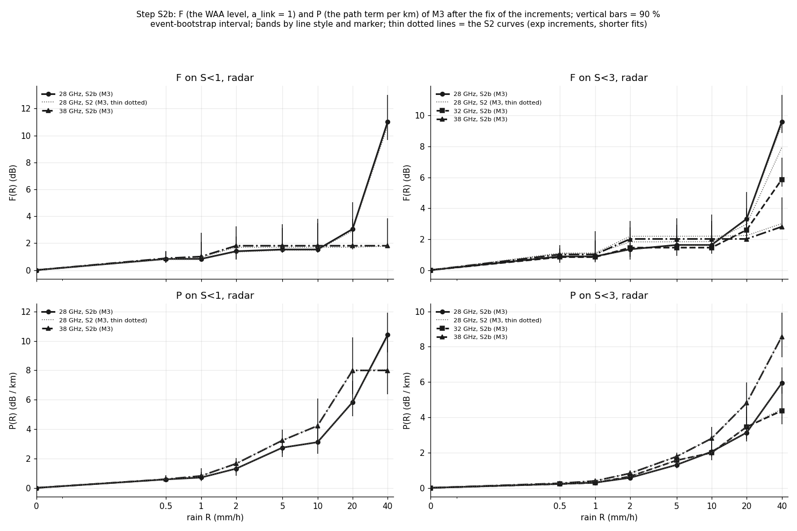
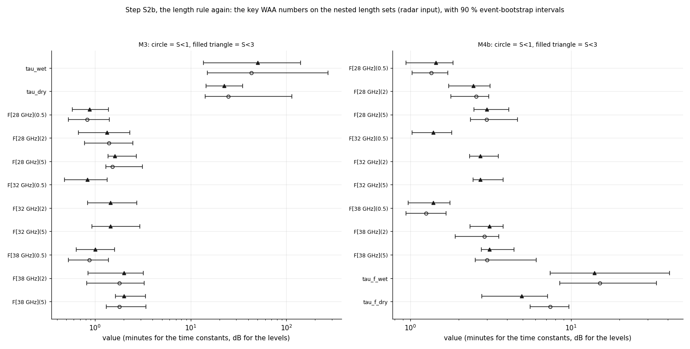
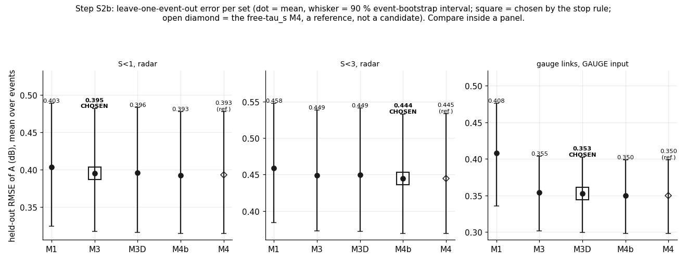
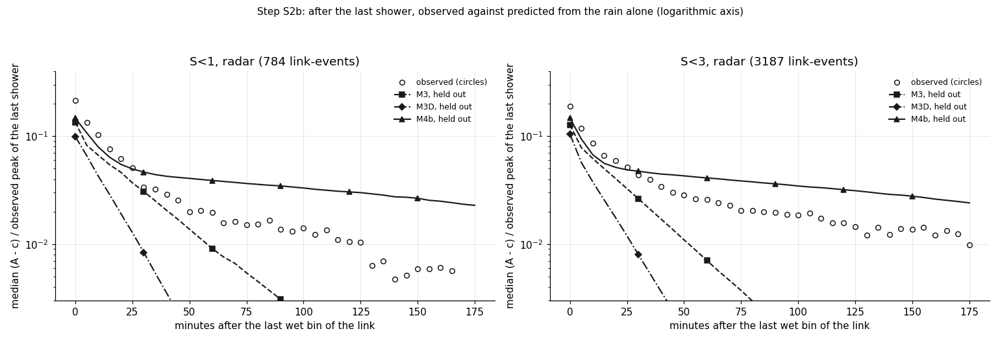

# wet_antenna step S2b: repair and finish the S2 model (the P / F trap, a bounded slow store, longer fits; TRAIN only)

Written by `research/wet_antenna/system_id_s2b.py` (library `system_id.py`). Settings and every rule:
`wet_antenna.system_id_s2b` in `research/config.yaml`, written before the run; data, judge and fake noise as
`wet_antenna.system_id_s2`. Plan: `docs/ROADMAP.md`, "Reboot (2026-10-13)", "WAA v1" and "Remaining plan".

## 1. What was run

- The S2 frame A_pred(t) = W(t) + L * P_band(R(t - d)) + c with three repairs: (1) the increments of P and F between
  the knots (0, 0.5, 1, 2, 5, 10, 20, 40 mm/h) are plain parameters >= 0 (no exp), with 4 starting curves for P (0, 0.5,
  1, 2 x the ITU-R P.838 size; starting values only, never a correction); (2) M4b = M4 with tau_s in
  30-240 min; (3) 8 starts per model, caps 1000 iterations per start and
  1000 for the polish (5 x S2), 120 per fold (3 x S2); bootstrap refits 30 (as S2).
- Candidates M1 < M3 < M3D < M4b (stop rule as S1 / S2; the chosen model = the one chosen on S<1, radar, the main
  set); the free-tau_s M4 is fitted and shown as a reference only. Sets: S<1, radar, S<3, radar, gauge links, GAUGE input.
- Timing: one M4b start on S<3 took 264.5 s (1000 iterations, converged: False); one evaluation
  236 ms; projection 7.63 h on 3 processes (budget 5.0 h). Cut: S<2, the gauge-links radar comparison, fake replicates 3 -> 2.
  Fitting time summed over the processes: 12.4 h. Run time of this run: 0.6 min (fits are cached).
- **Convergence (real data, 15 fits on all events):** 13 converged before the cap;
  68 of 120 starts converged; 120 starts needed more than the S2 cap of
  200 iterations; 356 of 680 leave-one-event-out folds reached the cap of 120
  (474 needed more than the S2 cap of 40).
- TRAIN events only; VAL is never read. S1 and S2 outputs are unchanged (shared functions moved into the library).
- Software: numba 0.68.0, scipy 1.17.1 (L-BFGS-B, exact gradients), numpy 2.4.5.

| set | link_events | links | events | points_5min | links_28 GHz | links_32 GHz | links_38 GHz |
|---|---|---|---|---|---|---|---|
| S<1, radar | 1718 | 41 | 42 | 367190 | 17 | 0 | 24 |
| S<2, radar | 4381 | 99 | 50 | 929641 | 42 | 8 | 49 |
| S<3, radar | 6653 | 144 | 51 | 1351199 | 62 | 12 | 70 |
| gauge links, GAUGE input | 1998 | 42 | 43 | 388362 | 14 | 5 | 23 |
| gauge links, radar input (same points) | 1998 | 42 | 43 | 388362 | 14 | 5 | 23 |

(`research/wet_antenna/outputs/tables/system_id_s2b_counts.csv`.) The convergence of every fit (`research/wet_antenna/outputs/tables/system_id_s2b_convergence.csv`):

| fit | model | converged_on_all_events | d | starts | starts_converged | starts_past_S2_cap | starts_median_iterations | spread_over_starts | best_start | folds | folds_at_cap | folds_past_S2_cap | seconds |
|---|---|---|---|---|---|---|---|---|---|---|---|---|---|
| S<1, radar | M1 | True | 3 | 8 | 8 | 8 | 480.0 | 0.03 | g4+Phalf | 42 | 14 | 20 | 516 |
| S<1, radar | M3 | True | 2 | 8 | 8 | 8 | 702.0 | 0.0 | g1+Pitu | 42 | 34 | 42 | 1192 |
| S<1, radar | M3D | False | -1 | 8 | 0 | 8 | 1000.0 | 8.31 | g2+Phalf | 42 | 42 | 42 | 1282 |
| S<1, radar | M4b | True | -1 | 8 | 8 | 8 | 724.5 | 0.01 | g4+Phalf | 42 | 15 | 20 | 1047 |
| S<1, radar | M4 | True | -1 | 8 | 7 | 8 | 827.5 | 0.09 | g2+Phalf | 42 | 16 | 21 | 862 |
| S<3, radar | M1 | True | 3 | 8 | 5 | 8 | 972.5 | 0.17 | g1+P0 | 51 | 18 | 26 | 3024 |
| S<3, radar | M3 | True | 2 | 8 | 0 | 8 | 1000.0 | 0.1 | g2+Phalf | 51 | 18 | 29 | 5177 |
| S<3, radar | M3D | False | 2 | 8 | 0 | 8 | 1000.0 | 4.81 | g2+Phalf | 51 | 51 | 51 | 5417 |
| S<3, radar | M4b | True | 1 | 8 | 0 | 8 | 1000.0 | 0.34 | g4+Pdouble | 51 | 18 | 27 | 4850 |
| S<3, radar | M4 | True | 1 | 8 | 0 | 8 | 1000.0 | 0.26 | g2+Phalf | 51 | 28 | 39 | 4174 |
| gauge links, GAUGE input | M1 | True | 0 | 8 | 8 | 8 | 511.5 | 0.01 | g2+Phalf | 43 | 14 | 17 | 501 |
| gauge links, GAUGE input | M3 | True | -3 | 8 | 8 | 8 | 497.5 | 0.01 | g4+Pdouble | 43 | 13 | 27 | 902 |
| gauge links, GAUGE input | M3D | True | -3 | 8 | 0 | 8 | 1000.0 | 2.14 | g3+Pitu | 43 | 38 | 42 | 1227 |
| gauge links, GAUGE input | M4b | True | -3 | 8 | 8 | 8 | 564.5 | 0.01 | g3+P0 | 43 | 19 | 40 | 995 |
| gauge links, GAUGE input | M4 | True | -3 | 8 | 8 | 8 | 637.5 | 0.01 | g3+P0 | 43 | 18 | 31 | 828 |
| fake Tc 0, S3 | M3 | False | 2 | 8 | 2 | 8 | 1000.0 | 0.02 | g4+Pdouble | 0 | 0 | 0 | 3064 |
| fake Tc 0, S1 | M3 | True | 2 | 8 | 8 | 8 | 564.0 | 0.01 | g3+P0 | 0 | 0 | 0 | 610 |
| fake Tc 1, S3 | M3 | False | 2 | 8 | 2 | 8 | 1000.0 | 0.06 | g1+P0 | 0 | 0 | 0 | 2982 |
| fake Tc 1, S1 | M3 | True | 2 | 8 | 7 | 8 | 549.0 | 0.01 | g1+P0 | 0 | 0 | 0 | 602 |
| fake Te 0 | M3 | True | 2 | 8 | 8 | 8 | 566.5 | 0.0 | g2+Phalf | 42 | 26 | 28 | 808 |
| fake Te 0 | M3D | True | 2 | 8 | 0 | 8 | 1000.0 | 1.29 | g1+Pitu | 42 | 23 | 26 | 1116 |
| fake Te 0 | M4b | True | 2 | 8 | 8 | 8 | 677.0 | 0.0 | g1+Pitu | 42 | 8 | 18 | 774 |
| fake Te 1 | M3 | True | 2 | 8 | 8 | 8 | 535.0 | 0.01 | g2+Pdouble | 42 | 11 | 18 | 753 |
| fake Te 1 | M3D | False | 2 | 8 | 0 | 8 | 1000.0 | 1.62 | g4+Phalf | 42 | 39 | 41 | 1267 |
| fake Te 1 | M4b | True | 2 | 8 | 8 | 8 | 627.0 | 0.0 | g1+P0 | 42 | 9 | 17 | 749 |

## 2. Item 1: the P / F trap

**Fake check Tc again: PASS.** on S<3 30 of 30 F and P knots (0.5-10 mm/h, every band) are within +-30% of the truth (farthest: F[32 GHz](0.5) x1.15); P(2 mm/h) / truth = 28 GHz 1.02, 32 GHz 1.04, 38 GHz 1.01; on S<1 20 of 20 within.

| set | kind | band | R_mmh | value | truth | ratio |
|---|---|---|---|---|---|---|
| S1 | F | 28 GHz | 0.5 | 1.517 | 1.298 | 1.168 |
| S1 | F | 28 GHz | 1.0 | 2.253 | 2.086 | 1.08 |
| S1 | F | 28 GHz | 2.0 | 3.157 | 2.853 | 1.106 |
| S1 | F | 28 GHz | 5.0 | 3.549 | 3.278 | 1.083 |
| S1 | F | 28 GHz | 10.0 | 3.549 | 3.3 | 1.075 |
| S1 | F | 32 GHz | 0.5 |  | 1.298 |  |
| S1 | F | 32 GHz | 1.0 |  | 2.086 |  |
| S1 | F | 32 GHz | 2.0 |  | 2.853 |  |
| S1 | F | 32 GHz | 5.0 |  | 3.278 |  |
| S1 | F | 32 GHz | 10.0 |  | 3.3 |  |
| S1 | F | 38 GHz | 0.5 | 1.491 | 1.298 | 1.148 |
| S1 | F | 38 GHz | 1.0 | 2.24 | 2.086 | 1.074 |
| S1 | F | 38 GHz | 2.0 | 3.171 | 2.853 | 1.111 |
| S1 | F | 38 GHz | 5.0 | 3.558 | 3.278 | 1.085 |
| S1 | F | 38 GHz | 10.0 | 3.558 | 3.3 | 1.078 |
| S1 | P | 28 GHz | 0.5 | 0.085 | 0.106 | 0.801 |
| S1 | P | 28 GHz | 1.0 | 0.209 | 0.201 | 1.043 |
| S1 | P | 28 GHz | 2.0 | 0.424 | 0.381 | 1.112 |
| S1 | P | 28 GHz | 5.0 | 0.912 | 0.89 | 1.025 |
| S1 | P | 28 GHz | 10.0 | 1.625 | 1.69 | 0.961 |
| S1 | P | 32 GHz | 0.5 |  | 0.147 |  |
| S1 | P | 32 GHz | 1.0 |  | 0.273 |  |
| S1 | P | 32 GHz | 2.0 |  | 0.507 |  |
| S1 | P | 32 GHz | 5.0 |  | 1.152 |  |
| S1 | P | 32 GHz | 10.0 |  | 2.141 |  |
| S1 | P | 38 GHz | 0.5 | 0.236 | 0.204 | 1.157 |
| S1 | P | 38 GHz | 1.0 | 0.397 | 0.37 | 1.073 |
| S1 | P | 38 GHz | 2.0 | 0.691 | 0.672 | 1.028 |
| S1 | P | 38 GHz | 5.0 | 1.501 | 1.477 | 1.016 |
| S1 | P | 38 GHz | 10.0 | 2.646 | 2.68 | 0.987 |
| S3 | F | 28 GHz | 0.5 | 1.398 | 1.298 | 1.076 |
| S3 | F | 28 GHz | 1.0 | 2.11 | 2.086 | 1.011 |
| S3 | F | 28 GHz | 2.0 | 2.965 | 2.853 | 1.039 |
| S3 | F | 28 GHz | 5.0 | 3.316 | 3.278 | 1.012 |
| S3 | F | 28 GHz | 10.0 | 3.316 | 3.3 | 1.005 |
| S3 | F | 32 GHz | 0.5 | 1.488 | 1.298 | 1.146 |
| S3 | F | 32 GHz | 1.0 | 2.169 | 2.086 | 1.04 |
| S3 | F | 32 GHz | 2.0 | 3.107 | 2.853 | 1.089 |
| S3 | F | 32 GHz | 5.0 | 3.419 | 3.278 | 1.043 |
| S3 | F | 32 GHz | 10.0 | 3.419 | 3.3 | 1.036 |
| S3 | F | 38 GHz | 0.5 | 1.44 | 1.298 | 1.109 |
| S3 | F | 38 GHz | 1.0 | 2.153 | 2.086 | 1.032 |
| S3 | F | 38 GHz | 2.0 | 3.033 | 2.853 | 1.063 |
| S3 | F | 38 GHz | 5.0 | 3.397 | 3.278 | 1.036 |
| S3 | F | 38 GHz | 10.0 | 3.397 | 3.3 | 1.029 |
| S3 | P | 28 GHz | 0.5 | 0.111 | 0.106 | 1.055 |
| S3 | P | 28 GHz | 1.0 | 0.204 | 0.201 | 1.016 |
| S3 | P | 28 GHz | 2.0 | 0.39 | 0.381 | 1.024 |
| S3 | P | 28 GHz | 5.0 | 0.899 | 0.89 | 1.011 |
| S3 | P | 28 GHz | 10.0 | 1.689 | 1.69 | 0.999 |
| S3 | P | 32 GHz | 0.5 | 0.148 | 0.147 | 1.006 |
| S3 | P | 32 GHz | 1.0 | 0.271 | 0.273 | 0.993 |
| S3 | P | 32 GHz | 2.0 | 0.525 | 0.507 | 1.036 |
| S3 | P | 32 GHz | 5.0 | 1.182 | 1.152 | 1.026 |
| S3 | P | 32 GHz | 10.0 | 2.126 | 2.141 | 0.993 |
| S3 | P | 38 GHz | 0.5 | 0.213 | 0.204 | 1.044 |
| S3 | P | 38 GHz | 1.0 | 0.375 | 0.37 | 1.014 |
| S3 | P | 38 GHz | 2.0 | 0.68 | 0.672 | 1.012 |
| S3 | P | 38 GHz | 5.0 | 1.495 | 1.477 | 1.012 |
| S3 | P | 38 GHz | 10.0 | 2.688 | 2.68 | 1.003 |

(`research/wet_antenna/outputs/tables/system_id_s2b_fake_tc_knots.csv`; median over 2 replicates; truth F = 3.3 (1 - exp(-R / 1)) dB, P = the ITU size.)



The curves of M3 on the main set (S<1, radar):

| set | model | parameter | value | lo | hi |
|---|---|---|---|---|---|
| S<1, radar | M3 | F[28 GHz](0.5) | 0.827 | 0.53 | 1.41 |
| S<1, radar | M3 | P[28 GHz](0.5) | 0.577 | 0.389 | 0.814 |
| S<1, radar | M3 | F[28 GHz](1) | 0.827 | 0.644 | 2.108 |
| S<1, radar | M3 | P[28 GHz](1) | 0.702 | 0.441 | 1.087 |
| S<1, radar | M3 | F[28 GHz](2) | 1.398 | 0.776 | 2.489 |
| S<1, radar | M3 | P[28 GHz](2) | 1.307 | 0.806 | 1.614 |
| S<1, radar | M3 | F[28 GHz](5) | 1.528 | 1.3 | 3.146 |
| S<1, radar | M3 | P[28 GHz](5) | 2.738 | 2.098 | 3.263 |
| S<1, radar | M3 | F[28 GHz](10) | 1.528 | 1.3 | 3.481 |
| S<1, radar | M3 | P[28 GHz](10) | 3.107 | 2.336 | 4.337 |
| S<1, radar | M3 | F[28 GHz](20) | 3.048 | 2.054 | 5.045 |
| S<1, radar | M3 | P[28 GHz](20) | 5.835 | 4.884 | 7.288 |
| S<1, radar | M3 | F[28 GHz](40) | 11.008 | 9.682 | 13.03 |
| S<1, radar | M3 | P[28 GHz](40) | 10.417 | 9.208 | 11.939 |
| S<1, radar | M3 | F[38 GHz](0.5) | 0.876 | 0.529 | 1.381 |
| S<1, radar | M3 | P[38 GHz](0.5) | 0.588 | 0.387 | 0.855 |
| S<1, radar | M3 | F[38 GHz](1) | 1.002 | 0.667 | 2.787 |
| S<1, radar | M3 | P[38 GHz](1) | 0.813 | 0.514 | 1.344 |
| S<1, radar | M3 | F[38 GHz](2) | 1.807 | 0.818 | 3.268 |
| S<1, radar | M3 | P[38 GHz](2) | 1.648 | 1.025 | 2.04 |
| S<1, radar | M3 | F[38 GHz](5) | 1.807 | 1.309 | 3.422 |
| S<1, radar | M3 | P[38 GHz](5) | 3.233 | 2.357 | 3.973 |
| S<1, radar | M3 | F[38 GHz](10) | 1.807 | 1.335 | 3.804 |
| S<1, radar | M3 | P[38 GHz](10) | 4.224 | 3.092 | 6.08 |
| S<1, radar | M3 | F[38 GHz](20) | 1.807 | 1.525 | 3.819 |
| S<1, radar | M3 | P[38 GHz](20) | 7.996 | 6.384 | 10.247 |
| S<1, radar | M3 | F[38 GHz](40) | 1.807 | 1.659 | 3.828 |
| S<1, radar | M3 | P[38 GHz](40) | 7.996 | 6.384 | 10.42 |

**The length rule again, read on M3: AGREE.** Every key number of S<3 lies inside the S<1 interval: S<3 can be the main set.

| model | key | S1_value | S1_lo | S1_hi | S2_value | S2_lo | S2_hi | S3_value | S3_lo | S3_hi | in_rule | S3_inside_S1_interval |
|---|---|---|---|---|---|---|---|---|---|---|---|---|
| M3 | tau_wet | 42.985 | 14.899 | 274.022 |  |  |  | 50.269 | 13.555 | 140.669 | True | True |
| M3 | tau_dry | 24.669 | 14.224 | 114.664 |  |  |  | 22.537 | 14.538 | 35.016 | True | True |
| M3 | F[28 GHz](0.5) | 0.827 | 0.53 | 1.41 |  |  |  | 0.885 | 0.579 | 1.39 | True | True |
| M3 | F[28 GHz](2) | 1.398 | 0.776 | 2.489 |  |  |  | 1.346 | 0.672 | 2.325 | True | True |
| M3 | F[28 GHz](5) | 1.528 | 1.3 | 3.146 |  |  |  | 1.625 | 1.363 | 2.703 | True | True |
| M3 | F[32 GHz](0.5) |  |  |  |  |  |  | 0.838 | 0.48 | 1.339 | False |  |
| M3 | F[32 GHz](2) |  |  |  |  |  |  | 1.452 | 0.838 | 2.745 | False |  |
| M3 | F[32 GHz](5) |  |  |  |  |  |  | 1.452 | 0.925 | 2.948 | False |  |
| M3 | F[38 GHz](0.5) | 0.876 | 0.529 | 1.381 |  |  |  | 1.013 | 0.64 | 1.602 | True | True |
| M3 | F[38 GHz](2) | 1.807 | 0.818 | 3.268 |  |  |  | 2.014 | 0.846 | 3.193 | True | True |
| M3 | F[38 GHz](5) | 1.807 | 1.309 | 3.422 |  |  |  | 2.014 | 1.64 | 3.364 | True | True |
| M3 | P[28 GHz](2) | 1.307 | 0.806 | 1.614 |  |  |  | 0.572 | 0.42 | 0.714 | False | False |
| M3 | P[28 GHz](5) | 2.738 | 2.098 | 3.263 |  |  |  | 1.303 | 1.117 | 1.42 | False | False |
| M3 | P[28 GHz](10) | 3.107 | 2.336 | 4.337 |  |  |  | 2.051 | 1.789 | 2.61 | False | False |
| M3 | P[32 GHz](2) |  |  |  |  |  |  | 0.65 | 0.398 | 0.807 | False |  |
| M3 | P[32 GHz](5) |  |  |  |  |  |  | 1.558 | 1.279 | 1.8 | False |  |
| M3 | P[32 GHz](10) |  |  |  |  |  |  | 1.99 | 1.565 | 2.909 | False |  |
| M3 | P[38 GHz](2) | 1.648 | 1.025 | 2.04 |  |  |  | 0.825 | 0.675 | 0.994 | False | False |
| M3 | P[38 GHz](5) | 3.233 | 2.357 | 3.973 |  |  |  | 1.772 | 1.484 | 1.987 | False | False |
| M3 | P[38 GHz](10) | 4.224 | 3.092 | 6.08 |  |  |  | 2.8 | 2.222 | 3.459 | False | False |
| M4b | tau_f_wet | 15.044 | 8.511 | 33.969 |  |  |  | 13.954 | 7.429 | 40.979 | True | True |
| M4b | tau_f_dry | 7.401 | 5.563 | 9.666 |  |  |  | 4.928 | 2.776 | 7.156 | True | False |
| M4b | F[28 GHz](0.5) | 1.352 | 1.025 | 1.714 |  |  |  | 1.441 | 0.938 | 1.846 | True | True |
| M4b | F[28 GHz](2) | 2.563 | 1.782 | 3.081 |  |  |  | 2.476 | 1.726 | 3.136 | True | True |
| M4b | F[28 GHz](5) | 2.982 | 2.365 | 4.643 |  |  |  | 2.992 | 2.482 | 4.106 | True | True |
| M4b | F[32 GHz](0.5) |  |  |  |  |  |  | 1.396 | 1.022 | 1.807 | False |  |
| M4b | F[32 GHz](2) |  |  |  |  |  |  | 2.731 | 2.341 | 3.535 | False |  |
| M4b | F[32 GHz](5) |  |  |  |  |  |  | 2.731 | 2.449 | 3.774 | False |  |
| M4b | F[38 GHz](0.5) | 1.254 | 0.942 | 1.668 |  |  |  | 1.391 | 0.972 | 1.766 | True | True |
| M4b | F[38 GHz](2) | 2.892 | 1.9 | 3.556 |  |  |  | 3.105 | 2.351 | 3.768 | True | True |
| M4b | F[38 GHz](5) | 3.004 | 2.526 | 6.069 |  |  |  | 3.105 | 2.761 | 4.403 | True | True |
| M4b | P[28 GHz](2) | 0.132 | 0.0 | 0.464 |  |  |  | 0.201 | 0.085 | 0.363 | False | True |
| M4b | P[28 GHz](5) | 1.171 | 0.512 | 1.698 |  |  |  | 0.785 | 0.529 | 0.994 | False | True |
| M4b | P[28 GHz](10) | 1.439 | 0.687 | 2.461 |  |  |  | 1.498 | 1.161 | 2.077 | False | True |
| M4b | P[32 GHz](2) |  |  |  |  |  |  | 0.219 | 0.019 | 0.451 | False |  |
| M4b | P[32 GHz](5) |  |  |  |  |  |  | 1.045 | 0.764 | 1.361 | False |  |
| M4b | P[32 GHz](10) |  |  |  |  |  |  | 1.44 | 1.008 | 2.185 | False |  |
| M4b | P[38 GHz](2) | 0.26 | 0.0 | 0.702 |  |  |  | 0.335 | 0.128 | 0.545 | False | True |
| M4b | P[38 GHz](5) | 1.474 | 0.533 | 1.96 |  |  |  | 1.168 | 0.798 | 1.44 | False | True |
| M4b | P[38 GHz](10) | 2.401 | 0.96 | 3.905 |  |  |  | 2.231 | 1.58 | 2.911 | False | True |

(`research/wet_antenna/outputs/tables/system_id_s2b_length_rule.csv`; P is shown, not in the rule.)



## 3. Item 2: a bounded slow store

**Fake check Te (truth M4b: phi 0.8, tau_f_wet 3, tau_f_dry 10, tau_s 90 min): PASS.** M4b chosen in 2 of 2 replicates (M4b, M4b); median tau_s 96 min (true 90, x1.06); phi 0.80 (true 0.8), tau_f_wet 3.0 (3), tau_f_dry 10.2 (10).

| replicate | chosen | best | phi | tau_f_wet | tau_f_dry | tau_s | d | rmse_M3 | rmse_M3D | rmse_M4b |
|---|---|---|---|---|---|---|---|---|---|---|
| 0 | M4b | M4b | 0.7952 | 3.0699 | 10.1825 | 103.7964 | 2 | 0.2836 | 0.2835 | 0.2799 |
| 1 | M4b | M4b | 0.8007 | 2.9712 | 10.1742 | 87.6455 | 2 | 0.2736 | 0.2736 | 0.2699 |

(`research/wet_antenna/outputs/tables/system_id_s2b_fake_checks.csv`.) The ladder per set (held-out RMSE of A in dB, from the rain alone; minus_best with the 90 % interval
of the paired difference to the best candidate):

| set | role | model | rmse | rmse_lo | rmse_hi | minus_best | diff_lo | diff_hi | interval_holds_0 |
|---|---|---|---|---|---|---|---|---|---|
| S<1, radar | candidate | M1 | 0.4034 | 0.3239 | 0.4893 | 0.0109 | 0.0015 | 0.0189 | False |
| S<1, radar | candidate | M3 | 0.3955 | 0.3171 | 0.482 | 0.0029 | -0.0005 | 0.0061 | True |
| S<1, radar | candidate | M3D | 0.3955 | 0.3155 | 0.4835 | 0.0029 | -0.0018 | 0.0073 | True |
| S<1, radar | candidate | M4b | 0.3926 | 0.3144 | 0.4781 | 0.0 | 0.0 | 0.0 | True |
| S<1, radar | reference | M4 | 0.3927 | 0.3146 | 0.4782 | 0.0001 | -0.0003 | 0.0006 | True |
| S<3, radar | candidate | M1 | 0.4584 | 0.3844 | 0.5478 | 0.014 | 0.0088 | 0.0201 | False |
| S<3, radar | candidate | M3 | 0.4491 | 0.3728 | 0.5387 | 0.0047 | 0.0021 | 0.0076 | False |
| S<3, radar | candidate | M3D | 0.4494 | 0.3718 | 0.5411 | 0.005 | 0.0015 | 0.0088 | False |
| S<3, radar | candidate | M4b | 0.4444 | 0.3692 | 0.5329 | 0.0 | 0.0 | 0.0 | True |
| S<3, radar | reference | M4 | 0.4447 | 0.3694 | 0.5336 | 0.0003 | -0.0001 | 0.0007 | True |
| gauge links, GAUGE input | candidate | M1 | 0.4081 | 0.3354 | 0.4763 | 0.0583 | 0.0338 | 0.0832 | False |
| gauge links, GAUGE input | candidate | M3 | 0.3545 | 0.302 | 0.4042 | 0.0047 | 0.002 | 0.0074 | False |
| gauge links, GAUGE input | candidate | M3D | 0.353 | 0.2999 | 0.4027 | 0.0031 | -0.0002 | 0.0073 | True |
| gauge links, GAUGE input | candidate | M4b | 0.3499 | 0.2983 | 0.3992 | 0.0 | 0.0 | 0.0 | True |
| gauge links, GAUGE input | reference | M4 | 0.3498 | 0.2985 | 0.3991 | -0.0001 | -0.0005 | 0.0003 | True |

**Chosen on the main set (S<1, radar): M3** (best: M4b). Per set: S<1, radar: best M4b, chosen M3, S<3, radar: best M4b, chosen M4b, gauge links, GAUGE input: best M4b, chosen M3D.

After the rain and the peaks (reported, not in the rule; integral = 0-180 min after the last wet bin, predicted / observed, 1 = right):

| set | model | rmse_rain | rmse_0_60 | rmse_60_180 | integral_pred_over_obs | shower_peak_error_median | shower_peak_error_lo | shower_peak_error_hi |
|---|---|---|---|---|---|---|---|---|
| S<1, radar | M1 | 0.601 | 0.276 | 0.241 | 0.316 | -0.571 | -0.737 | -0.395 |
| S<1, radar | M3 | 0.571 | 0.27 | 0.24 | 1.049 | -0.825 | -0.999 | -0.652 |
| S<1, radar | M3D | 0.569 | 0.268 | 0.241 | 0.53 | -0.864 | -1.03 | -0.697 |
| S<1, radar | M4b | 0.567 | 0.263 | 0.239 | 2.067 | -0.781 | -0.946 | -0.614 |
| S<1, radar | M4 | 0.567 | 0.263 | 0.239 | 2.367 | -0.777 | -0.951 | -0.62 |
| S<3, radar | M1 | 0.791 | 0.313 | 0.262 | 0.179 | -0.672 | -0.877 | -0.472 |
| S<3, radar | M3 | 0.751 | 0.31 | 0.262 | 0.55 | -0.967 | -1.202 | -0.735 |
| S<3, radar | M3D | 0.748 | 0.308 | 0.262 | 0.303 | -1.008 | -1.232 | -0.781 |
| S<3, radar | M4b | 0.742 | 0.304 | 0.262 | 1.142 | -0.89 | -1.113 | -0.669 |
| S<3, radar | M4 | 0.742 | 0.304 | 0.263 | 1.239 | -0.895 | -1.118 | -0.669 |
| gauge links, GAUGE input | M1 | 0.844 | 0.242 | 0.215 | 0.0 | -0.419 | -0.64 | -0.244 |
| gauge links, GAUGE input | M3 | 0.652 | 0.27 | 0.217 | 5.77 | -0.7 | -0.824 | -0.569 |
| gauge links, GAUGE input | M3D | 0.646 | 0.261 | 0.216 | 4.473 | -0.733 | -0.85 | -0.61 |
| gauge links, GAUGE input | M4b | 0.645 | 0.257 | 0.215 | 8.381 | -0.682 | -0.796 | -0.549 |
| gauge links, GAUGE input | M4 | 0.644 | 0.257 | 0.216 | 9.717 | -0.672 | -0.781 | -0.545 |

(`research/wet_antenna/outputs/tables/system_id_s2b_ladder.csv`.)





Median (A - c) / peak after the last shower (`research/wet_antenna/outputs/tables/system_id_s2b_after_last_shower.csv`):

| minutes_after_last_wet_bin | link_events | observed | M3 | M3D | M4b | M4 | set |
|---|---|---|---|---|---|---|---|
| 0 | 784 | 0.214 | 0.135 | 0.099 | 0.147 | 0.149 | S<1, radar |
| 10 | 784 | 0.103 | 0.067 | 0.043 | 0.08 | 0.081 | S<1, radar |
| 20 | 784 | 0.062 | 0.046 | 0.019 | 0.055 | 0.055 | S<1, radar |
| 30 | 784 | 0.034 | 0.031 | 0.008 | 0.046 | 0.047 | S<1, radar |
| 45 | 784 | 0.025 | 0.017 | 0.002 | 0.041 | 0.041 | S<1, radar |
| 60 | 784 | 0.02 | 0.009 | 0.001 | 0.039 | 0.039 | S<1, radar |
| 90 | 784 | 0.014 | 0.003 | 0.0 | 0.035 | 0.038 | S<1, radar |
| 120 | 784 | 0.011 | 0.001 | 0.0 | 0.03 | 0.035 | S<1, radar |
| 150 | 784 | 0.006 | 0.0 | 0.0 | 0.027 | 0.032 | S<1, radar |
| 175 | 784 | 0.0 | 0.0 | 0.0 | 0.023 | 0.03 | S<1, radar |
| 0 | 3187 | 0.189 | 0.128 | 0.104 | 0.147 | 0.149 | S<3, radar |
| 10 | 3187 | 0.086 | 0.062 | 0.038 | 0.067 | 0.069 | S<3, radar |
| 20 | 3187 | 0.059 | 0.04 | 0.018 | 0.051 | 0.05 | S<3, radar |
| 30 | 3187 | 0.044 | 0.026 | 0.008 | 0.047 | 0.046 | S<3, radar |
| 45 | 3187 | 0.03 | 0.014 | 0.002 | 0.044 | 0.043 | S<3, radar |
| 60 | 3187 | 0.026 | 0.007 | 0.001 | 0.041 | 0.042 | S<3, radar |
| 90 | 3187 | 0.02 | 0.002 | 0.0 | 0.036 | 0.038 | S<3, radar |
| 120 | 3187 | 0.016 | 0.001 | 0.0 | 0.032 | 0.035 | S<3, radar |
| 150 | 3187 | 0.014 | 0.0 | 0.0 | 0.028 | 0.032 | S<3, radar |
| 175 | 3187 | 0.01 | 0.0 | 0.0 | 0.024 | 0.029 | S<3, radar |

**Reading of item 2.** The fitting finds a bounded slow store when there is one (fake check Te: M4b chosen in
2 of 2, tau_s x1.06). On the real data M4b is the best candidate on every set, but by little: on the
main set M3 - M4b = +0.0029 dB (-0.0005 .. +0.0061), so the stop rule takes **M3**; on S<3 M3 is outside
(+0.0047, +0.0021 .. +0.0076) and M4b is chosen there; with the gauge input M3D is chosen. M4b and the free
M4 give the same RMSE within 0.0003 dB.

**The bound did not fix the leftover.** tau_s of M4b sits at the upper bound 240 min on every set (S<1 240 [192, 240],
S<3 240 [126, 240], gauge 240 [240, 240]): the fit still wants a longer store. After the last
shower M4b stays too high (S<1: 0.030 of the peak at 120 min against 0.011 observed; integral 0-180 min
2.07 x the observed, M4 2.37 x), while M3 falls to 0 too early (0.009 at 60 min against
0.020; integral 1.05 x on S<1 but 0.55 x on S<3). The RMSE 60-180 min is the same for every rung
(0.239-0.241 dB on S<1): after the rain the error is noise, not the model. **The slow leftover (2-4 % of the peak,
1-2 h) is still not described by any rung**: a store fed by the same F during the whole event fills over long events and
then empties too slowly. (With the gauge input the integral ratios, 0.0-9.7, rest on a very small observed integral.)

## 4. Item 3: did the longer fits change a choice or a number?

**Convergence.** 13 of 15 fits on all events converged before the cap (not: M3D on S<1, radar, M3D on S<3, radar);
68 of 120 starts converged, and every start needed more than the S2 cap of 200 iterations; 356 of
680 folds still reached the new cap of 120. M3D converges nowhere on the radar sets (its drift slopes, one per
link-event, make a long flat valley). The spread of the loss over the 8 starts is below 0.4 for every model except M3D: the
starts end in the same place.

**Was S2 trapped on the real data? Hardly.** The training loss of the S2b fit minus that of S2, same model and data:
M1 S<1 -0.2, M3 S<1 -0.1, M3D S<1 -9.6, M4 S<1 -0.3, M1 S<3 -1.0, M3 S<3 -0.9, M3D S<3 -124.8, M4 S<3 -7.1, M1 gauge -0.3, M3 gauge -9.8, M3D gauge -14.5, M4 gauge -2.0 (losses of 2e4-1e5). Apart from M3D the
changes are at most 10 units: the S2 fits on the radar sets were at the same minimum, and their numbers stand
(M3 and M4 change by a few % at most, see the table). The trap of S2 showed on the fake data (Tc now PASS) and in ONE place on
the real data: **the level F at light rain with the GAUGE input** moved a lot for a tiny change of the loss (M3 F[28 GHz](0.5)
0.14 -> 0.64 dB, M4 0.17 -> 0.98; F(2) 0.76 -> 2.96). So v1's "with the gauge the
level is still rising at 5 mm/h" was mostly the trap: with the gauge the level is now about 2-3 dB by 2 mm/h, as with the radar.
The S2 bootstrap intervals of those numbers were narrow (e.g. 0.12-0.15 dB) and did not hold the new value: refits that start
from the fit and stop after 30 iterations do not explore a flat direction.

**Choices.** On S<1 the chosen model changed from M3D (S2) to M3: not because M3 got better (held-out 0.3938 -> 0.3955 dB)
but because the best got a little worse (S2 M4 0.3899; S2b M4b 0.3926, M4 0.3927). The longer folds (120
instead of 40 iterations) raise the held-out RMSE of almost every model by 0.001-0.003 dB: stopping early acted as a
mild regularisation, and the judge depends on that cap. On S<3: M4 (S2) -> M4b (M4 is no longer a candidate). Gauge: M3D in both.

| what | set | S2 | S2b | note |
|---|---|---|---|---|
| chosen model | S<1, radar | M3D | M3 | S2 ladder M1 < M3 < M3D < M4 < M5; S2b M1 < M3 < M3D < M4b |
| chosen model | S<3, radar | M4 | M4b | S2 ladder M1 < M3 < M3D < M4 < M5; S2b M1 < M3 < M3D < M4b |
| chosen model | gauge links, GAUGE input | M3D | M3D | S2 ladder M1 < M3 < M3D < M4 < M5; S2b M1 < M3 < M3D < M4b |
| tau_wet: S2 M3 -> S2b M3 | S<1, radar | 43.0107 | 42.984791959791124 | S2 interval 15.1..174 |
| tau_dry: S2 M3 -> S2b M3 | S<1, radar | 24.6548 | 24.669206917618286 | S2 interval 13.6..83.6 |
| F[28 GHz](0.5): S2 M3 -> S2b M3 | S<1, radar | 0.7966 | 0.8274951001073838 | S2 interval 0.56..1.58 |
| F[28 GHz](2): S2 M3 -> S2b M3 | S<1, radar | 1.3384 | 1.3975081072143718 | S2 interval 0.711..2.26 |
| F[28 GHz](5): S2 M3 -> S2b M3 | S<1, radar | 1.4721 | 1.5278274453271823 | S2 interval 1.17..2.48 |
| F[38 GHz](0.5): S2 M3 -> S2b M3 | S<1, radar | 0.8215 | 0.8758539313081403 | S2 interval 0.504..1.38 |
| F[38 GHz](2): S2 M3 -> S2b M3 | S<1, radar | 1.6939 | 1.8071529167259017 | S2 interval 1.16..2.75 |
| F[38 GHz](5): S2 M3 -> S2b M3 | S<1, radar | 1.6947 | 1.8071529167259017 | S2 interval 1.16..2.75 |
| P[28 GHz](2): S2 M3 -> S2b M3 | S<1, radar | 1.3073 | 1.307001449414225 | S2 interval 0.673..1.65 |
| P[28 GHz](10): S2 M3 -> S2b M3 | S<1, radar | 3.1015 | 3.107204950460029 | S2 interval 2.44..4.07 |
| P[38 GHz](2): S2 M3 -> S2b M3 | S<1, radar | 1.6475 | 1.6477523006279446 | S2 interval 0.922..2.02 |
| P[38 GHz](10): S2 M3 -> S2b M3 | S<1, radar | 4.2177 | 4.2238896312104925 | S2 interval 3.27..6.92 |
| tau_f_wet: S2 M4 -> S2b M4 | S<1, radar | 17.2427 | 17.187075688733707 | S2 interval 8.95..35.7 |
| tau_f_dry: S2 M4 -> S2b M4 | S<1, radar | 8.2643 | 8.246042655559478 | S2 interval 5.68..9.81 |
| tau_s: S2 M4 -> S2b M4 | S<1, radar | 512.1228 | 511.52942907309347 | S2 interval 225..600 |
| F[28 GHz](0.5): S2 M4 -> S2b M4 | S<1, radar | 1.4624 | 1.400884713859595 | S2 interval 1.07..1.83 |
| F[28 GHz](2): S2 M4 -> S2b M4 | S<1, radar | 2.8167 | 2.7086536192869737 | S2 interval 2..3.18 |
| F[28 GHz](5): S2 M4 -> S2b M4 | S<1, radar | 3.1755 | 3.0412006631380013 | S2 interval 2.29..4.43 |
| F[38 GHz](0.5): S2 M4 -> S2b M4 | S<1, radar | 1.3498 | 1.2981845662758 | S2 interval 0.993..1.79 |
| F[38 GHz](2): S2 M4 -> S2b M4 | S<1, radar | 3.1816 | 3.048101530737144 | S2 interval 2.55..4.54 |
| F[38 GHz](5): S2 M4 -> S2b M4 | S<1, radar | 3.2187 | 3.1010312394314945 | S2 interval 2.58..4.58 |
| P[28 GHz](2): S2 M4 -> S2b M4 | S<1, radar | 0.1628 | 0.15314825827656414 | S2 interval 0.0726..0.402 |
| P[28 GHz](10): S2 M4 -> S2b M4 | S<1, radar | 1.5054 | 1.508864130863118 | S2 interval 0.98..2.31 |
| P[38 GHz](2): S2 M4 -> S2b M4 | S<1, radar | 0.3048 | 0.30366110199346097 | S2 interval 0.0362..0.671 |
| P[38 GHz](10): S2 M4 -> S2b M4 | S<1, radar | 2.5022 | 2.4839174930506878 | S2 interval 1.75..4.52 |
| tau_f_wet: S2 M4 -> S2b M4b | S<1, radar | 17.2427 | 15.043970842813723 | S2 interval 8.95..35.7 |
| tau_f_dry: S2 M4 -> S2b M4b | S<1, radar | 8.2643 | 7.40080596035995 | S2 interval 5.68..9.81 |
| tau_s: S2 M4 -> S2b M4b | S<1, radar | 512.1228 | 239.99999999999997 | S2 interval 225..600 |
| F[28 GHz](0.5): S2 M4 -> S2b M4b | S<1, radar | 1.4624 | 1.3521504277542298 | S2 interval 1.07..1.83 |
| F[28 GHz](2): S2 M4 -> S2b M4b | S<1, radar | 2.8167 | 2.562660978230155 | S2 interval 2..3.18 |
| F[28 GHz](5): S2 M4 -> S2b M4b | S<1, radar | 3.1755 | 2.98180038173527 | S2 interval 2.29..4.43 |
| F[38 GHz](0.5): S2 M4 -> S2b M4b | S<1, radar | 1.3498 | 1.2541753287475004 | S2 interval 0.993..1.79 |
| F[38 GHz](2): S2 M4 -> S2b M4b | S<1, radar | 3.1816 | 2.8918000870964096 | S2 interval 2.55..4.54 |
| F[38 GHz](5): S2 M4 -> S2b M4b | S<1, radar | 3.2187 | 3.0040424084671296 | S2 interval 2.58..4.58 |
| P[28 GHz](2): S2 M4 -> S2b M4b | S<1, radar | 0.1628 | 0.13244773050595693 | S2 interval 0.0726..0.402 |
| P[28 GHz](10): S2 M4 -> S2b M4b | S<1, radar | 1.5054 | 1.4387736682765526 | S2 interval 0.98..2.31 |
| P[38 GHz](2): S2 M4 -> S2b M4b | S<1, radar | 0.3048 | 0.25959648930372714 | S2 interval 0.0362..0.671 |
| P[38 GHz](10): S2 M4 -> S2b M4b | S<1, radar | 2.5022 | 2.400698551386903 | S2 interval 1.75..4.52 |
| tau_wet: S2 M3 -> S2b M3 | S<3, radar | 50.2662 | 50.26861040971534 | S2 interval 12.7..152 |
| tau_dry: S2 M3 -> S2b M3 | S<3, radar | 22.5454 | 22.536567427865258 | S2 interval 14.2..35.4 |
| F[28 GHz](0.5): S2 M3 -> S2b M3 | S<3, radar | 0.8684 | 0.8850313504276309 | S2 interval 0.57..1.48 |
| F[28 GHz](2): S2 M3 -> S2b M3 | S<3, radar | 1.3205 | 1.3455157220648875 | S2 interval 0.674..2.22 |
| F[28 GHz](5): S2 M3 -> S2b M3 | S<3, radar | 1.5916 | 1.624892229021402 | S2 interval 1.32..2.64 |
| F[32 GHz](0.5): S2 M3 -> S2b M3 | S<3, radar | 1.0504 | 0.8384958414264396 | S2 interval 0.573..1.97 |
| F[32 GHz](2): S2 M3 -> S2b M3 | S<3, radar | 1.8244 | 1.4516967149071527 | S2 interval 1.09..3.23 |
| F[32 GHz](5): S2 M3 -> S2b M3 | S<3, radar | 1.8313 | 1.4516967149071527 | S2 interval 1.1..3.23 |
| F[38 GHz](0.5): S2 M3 -> S2b M3 | S<3, radar | 1.1009 | 1.0129782261629023 | S2 interval 0.656..1.94 |
| F[38 GHz](2): S2 M3 -> S2b M3 | S<3, radar | 2.1884 | 2.014083082960809 | S2 interval 1.4..3.57 |
| F[38 GHz](5): S2 M3 -> S2b M3 | S<3, radar | 2.1896 | 2.014083082960809 | S2 interval 1.4..3.57 |
| P[28 GHz](2): S2 M3 -> S2b M3 | S<3, radar | 0.5723 | 0.5720891415041558 | S2 interval 0.413..0.693 |
| P[28 GHz](10): S2 M3 -> S2b M3 | S<3, radar | 2.05 | 2.051426028738784 | S2 interval 1.8..2.55 |
| P[32 GHz](2): S2 M3 -> S2b M3 | S<3, radar | 0.6467 | 0.6497791644414819 | S2 interval 0.397..0.802 |
| P[32 GHz](10): S2 M3 -> S2b M3 | S<3, radar | 1.9863 | 1.9903981897863048 | S2 interval 1.63..2.71 |
| P[38 GHz](2): S2 M3 -> S2b M3 | S<3, radar | 0.8252 | 0.824576277233342 | S2 interval 0.569..0.962 |
| P[38 GHz](10): S2 M3 -> S2b M3 | S<3, radar | 2.8013 | 2.7999735399469996 | S2 interval 2.42..3.46 |
| tau_f_wet: S2 M4 -> S2b M4 | S<3, radar | 15.9071 | 16.54335530140326 | S2 interval 6.43..58.6 |
| tau_f_dry: S2 M4 -> S2b M4 | S<3, radar | 5.5145 | 5.642232521688518 | S2 interval 3.08..7.11 |
| tau_s: S2 M4 -> S2b M4 | S<3, radar | 395.4206 | 399.868436902995 | S2 interval 169..600 |
| F[28 GHz](0.5): S2 M4 -> S2b M4 | S<3, radar | 1.4155 | 1.4460425189617059 | S2 interval 1.08..1.98 |
| F[28 GHz](2): S2 M4 -> S2b M4 | S<3, radar | 2.4262 | 2.5532223513957333 | S2 interval 1.79..2.96 |
| F[28 GHz](5): S2 M4 -> S2b M4 | S<3, radar | 2.7739 | 2.924224937920333 | S2 interval 2.2..3.98 |
| F[32 GHz](0.5): S2 M4 -> S2b M4 | S<3, radar | 1.4342 | 1.560992059279945 | S2 interval 0.934..2.04 |
| F[32 GHz](2): S2 M4 -> S2b M4 | S<3, radar | 2.7238 | 3.0213642885466694 | S2 interval 2.15..3.6 |
| F[32 GHz](5): S2 M4 -> S2b M4 | S<3, radar | 2.7585 | 3.0213642885466694 | S2 interval 2.19..3.63 |
| F[38 GHz](0.5): S2 M4 -> S2b M4 | S<3, radar | 1.3618 | 1.4566867073533658 | S2 interval 0.988..1.66 |
| F[38 GHz](2): S2 M4 -> S2b M4 | S<3, radar | 3.073 | 3.2876062667365344 | S2 interval 2.49..3.93 |
| F[38 GHz](5): S2 M4 -> S2b M4 | S<3, radar | 3.0841 | 3.2876062667365344 | S2 interval 2.5..3.94 |
| P[28 GHz](2): S2 M4 -> S2b M4 | S<3, radar | 0.1965 | 0.2198549895575448 | S2 interval 0.0647..0.387 |
| P[28 GHz](10): S2 M4 -> S2b M4 | S<3, radar | 1.5236 | 1.5593728956814643 | S2 interval 1.2..1.89 |
| P[32 GHz](2): S2 M4 -> S2b M4 | S<3, radar | 0.244 | 0.249394512030083 | S2 interval 0.125..0.398 |
| P[32 GHz](10): S2 M4 -> S2b M4 | S<3, radar | 1.4379 | 1.4778604620855087 | S2 interval 1.03..1.96 |
| P[38 GHz](2): S2 M4 -> S2b M4 | S<3, radar | 0.3611 | 0.3742403485905878 | S2 interval 0.157..0.583 |
| P[38 GHz](10): S2 M4 -> S2b M4 | S<3, radar | 2.2619 | 2.2799175194872854 | S2 interval 1.85..2.71 |
| tau_f_wet: S2 M4 -> S2b M4b | S<3, radar | 15.9071 | 13.954228544253342 | S2 interval 6.43..58.6 |
| tau_f_dry: S2 M4 -> S2b M4b | S<3, radar | 5.5145 | 4.928415330620982 | S2 interval 3.08..7.11 |
| tau_s: S2 M4 -> S2b M4b | S<3, radar | 395.4206 | 239.99999999999997 | S2 interval 169..600 |
| F[28 GHz](0.5): S2 M4 -> S2b M4b | S<3, radar | 1.4155 | 1.4405856827391452 | S2 interval 1.08..1.98 |
| F[28 GHz](2): S2 M4 -> S2b M4b | S<3, radar | 2.4262 | 2.4757521126671014 | S2 interval 1.79..2.96 |
| F[28 GHz](5): S2 M4 -> S2b M4b | S<3, radar | 2.7739 | 2.991568130707681 | S2 interval 2.2..3.98 |
| F[32 GHz](0.5): S2 M4 -> S2b M4b | S<3, radar | 1.4342 | 1.3957904731600437 | S2 interval 0.934..2.04 |
| F[32 GHz](2): S2 M4 -> S2b M4b | S<3, radar | 2.7238 | 2.73142940051412 | S2 interval 2.15..3.6 |
| F[32 GHz](5): S2 M4 -> S2b M4b | S<3, radar | 2.7585 | 2.73142940051412 | S2 interval 2.19..3.63 |
| F[38 GHz](0.5): S2 M4 -> S2b M4b | S<3, radar | 1.3618 | 1.3908881828836106 | S2 interval 0.988..1.66 |
| F[38 GHz](2): S2 M4 -> S2b M4b | S<3, radar | 3.073 | 3.105330210523255 | S2 interval 2.49..3.93 |
| F[38 GHz](5): S2 M4 -> S2b M4b | S<3, radar | 3.0841 | 3.105330210523255 | S2 interval 2.5..3.94 |
| P[28 GHz](2): S2 M4 -> S2b M4b | S<3, radar | 0.1965 | 0.20117253844771038 | S2 interval 0.0647..0.387 |
| P[28 GHz](10): S2 M4 -> S2b M4b | S<3, radar | 1.5236 | 1.4975961744455346 | S2 interval 1.2..1.89 |
| P[32 GHz](2): S2 M4 -> S2b M4b | S<3, radar | 0.244 | 0.21905926509044404 | S2 interval 0.125..0.398 |
| P[32 GHz](10): S2 M4 -> S2b M4b | S<3, radar | 1.4379 | 1.4401223913412617 | S2 interval 1.03..1.96 |
| P[38 GHz](2): S2 M4 -> S2b M4b | S<3, radar | 0.3611 | 0.33511133547012756 | S2 interval 0.157..0.583 |
| P[38 GHz](10): S2 M4 -> S2b M4b | S<3, radar | 2.2619 | 2.2306572527535256 | S2 interval 1.85..2.71 |
| tau_wet: S2 M3 -> S2b M3 | gauge links, GAUGE input | 2.9507 | 2.904120520785781 | S2 interval 2.58..3.6 |
| tau_dry: S2 M3 -> S2b M3 | gauge links, GAUGE input | 12.8691 | 12.789508570082223 | S2 interval 11.4..15.5 |
| F[28 GHz](0.5): S2 M3 -> S2b M3 | gauge links, GAUGE input | 0.1358 | 0.6440298831590875 | S2 interval 0.122..0.147 |
| F[28 GHz](2): S2 M3 -> S2b M3 | gauge links, GAUGE input | 0.6232 | 1.9683484859904183 | S2 interval 0.558..0.671 |
| F[28 GHz](5): S2 M3 -> S2b M3 | gauge links, GAUGE input | 2.3814 | 2.7936725517142547 | S2 interval 2.06..2.7 |
| F[32 GHz](0.5): S2 M3 -> S2b M3 | gauge links, GAUGE input | 0.0914 | 0.5404958709728157 | S2 interval 0.0837..0.1 |
| F[32 GHz](2): S2 M3 -> S2b M3 | gauge links, GAUGE input | 0.4659 | 1.6580603165022842 | S2 interval 0.414..0.506 |
| F[32 GHz](5): S2 M3 -> S2b M3 | gauge links, GAUGE input | 2.0778 | 2.381419705394296 | S2 interval 1.61..2.37 |
| F[38 GHz](0.5): S2 M3 -> S2b M3 | gauge links, GAUGE input | 0.1616 | 0.8142130247577802 | S2 interval 0.145..0.176 |
| F[38 GHz](2): S2 M3 -> S2b M3 | gauge links, GAUGE input | 0.7879 | 2.478897910786307 | S2 interval 0.715..0.852 |
| F[38 GHz](5): S2 M3 -> S2b M3 | gauge links, GAUGE input | 3.6568 | 3.4744051181087796 | S2 interval 3.11..4.28 |
| P[28 GHz](2): S2 M3 -> S2b M3 | gauge links, GAUGE input | 0.2697 | 0.39131834826801715 | S2 interval 0.228..0.308 |
| P[28 GHz](10): S2 M3 -> S2b M3 | gauge links, GAUGE input | 0.5175 | 0.5418722891008718 | S2 interval 0.426..0.627 |
| P[32 GHz](2): S2 M3 -> S2b M3 | gauge links, GAUGE input | 0.3013 | 0.5584248150741163 | S2 interval 0.275..0.333 |
| P[32 GHz](10): S2 M3 -> S2b M3 | gauge links, GAUGE input | 0.6729 | 0.6768576152245376 | S2 interval 0.587..0.809 |
| P[38 GHz](2): S2 M3 -> S2b M3 | gauge links, GAUGE input | 0.3115 | 0.5856343092085166 | S2 interval 0.273..0.349 |
| P[38 GHz](10): S2 M3 -> S2b M3 | gauge links, GAUGE input | 0.8357 | 0.8461852771277829 | S2 interval 0.651..1.06 |
| tau_f_wet: S2 M4 -> S2b M4 | gauge links, GAUGE input | 2.7487 | 2.736540655358106 | S2 interval 2.45..3.08 |
| tau_f_dry: S2 M4 -> S2b M4 | gauge links, GAUGE input | 10.6081 | 10.58038853162692 | S2 interval 9.54..12.2 |
| tau_s: S2 M4 -> S2b M4 | gauge links, GAUGE input | 484.1824 | 480.60064395404225 | S2 interval 344..600 |
| F[28 GHz](0.5): S2 M4 -> S2b M4 | gauge links, GAUGE input | 0.1685 | 0.9842374163069074 | S2 interval 0.157..0.185 |
| F[28 GHz](2): S2 M4 -> S2b M4 | gauge links, GAUGE input | 0.7594 | 2.964730735609346 | S2 interval 0.71..0.827 |
| F[28 GHz](5): S2 M4 -> S2b M4 | gauge links, GAUGE input | 3.8089 | 4.009060585359675 | S2 interval 3.31..4.33 |
| F[32 GHz](0.5): S2 M4 -> S2b M4 | gauge links, GAUGE input | 0.1041 | 0.8354294094046955 | S2 interval 0.0937..0.115 |
| F[32 GHz](2): S2 M4 -> S2b M4 | gauge links, GAUGE input | 0.4827 | 2.518514194948307 | S2 interval 0.427..0.532 |
| F[32 GHz](5): S2 M4 -> S2b M4 | gauge links, GAUGE input | 2.1154 | 3.4150734380249785 | S2 interval 1.72..2.43 |
| F[38 GHz](0.5): S2 M4 -> S2b M4 | gauge links, GAUGE input | 0.2052 | 1.2137030008720038 | S2 interval 0.184..0.224 |
| F[38 GHz](2): S2 M4 -> S2b M4 | gauge links, GAUGE input | 0.9447 | 3.653050336338551 | S2 interval 0.845..1.02 |
| F[38 GHz](5): S2 M4 -> S2b M4 | gauge links, GAUGE input | 4.5076 | 4.926460005822737 | S2 interval 3.95..5.34 |
| P[28 GHz](2): S2 M4 -> S2b M4 | gauge links, GAUGE input | 0.277 | 0.269753709608999 | S2 interval 0.22..0.321 |
| P[28 GHz](10): S2 M4 -> S2b M4 | gauge links, GAUGE input | 0.4069 | 0.35967161281199866 | S2 interval 0.32..0.473 |
| P[32 GHz](2): S2 M4 -> S2b M4 | gauge links, GAUGE input | 0.2962 | 0.40571186630673833 | S2 interval 0.252..0.338 |
| P[32 GHz](10): S2 M4 -> S2b M4 | gauge links, GAUGE input | 0.5479 | 0.5409491550756511 | S2 interval 0.446..0.658 |
| P[38 GHz](2): S2 M4 -> S2b M4 | gauge links, GAUGE input | 0.3193 | 0.513009823149302 | S2 interval 0.263..0.361 |
| P[38 GHz](10): S2 M4 -> S2b M4 | gauge links, GAUGE input | 0.6775 | 0.6840130975324027 | S2 interval 0.487..0.822 |
| tau_f_wet: S2 M4 -> S2b M4b | gauge links, GAUGE input | 2.7487 | 2.6100761197245483 | S2 interval 2.45..3.08 |
| tau_f_dry: S2 M4 -> S2b M4b | gauge links, GAUGE input | 10.6081 | 10.31543406442908 | S2 interval 9.54..12.2 |
| tau_s: S2 M4 -> S2b M4b | gauge links, GAUGE input | 484.1824 | 239.99999999999997 | S2 interval 344..600 |
| F[28 GHz](0.5): S2 M4 -> S2b M4b | gauge links, GAUGE input | 0.1685 | 0.9236874620221135 | S2 interval 0.157..0.185 |
| F[28 GHz](2): S2 M4 -> S2b M4b | gauge links, GAUGE input | 0.7594 | 2.7831655796433146 | S2 interval 0.71..0.827 |
| F[28 GHz](5): S2 M4 -> S2b M4b | gauge links, GAUGE input | 3.8089 | 3.7673690095518495 | S2 interval 3.31..4.33 |
| F[32 GHz](0.5): S2 M4 -> S2b M4b | gauge links, GAUGE input | 0.1041 | 0.7172355892682065 | S2 interval 0.0937..0.115 |
| F[32 GHz](2): S2 M4 -> S2b M4b | gauge links, GAUGE input | 0.4827 | 2.1639292975459625 | S2 interval 0.427..0.532 |
| F[32 GHz](5): S2 M4 -> S2b M4b | gauge links, GAUGE input | 2.1154 | 2.9422775355190067 | S2 interval 1.72..2.43 |
| F[38 GHz](0.5): S2 M4 -> S2b M4b | gauge links, GAUGE input | 0.2052 | 1.1471506590472231 | S2 interval 0.184..0.224 |
| F[38 GHz](2): S2 M4 -> S2b M4b | gauge links, GAUGE input | 0.9447 | 3.453499815874256 | S2 interval 0.845..1.02 |
| F[38 GHz](5): S2 M4 -> S2b M4b | gauge links, GAUGE input | 4.5076 | 4.660889668588711 | S2 interval 3.95..5.34 |
| P[28 GHz](2): S2 M4 -> S2b M4b | gauge links, GAUGE input | 0.277 | 0.2666161910049141 | S2 interval 0.22..0.321 |
| P[28 GHz](10): S2 M4 -> S2b M4b | gauge links, GAUGE input | 0.4069 | 0.365359282938984 | S2 interval 0.32..0.473 |
| P[32 GHz](2): S2 M4 -> S2b M4b | gauge links, GAUGE input | 0.2962 | 0.3940392897906707 | S2 interval 0.252..0.338 |
| P[32 GHz](10): S2 M4 -> S2b M4b | gauge links, GAUGE input | 0.5479 | 0.5253857197208943 | S2 interval 0.446..0.658 |
| P[38 GHz](2): S2 M4 -> S2b M4b | gauge links, GAUGE input | 0.3193 | 0.48361700157966314 | S2 interval 0.263..0.361 |
| P[38 GHz](10): S2 M4 -> S2b M4b | gauge links, GAUGE input | 0.6775 | 0.6448226687728842 | S2 interval 0.487..0.822 |

(`research/wet_antenna/outputs/tables/system_id_s2b_compare_s2.csv`.)

## 5. WAA v2

```
WAA v2 (S2b, 2026-10-14): model M3, chosen by the stop rule on S<1, radar (the main set); 90 % event-bootstrap intervals
A(t) = W(t) + L * P_band(R(t - d)) + c
dW/dt = (a_link F_band(R) - W) / tau,  tau = tau_wet while W rises, tau_dry while it falls        (exact steps per minute)

                          radar, S<1 (main)                 GAUGE input (gauge links)
lag d                     +2 min                            -3 min
tau_wet                   43.0 [14.9, 274.0] min            2.9 [2.5, 3.6] min   <- the wetting speed (the radar value is input smoothing)
tau_dry                   24.7 [14.2, 114.7] min            12.8 [11.3, 15.5] min
F[28 GHz](0.5 / 2 / 5)    0.83 / 1.40 / 1.53 dB             0.64 / 1.97 / 2.79 dB
F[38 GHz](0.5 / 2 / 5)    0.88 / 1.81 / 1.81 dB             0.81 / 2.48 / 3.47 dB
P[28 GHz](2 / 10)         1.31 / 3.11 dB/km                 0.39 / 0.54 dB/km
P[38 GHz](2 / 10)         1.65 / 4.22 dB/km                 0.59 / 0.85 dB/km
a_link 10-90 %            0.65 - 1.32                       0.80 - 1.24

Within the interval on the main set: M4b (fast store 2.6 [2.4, 3.1] / 10.3 [9.2, 11.8] min with the gauge,
phi 0.72, tau_s at the bound 240); on S<3 the stop rule takes M4b.
Limits that remain:
- the F / P split depends on the model and the input: P[28 GHz](2) = 1.31 (M3, radar), 0.13 (M4b, radar),
  0.39 (M3, gauge) dB/km; ITU size 0.38. With the radar, M3's slow wetting pushes the fast part of W into P.
- the slow leftover after the rain (2-4 % of the peak, 1-2 h) is not described: M3 ends too early, M4b's store
  (tau_s at the bound) too late;
- peaks too low: -0.83 dB (radar), -0.70 dB (gauge);
- drying: gauge 12.8 min against radar 24.7 min, not one number yet;
- intervals from warm-started bootstrap refits (30 iterations) are too narrow along flat directions (section 4).
```

| set | model | parameter | value | lo | hi |
|---|---|---|---|---|---|
| S<1, radar | M3 | d | 2.0 | 2.0 | 2.0 |
| S<1, radar | M3 | tau_wet | 42.985 | 14.899 | 274.022 |
| S<1, radar | M3 | tau_dry | 24.669 | 14.224 | 114.664 |
| S<1, radar | M3 | a_log_sd | 0.332 | 0.263 | 0.493 |
| S<1, radar | M3 | a_p10 | 0.647 | 0.465 | 0.743 |
| S<1, radar | M3 | a_p90 | 1.318 | 1.152 | 1.458 |
| S<1, radar | M4b | d | -1.0 | -1.0 | -1.0 |
| S<1, radar | M4b | phi | 0.721 | 0.63 | 0.812 |
| S<1, radar | M4b | tau_f_wet | 15.044 | 8.511 | 33.969 |
| S<1, radar | M4b | tau_f_dry | 7.401 | 5.563 | 9.666 |
| S<1, radar | M4b | tau_s | 240.0 | 192.188 | 240.0 |
| S<1, radar | M4b | a_log_sd | 0.191 | 0.179 | 0.251 |
| S<1, radar | M4b | a_p10 | 0.785 | 0.56 | 0.888 |
| S<1, radar | M4b | a_p90 | 1.255 | 0.921 | 1.445 |
| gauge links, GAUGE input | M3 | d | -3.0 | -3.0 | -3.0 |
| gauge links, GAUGE input | M3 | tau_wet | 2.904 | 2.51 | 3.572 |
| gauge links, GAUGE input | M3 | tau_dry | 12.79 | 11.345 | 15.455 |
| gauge links, GAUGE input | M3 | a_log_sd | 0.184 | 0.171 | 0.228 |
| gauge links, GAUGE input | M3 | a_p10 | 0.801 | 0.73 | 0.827 |
| gauge links, GAUGE input | M3 | a_p90 | 1.236 | 1.193 | 1.28 |
| gauge links, GAUGE input | M4b | d | -3.0 | -3.0 | -3.0 |
| gauge links, GAUGE input | M4b | phi | 0.724 | 0.603 | 0.809 |
| gauge links, GAUGE input | M4b | tau_f_wet | 2.61 | 2.372 | 3.076 |
| gauge links, GAUGE input | M4b | tau_f_dry | 10.315 | 9.208 | 11.814 |
| gauge links, GAUGE input | M4b | tau_s | 240.0 | 240.0 | 240.0 |
| gauge links, GAUGE input | M4b | a_log_sd | 0.193 | 0.186 | 0.247 |
| gauge links, GAUGE input | M4b | a_p10 | 0.814 | 0.724 | 0.835 |
| gauge links, GAUGE input | M4b | a_p90 | 1.256 | 1.203 | 1.386 |

(`research/wet_antenna/outputs/tables/system_id_s2b_parameters.csv`.)

## 6. What S3 will verify

S3 takes WAA v2 (M3) and its runner-up M4b as fitted here on the TRAIN events, without refitting, to data they
have not seen: the VAL events (first time they are read), with the held-out RMSE, the shower peaks and the after-rain
integral as here; both directions of each link (the two sub-links share the antennas, so their W should agree); the
GAUGE input on the gauge links of VAL (is the wetting about 3 min and the drying about 13 min again?); and the
links longer than 3 km, where the path term dominates: does A - W behave like L * P(R), or like (L + L0) * P, i.e. is a
constant antenna part left (the f = L + L0 test of Stage 2)? The F / P split (which model's P is right) is decided
there, on the long links, not on the short ones.

## 7. Unclear / possibly wrong

- **Bootstrap intervals are too narrow along flat directions.** They come from refits that start at the fit and stop
  after 30 iterations; the gauge-input F at light rain moved far outside its S2 interval (section 4). Treat the intervals
  of F and P as lower bounds on the uncertainty.
- **The judge depends on the fold cap:** longer folds raised the held-out RMSE by 0.001-0.003 dB and changed the choice on
  S<1 (M3D -> M3). The differences between M3, M3D and M4b are of that size.
- **The length rule says AGREE on M3, partly because its intervals are wide** (tau_wet 43.0 [14.9, 274.0] min on S<1).
  For M4b 1 key number(s) of S<3 lie outside the S<1 interval (tau_f_dry), and the P of M3 halves from
  S<1 to S<3 (P[28 GHz](2) 1.31 -> 0.57, intervals apart): with the radar, M3's P holds something that does
  not scale with L. The config keeps S<1 as the main set; read on S<3, the chosen model would be M4b.
- **M3D does not converge** on the radar sets (0 of 8 starts); its numbers and its place in the ladder are less firm.
- **Cuts:** S<2, the gauge-links radar comparison, fake replicates 3 -> 2 (the projection assumed every start runs to the cap; the fits took 12.4 h summed over
  the 3 processes, about 4.1 h of wall clock). The gauge rule of S2 (gauge against radar on the same points) is therefore not repeated.
- **The fake checks use the exact rain** as input (as S1 / S2): Tc passing shows that the fit can split F and P when the
  input is right; it says nothing about the radar's errors.
- The run was first stopped by the session (low memory) and restarted; no fit was affected (each finished start is saved).
