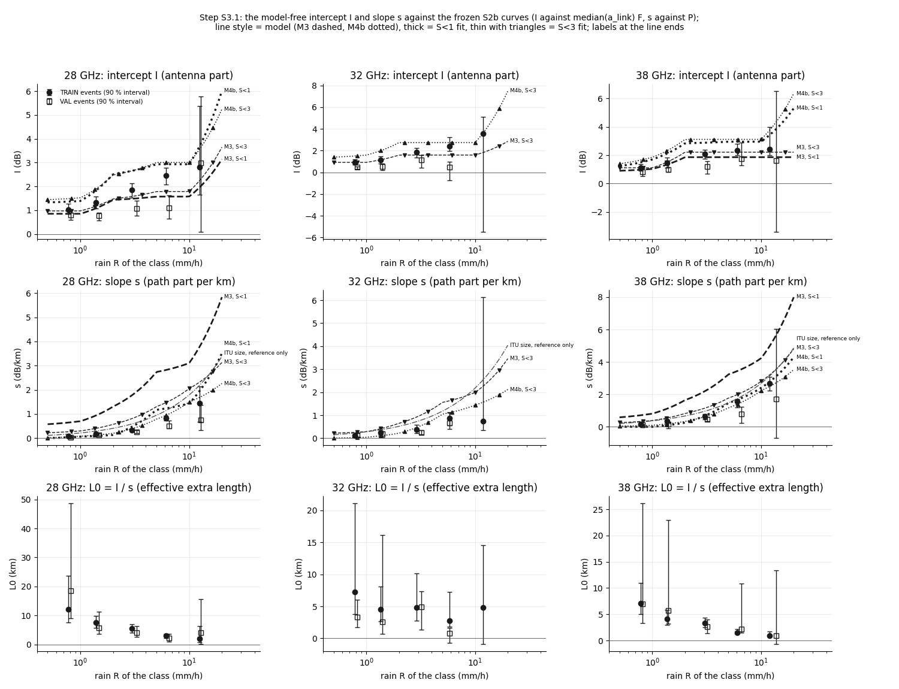
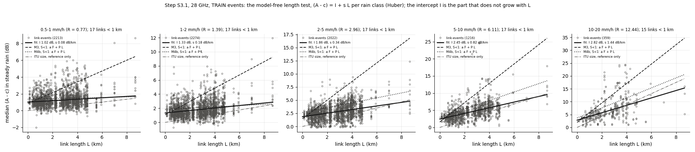
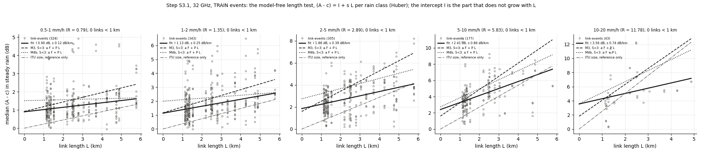
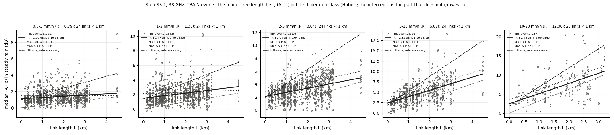
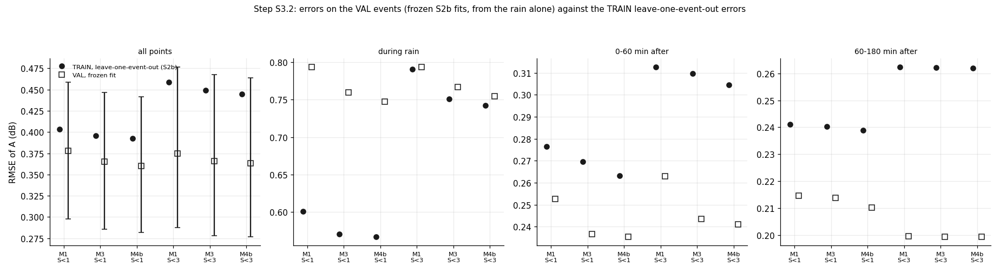
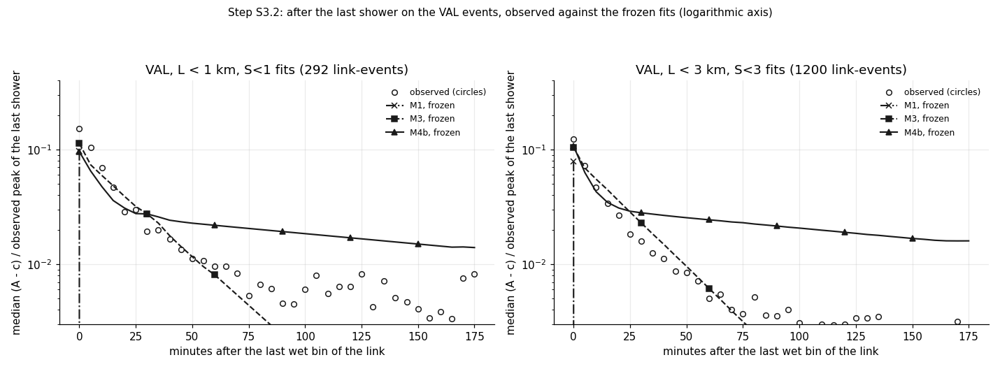
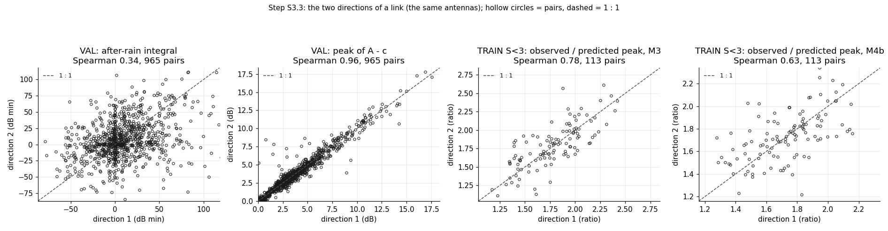

# wet_antenna step S3: verification of WAA v2 (frozen S2b fits of M3 and M4b; model-free length test, VAL, directions, gauge)

Written by `research/wet_antenna/system_id_s3.py` (library `system_id.py`). Settings and every rule: `wet_antenna.system_id_s3` in
`research/config.yaml`, written on 2026-10-15 BEFORE any VAL data was read and before the all-length dataset was built. Plan:
`docs/ROADMAP.md`, "WAA v2 (S2b, 2026-10-14)" and "Remaining plan" (S3.1-S3.4).

**Standing rule.** WAA is never estimated by subtracting a power-law rain term. The path part is separated only through its dependence on L (L -> 0) at matched rain conditions. ITU-R P.838 appears only as a size reference line on a figure (and, as in S2b, as one of the optimiser starting values of P in the S3.4 refit), never to correct data.

## 1. What was run

- **Frozen fits** (no refit except S3.4): M3 and M4b of S2b, radar input, fitted on the TRAIN events of S<1 and of S<3
  (`research/.cache/wet_antenna/system_id_s2b/real_<set>_<model>.pkl`, read only), with their lag d and a_link. M1 of S2b for scale in S3.2.
- **Data**: the S2 rules unchanged (A = TL - baseline v2, c = dry median 120-30 min before the first wet bin, link_state windows,
  exclusions, the bands 28 GHz, 32 GHz, 38 GHz), now for ALL links of the TRAIN link split (TEST links and TEST events never read).
  Check: the all-length TRAIN set cut at 3 km gives the same 6653 link-events as S2b's S<3, in the same order.
- **VAL events were read here for the first time** (S3.2-S3.4).
- Time: 5.7 min for this run. S3.4: one M4b start on the VAL gauge set took 15.7 s (910
  iterations, converged True); projection 0.07 h against the budget 3.0 h: **nothing was cut**
  (100 bootstrap refits per model). The S3.4 fits took 7 min summed over 2 processes.
- Software: numba 0.68.0, scipy 1.17.1, numpy 2.4.5.

| dataset | link_events | links | sublinks | events | points_5min | L_max_km | links_28 GHz | links_32 GHz | links_38 GHz |
|---|---|---|---|---|---|---|---|---|---|
| TRAIN events, all lengths (S3.1) | 9780 | 206 | 371 | 51 | 1892910 | 8.67 | 113 | 19 | 74 |
| VAL events, all lengths (S3.2 repeat of S3.1) | 3250 | 206 | 371 | 18 | 430487 | 8.67 | 113 | 19 | 74 |
| VAL, L < 3 km | 2185 | 144 | 257 | 18 | 302337 | 3.0 | 62 | 12 | 70 |
| VAL, L < 1 km | 531 | 41 | 67 | 14 | 78881 | 0.97 | 17 | 0 | 24 |
| VAL, L < 3 km, no 32 GHz | 1994 | 132 | 234 | 18 | 274788 | 3.0 | 62 | 0 | 70 |
| VAL gauge links, GAUGE input (S3.4) | 625 | 42 | 72 | 14 | 88866 | 2.93 | 14 | 5 | 23 |

(`research/wet_antenna/outputs/tables/system_id_s3_counts.csv`.) S3.1 bins kept (steady rain: radar path-mean R in the class, wet (R >= 0.3 mm/h) for the previous
20 min, the mean R of the previous 15 min within x0.5..x2.0 of the bin's R), per band and class, TRAIN and VAL events:

| band | class | bins (TRAIN) | bins (VAL) | link_events (TRAIN) | link_events (VAL) | links (TRAIN) | links (VAL) | links_under_1km (TRAIN) | links_under_1km (VAL) |
|---|---|---|---|---|---|---|---|---|---|
| 28 GHz | 0.5-1 | 14117 | 2820 | 2213 | 459 | 113 | 112 | 17 | 17 |
| 28 GHz | 1-2 | 20308 | 2994 | 2274 | 592 | 113 | 113 | 17 | 17 |
| 28 GHz | 10-20 | 1147 | 70 | 359 | 55 | 97 | 28 | 15 | 0 |
| 28 GHz | 2-5 | 16838 | 2072 | 2022 | 584 | 113 | 113 | 17 | 17 |
| 28 GHz | 5-10 | 5883 | 616 | 1216 | 372 | 113 | 98 | 17 | 13 |
| 32 GHz | 0.5-1 | 2088 | 477 | 324 | 71 | 19 | 18 | 0 | 0 |
| 32 GHz | 1-2 | 3154 | 516 | 343 | 91 | 19 | 19 | 0 | 0 |
| 32 GHz | 10-20 | 128 | 3 | 43 | 3 | 16 | 2 | 0 | 0 |
| 32 GHz | 2-5 | 2219 | 346 | 305 | 87 | 19 | 19 | 0 | 0 |
| 32 GHz | 5-10 | 865 | 59 | 177 | 35 | 19 | 15 | 0 | 0 |
| 38 GHz | 0.5-1 | 7895 | 1922 | 1271 | 276 | 74 | 74 | 24 | 24 |
| 38 GHz | 1-2 | 12526 | 2130 | 1343 | 346 | 74 | 74 | 24 | 24 |
| 38 GHz | 10-20 | 776 | 51 | 237 | 25 | 71 | 14 | 23 | 0 |
| 38 GHz | 2-5 | 10118 | 1273 | 1215 | 337 | 74 | 74 | 24 | 24 |
| 38 GHz | 5-10 | 3882 | 317 | 761 | 169 | 74 | 59 | 24 | 16 |

(`research/wet_antenna/outputs/tables/system_id_s3_bin_counts.csv`; every variant in that table. A cell is fitted with >= 10 link-events and 3 distinct lengths; it is
ELIGIBLE for the verdict with >= 8 links under 1 km. 32 GHz has no link under 1 km, so it is never eligible.)

## 2. S3.1: the model-free length test (the main result)

Per band and rain class, over the link-events: (A - c) = I + s L (Huber, event bootstrap 1000 draws). I = the L -> 0 part (the antenna),
s = the part per km (the path). The model's a F is median(a_link) x F_band(R_cell), its P is P_band(R_cell).

**Verdict (TRAIN events, rule: both F inside the I interval and P inside the s interval in >= 2/3 of the eligible cells):**
M3, S<1 NOT consistent (0 of 10 cells: F 6, P 0); M3, S<3 NOT consistent (0 of 10 cells: F 9, P 0); M4b, S<1 NOT consistent (2 of 10 cells: F 2, P 4); M4b, S<3 NOT consistent (2 of 10 cells: F 2, P 6).

**Neither M3 nor M4b is consistent with the model-free length test.** They fail in opposite ways:
- **M3: the level is right, the path term is not.** a F lies inside the I interval in 6 of 10 cells (S<1 fit;
  9 of 10 for S<3), but P is inside the s interval in none. P is several times the slope: 28 GHz, 0.5-1 mm/h:
  P = 0.64 (S<1) / 0.26 (S<3) dB/km against s = 0.08 [0.05, 0.12];
  2-5 mm/h: 1.76 / 0.81 against 0.34 [0.28, 0.42];
  38 GHz, 2-5: 2.20 / 1.15 against 0.64 [0.47, 0.78].
  This confirms the S2b length-rule warning: with the radar input M3 puts part of the antenna wetting into P (on links below 1 km the two
  cannot be told apart; across all lengths they can).
- **M4b: the path term is closer, the level is too high.** P is inside the s interval in 4 (S<1) /
  6 (S<3) of 10 cells (mostly above 2 mm/h), but at light rain P is near 0 (28 GHz, 0.5-1:
  0.03 against 0.08 [0.05, 0.12]). a F at equilibrium is above the I interval in most cells
  (28 GHz, 2-5: 2.65 dB against I = 1.86 [1.52, 2.12]).
- **Read through the test (information, not the rule).** a F is the level W reaches after a long steady rain. After 20 min of rain M4b's slow store is
  not full, so the rule's comparison is harsh on M4b. Fitting the same line to each model's own prediction on the same bins:

| fit | cells | I_inside | s_inside | both_inside |
|---|---|---|---|---|
| M3, S<1 | 10 | 0 | 0 | 0 |
| M3, S<3 | 10 | 4 | 3 | 2 |
| M4b, S<1 | 10 | 10 | 5 | 5 |
| M4b, S<3 | 10 | 9 | 5 | 5 |

  M4b's own intercept lies inside the I interval in 10 of 10 cells (S<1 fit), its slope in
  5; M3's slope in 0. The test returns each model's own P (s_through_model is close to P_model),
  so it is able to see P. **M4b is the closer model, but it still fails on P at light rain.**

**I and s, and L0 = I / s** (TRAIN; `research/wet_antenna/outputs/tables/system_id_s3_length_fits.csv`):

| band | class | link_events | links | links_under_1km | events | L_max_km | R_cell | I | I_lo | I_hi | s | s_lo | s_hi | q | q_lo | q_hi | L0 | L0_lo | L0_hi |
|---|---|---|---|---|---|---|---|---|---|---|---|---|---|---|---|---|---|---|---|
| 28 GHz | 0.5-1 | 2213 | 113 | 17 | 20 | 8.67 | 0.77 | 1.02 | 0.84 | 1.26 | 0.08 | 0.05 | 0.12 | 0.03 | 0.02 | 0.04 | 12.02 | 7.64 | 23.79 |
| 28 GHz | 1-2 | 2274 | 113 | 17 | 19 | 8.67 | 1.39 | 1.33 | 1.07 | 1.58 | 0.18 | 0.14 | 0.22 | 0.04 | 0.02 | 0.05 | 7.54 | 5.65 | 9.8 |
| 28 GHz | 2-5 | 2022 | 113 | 17 | 18 | 8.67 | 2.96 | 1.86 | 1.52 | 2.12 | 0.34 | 0.28 | 0.42 | 0.02 | -0.0 | 0.06 | 5.48 | 4.13 | 6.92 |
| 28 GHz | 5-10 | 1216 | 113 | 17 | 15 | 8.67 | 6.11 | 2.45 | 2.08 | 2.78 | 0.82 | 0.72 | 0.93 | 0.01 | -0.03 | 0.05 | 2.98 | 2.31 | 3.73 |
| 28 GHz | 10-20 | 359 | 97 | 15 | 9 | 8.67 | 12.44 | 2.82 | 1.64 | 5.38 | 1.44 | 0.68 | 2.13 | -0.11 | -0.56 | -0.02 | 1.96 | 0.81 | 6.28 |
| 32 GHz | 0.5-1 | 324 | 19 | 0 | 18 | 5.77 | 0.79 | 0.9 | 0.68 | 1.18 | 0.12 | 0.05 | 0.18 | 0.02 | -0.02 | 0.07 | 7.25 | 3.82 | 21.11 |
| 32 GHz | 1-2 | 343 | 19 | 0 | 16 | 5.77 | 1.35 | 1.13 | 0.8 | 1.48 | 0.25 | 0.16 | 0.36 | 0.01 | -0.06 | 0.07 | 4.55 | 2.68 | 8.13 |
| 32 GHz | 2-5 | 305 | 19 | 0 | 14 | 5.77 | 2.89 | 1.86 | 1.39 | 2.27 | 0.39 | 0.22 | 0.59 | -0.07 | -0.17 | 0.08 | 4.81 | 2.77 | 10.17 |
| 32 GHz | 5-10 | 177 | 19 | 0 | 9 | 5.77 | 5.83 | 2.41 | 1.96 | 3.22 | 0.86 | 0.41 | 1.12 | -0.23 | -0.67 | 0.04 | 2.79 | 1.82 | 7.23 |
| 32 GHz | 10-20 | 43 | 16 | 0 | 4 | 4.87 | 11.78 | 3.56 | -5.49 | 5.09 | 0.74 | 0.35 | 6.13 | -0.64 | -32.72 | -0.28 | 4.78 | -0.93 | 14.58 |
| 38 GHz | 0.5-1 | 1271 | 74 | 24 | 20 | 4.49 | 0.79 | 1.1 | 0.91 | 1.36 | 0.16 | 0.11 | 0.2 | -0.04 | -0.09 | 0.01 | 7.04 | 5.05 | 10.91 |
| 38 GHz | 1-2 | 1343 | 74 | 24 | 20 | 4.49 | 1.38 | 1.47 | 1.13 | 1.84 | 0.36 | 0.29 | 0.42 | -0.0 | -0.06 | 0.05 | 4.11 | 2.92 | 5.88 |
| 38 GHz | 2-5 | 1215 | 74 | 24 | 16 | 4.49 | 3.04 | 2.08 | 1.74 | 2.39 | 0.64 | 0.47 | 0.78 | -0.01 | -0.08 | 0.06 | 3.26 | 2.53 | 4.38 |
| 38 GHz | 5-10 | 761 | 74 | 24 | 13 | 4.49 | 6.07 | 2.35 | 2.0 | 2.81 | 1.56 | 1.2 | 1.7 | 0.06 | -0.19 | 0.19 | 1.5 | 1.25 | 2.18 |
| 38 GHz | 10-20 | 237 | 71 | 23 | 9 | 3.21 | 12.0 | 2.44 | 2.02 | 3.99 | 2.66 | 2.24 | 3.09 | 0.5 | -0.06 | 1.48 | 0.92 | 0.72 | 1.67 |

**What I / s does.** L0 is NOT constant: 28 GHz 12.0, 7.5, 5.5, 3.0, 2.0 km and 38 GHz
7.0, 4.1, 3.3, 1.5, 0.9 km from 0.5-1 to 10-20 mm/h. I grows slowly and flattens
(28 GHz: 1.02, 1.33, 1.86, 2.45, 2.82 dB; 38 GHz: 1.10, 1.47, 2.08, 2.35, 2.44 dB), while s keeps
growing roughly in proportion to R (28 GHz: 0.08, 0.18, 0.34, 0.82, 1.44 dB/km). This is the picture of a **saturating
antenna part of about 2-3 dB** next to a path part that grows with the rain, not of a fixed extra length that grows like the path. So a
constant L0 (f = L + L0) does not describe the data: at light rain the antenna part is worth 7-12 km of path, at 10-20 mm/h only about 1-2 km.
The quadratic check: q is small; its interval leaves 0 only in 4 of 15 cells, and I_q stays near I where the cells are well filled.
For size only (not used): s of 28 GHz is 0.50, 0.60, 0.58, 0.72 x the ITU-R P.838 size at the cell's R (classes 0.5-1 to 5-10).

**Robustness** (`research/wet_antenna/outputs/tables/system_id_s3_length_verdict.csv`): with R = the centred 15 min mean: M3, S<1 NOT consistent (0 of 10 cells: F 7, P 0); M3, S<3 NOT consistent (2 of 10 cells: F 8, P 2); M4b, S<1 NOT consistent (2 of 10 cells: F 4, P 3); M4b, S<3 NOT consistent (4 of 10 cells: F 4, P 6). With only bins >= 30 min into the
rain: M3, S<1 NOT consistent (0 of 10 cells: F 5, P 0); M3, S<3 NOT consistent (1 of 10 cells: F 9, P 1); M4b, S<1 NOT consistent (2 of 10 cells: F 2, P 4); M4b, S<3 NOT consistent (2 of 10 cells: F 2, P 7). The verdict does not change; I and s mostly stay inside the intervals of the main run (exception: 38 GHz 5-10 mm/h with R = 15 min mean, I 3.2 against 2.0-2.8)
(table below). **How much the intercept leans on the short links:** fitted on links >= 1 km only, I = 1.20 [0.95, 1.42] dB
(28 GHz, 1-2; all links 1.33 [1.07, 1.58]) and 1.54 [1.21, 1.89] dB (38 GHz; all links 1.47 [1.13, 1.84]).

| variant | band | class | link_events | I | I_lo | I_hi | s | s_lo | s_hi | I_q | L0 |
|---|---|---|---|---|---|---|---|---|---|---|---|
| TRAIN | 28 GHz | 0.5-1 | 2213 | 1.02 | 0.84 | 1.26 | 0.08 | 0.05 | 0.12 | 1.18 | 12.02 |
| TRAIN | 28 GHz | 1-2 | 2274 | 1.33 | 1.07 | 1.58 | 0.18 | 0.14 | 0.22 | 1.55 | 7.54 |
| TRAIN | 28 GHz | 2-5 | 2022 | 1.86 | 1.52 | 2.12 | 0.34 | 0.28 | 0.42 | 2.0 | 5.48 |
| TRAIN | 28 GHz | 5-10 | 1216 | 2.45 | 2.08 | 2.78 | 0.82 | 0.72 | 0.93 | 2.52 | 2.98 |
| TRAIN | 28 GHz | 10-20 | 359 | 2.82 | 1.64 | 5.38 | 1.44 | 0.68 | 2.13 | 2.11 | 1.96 |
| TRAIN | 32 GHz | 0.5-1 | 324 | 0.9 | 0.68 | 1.18 | 0.12 | 0.05 | 0.18 | 1.08 | 7.25 |
| TRAIN | 32 GHz | 1-2 | 343 | 1.13 | 0.8 | 1.48 | 0.25 | 0.16 | 0.36 | 1.2 | 4.55 |
| TRAIN | 32 GHz | 2-5 | 305 | 1.86 | 1.39 | 2.27 | 0.39 | 0.22 | 0.59 | 1.42 | 4.81 |
| TRAIN | 32 GHz | 5-10 | 177 | 2.41 | 1.96 | 3.22 | 0.86 | 0.41 | 1.12 | 1.07 | 2.79 |
| TRAIN | 32 GHz | 10-20 | 43 | 3.56 | -5.49 | 5.09 | 0.74 | 0.35 | 6.13 | -0.37 | 4.78 |
| TRAIN | 38 GHz | 0.5-1 | 1271 | 1.1 | 0.91 | 1.36 | 0.16 | 0.11 | 0.2 | 1.01 | 7.04 |
| TRAIN | 38 GHz | 1-2 | 1343 | 1.47 | 1.13 | 1.84 | 0.36 | 0.29 | 0.42 | 1.46 | 4.11 |
| TRAIN | 38 GHz | 2-5 | 1215 | 2.08 | 1.74 | 2.39 | 0.64 | 0.47 | 0.78 | 2.05 | 3.26 |
| TRAIN | 38 GHz | 5-10 | 761 | 2.35 | 2.0 | 2.81 | 1.56 | 1.2 | 1.7 | 2.46 | 1.5 |
| TRAIN | 38 GHz | 10-20 | 237 | 2.44 | 2.02 | 3.99 | 2.66 | 2.24 | 3.09 | 3.41 | 0.92 |
| TRAIN, R = 15 min mean | 28 GHz | 0.5-1 | 2610 | 0.93 | 0.78 | 1.14 | 0.09 | 0.05 | 0.12 | 1.06 | 10.78 |
| TRAIN, R = 15 min mean | 28 GHz | 1-2 | 2498 | 1.24 | 1.02 | 1.47 | 0.17 | 0.13 | 0.21 | 1.46 | 7.11 |
| TRAIN, R = 15 min mean | 28 GHz | 2-5 | 2086 | 1.72 | 1.37 | 2.03 | 0.36 | 0.29 | 0.45 | 1.75 | 4.77 |
| TRAIN, R = 15 min mean | 28 GHz | 5-10 | 1253 | 2.74 | 2.26 | 3.11 | 0.82 | 0.7 | 1.04 | 2.64 | 3.32 |
| TRAIN, R = 15 min mean | 28 GHz | 10-20 | 403 | 3.38 | 1.94 | 4.22 | 1.38 | 0.94 | 2.72 | 2.12 | 2.46 |
| TRAIN, R = 15 min mean | 32 GHz | 0.5-1 | 403 | 0.76 | 0.57 | 1.02 | 0.12 | 0.03 | 0.19 | 0.83 | 6.52 |
| TRAIN, R = 15 min mean | 32 GHz | 1-2 | 380 | 1.15 | 0.88 | 1.44 | 0.22 | 0.14 | 0.3 | 1.09 | 5.3 |
| TRAIN, R = 15 min mean | 32 GHz | 2-5 | 311 | 2.0 | 1.53 | 2.46 | 0.31 | 0.1 | 0.55 | 1.85 | 6.51 |
| TRAIN, R = 15 min mean | 32 GHz | 5-10 | 196 | 3.42 | 2.28 | 4.45 | 0.63 | 0.28 | 1.12 | 1.64 | 5.4 |
| TRAIN, R = 15 min mean | 32 GHz | 10-20 | 53 | 1.25 | -0.68 | 2.95 | 2.81 | 1.31 | 6.11 | -13.87 | 0.45 |
| TRAIN, R = 15 min mean | 38 GHz | 0.5-1 | 1559 | 0.98 | 0.8 | 1.22 | 0.17 | 0.12 | 0.22 | 0.98 | 5.85 |
| TRAIN, R = 15 min mean | 38 GHz | 1-2 | 1499 | 1.37 | 1.09 | 1.73 | 0.35 | 0.27 | 0.43 | 1.42 | 3.89 |
| TRAIN, R = 15 min mean | 38 GHz | 2-5 | 1257 | 1.9 | 1.51 | 2.24 | 0.69 | 0.56 | 0.81 | 2.0 | 2.77 |
| TRAIN, R = 15 min mean | 38 GHz | 5-10 | 859 | 3.17 | 2.22 | 4.17 | 1.28 | 0.72 | 1.7 | 3.37 | 2.48 |
| TRAIN, R = 15 min mean | 38 GHz | 10-20 | 284 | 2.59 | 1.43 | 4.75 | 2.93 | 2.19 | 3.79 | 2.1 | 0.88 |
| TRAIN, bins >= 30 min into the rain | 28 GHz | 0.5-1 | 1906 | 1.06 | 0.87 | 1.34 | 0.08 | 0.05 | 0.12 | 1.18 | 12.81 |
| TRAIN, bins >= 30 min into the rain | 28 GHz | 1-2 | 2011 | 1.4 | 1.12 | 1.69 | 0.17 | 0.13 | 0.21 | 1.59 | 8.46 |
| TRAIN, bins >= 30 min into the rain | 28 GHz | 2-5 | 1820 | 1.87 | 1.58 | 2.1 | 0.35 | 0.29 | 0.43 | 2.06 | 5.31 |
| TRAIN, bins >= 30 min into the rain | 28 GHz | 5-10 | 1042 | 2.38 | 1.99 | 2.71 | 0.83 | 0.73 | 0.95 | 2.4 | 2.87 |
| TRAIN, bins >= 30 min into the rain | 28 GHz | 10-20 | 328 | 2.72 | 1.13 | 5.68 | 1.49 | 0.73 | 2.45 | 1.89 | 1.82 |
| TRAIN, bins >= 30 min into the rain | 32 GHz | 0.5-1 | 286 | 0.93 | 0.73 | 1.27 | 0.11 | 0.05 | 0.15 | 0.8 | 8.67 |
| TRAIN, bins >= 30 min into the rain | 32 GHz | 1-2 | 284 | 1.25 | 0.88 | 1.65 | 0.24 | 0.15 | 0.36 | 1.36 | 5.16 |
| TRAIN, bins >= 30 min into the rain | 32 GHz | 2-5 | 281 | 1.75 | 1.31 | 2.14 | 0.43 | 0.25 | 0.7 | 1.6 | 4.05 |
| TRAIN, bins >= 30 min into the rain | 32 GHz | 5-10 | 149 | 2.33 | 1.92 | 2.95 | 0.91 | 0.47 | 1.17 | 1.42 | 2.56 |
| TRAIN, bins >= 30 min into the rain | 32 GHz | 10-20 | 39 | 3.51 | -5.37 | 4.32 | 0.72 | 0.51 | 6.33 | 0.07 | 4.89 |
| TRAIN, bins >= 30 min into the rain | 38 GHz | 0.5-1 | 1125 | 1.12 | 0.91 | 1.43 | 0.19 | 0.14 | 0.25 | 1.07 | 5.86 |
| TRAIN, bins >= 30 min into the rain | 38 GHz | 1-2 | 1190 | 1.55 | 1.19 | 1.99 | 0.35 | 0.28 | 0.42 | 1.58 | 4.38 |
| TRAIN, bins >= 30 min into the rain | 38 GHz | 2-5 | 1098 | 2.16 | 1.84 | 2.49 | 0.62 | 0.44 | 0.79 | 2.0 | 3.47 |
| TRAIN, bins >= 30 min into the rain | 38 GHz | 5-10 | 654 | 2.23 | 1.98 | 2.59 | 1.6 | 1.19 | 1.76 | 2.55 | 1.39 |
| TRAIN, bins >= 30 min into the rain | 38 GHz | 10-20 | 208 | 2.33 | 1.71 | 6.04 | 2.67 | 1.76 | 2.84 | 3.29 | 0.87 |
| TRAIN, links >= 1 km only (information) | 28 GHz | 0.5-1 | 1896 | 0.98 | 0.8 | 1.2 | 0.1 | 0.06 | 0.14 | 1.24 | 10.16 |
| TRAIN, links >= 1 km only (information) | 28 GHz | 1-2 | 1932 | 1.2 | 0.95 | 1.42 | 0.21 | 0.18 | 0.25 | 1.47 | 5.63 |
| TRAIN, links >= 1 km only (information) | 28 GHz | 2-5 | 1718 | 1.73 | 1.38 | 2.02 | 0.38 | 0.31 | 0.47 | 1.87 | 4.62 |
| TRAIN, links >= 1 km only (information) | 28 GHz | 5-10 | 1011 | 2.36 | 1.93 | 2.68 | 0.85 | 0.75 | 0.97 | 2.39 | 2.79 |
| TRAIN, links >= 1 km only (information) | 28 GHz | 10-20 | 315 | 3.31 | 2.02 | 6.22 | 1.31 | 0.44 | 1.99 | 2.4 | 2.53 |
| TRAIN, links >= 1 km only (information) | 32 GHz | 0.5-1 | 324 | 0.9 | 0.68 | 1.18 | 0.12 | 0.05 | 0.18 | 1.08 | 7.25 |
| TRAIN, links >= 1 km only (information) | 32 GHz | 1-2 | 343 | 1.13 | 0.8 | 1.48 | 0.25 | 0.16 | 0.36 | 1.2 | 4.55 |
| TRAIN, links >= 1 km only (information) | 32 GHz | 2-5 | 305 | 1.86 | 1.39 | 2.27 | 0.39 | 0.22 | 0.59 | 1.42 | 4.81 |
| TRAIN, links >= 1 km only (information) | 32 GHz | 5-10 | 177 | 2.41 | 1.96 | 3.22 | 0.86 | 0.41 | 1.12 | 1.07 | 2.79 |
| TRAIN, links >= 1 km only (information) | 32 GHz | 10-20 | 43 | 3.56 | -5.49 | 5.09 | 0.74 | 0.35 | 6.13 | -0.37 | 4.78 |
| TRAIN, links >= 1 km only (information) | 38 GHz | 0.5-1 | 876 | 1.31 | 1.04 | 1.67 | 0.07 | -0.01 | 0.13 | 1.63 | 19.44 |
| TRAIN, links >= 1 km only (information) | 38 GHz | 1-2 | 947 | 1.54 | 1.21 | 1.89 | 0.32 | 0.24 | 0.41 | 1.99 | 4.74 |
| TRAIN, links >= 1 km only (information) | 38 GHz | 2-5 | 874 | 2.1 | 1.79 | 2.41 | 0.62 | 0.46 | 0.77 | 2.44 | 3.38 |
| TRAIN, links >= 1 km only (information) | 38 GHz | 5-10 | 504 | 2.51 | 1.79 | 3.37 | 1.47 | 0.99 | 1.79 | 4.12 | 1.71 |
| TRAIN, links >= 1 km only (information) | 38 GHz | 10-20 | 179 | 2.42 | 0.73 | 4.99 | 2.68 | 2.01 | 3.28 | 9.58 | 0.9 |

Every eligible cell against every frozen fit (`research/wet_antenna/outputs/tables/system_id_s3_length_vs_models.csv`):

| band | class | fit | R_cell | I | I_lo | I_hi | aF_model | I_through_model | s | s_lo | s_hi | P_model | s_through_model | F_inside | P_inside |
|---|---|---|---|---|---|---|---|---|---|---|---|---|---|---|---|
| 28 GHz | 0.5-1 | M3, S<1 | 0.77 | 1.02 | 0.84 | 1.26 | 0.85 | 0.77 | 0.08 | 0.05 | 0.12 | 0.64 | 0.63 | True | False |
| 28 GHz | 0.5-1 | M3, S<3 | 0.77 | 1.02 | 0.84 | 1.26 | 0.97 | 0.96 | 0.08 | 0.05 | 0.12 | 0.26 | 0.19 | True | False |
| 28 GHz | 0.5-1 | M4b, S<1 | 0.77 | 1.02 | 0.84 | 1.26 | 1.36 | 1.19 | 0.08 | 0.05 | 0.12 | 0.03 | 0.02 | False | False |
| 28 GHz | 0.5-1 | M4b, S<3 | 0.77 | 1.02 | 0.84 | 1.26 | 1.49 | 1.2 | 0.08 | 0.05 | 0.12 | 0.05 | 0.04 | False | True |
| 28 GHz | 1-2 | M3, S<1 | 1.39 | 1.33 | 1.07 | 1.58 | 1.08 | 0.81 | 0.18 | 0.14 | 0.22 | 0.94 | 0.96 | True | False |
| 28 GHz | 1-2 | M3, S<3 | 1.39 | 1.33 | 1.07 | 1.58 | 1.17 | 1.04 | 0.18 | 0.14 | 0.22 | 0.41 | 0.34 | True | False |
| 28 GHz | 1-2 | M4b, S<1 | 1.39 | 1.33 | 1.07 | 1.58 | 1.83 | 1.44 | 0.18 | 0.14 | 0.22 | 0.09 | 0.1 | False | False |
| 28 GHz | 1-2 | M4b, S<3 | 1.39 | 1.33 | 1.07 | 1.58 | 1.9 | 1.39 | 0.18 | 0.14 | 0.22 | 0.13 | 0.13 | False | False |
| 28 GHz | 2-5 | M3, S<1 | 2.96 | 1.86 | 1.52 | 2.12 | 1.48 | 1.15 | 0.34 | 0.28 | 0.42 | 1.76 | 1.71 | False | False |
| 28 GHz | 2-5 | M3, S<3 | 2.96 | 1.86 | 1.52 | 2.12 | 1.58 | 1.36 | 0.34 | 0.28 | 0.42 | 0.81 | 0.67 | True | False |
| 28 GHz | 2-5 | M4b, S<1 | 2.96 | 1.86 | 1.52 | 2.12 | 2.65 | 2.08 | 0.34 | 0.28 | 0.42 | 0.46 | 0.39 | False | False |
| 28 GHz | 2-5 | M4b, S<3 | 2.96 | 1.86 | 1.52 | 2.12 | 2.65 | 1.93 | 0.34 | 0.28 | 0.42 | 0.39 | 0.35 | False | True |
| 28 GHz | 5-10 | M3, S<1 | 6.11 | 2.45 | 2.08 | 2.78 | 1.57 | 1.05 | 0.82 | 0.72 | 0.93 | 2.82 | 2.81 | False | False |
| 28 GHz | 5-10 | M3, S<3 | 6.11 | 2.45 | 2.08 | 2.78 | 1.79 | 1.44 | 0.82 | 0.72 | 0.93 | 1.47 | 1.35 | False | False |
| 28 GHz | 5-10 | M4b, S<1 | 6.11 | 2.45 | 2.08 | 2.78 | 2.93 | 2.13 | 0.82 | 0.72 | 0.93 | 1.23 | 1.21 | False | False |
| 28 GHz | 5-10 | M4b, S<3 | 6.11 | 2.45 | 2.08 | 2.78 | 3.0 | 2.08 | 0.82 | 0.72 | 0.93 | 0.94 | 0.96 | False | False |
| 28 GHz | 10-20 | M3, S<1 | 12.44 | 2.82 | 1.64 | 5.38 | 1.96 | 1.41 | 1.44 | 0.68 | 2.13 | 3.77 | 3.73 | True | False |
| 28 GHz | 10-20 | M3, S<3 | 12.44 | 2.82 | 1.64 | 5.38 | 2.24 | 1.71 | 1.44 | 0.68 | 2.13 | 2.32 | 2.14 | True | False |
| 28 GHz | 10-20 | M4b, S<1 | 12.44 | 2.82 | 1.64 | 5.38 | 3.68 | 2.85 | 1.44 | 0.68 | 2.13 | 1.94 | 1.77 | True | True |
| 28 GHz | 10-20 | M4b, S<3 | 12.44 | 2.82 | 1.64 | 5.38 | 3.55 | 2.43 | 1.44 | 0.68 | 2.13 | 1.68 | 1.67 | True | True |
| 38 GHz | 0.5-1 | M3, S<1 | 0.79 | 1.1 | 0.91 | 1.36 | 0.98 | 0.9 | 0.16 | 0.11 | 0.2 | 0.72 | 0.68 | True | False |
| 38 GHz | 0.5-1 | M3, S<3 | 0.79 | 1.1 | 0.91 | 1.36 | 1.11 | 1.2 | 0.16 | 0.11 | 0.2 | 0.34 | 0.15 | True | False |
| 38 GHz | 0.5-1 | M4b, S<1 | 0.79 | 1.1 | 0.91 | 1.36 | 1.5 | 1.3 | 0.16 | 0.11 | 0.2 | 0.0 | -0.01 | False | False |
| 38 GHz | 0.5-1 | M4b, S<3 | 0.79 | 1.1 | 0.91 | 1.36 | 1.66 | 1.33 | 0.16 | 0.11 | 0.2 | 0.07 | 0.08 | False | False |
| 38 GHz | 1-2 | M3, S<1 | 1.38 | 1.47 | 1.13 | 1.84 | 1.34 | 0.94 | 0.36 | 0.29 | 0.42 | 1.13 | 1.18 | True | False |
| 38 GHz | 1-2 | M3, S<3 | 1.38 | 1.47 | 1.13 | 1.84 | 1.53 | 1.32 | 0.36 | 0.29 | 0.42 | 0.56 | 0.4 | True | False |
| 38 GHz | 1-2 | M4b, S<1 | 1.38 | 1.47 | 1.13 | 1.84 | 2.13 | 1.6 | 0.36 | 0.29 | 0.42 | 0.1 | 0.13 | False | False |
| 38 GHz | 1-2 | M4b, S<3 | 1.38 | 1.47 | 1.13 | 1.84 | 2.33 | 1.59 | 0.36 | 0.29 | 0.42 | 0.19 | 0.27 | False | False |
| 38 GHz | 2-5 | M3, S<1 | 3.04 | 2.08 | 1.74 | 2.39 | 1.86 | 1.24 | 0.64 | 0.47 | 0.78 | 2.2 | 2.17 | True | False |
| 38 GHz | 2-5 | M3, S<3 | 3.04 | 2.08 | 1.74 | 2.39 | 2.21 | 1.71 | 0.64 | 0.47 | 0.78 | 1.15 | 0.89 | True | False |
| 38 GHz | 2-5 | M4b, S<1 | 3.04 | 2.08 | 1.74 | 2.39 | 2.88 | 2.16 | 0.64 | 0.47 | 0.78 | 0.68 | 0.62 | False | True |
| 38 GHz | 2-5 | M4b, S<3 | 3.04 | 2.08 | 1.74 | 2.39 | 3.12 | 2.15 | 0.64 | 0.47 | 0.78 | 0.63 | 0.64 | False | True |
| 38 GHz | 5-10 | M3, S<1 | 6.07 | 2.35 | 2.0 | 2.81 | 1.86 | 1.19 | 1.56 | 1.2 | 1.7 | 3.45 | 3.49 | False | False |
| 38 GHz | 5-10 | M3, S<3 | 6.07 | 2.35 | 2.0 | 2.81 | 2.21 | 1.71 | 1.56 | 1.2 | 1.7 | 1.99 | 1.82 | True | False |
| 38 GHz | 5-10 | M4b, S<1 | 6.07 | 2.35 | 2.0 | 2.81 | 2.95 | 2.2 | 1.56 | 1.2 | 1.7 | 1.67 | 1.67 | False | True |
| 38 GHz | 5-10 | M4b, S<3 | 6.07 | 2.35 | 2.0 | 2.81 | 3.12 | 2.16 | 1.56 | 1.2 | 1.7 | 1.4 | 1.55 | False | True |
| 38 GHz | 10-20 | M3, S<1 | 12.0 | 2.44 | 2.02 | 3.99 | 1.86 | 1.17 | 2.66 | 2.24 | 3.09 | 4.98 | 4.97 | False | False |
| 38 GHz | 10-20 | M3, S<3 | 12.0 | 2.44 | 2.02 | 3.99 | 2.21 | 1.84 | 2.66 | 2.24 | 3.09 | 3.2 | 2.91 | True | False |
| 38 GHz | 10-20 | M4b, S<1 | 12.0 | 2.44 | 2.02 | 3.99 | 3.43 | 2.56 | 2.66 | 2.24 | 3.09 | 2.78 | 2.7 | True | True |
| 38 GHz | 10-20 | M4b, S<3 | 12.0 | 2.44 | 2.02 | 3.99 | 3.77 | 2.43 | 2.66 | 2.24 | 3.09 | 2.49 | 2.58 | True | True |

## 3. S3.2: the VAL events (frozen fits, from the rain alone)

The VAL events were read here for the first time. a_link from the TRAIN fit of the link; links not in that fit get a_link = 1: 0 links in the
matched sets (the S<1 fits on VAL L < 1 km, the S<3 fits on VAL L < 3 km); 91 of
132 links when the S<1 fits are run on VAL L < 3 km (32 GHz left out: the S<1 fits have no 32 GHz numbers).

| fit | VAL set | link_events | links | links_a_link_1 | events | rmse | rmse_lo | rmse_hi | rmse_rain | rmse_0_60 | rmse_60_180 | shower_peak_error | peak_lo | peak_hi | integral_pred_over_obs | integral_lo | integral_hi |
|---|---|---|---|---|---|---|---|---|---|---|---|---|---|---|---|---|---|
| M1, S<1 | VAL, L < 1 km | 531 | 41 | 0 | 14 | 0.378 | 0.298 | 0.459 | 0.794 | 0.253 | 0.215 | -0.259 | -0.807 | 0.142 | 0.162 | 0.09 | 0.377 |
| M3, S<1 | VAL, L < 1 km | 531 | 41 | 0 | 14 | 0.365 | 0.285 | 0.447 | 0.759 | 0.237 | 0.214 | -0.778 | -1.288 | -0.514 | 0.483 | 0.267 | 1.002 |
| M4b, S<1 | VAL, L < 1 km | 531 | 41 | 0 | 14 | 0.36 | 0.282 | 0.441 | 0.747 | 0.235 | 0.21 | -0.738 | -1.304 | -0.501 | 0.836 | 0.436 | 1.714 |
| M1, S<3 | VAL, L < 3 km | 2185 | 144 | 0 | 18 | 0.375 | 0.287 | 0.477 | 0.794 | 0.263 | 0.2 | -0.319 | -0.817 | 0.103 | 0.276 | 0.144 | 0.932 |
| M3, S<3 | VAL, L < 3 km | 2185 | 144 | 0 | 18 | 0.366 | 0.278 | 0.468 | 0.767 | 0.244 | 0.199 | -0.871 | -1.245 | -0.576 | 0.655 | 0.346 | 1.969 |
| M4b, S<3 | VAL, L < 3 km | 2185 | 144 | 0 | 18 | 0.363 | 0.277 | 0.464 | 0.755 | 0.241 | 0.199 | -0.756 | -1.217 | -0.469 | 1.259 | 0.639 | 3.621 |
| M3, S<1 | VAL, L < 3 km, no 32 GHz | 1994 | 132 | 91 | 18 | 0.45 | 0.33 | 0.591 | 1.014 | 0.256 | 0.201 | -0.162 | -0.674 | 0.213 | 0.785 | 0.43 | 2.342 |
| M4b, S<1 | VAL, L < 3 km, no 32 GHz | 1994 | 132 | 91 | 18 | 0.371 | 0.282 | 0.475 | 0.779 | 0.24 | 0.2 | -0.676 | -1.13 | -0.384 | 1.072 | 0.56 | 2.941 |
| M3, S<3 | VAL, L < 1 km | 531 | 41 | 0 | 14 | 0.37 | 0.285 | 0.458 | 0.76 | 0.24 | 0.214 | -1.081 | -1.687 | -0.876 | 0.55 | 0.303 | 1.126 |
| M4b, S<3 | VAL, L < 1 km | 531 | 41 | 0 | 14 | 0.365 | 0.285 | 0.449 | 0.759 | 0.237 | 0.211 | -0.842 | -1.448 | -0.578 | 0.958 | 0.496 | 1.959 |

TRAIN leave-one-event-out numbers of S2b for the same fits:

| fit | train_set | train_rmse | train_rmse_lo | train_rmse_hi | train_rmse_rain | train_rmse_0_60 | train_rmse_60_180 | train_shower_peak_error | train_integral_pred_over_obs |
|---|---|---|---|---|---|---|---|---|---|
| M1, S<1 | S<1, radar | 0.403 | 0.324 | 0.489 | 0.601 | 0.276 | 0.241 | -0.571 | 0.316 |
| M3, S<1 | S<1, radar | 0.396 | 0.317 | 0.482 | 0.571 | 0.27 | 0.24 | -0.825 | 1.049 |
| M4b, S<1 | S<1, radar | 0.393 | 0.314 | 0.478 | 0.567 | 0.263 | 0.239 | -0.781 | 2.067 |
| M1, S<3 | S<3, radar | 0.458 | 0.384 | 0.548 | 0.791 | 0.313 | 0.262 | -0.672 | 0.179 |
| M3, S<3 | S<3, radar | 0.449 | 0.373 | 0.539 | 0.751 | 0.31 | 0.262 | -0.967 | 0.55 |
| M4b, S<3 | S<3, radar | 0.444 | 0.369 | 0.533 | 0.742 | 0.304 | 0.262 | -0.89 | 1.142 |

(`research/wet_antenna/outputs/tables/system_id_s3_val_errors.csv`.) **Reading.** Over all points the VAL errors are not worse than the TRAIN leave-one-event-out errors (VAL L < 1 km,
S<1 fits: M1 0.378, M3 0.365, M4b 0.360 dB; VAL L < 3 km, S<3 fits:
M1 0.375, M3 0.366, M4b 0.363 dB). But that hides two opposite changes: **during the rain
the VAL errors are LARGER** on the short links (L < 1 km: M3 0.759 against 0.571 dB in TRAIN,
M4b 0.747 against 0.567; L < 3 km about the same), and after the rain they are smaller. The order
M4b <= M3 < M1 is the same as in TRAIN, and the gaps are again a few thousandths of a dB, inside the intervals. The peaks are too low again (M3 -0.78, M4b
-0.74 dB on VAL L < 1 km). After the rain M3 is too low (0.48 x the observed integral,
S<1 fit) and M4b closer (0.84 x), but M4b's tail stays too high after 60 min (curve below), as in S2b.
**The S3.1 finding shows on VAL:** the S<1 M3 fit, whose P is too large, gets clearly worse on the 1-3 km VAL links
(0.450 dB, during rain 1.014), while the S<1 M4b fit carries over
(0.371 dB).

| minutes_after_last_wet_bin | link_events | observed | M1 | M3 | M4b | set |
|---|---|---|---|---|---|---|
| 0 | 292 | 0.153 | 0.097 | 0.113 | 0.096 | VAL, L < 1 km, S<1 fits |
| 10 | 292 | 0.07 | 0.0 | 0.059 | 0.047 | VAL, L < 1 km, S<1 fits |
| 20 | 292 | 0.029 | 0.0 | 0.039 | 0.031 | VAL, L < 1 km, S<1 fits |
| 30 | 292 | 0.019 | 0.0 | 0.027 | 0.027 | VAL, L < 1 km, S<1 fits |
| 60 | 292 | 0.01 | 0.0 | 0.008 | 0.022 | VAL, L < 1 km, S<1 fits |
| 90 | 292 | 0.005 | 0.0 | 0.002 | 0.019 | VAL, L < 1 km, S<1 fits |
| 120 | 292 | 0.006 | 0.0 | 0.001 | 0.017 | VAL, L < 1 km, S<1 fits |
| 175 | 292 | 0.008 | 0.0 | 0.0 | 0.014 | VAL, L < 1 km, S<1 fits |
| 0 | 1200 | 0.124 | 0.078 | 0.105 | 0.107 | VAL, L < 3 km, S<3 fits |
| 10 | 1200 | 0.047 | 0.0 | 0.055 | 0.043 | VAL, L < 3 km, S<3 fits |
| 20 | 1200 | 0.027 | 0.0 | 0.036 | 0.031 | VAL, L < 3 km, S<3 fits |
| 30 | 1200 | 0.016 | 0.0 | 0.023 | 0.028 | VAL, L < 3 km, S<3 fits |
| 60 | 1200 | 0.005 | 0.0 | 0.006 | 0.024 | VAL, L < 3 km, S<3 fits |
| 90 | 1200 | 0.004 | 0.0 | 0.002 | 0.022 | VAL, L < 3 km, S<3 fits |
| 120 | 1200 | 0.003 | 0.0 | 0.0 | 0.019 | VAL, L < 3 km, S<3 fits |
| 175 | 1200 | 0.001 | 0.0 | 0.0 | 0.016 | VAL, L < 3 km, S<3 fits |

(`research/wet_antenna/outputs/tables/system_id_s3_val_after_last_shower.csv`.)

**S3.1 again on the VAL events (confirmation):** M3, S<1 NOT consistent (0 of 8 cells: F 5, P 0); M3, S<3 NOT consistent (0 of 8 cells: F 2, P 0); M4b, S<1 NOT consistent (0 of 8 cells: F 0, P 4); M4b, S<3 NOT consistent (0 of 8 cells: F 0, P 4). Neither model is consistent on VAL either. The VAL intercepts are LOWER
than the TRAIN ones (28 GHz: 0.80, 0.76, 1.08, 1.10 dB against 1.02, 1.33, 1.86, 2.45), and so are the slopes;
L0 falls with R again (28 GHz: 18.5, 5.8, 4.1, 2.1 km). The antenna level differs between event sets (see section 5).

## 4. S3.3: both directions of a link

- **a_link cannot be compared between the directions:** S2b fits ONE a_link per link (both sub-links share it), so its Spearman is 1 by
  construction (config, written before the run). Substitute without refit (TRAIN, S<3, the S2b leave-one-event-out predictions): per sub-link the
  median observed / predicted peak of A - c. Spearman between the directions 0.78 (M3) and 0.63 (M4b),
  113 links, median ratio 1.00.
- **VAL, L < 3 km, 965 link-event pairs on 113 links:** peak of A - c Spearman 0.96 (per link 0.85), median ratio
  1.00: **the same by the rule (>= 0.6)**. After-rain integral 0-180 min: Spearman 0.34 (per link
  0.24), median ratio 0.99: **NOT the same by the rule**. TRAIN gives the same numbers (table).
- Reading: the peaks agree closely (they carry the rain on the path, which both directions see, and the wetting). The after-rain integral is
  small and noisy: only 380 of 965 VAL pairs have it positive in both directions, so its low Spearman says more about
  the noise of a 3 h integral of a few tenths of a dB than about the antennas; the median ratio is 0.99. Frequency difference
  between the directions: median 1.01 GHz, max 1.44 GHz.

| set | quantity | pairs | links | spearman_pairs | spearman_per_link_median | median_ratio_2_over_1 | pairs_both_positive | freq_diff_median_ghz | freq_diff_max_ghz | same_wetting |
|---|---|---|---|---|---|---|---|---|---|---|
| VAL, L < 3 km | after-rain integral 0-180 min (dB min) | 965 | 113 | 0.337 | 0.244 | 0.989 | 380 | 1.008 | 1.442 | False |
| VAL, L < 3 km | peak of A - c (dB) | 965 | 113 | 0.964 | 0.847 | 1.003 | 925 | 1.008 | 1.442 | True |
| TRAIN, L < 3 km | after-rain integral 0-180 min (dB min) | 2921 | 113 | 0.339 | 0.2 | 1.024 | 1201 | 1.008 | 1.442 | False |
| TRAIN, L < 3 km | peak of A - c (dB) | 2921 | 113 | 0.971 | 0.837 | 0.999 | 2803 | 1.008 | 1.442 | True |
| TRAIN, L < 3 km (S2b leave-one-event-out) | per-sub-link amplitude: median observed / predicted peak (M3), substitute for a_link | 113 | 113 | 0.777 |  | 0.998 | 113 |  |  | True |
| TRAIN, L < 3 km (S2b leave-one-event-out) | per-sub-link amplitude: median observed / predicted peak (M4b), substitute for a_link | 113 | 113 | 0.625 |  | 1.0 | 113 |  |  | True |

(`research/wet_antenna/outputs/tables/system_id_s3_directions.csv`; pairs in `research/wet_antenna/outputs/products/system_id_s3_direction_pairs.csv`.)

## 5. S3.4: gauge replication on VAL (the only refit)

M3 and M4b with the City-gauge rain on the VAL gauge links (625 link-events,
42 links, 14 events),
8 starts, caps as S2b, 100 event-bootstrap refits (30 iterations, warm start). Expectations (config, before the run): tau_wet in
[2, 5] min, tau_dry in [8, 18] min (M3); the fast store of M4b the same.

| quantity | VAL (S3.4) | TRAIN (S2b) | expected | as expected |
|---|---|---|---|---|
| M3 tau_wet (min) | 1.8 [1.5, 2.9] | 2.9 [2.5, 3.6] | [2, 5] | False |
| M3 tau_dry (min) | 10.8 [6.7, 20.6] | 12.8 [11.3, 15.5] | [8, 18] | True |
| M4b tau_f_wet (min) | 2.0 [1.5, 3.2] | 2.6 [2.4, 3.1] | [2, 5] | False |
| M4b tau_f_dry (min) | 8.8 [5.8, 13.1] | 10.3 [9.2, 11.8] | [8, 18] | True |
| M4b phi | 0.58 [0.42, 0.84] | 0.72 [0.60, 0.81] | | |
| M4b tau_s (min) | 240 [56, 240] | 240 [240, 240] | | |
| lag d (min) | -3 | -3 | | |

**Reading.** The drying replicates (M3 10.8 min, M4b fast store 8.8 min, inside 8-18 min, and the VAL intervals hold the TRAIN values). The wetting is FASTER than expected by a little: 1.8 min (M3) and 2.0 min (M4b) against the
lower edge of 2 min, with intervals that reach into [2, 5] and overlap the TRAIN ones: by the rule "not as expected", in substance "a few minutes,
as in TRAIN". The lag is -3 min again. The level F with the gauge is LOWER on VAL than on TRAIN for M3 (28 GHz F(2) 1.38 against
1.97 dB), the same within the intervals for M4b; this matches the lower VAL intercepts of section 3. tau_s of M4b sits at the 240 min
bound again. F and P per band (`research/wet_antenna/outputs/tables/system_id_s3_gauge_val.csv`):

| model | parameter | VAL | VAL_lo | VAL_hi | TRAIN | TRAIN_lo | TRAIN_hi | expected | as_expected |
|---|---|---|---|---|---|---|---|---|---|
| M3 | F[28 GHz](0.5) | 0.45 | 0.36 | 0.87 | 0.64 | 0.56 | 0.75 |  |  |
| M3 | F[28 GHz](2) | 1.38 | 1.09 | 2.63 | 1.97 | 1.73 | 2.3 |  |  |
| M3 | F[28 GHz](5) | 1.96 | 1.57 | 3.62 | 2.79 | 2.47 | 3.23 |  |  |
| M3 | F[32 GHz](0.5) | 0.42 | 0.25 | 0.59 | 0.54 | 0.43 | 0.64 |  |  |
| M3 | F[32 GHz](2) | 1.29 | 0.77 | 1.8 | 1.66 | 1.31 | 1.97 |  |  |
| M3 | F[32 GHz](5) | 1.83 | 1.14 | 2.52 | 2.38 | 1.92 | 2.8 |  |  |
| M3 | F[38 GHz](0.5) | 0.59 | 0.47 | 1.03 | 0.81 | 0.71 | 0.98 |  |  |
| M3 | F[38 GHz](2) | 1.8 | 1.44 | 3.11 | 2.48 | 2.17 | 2.99 |  |  |
| M3 | F[38 GHz](5) | 2.52 | 2.04 | 4.27 | 3.47 | 3.07 | 4.15 |  |  |
| M3 | P[28 GHz](2) | 0.27 | 0.05 | 0.42 | 0.39 | 0.3 | 0.45 |  |  |
| M3 | P[28 GHz](10) | 0.34 | 0.06 | 0.72 | 0.54 | 0.44 | 0.71 |  |  |
| M3 | P[32 GHz](2) | 0.49 | 0.17 | 0.72 | 0.56 | 0.44 | 0.63 |  |  |
| M3 | P[32 GHz](10) | 0.69 | 0.22 | 1.14 | 0.68 | 0.56 | 0.87 |  |  |
| M3 | P[38 GHz](2) | 0.34 | 0.0 | 0.57 | 0.59 | 0.44 | 0.73 |  |  |
| M3 | P[38 GHz](10) | 0.58 | 0.0 | 1.27 | 0.85 | 0.65 | 1.06 |  |  |
| M4b | F[28 GHz](0.5) | 0.85 | 0.67 | 1.55 | 0.92 | 0.83 | 1.07 |  |  |
| M4b | F[28 GHz](2) | 2.58 | 2.04 | 4.68 | 2.78 | 2.49 | 3.22 |  |  |
| M4b | F[28 GHz](5) | 3.61 | 2.89 | 6.41 | 3.77 | 3.38 | 4.34 |  |  |
| M4b | F[32 GHz](0.5) | 0.68 | 0.3 | 0.89 | 0.72 | 0.6 | 0.86 |  |  |
| M4b | F[32 GHz](2) | 2.07 | 0.93 | 2.69 | 2.16 | 1.8 | 2.59 |  |  |
| M4b | F[32 GHz](5) | 2.93 | 1.4 | 3.76 | 2.94 | 2.46 | 3.51 |  |  |
| M4b | F[38 GHz](0.5) | 1.12 | 0.95 | 1.54 | 1.15 | 1.01 | 1.41 |  |  |
| M4b | F[38 GHz](2) | 3.4 | 2.9 | 4.67 | 3.45 | 3.04 | 4.25 |  |  |
| M4b | F[38 GHz](5) | 4.71 | 4.03 | 6.39 | 4.66 | 4.11 | 5.72 |  |  |
| M4b | P[28 GHz](2) | 0.07 | 0.0 | 0.21 | 0.27 | 0.14 | 0.35 |  |  |
| M4b | P[28 GHz](10) | 0.27 | 0.0 | 0.51 | 0.37 | 0.25 | 0.59 |  |  |
| M4b | P[32 GHz](2) | 0.33 | 0.01 | 0.53 | 0.39 | 0.24 | 0.5 |  |  |
| M4b | P[32 GHz](10) | 0.65 | 0.21 | 1.02 | 0.53 | 0.32 | 0.67 |  |  |
| M4b | P[38 GHz](2) | 0.27 | 0.0 | 0.51 | 0.48 | 0.33 | 0.58 |  |  |
| M4b | P[38 GHz](10) | 0.35 | 0.0 | 0.66 | 0.64 | 0.44 | 0.77 |  |  |

## 6. WAA v3 candidate

**Neither M3 nor M4b survives S3.1 (the rule was: consistent for the S<1 fit; M3 no, M4b no).**
What fails:
- M3: P is 3-8 x (S<1 fit) and 1.6-3 x (S<3 fit) the model-free path slope s at R <= 5 mm/h (P inside in 0 of 10 cells for the S<1 fit);
  the radar-input M3 hides antenna wetting in P. Its level
  a F agrees with I in 6 of 10 cells, so the WAA LEVEL of v2 is about right; its F / P SPLIT is not.
- M4b: its own intercept matches I (10 of 10 cells read through the test), but P is near 0 at light rain where s is 0.08-0.36 dB/km, and its
  equilibrium level a F is 1.2-1.5 x I. Of the two it is the closer one, and its S<1 fit carries over to the 1-3 km VAL links (unlike M3); during rain it is worse on VAL too.
- Neither has a constant extra length: the data say the antenna part saturates at about 2-3 dB while the path part grows with R (L0 from
  about 12 to 1-2 km).

So the v2 numbers that stand are the time constants with the gauge input (wetting a few minutes, drying about 9-13 min, replicated on VAL) and
the size of the antenna level (I about 1 dB at 0.5-1 mm/h rising to about 2.5 dB above 5 mm/h); the path term P of either model is NOT
validated, and S3.1 gives the model-free I(R) and s(R) per band that a WAA v3 has to reproduce.

## 7. Unclear / possibly wrong

- **Radar path mean on long links vs short links.** The class is set by the radar path mean on a 2 x 2 km grid. On a 0.5 km link that is one
  cell; on a 6 km link it is an average over several cells. At the same R_cell the rain along a long link is more uneven, and A is a path
  integral of a power law with b < 1 at these frequencies, so uneven rain gives less attenuation per km than uniform rain at the same mean.
  That would make s too small at the long end and could raise I. The R = 15 min check does not test this.
- **How much the intercept leans on few short links.** The eligible cells have 17 (28 GHz) and
  24 (38 GHz) links under 1 km; the fit uses link-events of all lengths, and fitted on links >= 1 km
  only the intercept moves little (section 2). The intercept is an extrapolation of the long links as much as a reading of the short ones.
- **a_link = 1 for new links**: no new links in the matched VAL sets; 91 links when the S<1 fits run on 1-3 km links,
  which mixes "P too large" with "a_link unknown" in that row.
- **The rule compares the model at equilibrium** (a F) while the bins are only >= 20 (or 30) min into the rain. For M4b, whose slow store fills
  over hours, this is harsh; the "through the test" table shows the fairer reading, which is not the rule.
- **The intercept is the antenna AND everything else that does not grow with L** (baseline drift during rain, dew, a radar bias that is
  the same on every link). The steady-rain rule removes the start of the rain but not these.
- **On VAL the antenna level is lower** (the S3.1 intercepts and the gauge-input F of M3). Whether the level depends on the event
  (temperature, wind, how long it rained before) is a question for the conditions step, not answered here.
- **Directions**: the after-rain integral is too noisy to compare the antennas; the substitute amplitude reuses S2b predictions that share
  a_link between the directions, so a part of the agreement is built in.
- **32 GHz** has no link under 1 km: its cells are never eligible, and its intercepts are extrapolations from 1.3-5.8 km.
- Bootstrap intervals of S3.4 come from warm-started 30-iteration refits, as in S2b: too narrow along flat directions.
