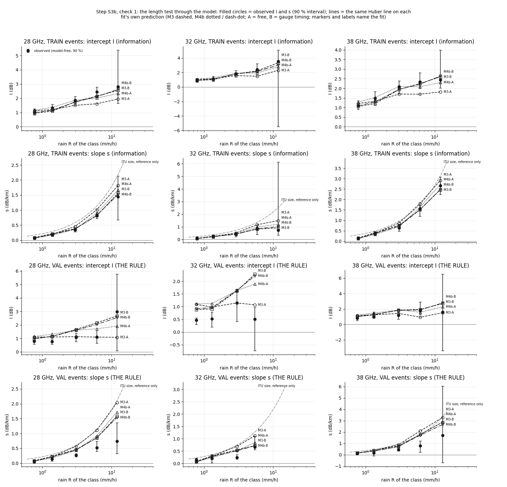
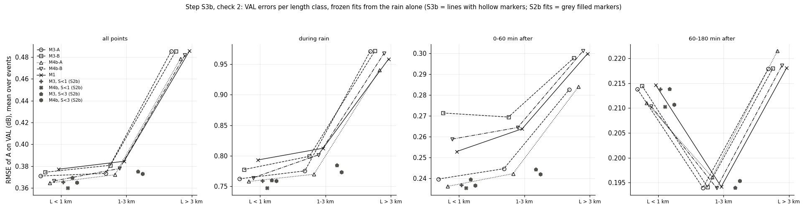
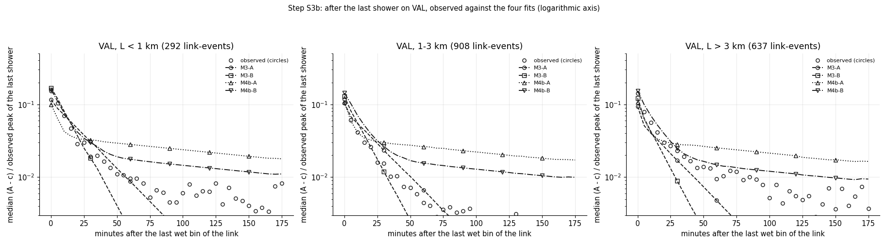
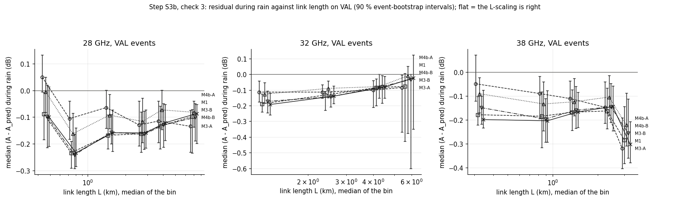

# wet_antenna step S3b: the S2 frame fitted on ALL link lengths, so that P is pinned by L (repair after S3)

Written by `research/wet_antenna/system_id_s3b.py` (libraries `system_id.py`, `length_test.py`). Settings and every rule:
`wet_antenna.system_id_s3b` in `research/config.yaml`, written on 2026-10-15 BEFORE the run. Plan: `docs/ROADMAP.md`, "Findings that
stand (after S3)" and "Remaining plan". **VAL is the judge** (these fits never saw it); TRAIN numbers are information (the fits saw them).

**Standing rule.** WAA is never estimated by subtracting a power-law rain term. The path part is separated only through its dependence on L at matched rain. ITU-R P.838 appears only as a size reference line on a figure and as one of the optimiser starting values of P (the S2b start plan), never to correct data.

## 1. What was run

- The S2 frame A_pred = W + L P_band(R(t - d)) + c on the S3 all-length TRAIN dataset (9780 link-events, 206 links, up to
  8.7 km; the S2 rules for A, c, windows and exclusions), radar input, the S2b settings (knots, increments >= 0, a_link ridge, lag
  grid -4..6 min, tau_s of M4b in 30-240 min).
- Fits: M3-A (M3, free), M3-B (M3, gauge timing fixed), M4b-A (M4b, free), M4b-B (M4b, gauge timing fixed), M1 (M1, free). Variant B fixes
  tau_wet 2.9, tau_dry 12.8 (M3) and tau_f_wet 2.6, tau_f_dry 10.3, phi 0.72, tau_s 240 (M4b), the TRAIN gauge values of S2b.
- 8 starts per fit (the S2b start plan, incl. the 4 P starts), caps 1000 / 300 / 1000; no leave-one-event-out
  folds; 30 event-bootstrap refits per fit (warm start, 30 iterations): **these intervals are too narrow along flat
  directions** (S2b), read them as lower bounds.
- **Timing:** one M4b-A start 388.6 s (1000 iterations, converged False); one evaluation 380 ms;
  projection 2.76 h on 3 processes against the budget 5.0 h: **cuts: nothing**.
  Fitting time 7.0 h summed over the processes. This run: 20.9 min.
- VAL: 3250 link-events, 18 events. Every VAL link is in the TRAIN fits (a_link = 1 for 0 links).
- Software: numba 0.68.0, scipy 1.17.1, numpy 2.4.5.

**Convergence** (`research/wet_antenna/outputs/tables/system_id_s3b_convergence.csv`):

| fit | model | variant | d | converged_on_all_events | starts | starts_converged | starts_median_iterations | spread_over_starts | best_start | lag_profile_loss_range | boot_draws | minutes |
|---|---|---|---|---|---|---|---|---|---|---|---|---|
| M3-A | M3 | A | 2 | True | 8 | 0 | 1000.0 | 0.39 | g3+P0 | 7038.89 | 30 | 90.8 |
| M3-B | M3 | B | 2 | True | 8 | 4 | 973.5 | 0.22 | g3+Pitu | 7095.28 | 30 | 85.9 |
| M4b-A | M4b | A | 1 | False | 8 | 0 | 1000.0 | 0.59 | g3+P0 | 7369.9 | 30 | 88.9 |
| M4b-B | M4b | B | 1 | True | 8 | 6 | 863.5 | 0.08 | g1+P0 | 7844.17 | 30 | 81.2 |
| M1 | M1 | A | 3 | True | 8 | 2 | 1000.0 | 0.3 | g3+Pitu | 21260.09 | 30 | 72.6 |

## 2. The length test on VAL (check 1, the main result)

The same Huber line (A_pred - c) = I + s L on each fit's own prediction, on the S3.1 steady-rain bins, against the observed I and s
intervals. Rule: both inside in >= 2/3 of the eligible cells (>= 8 links under 1 km).

**VAL (the rule):** M3-A **NOT consistent** (0 of 8 cells; I 4, s 2); M3-B **NOT consistent** (1 of 8 cells; I 3, s 2); M4b-A **NOT consistent** (0 of 8 cells; I 2, s 3); M4b-B **NOT consistent** (1 of 8 cells; I 3, s 2).

TRAIN (information): M3-A **NOT consistent** (5 of 10 cells; I 5, s 6); M3-B **consistent** (10 of 10 cells; I 10, s 10); M4b-A **consistent** (9 of 10 cells; I 9, s 10); M4b-B **consistent** (10 of 10 cells; I 10, s 10). For continuity, the S2b fits through the test on VAL: M3, S<1 (S2b) **NOT consistent** (0 of 8 cells; I 7, s 0); M4b, S<1 (S2b) **NOT consistent** (1 of 8 cells; I 2, s 4); M3, S<3 (S2b) **NOT consistent** (0 of 8 cells; I 4, s 1); M4b, S<3 (S2b) **NOT consistent** (1 of 8 cells; I 2, s 4).
The S3 equilibrium comparison (median a_link x F against I, P against s) on VAL: M3-A **NOT consistent** (0 of 8 cells; F 2, P 0); M3-B **NOT consistent** (0 of 8 cells; F 8, P 0); M4b-A **NOT consistent** (0 of 8 cells; F 0, P 5); M4b-B **NOT consistent** (1 of 8 cells; F 1, P 4).

**READING of check 1.** On TRAIN the repair works: with every link length in the fit, P is pinned and the fits reproduce the
model-free I and s (M3-A 5/10, M3-B 10/10, M4b-A 9/10, M4b-B 10/10; M1 9/10), where the S2b fits of S3 reached 0-2 of 10 by the
S3 rule and at most 5 of 10 read through the test. The gauge-timing fits (B) are the best on TRAIN. **On VAL every fit fails**
(M3-A 0/8, M3-B 1/8, M4b-A 0/8, M4b-B 1/8; M1 1/8; the S2b fits 0-1/8 as well). The failure is not
the F / P split: on VAL the observed I AND s are both lower than every fit predicts on the same bins, by about the same factor
(median observed / model on VAL: I 0.72, s 0.61; on TRAIN 1.07 and 0.97), and the static M1
fails in the same way. The VAL events attenuate less per mm/h of radar rain, both at the antenna and on the path (S3 already saw
lower VAL intercepts: 28 GHz, 1-2 mm/h, I 1.33 on TRAIN against 0.76 on VAL; s 0.34 against
0.26 at 2-5 mm/h). A common factor on I and s is what a radar that reads the VAL rain too high (or a
different drop-size mix in those events) would give; it cannot be told apart here. No fit with event-independent F and P can pass this
rule while the two event sets differ like this.

Median observed / model ratio of I and s over the eligible cells:

| set | fit | I_ratio | s_ratio |
|---|---|---|---|
| TRAIN | M3-A | 1.23 | 0.88 |
| TRAIN | M3-B | 1.07 | 0.94 |
| TRAIN | M4b-A | 1.0 | 0.97 |
| TRAIN | M4b-B | 1.07 | 0.99 |
| TRAIN | M1 | 0.99 | 1.03 |
| VAL | M3-A | 0.83 | 0.49 |
| VAL | M3-B | 0.73 | 0.58 |
| VAL | M4b-A | 0.67 | 0.62 |
| VAL | M4b-B | 0.72 | 0.61 |
| VAL | M1 | 0.7 | 0.67 |

Every eligible VAL cell (`research/wet_antenna/outputs/tables/system_id_s3b_length_vs_observed.csv`):

| fit | band | class | R_cell | I_obs | I_obs_lo | I_obs_hi | I_model | s_obs | s_obs_lo | s_obs_hi | s_model | I_inside | s_inside |
|---|---|---|---|---|---|---|---|---|---|---|---|---|---|
| M3-A | 28 GHz | 0.5-1 | 0.76 | 0.8 | 0.59 | 0.9 | 1.1 | 0.04 | 0.01 | 0.08 | 0.07 | False | True |
| M3-A | 28 GHz | 1-2 | 1.38 | 0.76 | 0.58 | 0.9 | 1.11 | 0.13 | 0.07 | 0.19 | 0.22 | False | False |
| M3-A | 28 GHz | 2-5 | 3.06 | 1.08 | 0.78 | 1.4 | 1.13 | 0.26 | 0.21 | 0.33 | 0.57 | True | False |
| M3-A | 28 GHz | 5-10 | 6.11 | 1.1 | 0.64 | 1.62 | 1.1 | 0.51 | 0.4 | 0.73 | 1.11 | True | False |
| M3-A | 38 GHz | 0.5-1 | 0.76 | 0.8 | 0.51 | 1.07 | 1.16 | 0.12 | -0.01 | 0.18 | 0.14 | False | True |
| M3-A | 38 GHz | 1-2 | 1.32 | 1.0 | 0.81 | 1.62 | 1.24 | 0.18 | -0.09 | 0.28 | 0.39 | True | False |
| M3-A | 38 GHz | 2-5 | 2.99 | 1.21 | 0.69 | 1.58 | 1.42 | 0.46 | 0.35 | 0.6 | 0.89 | True | False |
| M3-A | 38 GHz | 5-10 | 6.18 | 1.76 | 1.28 | 2.91 | 0.95 | 0.81 | 0.22 | 1.23 | 2.1 | False | False |
| M3-B | 28 GHz | 0.5-1 | 0.76 | 0.8 | 0.59 | 0.9 | 0.97 | 0.04 | 0.01 | 0.08 | 0.08 | False | True |
| M3-B | 28 GHz | 1-2 | 1.38 | 0.76 | 0.58 | 0.9 | 1.15 | 0.13 | 0.07 | 0.19 | 0.22 | False | False |
| M3-B | 28 GHz | 2-5 | 3.06 | 1.08 | 0.78 | 1.4 | 1.67 | 0.26 | 0.21 | 0.33 | 0.46 | False | False |
| M3-B | 28 GHz | 5-10 | 6.11 | 1.1 | 0.64 | 1.62 | 2.16 | 0.51 | 0.4 | 0.73 | 0.85 | False | False |
| M3-B | 38 GHz | 0.5-1 | 0.76 | 0.8 | 0.51 | 1.07 | 1.01 | 0.12 | -0.01 | 0.18 | 0.16 | True | True |
| M3-B | 38 GHz | 1-2 | 1.32 | 1.0 | 0.81 | 1.62 | 1.25 | 0.18 | -0.09 | 0.28 | 0.39 | True | False |
| M3-B | 38 GHz | 2-5 | 2.99 | 1.21 | 0.69 | 1.58 | 1.85 | 0.46 | 0.35 | 0.6 | 0.78 | False | False |
| M3-B | 38 GHz | 5-10 | 6.18 | 1.76 | 1.28 | 2.91 | 1.95 | 0.81 | 0.22 | 1.23 | 1.8 | True | False |
| M4b-A | 28 GHz | 0.5-1 | 0.76 | 0.8 | 0.59 | 0.9 | 1.15 | 0.04 | 0.01 | 0.08 | 0.07 | False | True |
| M4b-A | 28 GHz | 1-2 | 1.38 | 0.76 | 0.58 | 0.9 | 1.31 | 0.13 | 0.07 | 0.19 | 0.17 | False | True |
| M4b-A | 28 GHz | 2-5 | 3.06 | 1.08 | 0.78 | 1.4 | 1.62 | 0.26 | 0.21 | 0.33 | 0.43 | False | False |
| M4b-A | 28 GHz | 5-10 | 6.11 | 1.1 | 0.64 | 1.62 | 1.72 | 0.51 | 0.4 | 0.73 | 0.92 | False | False |
| M4b-A | 38 GHz | 0.5-1 | 0.76 | 0.8 | 0.51 | 1.07 | 1.2 | 0.12 | -0.01 | 0.18 | 0.15 | False | True |
| M4b-A | 38 GHz | 1-2 | 1.32 | 1.0 | 0.81 | 1.62 | 1.47 | 0.18 | -0.09 | 0.28 | 0.3 | True | False |
| M4b-A | 38 GHz | 2-5 | 2.99 | 1.21 | 0.69 | 1.58 | 1.87 | 0.46 | 0.35 | 0.6 | 0.7 | False | False |
| M4b-A | 38 GHz | 5-10 | 6.18 | 1.76 | 1.28 | 2.91 | 1.59 | 0.81 | 0.22 | 1.23 | 1.81 | True | False |
| M4b-B | 28 GHz | 0.5-1 | 0.76 | 0.8 | 0.59 | 0.9 | 1.01 | 0.04 | 0.01 | 0.08 | 0.06 | False | True |
| M4b-B | 28 GHz | 1-2 | 1.38 | 0.76 | 0.58 | 0.9 | 1.15 | 0.13 | 0.07 | 0.19 | 0.21 | False | False |
| M4b-B | 28 GHz | 2-5 | 3.06 | 1.08 | 0.78 | 1.4 | 1.61 | 0.26 | 0.21 | 0.33 | 0.44 | False | False |
| M4b-B | 28 GHz | 5-10 | 6.11 | 1.1 | 0.64 | 1.62 | 2.04 | 0.51 | 0.4 | 0.73 | 0.85 | False | False |
| M4b-B | 38 GHz | 0.5-1 | 0.76 | 0.8 | 0.51 | 1.07 | 1.03 | 0.12 | -0.01 | 0.18 | 0.15 | True | True |
| M4b-B | 38 GHz | 1-2 | 1.32 | 1.0 | 0.81 | 1.62 | 1.29 | 0.18 | -0.09 | 0.28 | 0.36 | True | False |
| M4b-B | 38 GHz | 2-5 | 2.99 | 1.21 | 0.69 | 1.58 | 1.82 | 0.46 | 0.35 | 0.6 | 0.75 | False | False |
| M4b-B | 38 GHz | 5-10 | 6.18 | 1.76 | 1.28 | 2.91 | 1.87 | 0.81 | 0.22 | 1.23 | 1.72 | True | False |

TRAIN cells (information):

| fit | band | class | I_obs | I_obs_lo | I_obs_hi | I_model | s_obs | s_obs_lo | s_obs_hi | s_model | I_inside | s_inside |
|---|---|---|---|---|---|---|---|---|---|---|---|---|
| M3-A | 28 GHz | 0.5-1 | 1.02 | 0.84 | 1.26 | 1.13 | 0.08 | 0.05 | 0.12 | 0.07 | True | True |
| M3-A | 28 GHz | 1-2 | 1.33 | 1.07 | 1.58 | 1.2 | 0.18 | 0.14 | 0.22 | 0.2 | True | True |
| M3-A | 28 GHz | 2-5 | 1.86 | 1.52 | 2.12 | 1.51 | 0.34 | 0.28 | 0.42 | 0.45 | False | False |
| M3-A | 28 GHz | 5-10 | 2.45 | 2.08 | 2.78 | 1.62 | 0.82 | 0.72 | 0.93 | 1.01 | False | False |
| M3-A | 28 GHz | 10-20 | 2.82 | 1.64 | 5.38 | 1.95 | 1.44 | 0.68 | 2.13 | 1.82 | True | True |
| M3-A | 38 GHz | 0.5-1 | 1.1 | 0.91 | 1.36 | 1.21 | 0.16 | 0.11 | 0.2 | 0.13 | True | True |
| M3-A | 38 GHz | 1-2 | 1.47 | 1.13 | 1.84 | 1.33 | 0.36 | 0.29 | 0.42 | 0.39 | True | True |
| M3-A | 38 GHz | 2-5 | 2.08 | 1.74 | 2.39 | 1.7 | 0.64 | 0.47 | 0.78 | 0.87 | False | False |
| M3-A | 38 GHz | 5-10 | 2.35 | 2.0 | 2.81 | 1.69 | 1.56 | 1.2 | 1.7 | 1.8 | False | False |
| M3-A | 38 GHz | 10-20 | 2.44 | 2.02 | 3.99 | 1.81 | 2.66 | 2.24 | 3.09 | 2.92 | False | True |
| M3-B | 28 GHz | 0.5-1 | 1.02 | 0.84 | 1.26 | 0.95 | 0.08 | 0.05 | 0.12 | 0.09 | True | True |
| M3-B | 28 GHz | 1-2 | 1.33 | 1.07 | 1.58 | 1.1 | 0.18 | 0.14 | 0.22 | 0.22 | True | True |
| M3-B | 28 GHz | 2-5 | 1.86 | 1.52 | 2.12 | 1.75 | 0.34 | 0.28 | 0.42 | 0.38 | True | True |
| M3-B | 28 GHz | 5-10 | 2.45 | 2.08 | 2.78 | 2.15 | 0.82 | 0.72 | 0.93 | 0.81 | True | True |
| M3-B | 28 GHz | 10-20 | 2.82 | 1.64 | 5.38 | 2.56 | 1.44 | 0.68 | 2.13 | 1.57 | True | True |
| M3-B | 38 GHz | 0.5-1 | 1.1 | 0.91 | 1.36 | 1.05 | 0.16 | 0.11 | 0.2 | 0.15 | True | True |
| M3-B | 38 GHz | 1-2 | 1.47 | 1.13 | 1.84 | 1.21 | 0.36 | 0.29 | 0.42 | 0.4 | True | True |
| M3-B | 38 GHz | 2-5 | 2.08 | 1.74 | 2.39 | 1.94 | 0.64 | 0.47 | 0.78 | 0.76 | True | True |
| M3-B | 38 GHz | 5-10 | 2.35 | 2.0 | 2.81 | 2.24 | 1.56 | 1.2 | 1.7 | 1.5 | True | True |
| M3-B | 38 GHz | 10-20 | 2.44 | 2.02 | 3.99 | 2.6 | 2.66 | 2.24 | 3.09 | 2.47 | True | True |
| M4b-A | 28 GHz | 0.5-1 | 1.02 | 0.84 | 1.26 | 1.17 | 0.08 | 0.05 | 0.12 | 0.07 | True | True |
| M4b-A | 28 GHz | 1-2 | 1.33 | 1.07 | 1.58 | 1.36 | 0.18 | 0.14 | 0.22 | 0.17 | True | True |
| M4b-A | 28 GHz | 2-5 | 1.86 | 1.52 | 2.12 | 1.86 | 0.34 | 0.28 | 0.42 | 0.36 | True | True |
| M4b-A | 28 GHz | 5-10 | 2.45 | 2.08 | 2.78 | 2.01 | 0.82 | 0.72 | 0.93 | 0.89 | False | True |
| M4b-A | 28 GHz | 10-20 | 2.82 | 1.64 | 5.38 | 2.34 | 1.44 | 0.68 | 2.13 | 1.67 | True | True |
| M4b-A | 38 GHz | 0.5-1 | 1.1 | 0.91 | 1.36 | 1.28 | 0.16 | 0.11 | 0.2 | 0.12 | True | True |
| M4b-A | 38 GHz | 1-2 | 1.47 | 1.13 | 1.84 | 1.52 | 0.36 | 0.29 | 0.42 | 0.32 | True | True |
| M4b-A | 38 GHz | 2-5 | 2.08 | 1.74 | 2.39 | 2.1 | 0.64 | 0.47 | 0.78 | 0.69 | True | True |
| M4b-A | 38 GHz | 5-10 | 2.35 | 2.0 | 2.81 | 2.08 | 1.56 | 1.2 | 1.7 | 1.61 | True | True |
| M4b-A | 38 GHz | 10-20 | 2.44 | 2.02 | 3.99 | 2.3 | 2.66 | 2.24 | 3.09 | 2.72 | True | True |
| M4b-B | 28 GHz | 0.5-1 | 1.02 | 0.84 | 1.26 | 1.0 | 0.08 | 0.05 | 0.12 | 0.07 | True | True |
| M4b-B | 28 GHz | 1-2 | 1.33 | 1.07 | 1.58 | 1.16 | 0.18 | 0.14 | 0.22 | 0.19 | True | True |
| M4b-B | 28 GHz | 2-5 | 1.86 | 1.52 | 2.12 | 1.73 | 0.34 | 0.28 | 0.42 | 0.37 | True | True |
| M4b-B | 28 GHz | 5-10 | 2.45 | 2.08 | 2.78 | 2.11 | 0.82 | 0.72 | 0.93 | 0.82 | True | True |
| M4b-B | 28 GHz | 10-20 | 2.82 | 1.64 | 5.38 | 2.63 | 1.44 | 0.68 | 2.13 | 1.52 | True | True |
| M4b-B | 38 GHz | 0.5-1 | 1.1 | 0.91 | 1.36 | 1.09 | 0.16 | 0.11 | 0.2 | 0.13 | True | True |
| M4b-B | 38 GHz | 1-2 | 1.47 | 1.13 | 1.84 | 1.29 | 0.36 | 0.29 | 0.42 | 0.37 | True | True |
| M4b-B | 38 GHz | 2-5 | 2.08 | 1.74 | 2.39 | 1.95 | 0.64 | 0.47 | 0.78 | 0.72 | True | True |
| M4b-B | 38 GHz | 5-10 | 2.35 | 2.0 | 2.81 | 2.21 | 1.56 | 1.2 | 1.7 | 1.5 | True | True |
| M4b-B | 38 GHz | 10-20 | 2.44 | 2.02 | 3.99 | 2.63 | 2.66 | 2.24 | 3.09 | 2.48 | True | True |

## 3. VAL errors by length (check 2)

Frozen fits from the rain alone; the S2b fits where their links exist (S<1 fits below 1 km, S<3 fits below 3 km).

| fit | VAL set | link_events | links | links_a_link_1 | events | rmse | rmse_lo | rmse_hi | rmse_rain | rmse_0_60 | rmse_60_180 | shower_peak_error | peak_lo | peak_hi | integral_pred_over_obs | integral_lo | integral_hi |
|---|---|---|---|---|---|---|---|---|---|---|---|---|---|---|---|---|---|
| M3-A | all lengths | 3250 | 206 | 0 | 18 | 0.403 | 0.308 | 0.514 | 0.836 | 0.259 | 0.205 | -0.873 | -1.195 | -0.588 | 0.635 | 0.307 | 1.944 |
| M3-B | all lengths | 3250 | 206 | 0 | 18 | 0.405 | 0.311 | 0.513 | 0.841 | 0.281 | 0.206 | -0.472 | -0.915 | -0.103 | 0.734 | 0.341 | 2.537 |
| M4b-A | all lengths | 3250 | 206 | 0 | 18 | 0.398 | 0.306 | 0.508 | 0.816 | 0.258 | 0.207 | -0.745 | -1.141 | -0.468 | 1.27 | 0.559 | 4.029 |
| M4b-B | all lengths | 3250 | 206 | 0 | 18 | 0.402 | 0.308 | 0.51 | 0.84 | 0.277 | 0.205 | -0.507 | -0.967 | -0.167 | 1.242 | 0.588 | 4.149 |
| M1 | all lengths | 3250 | 206 | 0 | 18 | 0.407 | 0.312 | 0.518 | 0.839 | 0.277 | 0.206 | -0.341 | -0.8 | 0.058 | 0.261 | 0.127 | 0.944 |
| M3-A | L < 1 km | 531 | 41 | 0 | 14 | 0.371 | 0.285 | 0.46 | 0.762 | 0.24 | 0.214 | -1.137 | -1.738 | -0.946 | 0.57 | 0.315 | 1.165 |
| M3-B | L < 1 km | 531 | 41 | 0 | 14 | 0.374 | 0.296 | 0.455 | 0.778 | 0.271 | 0.214 | -0.455 | -1.059 | -0.123 | 0.632 | 0.336 | 1.423 |
| M4b-A | L < 1 km | 531 | 41 | 0 | 14 | 0.365 | 0.285 | 0.448 | 0.758 | 0.236 | 0.211 | -0.847 | -1.446 | -0.572 | 0.995 | 0.512 | 2.009 |
| M4b-B | L < 1 km | 531 | 41 | 0 | 14 | 0.367 | 0.29 | 0.444 | 0.764 | 0.259 | 0.21 | -0.508 | -1.149 | -0.216 | 0.95 | 0.515 | 1.994 |
| M1 | L < 1 km | 531 | 41 | 0 | 14 | 0.377 | 0.298 | 0.458 | 0.793 | 0.253 | 0.215 | -0.248 | -0.808 | 0.158 | 0.163 | 0.091 | 0.38 |
| M3, S<1 (S2b) | L < 1 km | 531 | 41 | 0 | 14 | 0.365 | 0.285 | 0.447 | 0.759 | 0.237 | 0.214 | -0.778 | -1.288 | -0.514 | 0.483 | 0.267 | 1.002 |
| M4b, S<1 (S2b) | L < 1 km | 531 | 41 | 0 | 14 | 0.36 | 0.282 | 0.441 | 0.747 | 0.235 | 0.21 | -0.738 | -1.304 | -0.501 | 0.836 | 0.436 | 1.714 |
| M3, S<3 (S2b) | L < 1 km | 531 | 41 | 0 | 14 | 0.37 | 0.285 | 0.458 | 0.76 | 0.24 | 0.214 | -1.081 | -1.687 | -0.876 | 0.55 | 0.303 | 1.126 |
| M4b, S<3 (S2b) | L < 1 km | 531 | 41 | 0 | 14 | 0.365 | 0.285 | 0.449 | 0.759 | 0.237 | 0.211 | -0.842 | -1.448 | -0.578 | 0.958 | 0.496 | 1.959 |
| M3-A | 1-3 km | 1654 | 103 | 0 | 18 | 0.373 | 0.282 | 0.482 | 0.775 | 0.245 | 0.194 | -0.881 | -1.234 | -0.556 | 0.741 | 0.335 | 2.31 |
| M3-B | 1-3 km | 1654 | 103 | 0 | 18 | 0.381 | 0.289 | 0.488 | 0.799 | 0.269 | 0.194 | -0.509 | -0.964 | -0.096 | 0.887 | 0.372 | 2.952 |
| M4b-A | 1-3 km | 1654 | 103 | 0 | 18 | 0.372 | 0.28 | 0.481 | 0.77 | 0.242 | 0.196 | -0.768 | -1.174 | -0.438 | 1.455 | 0.59 | 4.377 |
| M4b-B | 1-3 km | 1654 | 103 | 0 | 18 | 0.378 | 0.287 | 0.485 | 0.802 | 0.264 | 0.194 | -0.542 | -1.008 | -0.143 | 1.429 | 0.637 | 4.476 |
| M1 | 1-3 km | 1654 | 103 | 0 | 18 | 0.385 | 0.29 | 0.494 | 0.813 | 0.264 | 0.194 | -0.348 | -0.824 | 0.076 | 0.305 | 0.13 | 1.04 |
| M3, S<3 (S2b) | 1-3 km | 1654 | 103 | 0 | 18 | 0.375 | 0.283 | 0.485 | 0.785 | 0.244 | 0.194 | -0.753 | -1.137 | -0.393 | 0.681 | 0.309 | 2.174 |
| M4b, S<3 (S2b) | 1-3 km | 1654 | 103 | 0 | 18 | 0.373 | 0.281 | 0.482 | 0.773 | 0.242 | 0.195 | -0.73 | -1.15 | -0.415 | 1.384 | 0.569 | 4.15 |
| M3-A | L > 3 km | 1065 | 62 | 0 | 17 | 0.485 | 0.367 | 0.614 | 0.971 | 0.283 | 0.218 | -0.589 | -0.971 | -0.24 | 0.721 | -2.654 | 3.292 |
| M3-B | L > 3 km | 1065 | 62 | 0 | 17 | 0.485 | 0.37 | 0.613 | 0.972 | 0.298 | 0.218 | -0.446 | -0.832 | -0.072 | 0.795 | -2.811 | 3.622 |
| M4b-A | L > 3 km | 1065 | 62 | 0 | 17 | 0.478 | 0.359 | 0.607 | 0.94 | 0.284 | 0.222 | -0.65 | -1.027 | -0.397 | 1.669 | -6.04 | 7.671 |
| M4b-B | L > 3 km | 1065 | 62 | 0 | 17 | 0.482 | 0.368 | 0.607 | 0.968 | 0.301 | 0.219 | -0.436 | -0.85 | -0.12 | 1.592 | -5.753 | 7.373 |
| M1 | L > 3 km | 1065 | 62 | 0 | 17 | 0.485 | 0.368 | 0.617 | 0.958 | 0.3 | 0.218 | -0.375 | -0.78 | 0.01 | 0.327 | -1.089 | 1.478 |

(`research/wet_antenna/outputs/tables/system_id_s3b_val_by_length.csv`.)

**READING of check 2.** The differences between the fits are again a few thousandths to a hundredth of a dB, inside the
intervals. Over all VAL lengths the lowest error is M4b-A (0.398 dB; the others M3-A 0.403, M3-B 0.405, M4b-B 0.402, M1 0.407).
Fitting on all lengths does not cost much on the short links (L < 1 km: M4b-A 0.365 against the S2b S<1 fit
0.360) and matches the S2b S<3 fits on 1-3 km. The errors grow with L (> 3 km: 0.478 dB
during all points, 0.940 during rain), where the path term dominates. **The gauge timing (B) gives better peaks**
(shower peak error M3-B -0.47, M4b-B -0.51 dB against M3-A -0.87,
M4b-A -0.75), but a worse first hour after the rain (RMSE 0-60 min M3-B 0.281 against M3-A
0.259): with the radar input, a fast antenna follows the radar's timing errors. After the rain M3 ends too low
(integral 0.63 x), M4b too high (1.27 x), as in S2b.

Median (A - c) / peak after the last shower on VAL (`research/wet_antenna/outputs/tables/system_id_s3b_val_after_last_shower.csv`):

| minutes_after_last_wet_bin | link_events | observed | M3-A | M3-B | M4b-A | M4b-B | set |
|---|---|---|---|---|---|---|---|
| 0 | 292 | 0.153 | 0.116 | 0.169 | 0.1 | 0.159 | L < 1 km |
| 10 | 292 | 0.07 | 0.071 | 0.08 | 0.042 | 0.076 | L < 1 km |
| 20 | 292 | 0.029 | 0.047 | 0.037 | 0.034 | 0.042 | L < 1 km |
| 30 | 292 | 0.019 | 0.031 | 0.018 | 0.032 | 0.03 | L < 1 km |
| 60 | 292 | 0.01 | 0.009 | 0.002 | 0.028 | 0.018 | L < 1 km |
| 90 | 292 | 0.005 | 0.002 | 0.0 | 0.025 | 0.015 | L < 1 km |
| 120 | 292 | 0.006 | 0.001 | 0.0 | 0.022 | 0.013 | L < 1 km |
| 175 | 292 | 0.008 | 0.0 | 0.0 | 0.018 | 0.011 | L < 1 km |
| 0 | 908 | 0.118 | 0.105 | 0.13 | 0.107 | 0.143 | 1-3 km |
| 10 | 908 | 0.041 | 0.055 | 0.056 | 0.041 | 0.071 | 1-3 km |
| 20 | 908 | 0.026 | 0.036 | 0.026 | 0.032 | 0.04 | 1-3 km |
| 30 | 908 | 0.015 | 0.023 | 0.012 | 0.03 | 0.026 | 1-3 km |
| 60 | 908 | 0.004 | 0.007 | 0.001 | 0.026 | 0.016 | 1-3 km |
| 90 | 908 | 0.003 | 0.002 | 0.0 | 0.023 | 0.013 | 1-3 km |
| 120 | 908 | 0.001 | 0.001 | 0.0 | 0.02 | 0.012 | 1-3 km |
| 175 | 908 | 0.0 | 0.0 | 0.0 | 0.017 | 0.01 | 1-3 km |
| 0 | 637 | 0.142 | 0.094 | 0.121 | 0.108 | 0.153 | L > 3 km |
| 10 | 637 | 0.056 | 0.04 | 0.043 | 0.041 | 0.07 | L > 3 km |
| 20 | 637 | 0.03 | 0.026 | 0.02 | 0.031 | 0.04 | L > 3 km |
| 30 | 637 | 0.023 | 0.017 | 0.009 | 0.028 | 0.025 | L > 3 km |
| 60 | 637 | 0.009 | 0.005 | 0.001 | 0.025 | 0.015 | L > 3 km |
| 90 | 637 | 0.009 | 0.001 | 0.0 | 0.022 | 0.013 | L > 3 km |
| 120 | 637 | 0.006 | 0.0 | 0.0 | 0.02 | 0.011 | L > 3 km |
| 175 | 637 | 0.004 | 0.0 | 0.0 | 0.016 | 0.009 | L > 3 km |

## 4. Residual against L on VAL (check 3)

Per link-event the median (A - A_pred) during rain; per band and L bin the median with a 90 % event-bootstrap interval. FLAT = the
intervals of the shortest and the longest bin (>= 5 links) overlap.

| fit | band | shortest | longest | shortest_median | longest_median | verdict |
|---|---|---|---|---|---|---|
| M3-A | 28 GHz | 0.5-1 | 3-5 | -0.106 | -0.115 | FLAT |
| M3-A | 32 GHz | 1-2 | 3-5 | -0.114 | -0.102 | FLAT |
| M3-A | 38 GHz | 0-0.5 | 2-3 | -0.049 | -0.147 | FLAT |
| M3-B | 28 GHz | 0.5-1 | 3-5 | -0.234 | -0.134 | FLAT |
| M3-B | 32 GHz | 1-2 | 3-5 | -0.188 | -0.086 | FLAT |
| M3-B | 38 GHz | 0-0.5 | 2-3 | -0.179 | -0.163 | FLAT |
| M4b-A | 28 GHz | 0.5-1 | 3-5 | -0.162 | -0.073 | FLAT |
| M4b-A | 32 GHz | 1-2 | 3-5 | -0.127 | -0.079 | FLAT |
| M4b-A | 38 GHz | 0-0.5 | 2-3 | -0.091 | -0.105 | FLAT |
| M4b-B | 28 GHz | 0.5-1 | 3-5 | -0.242 | -0.13 | FLAT |
| M4b-B | 32 GHz | 1-2 | 3-5 | -0.173 | -0.079 | FLAT |
| M4b-B | 38 GHz | 0-0.5 | 2-3 | -0.149 | -0.146 | FLAT |
| M1 | 28 GHz | 0.5-1 | 3-5 | -0.234 | -0.121 | FLAT |
| M1 | 32 GHz | 1-2 | 3-5 | -0.193 | -0.082 | FLAT |
| M1 | 38 GHz | 0-0.5 | 2-3 | -0.199 | -0.144 | FLAT |

**READING of check 3.** 15 of 15 (fit, band) lines are FLAT by the rule: the residual during rain does not change
with L within the intervals, so the L-scaling of every fit is right on VAL. But the residual is negative at every length (about
-0.17 to -0.09 dB, middle half of the bins): the fits predict too much attenuation during rain on VAL at
all lengths, the same level difference as in check 1.

| fit | band | L_bin_km | L_median_km | link_events | links | residual_median_db | lo | hi |
|---|---|---|---|---|---|---|---|---|
| M3-A | 28 GHz | 0-0.5 | 0.461 | 72 | 4 | 0.05 | -0.005 | 0.134 |
| M3-A | 28 GHz | 0.5-1 | 0.76 | 185 | 13 | -0.106 | -0.183 | -0.04 |
| M3-A | 28 GHz | 1-2 | 1.491 | 419 | 25 | -0.064 | -0.141 | 0.002 |
| M3-A | 28 GHz | 2-3 | 2.738 | 360 | 20 | -0.13 | -0.208 | -0.04 |
| M3-A | 28 GHz | 3-5 | 3.902 | 829 | 47 | -0.115 | -0.195 | -0.039 |
| M3-A | 28 GHz | >5 | 6.992 | 58 | 4 | -0.135 | -0.232 | -0.074 |
| M3-A | 32 GHz | 1-2 | 1.263 | 117 | 8 | -0.114 | -0.176 | -0.043 |
| M3-A | 32 GHz | 2-3 | 2.473 | 74 | 4 | -0.114 | -0.152 | -0.067 |
| M3-A | 32 GHz | 3-5 | 4.258 | 97 | 6 | -0.102 | -0.21 | -0.04 |
| M3-A | 32 GHz | >5 | 5.773 | 18 | 1 | -0.084 | -0.368 | -0.005 |
| M3-A | 38 GHz | 0-0.5 | 0.324 | 107 | 11 | -0.049 | -0.121 | 0.072 |
| M3-A | 38 GHz | 0.5-1 | 0.869 | 167 | 13 | -0.09 | -0.195 | -0.019 |
| M3-A | 38 GHz | 1-2 | 1.386 | 349 | 25 | -0.111 | -0.175 | -0.037 |
| M3-A | 38 GHz | 2-3 | 2.38 | 335 | 21 | -0.147 | -0.215 | -0.04 |
| M3-A | 38 GHz | 3-5 | 3.099 | 63 | 4 | -0.32 | -0.404 | -0.192 |
| M3-B | 28 GHz | 0-0.5 | 0.461 | 72 | 4 | -0.089 | -0.184 | -0.008 |
| M3-B | 28 GHz | 0.5-1 | 0.76 | 185 | 13 | -0.234 | -0.292 | -0.19 |
| M3-B | 28 GHz | 1-2 | 1.491 | 419 | 25 | -0.168 | -0.219 | -0.092 |
| M3-B | 28 GHz | 2-3 | 2.738 | 360 | 20 | -0.163 | -0.232 | -0.08 |
| M3-B | 28 GHz | 3-5 | 3.902 | 829 | 47 | -0.134 | -0.218 | -0.058 |
| M3-B | 28 GHz | >5 | 6.992 | 58 | 4 | -0.098 | -0.234 | -0.071 |
| M3-B | 32 GHz | 1-2 | 1.263 | 117 | 8 | -0.188 | -0.24 | -0.127 |
| M3-B | 32 GHz | 2-3 | 2.473 | 74 | 4 | -0.133 | -0.229 | -0.108 |
| M3-B | 32 GHz | 3-5 | 4.258 | 97 | 6 | -0.086 | -0.201 | -0.03 |
| M3-B | 32 GHz | >5 | 5.773 | 18 | 1 | -0.077 | -0.426 | 0.006 |
| M3-B | 38 GHz | 0-0.5 | 0.324 | 107 | 11 | -0.179 | -0.222 | -0.102 |
| M3-B | 38 GHz | 0.5-1 | 0.869 | 167 | 13 | -0.185 | -0.316 | -0.083 |
| M3-B | 38 GHz | 1-2 | 1.386 | 349 | 25 | -0.168 | -0.243 | -0.075 |
| M3-B | 38 GHz | 2-3 | 2.38 | 335 | 21 | -0.163 | -0.237 | -0.068 |
| M3-B | 38 GHz | 3-5 | 3.099 | 63 | 4 | -0.284 | -0.382 | -0.144 |
| M4b-A | 28 GHz | 0-0.5 | 0.461 | 72 | 4 | -0.005 | -0.082 | 0.05 |
| M4b-A | 28 GHz | 0.5-1 | 0.76 | 185 | 13 | -0.162 | -0.235 | -0.085 |
| M4b-A | 28 GHz | 1-2 | 1.491 | 419 | 25 | -0.093 | -0.143 | -0.015 |
| M4b-A | 28 GHz | 2-3 | 2.738 | 360 | 20 | -0.117 | -0.195 | -0.028 |
| M4b-A | 28 GHz | 3-5 | 3.902 | 829 | 47 | -0.073 | -0.147 | 0.0 |
| M4b-A | 28 GHz | >5 | 6.992 | 58 | 4 | -0.082 | -0.137 | -0.04 |
| M4b-A | 32 GHz | 1-2 | 1.263 | 117 | 8 | -0.127 | -0.184 | -0.054 |
| M4b-A | 32 GHz | 2-3 | 2.473 | 74 | 4 | -0.09 | -0.15 | -0.042 |
| M4b-A | 32 GHz | 3-5 | 4.258 | 97 | 6 | -0.079 | -0.152 | 0.0 |
| M4b-A | 32 GHz | >5 | 5.773 | 18 | 1 | -0.01 | -0.375 | 0.051 |
| M4b-A | 38 GHz | 0-0.5 | 0.324 | 107 | 11 | -0.091 | -0.17 | -0.023 |
| M4b-A | 38 GHz | 0.5-1 | 0.869 | 167 | 13 | -0.134 | -0.245 | -0.041 |
| M4b-A | 38 GHz | 1-2 | 1.386 | 349 | 25 | -0.125 | -0.183 | -0.027 |
| M4b-A | 38 GHz | 2-3 | 2.38 | 335 | 21 | -0.105 | -0.179 | -0.014 |
| M4b-A | 38 GHz | 3-5 | 3.099 | 63 | 4 | -0.221 | -0.31 | -0.087 |
| M4b-B | 28 GHz | 0-0.5 | 0.461 | 72 | 4 | -0.098 | -0.214 | 0.02 |
| M4b-B | 28 GHz | 0.5-1 | 0.76 | 185 | 13 | -0.242 | -0.293 | -0.164 |
| M4b-B | 28 GHz | 1-2 | 1.491 | 419 | 25 | -0.157 | -0.201 | -0.089 |
| M4b-B | 28 GHz | 2-3 | 2.738 | 360 | 20 | -0.165 | -0.221 | -0.078 |
| M4b-B | 28 GHz | 3-5 | 3.902 | 829 | 47 | -0.13 | -0.213 | -0.05 |
| M4b-B | 28 GHz | >5 | 6.992 | 58 | 4 | -0.101 | -0.189 | -0.049 |
| M4b-B | 32 GHz | 1-2 | 1.263 | 117 | 8 | -0.173 | -0.246 | -0.106 |
| M4b-B | 32 GHz | 2-3 | 2.473 | 74 | 4 | -0.144 | -0.207 | -0.112 |
| M4b-B | 32 GHz | 3-5 | 4.258 | 97 | 6 | -0.079 | -0.184 | -0.009 |
| M4b-B | 32 GHz | >5 | 5.773 | 18 | 1 | -0.034 | -0.601 | -0.0 |
| M4b-B | 38 GHz | 0-0.5 | 0.324 | 107 | 11 | -0.149 | -0.218 | -0.101 |
| M4b-B | 38 GHz | 0.5-1 | 0.869 | 167 | 13 | -0.196 | -0.293 | -0.112 |
| M4b-B | 38 GHz | 1-2 | 1.386 | 349 | 25 | -0.16 | -0.236 | -0.06 |
| M4b-B | 38 GHz | 2-3 | 2.38 | 335 | 21 | -0.146 | -0.21 | -0.048 |
| M4b-B | 38 GHz | 3-5 | 3.099 | 63 | 4 | -0.255 | -0.36 | -0.112 |
| M1 | 28 GHz | 0-0.5 | 0.461 | 72 | 4 | -0.099 | -0.21 | 0.014 |
| M1 | 28 GHz | 0.5-1 | 0.76 | 185 | 13 | -0.234 | -0.284 | -0.14 |
| M1 | 28 GHz | 1-2 | 1.491 | 419 | 25 | -0.159 | -0.228 | -0.073 |
| M1 | 28 GHz | 2-3 | 2.738 | 360 | 20 | -0.159 | -0.215 | -0.073 |
| M1 | 28 GHz | 3-5 | 3.902 | 829 | 47 | -0.121 | -0.187 | -0.051 |
| M1 | 28 GHz | >5 | 6.992 | 58 | 4 | -0.087 | -0.198 | -0.053 |
| M1 | 32 GHz | 1-2 | 1.263 | 117 | 8 | -0.193 | -0.259 | -0.119 |
| M1 | 32 GHz | 2-3 | 2.473 | 74 | 4 | -0.14 | -0.186 | -0.075 |
| M1 | 32 GHz | 3-5 | 4.258 | 97 | 6 | -0.082 | -0.153 | -0.014 |
| M1 | 32 GHz | >5 | 5.773 | 18 | 1 | -0.023 | -0.35 | 0.124 |
| M1 | 38 GHz | 0-0.5 | 0.324 | 107 | 11 | -0.199 | -0.233 | -0.076 |
| M1 | 38 GHz | 0.5-1 | 0.869 | 167 | 13 | -0.204 | -0.293 | -0.077 |
| M1 | 38 GHz | 1-2 | 1.386 | 349 | 25 | -0.167 | -0.232 | -0.085 |
| M1 | 38 GHz | 2-3 | 2.38 | 335 | 21 | -0.144 | -0.246 | -0.059 |
| M1 | 38 GHz | 3-5 | 3.099 | 63 | 4 | -0.301 | -0.379 | -0.207 |

(`research/wet_antenna/outputs/tables/system_id_s3b_residual_vs_L.csv`.)

## 5. Timing (check 4)

| fit | wetting (radar, all lengths) | drying (radar, all lengths) | short (<= 10 min) | gauge TRAIN (S2b) wet / dry | gauge VAL (S3.4) wet / dry | S2b radar S<1 wet / dry |
|---|---|---|---|---|---|---|
| M3-A | 56.1 [17.5, 125.0] | 23.5 [14.9, 33.9] | False | 2.9 / 12.8 | 1.8 / 10.8 | 43.0 / 24.7 |
| M4b-A | 13.1 [6.9, 72.3] | 4.1 [2.4, 5.4] | False | 2.6 / 10.3 | 2.0 / 8.8 | 15.0 / 7.4 |

**READING of check 4.** No. With P pinned the radar wetting time stays long: M3-A tau_wet 56 [17, 125] min
(S2b S<1: 43), M4b-A tau_f_wet 13.1 [6.9, 72.3] min (S2b: 15), against 2-3 min with the gauge (TRAIN and VAL). So the slow
wetting with the radar is not caused by the F / P confusion; it is the input smoothing that fake check Ta of S2 showed (a 5 min, noisy
rain input makes the wetting about 2 x slower). The gauge-timing fits (B) fit TRAIN slightly worse (training loss M3-B - M3-A
= +3247, M4b-B - M4b-A = +3647, of about 1.6e5) and give the better peaks on VAL.

The parameters of every fit (`research/wet_antenna/outputs/tables/system_id_s3b_parameters.csv`):

| fit | parameter | value | lo | hi |
|---|---|---|---|---|
| M3-A | d | 2.0 | 2.0 | 2.0 |
| M3-A | tau_wet | 56.142 | 17.454 | 124.991 |
| M3-A | tau_dry | 23.538 | 14.89 | 33.914 |
| M3-A | F[28 GHz](0.5) | 0.944 | 0.67 | 1.275 |
| M3-A | P[28 GHz](0.5) | 0.157 | 0.11 | 0.196 |
| M3-A | F[28 GHz](2) | 1.366 | 0.841 | 1.989 |
| M3-A | P[28 GHz](2) | 0.45 | 0.349 | 0.508 |
| M3-A | F[28 GHz](5) | 1.689 | 1.447 | 2.245 |
| M3-A | P[28 GHz](5) | 1.023 | 0.873 | 1.16 |
| M3-A | F[28 GHz](10) | 1.689 | 1.521 | 2.729 |
| M3-A | P[28 GHz](10) | 1.687 | 1.433 | 2.12 |
| M3-A | F[32 GHz](0.5) | 0.851 | 0.497 | 1.266 |
| M3-A | P[32 GHz](0.5) | 0.135 | 0.085 | 0.194 |
| M3-A | F[32 GHz](2) | 1.57 | 1.173 | 2.394 |
| M3-A | P[32 GHz](2) | 0.511 | 0.289 | 0.674 |
| M3-A | F[32 GHz](5) | 1.57 | 1.307 | 2.397 |
| M3-A | P[32 GHz](5) | 1.207 | 0.998 | 1.443 |
| M3-A | F[32 GHz](10) | 1.57 | 1.337 | 2.528 |
| M3-A | P[32 GHz](10) | 1.741 | 1.39 | 2.393 |
| M3-A | F[38 GHz](0.5) | 1.087 | 0.764 | 1.57 |
| M3-A | P[38 GHz](0.5) | 0.252 | 0.165 | 0.328 |
| M3-A | F[38 GHz](2) | 2.131 | 1.37 | 2.905 |
| M3-A | P[38 GHz](2) | 0.815 | 0.609 | 0.986 |
| M3-A | F[38 GHz](5) | 2.131 | 1.819 | 2.954 |
| M3-A | P[38 GHz](5) | 1.746 | 1.487 | 1.981 |
| M3-A | F[38 GHz](10) | 2.131 | 1.992 | 3.391 |
| M3-A | P[38 GHz](10) | 2.809 | 2.437 | 3.482 |
| M3-A | a_p10 | 0.622 | 0.559 | 0.621 |
| M3-A | a_p90 | 1.518 | 1.373 | 1.59 |
| M3-B | d | 2.0 | 2.0 | 2.0 |
| M3-B | tau_wet | 2.9 | 2.9 | 2.9 |
| M3-B | tau_dry | 12.8 | 12.8 | 12.8 |
| M3-B | F[28 GHz](0.5) | 0.535 | 0.359 | 0.668 |
| M3-B | P[28 GHz](0.5) | 0.12 | 0.084 | 0.157 |
| M3-B | F[28 GHz](2) | 0.801 | 0.641 | 1.166 |
| M3-B | P[28 GHz](2) | 0.425 | 0.336 | 0.553 |
| M3-B | F[28 GHz](5) | 1.336 | 1.112 | 1.588 |
| M3-B | P[28 GHz](5) | 0.889 | 0.771 | 1.005 |
| M3-B | F[28 GHz](10) | 1.757 | 1.47 | 2.135 |
| M3-B | P[28 GHz](10) | 1.423 | 1.213 | 1.683 |
| M3-B | F[32 GHz](0.5) | 0.447 | 0.269 | 0.594 |
| M3-B | P[32 GHz](0.5) | 0.118 | 0.074 | 0.167 |
| M3-B | F[32 GHz](2) | 0.722 | 0.587 | 0.966 |
| M3-B | P[32 GHz](2) | 0.545 | 0.349 | 0.881 |
| M3-B | F[32 GHz](5) | 1.301 | 1.108 | 1.499 |
| M3-B | P[32 GHz](5) | 1.022 | 0.89 | 1.248 |
| M3-B | F[32 GHz](10) | 1.792 | 1.548 | 2.041 |
| M3-B | P[32 GHz](10) | 1.233 | 1.035 | 1.573 |
| M3-B | F[38 GHz](0.5) | 0.614 | 0.4 | 0.782 |
| M3-B | P[38 GHz](0.5) | 0.172 | 0.1 | 0.225 |
| M3-B | F[38 GHz](2) | 1.116 | 0.851 | 1.506 |
| M3-B | P[38 GHz](2) | 0.764 | 0.582 | 0.993 |
| M3-B | F[38 GHz](5) | 1.767 | 1.511 | 2.023 |
| M3-B | P[38 GHz](5) | 1.483 | 1.195 | 1.693 |
| M3-B | F[38 GHz](10) | 2.053 | 1.701 | 2.5 |
| M3-B | P[38 GHz](10) | 2.419 | 2.002 | 2.825 |
| M3-B | a_p10 | 0.581 | 0.534 | 0.603 |
| M3-B | a_p90 | 1.537 | 1.383 | 1.611 |
| M4b-A | d | 1.0 | 1.0 | 1.0 |
| M4b-A | phi | 0.662 | 0.563 | 0.759 |
| M4b-A | tau_f_wet | 13.109 | 6.911 | 72.294 |
| M4b-A | tau_f_dry | 4.098 | 2.351 | 5.388 |
| M4b-A | tau_s | 240.0 | 160.219 | 240.0 |
| M4b-A | F[28 GHz](0.5) | 1.489 | 1.11 | 1.84 |
| M4b-A | P[28 GHz](0.5) | 0.008 | 0.0 | 0.051 |
| M4b-A | F[28 GHz](2) | 2.609 | 1.878 | 3.09 |
| M4b-A | P[28 GHz](2) | 0.17 | 0.122 | 0.266 |
| M4b-A | F[28 GHz](5) | 3.079 | 2.599 | 3.428 |
| M4b-A | P[28 GHz](5) | 0.647 | 0.533 | 0.794 |
| M4b-A | F[28 GHz](10) | 3.079 | 2.716 | 3.546 |
| M4b-A | P[28 GHz](10) | 1.292 | 1.076 | 1.633 |
| M4b-A | F[32 GHz](0.5) | 1.372 | 0.983 | 1.745 |
| M4b-A | P[32 GHz](0.5) | 0.0 | 0.0 | 0.037 |
| M4b-A | F[32 GHz](2) | 2.89 | 2.464 | 3.655 |
| M4b-A | P[32 GHz](2) | 0.193 | 0.078 | 0.347 |
| M4b-A | F[32 GHz](5) | 3.317 | 2.88 | 4.043 |
| M4b-A | P[32 GHz](5) | 0.745 | 0.587 | 0.939 |
| M4b-A | F[32 GHz](10) | 3.317 | 2.894 | 4.043 |
| M4b-A | P[32 GHz](10) | 1.136 | 0.972 | 1.465 |
| M4b-A | F[38 GHz](0.5) | 1.439 | 1.148 | 1.94 |
| M4b-A | P[38 GHz](0.5) | 0.041 | 0.0 | 0.098 |
| M4b-A | F[38 GHz](2) | 3.222 | 2.731 | 3.784 |
| M4b-A | P[38 GHz](2) | 0.331 | 0.158 | 0.512 |
| M4b-A | F[38 GHz](5) | 3.222 | 2.893 | 3.836 |
| M4b-A | P[38 GHz](5) | 1.151 | 1.032 | 1.391 |
| M4b-A | F[38 GHz](10) | 3.222 | 2.895 | 4.026 |
| M4b-A | P[38 GHz](10) | 2.242 | 1.913 | 2.713 |
| M4b-A | a_p10 | 0.779 | 0.692 | 0.786 |
| M4b-A | a_p90 | 1.239 | 1.192 | 1.296 |
| M4b-B | d | 1.0 | 1.0 | 1.0 |
| M4b-B | phi | 0.72 | 0.72 | 0.72 |
| M4b-B | tau_f_wet | 2.6 | 2.6 | 2.6 |
| M4b-B | tau_f_dry | 10.3 | 10.3 | 10.3 |
| M4b-B | tau_s | 240.0 | 240.0 | 240.0 |
| M4b-B | F[28 GHz](0.5) | 0.978 | 0.751 | 1.266 |
| M4b-B | P[28 GHz](0.5) | 0.009 | 0.0 | 0.03 |
| M4b-B | F[28 GHz](2) | 1.635 | 1.267 | 2.354 |
| M4b-B | P[28 GHz](2) | 0.245 | 0.114 | 0.288 |
| M4b-B | F[28 GHz](5) | 2.619 | 2.313 | 3.341 |
| M4b-B | P[28 GHz](5) | 0.634 | 0.373 | 0.805 |
| M4b-B | F[28 GHz](10) | 3.377 | 2.97 | 4.622 |
| M4b-B | P[28 GHz](10) | 1.145 | 0.684 | 1.277 |
| M4b-B | F[32 GHz](0.5) | 0.903 | 0.638 | 1.247 |
| M4b-B | P[32 GHz](0.5) | 0.006 | 0.0 | 0.023 |
| M4b-B | F[32 GHz](2) | 1.702 | 1.515 | 2.249 |
| M4b-B | P[32 GHz](2) | 0.329 | 0.123 | 0.548 |
| M4b-B | F[32 GHz](5) | 2.936 | 2.771 | 3.503 |
| M4b-B | P[32 GHz](5) | 0.698 | 0.365 | 0.823 |
| M4b-B | F[32 GHz](10) | 3.706 | 3.539 | 4.476 |
| M4b-B | P[32 GHz](10) | 0.969 | 0.493 | 1.371 |
| M4b-B | F[38 GHz](0.5) | 0.957 | 0.685 | 1.266 |
| M4b-B | P[38 GHz](0.5) | 0.022 | 0.0 | 0.061 |
| M4b-B | F[38 GHz](2) | 2.016 | 1.642 | 2.762 |
| M4b-B | P[38 GHz](2) | 0.466 | 0.207 | 0.6 |
| M4b-B | F[38 GHz](5) | 3.005 | 2.743 | 3.799 |
| M4b-B | P[38 GHz](5) | 1.091 | 0.5 | 1.271 |
| M4b-B | F[38 GHz](10) | 3.484 | 3.128 | 4.697 |
| M4b-B | P[38 GHz](10) | 2.0 | 1.056 | 2.314 |
| M4b-B | a_p10 | 0.725 | 0.672 | 0.75 |
| M4b-B | a_p90 | 1.21 | 1.197 | 1.317 |
| M1 | d | 3.0 | 3.0 | 3.0 |
| M1 | F[28 GHz](0.5) | 1.032 | 0.75 | 1.139 |
| M1 | P[28 GHz](0.5) | 0.001 | 0.0 | 0.048 |
| M1 | F[28 GHz](2) | 1.714 | 1.335 | 2.041 |
| M1 | P[28 GHz](2) | 0.163 | 0.09 | 0.329 |
| M1 | F[28 GHz](5) | 2.705 | 2.356 | 3.085 |
| M1 | P[28 GHz](5) | 0.415 | 0.324 | 0.612 |
| M1 | F[28 GHz](10) | 3.05 | 2.676 | 3.687 |
| M1 | P[28 GHz](10) | 0.948 | 0.854 | 1.284 |
| M1 | F[32 GHz](0.5) | 0.92 | 0.633 | 1.063 |
| M1 | P[32 GHz](0.5) | 0.001 | 0.0 | 0.071 |
| M1 | F[32 GHz](2) | 1.445 | 1.313 | 1.806 |
| M1 | P[32 GHz](2) | 0.348 | 0.17 | 0.622 |
| M1 | F[32 GHz](5) | 3.078 | 2.9 | 3.397 |
| M1 | P[32 GHz](5) | 0.349 | 0.27 | 0.622 |
| M1 | F[32 GHz](10) | 3.552 | 3.252 | 4.042 |
| M1 | P[32 GHz](10) | 0.513 | 0.389 | 0.859 |
| M1 | F[38 GHz](0.5) | 1.038 | 0.783 | 1.189 |
| M1 | P[38 GHz](0.5) | 0.032 | 0.002 | 0.112 |
| M1 | F[38 GHz](2) | 2.024 | 1.731 | 2.432 |
| M1 | P[38 GHz](2) | 0.325 | 0.134 | 0.625 |
| M1 | F[38 GHz](5) | 2.966 | 2.644 | 3.468 |
| M1 | P[38 GHz](5) | 0.776 | 0.599 | 0.988 |
| M1 | F[38 GHz](10) | 2.966 | 2.652 | 3.826 |
| M1 | P[38 GHz](10) | 1.838 | 1.662 | 2.042 |
| M1 | a_p10 | 0.773 | 0.697 | 0.77 |
| M1 | a_p90 | 1.242 | 1.183 | 1.325 |

## 6. WAA v3 candidate

**None.** No fit is consistent with the length test on VAL (the rule). What fails: every fit predicts a larger intercept and slope on the VAL steady-rain bins than VAL shows (observed / model
about 0.72 for I and 0.61 for s), the static M1 and the S2b fits included. This is a difference between the TRAIN and
VAL event sets that a model with one F and one P per band cannot follow; it is not the F / P split, which the all-length fits get
right on TRAIN (M3-B and M4b-B 10 of 10 cells). What stands from S3b: (1) with all lengths in the fit, P is pinned and the TRAIN length
test is reproduced (B fits: 10 / 10); (2) the L-scaling is right on VAL (residual flat with L); (3) the radar wetting time stays long
with P pinned (input smoothing, not P); (4) the gauge timing gives better peaks.

**Note for the next step (not started here).** The best-checked fit on TRAIN is M4b-B (gauge timing, all lengths): 10 / 10 cells
through the test and 7 / 10 even by the stricter S3 equilibrium rule, VAL RMSE within 0.004 dB of the best. Whether the VAL level
difference is a property of the events (rain type, radar error, antenna condition) is the conditions question of S4.

## 7. Unclear / possibly wrong

- **The VAL rule may be testing the event sets, not the models.** VAL has 18 events (TRAIN 51) and only 8 eligible cells; if the
  radar over-reads the VAL rain, no rain-driven model can pass. The rule was written before the run and stays as it is; the reading
  above says what failed.
- **TRAIN numbers are in-sample** (the fits saw these events), so 10 / 10 on TRAIN shows that the frame CAN reproduce the length test,
  not that it predicts it.
- **Bootstrap intervals are too narrow** (30 warm-started refits of 30 iterations, as S2b), e.g. tau_s of M4b at the 240 bound with an
  interval that touches it. M4b-A did not converge on all events, and for M3-A and M4b-A none of the 8 starts converged before the cap of 1000.
- **The fixed gauge time constants (B) come from the TRAIN gauge links**: B is not independent of TRAIN.
- **Uneven rain on long links** may still bias s (radar path mean, b < 1); the residual is flat with L on VAL, which argues against a
  large effect.
- **32 GHz** has no link under 1 km and is never eligible; its I is an extrapolation.
- The run was stopped once by the session for low memory (after 97 min) and resumed from the cache; no fit was affected (every start
  and draw is saved).
