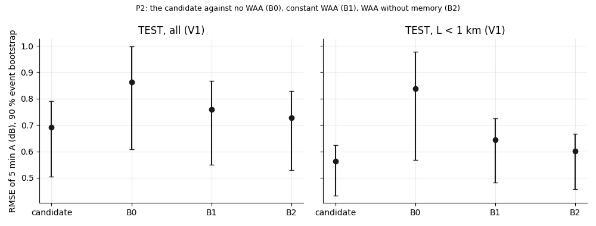
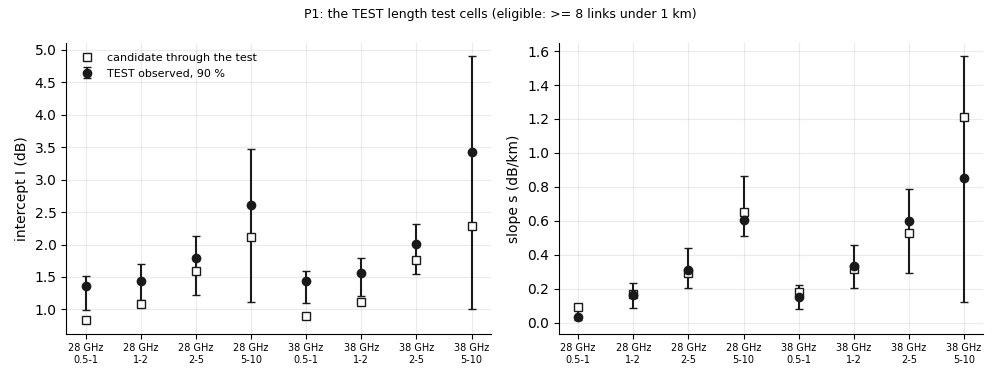
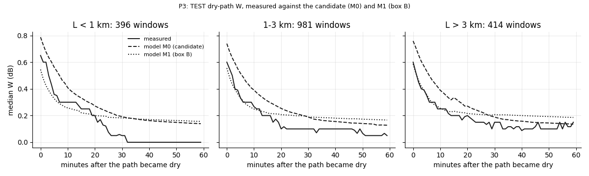
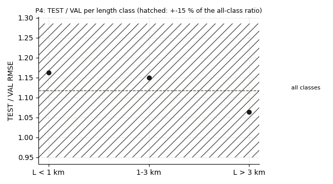
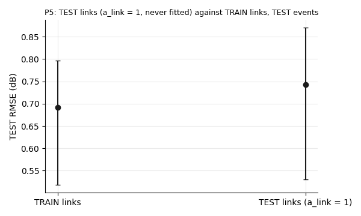
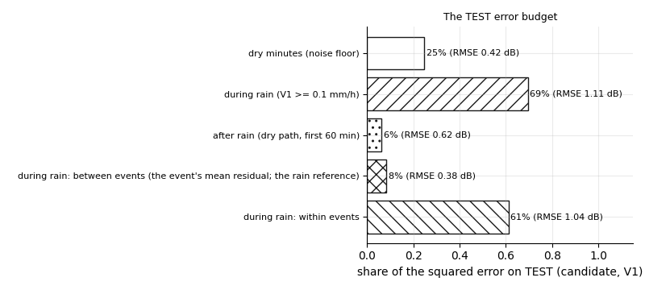

# wet_antenna step S8: freeze, then TEST once

Written by `research/wet_antenna/test_s8.py` (libraries `final_model.py`, `validation.py`, `system_id.py`, `length_test.py`, `event_factors.py`, `wind_drying.py`, `baseline/baseline.py`). Every rule: `wet_antenna.test_s8` in `research/config.yaml`, written on 2026-10-19 BEFORE TEST was read.

**Standing rule.** WAA is never estimated by subtracting a power-law rain term; ITU-R P.838 only as a size reference; the rain correction comes from the City gauges only (g_e, for TEST events from the TEST events' City gauges); nothing of the candidate is refitted on TEST; nothing is changed after TEST is read.

The candidate is **M0 = the S6 candidate** (decision 2026-10-19 in `docs/ROADMAP.md`; M1 of S6b is box B and is shown for information only).

## 1. The freeze

`research/wet_antenna/outputs/products/test_s8_freeze.json` (written 2026-10-19 18:14, committed before TEST was read; checked by this run):

- candidate `research/wet_antenna/outputs/products/tighten_s6_candidate.json`: sha256 `36135658c4362397754247faf4a744dc2e6e61b6737e9bcc112c83937519d82b`
- comparison fit B0 `research/.cache/wet_antenna/test_s8/fit_B0.pkl`: sha256 `2676c6d3e0ecc13b1b076baedd671d5ee11efd3698584c2f8a928f0aca1edddf`
- comparison fit B1 `research/.cache/wet_antenna/test_s8/fit_B1.pkl`: sha256 `64fc7f096c649ae55c27597394c04cca8a19373f4bc7c569d2c6582830f2c904`
- comparison fit B2 `research/.cache/wet_antenna/test_s8/fit_B2.pkl`: sha256 `508f1e7a7acc5ca95f6f720304937a204ab816d560e6f78007a6bbbe27b37f9e`
- M1 (box B, information) `research/.cache/wet_antenna/return_s6b/fit_M1.pkl`: sha256 `97c1401ec3283c34cadf242f9b65f1b03596fe500bdaa06e25327be109ca45bf`
- config block `wet_antenna.test_s8`: sha256 `2ac54ac50ee0e697c8ddd6a0f51ac068c8b10ce7f57af46421ea75e8e6ce6a83`
- code commit `761c6f18ade6440eb329300b51871072f7db22cf`; code changed since then: research/wet_antenna/paths.py, research/wet_antenna/test_s8.py, research/wet_antenna/validation.py

**Bug fix after TEST was read (2026-10-19, evaluation code only; recorded in config `wet_antenna.test_s8.results`):** evaluation code, found after TEST was read: TEST event E20150603_1500 has gauges with 1.1 mm per gauge link but a radar sum of 0, so the S4.3 rule gave g_e = 0 and V1 = radar / 0 (infinite or undefined), which the model reads as the heaviest rain over the whole event. Fixed: a radar / gauge ratio of 0 or not finite cannot rescale the radar; such an event gets the rule's fallback g_e = 1. Neither the model nor a pass rule changed. BEFORE the fix (V1): candidate pooled RMSE 2.152 dB (V0 0.724, V3 0.701); P1 4 of 8 cells FAIL; P2 FAIL (all: B2 better by 0.386 dB); P3 pass; P4 FAIL (TEST / VAL 3.47; L < 1 km 0.33 x, L > 3 km 1.24 x); P5 pass (0.89 x). The outputs before the fix are kept in research/explorations/s8_checks/before_fix/. AFTER the 1st fix: candidate RMSE (V1) 1.997 dB, still far above V0 (0.724): a 2nd bug of the same kind: the 3 TEST events without gauge link-events had no g_e entry, so V1 = radar / NaN (read as the heaviest rain). Fixed: every event without a usable ratio gets g_e = 1 (the written fallback). AFTER both fixes: see the report test_s8.md

## 2. The comparison models (fitted on TRAIN only)

B3 skipped: skipped: no literature WAA model is implemented in the repo (the S4 report names pycomlink's waa_schleiss_2013 [1] without a value; the proposal's [1], [9] are not coded here).

| set | model | rmse_pooled | rmse_pooled_L<1km | rmse_judge | c[28 GHz] | c[32 GHz] | c[38 GHz] | W5[28 GHz] | W5[32 GHz] | W5[38 GHz] | train_loss | converged |
|---|---|---|---|---|---|---|---|---|---|---|---|---|
| TRAIN | candidate | 0.8123 | 0.6462 | 0.4601 |  |  |  |  |  |  |  |  |
| TRAIN | B0 | 0.9844 | 0.8601 | 0.5239 | 0.2725 | 0.3463 | 0.4816 | 0.0 | 0.0 | 0.0 | 198114.1011 | True |
| TRAIN | B1 | 0.8891 | 0.7339 | 0.4946 | 0.2125 | 0.2773 | 0.3789 | 0.516 | 0.3438 | 0.5923 | 179695.2095 | True |
| TRAIN | B2 | 0.8465 | 0.6829 | 0.4726 | 0.0785 | 0.1084 | 0.1456 | 2.7627 | 2.6057 | 3.0216 | 170744.1356 | True |
| VAL (used (optimistic)) | candidate | 0.6195 | 0.4835 | 0.3873 |  |  |  |  |  |  |  |  |
| VAL (used (optimistic)) | B0 | 0.717 | 0.6174 | 0.4436 | 0.2725 | 0.3463 | 0.4816 | 0.0 | 0.0 | 0.0 | 198114.1011 | True |
| VAL (used (optimistic)) | B1 | 0.6458 | 0.5106 | 0.4132 | 0.2125 | 0.2773 | 0.3789 | 0.516 | 0.3438 | 0.5923 | 179695.2095 | True |
| VAL (used (optimistic)) | B2 | 0.6296 | 0.5005 | 0.3938 | 0.0785 | 0.1084 | 0.1456 | 2.7627 | 2.6057 | 3.0216 | 170744.1356 | True |

**READING.** Pooled 5 min RMSE on TRAIN (fitted) and VAL (used, optimistic): candidate 0.812 / 0.620 dB; B0 0.984 / 0.717 dB; B1 0.889 / 0.646 dB; B2 0.847 / 0.630 dB. The candidate is the best on VAL. These numbers are a sanity check only; nothing was tuned after them.

## 3. The TEST funnel

| stage | count |
|---|---|
| TEST events | 18 |
| TEST events, TRAIN links: (event, sub-link) pairs with a baseline row | 10188 |
| TEST events, TRAIN links:   minus no baseline | 316 |
| TEST events, TRAIN links:   minus no wet bin of the link in the event | 4679 |
| TEST events, TRAIN links:   minus sub-link not good | 481 |
| TEST events, TRAIN links:   minus use_in_waa_main false | 679 |
| TEST events, TRAIN links:   minus offset_std > 0.3 dB | 373 |
| TEST events, TRAIN links:   minus frequency outside the two bands | 293 |
| TEST events, TRAIN links:   minus cut at a TSL step | 152 |
| TEST events, TRAIN links:   minus TSL step before the rain | 12 |
| TEST events, TRAIN links:   minus too few valid 5 min bins | 0 |
| TEST events, TRAIN links:   minus too many 5 min bins without radar | 0 |
| TEST events, TRAIN links: link-events kept | 3355 |
| TEST events, TEST links: (event, sub-link) pairs with a baseline row | 2556 |
| TEST events, TEST links:   minus no baseline | 70 |
| TEST events, TEST links:   minus no wet bin of the link in the event | 1182 |
| TEST events, TEST links:   minus sub-link not good | 124 |
| TEST events, TEST links:   minus use_in_waa_main false | 16 |
| TEST events, TEST links:   minus offset_std > 0.3 dB | 0 |
| TEST events, TEST links:   minus frequency outside the two bands | 154 |
| TEST events, TEST links:   minus cut at a TSL step | 51 |
| TEST events, TEST links:   minus TSL step before the rain | 0 |
| TEST events, TEST links:   minus too few valid 5 min bins | 0 |
| TEST events, TEST links:   minus too many 5 min bins without radar | 0 |
| TEST events, TEST links: link-events kept | 1010 |

| length | TRAIN links link-events | TRAIN links links | TEST links link-events | TEST links links |
|---|---|---|---|---|
| L < 1 km | 563 | 41 | 197 | 13 |
| 1-3 km | 1696 | 103 | 545 | 31 |
| L > 3 km | 1096 | 62 | 268 | 15 |
| all | 3355 | 206 | 1010 | 59 |

g_e of the TEST events (S4.3 path-mean rule): used for 4 of 15 events; pooled V3 ratio 0.834 (`research/wet_antenna/outputs/tables/test_s8_g_e.csv`).

| event_id | gauge_links | gauge_mm_per_link | radar_over_gauge | path_used | g_path |
|---|---|---|---|---|---|
| E20150601_1235 | 20 | 0.07 | 6.257 | False | 1.0 |
| E20150602_0335 | 49 | 16.31 | 0.857 | True | 0.857 |
| E20150603_1500 | 4 | 1.1 | 0.0 | False | 1.0 |
| E20150613_1100 | 50 | 6.458 | 0.961 | True | 0.961 |
| E20150617_2355 | 11 | 0.0 |  | False | 1.0 |
| E20150620_0210 | 11 | 0.155 | 0.004 | False | 1.0 |
| E20150628_2200 | 50 | 4.75 | 0.452 | True | 0.452 |
| E20150702_0900 | 11 | 0.155 | 0.0 | False | 1.0 |
| E20150711_1945 | 50 | 0.916 | 0.516 | False | 1.0 |
| E20150721_0405 | 50 | 2.418 | 1.085 | True | 1.085 |
| E20150724_1220 | 9 | 0.0 |  | False | 1.0 |
| E20150727_0635 | 50 | 0.31 | 4.492 | False | 1.0 |
| E20150812_1340 | 7 | 0.1 | 0.0 | False | 1.0 |
| E20150828_0630 | 48 | 0.748 | 0.28 | False | 1.0 |
| E20150829_1445 | 28 | 0.0 |  | False | 1.0 |

## 4. P1-P5 on TEST

| rule | numbers | verdict | claim |
|---|---|---|---|
| P1 length test through the model | 4 of 8 eligible cells (needed 6) | FAIL | W independent of L |
| P2 the candidate beats B0, B1, B2 | all B0 +0.1694 [+0.0833, +0.2160] dB; all B1 +0.0673 [+0.0389, +0.0825] dB; all B2 +0.0345 [+0.0197, +0.0457] dB; L < 1 km B0 +0.2763 [+0.1143, +0.3608] dB; L < 1 km B1 +0.0814 [+0.0343, +0.1069] dB; L < 1 km B2 +0.0388 [+0.0202, +0.0545] dB | pass | the value of the memory and of the antenna term |
| P3 dry-path error equal across lengths | L > 3 minus L < 1 at 10 min -0.042 [-0.153, +0.040] dB (320 / 262 windows) | pass | W independent of L |
| P4 TEST / VAL per length class within +-15 % of all | all 1.117 (1.00 x); L < 1 km 1.163 (1.04 x); 1-3 km 1.150 (1.03 x); L > 3 km 1.064 (0.95 x) | pass | the length behaviour |
| P5 TEST links at most 20 % above TRAIN links | 0.743 / 0.692 = 1.073 [0.998, 1.114] | pass | the link multiplier |

RMSE (pooled 5 min bins, 90 % event bootstrap):

| set | subset | model | rmse | lo | hi |
|---|---|---|---|---|---|
| TEST | all | candidate | 0.6922 | 0.5038 | 0.7904 |
| TEST | all | B0 | 0.8616 | 0.6071 | 0.9982 |
| TEST | all | B1 | 0.7596 | 0.5504 | 0.8682 |
| TEST | all | B2 | 0.7267 | 0.5298 | 0.8279 |
| TEST | L < 1 km | candidate | 0.5621 | 0.4329 | 0.6247 |
| TEST | L < 1 km | B0 | 0.8384 | 0.5676 | 0.9767 |
| TEST | L < 1 km | B1 | 0.6435 | 0.4817 | 0.7247 |
| TEST | L < 1 km | B2 | 0.6009 | 0.4569 | 0.6673 |

P2 differences (Bx minus candidate):

| subset | model | diff_db | lo | hi | ok |
|---|---|---|---|---|---|
| all | B0 | 0.1694 | 0.0833 | 0.216 | True |
| all | B1 | 0.0673 | 0.0389 | 0.0825 | True |
| all | B2 | 0.0345 | 0.0197 | 0.0457 | True |
| L < 1 km | B0 | 0.2763 | 0.1143 | 0.3608 | True |
| L < 1 km | B1 | 0.0814 | 0.0343 | 0.1069 | True |
| L < 1 km | B2 | 0.0388 | 0.0202 | 0.0545 | True |

P1 cells:

| band | class | R_cell | links_under_1km | eligible | I_obs | I_lo | I_hi | I_model | s_obs | s_lo | s_hi | s_model | I_inside | s_inside |
|---|---|---|---|---|---|---|---|---|---|---|---|---|---|---|
| 28 GHz | 0.5-1 | 0.761 | 17 | True | 1.354 | 0.994 | 1.517 | 0.83 | 0.037 | 0.014 | 0.077 | 0.095 | False | False |
| 28 GHz | 1-2 | 1.393 | 17 | True | 1.433 | 1.145 | 1.705 | 1.078 | 0.164 | 0.086 | 0.234 | 0.167 | False | True |
| 28 GHz | 2-5 | 2.691 | 17 | True | 1.794 | 1.216 | 2.129 | 1.586 | 0.313 | 0.205 | 0.439 | 0.296 | True | True |
| 28 GHz | 5-10 | 5.923 | 13 | True | 2.603 | 1.114 | 3.466 | 2.116 | 0.603 | 0.513 | 0.863 | 0.653 | True | True |
| 28 GHz | 10-20 | 11.762 | 0 | False | 1.478 | -3.221 | 7.737 | 2.16 | 1.418 | -0.223 | 2.307 | 1.668 | True | True |
| 32 GHz | 0.5-1 | 0.753 | 0 | False | 1.143 | 0.697 | 1.399 | 0.78 | 0.124 | 0.029 | 0.249 | 0.109 | True | True |
| 32 GHz | 1-2 | 1.357 | 0 | False | 1.345 | 1.017 | 1.616 | 1.06 | 0.177 | 0.067 | 0.289 | 0.178 | True | True |
| 32 GHz | 2-5 | 2.731 | 0 | False | 1.912 | 1.173 | 2.47 | 1.864 | 0.353 | 0.179 | 0.557 | 0.236 | True | True |
| 32 GHz | 5-10 | 5.904 | 0 | False | 5.074 | 3.986 | 8.208 | 1.794 | -0.007 | -0.625 | 0.233 | 0.989 | False | False |
| 38 GHz | 0.5-1 | 0.754 | 24 | True | 1.437 | 1.106 | 1.599 | 0.892 | 0.15 | 0.082 | 0.221 | 0.184 | False | True |
| 38 GHz | 1-2 | 1.341 | 24 | True | 1.554 | 1.2 | 1.791 | 1.112 | 0.332 | 0.203 | 0.455 | 0.317 | False | True |
| 38 GHz | 2-5 | 2.668 | 24 | True | 2.004 | 1.541 | 2.311 | 1.762 | 0.598 | 0.296 | 0.787 | 0.527 | True | True |
| 38 GHz | 5-10 | 5.669 | 22 | True | 3.421 | 1.013 | 4.901 | 2.291 | 0.85 | 0.121 | 1.57 | 1.213 | True | True |
| 38 GHz | 10-20 | 10.898 | 1 | False | 4.353 | 2.527 | 14.53 | 3.921 | 1.149 | -3.428 | 2.024 | 1.772 | True | True |

P3 dry-path errors (W_obs - W_model, median, 90 % event bootstrap):

| t_min | length | windows | events | err_M0 | err_M0_lo | err_M0_hi | err_M1 | err_M1_lo | err_M1_hi |
|---|---|---|---|---|---|---|---|---|---|
| 5 | L < 1 km | 396 | 6 | -0.174 | -0.302 | -0.087 | 0.058 | -0.022 | 0.16 |
| 5 | 1-3 km | 981 | 10 | -0.186 | -0.247 | -0.13 | 0.013 | -0.042 | 0.12 |
| 5 | L > 3 km | 410 | 10 | -0.188 | -0.279 | -0.144 | -0.034 | -0.098 | 0.024 |
| 5 | all | 1787 | 10 | -0.184 | -0.247 | -0.136 | 0.013 | -0.043 | 0.089 |
| 10 | L < 1 km | 262 | 6 | -0.12 | -0.213 | -0.029 | 0.048 | -0.04 | 0.149 |
| 10 | 1-3 km | 716 | 9 | -0.153 | -0.203 | -0.101 | 0.008 | -0.021 | 0.058 |
| 10 | L > 3 km | 320 | 9 | -0.162 | -0.232 | -0.114 | -0.026 | -0.077 | 0.054 |
| 10 | all | 1298 | 10 | -0.147 | -0.199 | -0.102 | 0.01 | -0.035 | 0.065 |
| 20 | L < 1 km | 150 | 5 | -0.076 | -0.177 | -0.035 | -0.013 | -0.05 | 0.015 |
| 20 | 1-3 km | 473 | 7 | -0.123 | -0.158 | -0.078 | -0.065 | -0.121 | 0.002 |
| 20 | L > 3 km | 226 | 9 | -0.074 | -0.123 | -0.032 | -0.027 | -0.064 | 0.028 |
| 20 | all | 849 | 9 | -0.11 | -0.129 | -0.058 | -0.043 | -0.084 | 0.008 |

P4 TEST / VAL:

| subset | rmse_TEST | rmse_VAL | ratio | rel_to_all | ok |
|---|---|---|---|---|---|
| all | 0.6922 | 0.6195 | 1.1174 | 1.0 | True |
| L < 1 km | 0.5621 | 0.4835 | 1.1626 | 1.0405 | True |
| 1-3 km | 0.6811 | 0.592 | 1.1504 | 1.0296 | True |
| L > 3 km | 0.7777 | 0.7309 | 1.064 | 0.9523 | True |

P5 new links:

| links | n_links | rmse | lo | hi |
|---|---|---|---|---|
| TRAIN links | 206.0 | 0.6922 | 0.5181 | 0.7965 |
| TEST links (a_link = 1) | 59.0 | 0.7427 | 0.53 | 0.87 |
| L < 1 km: TRAIN links / TEST links |  | 0.9947 |  |  |
| 1-3 km: TRAIN links / TEST links |  | 1.0858 |  |  |
| L > 3 km: TRAIN links / TEST links |  | 1.1368 |  |  |

## 5. Information items

| item | value |
|---|---|
| share of TEST link-events where the candidate beats B0 | 0.744 |
| share of TRAIN links with |mean residual| < 0.3 dB on TEST (all minutes) | 0.956 |
| share of TRAIN links with |mean residual| < 0.3 dB on TEST (rain minutes only, 206 links) | 0.544 |
| candidate RMSE with input V0 | 0.724 |
| candidate RMSE with input V1 | 0.692 |
| candidate RMSE with input V3 | 0.701 |
| gauge links (786 link-events): candidate RMSE with V1 | 0.612 |
| gauge links: candidate RMSE with the gauge rain as input | 0.678 |
| dry-path median error at 5 min, M0 (candidate) / M1 (box B) | -0.184 / +0.013 dB (1787 windows) |
| dry-path median error at 10 min, M0 (candidate) / M1 (box B) | -0.147 / +0.010 dB (1298 windows) |
| dew-before-rain link-events on TEST (S7.4 rule) | 0 of 3355 (0 events) |

The TEST error budget (candidate, V1; the S6b split):

| part | bins | rmse_db | share_of_squared_error |
|---|---|---|---|
| dry minutes (noise floor) | 339230 | 0.4238 | 0.2454 |
| during rain (V1 >= 0.1 mm/h) | 140869 | 1.1066 | 0.6946 |
| after rain (dry path, first 60 min) | 38214 | 0.6248 | 0.0601 |
|   during rain: between events (the event's mean residual; the rain reference) | 140869 | 0.3832 | 0.0833 |
|   during rain: within events | 140869 | 1.0382 | 0.6113 |
| all | 518313 | 0.6922 | 1.0 |

## 6. The verdict

**The box-A equation does NOT fully hold on TEST**: P1 length test through the model failed (4 of 8 eligible cells (needed 6)) - this touches: W independent of L. On TEST the candidate's pooled RMSE is 0.692 dB against B0 0.862, B1 0.760, B2 0.727 dB (L < 1 km: 0.562 against 0.838 / 0.644 / 0.601 dB). The length test: 4 of 8 cells. The TEST / VAL ratio is 1.12 overall. TEST links (never fitted) against TRAIN links: 1.07 x. Nothing was refitted or changed after TEST was read.

## 7. What S9 should present

1. The equation (box A) with its numbers and intervals (S6), and what it does NOT claim (boxes B and C, S6b).
2. The evidence that W does not depend on L: S7 (four checks) and TEST (P1, P3).
3. The value of the antenna term and of its memory: TEST against B0, B1, B2 (P2), all links and short links.
4. The data funnel (S6 TRAIN / VAL and S8 TEST) and the error budget (VAL and TEST).
5. The decisions and deviations, dated (M4c -> M4b-B, the 2 / 3 threshold, M1 -> box B, the undone cuts), and the lessons.
6. The rain reference: V1 = radar / g_e from the City gauges, and its limits (the radar is gauge-adjusted; g_e for few events).

## 8. Unclear / possibly wrong

- **TEST baselines were computed in this step** with the frozen baseline code; the TEST links have no fake-event uncertainty (the offset_std rule does not apply to them) and no daily-cycle amplitude (that flag is not raised).
- **g_e** is used for 4 of 15 TEST events; the others keep the raw radar (g_e = 1).
- **P5 compares TEST links with TRAIN links on the same events**, but their length and band mix differ (the per-class ratios are in the P5 table).
- **P2 uses the pooled RMSE**, dominated by the rain minutes (S6b budget: during rain 68 % of the squared error on VAL).
- **VAL was used for decisions**; TEST was read once, after the freeze.
