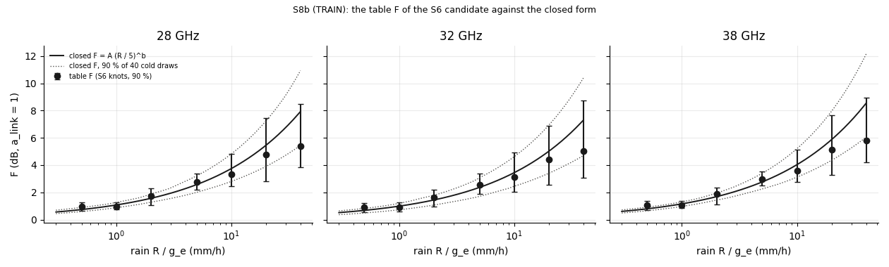
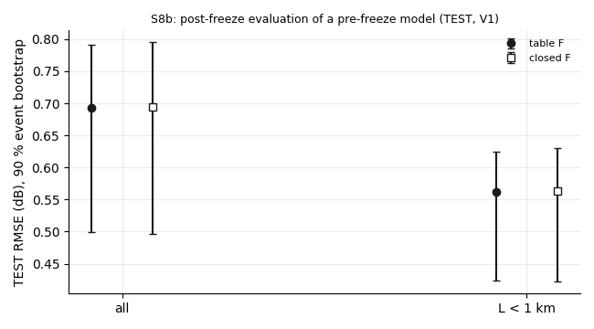

# wet_antenna step S8b: post-freeze evaluation of a pre-freeze model (the closed form of F)

Written by `research/wet_antenna/test_s8b.py` (libraries `final_model.py`, `validation.py`, `system_id.py`, `length_test.py`). The rule: `wet_antenna.test_s8b` in `research/config.yaml` and `docs/ROADMAP.md` (S8b), written on 2026-10-19 after TEST was read, BEFORE this evaluation.

## 1. Status and the file times

**Status.** TEST was read once in S8 with the frozen S6 candidate (the table F). This step does NOT refit anything on TEST and does not change the S8 verdict. It runs ONE other model that was fitted on TRAIN in S6, before TEST was read: the S6 plug-back fit "F and P" (F = A_band (R / 5)^b, P = c_band R, everything else as S6; the "closed F" of S7). Everything here is a **post-freeze evaluation of a pre-freeze model**.

- The closed-F fit `research/.cache/wet_antenna/tighten_s6/plug_shared_FP_F_and_P.pkl`: sha256 `1d8163cd8b84aafc85f59c6c223f44b33923278265e3e40819923d8076c8e0b9`, modified 2026-10-18 12:45:04 (local time +0300).
- The S8 freeze `research/wet_antenna/outputs/products/test_s8_freeze.json`: written 2026-10-19 18:14 (commit bb30b5c). The fit is **BEFORE** the freeze.
- Nothing is refitted on TEST; the S8 verdict (P1 fails, P2-P5 pass, with the table F) is unchanged.

## 2. The closed-F model on TRAIN: numbers and identifiability

Cold event bootstrap (40 converged draws of 40) and the S6 identifiability check (3 fake replicates; `research/wet_antenna/outputs/tables/test_s8b_closed_f_train.csv`):

| quantity | value | boot_lo | boot_hi | draws | fake | fake_within_3_of_3 | interval_at_bound | identified |
|---|---|---|---|---|---|---|---|---|
| A[28 GHz] | 2.5659 | 1.9961 | 3.2063 | 40 | 2.449, 2.448, 2.462 | True | False | True |
| A[32 GHz] | 2.3603 | 1.7044 | 3.0638 | 40 | 2.054, 2.147, 2.159 | True | False | True |
| A[38 GHz] | 2.7664 | 2.2534 | 3.4025 | 40 | 2.586, 2.619, 2.603 | True | False | True |
| b | 0.5424 | 0.4721 | 0.6261 | 40 | 0.5421, 0.5399, 0.5412 | True | False | True |
| c[28 GHz] | 0.1049 | 0.0576 | 0.138 | 40 | 0.1039, 0.1054, 0.1045 | True | False | True |
| c[32 GHz] | 0.1406 | 0.0474 | 0.1904 | 40 | 0.1433, 0.1427, 0.1387 | True | False | True |
| c[38 GHz] | 0.1944 | 0.1105 | 0.2452 | 40 | 0.1955, 0.1936, 0.1941 | True | False | True |
| a_p10 | 0.7676 | 0.7158 | 0.8138 | 40 | 0.7947, 0.8115, 0.7625 | True | False | True |
| a_p90 | 1.2419 | 1.2897 | 1.3988 | 40 | 1.328, 1.305, 1.348 | True | False | True |

**READING.** b = 0.542 [0.472, 0.626]; A = 2.57 [2.00, 3.21], 2.36 [1.70, 3.06], 2.77 [2.25, 3.40] dB at 5 mm/h; c = 0.105 [0.058, 0.138], 0.141 [0.047, 0.190], 0.194 [0.111, 0.245] dB/km per mm/h. Identified by the S6 rule: 9 of 9.

## 3. The closed F against the table F (TRAIN)

Per band and knot: the table F of the S6 candidate with its S6 bootstrap interval, the closed F, and whether it lies inside (`research/wet_antenna/outputs/tables/test_s8b_closed_vs_table_f.csv`):

| band | R | table_F | table_lo | table_hi | closed_F | difference | closed_inside_table_interval |
|---|---|---|---|---|---|---|---|
| 28 GHz | 0.5 | 0.972 | 0.639 | 1.284 | 0.736 | -0.236 | True |
| 28 GHz | 1.0 | 0.972 | 0.747 | 1.285 | 1.072 | 0.099 | True |
| 28 GHz | 2.0 | 1.725 | 1.069 | 2.293 | 1.561 | -0.164 | True |
| 28 GHz | 5.0 | 2.744 | 2.205 | 3.37 | 2.566 | -0.178 | True |
| 28 GHz | 10.0 | 3.318 | 2.434 | 4.82 | 3.737 | 0.418 | True |
| 28 GHz | 20.0 | 4.746 | 2.822 | 7.45 | 5.442 | 0.696 | True |
| 28 GHz | 40.0 | 5.394 | 3.822 | 8.496 | 7.926 | 2.532 | True |
| 32 GHz | 0.5 | 0.908 | 0.558 | 1.214 | 0.677 | -0.231 | True |
| 32 GHz | 1.0 | 0.908 | 0.619 | 1.251 | 0.986 | 0.078 | True |
| 32 GHz | 2.0 | 1.61 | 0.97 | 2.205 | 1.436 | -0.175 | True |
| 32 GHz | 5.0 | 2.562 | 1.88 | 3.389 | 2.36 | -0.202 | True |
| 32 GHz | 10.0 | 3.098 | 2.026 | 4.947 | 3.437 | 0.339 | True |
| 32 GHz | 20.0 | 4.431 | 2.53 | 6.883 | 5.006 | 0.575 | True |
| 32 GHz | 40.0 | 5.036 | 3.078 | 8.719 | 7.291 | 2.255 | True |
| 38 GHz | 0.5 | 1.05 | 0.71 | 1.349 | 0.793 | -0.256 | True |
| 38 GHz | 1.0 | 1.05 | 0.843 | 1.35 | 1.156 | 0.106 | True |
| 38 GHz | 2.0 | 1.862 | 1.122 | 2.364 | 1.683 | -0.179 | True |
| 38 GHz | 5.0 | 2.962 | 2.492 | 3.527 | 2.766 | -0.196 | True |
| 38 GHz | 10.0 | 3.582 | 2.74 | 5.122 | 4.029 | 0.447 | True |
| 38 GHz | 20.0 | 5.122 | 3.253 | 7.654 | 5.868 | 0.745 | True |
| 38 GHz | 40.0 | 5.822 | 4.19 | 8.927 | 8.546 | 2.724 | True |

Largest |closed F - table F| over 0.5-40 mm/h: 28 GHz 2.53 dB at 40.0 mm/h; 32 GHz 2.26 dB at 40.0 mm/h; 38 GHz 2.72 dB at 40.0 mm/h. Inside the table's interval at 21 of 21 knots.



## 4. TEST: P1-P5 side by side, and the paired difference

The table F recomputed here reproduces the S8 verdicts: **True**.

| rule | S8 verdict (table F) | table F (this run) | table F numbers | closed F | closed F numbers |
|---|---|---|---|---|---|
| P1 | FAIL | FAIL | 4 of 8 eligible cells | FAIL | 4 of 8 eligible cells |
| P2 | pass | pass | all B0 +0.1694 [+0.0833, +0.2160]; all B1 +0.0673 [+0.0389, +0.0825]; all B2 +0.0345 [+0.0197, +0.0457]; L < 1 km B0 +0.2763 [+0.1143, +0.3608]; L < 1 km B1 +0.0814 [+0.0343, +0.1069]; L < 1 km B2 +0.0388 [+0.0202, +0.0545] | pass | all B0 +0.1669 [+0.0889, +0.2076]; all B1 +0.0649 [+0.0440, +0.0751]; all B2 +0.0320 [+0.0186, +0.0486]; L < 1 km B0 +0.2746 [+0.1203, +0.3534]; L < 1 km B1 +0.0798 [+0.0432, +0.0990]; L < 1 km B2 +0.0372 [+0.0194, +0.0572] |
| P3 | pass | pass | L > 3 minus L < 1 at 10 min -0.042 [-0.153, +0.040] dB | pass | L > 3 minus L < 1 at 10 min -0.044 [-0.167, +0.030] dB |
| P4 | pass | pass | all 1.117 (1.00 x); L < 1 km 1.163 (1.04 x); 1-3 km 1.150 (1.03 x); L > 3 km 1.064 (0.95 x) | pass | all 1.122 (1.00 x); L < 1 km 1.165 (1.04 x); 1-3 km 1.157 (1.03 x); L > 3 km 1.067 (0.95 x) |
| P5 | pass | pass | TEST links / TRAIN links 1.073 | pass | TEST links / TRAIN links 1.073 |

TEST RMSE (pooled 5 min bins, 90 % event bootstrap) and the paired difference closed minus table (rule: the 90 % interval within [-0.01, +0.01] dB):

| subset | model | rmse | lo | hi |
|---|---|---|---|---|
| all | table F | 0.6922 | 0.4999 | 0.7912 |
| all | closed F | 0.6947 | 0.497 | 0.7949 |
| L < 1 km | table F | 0.5621 | 0.4239 | 0.6249 |
| L < 1 km | closed F | 0.5637 | 0.4221 | 0.6302 |

| subset | closed_minus_table_db | lo | hi | within_band |
|---|---|---|---|---|
| all | 0.0025 | -0.0065 | 0.0085 | True |
| L < 1 km | 0.0016 | -0.0082 | 0.0078 | True |

Dry-path median errors (W_obs - W_model, dB):

| t_min | windows | err table F | err closed F |
|---|---|---|---|
| 5 | 1787 | -0.184 | -0.185 |
| 10 | 1298 | -0.147 | -0.146 |
| 20 | 849 | -0.11 | -0.107 |



## 5. The decision by the rule

(1) The P1-P5 verdicts of the closed F are the same as the table F's: **True**. (2) The paired 90 % interval lies within [-0.01, +0.01] dB for all link-events and L < 1 km: **True** (all +0.0025 [-0.0065, +0.0085]; L < 1 km +0.0016 [-0.0082, +0.0078]).

**The closed form is ADOPTED as the written form of F.**

## 6. The equation of F to use in S9

```
F_band(R) = A_band (R / 5)^b   (closed form; post-freeze evaluation of a pre-freeze model, adopted by the S8b rule)
b = 0.542 [0.472, 0.626]
A[28 GHz] = 2.57 [2.00, 3.21] dB
A[32 GHz] = 2.36 [1.70, 3.06] dB
A[38 GHz] = 2.77 [2.25, 3.40] dB
with P_band = c_band R: c[28 GHz] = 0.105, c[32 GHz] = 0.141, c[38 GHz] = 0.194 dB/km per mm/h (the closed-F fit)
```

**Range.** The closed form was fitted on 0-40 mm/h, and F above 10 mm/h rests on 0.4 % of the TRAIN minutes (S6). It has no saturation: at 40 mm/h it is +2.5 dB, +2.3 dB, +2.7 dB above the table F (inside the table's wide interval). It must not be extrapolated above 40 mm/h. b of this plug-back refit (0.54) differs from the knot fit of S6 (0.47): the knot fit described the table F, this is the model refitted with the form.
