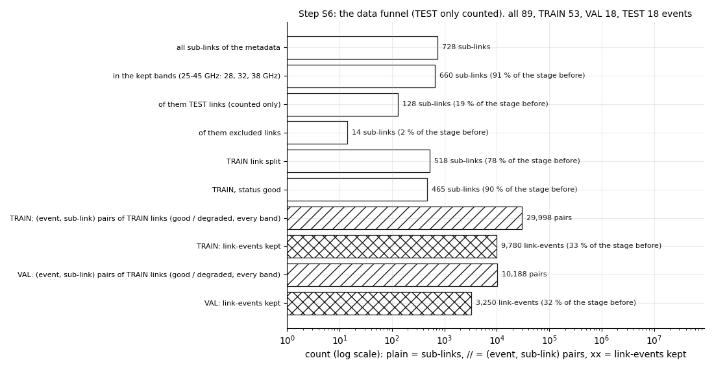
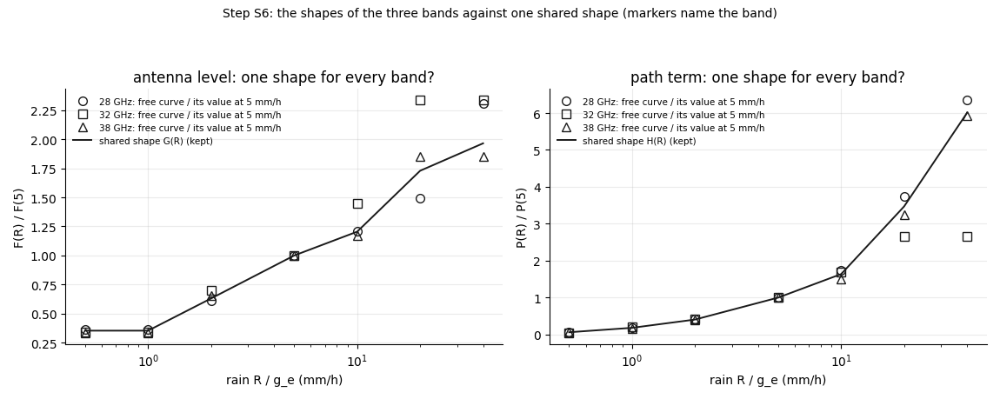
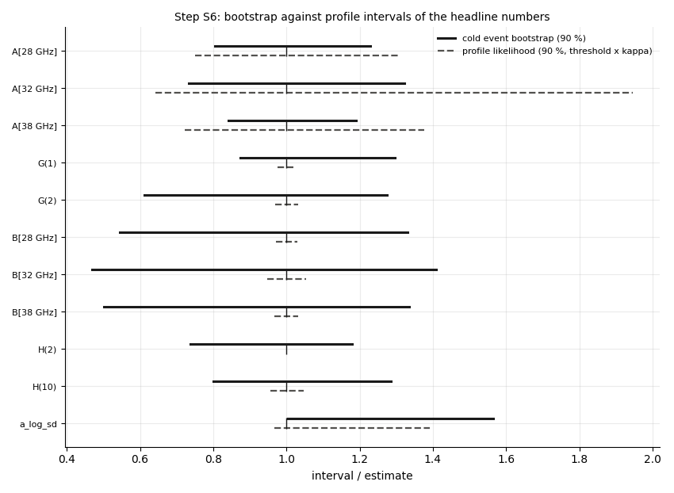
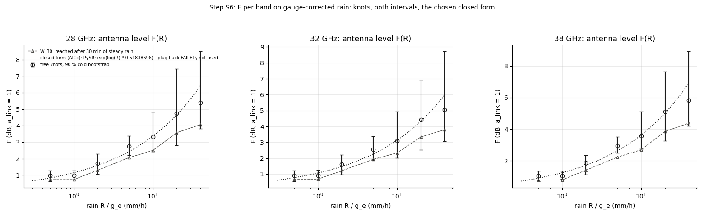
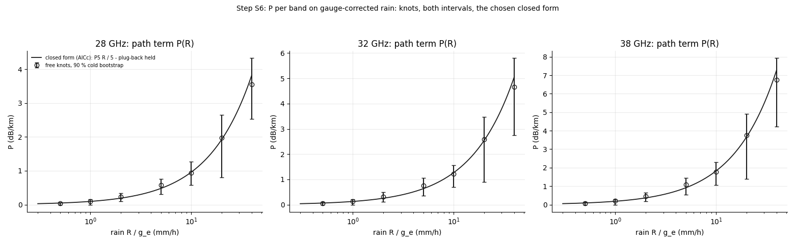
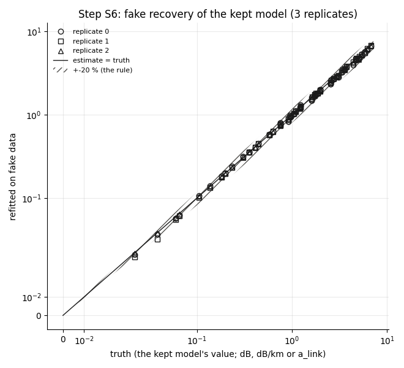

# wet_antenna step S6: tighten the equation (M4b-B on gauge-corrected rain)

Written by `research/wet_antenna/tighten_s6.py` (libraries `final_model.py`, `system_id.py`, `length_test.py`, `event_factors.py`). Every rule:
`wet_antenna.tighten_s6` in `research/config.yaml`, written on 2026-10-18 BEFORE the run. Plan and integrity rules: `docs/ROADMAP.md`.

**Standing rule.** WAA is never estimated by subtracting a power-law rain term. The path part is separated only through its dependence on L at matched rain. ITU-R P.838 only as a size reference (here only as the generic optimiser start of P, as in S2b-S5a). The rain correction comes from the City gauges only (g_e of S4.3), never from the links. Closed forms are fitted to curves the data learned; physics candidates and PySR proposals compete under the same rule; nothing is imposed. No TEST attenuation or rain was read.

**Decision (2026-10-18, before any TEST read, a deviation from the S5a rule):** 2026-10-18, before any TEST read, a deviation from the S5a rule (which kept M4c): the final model is M4b-B (gauge timing fixed); M4c is dropped because its slow-store parameters are not identified on real data and it gains only 0.0005 dB on VAL. Decided after seeing VAL; the reason is identifiability, not the VAL score.
VAL numbers below are **used (optimistic)**: VAL has been used for decisions since S3.

## 1. What was run

- Data: the S3 all-length TRAIN dataset (9780 link-events, 51 events), input V1 = radar / g_e; VAL 3250 link-events (V1, frozen fits).
- The free-knot M4b-B is the S5a refit (read from its cache). New fits: shared_F, shared_P, shared_FP, plug_shared_FP_F_and_P, plug_shared_FP_F_only, plug_shared_FP_P_only.
- Bootstrap 60 draws, fake 3 replicates, timing sensitivity yes, 11 profiles.
- Timing first: one evaluation 354 ms on 3 processes; projection 6.67 h (budget 6.0 h);
  cuts: nothing (DEVIATION: bootstrap 60 -> 40 cut undone on 2026-10-18 (projection 4-5 x too long); see config tighten_s6.bootstrap.deviation). Fitting time summed over the processes: 3.6 h; this run took 0.14 h.

## 2. Data funnel

Every stage with its count and the share of the stage before (`research/wet_antenna/outputs/tables/tighten_s6_funnel.csv`):

| stage | count | unit | share_of_previous | note |
|---|---|---|---|---|
| all sub-links of the metadata | 728 | sub-links |  |  |
| in the kept bands (25-45 GHz: 28, 32, 38 GHz) | 660 | sub-links | 0.907 |  |
|   of them TEST links (counted only) | 128 | sub-links | 0.194 |  |
|   of them excluded links | 14 | sub-links | 0.021 |  |
| TRAIN link split | 518 | sub-links | 0.785 |  |
| TRAIN, status good | 465 | sub-links | 0.898 | degraded / unusable: degraded 49, unusable 4 |
| events: all | 89 | events |  |  |
| events: TRAIN | 53 | events | 0.596 |  |
| events: VAL | 18 | events | 0.202 |  |
| events: TEST | 18 | events | 0.202 |  |
| TRAIN: (event, sub-link) pairs of TRAIN links (good / degraded, every band) | 29998 | pairs |  |  |
| TRAIN:   minus no baseline | 1148 | pairs |  |  |
| TRAIN:   minus no wet bin of the link in the event | 13480 | pairs |  |  |
| TRAIN:   minus sub-link not good | 1450 | pairs |  |  |
| TRAIN:   minus use_in_waa_main false | 1971 | pairs |  |  |
| TRAIN:   minus offset_std > 0.3 dB | 1139 | pairs |  |  |
| TRAIN:   minus frequency outside the two bands | 862 | pairs |  |  |
| TRAIN:   minus cut at a TSL step | 679 | pairs |  |  |
| TRAIN:   minus TSL step before the rain | 16 | pairs |  |  |
| TRAIN:   minus too few valid 5 min bins | 12 | pairs |  |  |
| TRAIN:   minus too many 5 min bins without radar | 140 | pairs |  |  |
| TRAIN: link-events kept | 9780 | link-events | 0.326 |  |
| VAL: (event, sub-link) pairs of TRAIN links (good / degraded, every band) | 10188 | pairs |  |  |
| VAL:   minus no baseline | 2 | pairs |  |  |
| VAL:   minus no wet bin of the link in the event | 5201 | pairs |  |  |
| VAL:   minus sub-link not good | 456 | pairs |  |  |
| VAL:   minus use_in_waa_main false | 598 | pairs |  |  |
| VAL:   minus offset_std > 0.3 dB | 376 | pairs |  |  |
| VAL:   minus frequency outside the two bands | 300 | pairs |  |  |
| VAL:   minus cut at a TSL step | 201 | pairs |  |  |
| VAL:   minus TSL step before the rain | 2 | pairs |  |  |
| VAL:   minus too few valid 5 min bins | 3 | pairs |  |  |
| VAL:   minus too many 5 min bins without radar | 0 | pairs |  |  |
| VAL: link-events kept | 3250 | link-events | 0.319 |  |

Frequency bands present (nearest nominal band; `research/wet_antenna/outputs/tables/tighten_s6_bands.csv`):

| nominal | sublinks | links | f_min | f_max | kept |
|---|---|---|---|---|---|
| 7 GHz | 2 | 2 | 7.46 | 7.46 | False |
| 8 GHz | 2 | 2 | 7.61 | 7.61 | False |
| 15 GHz | 18 | 9 | 14.52 | 15.09 | False |
| 18 GHz | 44 | 22 | 18.2 | 19.42 | False |
| 23 GHz | 2 | 1 | 22.13 | 23.14 | False |
| 28 GHz | 344 | 172 | 28.0 | 29.27 | True |
| 32 GHz | 66 | 33 | 32.33 | 33.26 | True |
| 38 GHz | 250 | 125 | 37.06 | 38.68 | True |

Link-events per set and length class; TEST only links from the split table (`research/wet_antenna/outputs/tables/tighten_s6_lengths.csv`):

| length | TRAIN link-events | TRAIN links | VAL link-events | VAL links | TEST links (split table) |
|---|---|---|---|---|---|
| L < 1 km | 1718 | 41 | 531 | 41 | 13 |
| 1-3 km | 4935 | 103 | 1654 | 103 | 32 |
| L > 3 km | 3127 | 62 | 1065 | 62 | 19 |
| all | 9780 | 206 | 3250 | 206 | 64 |

Minutes and V1 rain inside the kept link-event windows (`research/wet_antenna/outputs/tables/tighten_s6_minutes.csv`):

| set | link_events | events | minutes | rain_mm_V1 | min 0-0.5 | min 0.5-1 | min 1-2 | min 2-5 | min 5-10 | min 10-20 | min > 20 |
|---|---|---|---|---|---|---|---|---|---|---|---|
| TRAIN | 9780 | 51 | 9499740 | 57615.3 | 8365050 | 321255 | 325100 | 316710 | 137810 | 28440 | 5375 |
| VAL | 3250 | 18 | 2159920 | 6038.9 | 1992395 | 78715 | 46435 | 33670 | 6355 | 1845 | 505 |



**READING.** Of the 728 sub-links, 660 are in the three kept bands
(the 7-23 GHz sub-links are dropped by the band rule, not by quality); 518 of them are on TRAIN links. The largest single loss of
(event, sub-link) pairs is "no wet bin of the link in the event" (13480 of 29998 TRAIN pairs): an event
is defined over the whole network, and many links see no rain in it. The quality rules together remove about a fifth of the rest; 9780 TRAIN
and 3250 VAL link-events remain (33 % and 32 % of the pairs). The data are mostly dry: of 9.5 M TRAIN link-event minutes,
1.13 M (12 %) have V1 rain >= 0.5 mm/h, 33,815.0 minutes >= 10 mm/h and only 5,375.0 above
20 mm/h. Everything said about F and P above 10 mm/h rests on about 0.4 % of the minutes; the 40 mm/h knot on 5,375.0.

## 3. Parametrisation and shared shape

The knots: the free-knot fit (the S5a refit, 90 % of its 30 cold draws) and the kept shared-shape fit (90 % of 60 cold draws), W_30 next to the equilibrium F (W_30 = 0.753 F for this timing), and the TRAIN minutes behind every knot (`research/wet_antenna/outputs/tables/tighten_s6_knots.csv`):

| kind | band | R | free_value | free_lo | free_hi | kept_value | kept_lo | kept_hi | W30_free | W30_kept | train_minutes_in_range | of_them_R_above_0 |
|---|---|---|---|---|---|---|---|---|---|---|---|---|
| F | 28 GHz | 0.5 | 0.994 | 0.717 | 1.346 | 0.972 | 0.639 | 1.284 | 0.748 | 0.732 | 8686305 | 2419045 |
| F | 28 GHz | 1.0 | 0.994 | 0.757 | 1.346 | 0.972 | 0.747 | 1.285 | 0.748 | 0.732 | 646355 | 646355 |
| F | 28 GHz | 2.0 | 1.646 | 1.086 | 2.191 | 1.725 | 1.069 | 2.293 | 1.239 | 1.299 | 641810 | 641810 |
| F | 28 GHz | 5.0 | 2.711 | 2.132 | 3.151 | 2.744 | 2.205 | 3.37 | 2.041 | 2.066 | 454520 | 454520 |
| F | 28 GHz | 10.0 | 3.27 | 2.329 | 4.824 | 3.318 | 2.434 | 4.82 | 2.462 | 2.498 | 166250 | 166250 |
| F | 28 GHz | 20.0 | 4.043 | 2.52 | 6.523 | 4.746 | 2.822 | 7.45 | 3.044 | 3.573 | 33335 | 33335 |
| F | 28 GHz | 40.0 | 6.25 | 3.703 | 10.2 | 5.394 | 3.822 | 8.497 | 4.705 | 4.061 | 5375 | 5375 |
| F | 32 GHz | 0.5 | 0.868 | 0.584 | 1.066 | 0.908 | 0.558 | 1.213 | 0.653 | 0.684 | 8686305 | 2419045 |
| F | 32 GHz | 1.0 | 0.868 | 0.631 | 1.066 | 0.908 | 0.619 | 1.251 | 0.653 | 0.684 | 646355 | 646355 |
| F | 32 GHz | 2.0 | 1.775 | 0.954 | 2.59 | 1.611 | 0.97 | 2.205 | 1.336 | 1.213 | 641810 | 641810 |
| F | 32 GHz | 5.0 | 2.537 | 1.874 | 3.105 | 2.562 | 1.88 | 3.389 | 1.91 | 1.929 | 454520 | 454520 |
| F | 32 GHz | 10.0 | 3.682 | 2.253 | 5.476 | 3.098 | 2.026 | 4.947 | 2.772 | 2.333 | 166250 | 166250 |
| F | 32 GHz | 20.0 | 5.921 | 2.936 | 8.392 | 4.431 | 2.53 | 6.883 | 4.458 | 3.336 | 33335 | 33335 |
| F | 32 GHz | 40.0 | 5.921 | 3.8 | 10.09 | 5.036 | 3.078 | 8.719 | 4.458 | 3.791 | 5375 | 5375 |
| F | 38 GHz | 0.5 | 0.993 | 0.752 | 1.312 | 1.05 | 0.71 | 1.349 | 0.748 | 0.79 | 8686305 | 2419045 |
| F | 38 GHz | 1.0 | 0.993 | 0.802 | 1.312 | 1.05 | 0.843 | 1.35 | 0.748 | 0.79 | 646355 | 646355 |
| F | 38 GHz | 2.0 | 1.939 | 1.211 | 2.61 | 1.862 | 1.122 | 2.364 | 1.46 | 1.402 | 641810 | 641810 |
| F | 38 GHz | 5.0 | 2.951 | 2.443 | 3.523 | 2.962 | 2.492 | 3.527 | 2.221 | 2.23 | 454520 | 454520 |
| F | 38 GHz | 10.0 | 3.466 | 2.522 | 5.075 | 3.582 | 2.74 | 5.122 | 2.609 | 2.697 | 166250 | 166250 |
| F | 38 GHz | 20.0 | 5.464 | 3.719 | 7.772 | 5.122 | 3.253 | 7.654 | 4.114 | 3.857 | 33335 | 33335 |
| F | 38 GHz | 40.0 | 5.464 | 4.446 | 10.3 | 5.822 | 4.191 | 8.927 | 4.114 | 4.383 | 5375 | 5375 |
| P | 28 GHz | 0.5 | 0.034 | 0.0 | 0.088 | 0.034 | 0.0 | 0.075 |  |  | 8686305 | 2419045 |
| P | 28 GHz | 1.0 | 0.106 | 0.011 | 0.172 | 0.104 | 0.0 | 0.16 |  |  | 646355 | 646355 |
| P | 28 GHz | 2.0 | 0.237 | 0.083 | 0.361 | 0.234 | 0.094 | 0.335 |  |  | 641810 | 641810 |
| P | 28 GHz | 5.0 | 0.573 | 0.329 | 0.818 | 0.575 | 0.313 | 0.766 |  |  | 454520 | 454520 |
| P | 28 GHz | 10.0 | 0.99 | 0.558 | 1.491 | 0.94 | 0.583 | 1.276 |  |  | 166250 | 166250 |
| P | 28 GHz | 20.0 | 2.141 | 0.731 | 3.206 | 1.982 | 0.798 | 2.654 |  |  | 33335 | 33335 |
| P | 28 GHz | 40.0 | 3.634 | 1.902 | 5.028 | 3.557 | 2.536 | 4.326 |  |  | 5375 | 5375 |
| P | 32 GHz | 0.5 | 0.036 | 0.0 | 0.119 | 0.045 | 0.0 | 0.106 |  |  | 8686305 | 2419045 |
| P | 32 GHz | 1.0 | 0.144 | 0.037 | 0.202 | 0.136 | 0.0 | 0.219 |  |  | 646355 | 646355 |
| P | 32 GHz | 2.0 | 0.29 | 0.067 | 0.491 | 0.306 | 0.122 | 0.494 |  |  | 641810 | 641810 |
| P | 32 GHz | 5.0 | 0.697 | 0.295 | 1.044 | 0.752 | 0.352 | 1.06 |  |  | 454520 | 454520 |
| P | 32 GHz | 10.0 | 1.171 | 0.53 | 1.732 | 1.229 | 0.686 | 1.569 |  |  | 166250 | 166250 |
| P | 32 GHz | 20.0 | 1.845 | 0.53 | 3.322 | 2.592 | 0.893 | 3.483 |  |  | 33335 | 33335 |
| P | 32 GHz | 40.0 | 1.845 | 0.53 | 7.962 | 4.652 | 2.758 | 5.801 |  |  | 5375 | 5375 |
| P | 38 GHz | 0.5 | 0.072 | 0.002 | 0.152 | 0.065 | 0.0 | 0.145 |  |  | 8686305 | 2419045 |
| P | 38 GHz | 1.0 | 0.188 | 0.066 | 0.289 | 0.198 | 0.0 | 0.288 |  |  | 646355 | 646355 |
| P | 38 GHz | 2.0 | 0.434 | 0.156 | 0.675 | 0.445 | 0.193 | 0.638 |  |  | 641810 | 641810 |
| P | 38 GHz | 5.0 | 1.115 | 0.54 | 1.521 | 1.092 | 0.547 | 1.459 |  |  | 454520 | 454520 |
| P | 38 GHz | 10.0 | 1.676 | 0.951 | 2.372 | 1.786 | 1.066 | 2.297 |  |  | 166250 | 166250 |
| P | 38 GHz | 20.0 | 3.624 | 1.406 | 4.944 | 3.766 | 1.386 | 4.918 |  |  | 33335 | 33335 |
| P | 38 GHz | 40.0 | 6.617 | 4.167 | 7.366 | 6.758 | 4.235 | 7.928 |  |  | 5375 | 5375 |

Shared-shape tests (rule: VAL V1 RMSE rise <= 0.003 dB AND the VAL length test passes; AICc / BIC on TRAIN for
information; `research/wet_antenna/outputs/tables/tighten_s6_shared_shape.csv`). **Kept: shared_FP.**

| fit | VAL V1 rmse (used, optimistic) | rise_vs_free_db | length_share | length_ok | aicc | bic | rise_ok | kept | delta_aicc | delta_bic |
|---|---|---|---|---|---|---|---|---|---|---|
| free | 0.3878 | 0.0 | 0.8333 | True | -3381919.1455 | -3378830.7116 |  |  | 0.0 | 57.8989 |
| shared_F | 0.3877 | -0.0001 | 0.8333 | True | -3381586.4879 | -3378647.4913 | True | True | 332.6576 | 241.1191 |
| shared_P | 0.3875 | -0.0003 | 0.8333 | True | -3381827.6071 | -3378888.6105 | True | True | 91.5385 | 0.0 |
| shared_FP | 0.3875 | -0.0003 | 0.8333 | True | -3381332.9646 | -3378543.4056 | True | True | 586.1809 | 345.2048 |



**READING.** By the rule written before the run, **both shared shapes are kept** (F = A_band G(R), P = B_band H(R)): VAL V1 RMSE
(used, optimistic) 0.3875 against 0.3878 dB for the free curves (a change of
-0.0003 dB), and the VAL length test stays at 5 / 6. On TRAIN the information criteria (information only) say the
opposite: the free curves have the lowest AICc, sharing F costs 333 AICc, sharing P 92 (BIC: P sharing is the best by BIC), both 586.
These criteria treat the 1,892,910 points as independent; with the residual autocorrelation (kappa 7.4) the effective numbers are about
45 and 12, still against sharing for F. So the three bands differ in the SHAPE of F on TRAIN by a detectable amount, but the
difference does not carry over to VAL: the shared shape is what generalises, the band details are not. The figure shows the bands' own shapes against the
shared one. Two features of the kept shapes: G(0.5) = G(1) = 0.35 (F is flat between 0.5 and 1 mm/h: the increment at 1 mm/h is at its
lower limit), and H is close to a straight line (H(2) 0.41, H(10) 1.63, H(20) 3.45; a line gives 0.4, 2, 4).

## 4. Error bars

Cold event bootstrap on the kept parametrisation (the main interval; `research/wet_antenna/outputs/tables/tighten_s6_bootstrap.csv`, draws in `research/wet_antenna/outputs/tables/tighten_s6_bootstrap_draws.csv`):

| quantity | value | boot_lo | boot_hi | boot_se | draws_converged | draws_all |
|---|---|---|---|---|---|---|
| F[28 GHz](0.5) | 0.9724 | 0.6393 | 1.2839 | 0.1943 | 60 | 60 |
| P[28 GHz](0.5) | 0.0341 | 0.0 | 0.0754 | 0.0275 | 60 | 60 |
| F[28 GHz](1) | 0.9724 | 0.7473 | 1.2852 | 0.164 | 60 | 60 |
| P[28 GHz](1) | 0.1043 | 0.0001 | 0.16 | 0.0459 | 60 | 60 |
| F[28 GHz](2) | 1.7251 | 1.0689 | 2.2933 | 0.3965 | 60 | 60 |
| P[28 GHz](2) | 0.2342 | 0.0945 | 0.3352 | 0.0812 | 60 | 60 |
| F[28 GHz](5) | 2.7442 | 2.2049 | 3.3703 | 0.3852 | 60 | 60 |
| P[28 GHz](5) | 0.5749 | 0.3134 | 0.7657 | 0.1557 | 60 | 60 |
| F[28 GHz](10) | 3.3184 | 2.4345 | 4.8202 | 0.6935 | 60 | 60 |
| P[28 GHz](10) | 0.9399 | 0.5832 | 1.276 | 0.2457 | 60 | 60 |
| F[28 GHz](20) | 4.746 | 2.8221 | 7.45 | 1.3379 | 60 | 60 |
| P[28 GHz](20) | 1.9824 | 0.7975 | 2.6539 | 0.6381 | 60 | 60 |
| F[28 GHz](40) | 5.3938 | 3.8218 | 8.4965 | 1.8696 | 60 | 60 |
| P[28 GHz](40) | 3.5572 | 2.5357 | 4.3262 | 0.6097 | 60 | 60 |
| F[32 GHz](0.5) | 0.9079 | 0.558 | 1.2135 | 0.2098 | 60 | 60 |
| P[32 GHz](0.5) | 0.0446 | 0.0 | 0.1058 | 0.0369 | 60 | 60 |
| F[32 GHz](1) | 0.9079 | 0.6187 | 1.2514 | 0.1948 | 60 | 60 |
| P[32 GHz](1) | 0.1364 | 0.0001 | 0.2191 | 0.0634 | 60 | 60 |
| F[32 GHz](2) | 1.6105 | 0.9702 | 2.205 | 0.4391 | 60 | 60 |
| P[32 GHz](2) | 0.3062 | 0.1221 | 0.4937 | 0.1178 | 60 | 60 |
| F[32 GHz](5) | 2.5621 | 1.88 | 3.3894 | 0.4991 | 60 | 60 |
| P[32 GHz](5) | 0.7518 | 0.3524 | 1.0597 | 0.231 | 60 | 60 |
| F[32 GHz](10) | 3.0981 | 2.0255 | 4.9469 | 0.8277 | 60 | 60 |
| P[32 GHz](10) | 1.2291 | 0.6861 | 1.5687 | 0.3252 | 60 | 60 |
| F[32 GHz](20) | 4.4309 | 2.5296 | 6.8827 | 1.4279 | 60 | 60 |
| P[32 GHz](20) | 2.5923 | 0.8929 | 3.4829 | 0.8567 | 60 | 60 |
| F[32 GHz](40) | 5.0358 | 3.0778 | 8.719 | 2.0302 | 60 | 60 |
| P[32 GHz](40) | 4.6519 | 2.7584 | 5.8009 | 1.1026 | 60 | 60 |
| F[38 GHz](0.5) | 1.0496 | 0.7098 | 1.3486 | 0.1872 | 60 | 60 |
| P[38 GHz](0.5) | 0.0648 | 0.0001 | 0.145 | 0.0523 | 60 | 60 |
| F[38 GHz](1) | 1.0496 | 0.843 | 1.3504 | 0.1558 | 60 | 60 |
| P[38 GHz](1) | 0.1981 | 0.0002 | 0.2882 | 0.0836 | 60 | 60 |
| F[38 GHz](2) | 1.8619 | 1.1216 | 2.364 | 0.4312 | 60 | 60 |
| P[38 GHz](2) | 0.4449 | 0.1925 | 0.6382 | 0.1514 | 60 | 60 |
| F[38 GHz](5) | 2.962 | 2.4915 | 3.5271 | 0.3577 | 60 | 60 |
| P[38 GHz](5) | 1.0922 | 0.5473 | 1.4593 | 0.2859 | 60 | 60 |
| F[38 GHz](10) | 3.5817 | 2.74 | 5.1225 | 0.7183 | 60 | 60 |
| P[38 GHz](10) | 1.7856 | 1.0664 | 2.2971 | 0.4191 | 60 | 60 |
| F[38 GHz](20) | 5.1225 | 3.2527 | 7.6541 | 1.3562 | 60 | 60 |
| P[38 GHz](20) | 3.766 | 1.3864 | 4.9182 | 1.1369 | 60 | 60 |
| F[38 GHz](40) | 5.8218 | 4.1905 | 8.9266 | 1.919 | 60 | 60 |
| P[38 GHz](40) | 6.758 | 4.235 | 7.9276 | 1.1844 | 60 | 60 |
| A[28 GHz] | 2.7442 | 2.2049 | 3.3703 | 0.3852 | 60 | 60 |
| A[32 GHz] | 2.5621 | 1.88 | 3.3894 | 0.4991 | 60 | 60 |
| A[38 GHz] | 2.962 | 2.4915 | 3.5271 | 0.3577 | 60 | 60 |
| G(0.5) | 0.3543 | 0.2549 | 0.4596 | 0.0598 | 60 | 60 |
| G(1) | 0.3544 | 0.3095 | 0.4596 | 0.0443 | 60 | 60 |
| G(2) | 0.6286 | 0.3847 | 0.8012 | 0.1431 | 60 | 60 |
| G(5) | 1.0 | 1.0 | 1.0 | 0.0 | 60 | 60 |
| G(10) | 1.2092 | 1.0082 | 1.4907 | 0.1511 | 60 | 60 |
| G(20) | 1.7294 | 1.1801 | 2.2967 | 0.3283 | 60 | 60 |
| G(40) | 1.9655 | 1.6292 | 2.812 | 0.429 | 60 | 60 |
| B[28 GHz] | 0.5749 | 0.3134 | 0.7657 | 0.1557 | 60 | 60 |
| B[32 GHz] | 0.7518 | 0.3524 | 1.0597 | 0.231 | 60 | 60 |
| B[38 GHz] | 1.0922 | 0.5473 | 1.4593 | 0.2859 | 60 | 60 |
| H(0.5) | 0.0593 | 0.0001 | 0.1193 | 0.0392 | 60 | 60 |
| H(1) | 0.1814 | 0.0003 | 0.2091 | 0.0564 | 60 | 60 |
| H(2) | 0.4073 | 0.3006 | 0.4806 | 0.075 | 60 | 60 |
| H(5) | 1.0 | 1.0 | 1.0 | 0.0 | 60 | 60 |
| H(10) | 1.6349 | 1.3081 | 2.1018 | 0.2467 | 60 | 60 |
| H(20) | 3.4481 | 2.2379 | 3.9816 | 0.6751 | 60 | 60 |
| H(40) | 6.1875 | 4.8264 | 10.062 | 3.5447 | 60 | 60 |
| a_p10 | 0.7589 | 0.6815 | 0.7838 | 0.0322 | 60 | 60 |
| a_p90 | 1.2266 | 1.2392 | 1.4023 | 0.0497 | 60 | 60 |
| a_log_sd | 0.2137 | 0.2147 | 0.3345 | 0.0382 | 60 | 60 |

Profile likelihood (cross-check). Threshold: Delta loss <= 1.353 sigma2 kappa = 1.676 loss units, with n = 1892910 valid 5 min points,
sigma2 = 0.1675 dB^2, lag-1 residual autocorrelation rho1 = 0.762, kappa = 7.40 (effective n = 255948).
`research/wet_antenna/outputs/tables/tighten_s6_profile.csv`, points in `research/wet_antenna/outputs/tables/tighten_s6_profile_points.csv`:

| quantity | value | prof_lo | prof_hi | points | note | boot_lo | boot_hi | boot_se | boot_width | prof_width | boot_over_prof |
|---|---|---|---|---|---|---|---|---|---|---|---|
| A[28 GHz] | 2.7442 | 2.0574 | 3.5877 | 10 |  | 2.2049 | 3.3703 | 0.3852 | 1.1654 | 1.5303 | 0.7615 |
| A[32 GHz] | 2.5621 | 1.6474 | 4.9879 | 12 |  | 1.88 | 3.3894 | 0.4991 | 1.5095 | 3.3405 | 0.4519 |
| A[38 GHz] | 2.962 | 2.1402 | 4.0769 | 11 |  | 2.4915 | 3.5271 | 0.3577 | 1.0356 | 1.9367 | 0.5347 |
| G(1) | 0.3544 | 0.3459 | 0.3629 | 7 |  | 0.3095 | 0.4596 | 0.0443 | 0.1502 | 0.017 | 8.8456 |
| G(2) | 0.6286 | 0.6088 | 0.6487 | 7 |  | 0.3847 | 0.8012 | 0.1431 | 0.4165 | 0.0399 | 10.4382 |
| B[28 GHz] | 0.5749 | 0.558 | 0.5917 | 7 |  | 0.3134 | 0.7657 | 0.1557 | 0.4523 | 0.0337 | 13.4066 |
| B[32 GHz] | 0.7518 | 0.712 | 0.7917 | 7 |  | 0.3524 | 1.0597 | 0.231 | 0.7074 | 0.0797 | 8.8708 |
| B[38 GHz] | 1.0922 | 1.0572 | 1.1271 | 7 |  | 0.5473 | 1.4593 | 0.2859 | 0.912 | 0.0699 | 13.0569 |
| H(2) | 0.4073 |  | 0.43 | 10 | lower end not found (refits stalled) | 0.3006 | 0.4806 | 0.075 | 0.18 |  |  |
| H(10) | 1.6349 | 1.5635 | 1.7108 | 7 |  | 1.3081 | 2.1018 | 0.2467 | 0.7937 | 0.1473 | 5.3878 |
| a_log_sd | 0.2137 | 0.2067 | 0.2973 | 10 |  | 0.2147 | 0.3345 | 0.0382 | 0.1199 | 0.0906 | 1.3228 |



Timing sensitivity, relative change of the headline numbers (`research/wet_antenna/outputs/tables/tighten_s6_timing.csv`):

| quantity | tau_f_dry 9.2 min | tau_f_dry 11.8 min | tau_f_wet 2.4 min | tau_f_wet 3.1 min |
|---|---|---|---|---|
| A[28 GHz] | 0.049 | -0.078 | -0.003 | 0.008 |
| A[32 GHz] | 0.052 | -0.102 | -0.004 | 0.009 |
| A[38 GHz] | 0.044 | -0.079 | -0.003 | 0.009 |
| B[28 GHz] | -0.074 | 0.088 | -0.001 | 0.002 |
| B[32 GHz] | -0.067 | 0.078 | -0.0 | -0.001 |
| B[38 GHz] | -0.068 | 0.08 | -0.0 | -0.0 |
| F[28 GHz](1) | 0.058 | -0.086 | -0.007 | 0.016 |
| F[28 GHz](10) | 0.048 | -0.072 | -0.001 | -0.004 |
| F[28 GHz](2) | 0.061 | -0.089 | -0.007 | 0.015 |
| F[28 GHz](5) | 0.049 | -0.078 | -0.003 | 0.008 |
| F[32 GHz](1) | 0.061 | -0.11 | -0.008 | 0.016 |
| F[32 GHz](10) | 0.05 | -0.096 | -0.002 | -0.003 |
| F[32 GHz](2) | 0.063 | -0.113 | -0.008 | 0.015 |
| F[32 GHz](5) | 0.052 | -0.102 | -0.004 | 0.009 |
| F[38 GHz](1) | 0.053 | -0.088 | -0.008 | 0.017 |
| F[38 GHz](10) | 0.043 | -0.074 | -0.002 | -0.003 |
| F[38 GHz](2) | 0.055 | -0.09 | -0.008 | 0.016 |
| F[38 GHz](5) | 0.044 | -0.079 | -0.003 | 0.009 |
| G(1) | 0.008 | -0.009 | -0.004 | 0.008 |
| G(10) | -0.001 | 0.006 | 0.001 | -0.012 |
| G(2) | 0.011 | -0.012 | -0.004 | 0.007 |
| H(1) | -0.095 | 0.093 | 0.009 | -0.018 |
| H(10) | 0.022 | -0.025 | -0.001 | 0.007 |
| H(2) | -0.055 | 0.053 | 0.003 | -0.006 |
| P[28 GHz](1) | -0.162 | 0.189 | 0.008 | -0.016 |
| P[28 GHz](10) | -0.053 | 0.061 | -0.002 | 0.009 |
| P[28 GHz](2) | -0.125 | 0.146 | 0.002 | -0.004 |
| P[28 GHz](5) | -0.074 | 0.088 | -0.001 | 0.002 |
| P[32 GHz](1) | -0.156 | 0.178 | 0.009 | -0.018 |
| P[32 GHz](10) | -0.046 | 0.051 | -0.001 | 0.007 |
| P[32 GHz](2) | -0.119 | 0.135 | 0.003 | -0.007 |
| P[32 GHz](5) | -0.067 | 0.078 | -0.0 | -0.001 |
| P[38 GHz](1) | -0.156 | 0.18 | 0.009 | -0.018 |
| P[38 GHz](10) | -0.047 | 0.053 | -0.001 | 0.007 |
| P[38 GHz](2) | -0.12 | 0.137 | 0.003 | -0.006 |
| P[38 GHz](5) | -0.068 | 0.08 | -0.0 | -0.0 |





**READING.** Bootstrap (main): A (F at 5 mm/h) 2.74 [2.20, 3.37] / 2.56 [1.88, 3.39] / 2.96 [2.49, 3.53] dB (28 / 32 / 38 GHz);
G(2) 0.63 [0.38, 0.80], G(20) 1.73 [1.18, 2.30]; B (P at 5 mm/h) 0.57 [0.31, 0.77] / 0.75 [0.35, 1.06] / 1.09 [0.55, 1.46] dB/km; all 60 draws converged.
**Profile against bootstrap.** For the shapes and the path amplitudes (G(1), G(2), B[28 GHz], B[32 GHz], B[38 GHz], H(10), a_log_sd) the profile interval is 1-13 x
NARROWER than the bootstrap. kappa = 7.4 (lag-1 residual autocorrelation 0.76) corrects for the correlation in time inside one link-event,
but not for the correlation BETWEEN the links of one event: they all see the same rain error of that event (radar / g_e), so the independent pieces
are closer to the 51 events than to 255,948 points. The bootstrap resamples whole events and is the honest interval; the profile is
a lower bound. **For the F amplitudes it is the other way round**: A[32 GHz] profile 1.65-4.99 against
bootstrap 1.88-3.39 dB. Raising A_band and lowering every a_link of that band by the same factor changes
the prediction not at all; only the ridge prior on log a_link (median a_link ~ 1) resists it (+-30 % of A costs about 0.25 loss units, the threshold is
1.68). **The data determine the product a_link F, not F alone; the level of F is the level of a link with a_link = 1, fixed by the prior.**
The bootstrap does not see this because every draw applies the same prior. The a_link spread: fit 0.214, bootstrap
0.215-0.335 (the fit at the lower end: duplicated events in a draw spread a_link, as in S5a), profile
0.207-0.297. The lower profile end of H(2) was not found (the refits on that side stalled; upper end
0.43). **Timing:** tau_f_wet 2.4 / 3.1 min moves every number by less than 2 %. tau_f_dry 9.2 / 11.8 min moves F by +4..+6 % / -7..-11 % and
P by -5..-16 % / +5..+19 % (the most at P(1)): a longer drying keeps W up longer, so F goes down and P up, the two halves trade against each other. Every
change is inside the bootstrap interval of its number.

## 5. Identifiability (fake data from the kept model)

Rule: within +-20 % in 3 of 3 replicates (|truth| < 0.05: +-0.01) and the real interval not at a bound (`research/wet_antenna/outputs/tables/tighten_s6_identified.csv`, every value in `research/wet_antenna/outputs/tables/tighten_s6_fake.csv`):

| quantity | fake_within_3_of_3 | max_abs_rel_error | interval_at_bound | identified | note |
|---|---|---|---|---|---|
| F[28 GHz](0.5) | True | 0.022 | False | True |  |
| P[28 GHz](0.5) | True | 0.078 | True | False |  |
| F[28 GHz](1) | True | 0.02 | False | True |  |
| P[28 GHz](1) | True | 0.026 | True | False |  |
| F[28 GHz](2) | True | 0.02 | False | True |  |
| P[28 GHz](2) | True | 0.021 | False | True |  |
| F[28 GHz](5) | True | 0.025 | False | True |  |
| P[28 GHz](5) | True | 0.014 | False | True |  |
| F[28 GHz](10) | True | 0.024 | False | True |  |
| P[28 GHz](10) | True | 0.011 | False | True |  |
| F[28 GHz](20) | True | 0.039 | False | True |  |
| P[28 GHz](20) | True | 0.01 | False | True |  |
| F[28 GHz](40) | True | 0.037 | False | True | 40 mm/h: information |
| P[28 GHz](40) | True | 0.005 | False | True | 40 mm/h: information |
| F[32 GHz](0.5) | True | 0.086 | False | True |  |
| P[32 GHz](0.5) | True | 0.075 | True | False |  |
| F[32 GHz](1) | True | 0.084 | False | True |  |
| P[32 GHz](1) | True | 0.032 | True | False |  |
| F[32 GHz](2) | True | 0.085 | False | True |  |
| P[32 GHz](2) | True | 0.034 | False | True |  |
| F[32 GHz](5) | True | 0.089 | False | True |  |
| P[32 GHz](5) | True | 0.028 | False | True |  |
| F[32 GHz](10) | True | 0.088 | False | True |  |
| P[32 GHz](10) | True | 0.025 | False | True |  |
| F[32 GHz](20) | True | 0.103 | False | True |  |
| P[32 GHz](20) | True | 0.024 | False | True |  |
| F[32 GHz](40) | True | 0.077 | False | True | 40 mm/h: information |
| P[32 GHz](40) | True | 0.013 | False | True | 40 mm/h: information |
| F[38 GHz](0.5) | True | 0.028 | False | True |  |
| P[38 GHz](0.5) | True | 0.062 | True | False |  |
| F[38 GHz](1) | True | 0.027 | False | True |  |
| P[38 GHz](1) | True | 0.013 | True | False |  |
| F[38 GHz](2) | True | 0.027 | False | True |  |
| P[38 GHz](2) | True | 0.015 | False | True |  |
| F[38 GHz](5) | True | 0.031 | False | True |  |
| P[38 GHz](5) | True | 0.011 | False | True |  |
| F[38 GHz](10) | True | 0.038 | False | True |  |
| P[38 GHz](10) | True | 0.012 | False | True |  |
| F[38 GHz](20) | True | 0.046 | False | True |  |
| P[38 GHz](20) | True | 0.009 | False | True |  |
| F[38 GHz](40) | True | 0.044 | False | True | 40 mm/h: information |
| P[38 GHz](40) | True | 0.014 | False | True | 40 mm/h: information |
| A[28 GHz] | True | 0.025 | False | True |  |
| A[32 GHz] | True | 0.089 | False | True |  |
| A[38 GHz] | True | 0.031 | False | True |  |
| G(0.5) | True | 0.01 | False | True |  |
| G(1) | True | 0.01 | False | True |  |
| G(2) | True | 0.004 | False | True |  |
| G(10) | True | 0.012 | False | True |  |
| G(20) | True | 0.015 | False | True |  |
| G(40) | True | 0.024 | False | True | 40 mm/h: information |
| B[28 GHz] | True | 0.014 | False | True |  |
| B[32 GHz] | True | 0.028 | False | True |  |
| B[38 GHz] | True | 0.011 | False | True |  |
| H(0.5) | True | 0.072 | True | False |  |
| H(1) | True | 0.02 | True | False |  |
| H(2) | True | 0.01 | False | True |  |
| H(10) | True | 0.004 | False | True |  |
| H(20) | True | 0.004 | False | True |  |
| H(40) | True | 0.016 | False | True | 40 mm/h: information |
| a_p10 | True | 0.06 | False | True |  |
| a_p90 | True | 0.067 | False | True |  |



**READING.** All 62 quantities are recovered within +-20 % in 3 of 3 replicates (largest error 10 %, at 32 GHz,
where there is no link under 1 km). **8 are NOT identified, all because their real bootstrap interval touches the lower bound 0**: P[28 GHz](0.5), P[28 GHz](1), P[32 GHz](0.5), P[32 GHz](1), P[38 GHz](0.5), P[38 GHz](1), H(0.5), H(1):
the path term below 1 mm/h. The fake data cannot test the a_link / F level trade-off of section 4: the truth obeys the same ridge prior as the fit.
The slow store (phi, tau_s) is fixed, so it is not tested either; it stays not identified (S2b, S5a).

## 6. Closed forms (physics and PySR) and plug-back

**PySR:** PySR ran (2.5 min, seeds [1, 2, 3]). Knots 0.5, 1, 2, 5, 10, 20, 40 mm/h (723 TRAIN link-events above 20 mm/h). Every candidate
(`source` = physics or PySR; `usable` = >= 0 and non-decreasing on 0-40 mm/h; `research/wet_antenna/outputs/tables/tighten_s6_closed_forms.csv`, the PySR fronts in `research/wet_antenna/outputs/tables/tighten_s6_pysr.csv`):

| kind | scope | form | formula | k | n | aicc | usable | amps | theta | source | chosen | delta_aicc |
|---|---|---|---|---|---|---|---|---|---|---|---|---|
| F | all bands (shared shape) | sat5 | F5 [R / (R + R0)] / [5 / (5 + R0)] | 4 | 21 | 1.479 | True | [2.82149, 2.6659, 3.04034] | [3.191315] | physics | False | 11.387 |
| F | all bands (shared shape) | exp5 | F5 [1 - exp(-R / R0)] / [1 - exp(-5 / R0)] | 4 | 21 | 8.731 | True | [2.96186, 2.81116, 3.18656] | [2.797555] | physics | False | 18.639 |
| F | all bands (shared shape) | capped | F5 min((R / 5)^b, m) / min(1, m) | 5 | 21 | -9.908 | True | [2.50283, 2.33895, 2.7027] | [0.490857, 2.154146] | physics | False | 0.0 |
| F | all bands (shared shape) | pysr_F_0 | PySR: 1.2860016 | 4 | 21 | inf | False | [2.74425, 2.56206, 2.96196] | [1.286002] | PySR | False | inf |
| F | all bands (shared shape) | pysr_F_1 | PySR: log(R * 3.4230464) | 4 | 21 | inf | False | [2.74425, 2.56206, 2.96196] | [3.423046] | PySR | False | inf |
| F | all bands (shared shape) | pysr_F_2 | PySR: exp(log(R) * 0.51838696) | 4 | 21 | -9.723 | True | [2.43529, 2.27026, 2.63035] | [0.466256] | PySR | True | 0.185 |
| F | all bands (shared shape) | pysr_F_3 | PySR: log(R + 1.2584511) * 1.4115124 | 5 | 21 | -2.119 | True | [2.66579, 2.50618, 2.87533] | [0.673509, 0.001412] | PySR | False | 7.789 |
| F | all bands (shared shape) | pysr_F_4 | PySR: exp(exp((-2.9410195 / R) - -0.56006736)) | 5 | 21 | 20.659 | True | [2.76817, 2.61533, 2.982] | [-0.445831, 2.752272] | PySR | False | 30.568 |
| F | all bands (shared shape) | pysr_F_5 | PySR: (log(R) + (0.6610993 / R)) * 1.5241841 | 5 | 21 | inf | False | [2.74425, 2.56206, 2.96196] | [1.007637, 1.524184] | PySR | False | inf |
| F | all bands (shared shape) | pysr_F_6 | PySR: log((R * log(R)) - -2.8782747) | 4 | 21 | inf | False | [2.74425, 2.56206, 2.96196] | [2.878275] | PySR | False | inf |
| F | all bands (shared shape) | pysr_F_7 | PySR: log((R * 3.0363386) - log(R)) | 4 | 21 | inf | False | [2.74425, 2.56206, 2.96196] | [3.036339] | PySR | False | inf |
| F | all bands (shared shape) | pysr_F_8 | PySR: (log(R - -2.721274) + -0.739768) / 0.513782 | 6 | 21 | 1.881 | True | [2.66579, 2.50618, 2.87533] | [-16.835917, 0.002092, 0.673504] | PySR | False | 11.789 |
| F | all bands (shared shape) | pysr_F_9 | PySR: log(R + 1.8591456) | 4 | 21 | -5.619 | True | [2.66579, 2.50618, 2.87533] | [0.673505] | PySR | False | 4.289 |
| F | all bands (shared shape) | pysr_F_10 | PySR: log((R * R) + 2.8690124) * 0.84609944 | 5 | 21 | 7.801 | True | [2.63527, 2.48029, 2.83927] | [0.000846, 0.07955] | PySR | False | 17.709 |
| F | all bands (shared shape) | pysr_F_11 | PySR: log((R * (R * 0.556515)) + 2.5409875) | 5 | 21 | 7.801 | True | [2.63527, 2.48029, 2.83927] | [5.912657, 0.470356] | PySR | False | 17.709 |
| F | all bands (shared shape) | pysr_F_12 | PySR: exp((-3.928051 / R) - -1.4707781) + 1.0104736 | 6 | 21 | 30.536 | True | [2.64738, 2.49641, 2.85118] | [-0.953629, 0.061379, 13.839749] | PySR | False | 40.444 |
| P | all bands (shared shape) | linear | P5 R / 5 | 3 | 21 | -31.731 | True | [0.4781, 0.63167, 0.91148] | [] | physics | True | 0.897 |
| P | all bands (shared shape) | power | P5 (R / 5)^b | 4 | 21 | -31.621 | True | [0.49303, 0.64627, 0.93847] | [0.968633] | physics | False | 1.007 |
| P | all bands (shared shape) | quadratic | P5 (R + d R^2) / (5 + 25 d) | 4 | 21 | -28.643 | True | [0.4781, 0.63167, 0.91148] | [0.0] | physics | False | 3.985 |
| P | all bands (shared shape) | pysr_P_0 | PySR: 0.09150352 | 4 | 21 | inf | False | [0.57491, 0.75181, 1.0922] | [0.091504] | PySR | False | inf |
| P | all bands (shared shape) | pysr_P_1 | PySR: R * 0.09561987 | 4 | 21 | -28.643 | True | [0.4781, 0.63167, 0.91148] | [0.09562] | PySR | False | 3.985 |
| P | all bands (shared shape) | pysr_P_2 | PySR: (R + -0.027841799) * 0.09618085 | 5 | 21 | -25.143 | True | [0.4781, 0.63167, 0.91148] | [-0.002678, 0.096181] | PySR | False | 7.485 |
| P | all bands (shared shape) | pysr_P_3 | PySR: ((R * -0.00038908608) + 0.10454788) * R | 5 | 21 | -32.628 | True | [0.51226, 0.66635, 0.97207] | [-0.000383, 0.105144] | PySR | False | 0.0 |
| P | all bands (shared shape) | pysr_P_4 | PySR: (log(R - -0.41084862) + R) * 0.08128306 | 5 | 21 | -30.145 | True | [0.49899, 0.65339, 0.9494] | [1.894114, 4.535547] | PySR | False | 2.483 |

Intervals of the chosen forms over the bootstrap draws (the limit at large R only derived):

| kind | scope | form | parameter | value | lo | hi | draws |
|---|---|---|---|---|---|---|---|
| F | all bands (shared shape) | pysr_F_2 | F5[28 GHz] | 2.4353 | 1.9462 | 3.1922 | 60 |
| F | all bands (shared shape) | pysr_F_2 | F5[32 GHz] | 2.2703 | 1.5778 | 3.2865 | 60 |
| F | all bands (shared shape) | pysr_F_2 | F5[38 GHz] | 2.6304 | 2.1447 | 3.3622 | 60 |
| F | all bands (shared shape) | pysr_F_2 | t0 | 0.4663 | 0.4142 | 0.5511 | 60 |
| F | all bands (shared shape) | pysr_F_2 | F_limit[28 GHz] (derived) |  |  |  | 60 |
| F | all bands (shared shape) | pysr_F_2 | F_limit[32 GHz] (derived) |  |  |  | 60 |
| F | all bands (shared shape) | pysr_F_2 | F_limit[38 GHz] (derived) |  |  |  | 60 |
| P | all bands (shared shape) | linear | P5[28 GHz] | 0.4781 | 0.2774 | 0.5998 | 60 |
| P | all bands (shared shape) | linear | P5[32 GHz] | 0.6317 | 0.291 | 0.8824 | 60 |
| P | all bands (shared shape) | linear | P5[38 GHz] | 0.9115 | 0.4539 | 1.1162 | 60 |
| P | all bands (shared shape) | linear | P_limit[28 GHz] (derived) |  |  |  | 60 |
| P | all bands (shared shape) | linear | P_limit[32 GHz] (derived) |  |  |  | 60 |
| P | all bands (shared shape) | linear | P_limit[38 GHz] (derived) |  |  |  | 60 |

Plug-back (rule: VAL V1 RMSE rise <= 0.005 dB against the kept free curves AND the VAL length test passes;
`research/wet_antenna/outputs/tables/tighten_s6_plug_back.csv`): **P only**.

| try | loss | converged | VAL V1 rmse (used, optimistic) | VAL V1 rmse kept free | rise_db | rise_ok | length_share | length_ok | holds |
|---|---|---|---|---|---|---|---|---|---|
| F and P | 158653.3495 | True | 0.3873 | 0.3875 | -0.0002 | True | 0.6667 | False | False |
| F only | 158358.7414 | True | 0.3872 | 0.3875 | -0.0004 | True | 0.6667 | False | False |
| P only | 158706.1076 | True | 0.3873 | 0.3875 | -0.0002 | True | 0.8333 | True | True |

**READING.** **P:** the straight line P = P5 R / 5 (= c_band R) is chosen: a PySR form with a slight downward bend
(R (0.105 - 0.0004 R)) has the lowest AICc, the line is 0.9 higher with 2 parameters fewer; the power law gives
b = 0.97 (+1.0), the quadratic term is 0. With the plug-back refit c = P5 / 5 =
0.107, 0.142, 0.197 dB/km per mm/h (28 / 32 / 38 GHz). This is the path term found from the data;
P.838 is not used. **F:** the physics candidates rank capped power (b 0.49, cap at
2.15 x F(5)) < saturation R / (R + R0) (+11.4) < 1 - exp
(+18.6); the PySR proposal exp(b log R) = (R / 5)^b, b 0.47, is within
0.19 AICc of the capped form with one parameter fewer and wins by the simplicity rule. So with the gauge-corrected rain and
the shared shape, F rises like R^0.5 up to 40 mm/h; the saturation of S5a is not preferred any more (the hyperbola is +11
AICc). It has no finite limit, so no F_max is given. **Plug-back:** F and P together and F alone LOWER the VAL RMSE (by 0.0002 and
0.0004 dB) but the VAL length test drops to 4 of 6 cells; P alone holds (5 / 6, -0.0002 dB). By the rule the candidate
keeps the free shared F and takes P = c_band R. **Note the edge:** 4 / 6 is exactly 2 / 3; the rule's number (0.6667, used since S3b) fails it, the
words "at least 2 / 3" would pass it (section 9).

3 frequencies are too few for a frequency law: any dependence on f below describes these three bands only.

## 7. The candidate

```
WAA candidate (S6): M4b-B on gauge-corrected rain, TRAIN events of all link lengths
A(t) = W_f(t) + W_s(t) + L * P_band(R(t - d)) + c,   u = a_link * F_band(R(t - d))
dW_f/dt = (phi u - W_f) / tau_f,   tau_f = tau_f_wet while W_f rises, tau_f_dry while it falls
dW_s/dt = ((1 - phi) u - W_s) / tau_s
lag d        +1 min
tau_f_wet    2.6 min, tau_f_dry 10.3 min   (fixed: gauge timing of S2b, replicated on VAL in S3.4)
phi          0.72, tau_s 240 min   (fixed; tau_s at the S2b bound: the slow store is NOT identified)
F_band(R): free knots (shared shape F = A_band G(R), G(5) = 1); closed form pysr_F_2 not used (its plug-back failed the VAL length test (4 of 6 cells against the rule's 0.6667))
   A[28 GHz] 2.74 [2.2, 3.37]   A[32 GHz] 2.56 [1.88, 3.39]   A[38 GHz] 2.96 [2.49, 3.53]   G(0.5) 0.354 [0.255, 0.46]
   G(1) 0.354 [0.309, 0.46]   G(2) 0.629 [0.385, 0.801]   G(5) 1 [1, 1]   G(10) 1.21 [1.01, 1.49]
   G(20) 1.73 [1.18, 2.3]   G(40) 1.97 [1.63, 2.81]
   (linear between the knots, 0 at R = 0, constant above 40 mm/h; band amplitudes in dB)
P_band(R) = P5 R / 5   (closed form; plug-back held)
   P5[28 GHz] = 0.534 [0.277, 0.600] dB/km
   P5[32 GHz] = 0.712 [0.291, 0.882] dB/km
   P5[38 GHz] = 0.987 [0.454, 1.116] dB/km
a_link 10-90 %  0.76 [0.68, 0.78] - 1.23 [1.24, 1.40]   (the ridge prior, median a_link ~ 1, sets the F level)
rain input   radar path mean (5 min, per minute) / g_e; g_e = radar / City-gauge ratio of the event (S4.3; 1 if < 1 mm per gauge link)
NOT identified: P[28 GHz](0.5), P[28 GHz](1), P[32 GHz](0.5), P[32 GHz](1), P[38 GHz](0.5), P[38 GHz](1), H(0.5), H(1); tau_s and phi (fixed)
[ ] = 90 % cold event bootstrap (60 draws)
```

Written into `wet_antenna.tighten_s6.candidate_numbers` and `research/wet_antenna/outputs/products/tighten_s6_candidate.json`. The assumptions it rests on:

| assumption | checked in |
|---|---|
| A(t) = W(t) + L P(R) + c: the antenna and path parts add, the path part is linear in L at matched rain | S3.1 / S3b (model-free length test), S5a (V1 length test) |
| W does not depend on L (antennas are alike at all lengths) | to check in S7.1 |
| The radar / g_e is the right rain at the path scale (one g_e per event from point gauges, the radar already gauge-adjusted) | S4.3 (closes the VAL gap; circular); to check in S7.2-7.3 |
| The gauge timing (tau_f_wet 2.6, tau_f_dry 10.3 min) holds with the radar input | S2b (gauge), S3.4 (replicated on VAL), S3b (radar wetting = input smoothing); S6 timing sensitivity |
| The slow store is fixed (phi 0.72, tau_s 240 min at its bound): not identified, it carries the long tail | S2b, S5a (M4c not identified) |
| One a_link per link, constant over the summer, and the same dynamics in every band | S3.3 (both directions); to check in S7.1 / S7.5 |
| The baseline (v2, 24 h dry median before the event) does not follow the drying tail | baseline R1 / R1b |
| Dew and other non-rain wetting are not in the model | to check in S7.4 |

## 8. What S7 must check about this candidate

1. **The F level against a_link (7.1).** The data fix a_link F, not F: the level of F is that of a link with a_link = 1 under the ridge prior.
   Check that a_link does not depend on L, frequency or antenna size (else the level of F carries a length effect), and whether W levels of short
   and long links agree at matched rain.
2. **The F form (7.1 / 7.3).** F ~ R^0.5 was chosen by AICc but failed the length test in the model at 4 / 6 (exactly 2 / 3). Check on the
   long-link moments where A - c = W whether F keeps rising above 10 mm/h or saturates.
3. **P = c R (7.3).** Check the straight line on dry-path moments and paired links (W = (L2 A1 - L1 A2) / (L2 - L1)); P below 1 mm/h is not identified.
4. **The shared shapes (7.2).** TRAIN prefers band-specific shapes; check on short VAL links that the shared shape is not hiding a band effect.
5. **Timing against level (7.2).** tau_f_dry and the F / P split trade off (10 % in tau_f_dry moves P by up to 19 % at 1 mm/h).
6. **Dew (7.4)** and **the slow store** (fixed, not identified): the median tail after ~40 min is still too high (S5a).
7. **a_link against metadata (7.5)** with PySR, under the fake and held-out checks.

## 9. Unclear / possibly wrong

- **The length-test edge.** The F closed form failed the plug-back by 4 / 6 = 0.66667 against the written 0.6667. The words of the S3b rule
  ("at least 2 / 3") would pass it. The rule was not changed after seeing this (integrity rule 4); the learners should decide, dated, whether
  0.6667 or 2 / 3 is meant from now on.
- **AICc against VAL.** The shared shapes are kept by VAL (used, optimistic) while every TRAIN criterion prefers the free curves.
- **The F level is set by the prior** (section 4): the absolute F numbers depend on the ridge (a_prior_sd 0.5); a_link F does not.
- **Profile intervals** ignore the correlation between links within an event; they are not a second honest interval, only a lower bound. The H(2)
  lower end was not found.
- **The plug-back of P alone** kept F at the kept free curves interpolated on the dense knot grid and did not refit them (only P and a_link were refitted).
- **PySR constants:** a multiplicative constant has no effect after the shape is normalised at 5 mm/h, yet it counts as a parameter, which
  handicaps such forms in AICc (e.g. log(R + c1) x c2). PySR forms without R or with log(R) alone are dropped as not usable (negative or infinite at R = 0).
- **G(0.5) = G(1)**: F is flat between 0.5 and 1 mm/h (an increment at its limit), as in S5a; the 0.5 mm/h knot also holds the dry minutes.
- **a_link percentiles** of the fit lie at or below the lower end of their bootstrap interval (resampling duplicates events), as in S5a.
- **3 frequencies** are too few for a frequency law; c and A per band describe these bands only.
- The bootstrap was cut to 40 by the projection and restored to 60 (a dated deviation, config `tighten_s6.bootstrap.deviation`).

Run: this report 8.2 min after the start of the script.
