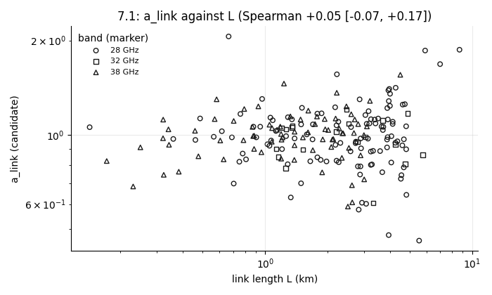
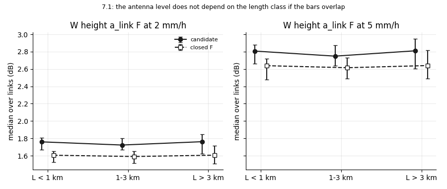
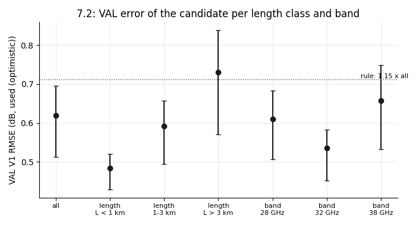
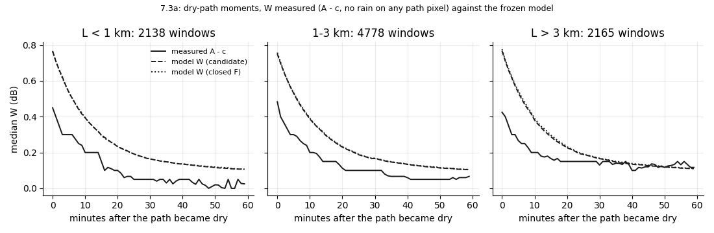
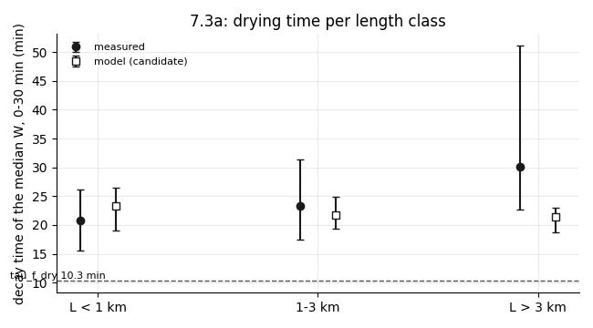
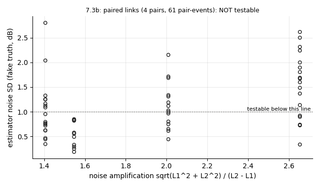
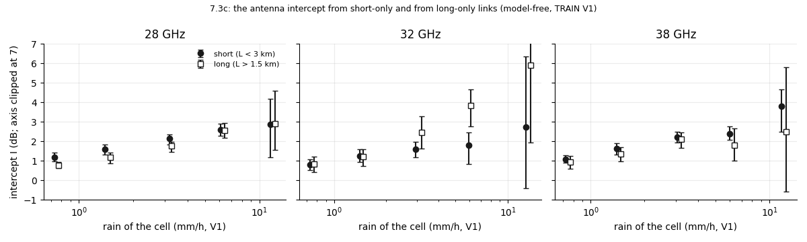
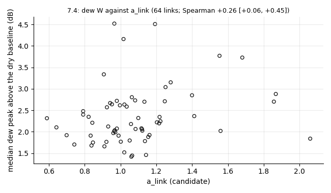
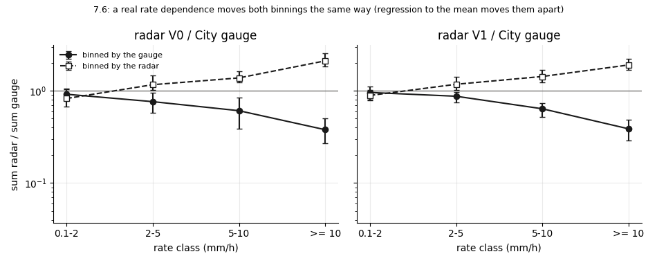

# wet_antenna step S7: validate the frozen S6 candidate without TEST

Written by `research/wet_antenna/validate_s7.py` (libraries `final_model.py`, `system_id.py`, `length_test.py`, `event_factors.py`). Every rule: `wet_antenna.validate_s7` in `research/config.yaml`, written on 2026-10-19 BEFORE the run. Plan, decisions and integrity rules: `docs/ROADMAP.md`.

**Standing rule.** WAA is never estimated by subtracting a power-law rain term. The path part is separated only through its dependence on L at matched rain, or by dry-path moments (R = 0 on the whole path). ITU-R P.838 only as a size reference. The rain correction comes from the City gauges only (g_e), never from the links. No TEST attenuation or rain was read (TEST links and events are only counted).

**Frozen object.** The S6 candidate, `research/wet_antenna/outputs/products/tighten_s6_candidate.json`, sha256 `36135658c4362397754247faf4a744dc2e6e61b6737e9bcc112c83937519d82b`. Nothing of it was refitted. VAL numbers are **used (optimistic)**.

## 1. What was run

- Data: TRAIN 9780 link-events (51 events), VAL 3250 (18 events), input V1 = radar / g_e.
- Two descriptions of F, both frozen S6 fits: **candidate** (free shared F knots, P = c_band R; the S6 plug-back 'P only') and **closed F** (F = A_band (R / 5)^b, P = c_band R; the S6 plug-back 'F and P'). The S5a free fit (band shapes) only in 7.2.
- 7.5 timing: one PySR run 16.1 s (+8.1 s start-up); projection 0.76 h for the full plan (budget 8.0 h); cuts: nothing.
- Run time: 7.4 min.

## 2. Every check, its rule and its result

| check | rule | result | verdict |
|---|---|---|---|
| 7.1 a_link against L | not (|rho| >= 0.3 and interval excludes 0) | rho +0.05 [-0.07, +0.17] | pass |
| 7.1 W height per length class | the three classes overlap pairwise at 2 and 5 mm/h | 2 mm/h: L < 1 km 1.76 [1.67, 1.81], 1-3 km 1.72 [1.67, 1.80], L > 3 km 1.76 [1.62, 1.85]; 5 mm/h: L < 1 km 2.81 [2.66, 2.88], 1-3 km 2.75 [2.64, 2.87], L > 3 km 2.81 [2.60, 2.95] | pass |
| 7.2 VAL RMSE per length class and band | each <= 1.15 x all-class VAL RMSE | L < 1 km 0.78 x, 1-3 km 0.96 x, L > 3 km 1.18 x, 28 GHz 0.98 x, 32 GHz 0.86 x, 38 GHz 1.06 x | FAIL |
| 7.2 VAL length test (candidate) | at least 4 of 6 cells | 5 of 6 | pass |
| 7.2 shared against band shapes, short VAL links | shared not worse by > 0.003 dB in any band | 28 GHz +0.0005 dB, 38 GHz -0.0027 dB | pass |
| 7.3a dry-path W, L > 3 km against L < 1 km | difference of the median errors at 10 min: interval contains 0; |median error at 10 min| <= 0.3 dB | difference -0.00 [-0.04, 0.03] dB; errors L < 1 km -0.18, 1-3 km -0.18, L > 3 km -0.18 | pass |
| 7.3b paired links | >= 5 pairs and median estimator noise <= 1 dB, else not testable | 4 pairs with common events, median noise 0.97 dB | not testable |
| 7.3c intercept short-only against long-only | intervals overlap in at least 4 of 6 cells (k of n = ceil(2 n / 3)) | 13 of 15 | pass |
| 7.3d F form (free knots against (R / 5)^0.47) | an observation inside one and outside the other | cannot tell | information |
| 7.3e c_band against ITU-R P.838 (size only) | flag a ratio outside 0.5-2 | 28 GHz 0.56, 32 GHz 0.61, 38 GHz 0.67 (at 5 mm/h) | no flag |
| 7.4 dew | >= 8 link-nights | 125 link-nights on 64 links | tested (information) |
| 7.5 leftovers (a_link, drying time) | skill > 0 and > 95 % of the null | a_link: no relation found; drying: RELATION (hint only) | RELATION |
| 7.6 radar / gauge rate dependence (V1) | high / low differs > 25 % in both binnings, same direction, intervals exclude 1 | gauge binning -57%, radar binning +88% | not found |

## 3. 7.1 W independent of L

a_link against the link metadata (Spearman of log a_link, 90 % link-bootstrap interval, BH q = 0.10; `research/wet_antenna/outputs/tables/validate_s7_alink_tests.csv`). The metadata has no antenna type, radome or mast height; a_link is one number per link, so the direction of a sub-link does not apply.

| variable | test | rho | lo | hi | p | n | bh_discovery |
|---|---|---|---|---|---|---|---|
| L_km | Spearman | 0.047 | -0.072 | 0.167 | 0.499 | 206 | False |
| frequency_ghz | Spearman | -0.0 | -0.122 | 0.122 | 0.998 | 206 | False |
| antenna_d | Spearman | 0.165 | 0.032 | 0.299 | 0.018 | 206 | False |
| abs_sin_bearing | Spearman | -0.111 | -0.216 | -0.002 | 0.111 | 206 | False |
| abs_cos_bearing | Spearman | 0.111 | 0.005 | 0.225 | 0.111 | 206 | False |
| n_radar_cells | Spearman | 0.028 | -0.102 | 0.148 | 0.688 | 206 | False |
| site (hub, 25 sites with >= 3 links) | Kruskal-Wallis |  |  |  | 0.192 | 109 | False |
| polarization (v 204, h 2 links) | information only |  |  |  |  | 206 | False |

W height a_link F (equilibrium) per length class, median over links with a 90 % link-bootstrap interval (`research/wet_antenna/outputs/tables/validate_s7_w_height.csv`):

| model | R_mmh | by | band | length | links | W_median_db | lo | hi |
|---|---|---|---|---|---|---|---|---|
| candidate | 2.0 | length | all | L < 1 km | 41 | 1.76 | 1.669 | 1.805 |
| candidate | 2.0 | length | all | 1-3 km | 103 | 1.723 | 1.667 | 1.8 |
| candidate | 2.0 | length | all | L > 3 km | 62 | 1.762 | 1.623 | 1.846 |
| candidate | 5.0 | length | all | L < 1 km | 41 | 2.807 | 2.663 | 2.879 |
| candidate | 5.0 | length | all | 1-3 km | 103 | 2.749 | 2.641 | 2.871 |
| candidate | 5.0 | length | all | L > 3 km | 62 | 2.81 | 2.603 | 2.949 |
| closed F | 2.0 | length | all | L < 1 km | 41 | 1.605 | 1.525 | 1.652 |
| closed F | 2.0 | length | all | 1-3 km | 103 | 1.591 | 1.513 | 1.653 |
| closed F | 2.0 | length | all | L > 3 km | 62 | 1.606 | 1.51 | 1.712 |
| closed F | 5.0 | length | all | L < 1 km | 41 | 2.638 | 2.479 | 2.716 |
| closed F | 5.0 | length | all | 1-3 km | 103 | 2.615 | 2.491 | 2.73 |
| closed F | 5.0 | length | all | L > 3 km | 62 | 2.64 | 2.492 | 2.815 |

**READING.** a_link does not depend on the length: rho +0.05 [-0.07, +0.17], far from the 0.3 of the rule, and the W height a_link F is the same in the three length classes (L < 1 km 2.81, 1-3 km 2.75, L > 3 km 2.81 dB at 5 mm/h, overlapping intervals; the closed F gives the same picture about 0.15 dB lower). **7.1 passes.** No variable is a BH discovery (none); nominally (interval excluding 0, BH not passed) antenna_d +0.16, abs_sin_bearing -0.11, abs_cos_bearing +0.11: larger antennas a little larger a_link, the orientation a little. These are findings, not failures, and too weak to act on (|rho| < 0.2). The metadata has no radome or antenna type.

## 4. 7.2 Short links on VAL (used (optimistic))

RMSE per class (`research/wet_antenna/outputs/tables/validate_s7_rmse.csv`); `over_all_class` = RMSE / the all-class RMSE of the same set and model; `val_over_train` for VAL:

| set | model | by | class | bins | rmse | lo | hi | over_all_class | val_over_train |
|---|---|---|---|---|---|---|---|---|---|
| TRAIN | candidate | all | all | 1892910 | 0.8123 | 0.6578 | 0.939 | 1.0 |  |
| TRAIN | candidate | length | L < 1 km | 367190 | 0.6462 | 0.5283 | 0.7515 | 0.7955 |  |
| TRAIN | candidate | length | 1-3 km | 984009 | 0.812 | 0.6632 | 0.9322 | 0.9996 |  |
| TRAIN | candidate | length | L > 3 km | 541711 | 0.9082 | 0.7185 | 1.0804 | 1.1182 |  |
| TRAIN | candidate | band | 28 GHz | 1078054 | 0.7851 | 0.6355 | 0.9157 | 0.9665 |  |
| TRAIN | candidate | band | 32 GHz | 167625 | 0.7487 | 0.5991 | 0.8797 | 0.9217 |  |
| TRAIN | candidate | band | 38 GHz | 647231 | 0.8705 | 0.7083 | 1.0015 | 1.0717 |  |
| TRAIN | candidate | rain | 0-0.1 | 1470372 | 0.5557 | 0.4064 | 0.7062 | 0.6841 |  |
| TRAIN | candidate | rain | 0.1-2 | 325163 | 1.0003 | 0.8885 | 1.0974 | 1.2314 |  |
| TRAIN | candidate | rain | 2-5 | 63230 | 1.6825 | 1.5503 | 1.789 | 2.0714 |  |
| TRAIN | candidate | rain | 5-10 | 27493 | 2.403 | 2.1934 | 2.5655 | 2.9584 |  |
| TRAIN | candidate | rain | >= 10 | 6652 | 4.4508 | 3.7968 | 4.954 | 5.4794 |  |
| VAL | candidate | all | all | 430487 | 0.6195 | 0.5122 | 0.6949 | 1.0 | 0.7627 |
| VAL | candidate | length | L < 1 km | 78881 | 0.4835 | 0.4286 | 0.521 | 0.7804 | 0.7483 |
| VAL | candidate | length | 1-3 km | 223456 | 0.592 | 0.4942 | 0.6573 | 0.9556 | 0.7291 |
| VAL | candidate | length | L > 3 km | 128150 | 0.7309 | 0.5705 | 0.8385 | 1.1798 | 0.8048 |
| VAL | candidate | band | 28 GHz | 247998 | 0.6099 | 0.506 | 0.6836 | 0.9844 | 0.7768 |
| VAL | candidate | band | 32 GHz | 39463 | 0.5354 | 0.452 | 0.5819 | 0.8643 | 0.7152 |
| VAL | candidate | band | 38 GHz | 143026 | 0.6567 | 0.533 | 0.7479 | 1.0599 | 0.7543 |
| VAL | candidate | rain | 0-0.1 | 355351 | 0.3895 | 0.3216 | 0.4376 | 0.6287 | 0.7009 |
| VAL | candidate | rain | 0.1-2 | 66683 | 1.0187 | 0.9183 | 1.0812 | 1.6444 | 1.0185 |
| VAL | candidate | rain | 2-5 | 6724 | 1.8552 | 1.6569 | 1.9774 | 2.9946 | 1.1027 |
| VAL | candidate | rain | 5-10 | 1261 | 2.6768 | 2.3779 | 3.0163 | 4.3207 | 1.1139 |
| VAL | candidate | rain | >= 10 | 468 | 4.6058 | 4.0077 | 6.1341 | 7.4344 | 1.0348 |

The closed F and the S5a free fit, all classes, for comparison:

| set | model | by | class | bins | rmse | lo | hi | over_all_class | val_over_train |
|---|---|---|---|---|---|---|---|---|---|
| TRAIN | closed F | all | all | 1892910 | 0.8127 | 0.6549 | 0.9434 | 1.0 |  |
| TRAIN | S5a free (band shapes) | all | all | 1892910 | 0.8115 | 0.6578 | 0.9363 | 1.0 |  |
| VAL | closed F | all | all | 430487 | 0.6194 | 0.5117 | 0.6948 | 1.0 | 0.7621 |
| VAL | S5a free (band shapes) | all | all | 430487 | 0.6215 | 0.5139 | 0.6973 | 1.0 | 0.7658 |

VAL V1 length test through the model (at least 4 of 6 cells):

| fit | eligible_cells | both_inside | needed | passes |
|---|---|---|---|---|
| candidate | 6 | 5 | 4 | True |
| closed F | 6 | 4 | 4 | True |

Shared shapes (candidate) against band shapes (S5a free fit) on the short VAL links (L < 1 km), RMSE in dB:

| band | link_events | bins | candidate (shared shapes) | S5a free (band shapes) | shared_minus_band_db | ok |
|---|---|---|---|---|---|---|
| 28 GHz | 257 | 36728 | 0.4632 | 0.4627 | 0.0005 | True |
| 38 GHz | 274 | 42153 | 0.5005 | 0.5032 | -0.0027 | True |

Median residual A - A_pred (dB) against the minutes after the link's last wet bin (`research/wet_antenna/outputs/tables/validate_s7_after_rain.csv`):

| after_min | TRAIN 1-3 km | TRAIN L < 1 km | TRAIN L > 3 km | VAL 1-3 km | VAL L < 1 km | VAL L > 3 km |
|---|---|---|---|---|---|---|
| 5 | -0.095 | -0.123 | -0.053 | -0.085 | -0.073 | -0.045 |
| 15 | -0.048 | -0.062 | -0.026 | -0.052 | -0.064 | -0.021 |
| 25 | -0.02 | -0.033 | -0.004 | -0.031 | -0.038 | -0.006 |
| 35 | -0.011 | -0.023 | 0.004 | -0.022 | -0.029 | -0.003 |
| 45 | -0.009 | -0.018 | 0.007 | -0.018 | -0.022 | 0.0 |
| 55 | -0.008 | -0.013 | 0.007 | -0.017 | -0.018 | -0.002 |
| 65 | -0.008 | -0.013 | 0.005 | -0.015 | -0.016 | -0.006 |
| 75 | -0.007 | -0.01 | 0.003 | -0.016 | -0.019 | -0.005 |
| 85 | -0.007 | -0.012 | -0.0 | -0.014 | -0.018 | -0.004 |
| 95 | -0.007 | -0.013 | 0.005 | -0.013 | -0.018 | -0.004 |
| 105 | -0.006 | -0.011 | 0.004 | -0.013 | -0.015 | -0.007 |
| 115 | -0.007 | -0.009 | -0.001 | -0.014 | -0.015 | -0.008 |
| 125 | -0.007 | -0.008 | -0.002 | -0.012 | -0.013 | -0.006 |
| 135 | -0.008 | -0.009 | -0.001 | -0.012 | -0.013 | -0.004 |
| 145 | -0.008 | -0.013 | -0.001 | -0.011 | -0.015 | -0.008 |
| 155 | -0.006 | -0.012 | 0.005 | -0.012 | -0.014 | -0.006 |
| 165 | -0.007 | -0.012 | 0.004 | -0.01 | -0.013 | -0.003 |
| 175 | -0.005 | -0.012 | 0.007 | -0.011 | -0.012 | -0.002 |

**READING.** The RMSE here pools all 5 min bins (the S3-S6 judge averaged per event, hence the larger numbers: VAL all classes 0.620 dB, TRAIN 0.812 dB). The written rule **fails for the long links**: VAL L > 3 km is 1.18 x the all-class RMSE (rule 1.15). It is not a VAL effect: on TRAIN the same class is 1.12 x, and every VAL length and band class is BELOW its TRAIN value (VAL / TRAIN 0.72-0.80). Long links carry a larger path term, so their absolute error in rain is larger; the rule compared absolute errors across lengths, which is the wrong yardstick for the long class, but it was written so and the check is reported as failed (it is not one of the return reasons). The short links, which this check is about, are the best class (0.78 x). The rain classes on VAL are within 1.11 x of TRAIN (information). The VAL length test passes (5 of 6; the closed F reaches exactly 4 of 6 and passes under the 2026-10-19 wording). On the short VAL links the shared shape is as good as the band shapes (28 GHz +0.0005 dB, 38 GHz -0.0027 dB; no 32 GHz link is under 1 km). After the rain the median residual is small and negative (the model a little HIGH: -0.05 to -0.12 dB in the first 10 min, -0.01 to -0.02 dB after an hour), the same on TRAIN and VAL and slightly larger on short links.

## 5. 7.3 Long links without a power law

### 7.3a Dry-path moments

Windows (path-max radar <= 0.05 mm/h on every pixel, V0 and V1, the City gauge 0 if any, after >= 10 min of V1 >= 2 mm/h in the hour before; `research/wet_antenna/outputs/tables/validate_s7_dry_windows.csv`): **9081 windows** on 206 links in 33 events.

| length | 28 GHz | 32 GHz | 38 GHz |
|---|---|---|---|
| 1-3 km | 2204 | 568 | 2006 |
| L < 1 km | 1015 | 0 | 1123 |
| L > 3 km | 1935 | 110 | 120 |

Measured W (A - c) against the model's W, median over windows, 90 % event-bootstrap intervals (`research/wet_antenna/outputs/tables/validate_s7_dry_path.csv`):

| t_min | by | band | length | windows | links | events | W_obs | W_obs_lo | W_obs_hi | W_candidate | err_candidate | err_candidate_lo | err_candidate_hi | W_closed F | err_closed F | err_closed F_lo | err_closed F_hi |
|---|---|---|---|---|---|---|---|---|---|---|---|---|---|---|---|---|---|
| 5 | length | all | L < 1 km | 2138 | 41 | 19 | 0.3 | 0.25 | 0.3 | 0.535 | -0.225 | -0.304 | -0.144 | 0.538 | -0.236 | -0.304 | -0.155 |
| 5 | length | all | 1-3 km | 4762 | 103 | 29 | 0.3 | 0.25 | 0.35 | 0.532 | -0.211 | -0.281 | -0.133 | 0.535 | -0.228 | -0.293 | -0.143 |
| 5 | length | all | L > 3 km | 2150 | 62 | 29 | 0.267 | 0.2 | 0.3 | 0.533 | -0.248 | -0.321 | -0.171 | 0.545 | -0.26 | -0.339 | -0.188 |
| 10 | length | all | L < 1 km | 1785 | 41 | 19 | 0.2 | 0.15 | 0.267 | 0.394 | -0.178 | -0.234 | -0.126 | 0.396 | -0.187 | -0.238 | -0.125 |
| 10 | length | all | 1-3 km | 3969 | 103 | 29 | 0.2 | 0.15 | 0.25 | 0.387 | -0.177 | -0.237 | -0.12 | 0.392 | -0.185 | -0.236 | -0.126 |
| 10 | length | all | L > 3 km | 1809 | 62 | 29 | 0.2 | 0.15 | 0.25 | 0.381 | -0.18 | -0.232 | -0.126 | 0.39 | -0.187 | -0.244 | -0.138 |
| 20 | length | all | L < 1 km | 1360 | 41 | 19 | 0.1 | 0.05 | 0.12 | 0.233 | -0.127 | -0.17 | -0.09 | 0.234 | -0.132 | -0.168 | -0.095 |
| 20 | length | all | 1-3 km | 3028 | 103 | 29 | 0.113 | 0.067 | 0.15 | 0.23 | -0.109 | -0.149 | -0.071 | 0.233 | -0.113 | -0.152 | -0.072 |
| 20 | length | all | L > 3 km | 1421 | 62 | 28 | 0.15 | 0.1 | 0.2 | 0.225 | -0.082 | -0.122 | -0.044 | 0.231 | -0.085 | -0.124 | -0.048 |
| 40 | length | all | L < 1 km | 994 | 41 | 17 | 0.05 | 0.0 | 0.067 | 0.136 | -0.082 | -0.115 | -0.06 | 0.137 | -0.083 | -0.119 | -0.06 |
| 40 | length | all | 1-3 km | 2278 | 103 | 27 | 0.06 | 0.05 | 0.1 | 0.134 | -0.07 | -0.093 | -0.042 | 0.135 | -0.073 | -0.096 | -0.043 |
| 40 | length | all | L > 3 km | 1068 | 61 | 26 | 0.1 | 0.06 | 0.175 | 0.134 | -0.019 | -0.068 | 0.026 | 0.138 | -0.02 | -0.069 | 0.024 |

Per band and length class (information):

| t_min | band | length | windows | W_obs | W_candidate | err_candidate | err_closed F |
|---|---|---|---|---|---|---|---|
| 5 | 28 GHz | L < 1 km | 1015 | 0.3 | 0.541 | -0.247 | -0.258 |
| 5 | 28 GHz | 1-3 km | 2200 | 0.3 | 0.499 | -0.184 | -0.197 |
| 5 | 28 GHz | L > 3 km | 1920 | 0.25 | 0.535 | -0.255 | -0.268 |
| 5 | 32 GHz | 1-3 km | 566 | 0.3 | 0.473 | -0.197 | -0.21 |
| 5 | 32 GHz | L > 3 km | 110 | 0.25 | 0.404 | -0.16 | -0.181 |
| 5 | 38 GHz | L < 1 km | 1123 | 0.3 | 0.528 | -0.21 | -0.214 |
| 5 | 38 GHz | 1-3 km | 1996 | 0.3 | 0.577 | -0.243 | -0.259 |
| 5 | 38 GHz | L > 3 km | 120 | 0.4 | 0.651 | -0.246 | -0.264 |
| 10 | 28 GHz | L < 1 km | 830 | 0.2 | 0.401 | -0.185 | -0.196 |
| 10 | 28 GHz | 1-3 km | 1791 | 0.2 | 0.369 | -0.158 | -0.162 |
| 10 | 28 GHz | L > 3 km | 1616 | 0.2 | 0.381 | -0.189 | -0.194 |
| 10 | 32 GHz | 1-3 km | 476 | 0.15 | 0.344 | -0.184 | -0.2 |
| 10 | 32 GHz | L > 3 km | 87 | 0.15 | 0.282 | -0.139 | -0.151 |
| 10 | 38 GHz | L < 1 km | 955 | 0.225 | 0.394 | -0.169 | -0.173 |
| 10 | 38 GHz | 1-3 km | 1702 | 0.227 | 0.425 | -0.195 | -0.203 |
| 10 | 38 GHz | L > 3 km | 106 | 0.3 | 0.47 | -0.123 | -0.134 |
| 20 | 28 GHz | L < 1 km | 626 | 0.058 | 0.24 | -0.141 | -0.141 |
| 20 | 28 GHz | 1-3 km | 1381 | 0.1 | 0.223 | -0.107 | -0.106 |
| 20 | 28 GHz | L > 3 km | 1275 | 0.15 | 0.226 | -0.082 | -0.087 |
| 20 | 32 GHz | 1-3 km | 353 | 0.052 | 0.192 | -0.123 | -0.128 |
| 20 | 32 GHz | L > 3 km | 66 | 0.033 | 0.175 | -0.119 | -0.124 |
| 20 | 38 GHz | L < 1 km | 734 | 0.1 | 0.224 | -0.121 | -0.12 |
| 20 | 38 GHz | 1-3 km | 1294 | 0.15 | 0.247 | -0.109 | -0.113 |
| 20 | 38 GHz | L > 3 km | 80 | 0.25 | 0.272 | -0.009 | -0.016 |
| 40 | 28 GHz | L < 1 km | 471 | 0.03 | 0.136 | -0.087 | -0.085 |
| 40 | 28 GHz | 1-3 km | 1054 | 0.05 | 0.126 | -0.074 | -0.076 |
| 40 | 28 GHz | L > 3 km | 961 | 0.1 | 0.136 | -0.023 | -0.025 |
| 40 | 32 GHz | 1-3 km | 254 | 0.009 | 0.118 | -0.091 | -0.089 |
| 40 | 32 GHz | L > 3 km | 49 | 0.0 | 0.093 | -0.077 | -0.078 |
| 40 | 38 GHz | L < 1 km | 523 | 0.05 | 0.135 | -0.077 | -0.079 |
| 40 | 38 GHz | 1-3 km | 970 | 0.1 | 0.147 | -0.064 | -0.064 |
| 40 | 38 GHz | L > 3 km | 58 | 0.2 | 0.156 | 0.082 | 0.086 |

Difference of the median error at 10 min, L > 3 km minus L < 1 km (rule: interval contains 0): candidate -0.00 [-0.04, 0.03] dB; closed F -0.00 [-0.04, 0.03] dB

Decay time of the median normalised W over 0-30 min and the share left at 40-60 min (`research/wet_antenna/outputs/tables/validate_s7_decay.csv`):

| length | windows | events | W0_median_db | tau_obs | left_40_60_obs | tau_obs_lo | tau_obs_hi | left_40_60_obs_lo | left_40_60_obs_hi | tau_candidate | left_40_60_candidate | tau_candidate_lo | tau_candidate_hi | left_40_60_candidate_lo | left_40_60_candidate_hi | tau_closed F | left_40_60_closed F |
|---|---|---|---|---|---|---|---|---|---|---|---|---|---|---|---|---|---|
| L < 1 km | 1007 | 17 | 0.925 | 20.771 | 0.196 | 15.513 | 26.126 | 0.118 | 0.263 | 23.253 | 0.215 | 19.096 | 26.416 | 0.161 | 0.269 | 22.421 | 0.207 |
| 1-3 km | 2260 | 24 | 0.95 | 23.317 | 0.175 | 17.442 | 31.295 | 0.103 | 0.261 | 21.806 | 0.197 | 19.385 | 24.881 | 0.158 | 0.243 | 21.617 | 0.193 |
| L > 3 km | 952 | 24 | 0.908 | 30.089 | 0.312 | 22.722 | 51.084 | 0.236 | 0.42 | 21.362 | 0.195 | 18.724 | 22.97 | 0.158 | 0.221 | 20.887 | 0.189 |

**READING.** 9081 dry-path windows exist (L < 1 km 2138, 1-3 km 4762, L > 3 km 2150 at 5 min; 32 GHz has none under 1 km and few above 3 km). **7.3a passes**: the model's error at 10 min is the same in every length class (L < 1 km -0.18, 1-3 km -0.18, L > 3 km -0.18 dB; L > 3 minus L < 1: -0.00 [-0.04, 0.03] dB) and below the 0.3 dB of the rule. So W measured where no rain is on the path does not depend on L, as the model assumes. But the model is HIGH by 0.2-0.3 dB right after the rain stops, in every class: the measured median W starts at about 0.45 dB where the model has about 0.75 dB (figure), and the gap closes over 20-40 min. The decay time of the normalised median curve is L < 1 km 21 [16, 26], 1-3 km 23 [17, 31], L > 3 km 30 [23, 51] min measured against about 22 min in the model (both slower than tau_f_dry = 10.3 min because the slow store and the windows with small W flatten the median curve); the share left at 40-60 min is L < 1 km 0.20, 1-3 km 0.17, L > 3 km 0.31 measured against about 0.20 in the model. The long links keep MORE water late (decay 30 min, 0.31 left), a hint that a path holding drizzle below the radar's 0.05 mm/h over 3-8 km still attenuates a little, or that the long links' antennas dry more slowly; it is not part of the rule and is reported.

### 7.3b Paired links

Link pairs with a shared site and the same band: 138; with the geometry rule (bearing within 15 deg, L2 / L1 >= 1.5, L2 - L1 >= 1 km): 4; with common events and >= 6 common rain bins: 4 pairs, 61 pair-events. Fake check (truth W = 1.5 dB, k = 0.5 dB/km, the real residual series of the two link-events): median estimator noise SD **0.97 dB** -> **NOT testable** (rule: >= 5 pairs and <= 1 dB; `research/wet_antenna/outputs/tables/validate_s7_pairs.csv`).

| set | event_id | link_short | link_long | L1_km | L2_km | rain_bins | noise_sd_db | noise_factor | W_obs_median | W_model_median |
|---|---|---|---|---|---|---|---|---|---|---|
| TRAIN | E20150605_1745 | 10048 | 10017 | 0.927 | 2.889 | 9 | 0.19 | 1.546 | 0.617 | 0.883 |
| TRAIN | E20150608_1150 | 10048 | 10017 | 0.927 | 2.889 | 7 | 0.561 | 1.546 | -0.042 | 2.403 |
| TRAIN | E20150707_1235 | 10048 | 10017 | 0.927 | 2.889 | 15 | 0.253 | 1.546 | 0.877 | 1.262 |
| TRAIN | E20150725_0440 | 10048 | 10017 | 0.927 | 2.889 | 66 | 0.835 | 1.546 | 1.098 | 2.088 |
| TRAIN | E20150810_1545 | 10048 | 10017 | 0.927 | 2.889 | 19 | 0.821 | 1.546 | 0.966 | 1.204 |
| TRAIN | E20150825_0145 | 10048 | 10017 | 0.927 | 2.889 | 20 | 0.494 | 1.546 | 2.554 | 3.237 |
| TRAIN | E20150826_0520 | 10048 | 10017 | 0.927 | 2.889 | 20 | 0.851 | 1.546 | 1.068 | 1.13 |
| TRAIN | E20150831_0455 | 10048 | 10017 | 0.927 | 2.889 | 15 | 0.332 | 1.546 | 0.202 | 1.456 |
| TRAIN | E20150605_1745 | 10069 | 10063 | 1.194 | 2.633 | 20 | 0.445 | 2.009 | 0.239 | 1.084 |
| TRAIN | E20150622_0930 | 10069 | 10063 | 1.194 | 2.633 | 17 | 1.189 | 2.009 | 1.248 | 1.8 |
| TRAIN | E20150705_1910 | 10069 | 10063 | 1.194 | 2.633 | 11 | 0.652 | 2.009 | 1.025 | 1.117 |
| TRAIN | E20150707_1235 | 10069 | 10063 | 1.194 | 2.633 | 67 | 1.338 | 2.009 | 1.175 | 1.664 |
| TRAIN | E20150725_0440 | 10069 | 10063 | 1.194 | 2.633 | 90 | 1.119 | 2.009 | 1.191 | 2.101 |
| TRAIN | E20150727_2140 | 10069 | 10063 | 1.194 | 2.633 | 62 | 2.152 | 2.009 | 1.323 | 2.546 |
| TRAIN | E20150804_1830 | 10069 | 10063 | 1.194 | 2.633 | 39 | 0.997 | 2.009 | 2.212 | 2.113 |
| TRAIN | E20150810_1545 | 10069 | 10063 | 1.194 | 2.633 | 20 | 0.616 | 2.009 | 1.372 | 1.116 |
| TRAIN | E20150815_1305 | 10069 | 10063 | 1.194 | 2.633 | 30 | 1.686 | 2.009 | 1.863 | 1.866 |
| TRAIN | E20150825_0145 | 10069 | 10063 | 1.194 | 2.633 | 50 | 0.967 | 2.009 | 3.011 | 2.939 |
| TRAIN | E20150826_0520 | 10069 | 10063 | 1.194 | 2.633 | 19 | 1.311 | 2.009 | 2.546 | 1.174 |
| TRAIN | E20150826_1620 | 10069 | 10063 | 1.194 | 2.633 | 79 | 1.714 | 2.009 | 3.258 | 2.761 |
| TRAIN | E20150831_0455 | 10069 | 10063 | 1.194 | 2.633 | 84 | 0.75 | 2.009 | 2.551 | 1.791 |
| TRAIN | E20150605_1745 | 10192 | 10064 | 2.212 | 3.902 | 19 | 0.74 | 2.654 | 0.182 | 0.435 |
| TRAIN | E20150618_0530 | 10192 | 10064 | 2.212 | 3.902 | 10 | 1.486 | 2.654 | 1.15 | 0.816 |
| TRAIN | E20150622_0930 | 10192 | 10064 | 2.212 | 3.902 | 9 | 0.923 | 2.654 | 0.938 | 0.444 |
| TRAIN | E20150705_1910 | 10192 | 10064 | 2.212 | 3.902 | 9 | 1.369 | 2.654 | 0.355 | 0.405 |
| TRAIN | E20150707_1235 | 10192 | 10064 | 2.212 | 3.902 | 56 | 1.804 | 2.654 | 0.5 | 0.678 |
| TRAIN | E20150725_0440 | 10192 | 10064 | 2.212 | 3.902 | 89 | 2.499 | 2.654 | 0.765 | 0.801 |
| TRAIN | E20150727_2140 | 10192 | 10064 | 2.212 | 3.902 | 61 | 2.615 | 2.654 | 1.386 | 1.141 |
| TRAIN | E20150804_1830 | 10192 | 10064 | 2.212 | 3.902 | 33 | 2.24 | 2.654 | 1.729 | 1.052 |
| TRAIN | E20150810_1545 | 10192 | 10064 | 2.212 | 3.902 | 10 | 0.339 | 2.654 | 0.008 | 0.452 |
| TRAIN | E20150815_1305 | 10192 | 10064 | 2.212 | 3.902 | 33 | 1.895 | 2.654 | 0.521 | 1.032 |
| TRAIN | E20150825_0145 | 10192 | 10064 | 2.212 | 3.902 | 53 | 1.69 | 2.654 | 1.96 | 1.203 |
| TRAIN | E20150826_0520 | 10192 | 10064 | 2.212 | 3.902 | 19 | 0.898 | 2.654 | 1.522 | 1.138 |
| TRAIN | E20150826_1620 | 10192 | 10064 | 2.212 | 3.902 | 77 | 1.999 | 2.654 | 1.96 | 1.165 |
| TRAIN | E20150831_0455 | 10192 | 10064 | 2.212 | 3.902 | 82 | 0.727 | 2.654 | 0.852 | 0.687 |
| TRAIN | E20150605_1745 | 10206 | 10209 | 1.127 | 4.267 | 15 | 0.622 | 1.406 | 0.423 | 0.716 |
| TRAIN | E20150608_1150 | 10206 | 10209 | 1.127 | 4.267 | 12 | 2.038 | 1.406 | 2.26 | 0.937 |
| TRAIN | E20150617_0705 | 10206 | 10209 | 1.127 | 4.267 | 66 | 1.123 | 1.406 | 1.614 | 2.006 |
| TRAIN | E20150707_1235 | 10206 | 10209 | 1.127 | 4.267 | 65 | 1.253 | 1.406 | 1.055 | 1.113 |
| TRAIN | E20150725_0440 | 10206 | 10209 | 1.127 | 4.267 | 110 | 1.328 | 1.406 | 1.371 | 1.321 |
| TRAIN | E20150727_2140 | 10206 | 10209 | 1.127 | 4.267 | 60 | 2.799 | 1.406 | 1.849 | 1.519 |
| TRAIN | E20150804_1830 | 10206 | 10209 | 1.127 | 4.267 | 37 | 0.469 | 1.406 | 1.963 | 1.494 |
| TRAIN | E20150810_1545 | 10206 | 10209 | 1.127 | 4.267 | 16 | 0.348 | 1.406 | 1.772 | 0.697 |
| TRAIN | E20150815_1305 | 10206 | 10209 | 1.127 | 4.267 | 30 | 1.089 | 1.406 | 1.259 | 1.392 |
| TRAIN | E20150825_0145 | 10206 | 10209 | 1.127 | 4.267 | 66 | 0.721 | 1.406 | 2.299 | 1.344 |
| TRAIN | E20150826_0520 | 10206 | 10209 | 1.127 | 4.267 | 15 | 0.75 | 1.406 | 2.107 | 0.808 |
| TRAIN | E20150826_1620 | 10206 | 10209 | 1.127 | 4.267 | 73 | 0.768 | 1.406 | 2.19 | 1.386 |
| TRAIN | E20150831_0455 | 10206 | 10209 | 1.127 | 4.267 | 74 | 0.796 | 1.406 | 1.78 | 1.297 |
| VAL | E20150709_1725 | 10048 | 10017 | 0.927 | 2.889 | 7 | 0.294 | 1.546 | 0.404 | 1.0 |
| VAL | E20150717_1525 | 10048 | 10017 | 0.927 | 2.889 | 12 | 0.578 | 1.546 | 0.447 | 1.186 |
| VAL | E20150709_1725 | 10069 | 10063 | 1.194 | 2.633 | 17 | 1.028 | 2.009 | 0.598 | 1.906 |
| VAL | E20150719_1205 | 10069 | 10063 | 1.194 | 2.633 | 58 | 0.803 | 2.009 | 0.706 | 1.409 |
| VAL | E20150709_1725 | 10192 | 10064 | 2.212 | 3.902 | 14 | 1.137 | 2.654 | -0.095 | 0.655 |
| VAL | E20150719_1205 | 10192 | 10064 | 2.212 | 3.902 | 50 | 1.672 | 2.654 | 0.336 | 0.518 |
| VAL | E20150722_2315 | 10192 | 10064 | 2.212 | 3.902 | 8 | 1.598 | 2.654 | -0.035 | 1.35 |
| VAL | E20150824_0330 | 10192 | 10064 | 2.212 | 3.902 | 13 | 2.313 | 2.654 | 0.951 | 0.945 |
| VAL | E20150709_1725 | 10206 | 10209 | 1.127 | 4.267 | 19 | 0.627 | 1.406 | 1.472 | 1.073 |
| VAL | E20150717_1525 | 10206 | 10209 | 1.127 | 4.267 | 12 | 0.954 | 1.406 | 1.099 | 0.889 |
| VAL | E20150719_1205 | 10206 | 10209 | 1.127 | 4.267 | 33 | 1.25 | 1.406 | 1.347 | 0.731 |
| VAL | E20150722_2315 | 10206 | 10209 | 1.127 | 4.267 | 9 | 0.445 | 1.406 | 1.374 | 1.476 |
| VAL | E20150824_0330 | 10206 | 10209 | 1.127 | 4.267 | 15 | 1.165 | 1.406 | 2.004 | 1.378 |

### 7.3c The intercept from short-only and long-only links

Model-free length test on TRAIN V1 (S3 rules) twice, with the models' own I on the same bins (`research/wet_antenna/outputs/tables/validate_s7_intercept.csv`):

| band | class | R_cell_short | links_short | I_short | I_lo_short | I_hi_short | links_long | I_long | I_lo_long | I_hi_long | I_candidate_short | I_candidate_long | I_closed F_short | I_closed F_long | overlap |
|---|---|---|---|---|---|---|---|---|---|---|---|---|---|---|---|
| 28 GHz | 0.5-1 | 0.757 | 62 | 1.172 | 0.965 | 1.43 | 81 | 0.762 | 0.64 | 0.925 | 0.981 | 0.838 | 0.939 | 0.804 | False |
| 28 GHz | 1-2 | 1.437 | 62 | 1.6 | 1.323 | 1.83 | 81 | 1.169 | 0.857 | 1.435 | 1.387 | 1.136 | 1.335 | 1.087 | True |
| 28 GHz | 2-5 | 3.289 | 62 | 2.153 | 1.848 | 2.358 | 81 | 1.772 | 1.466 | 1.987 | 2.031 | 1.719 | 1.934 | 1.654 | True |
| 28 GHz | 5-10 | 6.275 | 62 | 2.596 | 2.297 | 2.9 | 81 | 2.551 | 2.184 | 2.946 | 2.408 | 2.158 | 2.417 | 2.218 | True |
| 28 GHz | 10-20 | 11.874 | 60 | 2.873 | 1.192 | 4.178 | 74 | 2.911 | 1.553 | 4.598 | 3.035 | 2.626 | 3.359 | 2.955 | True |
| 32 GHz | 0.5-1 | 0.752 | 12 | 0.782 | 0.51 | 1.063 | 12 | 0.822 | 0.416 | 1.218 | 0.789 | 0.929 | 0.745 | 0.863 | True |
| 32 GHz | 1-2 | 1.448 | 12 | 1.257 | 0.92 | 1.592 | 12 | 1.224 | 0.736 | 1.604 | 0.937 | 1.506 | 0.882 | 1.438 | True |
| 32 GHz | 2-5 | 3.05 | 12 | 1.585 | 1.165 | 1.971 | 12 | 2.448 | 1.635 | 3.283 | 1.395 | 2.034 | 1.293 | 1.971 | True |
| 32 GHz | 5-10 | 6.121 | 12 | 1.811 | 0.849 | 2.472 | 12 | 3.83 | 2.755 | 4.665 | 1.96 | 2.647 | 1.926 | 2.701 | False |
| 32 GHz | 10-20 | 13.068 | 12 | 2.725 | -0.417 | 6.357 | 6 | 5.9 | 1.94 | 28.421 | 2.53 | 3.843 | 2.722 | 4.328 | True |
| 38 GHz | 0.5-1 | 0.746 | 70 | 1.071 | 0.893 | 1.29 | 35 | 0.951 | 0.6 | 1.259 | 0.984 | 0.932 | 0.943 | 0.897 | True |
| 38 GHz | 1-2 | 1.439 | 70 | 1.634 | 1.33 | 1.89 | 35 | 1.366 | 0.971 | 1.684 | 1.371 | 1.198 | 1.319 | 1.15 | True |
| 38 GHz | 2-5 | 3.134 | 70 | 2.213 | 1.926 | 2.481 | 35 | 2.097 | 1.666 | 2.453 | 1.997 | 1.832 | 1.908 | 1.742 | True |
| 38 GHz | 5-10 | 6.17 | 70 | 2.389 | 2.09 | 2.757 | 35 | 1.789 | 1.003 | 2.647 | 2.34 | 2.345 | 2.348 | 2.437 | True |
| 38 GHz | 10-20 | 12.03 | 65 | 3.808 | 2.497 | 4.653 | 30 | 2.485 | -0.582 | 5.787 | 3.069 | 2.845 | 3.413 | 3.066 | True |

### 7.3d Can the data tell the two F descriptions apart?

| check | n | observed | lo | hi | candidate | candidate inside | closed F | closed F inside |
|---|---|---|---|---|---|---|---|---|
| dry path after heavy rain, W at 5 min | 552 | 0.25 | 0.05 | 0.45 | 0.775 | False | 0.804 | False |
| dry path after heavy rain, W at 10 min | 464 | 0.125 | 0.0 | 0.3 | 0.584 | False | 0.596 | False |
| dry path after heavy rain, W at 20 min | 363 | 0.05 | 0.0 | 0.2 | 0.327 | False | 0.354 | False |
| intercept I, 28 GHz, 10-20 mm/h (all lengths) | 499 | 3.086 | 2.147 | 3.85 | 2.814 | True | 3.128 | True |
| intercept I, 32 GHz, 10-20 mm/h (all lengths) | 51 | 2.931 | 0.23 | 5.859 | 2.566 | True | 2.812 | True |
| intercept I, 38 GHz, 10-20 mm/h (all lengths) | 282 | 3.454 | 2.075 | 4.268 | 2.964 | True | 3.291 | True |

**READING.** **Cannot tell.** The intercepts of the 10-20 mm/h class have intervals of 1.5-6 dB and hold both descriptions in every band; the paired links are not testable. The dry-path windows after heavy rain (>= 10 min of V1 >= 10 mm/h in the hour before) reject BOTH descriptions alike: measured W 0.25 dB at 5 min, both models about 0.8 dB (0.6 at 10 min against 0.13 measured). After heavy rain the antenna is drier, sooner, than the model says, whatever the shape of F; the two shapes differ by only 0.03 dB there. This is the clearest misfit S7 found (section 11).

### 7.3e The size of P against ITU-R P.838 (size reference only, never a correction)

| band | f_ghz | c_db_km_per_mmh | R_mmh | P_candidate | ITU_P838_kR^alpha | ratio | flag |
|---|---|---|---|---|---|---|---|
| 28 GHz | 29.1865 | 0.1068 | 2.0 | 0.2137 | 0.4074 | 0.5245 | False |
| 28 GHz | 29.1865 | 0.1068 | 5.0 | 0.5342 | 0.9455 | 0.5649 | False |
| 28 GHz | 29.1865 | 0.1068 | 10.0 | 1.0683 | 1.7877 | 0.5976 | False |
| 32 GHz | 32.795 | 0.1424 | 2.0 | 0.2848 | 0.5186 | 0.5493 | False |
| 32 GHz | 32.795 | 0.1424 | 5.0 | 0.7121 | 1.1745 | 0.6063 | False |
| 32 GHz | 32.795 | 0.1424 | 10.0 | 1.4242 | 2.1798 | 0.6533 | False |
| 38 GHz | 37.324 | 0.1974 | 2.0 | 0.3948 | 0.6717 | 0.5877 | False |
| 38 GHz | 37.324 | 0.1974 | 5.0 | 0.9869 | 1.4769 | 0.6682 | False |
| 38 GHz | 37.324 | 0.1974 | 10.0 | 1.9738 | 2.6803 | 0.7364 | False |

**READING.** c_band R is 0.52-0.74 times the ITU-R P.838 size (vertical, the band's median frequency): the same order, about 0.6 of it, rising with R and with the frequency. No ratio is outside 0.5-2, so nothing is flagged; 28 GHz at 2 mm/h (0.52) is close to the edge. A path term below the ITU size is what the radar's path mean on a 2 km grid and gauge-adjusted rain would give if rain on the path is spread unevenly; it is a size reference only and corrects nothing.

## 6. 7.4 Dew

Source: `research/baseline/outputs/products/dry_jumps.csv` (baseline module, `make_dew_products.py`: the R1 C4 dry-day jumps with the SMHI GbgA weather), positive jumps of the S7 links, >= 6 h after the last wet slot, at dew risk by the baseline rule (mean RH >= 90 % or dew-point depression < 2 C): **192 jumps, 125 link-nights on 64 links** (`research/wet_antenna/outputs/tables/validate_s7_dew.csv`).

Size and timing of the dew W:

| quantity | count | mean | std | min | 25% | 50% | 75% | max |
|---|---|---|---|---|---|---|---|---|
| median_excess_db | 192.0 | 1.814 | 0.495 | 1.085 | 1.46 | 1.702 | 2.061 | 3.63 |
| peak_excess_db | 192.0 | 2.482 | 0.805 | 1.17 | 1.938 | 2.283 | 2.792 | 5.08 |
| duration_h | 192.0 | 4.363 | 1.201 | 3.0 | 3.417 | 4.0 | 5.0 | 8.333 |
| mean_rh | 192.0 | 90.876 | 1.788 | 87.667 | 88.966 | 91.551 | 92.264 | 93.952 |

Local start hour of the jumps: 0 h: 15, 1 h: 44, 2 h: 72, 3 h: 49, 4 h: 6, 5 h: 1, 7 h: 1, 23 h: 4

Same water layer? Spearman of the link's median dew peak against log a_link: +0.26 [+0.06, +0.45] (p 0.039, 64 links).

The rain W of the candidate at 0.75 mm/h (median link): 1.00 dB; its fast drying time 10.3 min.

Dew before the rain (>= 4 of the 6 hours before the link's first wet bin at dew risk, the path dry): 523 of 13030 link-events (8 events); a dew jump of the sub-link in those 6 h: 8 (`research/wet_antenna/outputs/tables/validate_s7_dew_before_rain.csv`). With minus without, within the rain class, event bootstrap (TRAIN and VAL; VAL used (optimistic)):

| definition | link_events_with | link_events_without | events_with | rmse_with_minus_without | rmse_lo | rmse_hi | bias_with_minus_without | bias_lo | bias_hi | c_db_with_minus_without | c_db_lo | c_db_hi |
|---|---|---|---|---|---|---|---|---|---|---|---|---|
| dew_before | 523 | 12507 | 8 | 0.104 | -0.016 | 0.188 | -0.056 | -0.171 | -0.016 | 0.131 | 0.05 | 0.347 |
| jump_before | 8 | 13022 | 2 | 0.691 | 0.28 | 0.953 | -0.731 | -1.015 | -0.264 | 0.937 | 0.1 | 1.45 |

**READING.** Dew is testable (125 link-nights). The dew W is LARGER than the rain W at light rain: median 1.7 dB above the dry baseline (peak 2.3 dB) against 1.0 dB for the candidate at 0.75 mm/h, and it lasts hours (median 4 h, starting between midnight and 3 h local), not the minutes of the rain drying. **Same water layer: yes, weakly**: links with a larger a_link get larger dew rises (rho +0.26 [+0.06, +0.45], 64 links), as expected if the same radome holds both. Dew before the rain is rare in these events (523 link-events in 8 events): there c is +0.13 [+0.05, +0.35] dB higher (dew water inside the pre-rain offset c), the model bias is -0.06 [-0.17, -0.02] dB (A over-predicted a little: the dew already in c is counted again as rain wetting), RMSE +0.10 [-0.02, +0.19] dB. The stricter definition (a dew jump of the sub-link) has only 8 link-events in 2 events: its large numbers are not interpretable. Dew is outside the equation; it matters through c (about 0.1 dB, at most a few tenths) and on dry nights.

## 7. 7.5 What explains the leftovers

Screening (Spearman, BH q = 0.10) and PySR on all variables (complexity <= 6), guarded by leave-one-out skill against a constant and a permutation null (`research/wet_antenna/outputs/tables/validate_s7_leftovers.csv`; per-event drying times in `research/wet_antenna/outputs/tables/validate_s7_event_drying.csv`):

| target | n | screen_discoveries | pysr_equation | complexity | loo_skill | null_q95 | null_median | shuffles | seeds | verdict |
|---|---|---|---|---|---|---|---|---|---|---|
| a_link | 206 | antenna_d, x_mid_km | (n_radar_cells * 0.057939902) * x_mid_km | 5 | 0.077 | 0.081 | 0.038 | 50 | 3 | no relation found |
| drying | 17 | wind_speed | exp(wind_speed * -0.3235411) - -2.062722 | 6 | 0.503 | 0.339 | 0.21 | 50 | 3 | RELATION (hint only) |

| target | variable | rho | p | bh_discovery |
|---|---|---|---|---|
| a_link | L_km | 0.047 | 0.499 | False |
| a_link | frequency_ghz | -0.0 | 0.998 | False |
| a_link | antenna_d | 0.165 | 0.018 | True |
| a_link | abs_sin_bearing | -0.111 | 0.111 | False |
| a_link | abs_cos_bearing | 0.111 | 0.111 | False |
| a_link | n_radar_cells | 0.028 | 0.688 | False |
| a_link | dry_noise_db | 0.134 | 0.055 | False |
| a_link | diurnal_range_db | -0.023 | 0.74 | False |
| a_link | x_mid_km | 0.218 | 0.002 | True |
| a_link | y_mid_km | 0.064 | 0.36 | False |
| drying | temperature | -0.417 | 0.096 | False |
| drying | humidity | -0.201 | 0.439 | False |
| drying | wind_speed | -0.76 | 0.0 | True |
| drying | dew_point_depression | 0.199 | 0.445 | False |
| drying | night_share | 0.245 | 0.343 | False |
| drying | local_hour | -0.022 | 0.933 | False |

Per-event drying times: 17 events with >= 5 windows; median 25.4 min (range 12.2-47.3).

**READING.** **a_link: no relation found** (the best PySR form, (n_radar_cells * 0.057939902) * x_mid_km, has a leave-one-link-out skill of 0.077, below the 95 % of the shuffled null, 0.081; the screen finds antenna diameter and the east-west position, both weak). **Drying time: a relation beats the null**: per-event decay time against the wind speed, `exp(wind_speed * -0.3235411) - -2.062722` (wind standardised), leave-one-event-out skill 0.50 against the null's 95 % 0.34; Spearman of wind against the decay time -0.76 (17 events). Windier events dry faster, which is physical (evaporation and shaking off the radome). It is a hint on 17 events with one weather station and hourly wind, and the per-event decay time also carries the rain history of the event; by the return rule it is a reason to return to S6.

## 8. 7.6 The rain reference

Radar pixel above the 10 City gauges against the gauge, 5 min, TRAIN and VAL event windows only (`research/wet_antenna/outputs/tables/validate_s7_rain_reference.csv`):

| input | binned_by | class | pairs | events | ratio | lo | hi |
|---|---|---|---|---|---|---|---|
| V0 | gauge | 0.1-2 | 2547.0 | 44.0 | 0.918 | 0.803 | 1.036 |
| V0 | gauge | 2-5 | 3093.0 | 29.0 | 0.763 | 0.576 | 0.961 |
| V0 | gauge | 5-10 | 739.0 | 23.0 | 0.609 | 0.387 | 0.842 |
| V0 | gauge | >= 10 | 307.0 | 16.0 | 0.379 | 0.269 | 0.502 |
| V0 | gauge | high / low (>= 10 against 0.1-5) |  |  | 0.473 | 0.369 | 0.6 |
| V0 | radar | 0.1-2 | 12066.0 | 41.0 | 0.826 | 0.673 | 1.05 |
| V0 | radar | 2-5 | 1859.0 | 26.0 | 1.165 | 1.014 | 1.462 |
| V0 | radar | 5-10 | 803.0 | 21.0 | 1.381 | 1.246 | 1.638 |
| V0 | radar | >= 10 | 245.0 | 14.0 | 2.113 | 1.83 | 2.553 |
| V0 | radar | high / low (>= 10 against 0.1-5) |  |  | 2.223 | 1.796 | 2.754 |
| V1 | gauge | 0.1-2 | 2547.0 | 44.0 | 0.96 | 0.796 | 1.11 |
| V1 | gauge | 2-5 | 3093.0 | 29.0 | 0.873 | 0.745 | 0.965 |
| V1 | gauge | 5-10 | 739.0 | 23.0 | 0.639 | 0.523 | 0.733 |
| V1 | gauge | >= 10 | 307.0 | 16.0 | 0.387 | 0.288 | 0.489 |
| V1 | gauge | high / low (>= 10 against 0.1-5) |  |  | 0.433 | 0.338 | 0.552 |
| V1 | radar | 0.1-2 | 11232.0 | 41.0 | 0.891 | 0.79 | 1.024 |
| V1 | radar | 2-5 | 1983.0 | 26.0 | 1.178 | 1.027 | 1.42 |
| V1 | radar | 5-10 | 1000.0 | 19.0 | 1.431 | 1.225 | 1.675 |
| V1 | radar | >= 10 | 241.0 | 15.0 | 1.907 | 1.7 | 2.231 |
| V1 | radar | high / low (>= 10 against 0.1-5) |  |  | 1.882 | 1.638 | 2.159 |

Rule on V1 (both binnings > 25 %, same direction, intervals exclude 1): gauge binning -57% (excludes 1: True), radar binning +88% (excludes 1: True) -> **no rate dependence found**.

The candidate's mean residual by V1 class:

| set | V1 class | bins | mean_residual_db | lo | hi |
|---|---|---|---|---|---|
| TRAIN | 2-5 | 63230 | 0.248 | -0.023 | 0.499 |
| TRAIN | >= 10 | 6652 | -0.119 | -1.592 | 0.897 |
| VAL | 2-5 | 6724 | 0.147 | -0.152 | 0.471 |
| VAL | >= 10 | 468 | 0.786 | -0.822 | 1.258 |

**READING.** **No rate dependence found.** Binned by the gauge, the radar reads LOW at high rates (high / low 0.43); binned by the radar, it reads HIGH (1.88): the two binnings move in OPPOSITE directions, the signature of regression to the mean between two noisy measures of a point at 5 min (a 2 x 2 km radar pixel against a gauge orifice), not of a radar error that grows with the rate. The rule asks for the same direction; it is not met, so the parked g(R) correction is NOT justified by these data. The candidate's mean residual in V1 >= 10 mm/h bins has intervals that hold 0 on TRAIN and VAL (information).

## 9. The return decision

| reason to return to S6 | met |
|---|---|
| (a) 7.1 dependence on L | False |
| (b) 7.3a or 7.3c fails | False |
| (c) 7.6 rate dependence | False |
| (d) 7.5 relation beats the null | True |

**Back to S6** (the one allowed return, to be recorded and dated) because: (d) 7.5 relation beats the null.

The return rule was written before the run; the only reason met is (d), the drying-time relation with the wind. The checks that test the candidate's structure (W independent of L: 7.1, 7.3a, 7.3c; the rain reference: 7.6) all pass. So S7 sends the work back to S6 ONCE (recorded and dated 2026-10-19 in the roadmap). What S6 would test, under the same rules: whether tau_f_dry depending on the wind (e.g. tau_f_dry = tau_0 exp(-k u), u the hourly wind) is identified on fake data, improves the model out of sample, and changes the other numbers; and, from 7.3d, why the model is about 0.5 dB high in the minutes after heavy rain. This step does NOT start it.

## 10. What S8 must check

1. Read TEST once, after a hashed freeze of whichever candidate leaves S6 (the S6 candidate hashed here if the return changes nothing).
2. The TEST length test through the model, at least 4 of 6 cells, and the TEST RMSE per length class against VAL (the S5a plan), on V1 with g_e from the TEST events' City gauges, V0 and the gauge links as the independent check.
3. The dry-path check of 7.3a on TEST: the error at 10 min per length class (and after heavy rain, where S7 found the model 0.5 dB high).
4. The long links separately: their RMSE is 1.1-1.2 x the all-class value on TRAIN and VAL (7.2).
5. If wind enters tau_f_dry in S6: the same on TEST with the TEST hours' wind; if not, the residual of the drying against the wind.

## 11. Unclear / possibly wrong

- **The RMSE rule of 7.2 failed for L > 3 km** (1.18 x) although every VAL length and band class is better than on TRAIN; the rule compared absolute errors across lengths. It is reported as failed; it is not one of the return reasons.
- **After heavy rain the model is about 0.5 dB too high** in the first 10 min of dry path (7.3d), for both F descriptions, and about 0.2 dB high after ordinary rain (7.3a). The fast store may dry faster after heavy rain than tau_f_dry = 10.3 min, or F above 10 mm/h is too high (F there rests on 0.4 % of the minutes), or the radar marks the path dry a little late. Not separable here.
- **The long links keep more water late** in dry-path windows (7.3a); drizzle below 0.05 mm/h per pixel over a long path is possible.
- **The drying relation** rests on 17 events, one station, hourly wind, and decay times of pooled windows (which also carry each event's rain history); the permutation null guards against chance in the procedure, not against a confounder such as storm type.
- **The a_link relation** missed the null by a hair (skill 0.077 against 0.081); it is reported as none.
- **Dew before the rain** is rare here (8 events); the stricter definition (2 events) is not interpretable.
- **Paired links**: only 4 pairs meet the geometry, so 'not testable' (the noise, 0.97 dB, would have just passed).
- **Windows are not independent**: both directions of a link and neighbouring links share an event; every interval resamples events.
- **VAL has been used for decisions** since S3; its numbers here are optimistic.
